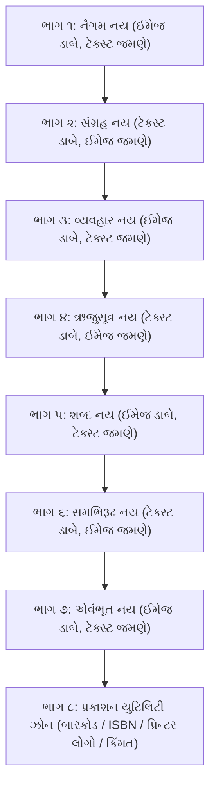

# 'નય પ્રકાશ' — બેક કવર નિર્માણ કાર્યયોજના (Updated 8-Zone Layout Plan)

આ કાર્યયોજના પુસ્તકના પાછલા કવર (Back Cover) ના સમગ્ર માળખા, ૮-વિભાગીય લેઆઉટ ગ્રીડ, ફાઇનલ મંજૂર થયેલા ટેક્સ્ટ અને કોરલ ડ્રો / ઇલસ્ટ્રેટર હેન્ડઓફ માટેની પૂર્ણ રૂપરેખા છે.

---

## 📐 ૮-વિભાગીય લેઆઉટ રચના (8-Zone Vertical Grid Structure)

બેક કવરને ઊભી રીતે (Vertically) **૮ સમાન સંતુલિત ભાગોમાં** વહેંચવામાં આવશે:

> [!IMPORTANT]
> **ભાગ ૮ (બોટમ ઝોન):** આ છેલ્લો ભાગ શાસ્ત્રીય ટેક્સ્ટથી મુક્ત અને સ્વચ્છ (Clean Canvas) રખાશે, જેથી CorelDRAW અથવા Illustrator માં ત્યાં ISBN બારકોડ, પ્રકાશન સંસ્થાનો લોગો, મૂલ્ય (MRP) અને મુદ્રકની વિગતો સરળતાથી બેસાડી શકાય.

---

## 📜 ફાઇનલાઇઝ્ડ શાસ્ત્રોક્ત ટેક્સ્ટ (ભાગ ૧ થી ૭)

આ ટેક્સ્ટ વાર્તાના મૂળ રસ અને શાસ્ત્રોક્ત સ્યાદ્વાદ-સાપેક્ષતાના સંપૂર્ણ સંતુલન સાથે મંજૂર કરવામાં આવ્યું છે:

### ભાગ ૧: નૈગમ નય
- **ઈલ્યુસ્ટ્રેશન પ્લેસમેન્ટ:** ડાબી બાજુ *(પ્રાચીન શાળા અને સંકલ્પ-શિલા)*
- **પીપાસા (વાર્તા):** *એક અધ્યાપક જૂની પાઠશાળાના જીર્ણોદ્ધારને “આપણી શાળાનો પુનર્જન્મ” કહે છે; બીજા અધ્યાપક નવા ભવનમાં આસનો ગોઠવતાં કહે છે, “આજે શાળાનો આરંભ થયો.” જિજ્ઞાસુ પૂછે છે, “ઉદ્ઘાટન તો હવે પછી છે, તો આમાં સત્ય કયું?”*
- **પાન (બોલ્ડ નય):** **નૈગમ નય — સ્થાપનામાં અતીત, આસનો ગોઠવવાની પ્રવૃત્તિમાં વર્તમાન સંકલ્પ અને ઉદ્ઘાટનમાં ભાવી નજરે ચડે છે; નૈગમ નય આ ત્રણેય કાળને એક જ દ્રવ્યસાતત્યના તાંતણે પરોવી જીવનના સાર્થક પ્રયોજનનો સાક્ષાત્કાર કરાવે છે.**

---

### ભાગ ૨: સંગ્રહ નય
- **ઈલ્યુસ્ટ્રેશન પ્લેસમેન્ટ:** જમણી બાજુ *(વગડો, પશુ-પંખી અને અખંડ પ્રવાહ)*
- **પીપાસા (વાર્તા):** *વિદ્યાર્થી વગડામાં મનુષ્ય, વૃક્ષ, પક્ષી, પથ્થર અને ઘડો જુએ છે. તે આશ્ચર્યથી પૂછે છે, “આ બધાં બહારથી આટલાં ભિન્ન અને વિખરાયેલાં છે, છતાં જ્ઞાનીઓ આ બધાંને એક અખંડ સત્યમાં કેવી રીતે જુએ છે?”*
- **પાન (બોલ્ડ નય):** **સંગ્રહ નય — “સમસ્ત વિશ્વ છે” એવો અસ્તિત્વનો સ્વીકાર પરસંગ્રહની સત્તા-એકતા છે, જ્યારે મનુષ્ય, વૃક્ષ કે પંખીને “ચૈતન્ય જીવ” તરીકે ઓળખવા એ અપરસંગ્રહની જાતિ-એકતા છે; સંગ્રહ નય બાહ્ય ભેદોથી પર થઈને સમગ્ર વિશ્વમાં વહેતી એક અખંડ સત્તાનો સાક્ષાત્કાર કરાવે છે.**

---

### ભાગ ૩: વ્યવહાર નય
- **ઈલ્યુસ્ટ્રેશન પ્લેસમેન્ટ:** ડાબી બાજુ *(કુંભારનો ચાકડો અને વિવિધ મૃદ્-પાત્રો)*
- **પીપાસા (વાર્તા):** *ગ્રાહક કુંભાર પાસે જઈને કહે છે, “જો બધું જ માટીનું બનેલું છે, તો પછી તેલ ભરવા માટે હું કોઈપણ પાત્ર લઈ જાઉં?” કુંભાર હસીને કહે છે, “ના, તેલ માટે સાંકડા મોંવાળી કૂંડી જોઈએ અને જળ માટે ગોળ ઘડો!” ગ્રાહક વિચારે છે, “બંને શબ્દો માટી સાથે જોડાયેલા છે, તો આ ભેદ શા માટે?”*
- **પાન (બોલ્ડ નય):** **વ્યવહાર નય — દ્રવ્યરૂપે માટી એક હોવા છતાં ઘડો, કૂંડી કે દીપકનાં પ્રયોજન અને કાર્ય જુદાં છે; ‘ગોળ’ આકાર દર્શાવે છે અને ‘માટી’ ઉપાદાનનો સંબંધ બતાવે છે. વ્યવહાર નય અખંડ સત્યને જીવનના આચાર અને સાધનાના વ્યવહારુ પગથિયાંમાં વિભાજિત કરી મોક્ષમાર્ગનો સુગમ સેતુ રચે છે.**

---

### ભાગ ૪: ઋજુસૂત્ર નય
- **ઈલ્યુસ્ટ્રેશન પ્લેસમેન્ટ:** જમણી બાજુ *(માટીનો દીપક અને પવનમાં લહેરાતી જ્યોતિ)*
- **પીપાસા (વાર્તા):** *મંદિરમાં માટીનો દીવો અવિરત બળે છે. અચાનક પવનની લહેરખી આવતાં જ્યોત સહેજ નમીને નવો વળાંક લે છે. શિષ્ય પૂછે છે, “દીવો તો એ જ રહ્યો, છતાં જ્યોત બદલાઈ ગઈ! આમાં દીવાનું સાચું અસ્તિત્વ કયું — એનું સ્થિર રહેવું કે જ્યોતનું બદલાવું?”*
- **પાન (બોલ્ડ નય):** **ઋજુસૂત્ર નય — દીપકની દીર્ઘ સ્થિરતા એ સ્થૂળ વર્તમાન છે, જ્યારે ક્ષણે ક્ષણે જૂનો પર્યાય વિલીન થઈ નવો પર્યાય પ્રગટવો એ સમયવર્તી સૂક્ષ્મ સત્ય છે; ઋજુસૂત્ર નય અતીત અને ભાવીના સઘળા ભારને ખંખેરી માત્ર આજ ક્ષણે ધબકતી જીવંત ઋજુતામાં આત્માને સ્થિર કરે છે.**

---

### ભાગ ૫: શબ્દ નય
- **ઈલ્યુસ્ટ્રેશન પ્લેસમેન્ટ:** ડાબી બાજુ *(શ્રુતજ્ઞાનની મુદ્રા અને ધ્વનિ-તરંગો)*
- **પીપાસા (વાર્તા):** *પાઠશાળામાં નવો વિદ્યાર્થી બોલે છે, “બાળક આવ્યો અને તે દીવા પ્રગટાવ્યા.” વિદ્વાન ગુરુ સ્મિત સાથે પૂછે છે, “બાળક આવ્યો કે બાળક આવ્યું? દીવો પ્રગટાવ્યો કે દીવા? માત્ર શબ્દોના આટલા ભેદથી અર્થમાં ખરેખર શો ફરક પડે?”*
- **પાન (બોલ્ડ નય):** **શબ્દ નય — ‘આવ્યો-આવ્યું’માં લિંગ, ‘દીવો-દીવા’માં વચન અને ‘પ્રગટાવ્યો-પ્રગટાવ્યા’માં કાળની વિસંગતિ દૂર થાય છે; ‘બાળકે’ કર્તાનું સ્થાન અને ‘દીવાથી’ કરણનું સાધન બતાવે છે. શબ્દ નય વ્યાકરણના સૂક્ષ્મ વિવેક દ્વારા વાણીને વિકારમુક્ત બનાવી પરમ સત્યનું નિર્દોષ વાહક બનાવે છે.**

---

### ભાગ ૬: સમભિરૂઢ નય
- **ઈલ્યુસ્ટ્રેશન પ્લેસમેન્ટ:** જમણી બાજુ *(નિર્મળ જળમાં ખીલેલું પંકજ-કમળ)*
- **પીપાસા (વાર્તા):** *સરોવરની પાળે ઊભેલો જિજ્ઞાસુ પૂછે છે, “આ પુષ્પને આપણે કમળ કહીએ છીએ, કવિઓ ક્યારેક પંકજ તો ક્યારેક જલજ કહે છે. જ્યારે ફૂલ એક જ છે, ત્યારે આટલાં બધાં નામો પાછળ કયો ગૂઢ ભેદ રહેલો છે?”*
- **પાન (બોલ્ડ નય):** **સમભિરૂઢ નય — પુષ્પ એક જ છે, પરંતુ ‘પંકજ’ કાદવમાંથી જન્મવાનો અને ‘જલજ’ જળમાંથી પ્રગટવાનો વિશિષ્ટ ભાવ વ્યક્ત કરે છે; વ્યુત્પત્તિ બદલાતાં અર્થનું નવું પાસું ખૂલે છે. સમભિરૂઢ નય પર્યાયવાચી શબ્દો વચ્ચે રહેલા સૂક્ષ્મ ભાવભેદને પ્રગટ કરી જ્ઞાનની પારદર્શિતાને ચરમ સીમાએ પહોંચાડે છે.**

---

### ભાગ ૭: એવંભૂત નય
- **ઈલ્યુસ્ટ્રેશન પ્લેસમેન્ટ:** ડાબી બાજુ *(રસોઈકર્મમાં પૂર્ણ તન્મય રસોઈયો)*
- **પીપાસા (વાર્તા):** *વિદ્યાર્થી રસોઈયાને ક્યારેક વિશ્રામ કરતા, વાતો કરતા અને ક્યારેક ચૂલા સામે શાક હલાવતાં જુએ છે. તે પૂછે છે, “એ માણસ બંને વખતે ‘રસોઈયો’ કહેવાય, તો શાસ્ત્ર પ્રમાણે આ બે ક્ષણો વચ્ચે શો વિરોધ છે?”*
- **પાન (બોલ્ડ નય):** **એવંભૂત નય — ભૂતકાળના અનુભવ કે ભવિષ્યની ક્ષમતાની અપેક્ષાએ તે બંને વખતે રસોઈયો ઓળખાય એ વ્યવહારની સત્યતા છે; જ્યારે શબ્દ જે મૂળ ક્રિયામાંથી જન્મ્યો છે, તે જ ક્રિયારૂપે પરિણમતી વર્તમાન અવસ્થાને ગ્રહણ કરવી એ એવંભૂત નયની સૂક્ષ્મ અપેક્ષા છે. એવંભૂત નય શબ્દ અને સાક્ષાત્ ક્રિયાનું પૂર્ણ ઐક્ય સ્થાપે છે.**

---

### ભાગ ૮: બારકોડ & લોગો યુટિલિટી ઝોન (ખાલી અનામત)
- **સ્થાન:** પાનાના તળિયે (Bottom Footer Zone)
- **રચના:** 
  - ડાબી બાજુ: પ્રકાશન સંસ્થાનું નામ, વેબસાઈટ, મુદ્રક વિગત.
  - મધ્ય/જમણી બાજુ: ISBN બારકોડ અને કિંમત (MRP).
  - બેકગ્રાઉન્ડ: કેનવાસનો શુદ્ધ નેવી ઈન્ડિગો કલર જે બારકોડના શ્વેત બોક્સને આકર્ષક કોન્ટ્રાસ્ટ આપશે.

---

## 🎨 આર્ટવર્ક અને ગ્રાફિક્સ નિર્માણ પગલાં

1. **બેક કેનવાસ:** અગ્ર કવર જેવું જ ડીપ રોયલ ઈન્ડિગો + મિડનાઇટ સ્પેસ ટેક્સ્ચર ધરાવતી હાઈ-રિઝોલ્યુશન બેઝ ફાઇલ.
2. **૭ સુવર્ણ મિનિએચર્સ:** ડાર્ક બેકગ્રાઉન્ડમાં ઓગળી જતી સોનેરી આભા (Soft Golden Glow Vignette) વાળા ૭ ડિજિટલ ચિત્રો.
3. **CorelDRAW / Illustrator ફાઈલ પેકેજ:** તમામ લેયર્સ (Background, 7 Vignettes, Typography Grid) નું સુવ્યવસ્થિત વિભાજન.
