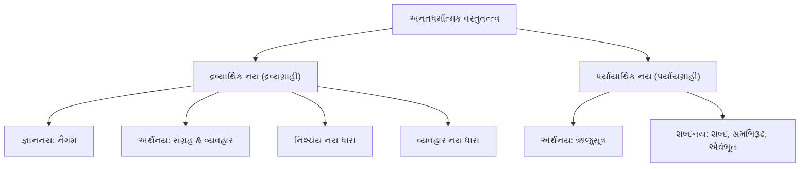
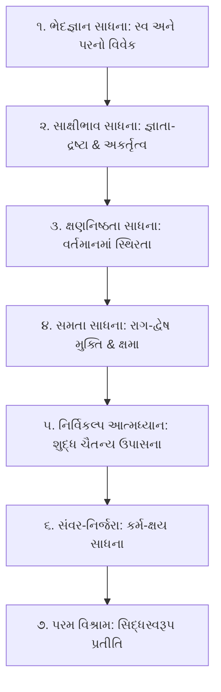

# નયચક્ષુ
### નયનું જ્ઞાન, સંશયનું સમાધાન

---

## મંગલાચરણ

```
ણમો અરિહંતાણં, ણમો સિદ્ધાણં, ણમો આયરિયાણં।
ણમો ઉવજ્ઝાયાણં, ણમો લોએ સવ્વસાહૂણં।।

અનેકાંતમયી મૂર્તિઃ સત્યા સત્યવિભાવિની।
નયપ્રકાશિકા ભૂયાજ્જિનેન્દ્રવદનામ્બુજાત્।।
```

---

# પ્રસ્તાવના : નયચક્ષુ
### નયનું જ્ઞાન, સંશયનું સમાધાન
#### (અનંત સત્યની અખંડ યાત્રા અને દ્રષ્ટિ-વિજ્ઞાનનો પરમ ઉન્મેષ)

---

### ૧. મંગલ પ્રવેશ : સત્યની અનંતતા અને માનવ-ચિત્તની સીમા

આ બ્રહ્માંડમાં વિદ્યમાન પ્રત્યેક પદાર્થ રહસ્યોનો અસીમ મહાસાગર છે. જૈન દર્શનના જ્ઞાનમીમાંસકોએ સત્યનું અતિ ગહન અને ગૌરવપૂર્ણ લક્ષણ બાંધતાં કહ્યું છે — **‘અનંતધર્માત્મકં વસ્તુ’** — અર્થાત્ જગતનો પ્રત્યેક પદાર્થ અનંત ધર્મો, અનંત ગુણો અને અનંત આયામોને પોતાની ભીતરમાં સમાવીને બેઠો છે. તે નિત્ય પણ છે અને અનિત્ય પણ છે; તે એક પણ છે અને અનેક પણ છે; તે સત્ પણ છે અને અપેક્ષાએ અસત્ પણ છે. 

પરંતુ, અસીમ અનંતતાની સામે ઊભેલા માનવ-ચિત્તની ગ્રહણશક્તિ સસીમ છે, મર્યાદિત છે. માનવી એક સમયે, એક સ્થળેથી, એક જ દ્રષ્ટિકોણ દ્વારા સત્યના એકાદ અંશને જ પકડી શકે છે. જગતમાં ક્યારેય અસત્યનો એટલો મોટો ત્રાસ રહ્યો નથી જેટલો **‘અંશ-સત્યને જ સમગ્ર સત્ય માની બેસવાના અહંકાર’**નો રહ્યો છે. જ્યારે અપૂર્ણ દર્શન પોતાના પૂર્ણ હોવાનો દાવો કરે છે, ત્યારે સંસારમાં વૈચારિક અંધાધૂંધી, કલહ અને દુરભિનિવેશ સર્જાય છે. 

આ વૈચારિક સંઘર્ષના દાવાનળમાં શીતળ ચંદન બનીને પ્રગટે છે — **ભગવાન મહાવીરનું પ્રજ્ઞા-દર્શન : અનેકાંતવાદ.** અનેકાંત એ કોઈ વાદ કે સંપ્રદાય નથી, પણ વસ્તુસ્થિતિનું યથાતથ દર્શન છે; એ સમગ્ર બ્રહ્માંડને તેની સમસ્ત વિરોધાભાસી વિવિધતા સાથે સહજ ભાવે સ્વીકારવાની અપરંપાર ઉદારતા છે.

---

### ૨. અભિવ્યક્તિના બે દિવ્ય રાજમાર્ગ : સ્યાદવાદ અને નય શૈલી

અનેકાંત એ અંતસ્તત્ત્વની વાસ્તવિકતા છે. પરંતુ આ ગહન અનેકાંતને જ્યારે જ્ઞાન અને ભાષામાં ઉતારવો હોય, ત્યારે જૈન દર્શને માનવજાતને બે પરમ અનુપમ ચિંતન-શૈલીઓ ભેટ આપી છે: **સ્યાદવાદ શૈલી** અને **નય શૈલી.**

પ્રથમ છે — **સ્યાદવાદ શૈલી.** સ્યાદવાદ એ વાણીનું પરમ શૃંગાર અને વાચિક અહિંસાની ચરમસીમા છે. સ્યાદવાદ એટલે ‘સ્યાત્’ (કથંચિત્ — અમુક અપેક્ષાએ) મુદ્રા સાથે સત્યની રજૂઆત. જ્યારે બોલનારો કોઈ પદાર્થનું કથન કરે છે, ત્યારે સ્યાદવાદ શબ્દની આગળ એક અદૃશ્ય કરુણા અને સાપેક્ષતા મૂકી આપે છે કે — "હું જે કહી રહ્યો છું તે અમુક વિશિષ્ટ દ્રષ્ટિકોણથી સર્વથા યોગ્ય છે, પરંતુ તે જ સર્વસ્વ નથી." સ્યાદવાદ અખંડ સત્યને વાણી દ્વારા આદરપૂર્વક પ્રરૂપે છે; તે સમગ્ર વસ્તુને અખંડ રાખીને તેને સ્પર્શવાનો પ્રયાસ કરે છે, તેથી તે ‘સકલદેશી’ અભિવ્યક્તિ છે.

પરંતુ, વાણીમાં સ્યાદવાદ ઊતરે તે પહેલાં બુદ્ધિ અને ચેતનામાં સત્યનું યથાર્થ પૃથક્કરણ થવું અનિવાર્ય છે. આ પૃથક્કરણનું સામર્થ્ય પ્રગટાવે છે — **નય શૈલી.**

**નય એટલે શું?**  
*‘જ્ઞાતુરભિપ્રાયો નયઃ’* — અનંતધર્માત્મક પદાર્થમાંથી જ્ઞાતા પોતાના કોઈ ચોક્કસ પ્રયોજન કે દ્રષ્ટિકોણ અનુસાર તેના કોઈ એક ધર્મને મુખ્ય (પ્રધાન) ગણે અને બાકીના ધર્મોનો ઇનકાર કર્યા વિના તેમને ગૌણ રાખે, તે જ્ઞાતાના વિચારવિશેષને ‘નય’ કહેવાય છે. 

જો સ્યાદવાદ સમુદ્રની વિશાળતાને સમેટી લેતો અવાજ છે, તો નય એ સમુદ્રના પ્રત્યેક મોજાંની આગવી લયને માપતી અચૂક પારાશીશી છે. સ્યાદવાદ વાણીનું રક્ષણ કરે છે, જ્યારે નય દ્રષ્ટિનું નિર્માણ કરે છે. નય વિના સ્યાદવાદ નિરાધાર બની જાય છે અને સ્યાદવાદ વિના નય લૂલો થઈ જાય છે. તેથી જ, જ્ઞાનના વિરાટ ભવનમાં પ્રવેશવા માટે નય શૈલી એ અનિવાર્ય સોપાન છે.

---

### ૩. નય-વિહીનતાની કરુણાંતિકા : અંધકાર, દુરાગ્રહ અને ભયંકર ગફલતો

જો માનવજાત પાસે નય-દ્રષ્ટિ ન હોય તો કેવાં પરિણામો આવે? 

શાસ્ત્રોમાં અંધજનો અને હાથીનું જાણીતું રૂપક આવે છે. જેણે કાન પકડ્યો તેણે કહ્યું "હાથી સૂપડા જેવો છે"; જેણે પગ પકડ્યો તેણે કહ્યું "હાથી થાંભલા જેવો છે"; જેણે પૂંછડી પકડી તેણે કહ્યું "હાથી દોરડા જેવો છે." સમસ્યા એ નહોતી કે તેઓ ખોટું બોલતા હતા — સમસ્યા એ હતી કે તેઓ પોતાના સ્પર્શેલા આંશિક સત્યને જ ‘પરમ સત્ય’ માનીને પરસ્પર લાઠીઓ લઈને લડી મર્યા! 

આ રૂપક માત્ર અંધજનોનું નથી, એ નય-વિહીન માનવ-ઇતિહાસનું દર્પણ છે. નયના જ્ઞાન વિના મનુષ્ય કેવી ગફલતો કરે છે?

1. **એકાંતવાદનો વિષધર :** જ્યારે વ્યક્તિ પોતાના એક જ દ્રષ્ટિબિંદુને પકડી રાખે છે અને બીજાના દ્રષ્ટિકોણનો નિષેધ કરે છે, ત્યારે 'નય' ભ્રષ્ટ થઈને **'દુર્નય'** કે **'નયાભાસ'** બની જાય છે. આ નયાભાસ મનુષ્યમાં કટ્ટરતા, અહંકાર અને મિથ્યા હઠાગ્રહ જન્માવે છે.
2. **સંબંધો અને સમાજમાં વૈચારિક વિખવાદ :** ઘરમાં, સમાજમાં કે રાષ્ટ્રો વચ્ચે ચાલતા મોટાભાગના સંઘર્ષો અસત્યને કારણે નથી, પણ પોતપોતાના અંશ-સત્યના ઘમંડને કારણે છે. "હું જ સાચો છું" એ માન્યતા હજારો યુદ્ધો અને કલહોનું જનની છે; જ્યારે નય સમજાવે છે કે "હું આ અપેક્ષાએ સાચો છું, અને સામી વ્યક્તિ તે અપેક્ષાએ સાચી છે."
3. **આધ્યાત્મિક માર્ગમાં પતન અને વિતંડા :** નયના વિવેક વિના સાધક શાસ્ત્રાર્થોમાં અટવાઈ જાય છે. કોઈ દ્રવ્યને જ પકડીને નિષ્ક્રિય બેસી રહે છે, તો કોઈ માત્ર ક્ષણિક પર્યાયમાં અટવાઈને પોતાના શાશ્વત આત્મતત્ત્વને ભૂલી જાય છે. પદાર્થનો પ્રત્યેક પર્યાય ક્ષણે ક્ષણે બદલાતો રહે છે — આ પર્યાયાર્થિક સત્ય ન સમજાય તો જીવ શોક અને મોહમાં ડૂબે છે; અને તે પર્યાયની પાછળ રહેલું ધ્રુવ દ્રવ્ય ન સમજાય તો જીવ ઉચ્છેદવાદમાં ધકેલાઈ જાય છે.

નયનું અજ્ઞાન એ માત્ર બૌદ્ધિક ત્રુટિ નથી; એ જીવનને સંકુચિત, કઠોર, શુષ્ક અને કલહગ્રસ્ત બનાવી દેતો મહારોગ છે.

---

### ૪. નય-પ્રદીપનો પ્રભાવ : વિશ્વદ્રષ્ટિઓનો મહાસમન્વય અને પરમ પ્રજ્ઞા

પરંતુ, ક્ષણવાર કલ્પના કરો કે જ્યારે જીવનમાં નય-દ્રષ્ટિનો સૂર્યોદય થાય ત્યારે કેવો ચમત્કાર સર્જાય છે!

નય-દ્રષ્ટિ સાંપડતાં જ વ્યક્તિના ચિત્તમાંથી પૂર્વગ્રહોનાં જાળાં એક ઝાટકે સાફ થઈ જાય છે. નય એવો દિવ્ય પારસમણિ છે જે વિરોધી દેખાતા વિચારોને પણ સમન્વયના સુવર્ણમાં ફેરવી નાખે છે.
- નય શીખવે છે કે વિરોધ એ વસ્તુમાં નથી, આપણી દ્રષ્ટિના ખૂણામાં છે.
- જગતના તમામ પ્રાચીન અને અર્વાચીન દર્શનો — પછી તે અદ્વૈત વેદાંતની નિત્યતા હોય, બૌદ્ધ દર્શનનો ક્ષણિક પર્યાયપ્રવાહ હોય, સાંખ્યનો પરિણામવાદ હોય, ન્યાય-વૈશેષિકનો ભેદવાદ હોય, કે પશ્ચિમના આધુનિક દાર્શનિકોનું ચિંતન હોય — આ તમામેતમામ વાદો નય-ચક્ષુથી જોતાં કોઈ શત્રુઓ નથી લાગતા, પણ એ પરમ સત્યના જુદા જુદા નયોના પ્રતિનિધિઓ ભાસે છે!

નય પ્રાપ્ત થતાં જ મનુષ્યનો અહંકાર ઓગળી જાય છે અને ત્યાં પ્રગટે છે અનંત કરુણા, અસીમ મૈત્રી અને પરમ સહિષ્ણુતા. નય તમને સામા માણસના સ્થાને ઊભા રહીને વિચારવાની એવી અદ્ભુત સહાનુભૂતિ (Empathy) બક્ષે છે કે તમારા જીવનમાંથી કડવાશ અને ફરિયાદ કાયમ માટે અસ્ત થઈ જાય છે. આ માત્ર દાર્શનિક સિદ્ધાંત નથી, પણ દૈનંદિન વ્યવહારમાં પરમ શાંતિ અને સંવાદિતા પામવાની સર્વોચ્ચ કળા છે.

---

### ૫. નયના પ્રકારોની વિશ્લેષકતા : સત્યને ખોળવાની સૂક્ષ્મ લેબોરેટરી

નય એ માત્ર સામાન્ય ખ્યાલ નથી, એ જ્ઞાનનું સૂક્ષ્માતિસૂક્ષ્મ વિજ્ઞાન છે. જૈન તત્ત્વજ્ઞાનમાં નયોનું જે વૈવિધ્યપૂર્ણ વર્ગીકરણ કરવામાં આવ્યું છે, તે માનવ-મગજની પૃથક્કરણ શક્તિની ચરમસીમા છે:
- **દ્રવ્યાર્થિક નય** વસ્તુના સ્થિર, અવિનાશી, સામાન્ય અને આંતરિક સત્-તત્ત્વને જુએ છે — જે જીવનને સ્થિરતા, આશ્વાસન અને આત્મવિશ્વાસ આપે છે.
- **પર્યાયાર્થિક નય** વસ્તુના બદલાતા, વહેતા, વિશેષ અને ક્ષણવર્તી રૂપને પકડે છે. એક પર્યાય પૂરો થયો અને બીજો નવો પર્યાય પ્રગટ થયો — આ પ્રવાહનું વિશ્લેષણ કરીને તે જીવનને સજગતા, પરિવર્તનશીલતા અને વર્તમાનમાં જીવવાની તાજગી આપે છે.
- સ્થૂળ દ્રષ્ટિથી માંડીને સૂક્ષ્મતાના શિખરે પહોંચાડતા નૈગમ, સંગ્રહ, વ્યવહાર, ઋજુસૂત્ર, શબ્દ, સમભિરૂઢ અને એવંભૂત સુધીના નયો માનવ-ચેતનાને સંકલ્પથી લઈને શબ્દના અર્થ અને ક્રિયાની પરમ એકાગ્રતા સુધી લઈ જાય છે.

જ્યારે કોઈ જિજ્ઞાસુ આ નયોના વિશ્લેષણાત્મક વૈભવમાં ડૂબકી મારે છે, ત્યારે તેને પ્રતીતિ થાય છે કે સંસારનો કોઈપણ વ્યવહાર, શાસ્ત્રનું કોઈપણ રહસ્ય કે મનની કોઈપણ ગૂંચવણ એવી નથી જેને આ નય-વિજ્ઞાન ક્ષણવારમાં ઉકેલી ન શકે! નય એ સત્યની પ્રયોગશાળાનું એવું સૂક્ષ્મદર્શક યંત્ર (Microscope) છે, જે સૂક્ષ્મમાં સૂક્ષ્મ ભ્રમને પણ છતો કરી દે છે.

---

### ૬. શા માટે 'નયચક્ષુ' ગ્રંથ જીવનમાં અનિવાર્ય છે?

આ પૃષ્ઠભૂમિ પર રચાયેલો આ ગ્રંથ — **‘નયચક્ષુ : નયનું જ્ઞાન, સંશયનું સમાધાન’** — એ માત્ર અક્ષરોનો મેળાવડો નથી, પણ માનવજાત માટે દ્રષ્ટિની એક નવી આંખનું પ્રાગટ્ય છે.

અત્યાર સુધી જૈન પરંપરામાં નયોની ચર્ચા ગૂઢ, શુષ્ક, અતિ-પારિભાષિક અને સામાન્ય વાચક માટે અગમ્ય રહી હતી. સામાન્ય જન તો ઠીક, ઊંડા અભ્યાસીઓ પણ ગણ્યા-ગાંઠ્યા નયોથી આગળ વધી શકતા નહોતા. પરંતુ આ ગ્રંથની અંદર સમગ્ર નય-સાહિત્યના ગહન સમુદ્રનું મંથન કરીને **૨૦૩ નયોનું એવું સર્વવ્યાપી, વ્યવસ્થિત, વિશિષ્ટ અને અજોડ સંકલન** કરવામાં આવ્યું છે, જે ચિંતન-સાહિત્યના સમગ્ર ઇતિહાસમાં સર્વથા અભૂતપૂર્વ છે.

**આ પુસ્તક વાંચ્યા વિના કેમ ચાલે તેમ નથી?**
- **જેને સંબંધોમાં સંવાદિતા જોઈએ છે :** આ પુસ્તક તમને સામા પક્ષની દ્રષ્ટિ સમજવાનું કૌશલ્ય આપશે, જેથી કલેશ અને ગેરસમજોનું મૂળથી છેદન થઈ જશે.
- **જેને પોતાના વૈચારિક ગૂંચવાડા ઉકેલવા છે :** માનસિક દ્વંદ્વ, અનિર્ણાયકતા અને પૂર્વગ્રહોમાંથી મુક્ત થઈને તટસ્થ વિવેકબુદ્ધિ ખીલવવા માટે આ ગ્રંથ દીવાદાંડી સમાન છે.
- **જેને આધ્યાત્મિક સત્યનો સાક્ષાત્કાર કરવો છે :** શાસ્ત્રોના પરસ્પર વિરોધી જણાતા ઉપદેશો — ક્યાંક આત્માને અકર્તા કહ્યો છે તો ક્યાંક કર્તા, ક્યાંક બંધનરૂપ કહ્યો છે તો ક્યાંક મુક્ત — આ તમામ ગૂંચવણો નય-જ્ઞાનની ચાવીથી એક ક્ષણમાં ખૂલી જશે.
- **જેને વિશ્વના વિવિધ વિચારો અને દર્શનોનું રહસ્ય પામવું છે :** આ ગ્રંથ તમને એવી બ્રહ્માંડીય દ્રષ્ટિ આપશે કે તમે જગતના કોઈપણ વિચાર કે ફિલસૂફીને તેના યથાસ્થાને મૂકીને મૂલવી શકશો.

આ ગ્રંથનું પ્રત્યેક પૃષ્ઠ વાચકની ચેતનામાં પ્રકાશનું નવું કિરણ પ્રગટાવે છે. તે માત્ર બુદ્ધિને કસરત નથી કરાવતો, પણ હૃદયને વિશાળ બનાવે છે; પદાર્થની દ્રષ્ટિએ તે પૂર્ણ પ્રામાણિક છે, પ્રયોજનની દ્રષ્ટિએ તે પરમ કલ્યાણકારી છે, પરિણામની દ્રષ્ટિએ તે ચિત્તની સમાધિ આપનાર છે, અને પ્રસ્તુતિની દ્રષ્ટિએ તે એટલો રોચક, રસાળ અને પ્રવાહી છે કે એકવાર વાંચવાનું શરૂ કર્યા પછી અધવચ્ચે મૂકવાનું મન જ ન થાય!

---

### ૭. જિજ્ઞાસુને અંતરંગ નિમંત્રણ : દ્રષ્ટિ બદલો, સૃષ્ટિ બદલાશે

સત્યની શોધમાં ભટકતા હે પરમ પિપાસુ! 

તમારા હાથમાં રહેલો આ ગ્રંથ એ માત્ર પુસ્તક નથી, એ તમારા હાથમાં મુકાયેલું **‘જ્ઞાનનું ત્રીજું નેત્ર’ — સાચું ‘નયચક્ષુ’** છે. 

આવો, તમારા જૂના પૂર્વગ્રહો, એકાંગી માન્યતાઓ અને હઠાગ્રહોનાં ચશ્માં ઉતારી દો. આ ગ્રંથના પ્રત્યેક નયની સરવાણીમાં સ્નાન કરીને તમારી દ્રષ્ટિને એટલી નિર્મળ, સક્ષમ અને પારદર્શક બનાવી દો કે આખું વિશ્વ તમને તેના અસલ, અખંડ અને સુંદર રૂપમાં દેખાવા લાગે.

જે ક્ષણે તમારી દ્રષ્ટિ નય-સંપન્ન બનશે, તે જ ક્ષણે તમારા જીવનમાંથી વિવાદો મટી જશે અને પરમ સંવાદનો મંગલ શંખનાદ ફૂંકાશે. 

આ પુસ્તક તમારી રાહ જોઈ રહ્યું છે — એક એવી અનંત યાત્રા માટે, જ્યાંથી પાછા ફર્યા પછી તમે એ જૂના માણસ નહીં રહો, પણ એક પ્રજ્ઞાવાન, મુક્ત અને પ્રબુદ્ધ ચેતના બનીને બહાર આવશો. 

**આવો, ‘નયચક્ષુ’ના આ દિવ્ય તેજપુંજમાં પ્રવેશ કરો — નયનું જ્ઞાન પામીને સર્વ સંશયોનું પરમ સમાધાન મેળવો!**

---


---

# નયચક્ષુ પરિચય : ગ્રંથ-વાસ્તુ, પ્રસ્તુતિ-શૈલી અને વાંચન-માર્ગદર્શિકા
### (અંતરંગ વાસ્તુ-શિલ્પ, પંચધારા વિવેચન અને જીવન-રૂપાંતરણની વિધિ)

---

### ૧. ગ્રંથ-પ્રવેશ : દ્રષ્ટિ-વિજ્ઞાનના આંગણે

કોઈપણ વિશાળ કલ્પવૃક્ષની છાયામાં બેસતાં પહેલાં તેના થડ, શાખાઓ અને પર્ણોની સુંદરતા સમજી લેવી હિતકારી છે. આ ગ્રંથ માત્ર કોઈ શાસ્ત્રીય સંગ્રહ નથી, પણ એક ભવ્ય સાધના-પ્રાસાદ (Architectural Palace) છે. વાચક આ ગ્રંથમાં કેવી રીતે પ્રવેશ કરે, તેના ખંડ અને અવાંતર પ્રકરણોની યોજના શું છે, અને પ્રત્યેક નયની પ્રસ્તુતિ પાછળ કયું મનોવૈજ્ઞાનિક-આધ્યાત્મિક માળખું કાર્યરત છે — તેનો આ અંતરંગ પરિચય છે.

અહીં ૨૦૩ નયોની રજૂઆત કોઈ શુષ્ક પાંડિત્યના ભાર હેઠળ નથી દબાયેલી, પરંતુ જિજ્ઞાસુના ચિત્તમાં રસ, ભાવ, તર્ક અને સાધનાનો અખંડ આનંદ પ્રગટે તેવી અત્યંત પ્રવાહી, રસાળ, અલંકારિક અને કાવ્યાત્મક શૈલીમાં ગૂંથાયેલી છે.

---

### ૨. પૂર્વભૂમિકા અને સપ્ત ખંડ વિભાજનની ભવ્ય યોજના

આ સમગ્ર ગ્રંથ મુખ્યત્વે બે મોટાં પાયાગત સોપાનોમાં વિભાજિત છે:

#### (૧) ૫ સામાન્ય પ્રવેશ પ્રકરણો (પૂર્વભૂમિકા)
જેમ કોઈ ભવ્ય મહેલમાં પ્રવેશતાં પહેલાં મનોહર પ્રવેશદ્વાર અને આંગણું આવે, તેમ ગ્રંથના પ્રારંભે ૫ સામાન્ય પ્રકરણો મુકાયાં છે. આ પ્રકરણો નયની મૂળભૂત વ્યાખ્યા, નય જાણવાની અનિવાર્યતા, નયોનો નકશો, દ્રવ્યાર્થિક-પર્યાયાર્થિક ભેદો અને જ્ઞાન-અર્થ-શબ્દ નયના પાયાના સિદ્ધાંતોનું સુગમ છતાં શાસ્ત્રીય દિગ્દર્શન કરાવે છે. અહીંથી વાચક પોતાની બૌદ્ધિક ભૂમિકા તૈયાર કરે છે:
- **પ્રકરણ ૧: નય એટલે શું?** — નયનું મૂળભૂત સ્વરૂપ, વ્યાખ્યા અને સર્વાંગી વિશ્લેષણ.
- **પ્રકરણ ૨: નયને જાણવું કેમ જરૂરી?** — નયનો મહિમા, અનિવાર્યતા અને ન જાણવાના ગંભીર પરિણામો.
- **પ્રકરણ ૩: નયના પ્રકાર** — સંક્ષિપ્ત પરિચય, અવાંતર નામો અને સપ્ત નયોનો નકશો.
- **પ્રકરણ ૪: દ્રવ્યાર્થિક નય અને પર્યાયાર્થિક નય** — સ્થિર દ્રવ્ય અને બદલાતા પર્યાયને સમજવાની ગહન ખંડશૈલી.
- **પ્રકરણ ૫: જ્ઞાન નય, અર્થ નય અને શબ્દ નય** — સંકલ્પ, પદાર્થ અને શબ્દ-ક્રિયાના ત્રિ-પરિમાણનું વિશ્લેષણ.

#### (૨) સપ્ત ખંડ વિભાજન : ૨૦૩ અવાંતર નયોનું સામ્રાજ્ય
જૈન દર્શનના મૂળભૂત ૭ નયો અનુસાર સમગ્ર ગ્રંથને ૭ સુવ્યવસ્થિત ખંડોમાં વહેંચવામાં આવ્યો છે:
- **ખંડ ૧: નૈગમ નય** (દ્રવ્યાર્થિક - જ્ઞાનનય: સંકલ્પ માત્રગ્રાહી — ૩૫ નય)
- **ખંડ ૨: સંગ્રહ નય** (દ્રવ્યાર્થિક - અર્થનય: સામાન્ય-અભેદગ્રાહી — ૩૨ નય)
- **ખંડ ૩: વ્યવહાર નય** (દ્રવ્યાર્થિક - અર્થનય: વિશેષ-ભેદગ્રાહી — ૩૮ નય)
- **ખંડ ૪: ઋજુસૂત્ર નય** (પર્યાયાર્થિક - અર્થનય: વર્તમાન માત્રગ્રાહી — ૩૦ નય)
- **ખંડ ૫: શબ્દ નય** (પર્યાયાર્થિક - શબ્દનય: વ્યાકરણ-કાળ-લિંગગ્રાહી — ૨૪ નય)
- **ખંડ ૬: સમભિરૂઢ નય** (પર્યાયાર્થિક - શબ્દનય: રૂઢિ-પર્યાયગ્રાહી — ૨૨ નય)
- **ખંડ ૭: એવંભૂત નય** (પર્યાયાર્થિક - શબ્દનય: ક્રિયારૂઢગ્રાહી — ૨૨ નય)

પ્રત્યેક ખંડની શરૂઆતમાં તે મૂળ નયનો **‘ખંડ પરિચય’** આપવામાં આવ્યો છે, જે સમગ્ર ખંડના પ્રવાહને સમજવા માટે માર્ગદર્શક હોકાયંત્ર (Compass) બની રહે છે.

---

### ૩. સામસામેના બે પૃષ્ઠોનું અદ્વિતીય વાસ્તુ-શિલ્પ (Facing Two-Page Spread)

વાચકનો સમય અત્યંત મૂલ્યવાન છે અને ચિત્તની એકાગ્રતા સર્વોપરી છે. તેથી જ, આ સંક્ષિપ્ત પુસ્તકમાં પ્રત્યેક નયને પુસ્તકના **સામસામેના બરાબર ૨ પૃષ્ઠો (Facing Spread)**માં એવી રીતે ઢાળવામાં આવ્યો છે કે પાનું ફેરવ્યા વિના, એક જ નજરે સમગ્ર નયનું સર્વાંગી દર્શન ચિત્તમાં અંકિત થઈ જાય!

આ બે પાનાનું માળખું માનવ-મગજના બંને ગોળાર્ધો (Left & Right Brain) — તર્ક અને લાગણી, જ્ઞાન અને અનુભૂતિ — બંનેને એકસાથે જાગ્રત કરે છે:

#### 👈 ડાબું પૃષ્ઠ : સિદ્ધાંત અને હૃદયનો સમન્વય (તત્ત્વધારા અને કાવ્યધારા)
1. **તત્ત્વધારા (નયનું હૃદય-વિશ્લેષણ) :**  
   આ વિભાગ શુષ્ક વ્યાખ્યા નથી આપતો, પણ ચાર ચોક્કસ પગથિયાં દ્વારા તત્ત્વને જીવંત કરે છે:
   - **૧. રૂપક-દ્રષ્ટિ :** કાવ્યાત્મક અને મનોહર રૂપક દ્વારા વિષયનો ત્વરિત ઉઘાડ, જેથી અઘરો વિષય આંખ સામે ચિત્ર બનીને ઊભો રહે.
   - **૨. સ્વરૂપ-સૃષ્ટિ :** નયનું શાસ્ત્રીય સ્વરૂપ, તેની દ્રષ્ટિની સીમા અને જ્ઞાનમીમાંસકીય પરિભાષાની અણીશુદ્ધ સ્પષ્ટતા.
   - **૩. વ્યવહાર-પૃષ્ટિ :** આપણા રોજીંદા વ્યવહાર, પરિવાર, સમાજ અને લોકજીવનમાંથી લીધેલાં જીવંત દૃષ્ટાંતો — જે સાબિત કરે છે કે આ નય માત્ર પુસ્તકમાં નથી, આપણી દિનચર્યામાં શ્વાસ લઈ રહ્યો છે!
   - **૪. મર્મ-તુષ્ટિ :** ભીતરી ગૂંચવણનું સમાધાન અને નયનો આધ્યાત્મિક સાર, જે વાચકના સંશયને નિર્મૂળ કરી અંતઃસંતોષ આપે છે.
2. **કાવ્યધારા (ગેય દોહરો) :**  
   તત્ત્વધારાના અંતે એક મીઠો, ગેય અને સચોટ દોહરો મૂકવામાં આવ્યો છે. જે વાચકને સમગ્ર નયનો નિચોડ એક જ ક્ષણમાં કંઠસ્થ કરાવી દે છે અને સ્મૃતિમાં કાયમ માટે જડી દે છે.

#### 👉 જમણું પૃષ્ઠ : જીવન-પ્રયોગ, વિવેક અને વિશ્વદર્શન (કથાધારા, વિવેકધારા અને દર્શનધારા)
3. **કથાધારા (માનવ સંવેદનાની જીવંત નવલિકા) :**  
   સિદ્ધાંત જ્યાં સુધી જીવનમાં ન ઊતરે ત્યાં સુધી અધૂરો છે. તેથી જ અહીં એક રોચક પ્રસંગ કે નવલિકા આલેખાઈ છે, જે બે અંકોમાં વહેંચાયેલી છે:
   - **પિપાસા :** પાત્રના જીવનમાં ઊભો થતો તીવ્ર સંઘર્ષ, મતભેદ, માનસિક મૂંઝવણ કે દર્દભર્યો પ્રશ્નાર્થ — જે વાચકને પોતાના જ જીવનની સમસ્યા જેવો પ્રતીત થાય છે.
   - **પાન :** તે જ ક્ષણે પ્રસ્તુત નય-દ્રષ્ટિનો પ્રવેશ અને ગૂંચવણનો અદ્ભુત ઉકેલ! સાધકના ચિત્તમાં વ્યાપી જતો પરમ વિશ્રામ અને સમાધાન.
4. **વિવેકધારા (સંતુલનનું ત્રાજવું) :**  
   નય એ બેધારી તલવાર છે. જો તેનો ખોટો ઉપયોગ થાય તો નુકસાન કરે. તેથી આ વિભાગ વાચકને બે પાસાં સમજાવે છે:
   - **એકાંત દર્શન :** જો આ નયને જ સર્વસ્વ માની લેવાય અને બીજા પક્ષનો નિષેધ કરાય, તો કેવો ‘દુર્નય/નયાભાસ’ સર્જાય અને જીવનમાં કેવી જડતા આવે તેનો સ્પષ્ટ ચેતવણીરૂપ નિર્દેશ.
   - **અનેકાંત દર્શન :** જ્યારે આ નય બીજા નયો સાથે સુમેળ સાધીને વર્તે છે, ત્યારે તે જીવનમાં કેવો સુમેળ, કરુણા અને આત્મિક ઉન્નતિ લાવે છે તેનું મંગલ દર્શન.
5. **દર્શનધારા (વૈશ્વિક ચિંતનનો મહાસમન્વય) :**  
   અહીં જૈન નયવાદ વિશ્વના ફિલસૂફી-મંચ પર વિરાજે છે. ચોક્કસ ૪ પ્રાસાનુપ્રાસી સ્તંભો દ્વારા આ સેક્શન વિશ્વદર્શનનો દરવાજો ખોલે છે:
   - **૧. નય-ઉન્મેષ :** નયનો પોતાનો મૌલિક ઉદ્ભવ અને વિચારપદ્ધતિ.
   - **૨. પ્રાચીન-વિશેષ :** સાંખ્ય, વેદાંત, બૌદ્ધ, ન્યાય કે મીમાંસા જેવા ભારતીય દર્શનો સાથે આ નયની તુલનાત્મક સંગતિ.
   - **૩. અર્વાચીન-પ્રવેશ :** કાન્ટ, સ્પીનોઝા, હેનરી બર્ગસન, વિટગેન્સ્ટાઇન કે સાર્ત્ર જેવા પશ્ચિમી ફિલસૂફોના સિદ્ધાંતોમાં આ નયની આધુનિક પ્રસ્તુતતા.
   - **૪. સમન્વય-અશેષ :** સ્યાદવાદ દર્શનમાં સર્વ શાખાઓનો અશેષ સમાહાર અને સર્વગ્રાહી બોધ.

---

### ૪. આ માળખું જીવનમાં શા માટે અત્યંત ઉપયોગી અને ક્રાંતિકારી છે?

આ પુસ્તકનો આ સુગ્રથિત ઢાંચો વાચકને સામાન્ય માનવીમાંથી એક ઉત્કૃષ્ટ, પ્રબુદ્ધ અને પરમ શાંત ચેતના બનાવવાની વૈજ્ઞાનિક પ્રયોગશાળા છે:

1. **દ્રષ્ટિનો વૈજ્ઞાનિક વિકાસ (Cognitive Expansion) :**  
   વાચકની સંકુચિત ‘હું-કેન્દ્રી’ દ્રષ્ટિ તૂટે છે. વસ્તુના અનેક પાસાં એકસાથે જોવાની ક્ષમતા કેળવાય છે.
2. **વ્યવહાર અને સંબંધોમાં ક્રાંતિ (Interpersonal Harmony) :**  
   કથાધારા અને વ્યવહાર-પૃષ્ટિ વાંચ્યા પછી ઘરમાં કે કાર્યક્ષેત્રમાં કોઈની સાથે વિવાદ થશે જ નહીં! સામો માણસ કયા નયથી બોલે છે તે પકડી લેવાની કળા હસ્તગત થતાં જ ક્રોધ અને અપેક્ષાઓનું વિસર્જન થઈ જાય છે.
3. **સાધના અને આધ્યાત્મિક પરિપક્વતા (Spiritual Alignment) :**  
   આત્મા નિશ્ચયથી અસંગ છે પણ વ્યવહારથી કર્મોથી બંધાયેલો છે; દ્રવ્યથી શુદ્ધ છે પણ તેના અશુદ્ધ પર્યાયો સંસારમાં ભટકે છે — આવા ગહન આધ્યાત્મિક ભેદો સ્પષ્ટ થતાં સાધક ભ્રમણાઓમાંથી મુક્ત થઈને સ્વાનુભૂતિના માર્ગે અડગ બને છે.
4. **એક 'સંતુલિત અને રીઝનેબલ પર્સન'નું નિર્માણ :**  
   વિવેકધારા વાચકને કટ્ટરપંથી બનતાં અટકાવે છે. તે વાચકને પ્રત્યેક વિચાર પ્રત્યે ઓપન-માઇન્ડેડ, તાર્કિક, વિવેકી અને પરમ સંવેદનશીલ બનાવે છે.
5. **અલ્ટીમેટ મિશન (સ્વાનુભૂતિ અને મોક્ષ)ની પ્રાપ્તિ :**  
   નય એ કેવળ બુદ્ધિનો વિલાસ નથી; આચાર્ય અમૃતચંદ્રસૂરી કહે છે તેમ, જ્યારે તમામ નયોનું જ્ઞાન પરિપક્વ થાય છે ત્યારે નયોના વિકલ્પો પણ શાંત થઈ જાય છે અને સાધક નિર્વિકલ્પ આત્મતત્ત્વમાં લીન થઈને પરમ મુક્તિ (અલ્ટીમેટ મિશન) પ્રાપ્ત કરે છે.

---

### ૫. વાંચન-વિધિ : આ પુસ્તકનું અધ્યયન કઈ રીતે કરવું?

આ પુસ્તક કોઈ નવલકથા નથી કે એક જ બેઠકે સડસડાટ વાંચી જવાય. આ તો **‘ચેતનાનું ઔષધાલય’** છે. 

- **રોજ એક જ નયનું મનન :** દિવસમાં માત્ર ૧ કે ૨ નય વાંચો (એટલે કે સામસામેનાં માત્ર બે પાનાં).
- **ક્રમબદ્ધ પ્રવાસ :** 
  - પ્રથમ ડાબા પાના પર **તત્ત્વધારા** વાંચી બુદ્ધિને સ્પષ્ટ કરો.
  - **કાવ્યધારા**નો દોહરો બે-ત્રણ વાર મનમાં ગાઈને હૃદયસ્થ કરો.
  - ત્યારબાદ જમણા પાના પર **કથાધારા** વાંચી પોતાની જાતને તે પાત્રની જગ્યાએ મૂકીને જુઓ કે "આવો પ્રસંગ મારા જીવનમાં બન્યો હોત તો?"
  - **વિવેકધારા** વાંચી પોતાના પૂર્વગ્રહો પર નજર નાખો.
  - અને **દર્શનધારા** દ્વારા વિશ્વચિંતન સાથે જોડાઈને ચિત્તને વિરાટ ફલક પર વિસ્તારો.
- **રાત્રિ-વિચારણા :** દિવસ દરમિયાન તે નયના ચશ્માં પહેરીને પોતાના રોજીંદા વ્યવહારોનું અવલોકન કરો. તમે જોશો કે થોડા જ દિવસોમાં તમારી અંદરનો ક્રોધ, અસહિષ્ણુતા અને અશાંતિ ઓગળવા લાગશે.

---

### ૬. ઉપસંહાર : અંતિમ આહ્વાન — હવે ગ્રંથમાં ડૂબકી મારો!

જ્ઞાનના દ્વારપાળે ઊભા રહીને ક્યારેય મહેલની ભવ્યતા માણી શકાતી નથી; તેના માટે તો ઉંબરો ઓળંગીને અંતર્ગૃહમાં પ્રવેશવું જ પડે છે!

આ ‘નયચક્ષુ પરિચય’ એ કેવળ પ્રવેશદ્વાર હતું. હવે સમય આવી ગયો છે કે તમે તમારા તમામ સંશયો, તમામ બૌદ્ધિક થાક અને તમામ પૂર્વગ્રહોને બહાર મૂકીને આ દિવ્ય ગ્રંથના હૃદયમાં પ્રવેશ કરો.

આગળનાં પૃષ્ઠો તમારી રાહ જોઈ રહ્યાં છે. પ્રથમ ૫ સામાન્ય પ્રકરણો તમારા જ્ઞાનની ધરાને તૈયાર કરશે, અને ત્યાર પછી પ્રગટ થનારો એક-એક નય તમારી ચેતના પરથી અજ્ઞાનના પડળો ઉતારતો જશે. પ્રત્યેક પૃષ્ઠ પર તમને લાગશે કે આ પુસ્તક સદીઓ જૂના શબ્દો નથી બોલતું, પણ તમારા જ અંતરાત્માનો મૂંગો પોકાર સાંભળીને તેને દિવ્ય વાચા આપી રહ્યું છે!

શાંત થાઓ, એક ઊંડો શ્વાસ લો, જિજ્ઞાસાનો દીવો પ્રગટાવો અને શ્રદ્ધાપૂર્વક આગળનું પૃષ્ઠ ઉઘાડો...

**આવો, ‘નયચક્ષુ’ના અગાધ મહાસાગરમાં નિર્ભય બનીને ડૂબકી મારો — સત્ય તમારી પ્રતીક્ષા કરી રહ્યું છે!**

---


---


# પૂર્વભૂમિકા: ૫ સામાન્ય પ્રવેશ પ્રકરણો

---

# પ્રકરણ ૧: નય એટલે શું? (નયનું સ્વરૂપ, વ્યાખ્યા અને સર્વાંગી વિશ્લેષણ)

> **મૂળ આગમિક સૂત્રો**:  
> `अनिराकृतप्रतिपक्षो वस्त्वंशग्राही ज्ञातुरभिप्रायो नयः।`  
> `प्रमाणसंगृहीतस्यार्थस्यैकदेशग्राही नयः।`  
> `नीयते गम्यते प्राप्यते अनेन वस्तुस्वभाव इति नयः।`  
> **શાસ્ત્રીય ભૂમિકા**: જૈન જ્ઞાનમીમાંસા (Epistemology) | અનેકાંત-સ્યાદ્વાદ દર્શન  

---

## ૧. આગમ-આધાર અને શાબ્દિક વ્યુત્પત્તિ

સત્યના અગાધ મહાસાગરમાં પ્રવેશવા માટે ભારતીય દર્શન પરંપરામાં અને વિશેષતઃ જૈન જ્ઞાનમીમાંસામાં **'નય'** એ સર્વોચ્ચ, અજોડ અને ક્રાંતિકારી વિભાવના છે. ચેતના જ્યારે પણ વિશ્વના કોઈ પદાર્થ કે તત્ત્વ તરફ અભિમુખ થાય છે, ત્યારે તે પદાર્થને ઓળખવા માટે જ્ઞાનમાં જે દ્રષ્ટિકોણ સ્ફુરે છે, તેનું નામ 'નય' છે. 

### પદ-વિગ્રહ અને ધાતુ-વ્યુત્પત્તિ
'નય' શબ્દ સંસ્કૃત ધાતુ **'ની'** (પ્રાપણે — દોરી જવું, પહોંચાડવું, પ્રાપ્ત કરાવવું) પરથી 'અચ્' કે 'ઘઞ્' પ્રત્યય લાગવાથી સિદ્ધ થાય છે:
- **'નીયતે ગમ્યતે પ્રાપ્યતે અનેન વસ્તુસ્વભાવ ઇતિ નયઃ'**  
  અર્થાત્ જેના દ્વારા જ્ઞાતા વસ્તુના કોઈ એક વિશિષ્ટ સ્વભાવ, ખૂણા કે રહસ્ય સુધી દોરાઈ જાય છે અને તેને યથાર્થપણે પામે છે, તે સાધનભૂત જ્ઞાન-પરિણામ તે 'નય' છે.
- **'નીયતે અનેકધર્માત્મકસ્યાર્થસ્ય એકદેશોઽસ્મિન્ ઇતિ નયઃ'**  
  જેના ફલક પર અનંત ધર્મોવાળા પદાર્થનો કોઈ એક દેશ (એક અંશ) જ્ઞાનનો વિષય બને છે, તે જ્ઞાતાનો આંતરિક વ્યાપાર તે નય છે.

### પ્રમાણભૂત આગમિક વ્યાખ્યાઓ
પ્રાચીન આચાર્યોએ નયના સ્વરૂપને અત્યંત ગંભીરતા અને સૂક્ષ્મતાથી પરિભાષિત કર્યું છે:
1. **તત્ત્વાર્થ શ્લોકવાર્તિક (આચાર્ય વિદ્યાનંદિ)**:  
   *'અનિરાકૃતપ્રતિપક્ષો વસ્ત્વંશગ્રાહી જ્ઞાતુર્અભિપ્રાયો નયઃ'*  
   આ વ્યાખ્યામાં ત્રણ અતિ મહત્ત્વપૂર્ણ સ્તંભો સમાયેલા છે:
   - **જ્ઞાતુર્અભિપ્રાયઃ**: નય એ બાહ્ય જડ પદાર્થ નથી, પરંતુ જાણનાર જ્ઞાતાનો આંતરિક અભિપ્રાય (Intentional Perspective) છે.
   - **વસ્ત્વંશગ્રાહી**: તે અનંતધર્મી પદાર્થમાંથી કોઈ એક અંશ કે ધર્મને જ વિષય બનાવે છે.
   - **અનિરાકૃતપ્રતિપક્ષઃ**: એક અંશને મુખ્ય કરતી વખતે પણ તે વસ્તુના અન્ય વિરોધી જણાતા અંશોનો સર્વથા ઇનકાર કે અનાદર કરતો નથી, પરંતુ તેમને ગૌણ રાખીને આદર આપે છે.
2. **આલાપપદ્ધતિ (આચાર્ય દેવસેન)**:  
   *'પ્રમાણસંગૃહીતસ્યાર્થસ્યૈકદેશગ્રાહી નયઃ'*  
   જે પદાર્થને 'પ્રમાણ' દ્વારા અખંડપણે સમગ્રતયા જાણી લેવામાં આવ્યો છે, તે પ્રમાણ-વિષયક પદાર્થના કોઈ એક ભાગને વિશિષ્ટ પ્રયોજનવશ પૃથક્ કરીને ગ્રહણ કરનાર જ્ઞાનનો અંશ તે નય છે.
3. **સન્માતિપ્રકરણ (આચાર્ય સિદ્ધસેન દિવાકર)**:  
   *'જાવઇયા વયણવહા તાવઇયા ચેવ હોંતિ ણયવાયા'*  
   જગતમાં જેટલા પણ વચનના માર્ગો છે, ભાષાના વિકલ્પો છે અને અભિપ્રાયના ભેદો છે, તે તમામ નયવાદના જ વિસ્તારો છે.

---

## ૨. તત્ત્વ-વિસ્તાર (નયનું મૌલિક સ્વરૂપ અને દાર્શનિક રહસ્ય)

જૈન દર્શનનું મૂળભૂત પ્રતિપાદન છે કે વિશ્વનો પ્રત્યેક પદાર્થ **અનેકાંતમય (અનંતધર્માત્મક)** છે. કોઈ પણ વસ્તુ કેવળ નિત્ય નથી અને કેવળ ક્ષણિક નથી; કેવળ સત્ નથી અને કેવળ અસત્ નથી; કેવળ એક નથી અને કેવળ અનેક નથી. વસ્તુ પરસ્પર વિરોધી લાગતા અનંત યુગ્મોનું અખંડ જીવંત એકત્વ છે. આવા અનંતધર્મી પદાર્થને પામવા માટે માનવબુદ્ધિ પાસે બે ઉપાયો છે: **પ્રમાણ** અને **નય**.

### પ્રમાણ અને નયનો તાત્ત્વિક સંબંધ
- **પ્રમાણ (સકલગ્રાહી)**: જે સમગ્ર વસ્તુને તેના સર્વ ગુણો, ધર્મો અને ત્રિકાળવર્તી પર્યાયો સાથે એકસાથે અખંડપણે ગ્રહણ કરે છે, તે પ્રમાણ છે. પ્રમાણનું કથન 'સકલાદેશ' છે.
- **નય (વિકલગ્રાહી / એકદેશગ્રાહી)**: માનવ મનની મર્યાદા છે કે તે એક ક્ષણે એક જ પાસાને વાણી કે વિચારમાં મૂકી શકે છે. જ્યારે અખંડ વસ્તુમાંથી કોઈ એક ધર્મને પ્રયોજનવશ મુખ્ય (પ્રધાન) કરવામાં આવે અને અન્ય સર્વ ધર્મોને વિદ્યમાન હોવા છતાં ગૌણ (અપ્રધાન) રાખવામાં આવે, ત્યારે તે જ્ઞાન 'નય' કહેવાય છે. નયનું કથન 'વિકલાદેશ' છે.

### પ્રમાણ અને નયના પ્રામાણિક રૂપકો
1. **સમુદ્ર અને જળબિંદુ**: પ્રમાણ એ અગાધ મહાસાગર છે; નય એ મહાસાગરમાંથી પ્રેમપૂર્વક ભરેલી અંજલિ કે કળશનું અમૃતજળ છે. કળશનું જળ સમુદ્રથી ભિન્ન નથી, છતાં તે આખો સમુદ્ર પણ નથી.
2. **વૃક્ષ અને ડાળી**: આખા વટવૃક્ષનું સમગ્ર દર્શન તે પ્રમાણ છે; તેના મૂળ, શાખા, પર્ણ કે પુષ્પનું અલગ-અલગ લક્ષણ ઓળખીને તેનો ઔષધીય ઉપયોગ કરવો તે નય છે.
3. **સુવર્ણ અને અલંકાર**: સુવર્ણ ધાતુની શાશ્વત સત્તાને જોવી તે દ્રવ્યદ્રષ્ટિ (દ્રવ્યાર્થિક નય) છે; અને તેના કડાં, કુંડળ કે વીંટી જેવા વિશિષ્ટ ઘાટને જોવા તે પર્યાયદ્રષ્ટિ (પર્યાયાર્થિક નય) છે. જ્યારે બંને દ્રષ્ટિઓ સાથે મળે ત્યારે જ સોનાનો સાચો હિસાબ અને મૂલ્ય નક્કી થાય છે.

### 'અનિરાકૃત પ્રતિપક્ષ' નું રહસ્ય
નયનું પ્રાણવાયુ 'અનિરાકૃત પ્રતિપક્ષ' છે. દાખલા તરીકે, જ્યારે આપણે કહીએ કે *"આત્મા જ્ઞાનસ્વરૂપ છે"*, ત્યારે આપણે જ્ઞાનગુણને મુખ્ય કર્યો છે. પરંતુ તેનો અર્થ એવો નથી કે આત્મામાં દર્શન, ચારિત્ર્ય કે સુખ નથી! અન્ય ગુણો ત્યાં હાજર છે જ, માત્ર વિવક્ષા (કહેવાની ઈચ્છા) પૂરતા તેઓ પડદા પાછળ ગૌણ રહ્યા છે. જો કોઈ એમ કહી દે કે "આત્મા કેવળ જ્ઞાન જ છે, ચારિત્ર્ય કે અન્ય કશું છે જ નહીં", તો તે નય મટીને **નયાભાસ (મિથ્યા એકાંત)** બની જાય છે.

---

## ૩. શાખા-પ્રસાર (નયનો વ્યાપક પટ અને સપ્ત નયોનો પ્રાદુર્ભાવ)

અનંતધર્માત્મક વસ્તુના અનંત અંશો હોવાથી તાત્ત્વિક રીતે નયો પણ અનંત છે. પરંતુ વ્યવહારમાં અને શાસ્ત્રમાં સમજી શકાય તે માટે જૈન તીર્થંકરો અને સમર્થ આચાર્યોએ આ અનંત નયોનું સુગ્રથિત વૈજ્ઞાનિક વર્ગીકરણ કર્યું છે:

```
                                [ અનંત નય-વિસ્તાર ]
                                         │
        ┌────────────────────────────────┴────────────────────────────────┐
        ▼                                                                 ▼
[ મૂળ ૨ મહાનયો ]                                                  [ મૂળ સપ્ત નયો ]
  ├─ ૧. દ્રવ્યાર્થિક નય (સામાન્ય / ધ્રુવગ્રાહી)                          ├─ ૧. નૈગમ નય   (સંકલ્પગ્રાહી - જ્ઞાનનય)
  └─ ૨. પર્યાયાર્થિક નય (વિશેષ / ક્ષણિકગ્રાહી)                         ├─ ૨. સંગ્રહ નય  (અભેદ મહાસત્તા - અર્થનય)
                                                                    ├─ ૩. વ્યવહાર નય (વિભાગીકરણ - અર્થનય)
                                                                    ├─ ૪. ઋજુસૂત્ર નય (વર્તમાન પર્યાય - અર્થનય)
                                                                    ├─ ૫. શબ્દ નય     (કાળ-કારક શુદ્ધિ - શબ્દનય)
                                                                    ├─ ૬. સમભિરૂઢ નય (રૂઢિગત અર્થ - શબ્દનય)
                                                                    └─ ૭. એવંભૂત નય   (ક્રિયાપરિણત સત્ય - શબ્દનય)
```

આ સપ્ત નયો આગળ જતાં વિસ્તરીને જૈન પરંપરામાં **૨૦૩ નયો** ના વિશાળ જ્ઞાનમંદિરમાં પલટાઈ જાય છે, જે આ સમગ્ર ગ્રંથનો મુખ્ય વિષય છે.

---

## ૪. વિવેક-વિચાર (વ્યવહારિક સત્ય અને નયાભાસથી સાવધાની)

માનવ જીવનના પ્રત્યેક ક્ષેત્રમાં નય અનાયાસપણે પ્રવર્તી રહ્યો છે. ભાષા અને વ્યવહાર નય વિના એક ડગલું પણ ચાલી શકતા નથી:
- જ્યારે કોઈ કહે કે *"હું ઘર બનાવી રહ્યો છું"*, ત્યારે ઈંટો હજુ ગોઠવાઈ રહી છે, ઘર પૂરું થયું નથી, છતાં સંકલ્પમાં ઘર બની ચૂક્યું હોવાથી તે સત્ય છે (નૈગમ નય).
- જ્યારે કોઈ કહે કે *"બધા મનુષ્યો સમાન છે"*, ત્યારે તે બાહ્ય રંગ-રૂપના ભેદો ભૂલી માનવતાની અખંડ જાતિ જુએ છે (સંગ્રહ નય).
- જ્યારે કોઈ કહે કે *"આ ભારતીય છે અને આ અમેરિકન છે"*, ત્યારે તે વ્યવહારિક કાર્ય માટે જાતિમાં ભેદ પાડે છે (વ્યવહાર નય).

### સુનય વિરુદ્ધ કુનય (નયાભાસ) નો વિવેક
જ્યાં સુધી નય પોતાની સીમાને ઓળખે છે અને અન્ય અપેક્ષાઓને નકારતો નથી, ત્યાં સુધી તે **સુનય (સમ્યક્ નય)** છે. પરંતુ જ્યારે નય અહંકારી બને છે, પોતાની જાતને જ 'એકમાત્ર પૂર્ણ સત્ય' જાહેર કરે છે અને બીજાના દ્રષ્ટિકોણને અસત્ય કહીને લાત મારે છે, ત્યારે તે તત્ક્ષણ **કુનય (નયાભાસ)** બની જાય છે.
- એકાંતવાદીઓ પર્વતના એક પથ્થરને પકડીને દાવો કરે છે કે આખો પર્વત આવો જ છે.
- સુનયવાન સાધક પથ્થરની વાસ્તવિકતા સ્વીકારીને પણ સમગ્ર પર્વતના અસ્તિત્વનો આદર કરે છે. જગતમાં જેટલા કલેશ, વિખવાદ અને યુદ્ધો થયા છે, તે તમામ કુનય અને નયાભાસના ઝેરી પરિણામો છે.

---

## ૫. સાધના-સાક્ષાત્કાર (આધ્યાત્મિક ફલશ્રુતિ અને નયાતીત દશા)

આધ્યાત્મિક યાત્રામાં નયનું પ્રયોજન બૌદ્ધિક ચર્ચા કે શાસ્ત્રાર્થ જીતવાનું નથી, પણ અહંકાર ઓગાળીને આત્માની પરમ શાંતિ પામવાનું છે:
1. **દ્રષ્ટિ-ઔદાર્ય (માધ્યસ્થ્ય ભાવ)**: નય સમજતાં જ સાધકની ભીતર તમામ જીવો પ્રત્યે અગાધ સહાનુભૂતિ અને સહિષ્ણુતા જન્મે છે. તે બીજાના દોષો જોવાનું છોડી તેમની ભૂમિકાને સમજતો થાય છે.
2. **નિશ્ચય-વ્યવહારનો સમન્વય**: સાધક આત્મસ્વરૂપના સ્મરણ માટે નિશ્ચય નયનો આશ્રય લે છે અને બાહ્ય તપ, સંયમ, સેવા અને સામાચારી માટે વ્યવહાર નયનો યથાયોગ્ય આદર કરે છે. તે સ્વચ્છંદી પણ નથી બનતો અને જડ ક્રિયાકાંડી પણ નથી રહેતો.
3. **સાધનનું સાધ્યમાં વિસર્જન (નયાતીત દશા)**: નય એ કિનારા સુધી પહોંચાડતી હોડી છે. જ્યારે આત્મા પોતાના નિર્વિકલ્પ, અખંડ જ્ઞાનસ્વભાવમાં લીન થાય છે, ત્યારે તમામ નયો, તમામ દ્રષ્ટિકોણો અને તમામ વાક્ય-વિકલ્પો આપોઆપ શાંત થઈ જાય છે. અમૃત પીધા પછી પાણીના પ્યાલાનો વિકલ્પ રહેતો નથી; તેવી જ રીતે આત્માનુભૂતિ થતાં જ સાધક **'નયાતીત' (નયોથી પર)** પરમ વિશ્રામમાં સમાઈ જાય છે.

---

## ૬. સૂત્ર-સાર

```
અનેકાંત જિનવચનનું, અમૃત પાવન દ્વાર;  
અંશે વસ્તુ ઓળખી, નય પમાડે પાર.  

સાપેક્ષે સમ્યક્ બને, નિરપેક્ષે મિથ્યાત;  
નય વિકલ્પો ઓગળી, પ્રગટે અખંડ શાંત.
```


---

# પ્રકરણ ૨: નયને જાણવું કેમ જરૂરી? (મહિમા, અનિવાર્યતા અને ન જાણવાના ગંભીર પરિણામો)

> **મૂળ સૂક્તિઓ**:  
> *“ન જાણે નય જેહ, તત્ત્વ તે કેમ પિછાણે?  
> નય વણ જે આચાર, અંધ જન જેમ અજાણે.”*  
> `नयैर्विना तु शास्त्राणि भवन्ति विषमयानि हि।`  
> `नयैः समन्विता वाणी जायतेऽमृतवर्षिणी॥`  
> *(નય વિના શાસ્ત્રો પણ ઝેરી બની જાય છે, અને નયસહિતની વાણી અમૃતની વર્ષા કરે છે).*  

---

## ૧. નયજ્ઞાનનો પરમ મહિમા (મંગલ ઉદ્ઘાટન)

માનવ સંસ્કૃતિના સમગ્ર ઈતિહાસમાં અને અધ્યાત્મ જગતની સમગ્ર યાત્રામાં જો કોઈ સૌથી મોટો ચમત્કાર હોય, તો તે **'દ્રષ્ટિની શુદ્ધિ'** છે. માણસ જેવો જુએ છે, તેવો જ તેનો સંસાર રચાય છે; જેવી તેની દ્રષ્ટિ હોય છે, તેવી જ તેની સૃષ્ટિ બને છે. જૈન દર્શનના મહાન આચાર્યોએ સ્પષ્ટ ઘોષણા કરી છે કે પ્રમાણ દ્વારા સત્યને સ્વીકારવું જેટલું જરૂરી છે, તેનાથીયે વિશેષ તે સત્યને જીવનમાં ઘટાડવા માટે **'નયજ્ઞાન'** ની અનિવાર્યતા છે.

નયને જાણવું એ કોઈ સામાન્ય બૌદ્ધિક વિલાસ કે શાસ્ત્રીય પાંડિત્યનું પ્રદર્શન નથી; તે તો જીવન જીવવાની પરમ કળા છે. નય એવો દિવ્ય પારસમણિ છે જે સામાન્ય લોખંડ જેવા કઠોર વિવાદોને પણ સુવર્ણ જેવા મધુર સંવાદમાં ફેરવી નાખે છે. જે મનુષ્ય નયના રહસ્યને પામી લે છે, તેના જીવનમાંથી પૂર્વગ્રહો, હઠાગ્રહો, આંધળી જીદ અને અજ્ઞાનજન્ય ભય હંમેશ માટે વિલીન થઈ જાય છે.

---

## ૨. વ્યવહારિક જીવનમાં નયજ્ઞાનની અનિવાર્યતા

સામાન્ય માનવીને એમ લાગે કે નયશાસ્ત્ર તો સાધુઓ, મુનિઓ અને વિદ્વાનો માટે છે; પરંતુ વાસ્તવિકતા એ છે કે નયજ્ઞાનની સૌથી પહેલી અને સૌથી તાતી જરૂરિયાત સામાન્ય સંસારી જીવને પોતાના દૈનિક વ્યવહારમાં છે.

### (ક) પારિવારિક અને સામાજિક સંબંધોનું સૌહાર્દ
આજના યુગમાં ઘરોમાં, પરિવારોમાં અને સમાજમાં થતા ૯૯% કલેશ અને સંબંધોના તૂટવાનું કારણ કોઈ મોટો ભૌતિક અનર્થ નથી હોતો, પરંતુ **'દ્રષ્ટિકોણનું આંધળું સંઘર્ષ'** હોય છે.
- પિતા પરંપરા અને દીર્ઘકાલીન સુરક્ષાની દ્રષ્ટિએ (દ્રવ્યાર્થિક નયથી) વિચારે છે; જ્યારે પુત્ર વર્તમાન સમયની તકો અને નવીનતાની દ્રષ્ટિએ (પર્યાયાર્થિક નયથી) વિચારે છે. બંને પોતાની જગ્યાએ સાચા છે, છતાં નયજ્ઞાનના અભાવે બંને એકબીજાને મૂર્ખ કે શત્રુ માની બેસે છે!
- સાસુ વ્યવસ્થા અને નિયમની દ્રષ્ટિએ જુએ છે; વહુ સ્નેહ અને સ્વતંત્રતાની દ્રષ્ટિએ જુએ છે. 
- જો બંને પક્ષોને નયનું ભાન હોય કે *"સામેવાળી વ્યક્તિ જે કહી રહી છે તે પણ સત્યનો એક ચોક્કસ ખૂણો છે"*, તો તત્ક્ષણ અહંકાર ઓગળી જાય છે અને ઘરમાં સ્વર્ગ ઊતરી આવે છે. નય સંબંધોમાં ક્ષમા, સ્નેહ અને પરસ્પર ગરિમાનું અમૃત સીંચે છે.

### (ખ) વ્યાવસાયિક વિઝન અને વહીવટી નિર્ણયોની ચોકસાઈ (Decision Precision)
કોઈપણ ઉદ્યોગપતિ, સંચાલક કે વહીવટકર્તા માટે નયજ્ઞાન સર્વોચ્ચ માર્ગદર્શક છે:
- જો કોઈ વેપારી કેવળ વર્તમાન નફા પાછળ દોડે (એકાંત પર્યાયાર્થિક), તો તે પેઢીની વિશ્વસનીયતા અને ભવિષ્ય ગુમાવી બેસે છે.
- જો તે કેવળ જૂની પરંપરાને જ જકડી રાખે અને સમય સાથે નવી ટેકનોલોજી ન અપનાવે (એકાંત દ્રવ્યાર્થિક), તો તેનો વેપાર ઠપ થઈ જાય છે.
- સફળ નેતૃત્વ તે જ છે જે મૂળ મૂલ્યો (દ્રવ્ય) ને અખંડ રાખીને પણ બદલાતી પરિસ્થિતિ (પર્યાય) મુજબ સચોટ નિર્ણય લઈ શકે. આ સંતુલન કેવળ નયજ્ઞાન જ શીખવે છે.

### (ગ) ભાષા અને સંવાદનું લાવણ્ય (Aesthetic Communication)
નયજ્ઞાની વ્યક્તિ ક્યારેય કર્કશ, આક્રમક કે અંતિમવાદી ભાષા વાપરતી નથી. તેની જીભ પર 'સ્યાત્' (ચોક્કસ અપેક્ષાએ) નો વિવેક હોય છે. તે "આમ જ છે અને બીજું બધું ખોટું છે" એવો દાવો કરવાને બદલે કહે છે: *"તમારી વાત પણ આ દ્રષ્ટિકોણથી તદ્દન સાચી છે, અને આ બીજા દ્રષ્ટિકોણથી આ પાસું પણ વિચારવા જેવું છે."* આ વાણી સંવાદમાં સંમોહક લાવણ્ય અને શાંતિ લાવે છે.

---

## ૩. સૈદ્ધાંતિક અને દાર્શનિક ક્ષેત્રે અનિવાર્યતા

દાર્શનિક જગતમાં નયજ્ઞાન એ તમામ વિરોધાભાસોને ઓગાળી નાખતો અમૃત-મહાસાગર છે.

### (ક) શાસ્ત્રીય પરસ્પર વિરોધી કથનોનો વિરોધ-પરિહાર
આગમો અને ઉપનિષદો વાંચતી વખતે સામાન્ય બુદ્ધિ ભ્રમિત થઈ જાય છે:
- એક જગ્યાએ શાસ્ત્ર કહે છે: *"આત્મા અજર, અમર, શાશ્વત અને ત્રિકાળ શુદ્ધ છે."*
- બીજી જગ્યાએ એ જ શાસ્ત્ર કહે છે: *"આત્મા નરક, તિર્યંચ, મનુષ્ય અને દેવગતિમાં ભટકે છે, દુઃખી થાય છે અને પાપ-પુણ્ય બાંધે છે."*
સામાન્ય માણસ માથું કૂટે કે આ બેમાંથી સાચું કયું? 
ત્યારે નયજ્ઞાન દીવો બનીને પ્રગટે છે: **દ્રવ્યાર્થિક નય અને પરમશુદ્ધ નિશ્ચય નયથી આત્મા સદાય શુદ્ધ અને નિત્ય છે; જ્યારે પર્યાયાર્થિક નય અને અશુદ્ધ વ્યવહાર નયથી આત્મા સંસારમાં ભટકે છે.** આ બંને સત્યો પોતપોતાની અપેક્ષાએ ૧૦૦% સાચાં છે! નય સમજતાં જ તમામ શાસ્ત્રો એકતાંતણે બંધાઈ જાય છે.

### (ખ) જગતના સમસ્ત દર્શનોનો સમન્વય
જગતના તમામ દર્શનો વાસ્તવમાં સત્યના જુદા જુદા નયો જ છે:
- **સાંખ્ય અને અદ્વૈત વેદાંત દર્શન**: દ્રવ્યાર્થિક સંગ્રહ નયને પકડીને બેઠા છે (બધું બ્રહ્મ છે, નિત્ય છે).
- **બૌદ્ધ દર્શન**: પર્યાયાર્થિક ઋજુસૂત્ર નયને પકડીને બેઠું છે (બધું ક્ષણિક છે, પરિવર્તનશીલ છે).
- **ન્યાય અને વૈશેષિક દર્શન**: નૈગમ નયના દ્રવ્ય-ગુણ ભેદને પકડીને બેઠા છે.
જૈન નયવાદ આ તમામ દર્શનોને દૂષિત કે મિથ્યા કહીને ફેંકી દેતો નથી; તે કહે છે: *"તમે સર્વે પોતપોતાના નયના ખૂણેથી સાચા છો, માત્ર તમારી ભૂલ એટલી છે કે તમે તમારા ખૂણાને જ આખો ઓરડો માની લીધો છે!"* નયજ્ઞાન તમામ દર્શનોને સ્યાદ્વાદના હારમાં મોતીની જેમ પરોવી દે છે.

---

## ૪. સાધનાકીય અને આધ્યાત્મિક ક્ષેત્રે અનિવાર્યતા

સાધકના અંતરંગ વિકાસ માટે નયજ્ઞાન જીવન-મરણનો પ્રશ્ન છે.

### (ક) નિશ્ચય અને વ્યવહારનો સુવર્ણ સમન્વય
સાધનામાં બે અતિરેકોથી બચવું અનિવાર્ય છે:
1. **સ્વચ્છંદતા (શુષ્ક જ્ઞાનવાદ)**: જો સાધક કેવળ નિશ્ચય નયને જ પકડી લે અને કહે કે *"હું તો શુદ્ધ આત્મા છું, મારે વ્રત, તપ, પૂજા કે સામાયિક કરવાની શી જરૂર?"* તો તે સ્વચ્છંદી બનીને ઘોર સંસારના ખાડામાં ગબડી પડે છે.
2. **જડ ક્રિયાકાંડ (ક્રિયાજડતા)**: જો સાધક કેવળ બાહ્ય વ્યવહાર અને ક્રિયાકાંડને જ પકડી રાખે અને અંતરમાં આત્મભાવ કે વૈરાગ્ય ન જાગે, તો તે અનંતકાળ સુધી ક્રિયાઓ કરીને પણ મોક્ષ પામી શકતો નથી.
**નયજ્ઞાન સાધકને શીખવે છે: સાધ્ય નિશ્ચય છે (શુદ્ધ આત્મા) અને સાધન વ્યવહાર છે (વ્રત, સંયમ, સદાચાર).** સાધન વિના સાધ્ય સુધી પહોંચાતું નથી અને સાધ્યના લક્ષ્ય વિના સાધન નિર્જીવ બની જાય છે.

### (ખ) ચિત્તનો નિર્વિકલ્પ વિશ્રામ
ધ્યાનમાં બેસતી વખતે જ્યારે સાધક નય દ્વારા પોતાના શુદ્ધ જ્ઞાયક સ્વભાવને ઓળખે છે, ત્યારે શરીરમાં થતી વેદના, મનમાં ઊઠતા વિચારો અને સંસારની ચિંતાઓ ક્ષણાર્ધમાં ઓગળી જાય છે. તે જાણે છે કે વિકારો તો પર્યાયના પરપોટા છે, હું તો અખંડ શાશ્વત ચેતના-સમુદ્ર છું! આ બોધ ધ્યાનની પરમ ક્ષણોમાં સમાધિ પ્રગટાવે છે.

---

## ૫. નય ન જાણવાના કારણે થતા ભયંકર નુકસાન અને દુષ્પરિણામો

જો જગતમાંથી નયજ્ઞાન લુપ્ત થઈ જાય, તો માનવજાત માટે કેવા ભયંકર વિનાશ સર્જાય છે, તેનું દર્શન હૃદય કંપાવી દેનારું છે:

### ૧. અંધજન અને હાથીનો ન્યાય (આંધળી અથડામણ)
નય ન જાણનારા લોકો તે છ આંધળાઓ જેવા છે જે હાથીને જોવા ગયા હતા:
- કોઈએ કાન પકડ્યો અને કહ્યું, "હાથી સુપડા જેવો છે!"
- કોઈએ પગ પકડ્યો અને કહ્યું, "હાથી થાંભલા જેવો છે!"
- કોઈએ પૂંછડી પકડી અને કહ્યું, "હાથી દોરડા જેવો છે!"
છએ અંધજનો પોતપોતાની જગ્યાએ સાચા હોવા છતાં, સાપેક્ષ નયજ્ઞાનના અભાવે એકબીજાના માથાં ફોડી નાખે છે! આજના ધર્મો અને સંપ્રદાયોની આ જ કરુણ દશા છે.

### ૨. નયાભાસ (કુનય) નો ઉપદ્રવ
જ્યારે નય નિરપેક્ષ બને છે ત્યારે તે 'નયાભાસ' (ઝેર) બને છે. અર્ધસત્ય જ્યારે પૂર્ણ સત્ય હોવાનો દાવો કરે છે ત્યારે તે સૌથી મોટું જૂઠાણું બની જાય છે. ઇતિહાસ ગવાહ છે કે જગતમાં જેટલા રક્તપાત, ધાર્મિક યુદ્ધો, જેહાદો અને અત્યાચારો થયા છે, તે તમામ નયાભાસના પાયા પર થયા છે—કારણ કે પ્રત્યેક પક્ષ માનતો હતો કે "કેવળ મારો જ મત સાચો છે અને બાકીના તમામને જીવવાનો કોઈ હક નથી!"

### ૩. સાધનાનું પતન અને ભ્રષ્ટતા
નય ન જાણનારો સાધક આધ્યાત્મિક રીતે આત્મઘાત કરી બેસે છે. તે કોઈ એક શાસ્ત્રીય વાક્યને અપેક્ષા સમજ્યા વિના પકડી લે છે અને જીવનભર ભટકતો રહે છે. કાં તો તે અહંકારી પંડિત બની જાય છે અથવા અંધશ્રદ્ધાળુ રૂઢિચુસ્ત. તેનું જીવન મુક્તિને બદલે બંધનનું કારણ બની જાય છે.

---

## ૬. વાચક માટે ઉત્કટ પ્રેરણા અને ગ્રંથપ્રવેશનું આહ્વાન

હે મુમુક્ષુ વાચક!  
જો તમારે જીવનના પ્રત્યેક સંઘર્ષમાંથી મુક્ત થવું હોય...  
જો તમારે પારિવારિક અને વ્યવસાયિક સંબંધોમાં પરમ મધુરતા અને લાવણ્ય પ્રગટાવવું હોય...  
જો તમારે શાસ્ત્રોના ગૂઢ રહસ્યોને કોઈ પણ મૂંઝવણ વિના સ્ફટિકની જેમ સ્પષ્ટ સમજવા હોય...  
અને જો તમારે સાધનાના સર્વોચ્ચ શિખર પર પહોંચીને પરમ શાંતિનો આસ્વાદ માણવો હોય...  

તો **નયજ્ઞાન પામ્યા વિના બીજો કોઈ વિકલ્પ નથી!**

આ ગ્રંથનું પ્રત્યેક પાનું તમારા મનના જાળાં સાફ કરવા માટે રચાયું છે. આ ગ્રંથ આગળ વાંચવો એ કોઈ ઐચ્છિક વાંચન નથી; તે તો જીવનને ભ્રમણાઓમાંથી ઉગારવા માટેની પરમ અનિવાર્યતા છે. આવો, અહંકાર અને એકાંતના સાંકડા સીમાડાઓ છોડીને ૨૦૩ નયોના વિશાળ, ઉદાર અને અમૃતમય સામ્રાજ્યમાં આગળ વધીએ!

---

## ૭. સૂત્ર-સાર

```
નય વિનાની દ્રષ્ટિ જેહ, અંધ તણી લાકડી;  
ભટકે ભવના વન મહીં, માયા જાણે પકડી.  

નય સમજે જે માનવી, પામે પરમ વિવેક;  
વિરોધ સઘળો શમી જતાં, પ્રગટે સત્ય અનેક.
```


---

# પ્રકરણ ૩: નયના પ્રકાર (સંક્ષિપ્ત પરિચય, અવાંતર નામો અને સપ્ત નયોનો નકશો)

> **મૂળ આગમિક સૂત્ર**:  
> `द्वौ हि नयावेकान्तौ द्रव्यार्थिकपर्यायार्थिकौ।`  
> `नैगमसंग्रहव्यवहारर्जुसूत्रशब्दसमभिरूढैवम्भूता नयाः॥`  
> **શાસ્ત્રીય ભૂમિકા**: નય-વર્ગીકરણ વિજ્ઞાન (Classification & Taxonomy of Standpoints)  

---

## ૧. પ્રસ્તાવના: નય-વર્ગીકરણનું તાત્ત્વિક રહસ્ય

વસ્તુ અનંતધર્માત્મક હોવાથી તેને જાણવાના વચનમાર્ગો અને અભિપ્રાયો પણ અનંત છે. પરંતુ આ અનંત અંશોને બુદ્ધિગ્રાહ્ય અને વ્યવસ્થિત બનાવવા માટે જૈન તત્ત્વજ્ઞાનીઓએ વિવિધ અપેક્ષાઓ અનુસાર નયોનું અત્યંત વૈજ્ઞાનિક અને તાર્કિક વર્ગીકરણ કર્યું છે. 

જેમ એક જ વૃક્ષને આપણે તેના મૂળિયાં અને થડની દ્રષ્ટિએ (દ્રવ્ય), તેના પાંદડાં અને ફળોની દ્રષ્ટિએ (પર્યાય), તેના બીજમાં રહેલી આંતરિક સંકલ્પનાની દ્રષ્ટિએ (જ્ઞાન), તેની ભૌતિક લાકડાની સત્તાની દ્રષ્ટિએ (અર્થ) કે તેના 'વડ' એવા નામની દ્રષ્ટિએ (શબ્દ) જોઈ શકીએ છીએ; તેમ જ સમગ્ર નયશાસ્ત્રને જુદા જુદા ચાર મુખ્ય પરિમાણોમાં વહેંચવામાં આવ્યું છે.

આ પ્રકરણમાં આપણે નયના મુખ્ય પ્રકારો, તેમના શાસ્ત્રીય અપર (પર્યાયવાચી) નામો અને સપ્ત નયોનું તેમાં સચોટ ઘટન સંક્ષેપમાં સમજીશું જેથી વાચકના ચિત્તમાં સમગ્ર નયશાસ્ત્રનો એક અચૂક **'નકશો' (Master Map)** અંકિત થઈ જાય.

---

## ૨. નયના વિવિધ પ્રકારો અને તેમના અવાંતર/અપર નામો

### (૧) દ્રવ્યાર્થિક નય અને પર્યાયાર્થિક નય (મૂળભૂત દ્વૈત)
જૈન આગમોમાં નયોનું સર્વપ્રથમ અને મૂળભૂત વિભાજન આ બે મહાનયોમાં થાય છે:
- **દ્રવ્યાર્થિક નય**: જે નય વસ્તુના સામાન્ય અંશને, સનાતન ધ્રુવ સત્તાને, અભેદ ભાવને અને કાળત્રયવર્તી એકત્વને વિષય બનાવે છે, તેને 'દ્રવ્યાર્થિક નય' કહે છે.
  * **અપર (પર્યાયવાચી) નામો**: *ઉત્સર્ગ નય, સામાન્યગ્રાહી નય, અભેદગ્રાહી નય, અન્વય નય, નિત્યગ્રાહી નય, ધ્રુવગ્રાહી નય.*
- **પર્યાયાર્થિક નય**: જે નય વસ્તુના વિશેષ અંશને, ઉત્પાદ-વ્યય રૂપ ક્ષણિક અવસ્થાને, ભેદ ભાવને અને વર્તમાન પરિણમનને વિષય બનાવે છે, તેને 'પર્યાયાર્થિક નય' કહે છે.
  * **અપર (પર્યાયવાચી) નામો**: *અપવાદ નય, વિશેષગ્રાહી નય, ભેદગ્રાહી નય, વ્યતિરેક નય, ક્ષણિકગ્રાહી નય, અવસ્થાગ્રાહી નય.*

---

### (૨) નિશ્ચય નય અને વ્યવહાર નય (અધ્યાત્મ દ્વૈત)
અધ્યાત્મશાસ્ત્ર (જેમ કે સમયસાર, નિયમસાર) માં આત્માના સાક્ષાત્કાર માટે આ બે નયો અત્યંત પ્રસિદ્ધ છે:
- **નિશ્ચય નય**: જે નય વસ્તુના વાસ્તવિક, સત્યાર્થ, સ્વાશ્રયી, અભેદ અને ઉપાધિરહિત સ્વરૂપને જ વિષય બનાવે છે, તેને 'નિશ્ચય નય' કહે છે.
  * **અપર નામો**: *પરમાર્થ નય, શુદ્ધ નય, સત્યાર્થ નય, સ્વાશ્રિત નય, તત્ત્વ નય.*
  * **અવાંતર પ્રકારો**:
    1. *પરમશુદ્ધ નિશ્ચય નય* (ત્રિકાળ એકરૂપ કારણ પરમાત્મ તત્ત્વ).
    2. *સાક્ષાત્ શુદ્ધ નિશ્ચય નય* (કેવળજ્ઞાન આદિ પૂર્ણ નિર્મળ પ્રગટ પર્યાય).
    3. *એકદેશ શુદ્ધ નિશ્ચય નય* (સાધકની અલ્પ શુદ્ધતા/ક્ષાયોપશમિક ભાવ).
    4. *અશુદ્ધ નિશ્ચય નય* (જીવમાં થતા રાગ-દ્વેષને આત્માના પરિણામ તરીકે સ્વીકારવો).
- **વ્યવહાર નય**: જે નય ઉપચારથી, પરસંયોગના આલંબને, ભેદકલ્પનાથી કે સોપાધિક રૂપે કથન કરે છે, તેને 'વ્યવહાર નય' કહે છે.
  * **અપર નામો**: *ઉપચાર નય, કલ્પના નય, અસત્યાર્થ નય, પરાશ્રિત નય, સોપાધિક નય.*
  * **અવાંતર પ્રકારો**:
    1. *અનુપચરિત સદ્ભૂત વ્યવહાર નય* (આત્મામાં જ્ઞાન-દર્શન આદિ ગુણભેદ કરવો).
    2. *ઉપચરિત સદ્ભૂત વ્યવહાર નય* (રાગ-દ્વેષ આદિ ક્ષણિક વિકારોને આત્માના કહેવા).
    3. *અનુપચરિત અસદ્ભૂત વ્યવહાર નય* (શરીર અને આત્માનો એકત્વ વ્યવહાર કરવો).
    4. *ઉપચરિત અસદ્ભૂત વ્યવહાર નય* (ધન, મકાન, કુટુંબને પોતાના કહેવા).

---

### (૩) જ્ઞાન નય, અર્થ નય અને શબ્દ નય (ત્રિવિધ સ્વરૂપ)
જ્ઞાનમીમાંસામાં વિષયના માધ્યમ અનુસાર નયના ત્રણ સ્વરૂપો સ્વીકારાયા છે:
- **જ્ઞાન નય**: જે નય બાહ્ય પદાર્થ કરતાં જ્ઞાતાના ચિત્તમાં રહેલા આંતરિક સંકલ્પ, ભાવ અને જ્ઞાનાશયને મુખ્ય વિષય બનાવે છે.
  * **અપર નામ**: *સંકલ્પમાત્રગ્રાહી નય, ભાવનય, ચેતનાનય.*
- **અર્થ નય**: જે નય બાહ્ય પદાર્થ (અર્થ) ની વાસ્તવિક સત્તા, તેની જાતિ, તેના ગુણો અને તેના પરિણમનને મુખ્ય વિષય બનાવે છે.
  * **અપર નામ**: *પદાર્થગ્રાહી નય, અર્થરૂપ નય, વસ્તુસત્તાનય.*
- **શબ્દ નય**: જે નય ભાષા, સંજ્ઞા, વાચક પદ, વ્યાકરણ અને શબ્દ-સંબંધની સૂક્ષ્મતાને મુખ્ય વિષય બનાવે છે.
  * **અપર નામ**: *વાચકગ્રાહી નય, શબ્દાર્થ નય, પદનય.*

---

### (૪) ભેદ નય અને અભેદ નય
- **અભેદ નય**: જે નય વસ્તુમાં ભેદ પાડ્યા વિના અખંડ સત્તાને, સામાન્ય જાતિને કે ગુણ-ગુણીના અવિભાજ્ય એકત્વને ગ્રહણ કરે છે.
- **ભેદ નય**: જે નય પ્રયોજનવશ અખંડ વસ્તુમાં ગુણ-ગુણીના ભેદ પાડે છે અથવા સામાન્યમાંથી વિશિષ્ટ જાતિ-પ્રજાતિના વિભાગ પાડે છે.

---

## ૩. આ દરેક પ્રકારોમાં સપ્ત નયોનું સચોટ વર્ગીકરણ

જૈન દર્શનના મૂળભૂત **૭ નયો** (નૈગમ, સંગ્રહ, વ્યવહાર, ઋજુસૂત્ર, શબ્દ, સમભિરૂઢ, એવંભૂત) આ તમામ શ્રેણીઓમાં કઈ રીતે વિભાજિત થાય છે, તેનું શાસ્ત્રીય ઘટન નીચે મુજબ છે:

### ૧. દ્રવ્યાર્થિક અને પર્યાયાર્થિક માં ૭ નયો:
- **દ્રવ્યાર્થિક નયો (પ્રથમ ૩ નયો)**:
  1. *નૈગમ નય* (સંકલ્પ દ્વારા દ્રવ્યની અખંડતાને જોવાથી)
  2. *સંગ્રહ નય* (સર્વ પદાર્થોની સત્તા-સામાન્યને અભેદ ગ્રહણ કરવાથી)
  3. *વ્યવહાર નય* (દ્રવ્યના ભેદો પાડીને પણ દ્રવ્યને જ મુખ્ય રાખવાથી)
- **પર્યાયાર્થિક નયો (અંતિમ ૪ નયો)**:
  4. *ઋજુસૂત્ર નય* (વર્તમાન સમયની એક પર્યાયને જ વિષય બનાવવાથી)
  5. *શબ્દ નય* (કાળ, કારક આદિ વ્યાકરણ-પર્યાયના ભેદથી અર્થ બદલવાથી)
  6. *સમભિરૂઢ નય* (રૂઢિગત પર્યાય-વિશેષને ગ્રહણ કરવાથી)
  7. *એવંભૂત નય* (પરિણમન-ક્રિયા રૂપ વર્તમાન પર્યાયને જ વાચ્ય માનવાથી)

---

### ૨. જ્ઞાન નય, અર્થ નય અને શબ્દ નય માં ૭ નયો:
- **જ્ઞાન નય (૧)**:
  * *નૈગમ નય* — કારણ કે તે બાહ્ય વસ્તુ સિદ્ધ થાય તે પૂર્વે ચિત્તના સંકલ્પમાત્રને ગ્રહણ કરે છે.
- **અર્થ નય (૩)**:
  * *સંગ્રહ નય* — બાહ્ય પદાર્થોની સામાન્ય સત્તા (અર્થ) ને ગ્રહણ કરે છે.
  * *વ્યવહાર નય* — બાહ્ય પદાર્થોના જાતિગત ભેદો (અર્થ) ને ગ્રહણ કરે છે.
  * *ઋજુસૂત્ર નય* — પદાર્થની વર્તમાન અર્થ-પર્યાયને ગ્રહણ કરે છે.
- **શબ્દ નય (૩)**:
  * *શબ્દ નય* — પર્યાયવાચી શબ્દોમાં વ્યાકરણ-ભેદે અર્થભેદ કરે છે.
  * *સમભિરૂઢ નય* — એક જ શબ્દના અનેક અર્થોમાંથી રૂઢિગત અર્થ પકડે છે.
  * *એવંભૂત નય* — તે શબ્દાર્થની ક્રિયા ચાલુ હોય ત્યારે જ તે શબ્દ પ્રયોજે છે.

---

### ૩. અભેદ નય અને ભેદ નય માં ૭ નયો:
- **અભેદ નય**:
  * મુખ્યત્વે *સંગ્રહ નય* (કારણ કે તે અનંત પદાર્થોને 'સત્' કહીને એક અખંડ અભેદમાં સમેટી લે છે).
  * તથા સામાન્યગ્રાહી નૈગમ નયનો અંશ.
- **ભેદ નય**:
  * *વ્યવહાર નય* (કારણ કે તે સંગ્રહના અખંડ સત્ માં જીવ, પુદ્ગલ વગેરે ભેદ પાડે છે).
  * તથા *ઋજુસૂત્ર, શબ્દ, સમભિરૂઢ અને એવંભૂત* (કારણ કે તેઓ સમય, વ્યાકરણ, સંજ્ઞા અને ક્રિયાના આધારે ઉત્તરોત્તર સૂક્ષ્મ ભેદો કરે છે).

---

### ૪. નિશ્ચય નય અને વ્યવહાર નય માં સાતેય નયોનું ઘટન:
શાસ્ત્રકારોએ સ્પષ્ટ કર્યું છે કે સપ્ત નયો માત્ર કોઈ જડ ડબ્બા નથી; દ્રષ્ટિના આશય અનુસાર **સાતે સાત નયો નિશ્ચય પણ બની શકે છે અને સાતે સાત નયો વ્યવહાર પણ બની શકે છે**:

1. **નિશ્ચય દ્રષ્ટિથી સાતેય નયો**:
   - જ્યારે નૈગમ નય ભાવી સિદ્ધત્વના સંકલ્પને આત્મ-અનુભૂતિમાં પ્રત્યક્ષ કરે ત્યારે તે *નિશ્ચય-નૈગમ* છે.
   - જ્યારે સંગ્રહ નય સમસ્ત જ્ઞાન-દર્શન ગુણોને અખંડ જ્ઞાયક આત્મામાં એક કરે ત્યારે તે *નિશ્ચય-સંગ્રહ* છે.
   - જ્યારે વ્યવહાર નય આત્માના ગુણોનું અધિગમ કરાવવા ભેદ પાડે ત્યારે તે *નિશ્ચય-વ્યવહાર* (અનુપચરિત સદ્ભૂત) છે.
   - જ્યારે ઋજુસૂત્ર નય આત્માની વર્તમાન નિર્મળ જ્ઞાન-પર્યાયને જુએ ત્યારે તે *નિશ્ચય-ઋજુસૂત્ર* છે.
   - જ્યારે શબ્દ, સમભિરૂઢ અને એવંભૂત નયો આત્માના શુદ્ધ વાચક-વાચ્ય અને ધ્યાનાત્મક ક્રિયામાં એકતા સાધે ત્યારે તેઓ *નિશ્ચય-શબ્દાદિ* બને છે.

2. **વ્યવહાર દ્રષ્ટિથી સાતેય નયો**:
   - જ્યારે આ સાતેય નયો શરીર, ધન, મકાન, પૌદ્ગલિક પર્યાયો, સામાજિક સંબંધો કે કર્મની ઉપાધિઓનું આલંબન લઈને કથન કરે છે, ત્યારે સાતે સાત નયો *વ્યવહાર નય* ના દાયરામાં પ્રવર્તે છે.

---

## ૪. સપ્ત નય મહાનકશો (Comprehensive Master Taxonomy Matrix)

નીચેનો કોષ્ટક સમગ્ર નયશાસ્ત્રનું સંપૂર્ણ ચિત્ર એક નજરે સ્પષ્ટ કરી આપે છે:

| નય ક્રમાંક | નયનું નામ | મૂળ દ્વૈત શ્રેણી | ત્રિવિધ સ્વરૂપ | ભેદ/અભેદ | કેન્દ્રીય લક્ષણ |
|:---:|---|---|---|---|---|
| **૧** | **નૈગમ નય** | દ્રવ્યાર્થિક | **જ્ઞાનનય** | ભેદાભેદગ્રાહી | અનિષ્પન્ન કાર્યમાં સંકલ્પમાત્રનું ગ્રહણ |
| **૨** | **સંગ્રહ નય** | દ્રવ્યાર્થિક | **અર્થનય** | **અભેદગ્રાહી** | સર્વ પદાર્થોની સત્તા-સામાન્યનું અખંડ ગ્રહણ |
| **૩** | **વ્યવહાર નય** | દ્રવ્યાર્થિક | **અર્થનય** | **ભેદગ્રાહી** | સંગ્રહ કરેલા પદાર્થોમાં વિધિપૂર્વક ભેદ પાડવો |
| **૪** | **ઋજુસૂત્ર નય** | પર્યાયાર્થિક | **અર્થનય** | ભેદગ્રાહી | ભૂત-ભાવી છોડી કેવળ વર્તમાન પર્યાયનું ગ્રહણ |
| **૫** | **શબ્દ નય** | પર્યાયાર્થિક | **શબ્દનય** | ભેદગ્રાહી | કાળ-કારક-લિંગના ભેદે અર્થભેદનું ગ્રહણ |
| **૬** | **સમભિરૂઢ નય** | પર્યાયાર્થિક | **શબ્દનય** | ભેદગ્રાહી | પર્યાયવાચી શબ્દોમાંથી રૂઢિગત અર્થનું ગ્રહણ |
| **૭** | **એવંભૂત નય** | પર્યાયાર્થિક | **શબ્દનય** | ભેદગ્રાહી | પ્રત્યક્ષ ક્રિયામાં પરિણત અર્થનું જ ગ્રહણ |

---

### આરેખાત્મક સંક્ષિપ્ત નકશો (Visual Flowchart):

```
                                  [ નય શાસ્ત્રનો નકશો ]
                                            │
        ┌───────────────────────────────────┴───────────────────────────────────┐
        ▼                                                                       ▼
[ દ્રવ્યાર્થિક મહાનય (૩) ]                                               [ પર્યાયાર્થિક મહાનય (૪) ]
  ├─ ૧. નૈગમ નય   (જ્ઞાનનય - સંકલ્પ)                                      ├─ ૪. ઋજુસૂત્ર નય (અર્થનય - વર્તમાન)
  ├─ ૨. સંગ્રહ નય  (અર્થનય   - મહાસત્તા/અભેદ)                               ├─ ૫. શબ્દ નય     (શબ્દનય - વ્યાકરણ)
  └─ ૩. વ્યવહાર નય (અર્થનય   - જાતિભેદ)                                    ├─ ૬. સમભિરૂઢ નય (શબ્દનય - રૂઢિ)
                                                                        └─ ૭. એવંભૂત નય   (શબ્દનય - ક્રિયા)
```

---

## ૫. સૂત્ર-સાર

```
સાત નયના સંગમે, પ્રગટે જ્ઞાન-પ્રકાશ;  
દ્રવ્ય-પર્યાય સમજીને, પામે અખંડ વિશ્વાસ.  

જ્ઞાન, અર્થ ને શબ્દમાં, સત્ય તણા આધાર;  
નકશો નયનો ઓળખી, ભવજળ ઊતરે પાર.
```


---

# પ્રકરણ ૪: દ્રવ્યાર્થિક નય અને પર્યાયાર્થિક નય (ગહન ખંડશૈલી વિશ્લેષણ)

> **મૂળ સૂત્ર**:  
> `द्रव्यमर्थः प्रयोजनमस्येति द्रव्यार्थिकः।`  
> `पर्यायोऽर्थः प्रयोजनमस्येति पर्यायार्थिकः।`  
> `द्रव्यपर्यायात्मकं वस्तु प्रमाणस्य विषयः। तयोः पृथक्करणं नयानाम्।`  
> **શાસ્ત્રીય ભૂમિકા**: જૈન જ્ઞાનમીમાંસાના બે મહાસ્તંભો (The Two Foundational Pillars of Standpoints)  

---

## પ્રસ્તાવના: દ્વિવિધ દર્શનની અનિવાર્યતા

વિશ્વનું પ્રત્યેક અસ્તિત્વવાન તત્ત્વ એક જ સમયે બે પરસ્પર વિરોધી જણાતા પણ પરમ પૂરક પરિમાણોમાં શ્વાસ લે છે: **શાશ્વતતા (ધ્રુવતા)** અને **પરિવર્તનશીલતા (ગતિશીલતા)**. 

સોનું એ જ રહે છે, પરંતુ કડાં પીગળીને કુંડળ બને છે; માટી એ જ રહે છે, પરંતુ પિંડ તૂટીને ઘડો બને છે; આત્મા એ જ રહે છે, પરંતુ તે સંસારી અવસ્થામાંથી મુક્ત થઈને સિદ્ધ બને છે. જો માત્ર સોનું જોઈએ તો કુંડળની સુંદરતા ચૂકી જવાય; અને જો માત્ર કુંડળનો આકાર જોઈએ તો સોનાની કિંમત ભુલાઈ જાય.

જૈન દર્શને આ ગૂઢ સત્યને પ્રગટ કરવા માટે સમગ્ર નય-વિજ્ઞાનને બે મહાનયોમાં વિભક્ત કર્યું છે: **દ્રવ્યાર્થિક નય** અને **પર્યાયાર્થિક નય**. પ્રસ્તુત પ્રકરણમાં આ બંને મહાનયોનું સ્થાપિત ખંડ-વિશ્લેષણ શૈલી અનુસાર ગહન વિશ્લેષણ બે સુસ્પષ્ટ વિભાગોમાં કરવામાં આવ્યું છે.

---

# વિભાગ ૧: દ્રવ્યાર્થિક નયનું વિશ્લેષણ

```
                    [ વિભાગ ૧: દ્રવ્યાર્થિક નય (Dravyarthika Naya) ]
                                          │
       ┌──────────────────┬───────────────┴───────────────┬──────────────────┐
       ▼                  ▼                               ▼                  ▼
[ આગમ-આધાર ]       [ તત્ત્વ-વિસ્તાર ]                [ શાખા-પ્રસાર ]      [ સાધના-સાક્ષાત્કાર ]
(સૂત્ર/વ્યુત્પત્તિ)    (ધ્રુવત્વ/અખંડ સત્તા)           (૧૦ પેટાભેદો / ૩ નય)    (અખંડ જ્ઞાયક વિશ્રામ)
```

---

## ૧.૧ આગમ-આધાર અને શાબ્દિક વ્યુત્પત્તિ

### પદ-વિગ્રહ અને વ્યુત્પત્તિ
'દ્રવ્યાર્થિક' શબ્દ 'દ્રવ્ય' + 'અર્થ' + 'ઇક' (ઠઞ્ પ્રત્યય) ના સુમેળથી બને છે:
- **'દ્રવ્યમ્ અર્થઃ પ્રયોજનમ્ અસ્ય ઇતિ દ્રવ્યાર્થિકઃ'**  
  અર્થાત્ જે નયનું એકમાત્ર 'અર્થ' એટલે કે સાધ્ય, વિષય અને પ્રયોજન સનાતન 'દ્રવ્ય' ને જાણવાનું છે, તે દ્રવ્યાર્થિક નય છે.
- સંસ્કૃત ધાતુ **'દ્રુ'** (ગતો — વહેવું, પરિણમવું) પરથી 'દ્રવ્ય' શબ્દ બને છે: *'દ્રવતિ ગચ્છતિ તાંસ્તાન્ પર્યાયાન્ ઇતિ દ્રવ્યમ્'*. જે ભૂત, ભવિષ્ય અને વર્તમાન ત્રણેય કાળની અનંત પર્યાયોમાં અખંડપણે વહી રહ્યું છે, છતાં પોતાનો મૂળ સ્વભાવ ક્યારેય છોડતું નથી, તે 'દ્રવ્ય' છે.

### આગમિક પ્રામાણ્ય
આચાર્ય ઉમાસ્વામી (તત્ત્વાર્થસૂત્ર), આચાર્ય કુંદકુંદદેવ (પ્રવચનસાર, પંચાસ્તિકાય), આચાર્ય દેવસેન (આલાપપદ્ધતિ) અને મહોપાધ્યાય યશોવિજયજી (નયપ્રદીપ) અનુસાર દ્રવ્યાર્થિક નય એ વસ્તુના **અન્વય (સાતત્ય)**, **સામાન્ય (Universal)** અને **અભેદ (Identity)** અંશને જ પ્રધાનપણે ગ્રહણ કરે છે.

---

## ૧.૨ તત્ત્વ-વિસ્તાર (દાર્શનિક ગાંભીર્ય)

દ્રવ્યાર્થિક નયની દ્રષ્ટિએ આ જગત એક અખંડ, અવિનાશી અને સનાતન સત્ય છે:
1. **ધ્રુવત્વ અને શાશ્વતતા**: આ નય પદાર્થની ક્ષણિક અવસ્થાઓ કે પરિવર્તનો તરફ આંખ મીંચી લે છે અને તેની ભીતર છુપાયેલી અવિચળ ધ્રુવ સત્તાને જ પકડી રાખે છે. સમુદ્ર પર હજારો તોફાની મોજાં ઊછળે કે શમી જાય, છતાં સમુદ્રનું અગાધ ઊંડાણ જરાય ડગતું નથી — તે ઊંડાણને જોવું તે દ્રવ્યાર્થિક દ્રષ્ટિ છે.
2. **સામાન્ય-વિશેષાત્મક વસ્તુમાં સામાન્યનું પ્રાધાન્ય**: પ્રત્યેક પદાર્થ સામાન્ય અને વિશેષ ઉભયાત્મક છે. દ્રવ્યાર્થિક નય સામાન્ય (જે સર્વ કાળ અને સર્વ અવસ્થાઓમાં એકસરખું રહે છે) ને જ પોતાનું કેન્દ્ર બનાવે છે.
3. **અભેદ દર્શન**: ગુણ અને ગુણી વચ્ચે કોઈ વાસ્તવિક દીવાલ નથી; આત્મા અને જ્ઞાન એક જ અખંડ ચૈતન્ય પિંડ છે. આવા અભેદનું સ્વાનુભૂતિ-પ્રેરક દર્શન દ્રવ્યાર્થિક નય કરાવે છે.

---

## ૧.૩ શાખા-પ્રસાર (ઉપભેદો અને નયોનું વર્ગીકરણ)

સપ્ત નયોમાંથી **પ્રથમ ૩ નયો** દ્રવ્યાર્થિક મહાનયની છત્રછાયા હેઠળ આવે છે:
1. **નૈગમ નય**: સંકલ્પ દ્વારા અસિદ્ધ કે ભાવી દ્રવ્ય-પરિણામને પણ અખંડ સ્વીકારે છે.
2. **સંગ્રહ નય**: સમસ્ત સૃષ્ટિના અનંત પદાર્થોને એક 'સત્' (અસ્તિત્વ) ના તાંતણે અભેદપણે સંગૃહીત કરે છે.
3. **વ્યવહાર નય**: સંગ્રહના અખંડ સત્ માં જીવ, અજીવ આદિ દ્રવ્યગત ભેદો પાડીને દ્રવ્યનું અધિગમ કરાવે છે.

### શાસ્ત્રીય ૧૦ દ્રવ્યાર્થિક નયો (આલાપપદ્ધતિ અનુસાર):
૧. શુદ્ધ દ્રવ્યાર્થિક નય | ૨. અશુદ્ધ દ્રવ્યાર્થિક નય | ૩. પરમશુદ્ધ દ્રવ્યાર્થિક નય | ૪. અન્વય દ્રવ્યાર્થિક નય | ૫. સ્વદ્રવ્યાદિગ્રાહી દ્રવ્યાર્થિક નય | ૬. પરદ્રવ્યાદિગ્રાહી દ્રવ્યાર્થિક નય | ૭. ઉત્પાદ-વ્યય-ગૌણ સત્તાગ્રાહી દ્રવ્યાર્થિક નય | ૮. ભેદકલ્પનાનિરપેક્ષ શુદ્ધ દ્રવ્યાર્થિક નય | ૯. ઉપાધિનિરપેક્ષ શુદ્ધ દ્રવ્યાર્થિક નય | ૧૦. ઉપાધિસાપેક્ષ અશુદ્ધ દ્રવ્યાર્થિક નય.

---

## ૧.૪ વિવેક-વિચાર (વ્યવહારિક મૂલ્ય અને નયાભાસથી સાવધાની)

### વ્યવહારિક જીવનમાં વિનિયોગ
- **જીવનમાં અડગ સ્થિરતા અને દીર્ઘદ્રષ્ટિ (Vision)**: જે વ્યક્તિ દ્રવ્યાર્થિક નયને જાણે છે, તે જીવનના ઉતાર-ચઢાવ, નફો-નુકસાન કે સુખ-દુઃખમાં વિચલિત થતી નથી. તે જાણે છે કે સંજોગો (પર્યાયો) ગમે તેટલા કઠિન હોય, મારું મૂળ જીવન-તત્ત્વ અખંડ સુરક્ષિત છે.
- **સંબંધોમાં અમર શ્રદ્ધા**: પરિવારમાં કે મિત્રતામાં નાની-મોટી ભૂલો (ક્ષણિક પર્યાયો) ની પાછળ છુપાયેલા સામેવાળાના નિર્મળ સ્નેહ-ભાવ (દ્રવ્ય) ને જોવાની ઉદારતા આ નય આપે છે.

### દ્રવ્યાર્થિકાભાસ (કુનય) થી સાવધાની
જ્યારે દ્રવ્યાર્થિક નય પોતાની સાપેક્ષતા ભૂલીને 'એકાંત' બની જાય છે, ત્યારે ભયાનક **દ્રવ્યાર્થિકાભાસ** જન્મે છે:
- જો કોઈ એમ માની બેસે કે *"કેવળ દ્રવ્ય જ સાચું છે, પર્યાય કે પરિવર્તન તો સાવ ભ્રમણા છે"*, તો તે સાંખ્ય દર્શનની જેમ અપરિણામી કૂટસ્થ નિત્યત્વવાદ અથવા અદ્વૈત વેદાંતના માયાવાદમાં સરી પડે છે. 
- જો પરિવર્તન સાચું ન હોય, તો સંસારમાં બંધન કોને થયું અને મોક્ષની સાધના કોણ કરશે? તેથી દ્રવ્યાર્થિક નય પર્યાયને વિદ્યમાન સ્વીકારીને જ દ્રવ્યને મુખ્ય કરે છે, પર્યાયનો ઉચ્છેદ કરતો નથી.

---

## ૧.૫ સાધના-સાક્ષાત્કાર (આધ્યાત્મિક પરિણામ)

આધ્યાત્મિક સાધનાના શિખરે દ્રવ્યાર્થિક નય મુમુક્ષુ માટે મોક્ષનું અમૃત-ઝરણું બની જાય છે:
- સાધક જ્યારે શરીરની ક્ષણભંગુરતા અને મનની ચંચળતાથી કંટાળી જાય છે, ત્યારે દ્રવ્યાર્થિક નય તેને ગર્જના કરીને ઢંઢોળે છે: *"તું ક્ષણિક ક્રોધ કે લોભ નથી; તું શરીર કે ઇન્દ્રિયો નથી; તું તો ત્રિકાળ અનાદિ-અનંત, અવિનાશી, પરમ પવિત્ર જ્ઞાયક ભગવાન આત્મા છે!"*
- આ દ્રષ્ટિ ચિત્તમાંથી ભય અને શોકનું કાયમી નિવારણ કરી દે છે અને સાધકને **પરમ વિશ્રામ (નિર્વિકલ્પ સમાધિ)** માં લીન કરી દે છે.

---

## ૧.૬ વિભાગ ૧ સાર-સૂત્ર

```
પર્યાયોના વમળમાં, દ્રવ્ય અખંડ સનાત;  
દ્રવ્યાર્થિક દ્રષ્ટિ ગ્રહે, ધ્રુવ ચેતન અવદાત.
```

---
---

# વિભાગ ૨: પર્યાયાર્થિક નયનું વિશ્લેષણ

```
                    [ વિભાગ ૨: પર્યાયાર્થિક નય (Paryayarthika Naya) ]
                                          │
       ┌──────────────────┬───────────────┴───────────────┬──────────────────┐
       ▼                  ▼                               ▼                  ▼
[ આગમ-આધાર ]       [ તત્ત્વ-વિસ્તાર ]                [ શાખા-પ્રસાર ]      [ સાધના-સાક્ષાત્કાર ]
(સૂત્ર/વ્યુત્પત્તિ)    (ઉત્પાદ-વ્યય/વર્તમાન)            (૬ પેટાભેદો / ૪ નય)    (વર્તમાન સાક્ષીભાવ)
```

---

## ૨.૧ આગમ-આધાર અને શાબ્દિક વ્યુત્પત્તિ

### પદ-વિગ્રહ અને વ્યુત્પત્તિ
'પર્યાયાર્થિક' શબ્દ 'પર્યાય' + 'અર્થ' + 'ઇક' ના સુમેળથી બને છે:
- **'પર્યાયોઽર્થઃ પ્રયોજનમ્ અસ્ય ઇતિ પર્યાયાર્થિકઃ'**  
  અર્થાત્ જે નયનું એકમાત્ર પ્રયોજન પદાર્થની વર્તમાન પરિણતિ કે 'પર્યાય' ને જાણવાનું છે, તે પર્યાયાર્થિક નય છે.
- સંસ્કૃત ઉપસર્ગ 'પરી' (ચારે બાજુથી) + ધાતુ 'ઇ' (ગતો — જવું, પ્રાપ્ત થવું) પરથી 'પર્યાય' બને છે: *'પરીયન્તે પરિણમ્યન્તે ઇતિ પર્યાયાઃ'*. દ્રવ્ય જે જે રૂપે ક્ષણે ક્ષણે પરિણમે છે, પ્રત્યેક ક્ષણે નવો ઘાટ કે નવી અવસ્થા ધારણ કરે છે, તે 'પર્યાય' છે.

### આગમિક પ્રામાણ્ય
આચાર્ય ઉમાસ્વામીના *'ઉત્પાદવ્યયધ્રૌવ્યયુક્તં સત્'* સૂત્રમાં ઉત્પાદ અને વ્યય એ પર્યાયાર્થિક નયનો વિષય છે. આ નય પદાર્થની **ક્ષણિકતા (Transience)**, **વિશેષતા (Particularity)** અને **ભેદ (Difference)** ને મુખ્ય વિષય બનાવે છે.

---

## ૨.૨ તત્ત્વ-વિસ્તાર (દાર્શનિક ગાંભીર્ય)

પર્યાયાર્થિક નયની દ્રષ્ટિએ વિશ્વ એ કોઈ જડ, સ્થગિત કે પથ્થર જેવું નિર્જીવ તત્ત્વ નથી, પણ પ્રત્યેક પળે નવાનવા રંગો પ્રગટાવતો જીવંત પ્રવાહ છે:
1. **ઉત્પાદ-વ્યયનું જીવંત સત્ય**: જૂની અવસ્થાનો વ્યય થાય અને નવી અવસ્થાનો ઉત્પાદ થાય — આ જ પ્રકૃતિનો શાશ્વત નિયમ છે. બાળક મટીને યુવાન બને અને યુવાન વૃદ્ધ બને; અજ્ઞાની જીવ સાધના કરીને કેવળજ્ઞાની બને — આ તમામ ગતિશીલતા પર્યાયાર્થિક નયના આંગણે જ શક્ય બને છે.
2. **પર્યાય એ સ્વતંત્ર સત્તા નથી, પણ દ્રવ્યનું પરિણમન છે**: જૈન ન્યાય સ્પષ્ટ કરે છે કે પર્યાય દ્રવ્યથી સર્વથા જુદો કોઈ સ્વતંત્ર પદાર્થ નથી; પર્યાય એ તો દ્રવ્યની જ એક ક્ષણની સ્થિતિ છે. તેથી પર્યાયાર્થિક નય પર્યાયના મુખેથી સાક્ષાત્ દ્રવ્યની વર્તમાન દશાનું દર્શન કરાવે છે.
3. **વર્તમાન ક્ષણની સર્વોચ્ચ વાસ્તવિકતા**: ભૂતકાળ વીતી ચૂક્યો છે, ભવિષ્ય હજુ જન્મ્યો નથી; સાચું જીવન તો કેવળ વર્તમાન પળમાં જ ધબકે છે. પર્યાયાર્થિક નય સાધકને કાલ્પનિક સ્મૃતિઓ કે હવાઈ આશાઓમાંથી મુક્ત કરી 'આ ક્ષણ' (Present Moment) માં લાવીને ઊભો રાખે છે.

---

## ૨.૩ શાખા-પ્રસાર (ઉપભેદો અને નયોનું વર્ગીકરણ)

સપ્ત નયોમાંથી **અંતિમ ૪ નયો** પર્યાયાર્થિક મહાનયની શ્રેણીમાં આવે છે:
1. **ઋજુસૂત્ર નય**: ભૂત-ભવિષ્યના વળાંકો છોડીને કેવળ સરળ (ઋજુ) વર્તમાન સમયના પર્યાયને જ વિષય બનાવે છે.
2. **શબ્દ નય**: કાળ, કારક, લિંગના સૂક્ષ્મ વ્યાકરણીય પર્યાય-ભેદે અર્થનો ભેદ ગ્રહણ કરે છે.
3. **સમભિરૂઢ નય**: પર્યાયવાચી શબ્દોમાંથી ચોક્કસ રૂઢિગત અર્થની પર્યાયને જ ગ્રહણ કરે છે.
4. **એવંભૂત નય**: પદાર્થ જ્યારે પ્રત્યક્ષ તે ક્રિયામાં પરિણમી રહ્યો હોય તે વર્તમાન પરિણમન-પર્યાયને જ વાચ્ય સ્વીકારે છે.

### શાસ્ત્રીય ૬ પર્યાયાર્થિક નયો:
૧. અનાદિ નિત્ય પર્યાયાર્થિક નય (જેમ કે મેરુ પર્વત વગેરેની અનાદિ સત્તા) | ૨. સાદિ નિત્ય પર્યાયાર્થિક નય (જેમ કે મુક્ત સિદ્ધાવસ્થા — જે શરૂ થઈ પણ ક્યારેય નષ્ટ નહીં થાય) | ૩. અનિત્ય અશુદ્ધ પર્યાયાર્થિક નય (પ્રતિસમય વિનષ્ટ થતી સંસારી પર્યાયો) | ૪. સ્થૂળ પર્યાયાર્થિક નય (મનુષ્ય, દેવ આદિ સ્થૂળ ભવ-પર્યાય) | ૫. સૂક્ષ્મ પર્યાયાર્થિક નય (એક સમયવર્તી અત્યંત સૂક્ષ્મ પરિણમન) | ૬. ઉપાધિનિરપેક્ષ શુદ્ધ પર્યાયાર્થિક નય (સિદ્ધ સમાન આત્માની શુદ્ધ પર્યાય).

---

## ૨.૪ વિવેક-વિચાર (વ્યવહારિક મૂલ્ય અને નયાભાસથી સાવધાની)

### વ્યવહારિક જીવનમાં વિનિયોગ
- **પરિવર્તનનો સહજ સ્વીકાર (Acceptance)**: સંસારમાં કશું પણ સ્થિર નથી. શરીર રોગી બને, સંજોગો બદલાય, સ્વજનો વિખૂટા પડે — પર્યાયાર્થિક નય શીખવે છે કે "આ સમય પણ વીતી જશે." આ બોધ ચિત્તમાં આઘાત અને શોક સામે રક્ષણ આપે છે.
- **સતત નવીનતા અને આત્મ-સુધારણા**: જો ભૂતકાળમાં આપણાથી કોઈ ભૂલ થઈ ગઈ હોય, તો પર્યાયાર્થિક નય કહે છે કે તે ભૂલ ભૂતકાળનો પર્યાય હતો; આ ક્ષણે તું નવો છો, તારી પાસે નવું પરિણામ ઘડવાની સંપૂર્ણ ક્ષમતા છે!

### પર્યાયાર્થિકાભાસ (કુનય) થી સાવધાની
જ્યારે પર્યાયાર્થિક નય એકાંત બને છે ત્યારે ભયાનક **પર્યાયાર્થિકાભાસ** પેદા થાય છે:
- જો કોઈ એમ માની લે કે *"કેવળ ક્ષણિક પર્યાય જ સત્ય છે, દ્રવ્ય જેવું કશું છે જ નહીં"*, તો તે બૌદ્ધ દર્શનના સર્વથા ક્ષણભંગવાદમાં ફસાઈ જાય છે.
- જો દ્રવ્ય ન હોય તો કર્મ બાંધનાર જુદો અને ફળ ભોગવનાર જુદો બની જાય! સ્મૃતિ, પુનર્જન્મ અને મોક્ષ બધું જ પાયાવિહોણું બની જાય. તેથી પર્યાયાર્થિક નય દ્રવ્યના આધાર વગર એક ક્ષણ પણ ટકી શકતો નથી.

---

## ૨.૫ સાધના-સાક્ષાત્કાર (આધ્યાત્મિક પરિણામ)

સાધનાના માર્ગે પર્યાયાર્થિક નય સાધકને **'પ્રમાદ-મુક્ત'** બનાવે છે:
- જો સાધક કેવળ એમ વિચારીને બેસી રહે કે "હું તો શુદ્ધ આત્મા છું", તો તે પુરુષાર્થહીન બની જાય છે. પર્યાયાર્થિક નય તેને અરીસો બતાવે છે: *"તારા દ્રવ્ય સ્વભાવમાં ભલે પૂર્ણતા હોય, પણ જો તારી વર્તમાન પર્યાયમાં હજુ ક્રોધ, માન અને વાસના ભરેલા છે! જાગ, સાધના કર અને પર્યાયને શુદ્ધ બનાવ!"*
- સાધક વર્તમાન ક્ષણમાં સંપૂર્ણ જાગૃત (Mindful) થઈને સાક્ષીભાવમાં સ્થિર થાય છે.

---

## ૨.૬ વિભાગ ૨ સાર-સૂત્ર

```
ઉત્પાદ-વ્યયની ધારામાં, પળ પળ નવો ઉજાસ;  
પર્યાયાર્થિક દર્શને, વર્તમાન પરિહાસ.
```

---

## પ્રકરણ ૪ ઉપસંહાર: દ્રવ્ય અને પર્યાયનો પરમ સમન્વય

જૈન દર્શનનો અમર સંદેશ છે કે દ્રવ્ય અને પર્યાય એક સિક્કાની બે બાજુઓ છે:
- **દ્રવ્ય વિના પર્યાય આકાશકુસુમ (અસંભવ) છે** — કારણ કે જેના વિના પરિણમન કોનું થાય?
- **પર્યાય વિના દ્રવ્ય ખરવિષાણ (ગધેડાના શિંગડા સમાન નિર્જીવ) છે** — કારણ કે જે ક્યારેય બદલાતું જ ન હોય તે કશું કરી જ ન શકે!

જ્યારે સાધક દ્રવ્યાર્થિક નય વડે પોતાના સનાતન ચૈતન્યનો આશ્રય લે છે અને પર્યાયાર્થિક નય વડે વર્તમાન દોષોને દૂર કરી નિર્મળતા પ્રગટાવે છે, ત્યારે જ જીવનમાં મુક્તિનો સાક્ષાત્કાર સંભવ બને છે.

```
દ્રવ્ય સનાતન મૂળ છે, પર્યાય પુષ્પ-સુવાસ;  
બંને મળીને પ્રગટાવે, પૂર્ણ સત્ય-પ્રકાશ.
```


---

# પ્રકરણ ૫: જ્ઞાન નય, અર્થ નય અને શબ્દ નય (ગહન ખંડશૈલી વિશ્લેષણ)

> **મૂળ આગમિક સૂત્ર**:  
> `ज्ञानार्थशब्दात्मका नयाः। तत्र नैगमो ज्ञाननयः। संग्रहव्यवहारर्जुसूत्रास्त्रयोऽर्थनयाः। शब्दसमभिरूढैवम्भूतास्त्रयः शब्दनयाः॥`  
> **શાસ્ત્રીય ભૂમિકા**: નયનું ત્રિવિધ સ્વરૂપ (The Tri-aspect Nature of Standpoints: Epistemic, Ontic & Semantic)  

---

## પ્રસ્તાવના: જ્ઞાન, અર્થ અને શબ્દની ત્રિવેણી

કોઈપણ સત્ય માનવ-ચેતનામાં ત્રણ તબક્કે પ્રગટ થાય છે:
૧. સૌથી પહેલાં ચેતનામાં વિચાર કે સંકલ્પ જાગે છે — તે **'જ્ઞાન'** છે.  
૨. ત્યારબાદ તે સંકલ્પ બાહ્ય જગતમાં રહેલા કોઈ વાસ્તવિક પદાર્થ સાથે જોડાય છે — તે **'અર્થ'** છે.  
૩. અને અંતે તે પદાર્થને બીજા સુધી પહોંચાડવા માટે ભાષા કે વાણીનું આલંબન લેવાય છે — તે **'શબ્દ'** છે.

જૈન દર્શને જ્ઞાનમીમાંસાની આ પરમ વૈજ્ઞાનિક પ્રક્રિયાને ઓળખીને સપ્ત નયોને આ ત્રણ સ્વરૂપોમાં વિભક્ત કર્યા છે: **જ્ઞાનનય**, **અર્થનય** અને **શબ્દનય**. પ્રસ્તુત પ્રકરણમાં આ ત્રણેય સ્વરૂપોનું ખંડ-વિશ્લેષણ શૈલી અનુસાર ૩ સુસ્પષ્ટ વિભાગોમાં વિસ્તૃત વિશ્લેષણ કરવામાં આવ્યું છે.

---

# વિભાગ ૧: જ્ઞાન નયનું વિશ્લેષણ

```
                       [ વિભાગ ૧: જ્ઞાન નય (Jnana Naya) ]
                                       │
       ┌──────────────────┬────────────┴────────────┬──────────────────┐
       ▼                  ▼                         ▼                  ▼
[ આગમ-આધાર ]       [ તત્ત્વ-વિસ્તાર ]          [ શાખા-પ્રસાર ]      [ સાધના-સાક્ષાત્કાર ]
(સંકલ્પમાત્રગ્રાહી)    (ચેતનાનો આંતરિક વ્યાપાર)    (નૈગમ નયના ૩ પ્રવાહ)   (ભાવી સિદ્ધત્વ દર્શન)
```

---

## ૧.૧ આગમ-આધાર અને શાબ્દિક વ્યુત્પત્તિ

### પદ-વિગ્રહ અને વ્યુત્પત્તિ
- **'જ્ઞાનમ્ એવ નયઃ જ્ઞાનનયઃ'** અથવા **'જ્ઞાનાશયપ્રધાનઃ નયઃ જ્ઞાનનયઃ'**  
  અર્થાત્ જે નય બાહ્ય પદાર્થની સ્થૂળ હાજરી કરતાં જ્ઞાતાના ચિત્તમાં રહેલા આંતરિક જ્ઞાન, સંકલ્પ, ભાવ અને પ્રયોજનને જ પોતાનો મુખ્ય વિષય બનાવે છે, તેને 'જ્ઞાનનય' કહેવામાં આવે છે.
- આગમિક પરિભાષામાં: *'અનિષ્પન્નેઽર્થે સંકલ્પમાત્રગ્રાહી નૈગમઃ'*. જે કાર્ય હજુ બાહ્ય જગતમાં સિદ્ધ (નિષ્પન્ન) થયું નથી, કેવળ ચેતનાના આંતરિક ફલક પર તેનો સંકલ્પ ઘોળાઈ રહ્યો છે, તે સંકલ્પને મુખ્ય સત્ય સ્વીકારવું તે જ્ઞાનનયનું લક્ષણ છે.

---

## ૧.૨ તત્ત્વ-વિસ્તાર (દાર્શનિક ગાંભીર્ય)

જગતની કોઈ પણ ભૌતિક રચના બાહ્યમાં પ્રગટ થાય તે પૂર્વે ચૈતન્યના ગર્ભમાં બીજરૂપે જન્મે છે:
1. **સંકલ્પની સર્વોચ્ચ શક્તિ**: તાજમહેલ પથ્થરોમાં રચાયો તે પહેલાં સ્થપતિના ચિત્તમાં જ્ઞાનરૂપે અખંડ ઊપસી ચૂક્યો હતો. કાવ્ય કાગળ પર ઊતરે તે પહેલાં કવિના હૃદયમાં ધબકી ચૂક્યું હોય છે. જ્ઞાનનય આ આંતરિક સંકલ્પ-સૃષ્ટિને બાહ્ય પદાર્થ કરતાં પણ વધુ વાસ્તવિક અને પ્રાથમિક માને છે.
2. **નૈગમ નયનું કેન્દ્રીય સ્થાન**: સપ્ત નયોમાં એકમાત્ર **નૈગમ નય** જ્ઞાનનયની શ્રેણીમાં બિરાજે છે. તે સામાન્ય અને વિશેષ બંનેને જ્ઞાનના ફલક પર એકસાથે તોળી શકે છે.

---

## ૧.૩ શાખા-પ્રસાર (શાખાઓ અને પ્રવાહો)

જ્ઞાનનય અંતર્ગત ત્રિકાળવ્યાપી નૈગમ નયના ત્રણ પ્રવાહો પ્રગટ થાય છે:
1. **ભૂતનૈગમ જ્ઞાનનય**: અતીતની પર્યાયને વર્તમાન જ્ઞાન-સંકલ્પમાં પ્રકાશીને મુખ્ય કરવી (જેમ કે દીપાવલીએ કહેવું કે "આજે ભગવાન મહાવીર મોક્ષ પધાર્યા").
2. **ભાવિનૈગમ જ્ઞાનનય**: ભવિષ્યમાં નિયમથી પ્રગટ થનારી પર્યાયને વર્તમાનમાં જ સાક્ષાત્ જોવી (જેમ કે અર્હંત ભગવાનને જોઈને કહેવું કે "આ તો સાક્ષાત્ સિદ્ધ પરમાત્મા જ છે").
3. **વર્તમાન નૈગમ જ્ઞાનનય**: પ્રારંભ થયેલા છતાં અપૂર્ણ કાર્યને સંકલ્પમાં પૂર્ણ ગણવું (જેમ કે તપેલી ચૂલે ચડાવતાં જ કહેવું કે "રસોઈ બની રહી છે").

---

## ૧.૪ વિવેક-વિચાર (વ્યવહાર અને સાવધાની)

### વ્યવહારિક વિનિયોગ
- **વિઝન, પ્લાનિંગ અને સર્જનાત્મકતા**: એક આર્કિટેક્ટ, વૈજ્ઞાનિક કે ઉદ્યોગસાહસિક માટે જ્ઞાનનય આધારસ્તંભ છે. જે કાર્ય હજુ બહાર દેખાતું નથી, તેનો સ્પષ્ટ નકશો મનમાં દોરી લેવો તે જ્ઞાનનયનું સામર્થ્ય છે.

### જ્ઞાનનયાભાસથી સાવધાની
- કેવળ મનોરાજ્ય કે આળસુ દિવાસ્વપ્નોમાં રાચવું અને વાસ્તવિક પરિશ્રમ ન કરવો તે આ નયનો મોટો દોષ (નયાભાસ) છે. સંકલ્પની સાથે પુરુષાર્થનું જોડાણ અનિવાર્ય છે.

---

## ૧.૫ સાધના-સાક્ષાત્કાર (આધ્યાત્મિક પરિણામ)

આધ્યાત્મિક પંથે જ્ઞાનનય સાધક માટે અમૃત-વરદાન છે:
- સાધક ભલે વર્તમાનમાં અપૂર્ણ હોય, રાગ-દ્વેષથી ઘેરાયેલો હોય, છતાં ભાવિનૈગમ જ્ઞાનનય તેને વિશ્વાસ આપે છે: *"તારા સંકલ્પમાં સિદ્ધત્વ રોપાઈ ચૂક્યું છે, તું નિયમથી પરમાત્મા બનીશ!"*
- આ સંકલ્પબળ સાધકના ચિત્તમાંથી લઘુતાગ્રંથિ અને નિરાશાને મૂળમાંથી ઉખાડી ફેંકે છે.

---

## ૧.૬ વિભાગ ૧ સાર-સૂત્ર

```
સંકલ્પમાં જે સીંચતો, ભાવી મુક્તિ-સ્વરૂપ;  
જ્ઞાનનય પ્રગટાવતો, જ્ઞાતા અંતર-રૂપ.
```

---
---

# વિભાગ ૨: અર્થ નયનું વિશ્લેષણ

```
                       [ વિભાગ ૨: અર્થ નય (Artha Naya) ]
                                       │
       ┌──────────────────┬────────────┴────────────┬──────────────────┐
       ▼                  ▼                         ▼                  ▼
[ આગમ-આધાર ]       [ તત્ત્વ-વિસ્તાર ]          [ શાખા-પ્રસાર ]      [ સાધના-સાક્ષાત્કાર ]
(પદાર્થસત્તાગ્રાહી)     (બાહ્યાર્થ વાસ્તવિકતા)      (સંગ્રહ, વ્યવહાર, ઋજુસૂત્ર)  (જ્ઞેયથી મુક્ત થઈ જ્ઞાયક)
```

---

## ૨.૧ આગમ-આધાર અને શાબ્દિક વ્યુત્પત્તિ

### પદ-વિગ્રહ અને વ્યુત્પત્તિ
- **'અર્થ્યતે પ્રયોજ્યતે ઇતિ અર્થઃ'** — જે બાહ્ય પદાર્થ તરીકે વાસ્તવમાં વિદ્યમાન છે અને વ્યવહારમાં ઉપયોગી બને છે તે 'અર્થ' છે.
- **'અર્થઃ વિષયો યસ્ય સઃ અર્થનયઃ'** — જે નય કેવળ આંતરિક કલ્પના કે સંકલ્પમાં નહીં, પરંતુ બાહ્ય પદાર્થ (વાચ્ય અર્થ) ની વાસ્તવિક સત્તા અને તેના પરિણામ પર આધાર રાખીને પ્રવર્તે છે, તેને 'અર્થનય' કહેવાય છે.

---

## ૨.૨ તત્ત્વ-વિસ્તાર (દાર્શનિક ગાંભીર્ય)

અર્થનય એ જ્ઞાનમાંથી બહાર નીકળીને વસ્તુજગતની વાસ્તવિકતા સાથે હાથ મિલાવે છે:
1. **વસ્તુ-સત્તાનું સાક્ષાત્ દર્શન**: અર્થનય કહે છે કે વિચાર ગમે તેવો સારો હોય, પણ જો બાહ્ય પદાર્થનું અસ્તિત્વ જ ન હોય તો તે આકાશકુસુમ જેવો છે. તેથી પદાર્થ કેવો છે, તેની સત્તા કેવી છે અને તેનું પરિણમન કેવું છે — તે તપાસવું અર્થનયનું કાર્ય છે.
2. **અર્થનયની ત્રિપુટી**: સપ્ત નયોમાંથી **૩ નયો** અર્થનયની શ્રેણીમાં આવે છે:
   - **સંગ્રહ નય**: સર્વ પદાર્થોની સત્તા-સામાન્ય (અખંડ અર્થ) ને ગ્રહણ કરે છે.
   - **વ્યવહાર નય**: તે પદાર્થોમાં રહેલા જાતિગત ભેદો (વિશેષ અર્થ) ને ગ્રહણ કરે છે.
   - **ઋજુસૂત્ર નય**: તે પદાર્થની વર્તમાન ક્ષણની અર્થ-પર્યાયને ગ્રહણ કરે છે.

---

## ૨.૩ શાખા-પ્રસાર (ઉપભેદો અને વર્ગીકરણ)

અર્થનય બે મુખ્ય ધારામાં વહેંચાય છે:
1. **દ્રવ્યાર્થિક અર્થનય**: સંગ્રહ અને વ્યવહાર — જે પદાર્થની દ્રવ્યસત્તા અને જાતિ-વિભાગોને વિષય બનાવે છે.
2. **પર્યાયાર્થિક અર્થનય**: ઋજુસૂત્ર નય — જે પદાર્થની વર્તમાન ક્ષણવર્તી અર્થ-પરિણતિને જ વિષય બનાવે છે.

---

## ૨.૪ વિવેક-વિચાર (વ્યવહાર અને સાવધાની)

### વ્યવહારિક વિનિયોગ
- **નક્કર વાસ્તવિકતા અને વ્યવહાર-સિદ્ધિ**: વ્યવહારમાં કેવળ આયોજનથી ભૂખ મટતી નથી; વાસ્તવિક અન્ન (અર્થ) ની જરૂર પડે છે. અર્થનય વ્યવહારિક જીવનને જમીન પર પગ રાખીને જીવવાની શીખ આપે છે.

### અર્થનયાભાસથી સાવધાની
- પદાર્થોની બાહ્ય સત્તામાં એટલા ડૂબી જવું કે અંદરનો જ્ઞાતા આત્મા ભુલાઈ જાય, તે 'અર્થનયાભાસ' (ભૌતિકવાદ/જડવાદ) છે. પદાર્થ સાધન છે, ચેતના સર્વોચ્ચ છે.

---

## ૨.૫ સાધના-સાક્ષાત્કાર (આધ્યાત્મિક પરિણામ)

સાધનાના ક્ષેત્રે અર્થનય સાધકને **'જ્ઞેય-જ્ઞાયક વિવેક'** શીખવે છે:
- બાહ્ય પદાર્થો (અર્થો) ભલે ગમે તેટલા સુંદર કે આકર્ષક હોય, તે બધા 'જ્ઞેય' (જાણવા યોગ્ય) છે.
- હું કોઈ બાહ્ય પદાર્થ નથી, હું તો એ સર્વ પદાર્થોને જાણનારો 'જ્ઞાયક' છું. આ બોધ થતાં જ બાહ્ય અર્થો પ્રત્યેનો રાગ-દ્વેષ ઓગળી જાય છે.

---

## ૨.૬ વિભાગ ૨ સાર-સૂત્ર

```
બાહ્ય પદાર્થની સત્તાને, યથાવત્ જે પિછાણ;  
અર્થનય તે આંકતો, વસ્તુ તણું પ્રમાણ.
```

---
---

# વિભાગ ૩: શબ્દ નયનું વિશ્લેષણ

```
                       [ વિભાગ ૩: શબ્દ નય (Shabda Naya) ]
                                       │
       ┌──────────────────┬────────────┴────────────┬──────────────────┐
       ▼                  ▼                         ▼                  ▼
[ આગમ-આધાર ]       [ તત્ત્વ-વિસ્તાર ]          [ શાખા-પ્રસાર ]      [ સાધના-સાક્ષાત્કાર ]
(વાચક-વ્યાકરણગ્રાહી)    (શબ્દ-અર્થ સૂક્ષ્મતા)      (શબ્દ, સમભિરૂઢ, એવંભૂત) (શબ્દથી નિઃશબ્દ સમાધિ)
```

---

## ૩.૧ આગમ-આધાર અને શાબ્દિક વ્યુત્પત્તિ

### પદ-વિગ્રહ અને વ્યુત્પત્તિ
- **'શબ્દઃ વિષયો યસ્ય સઃ શબ્દનયઃ'** — જે નય ભાષા, વ્યાકરણ, સંજ્ઞા, ધાતુ, પ્રત્યય, કાળ, કારક અને લિંગની સૂક્ષ્મ ચોકસાઈને વિષય બનાવે છે, તેને 'શબ્દનય' કહે છે.
- આગમિક દ્રષ્ટિએ: ઋજુસૂત્ર નય દ્વારા જે પરિણમન જાણી લેવાયું છે, તેને વાણીમાં પ્રગટ કરતી વખતે ભાષાશાસ્ત્ર અને અર્થક્રિયાના આધારે અત્યંત ચોકસાઈપૂર્વક મૂકવું તે શબ્દનયનો અધિકાર છે.

---

## ૩.૨ તત્ત્વ-વિસ્તાર (દાર્શનિક ગાંભીર્ય)

ભાષા એ કેવળ અવાજ નથી, તે સત્યનું વાહન છે:
1. **શબ્દભેદે અર્થભેદ**: સામાન્ય લોકો માને છે કે પર્યાયવાચી શબ્દો એક જ અર્થ આપે છે; પરંતુ શબ્દનય કહે છે કે પ્રત્યેક શબ્દની પોતાની અનોખી ખુશબૂ અને વિશિષ્ટ અર્થ હોય છે. શબ્દ બદલાય એટલે અર્થ પણ સૂક્ષ્મ રૂપે બદલાય છે.
2. **ઉત્તરોત્તર સૂક્ષ્મતાની ક્રાંતિ**: સપ્ત નયોમાંથી **અંતિમ ૩ નયો** શબ્દનયની શ્રેણીમાં આવે છે, અને આ ત્રણેય નયો સ્થૂળ ભાષામાંથી ક્રિયાની પરમ સૂક્ષ્મતા તરફ ગતિ કરે છે:
   - **શબ્દ નય**: વ્યાકરણના નિયમો (કાળ, કારક, લિંગ) સાચવીને શબ્દ પ્રયોજે છે.
   - **સમભિરૂઢ નય**: પર્યાયવાચી શબ્દોમાંથી રૂઢિગત વિશિષ્ટ અર્થને જ ગ્રહણ કરે છે.
   - **એવંભૂત નય**: તે પદાર્થ જ્યારે પ્રત્યક્ષ તે ક્રિયામાં પરિણમી રહ્યો હોય ત્યારે જ તે શબ્દ વાપરે છે (ચિંતન કરતી વખતે જ 'ચેતન', રાજ્ય ચલાવતી વખતે જ 'રાજા').

---

## ૩.૩ શાખા-પ્રસાર (ઉપભેદો અને વર્ગીકરણ)

શબ્દનયના ૩ મુખ્ય સ્તંભો:
1. **શબ્દ નય (વ્યાકરણ શુદ્ધિ)**: લિંગદોષ (જેમ કે તારા, તારકમ્, તારકા), કાળદોષ (હતો, છે, હશે) અને કારકદોષથી મુક્ત શબ્દ-પ્રયોગ.
2. **સમભિરૂઢ નય (અર્થ-રૂઢિ)**: 'ગો' શબ્દના અનેક અર્થો (વાણી, પૃથ્વી, કિરણ, ગાય) હોવા છતાં ગાય અર્થમાં જ રૂઢ કરવો; અથવા 'ઇન્દ્ર', 'શક્ર', 'પુરંદર' વચ્ચે શક્તિભેદે ભેદ કરવો.
3. **એવંભૂત નય (ક્રિયાપરિણત ચરમ શુદ્ધિ)**: જે સમયે જે ક્રિયા ચાલુ હોય તે જ સમયે તે સંજ્ઞા ઘટવી (પૂજા કરતી વખતે જ 'પૂજારી').

---

## ૩.૪ વિવેક-વિચાર (વ્યવહાર અને સાવધાની)

### વ્યવહારિક વિનિયોગ
- **વાણીનો વિવેક અને સત્યભાષણ**: વ્યવહારમાં એક અયોગ્ય શબ્દ મહાભારત રચી શકે છે, અને એક સમ્યક્ શબ્દ હૃદયને જોડી શકે છે. શબ્દનય ભાષાની ગરિમા અને સંવાદની ચોકસાઈ શીખવે છે.

### શબ્દાનયાભાસથી સાવધાની
- કેવળ શાબ્દિક વિવાદો, વ્યાકરણીય પંડિતાઈ કે શબ્દજાળમાં અટવાઈ જવું અને શબ્દ પાછળના ભાવને ભૂલી જવો તે 'શબ્દાનયાભાસ' છે.

---

## ૩.૫ સાધના-સાક્ષાત્કાર (આધ્યાત્મિક પરિણામ)

સાધનાના અંતિમ શિખરે શબ્દનય સાધકને **'મૌન'** અને **'નિર્વિકલ્પતા'** તરફ દોરી જાય છે:
- સાધક ધીમે ધીમે બાહ્ય શબ્દોના વિકલ્પો છોડીને ભીતરના નિઃશબ્દ આત્મામાં ઊતરે છે.
- એવંભૂત નય અનુસાર, સાધક જ્યારે કેવળ મુખેથી 'હું આત્મા છું' બોલતો નથી, પરંતુ અંતરમાં સાક્ષાત્ આત્મભાવમાં લીન થઈ જાય છે — ત્યારે જ સાચો સાધક બને છે! શબ્દનું સાધ્યમાં વિસર્જન થઈ જાય છે.

---

## ૩.૬ વિભાગ ૩ સાર-સૂત્ર

```
શબ્દ તણી સૂક્ષ્મતાથી, પ્રગટે અર્થ-વિશેષ;  
એવંભૂતમાં ઓગળે, વિકલ્પો અશેષ.
```

---

## પ્રકરણ ૫ ઉપસંહાર: ત્રિવિધ નયથી પરમ મોક્ષમાર્ગ

જ્ઞાન, અર્થ અને શબ્દ આ ત્રણેય નયો સાધકની ચેતનાને ક્રમિક રીતે શુદ્ધ કરે છે:
- **જ્ઞાનનય** અંતરમાં મુક્તિનો સંકલ્પ જગાડે છે (વિઝન).
- **અર્થનય** વાસ્તવિક આત્મતત્ત્વ અને સંસારના પદાર્થોનો વિવેક કરાવે છે (વાસ્તવિકતા).
- **શબ્દનય** વાણી અને ક્રિયામાં પૂર્ણ સત્ય પ્રગટાવીને અંતે નિઃશબ્દ મૌનમાં લઈ જાય છે (સમાધિ).

આ રીતે જ્ઞાનથી શરૂ થયેલી યાત્રા અર્થ અને શબ્દને અતિક્રમીને **પરમ સ્વાનુભૂતિ** માં પરિણમે છે.

```
જ્ઞાનમાં સંકલ્પ સ્ફુરે, અર્થે વસ્તુ-વિવેક;  
શબ્દે વાચા નિર્મળા, અંતે મૌન અનેક.
```


---


# प्रथम खंड: नैगम नय
> **મૂળ સૂત્ર**: `अनिष्पन्नेऽर्थे संकल्पमात्रग्राही नैगमः`
> **વર્ગીકરણ**: द्रव्यार्थिक नय (ज्ञाननय)

---

# પ્રથમ ખંડ: નૈગમ નય

> **મૂળ આગમ સૂત્ર**: `अनिष्पन्नेऽर्थे संकल्पमात्रग्राही नैगमः। अथवा सामान्यविशेषयोर्निरपेक्षयोर्ग्रहणात् नैगमः।` *(તત્ત્વાર્થરાજવાર્તિક / સર્વાર્થસિદ્ધિ)*  
> **શાસ્ત્રીય વર્ગીકરણ**: દ્રવ્યાર્થિક નય | જ્ઞાનનય  
> **મુખ્ય આગમ આધાર**: દ્રવ્યગુણપર્યાયનો રાસ, સપ્તભંગી નયપ્રદીપ, નયરહસ્ય, નયોપદેશ  

---

## ૧. આગમ-આધાર

જૈન દર્શનના પ્રમાણ અને નયમીમાંસાના પરમ ગંભીર ક્ષેત્રમાં સપ્ત મૂળ નયો પૈકી પ્રથમ અને અગ્રણી સ્થાન **નૈગમ નય**ને પ્રદાન કરવામાં આવ્યું છે. જૈન પરંપરાના સર્વોચ્ચ આગમિક અને તાર્કિક સત્તાધીશ મહોપાધ્યાય શ્રી યશોવિજયજી ગણિવર પ્રણીત *દ્રવ્યગુણપર્યાયનો રાસ*, *નયરહસ્ય* તેમજ પરમ પૂજ્ય આગમજ્ઞ આચાર્ય ભગવંતો પ્રણીત *સપ્તભંગી નયપ્રદીપ* અનુસાર 'નૈગમ' શબ્દની વ્યુત્પત્તિ દાર્શનિક દૃષ્ટિએ અત્યંત સુદ્રઢ બે સ્તંભો પર પ્રતિષ્ઠિત છે:

પ્રથમ વ્યુત્પત્તિ 'નિગમ' શબ્દ પરથી સિદ્ધ થાય છે, જેનો અર્થ જ્ઞાતાના ચિત્તમાં સ્ફુરેલો અભિપ્રેત સંકલ્પ અથવા પ્રયોજન થાય છે. જે કાર્ય હજુ બાહ્ય સ્થૂળ જગતમાં સર્વથા સિદ્ધ (નિષ્પન્ન) થયું નથી, માત્ર કર્તાની બુદ્ધિ અને ચેતનાના સ્તર પર તેના નિર્માણનો સંકલ્પ જાગ્રત થયો છે, તે સંકલ્પમાત્રને જ મુખ્ય સત્ય ગણીને પ્રવૃત્ત થતી દૃષ્ટિ તે નૈગમ નય છે. દ્વિતીય વ્યુત્પત્તિ 'નિગમો ગણઃ સમૂહો વા' અનુસાર જે નય સામાન્ય (અભેદ/જાતિ) અને વિશેષ (ભેદ/વ્યક્તિ) બંનેને પરસ્પર ગૌણ કે મુખ્ય કર્યા વિના એકસાથે નિરપેક્ષપણે ગ્રહણ કરે છે, તે નૈગમનું મૌલિક આગમિક સ્વરૂપ છે.

જૈન દર્શનની મુખ્ય-ગૌણ વ્યવસ્થા અનુસાર, નૈગમ નય બાહ્ય વસ્તુના પરિણામ કરતાં આંતરિક અભિપ્રાયને સર્વોચ્ચ પ્રાધાન્ય આપે છે અને વર્તમાન બાહ્ય અપૂર્ણતાને ગૌણ રાખે છે. *દ્રવ્યગુણપર્યાયનો રાસ*માં સ્પષ્ટપણે પ્રતિપાદિત થયું છે કે સમગ્ર સંસાર અને સાધનાના પ્રત્યેક વ્યવહારનું મૂળ બીજ કર્તાના સંકલ્પમાં રહેલું છે. ભલે પદાર્થ સાક્ષાત્ આંખ સામે ઉપસ્થિત ન હોય, છતાં જ્ઞાનના ફલક પર તેનું ચિત્ર અખંડ ઊપસી ચૂક્યું હોય, તો તે જ્ઞાન-વ્યાપારને સત્ય રૂપે પ્રમાણિત કરવો તે જ નૈગમ નયનું સર્વોત્કૃષ્ટ દાર્શનિક પ્રયોજન છે.

---

## ૨. તત્ત્વ-વિસ્તાર

તત્ત્વમીમાંસાના ગહન ફલક પર નૈગમ નયની ભૂમિકા અત્યંત મૂર્ધન્ય છે. સપ્ત મૂળ નયોના ત્રિવિધ શાસ્ત્રીય વર્ગીકરણમાં નૈગમ એકમાત્ર **જ્ઞાનનય** તરીકે બિરાજમાન છે, જ્યારે સંગ્રહ, વ્યવહાર અને ઋજુસૂત્ર 'અર્થનય' છે તથા શબ્દ, સમભિરૂઢ અને એવંભૂત 'શબ્દનય' છે. અર્થનયો બાહ્ય પદાર્થની સ્થૂળ સત્તા અને વર્તમાન પરિસ્થિતિના આલંબને પ્રવર્તે છે, જ્યારે નૈગમ નય બાહ્ય પદાર્થ પ્રગટ થાય તે પૂર્વે જ જ્ઞાતાની આંતરિક ચેતનામાં ઘોળાઈ રહેલા સંકલ્પને પોતાનો પ્રધાન વિષય બનાવે છે. તેથી તે જ્ઞાતાના જ્ઞાન-વ્યાપાર પર કેન્દ્રિત હોવાથી જ્ઞાનનય કહેવાય છે.

સાથે જ તે **દ્રવ્યાર્થિક નય** અંતર્ગત પરિગણિત છે, કારણ કે સંકલ્પ ક્યારેય ક્ષણિક પર્યાયના સાંકડા સીમાડામાં અટવાઈ રહેતો નથી; તે તો અનાદિ અને અનંત દ્રવ્યના મૂળ સામર્થ્યને લક્ષ્યમાં રાખે છે. *સપ્તભંગી નયપ્રદીપ* અને *નયોપદેશ* અનુસાર અનેકાંતવાદી વસ્તુ-વ્યવસ્થા સામાન્ય-વિશેષાત્મક છે. જ્યાં સંગ્રહ નય માત્ર અભેદ સત્તાને પકડે છે અને વ્યવહાર નય માત્ર બાહ્ય ભેદોનું વિભાજન કરે છે, ત્યાં નૈગમ નય સામાન્ય અને વિશેષ બંને ધર્મોને એકસાથે સ્વીકારીને પદાર્થનું અખંડ દર્શન કરાવે છે.

સપ્ત નયોની ક્રમિક વિકાસયાત્રામાં નૈગમ પ્રથમ મંગલ પ્રવેશદ્વાર છે. ચેતનામાં પ્રથમ સંકલ્પ સ્ફુરે છે (નૈગમ), ત્યારબાદ તેમાં સજાતીય તત્ત્વોનો સંગ્રહ થાય છે (સંગ્રહ), અને પછી તેનું વિધિપૂર્વક વ્યવહારિક વિશ્લેષણ થાય છે (વ્યવહાર). આ રીતે જ્ઞાનથી અર્થ તરફ આગળ વધતી જૈન જ્ઞાનમીમાંસામાં નૈગમ સમગ્ર તત્ત્વદર્શનનો પાયો છે.

---

## ૩. શાખા-પ્રસાર

પ્રથમ ખંડ અંતર્ગત નૈગમ નયના કાળ-ત્રયગત આંતરિક પ્રવાહો અને તેના સામાજિક વાચિક પ્રતિપાદક વ્યવહારોનું સુગ્રથિત વૈજ્ઞાનિક વર્ગીકરણ નીચે મુજબ પ્રગટ થાય છે:

```
                          [ પ્રથમ ખંડ: નૈગમ નય (કુલ ૬ અધ્યાય) ]
                                          │
         ┌────────────────────────────────┴────────────────────────────────┐
         ▼                                                                 ▼
[ ત્રિકાળ નૈગમ જ્ઞાનનય ]                                      [ નૈગમ પ્રતિપાદક વ્યવહાર ]
  ├─ ૦૦૧. ભૂતનૈગમ નય (અતીતનો વર્તમાન પ્રકાશ)                     ├─ ૦૬૨. ભૂતનૈગમ પ્રતિપાદક વ્યવહાર
  ├─ ૦૦૨. ભાવિનૈગમ નય (ભાવી સિદ્ધત્વનો વર્તમાન પ્રકાશ)          ├─ ૦૬૩. ભાવિનૈગમ પ્રતિપાદક વ્યવહાર
  └─ ૦૦૩. વર્તમાન નૈગમ નય (અનિષ્પન્ન કાર્યમાં નિષ્પન્ન સંકલ્પ)    └─ ૦૬૪. વર્તમાન નૈગમ પ્રતિપાદક વ્યવહાર
```

આ ખંડના ૬ અધ્યાયો નીચે મુજબના બે પરમ પ્રામાણિક વિભાગોમાં વિભાજિત થઈને વાચક સમક્ષ પ્રસ્તુત થાય છે:

૧. **મૂળ ત્રિકાળ નૈગમ જ્ઞાનનય (અધ્યાય ૦૦૧ થી ૦૦૩)**:  
- **અધ્યાય ૦૦૧ (ભૂતનૈગમ નય)**: ભૂતકાળમાં સિદ્ધ થયેલી દશાને વર્તમાનમાં જોવી; જેમ કે કાર્તિક વદ અમાસના દિવસે શ્રદ્ધાળુઓ કહે કે "આજે ભગવાન મહાવીર સ્વામી મોક્ષ પધાર્યા". વર્તમાન ક્ષણે નિર્વાણક્રિયા થતી નથી, છતાં અતીતના પાવન સત્યનો સંકલ્પપૂર્વક વર્તમાનમાં મહિમા કરવામાં આવે છે.  
- **અધ્યાય ૦૦૨ (ભાવિનૈગમ નય)**: ભવિષ્યમાં નિયમથી પ્રગટ થનારી પર્યાયને વર્તમાનમાં જ સાક્ષાત્ જોવી; જેમ કે નરકના કષ્ટો વેઠતા શ્રેણિક રાજાના જીવને ભાવી ઉત્સર્પિણીના પ્રથમ તીર્થંકર 'શ્રી પદ્મનાભ' તરીકે સ્વીકારી વંદન કરવા.  
- **અધ્યાય ૦૦૩ (વર્તમાન નૈગમ નય)**: પ્રારંભ થયેલા છતાં અધૂરા કાર્યને સંકલ્પમાં પરિપૂર્ણ ગણવું; જેમ કે ચૂલા પર તપેલું મૂકતાં જ કોઈ પૂછે તો ગૃહિણી સહજ કહે કે "હું ભાત રાંધું છું".  

૨. **નૈગમ પ્રતિપાદક વ્યવહાર નય (અધ્યાય ૦૬૨ થી ૦૬૪)**:  
- આ ત્રણેય કાળના આંતરિક સંકલ્પોને લોકભાષા, શાસ્ત્રકથન અને રોજિંદા સામાજિક આચરણમાં કઈ રીતે દોષરહિત પ્રતિપાદિત કરવા, તેનું વાચિક રહસ્ય આ ત્રણ અવાંતર પ્રકરણોમાં સ્પષ્ટ કરવામાં આવ્યું છે.

---

## ૪. વિવેક-વિચાર

માનવજીવનના પ્રત્યેક વ્યવહારમાં નૈગમ નય અનિવાર્યપણે સક્રિય રહે છે. એક શિલ્પી પથ્થર પર ટાંકણું અડાડે તે પહેલાં તેના માનસપટ પર દેવપ્રતિમા જીવંત થઈ ચૂકી હોય છે. એક ખેડૂત સૂકી ધરામાં બી રોપતાં જ ધાન્યના પાકની સમૃદ્ધિ નિહાળે છે. જો સંકલ્પની આ ક્ષમતા ન હોત તો જગતમાં કોઈ પણ મોટું કાર્ય, નિર્માણ કે સંશોધન ક્યારેય શક્ય બન્યું ન હોત.

પરંતુ જ્યારે આ નયનો મિથ્યા કદાગ્રહ કે જડ એકાંત પકડવામાં આવે ત્યારે ભયાનક **નૈગમાભાસ** જન્મે છે. વૈશેષિક અને નૈયાયિક દર્શન સામાન્ય અને વિશેષને એકબીજાથી સર્વથા અત્યંત પૃથક્ અને સ્વતંત્ર માની બેસે છે, જે નૈગમાભાસનું શાસ્ત્રીય ઉદાહરણ છે. તેવી જ રીતે, લૌકિક જીવનમાં વાસ્તવિક પુરુષાર્થ કે સાધનોની ઉપેક્ષા કરીને કેવળ મનોરાજ્ય કે આળસુ સંકલ્પમાં રાચવું તે પણ નૈગમાભાસ છે. સમન્વયકારી જ્ઞાની સંકલ્પને સત્ય માને છે, પરંતુ તે સંકલ્પને પ્રત્યક્ષ પુરુષાર્થ અને પદાર્થની સાચી પાત્રતા સાથે જોડીને અનેકાંત દૃષ્ટિથી જીવનને સુમેળપૂર્ણ બનાવે છે.

---

## ૫. સાધના-સાક્ષાત્કાર

આત્મસાધનાના માર્ગે ડગ માંડતા મુમુક્ષુ માટે નૈગમ નય સાક્ષાત્ આત્મવિશ્વાસનું અમૃતકુંભ છે. ભલે વર્તમાનમાં જીવ અજ્ઞાન અને કર્મોના મહાસાગરમાં ડૂબેલો ભાસતો હોય, છતાં ભાવિનૈગમ નય તેને પરમ નિર્ભયતા આપે છે: *"તારા જીવમાં શુદ્ધ જ્ઞાનસ્વભાવની શક્તિ છે; હાલ તું કર્મબંધનો અનુભવતો સંસારી જીવ છે, અને પુરુષાર્થથી મુક્તિમાર્ગે આગળ વધી શકે છે."* 

સાધક ભૂતનૈગમ વડે અનંત તીર્થંકરોની મુક્તિ-યાત્રાનું સ્મરણ કરીને પોતાના સુષુપ્ત આત્મવીર્યને ઢંઢોળે છે અને વર્તમાન નૈગમ દ્વારા સાધનાના પ્રથમ પગથિયે જ પોતાને 'મોક્ષમાર્ગી શ્રમણ' સ્વીકારી લે છે. સંકલ્પના આ પવિત્ર આલંબનથી મુમુક્ષુ મનની ભટકણ અને વિકલ્પોની જાળમાંથી મુક્ત થઈને ક્રમશઃ નિર્વિકલ્પ આત્મસાક્ષાત્કારના પરમ વિશ્રામમાં વિલીન થઈ જાય છે.

---

## ૬. સૂત્ર-સાર

```
સંકલ્પમાં જે સીંચતો, ભાવી મુક્તિ-સ્વરૂપ;  
નૈગમ નય પ્રગટાવતો, જ્ઞાતા અંતર-રૂપ.
```


---


<!-- START 2-PAGE SPREAD: NAYA 001 -->
# ૧. ભૂતનૈગમ નય
*(મૂળ નય: નૈગમ નય | મુખ્ય શ્રેણી: દ્રવ્યાર્થિક - જ્ઞાનનય | વ્યાખ્યા-સૂત્ર: अनिष्पन्नेऽर्थे संकल्पमात्रग्राही नैगमઃ)*

---

## તત્ત્વધારા

**૧. રૂપક-દ્રષ્ટિ: જૂના ચિત્રમાં ઝળહળતું બાળપણ**  
વર્ષો જૂના ચિત્રમાં આજે પણ કોઈ વ્યક્તિનું બાળપણ આપણી સામે સ્પષ્ટ દેખાય છે. એ ચિત્ર જોઈને આપણે તેને ફરી બાળક બનાવી દેતા નથી; અતીતની અવસ્થાને વર્તમાનમાં સ્મૃતિ અને વર્ણન દ્વારા ઉપસ્થિત કરીએ છીએ. ભૂતકાળની ઘટનાને તેના કાળભેદ સહિત યાદ કરીને આજના સંદર્ભમાં કહેવી—આ ભૂતનૈગમ નય સમજવા માટેનું એક સરળ રૂપક છે.

**૨. સ્વરૂપ-સૃષ્ટિ: કાળના પડદા પાર જોતી આંખ**  
અતીતની ઘટના કે પૂર્ણ થયેલા પર્યાયને વર્તમાન ઘટના સમજી લેવાનો અહીં આશય નથી. સ્મૃતિ, સંકલ્પ અથવા વાણીમાં અતીતને આજના સંદર્ભે મુખ્ય કરીને રજૂ કરવામાં આવે છે; ભૂતકાળ અને વર્તમાનનો કાળભેદ યથાવત્ રહે છે. આ દૃષ્ટિ અતીતને ભૂલી જતી નથી અને તેને વર્તમાનમાં ફરી ઘટતું પણ માનતી નથી.

**૩. વ્યવહાર-પૃષ્ટિ: જીવન-વ્યવહારના જીવંત દૃષ્ટાંતો**  
> • **નિર્વાણ-કલ્યાણકનું સ્મરણ**: દીપાવલીના દિવસે શ્રદ્ધાળુઓ ભગવાન મહાવીરના નિર્વાણની અતીત ઘટનાનું સ્મરણ અને મહિમા કરે છે. ઘટના આજે ફરી ઘટે છે એવો અર્થ નથી.  
> • **માતાનું વાત્સલ્ય**: પુખ્ત દીકરાના જૂના ચિત્રને જોઈને માતા કહે, "આ મારો નાનો દીકરો." તે વર્તમાન વયને નકારતી નથી; અતીતની અવસ્થાને યાદ કરે છે.  
> • **જીવનવૃત્તાંત**: કોઈ વડીલ કહે, "આજે હું એ જ શાળામાં ભણું છું"—એ વાક્યથી વર્તમાન અભ્યાસ નહીં, પરંતુ બાળપણના અભ્યાસકાળનું સ્મરણ થાય છે.

**૪. મર્મ-તુષ્ટિ: ભીતરી સત્ય અને ભ્રમણા-નિવારણ**  
આ સ્મૃતિને ભૂતકાળની પર્યાય વર્તમાનમાં યથાવત્ છે એવો દાવો ન માનવો. જૈન દૃષ્ટિએ દ્રવ્યનું સાતત્ય રહે છે અને તેના પર્યાયો બદલાય છે; અતીતનો પર્યાય અતીતકાળમાં હતો, જ્યારે વર્તમાનમાં તેનું જ્ઞાન સ્મૃતિ કે વર્ણનરૂપે થાય છે. ભૂતનૈગમની વાતમાં કાળનો ભેદ જાળવીને અતીતને મુખ્ય કરવો જરૂરી છે.

---

## કાવ્યધારા અને સાધનાધારા

| 📜 કાવ્યધારા | ✦ સાધનાધારા |
|:---|:---|
| અતીતનો પર્યાય ગયો, દ્રવ્યનું સાતત્ય;<br>સ્મૃતિમાં ઝળહળે આજે, કાળભેદનું ભાન. | અતીતના પશ્ચાત્તાપ કે મોહમાં અટવાયા વિના, તેના અનુભવમાંથી વર્તમાન આત્મજાગૃતિ માટે પ્રેરણા લેવી. |
---

## કથાધારા

### ઓલવાયેલા દીવાનું અમૃત-તેજ

### પિપાસા
પુત્ર આનંદની વ્યાપારિક ભૂલથી પેઢીને મોટું નુકસાન થતાં રમેશભાઈ અત્યંત વ્યથિત હતા: "મારી આખી જિંદગીનું પરિશ્રમ રોળાઈ ગયું!" પિતા-પુત્રના સંબંધોમાં તીખી તિરાડ પડી ગઈ હતી. અંધકારમાં છત તાકતાં એક જ વિવશ પોકાર ઊઠ્યો: *"આ વિષમ ગૂંચવણમાંથી હવે શું રસ્તો?"*

### પાન
દાદાજીએ ખભા પર સ્નેહભર્યો હાથ મૂકી કહ્યું: "બેટા, ભૂતનૈગમ દ્રષ્ટિથી જો! અગાઉ આજ આનંદે પેઢીને ઉગારી હતી અને તારી સેવા કરી હતી, તે શું સાવ મિથ્યા થઈ ગયું? વર્તમાનની એક ભૂલ પાછળ અતીતના સો ઉપકારો કેમ ભૂલી જાય છે?" રમેશભાઈનો ક્રોધ ઓગળી ગયો; ભીતરમાં અસીમ ક્ષમા અને પરમ વિશ્રામ છવાયો.

---

## વિવેકધારા

### એકાંત દર્શન
જો આ નય હઠાગ્રહ બને, તો મનુષ્ય ભૂતકાળના જડ વળગણોમાં કેદી બને છે. "અમારા જમાનામાં આમ જ થતું" એવી જીદ વર્તમાનના નવા સત્યોનો અસ્વીકાર કરી જીવનમાં જડતા અને સંબંધોમાં કાયમી સંકુચિતતા લાવે છે.

### અનેકાંત દર્શન
સમન્વય બને ત્યારે તે અતીતના સારને ગ્રહણ કરી વર્તમાનને સમૃદ્ધ બનાવે છે. તે અતીતના તીર્થંકરોના મુક્તિ-પ્રકાશને આત્મસાત કરી ભવિષ્યના મોક્ષમાર્ગનું મંગલ પ્રસ્થાન અને આધ્યાત્મિક જીવન-યાત્રાનું પરમ સૌંદર્ય પ્રગટાવે છે.

---

## દર્શનધારા
- **૧. નય-ઉન્મેષ**: જ્ઞાતા અતીતના પર્યાયને સ્મૃતિ કે વર્ણન દ્વારા વર્તમાન સંદર્ભે મુખ્ય કરે છે; તે પર્યાય આજની ક્ષણમાં ફરી ઉપસ્થિત થયો છે એવો અર્થ થતો નથી.
- **૨. પ્રાચીન-વિશેષ**: સાંખ્ય દર્શનનો **સત્કાર્યવાદ** (ઈશ્વરકૃષ્ણ) ખોલે છે કે અસત્ ક્યારેય ઉપજતું નથી, અતીત કાર્ય કારણમાં તિરોહિત રહે છે; ન્યાય દર્શનનું **પ્રત્યભિજ્ઞાન** ('તદેવેદમ્') પૂર્વ અનુભવથી વર્તમાન જ્ઞાનને જીવંત કરે છે.
- **૩. અર્વાચીન-પ્રવેશ**: હેનરી બર્ગસન (Henri Bergson)નો **મેટર એન્ડ મેમરી (Duration)** સિદ્ધાંત સિદ્ધ કરે છે કે અતીત એ ગબડતા હિમગોળાની જેમ વર્તમાન ચેતનામાં સંચિત થઈને સક્રિય રહે છે.
- **૪. સમન્વય-અશેષ**: અનેકાંતદૃષ્ટિ અતીત અને વર્તમાન બંનેના કાળભેદને સાચવે છે: અતીતનો પર્યાય વીતી ગયો છે, જ્યારે દ્રવ્યનું સાતત્ય અને તેની વર્તમાન પર્યાય ચાલુ છે. અતીતનું સ્મરણ વર્તમાન સમજને સમૃદ્ધ કરી શકે છે.


<!-- END 2-PAGE SPREAD: NAYA 001 -->

---


<!-- START 2-PAGE SPREAD: NAYA 002 -->
# ૨. ભાવિનૈગમ નય
*(મૂળ નય: નૈગમ નય | મુખ્ય શ્રેણી: દ્રવ્યાર્થિક - જ્ઞાનનય | વ્યાખ્યા-સૂત્ર: अनिष्पन्नेऽर्थे संकल्पमात्रग्राही नैगमः)*

---

## તત્ત્વધારા

**૧. રૂપક-દ્રષ્ટિ: અંકુરમાં વૃક્ષની સંભાવના**  
અંકુરને જોઈને માળી ભવિષ્યના વૃક્ષની સંભાવના ઓળખે છે. પરંતુ વૃક્ષ અવશ્ય ઊગશે એવી ખાતરી નથી—પાણી, માટી, હવામાન અને અન્ય નિમિત્તો પણ અસર કરે છે. સંભાવિત કાર્યને યોગ્ય સંદર્ભે ભાવીરૂપે કહેવું ભાવિનૈગમ સમજવા માટેનું રૂપક છે; ભવિષ્યને વર્તમાનમાં પૂર્ણ થયેલું માનવું તેનો અર્થ નથી.

**૨. સ્વરૂપ-સૃષ્ટિ: ભવિષ્યના સત્યને વર્તમાનમાં પ્રગટાવતી આંખ**  
ભવિષ્યમાં થનારા કાર્ય કે પર્યાયને વર્તમાન સંકલ્પ અથવા વ્યવહારમાં ભાવીરૂપે મુખ્ય કરવું—પરંતુ તેને આજની પૂર્ણ હકીકત તરીકે રજૂ કર્યા વિના—ભાવિનૈગમની સમજમાં આવે છે. ભાવીનું કથન યોગ્ય આધાર અને સંદર્ભ માગે છે; માત્ર ઈચ્છા કે સંકલ્પથી પરિણામ નિશ્ચિત થઈ જતું નથી.

**૩. વ્યવહાર-પૃષ્ટિ: જીવન-વ્યવહારના જીવંત દૃષ્ટાંતો**  
- **શિક્ષક અને શિષ્ય**: વર્ગખંડમાં ધૂળિયા, અણઘડ બાળકને જોઈને એક દ્રષ્ટા શિક્ષક તેને પ્રેમથી "મારો ભાવી વૈજ્ઞાનિક કે રાષ્ટ્રનિર્માતા" કહીને સન્માને છે.  
- **પથ્થર અને શિલ્પી**: પહાડમાંથી લાવેલા ખરબચડા કાળા પથ્થરને જોઈને શિલ્પકાર હાથ જોડીને નમે છે કે *"આ મારી ભાવી જિનેશ્વરની પાવન પ્રતિમા છે."*  
- **મેડિકલ વિદ્યાર્થી**: કોલેજના પ્રથમ વર્ષમાં પ્રવેશેલા યુવાનને કુટુંબીજનો અત્યંત ગૌરવ અને વિશ્વાસથી "આવો, ડોક્ટર સાહેબ!" કહીને આવકારે છે.

**૪. મર્મ-તુષ્ટિ: ભીતરી સત્ય અને ભ્રમણા-નિવારણ**  
આ દૃષ્ટિ ખાલી મનોરથમાં અટકી ન રહેવી જોઈએ. કારણ, યોગ્ય નિમિત્તો અને પુરુષાર્થ મળવાથી કોઈ કાર્યની સંભાવના સમજાય છે; પરિણામ અચૂક પહેલેથી જ કારણમાં હાજર છે એવો નિષ્કર્ષ કાઢવો નહીં. યોગ્ય આશા વર્તમાન પ્રયત્નને દિશા આપે છે, પરંતુ ભવિષ્યની અનિશ્ચિતતાને નાબૂદ કરતી નથી.

## કાવ્યધારા અને સાધનાધારા

| 📜 કાવ્યધારા | ✦ સાધનાધારા |
|:---|:---|
| ભવિષ્યનો પર્યાય જે, હજુય છે અદૃષ્ટ;<br>જ્ઞાન તણા સંકલ્પથી, આ પળ ભાસે સ્પષ્ટ. | ભવિષ્યની ચિંતા કે આકાંક્ષાઓ છોડી, મુક્તિના દિવ્ય સંકલ્પને વર્તમાન સાધનામાં પુરુષાર્થરૂપે ઢાળવો. |
---

## કથાધારા

### અણઘડ પથ્થર અને શિલ્પીની આંખ

### પિપાસા
કેશવ એક અત્યંત હતાશ અને આત્મવિશ્વાસ ગુમાવી ચૂકેલો યુવાન હતો. અનેક પરીક્ષાઓમાં નિષ્ફળતા મળ્યા પછી તેના પરિવાર અને સમાજના લોકો તેને "નકામો, જડ અને વ્યર્થ પથ્થર" કહીને ધિક્કારતા હતા. કેશવ પોતે પણ માની બેઠો હતો કે તેના અસ્તિત્વનું કોઈ ભવિષ્ય નથી. તેના મગજમાં આત્મ-તિરસ્કારના એવા કાળા ચકરાવા ઘૂમરાતા હતા કે તે જીવવાની આશા જ છોડી ચૂક્યો હતો: "મારું આખું જીવન નિરર્થક છે, હું ક્યારેય કોઈ યોગ્યતા સિદ્ધ નહીં કરી શકું." અંધકારભરી ગલીમાં ભટકતાં તેના અંતરમાંથી એક રુદનભર્યો વિવશ પોકાર ઊઠ્યો: *"શું આ તિરસ્કૃત પથ્થર જેવા પરાધીન જીવનમાંથી ઉગારવાનો કોઈ રસ્તો નથી?"*

### પાન
તે જ ક્ષણે નગરના એક શિલ્પકારે કેશવને પોતાની કાર્યશાળામાં બોલાવ્યો અને ખરબચડો પથ્થર બતાવી પૂછ્યું, "તને આમાં શું દેખાય છે?" કેશવે નિરાશ થઈ કહ્યું, "નકામો પથ્થર." શિલ્પકારે સમજાવ્યું, "હું આ પથ્થરમાંથી પ્રતિમા કંડારવાની સંભાવના જોઈ રહ્યો છું; પ્રતિમા હજી અહીં તૈયાર નથી. તેને ઘડવા કુશળતા, સાધનો અને સમય જોઈએ." પછી તેણે કેશવને કહ્યું, "તારી આજની નિષ્ફળતા તારી આખી ઓળખ નથી. અભ્યાસ અને યોગ્ય મદદથી તું આગળ વધી શકે છે; પરિણામ માટે પ્રયત્ન જરૂરી રહેશે." કેશવે પોતાની ક્ષમતાને સંભાવના તરીકે જોવાનું શીખ્યું, ખાતરી થયેલા ભવિષ્ય તરીકે નહીં. તેની હતાશા ઓછી થઈ અને તેણે ફરી પ્રયત્ન કરવાનો નિર્ણય કર્યો.

## વિવેકધારા

### એકાંત દર્શન
જો આ નય જીદ કે કદાગ્રહ બને, તો મનુષ્ય વર્તમાનના વાસ્તવિક પુરુષાર્થને છોડીને કેવળ હવામાં કિલ્લા બાંધતો થઈ જાય છે. "હું તો ભવિષ્યમાં મોટો મહાપુરુષ કે મુક્ત આત્મા થઈ જઈશ" એવા આળસુ અહંકારમાં તે આજના સાધન અને સદાચારની ઘોર ઉપેક્ષા કરે છે. પરિણામે સ્વપ્નશીલતા, પ્રમાદ અને જીવનમાં ક્યારેય સિદ્ધ ન થનારી સંકુચિતતા જન્મે છે.

### અનેકાંત દર્શન
આ નય-દ્રષ્ટિ ભવ્ય મુમુક્ષુ જીવમાં રહેલી ભાવિ મુક્તિની શક્યતાને આશ્રય આપે છે; તેને દરેક જીવ માટે અચૂક પરિણામ ન માનવું. તે સાધકને સંસારના ક્ષણિક પતન સામે ન જોતાં ભાવી નિર્વાણના લક્ષ્ય તરફ અડગ રાખી સાધ્ય તરફ સરકાવે છે. અહીં ભવિષ્યનું સ્વપ્ન પ્રમાદ નથી બનતું, પણ વર્તમાન પુરુષાર્થનું પરમ પાવક બળ બનીને જીવનને મહોત્સવ બનાવી દે છે.

---

## દર્શનધારા
- **૧. નય-ઉન્મેષ**: ભવિષ્યમાં અપેક્ષિત પર્યાય કે ફળને જ્ઞાતા વર્તમાન સંકલ્પ અથવા કથનમાં ભાવીરૂપે મુખ્ય કરે છે; તેને હાલ પૂર્ણ થયેલું માની લેતો નથી.
- **૨. પ્રાચીન-વિશેષ**: એરિસ્ટોટલ (Aristotle)નો **સંભાવના અને વાસ્તવિકતા (Potentiality & Actuality)** સિદ્ધાંત સ્પષ્ટ કરે છે કે કાર્ય બીજરૂપે પૂર્વેથી જ કારણમાં સુષુપ્ત હોય છે; ઉપનિષદનું **'તત્ત્વમસિ'** જીવમાં ભાવી બ્રહ્મત્વને વર્તમાનમાં સ્થાપે છે.
- **૩. અર્વાચીન-પ્રવેશ**: માર્ટિન હાઇડેગર (Martin Heidegger)નો **ભવિષ્યોન્મુખ અસ્તિત્વવાદ (Futurity / Being-towards-death)** અને ટેલહાર્ડ દ શાર્દાં (Teilhard de Chardin)નો **ઓમેગા પોઇન્ટ** ભવિષ્યના સર્વોચ્ચ લક્ષ્યને વર્તમાન ચેતનાનું ચાલકબળ ગણે છે.
- **૪. સમન્વય-અશેષ**: અનેકાંતદૃષ્ટિ ભાવી સંભાવનાને વર્તમાન કારણો, નિમિત્તો અને પ્રયત્નોની અપેક્ષાએ સમજે છે. ભવિષ્યને અચૂક વર્તમાન સત્ય ગણ્યા વિના, યોગ્ય દિશામાં પ્રયત્ન કરવાનો પ્રેરક સંકલ્પ રાખી શકાય.


<!-- END 2-PAGE SPREAD: NAYA 002 -->

---


<!-- START 2-PAGE SPREAD: NAYA 003 -->
# ૩. વર્તમાનનૈગમ નય
*(મૂળ નય: નૈગમ નય | મુખ્ય શ્રેણી: દ્રવ્યાર્થિક - જ્ઞાનનય | વ્યાખ્યા-સૂત્ર: अनिष्पन्नेऽर्थे संकल्पमात्रग्राही नैगमः)*

---

## તત્ત્વધારા

**૧. રૂપક-દ્રષ્ટિ: અગ્નિ પર ચડેલી તપેલીનું રહસ્ય**  
રસોડામાં ચૂલા પર પાણી અને ચોખા મુકાયા હોય, હજી તો અગ્નિ પ્રગટી રહ્યો હોય અને ભાત રંધાયો પણ ન હોય, છતાં કોઈ પૂછે કે 'શું કરો છો?' ત્યારે ગૃહિણી સહજ ભાવે ઉત્તર આપે છે: *"હું ભાત રાંધું છું."* વાસ્તવમાં તે ચોખા અને પાણી ઉકાળી રહી છે, પણ તેનું લક્ષ્ય સીધું પૂર્ણ ભાત પર છે. પ્રક્રિયાના પ્રારંભમાં જ સિદ્ધિનું દર્શન એટલે 'વર્તમાનનૈગમ નય'.

**૨. સ્વરૂપ-સૃષ્ટિ: ચાલી રહેલી પ્રક્રિયાનું લક્ષ્ય**  
જે કાર્ય શરૂ થયું છે પરંતુ પૂર્ણ થયું નથી, તેને તેના લક્ષ્યના આધારે વ્યવહારમાં "હું આ કામ કરી રહ્યો છું" એમ કહી શકાય. આ કથન કાર્યની દિશા દર્શાવે છે; અંતિમ પરિણામ થઈ જ ગયું છે કે નિશ્ચિત છે એવો અર્થ નથી. નયના સંદર્ભમાં સંકલ્પ અને કાર્યનો સંબંધ સમજવો, અને પૂર્ણતા અંગેના તથ્યને અલગ રાખવું જરૂરી છે.

**૩. વ્યવહાર-પૃષ્ટિ: જીવન-વ્યવહારના જીવંત દૃષ્ટાંતો**  
- **મકાનનું ચણતર**: હજુ તો પાયા ખોદાઈ રહ્યા હોય કે ઈંટો ગોઠવાતી હોય, છતાં ગૃહપતિ ગર્વથી કહે છે કે *"હું મારું નવું સુંદર ઘર બનાવું છું."*  
- **સમ્મેતશિખરનો યાત્રી**: ઘરમાંથી પહેલું ડગલું ભરીને રેલવે સ્ટેશન તરફ નીકળેલો યાત્રી શાંતિથી કહે છે કે *"હું તીર્થરાજ સમ્મેતશિખર જાઉં છું."*  
- **ધરતીપુત્ર ખેડૂત**: ચોમાસાની શરૂઆતમાં ખેતરમાં માત્ર હળ ચલાવતી વખતે જ ખેડૂત હરખાઈને બોલે છે કે *"હું આ વર્ષે મોતી જેવા ઘઉં પકવું છું."*

**૪. મર્મ-તુષ્ટિ: ભીતરી સત્ય અને ભ્રમણા-નિવારણ**  
"હું ભાત રાંધું છું" જેવા વાક્યમાં કાર્યની ચાલતી પ્રક્રિયા અને તેનું લક્ષ્ય સંક્ષેપમાં કહેવાય છે; તે ભાત તૈયાર થઈ ગયો છે એવો દાવો નથી. આ નય રોજિંદી ભાષાના આવા સંદર્ભિત પ્રયોગને સમજાવે છે. કાર્ય પૂર્ણ થશે કે નહીં તે વાસ્તવિક પરિસ્થિતિ અને પ્રયત્ન પર આધારિત છે.

## કાવ્યધારા અને સાધનાધારા

| 📜 કાવ્યધારા | ✦ સાધનાધારા |
|:---|:---|
| સાધન તણી પ્રક્રિયા જે, હજુય અનિષ્પન્ન;<br>સાધ્ય તણા સંકલ્પથી, ભાસે આ પળ નિષ્પન્ન. | આ પળમાં જ આત્માની સાચી પ્રાપ્તિ છે એવા પ્રબળ પુરુષાર્થ સાથે વર્તમાન ક્ષણમાં સદા જાગ્રત રહેવું. |
---

## કથાધારા

### રણમાં ખોદાતો પ્રથમ કૂવો

### પિપાસા
રણપ્રદેશના એક દુષ્કાળગ્રસ્ત ગામમાં પીવાના પાણીનું એક ટીપું નહોતું. લોકો તરસથી વ્યાકુળ થઈને ગામ છોડીને પલાયન કરી રહ્યા હતા. તે સમયે યુવાન સોમચંદે ગામલોકોને રોકીને સૂકી ધરતી પર પાવડો ચલાવવાનું શરૂ કર્યું. કાળઝાળ બળબળતી ગરમીમાં ધૂળ ઉડતી હતી અને કઠણ પથ્થરો નીકળતા હતા. આસપાસ ઊભેલા લોકો ઉપહાસ કરવા લાગ્યા: "મૂરખ, આ ઉજ્જડ રેતીમાં તું શું ધૂળ ઉડાડે છે? ક્યાંય પાણી નથી!" કલાકોના પરિશ્રમ પછી સોમચંદના હાથમાં ફોલ્લા પડી ગયા, શરીર થાકીને લોથપોથ થઈ ગયું. મનમાં સંશયના વમળો ઊઠ્યા: "શું મારી આ મહેનત ખરેખર વ્યર્થ જશે?" તે પાવડો ફેંકીને બેસી પડ્યો. થાક અને નિરાશા વચ્ચે પ્રશ્નાર્થ ઘેરાયો: *"શું આ અધૂરી મથામણમાંથી અમૃત પામવાનો કોઈ માર્ગ છે?"*

### પાન
તે જ ક્ષણે ગામના એક અનુભવી જળવિદ્ વડીલે આવીને સોમચંદને ઊભો કર્યો અને સ્નેહથી કહ્યું, "બેટા, જરા વર્તમાનનૈગમ દ્રષ્ટિ કેળવ! તું માત્ર ખાડો નથી ખોદી રહ્યો, તું આ ક્ષણે આખા ગામ માટે અમૃત-કુંભ તૈયાર કરી રહ્યો છે! જે ક્ષણે પાવડો જમીનને સ્પર્શ્યો, તે જ ક્ષણે જળ પ્રગટ થવાની યાત્રા પૂર્ણ થઈ ગઈ ગણાય. સાધન જ સાધ્યનો પ્રારંભ છે." વડીલના આ બોધ-અમૃતનું પાન કરતાં જ સોમચંદના થાકેલા અંગોમાં અદભુત નવી ઊર્જા વહી નીકળી. અધૂરું કાર્ય પળવારમાં સિદ્ધવત્ ભાસવા લાગ્યું અને અડગ શ્રદ્ધાથી વધુ ખોદતાં જ ધરામાંથી મીઠું અમૃત-જળ ફૂટી નીકળ્યું. સંશયો સમાપ્ત થઈ અંતરમાં પરમ વિશ્રામ છવાઈ ગયો.

## વિવેકધારા

### એકાંત દર્શન
જો આ નય જીદ કે કદાગ્રહ બને, તો મનુષ્ય પ્રારંભિક સફળતાને જ અંતિમ સિદ્ધિ માની બેસે છે. હજુ તો સાધના કે અભ્યાસનું પહેલું પગથિયું ચડ્યો હોય ત્યાં જ પોતાની જાતને પંડિત કે મુક્ત માનીને તે બાકીના આવશ્યક પુરુષાર્થનો ત્યાગ કરી દે છે. અધૂરા ઘડા જેવી આ અપરિપક્વ અહંકારયુક્ત વૃત્તિ કાર્યને મધ્યમાં જ રોળી નાખે છે અને કાયમી જડતા જન્માવે છે.

### અનેકાંત દર્શન
આ જ નય-દ્રષ્ટિ જો સમન્વયની યાત્રા બને, તો તે સાધકને આધ્યાત્મિક સાધનાના પ્રથમ સોપાન પર જ મુક્તિનો અલૌકિક સંતોષ અને ઉત્સાહ અર્પે છે. તે સમજે છે કે સમ્યગ્દર્શન થતાં જ મોક્ષની શરૂઆત થઈ ચૂકી છે. સાધનાનો પ્રત્યેક શ્વાસ સાધ્યની સુગંધથી ભરાઈ જાય છે અને મુક્તિ-યાત્રા પોતે જ મંઝિલ જેવી પરમ આનંદમય બની જાય છે.

---

## દર્શનધારા
- **૧. નય-ઉન્મેષ**: પ્રક્રિયાના આરંભકાળે હજી અધૂરા કે અનિષ્પન્ન રહેલા કાર્યને પણ જ્ઞાતા પોતાના સુદૃઢ સંકલ્પ-બળ વડે વર્તમાન ક્ષણમાં જ સંપૂર્ણ નિષ્પન્ન (સિદ્ધ) માનીને અનુભવે છે.
- **૨. પ્રાચીન-વિશેષ**: બૌદ્ધ દર્શનનો **પ્રતીત્યસમુત્પાદ** કાર્ય-કારણને ક્ષણિક પ્રવાહમાં જોડે છે; જ્યારે મીમાંસા દર્શનની **ભાવના-સિદ્ધિ** (કુમારિલ ભટ્ટ) સ્થાપે છે કે ક્રિયાનો પ્રથમ સંકલ્પ જ સમગ્ર અંતિમ ફળને અદૃષ્ટ રૂપે ખેંચી લાવે છે.
- **૩. અર્વાચીન-પ્રવેશ**: જોન ડ્યુઇ (John Dewey)નો **પ્રયોગાત્મક સાધનવાદ (Instrumentalism)** અને વિલિયમ જેમ્સ સિદ્ધ કરે છે કે ક્રિયાશીલ પ્રક્રિયા પોતાના પ્રત્યેક ચરણમાં સાધ્યના પરિણામને ગર્ભિત રાખે છે.
- **૪. સમન્વય-અશેષ**: સ્યાદવાદ આ વિચારધારાઓને વર્તમાનનૈગમ નયમાં સમન્વિત કરી સ્થાપે છે કે સાધન અને સાધ્ય ભિન્ન નથી, પરંતુ અખંડ ક્રિયા-પ્રવાહના બે પરસ્પર પૂરક છેડા છે.


<!-- END 2-PAGE SPREAD: NAYA 003 -->

---


<!-- START 2-PAGE SPREAD: NAYA 062 -->
# ૪. ભૂતનૈગમ પ્રતિપાદક વ્યવહાર
*(મૂળ નય: નૈગમ નય | મુખ્ય શ્રેણી: દ્રવ્યાર્થિક - વ્યવહારનય | વ્યાખ્યા-સૂત્ર: भूतकालीनसंकल्पप्रतिपादको व्यवहारः)*

---

## તત્ત્વધારા

**૧. રૂપક-દ્રષ્ટિ: સેવાનિવૃત્ત સેનાપતિનો સૈનિકી ગણવેશ**  
રણમેદાનમાં અનેક વિજયો અપાવ્યા પછી નિવૃત્ત થયેલો વૃદ્ધ સેનાપતિ આજે કોઈ શસ્ત્ર ધારણ કરતો નથી, છતાં રાજ્યના રાજદરબારમાં પ્રવેશતાં જ સૌ આદરપૂર્વક પોકારી ઊઠે છે: *"આપણા વીર સેનાપતિ પધાર્યા!"* અતીતનો ગૌરવશાળી સંકલ્પ જ્યારે વર્તમાનની વાણી અને વ્યવહારમાં જીવંત પ્રતિષ્ઠા પામે છે, ત્યારે તે 'ભૂતનૈગમ પ્રતિપાદક વ્યવહાર' બને છે.

**૨. સ્વરૂપ-સૃષ્ટિ: વચન-વ્યવહારમાં અતીતનું પ્રકાશન**  
જે ઘટના કે ઉપલબ્ધિ ભૂતકાળમાં પૂર્ણ થઈ ચૂકી છે, તે સંકલ્પને વર્તમાન ભાષા-વ્યવહારમાં જોડીને લોકવ્યવહાર પ્રવર્તાવવો તે આ નયનું કાર્ય છે. જ્ઞાનગત સ્મૃતિ માત્ર અંદર રહે છે, પરંતુ આ નય તેને શબ્દો, સંબોધનો અને સામાજિક આચરણ દ્વારા જગત સમક્ષ વ્યવહારમાં પ્રગટ કરે છે.

**૩. વ્યવહાર-પૃષ્ટિ: લોકજીવનના સાહજિક ઉદાહરણો**  
- **પૂર્વ પદવીનું સન્માન**: વર્ષો પૂર્વે સિંહાસન ત્યજી ચૂકેલા રાજાને પ્રજા આજે પણ વંદન કરીને કહે છે: *"પધારો મહારાજ!"*
- **સંઘવી કે દીક્ષાર્થીનું ગૌરવ**: યાત્રાસંઘ સંપન્ન થઈ ગયા પછી પણ શ્રાવકને આજીવન 'સંઘપતિ' કહી સન્માનવામાં આવે છે.
- **વિદ્યાપીઠનો આચાર્ય**: અધ્યાપનમાંથી મુક્ત થયેલા ગુરુજીને સમાજ સદાય "આચાર્યશ્રી" તરીકે જ વ્યવહારમાં સંબોધે છે.

**૪. મર્મ-તુષ્ટિ: કૃતજ્ઞતા અને અખંડ ઉપકારનો સ્વીકાર**  
આ નય માત્ર જૂના લેબલો ચોંટાડવાની ઔપચારિકતા નથી, પરંતુ અતીતમાં થયેલા પુરુષાર્થ, સદ્ગુણ અને ત્યાગ પ્રત્યેની કૃતજ્ઞતાનું વચન-રૂપ છે. તે ભૂતકાળના બીજમાંથી પાકેલા વર્તમાન વટવૃક્ષના ઋણને સ્વીકારીને સંબંધો અને સંસ્કારોની પરંપરાને અખંડ જાળવી રાખે છે.

## કાવ્યધારા અને સાધનાધારા

| 📜 કાવ્યધારા | ✦ સાધનાધારા |
|:---|:---|
| વીતી ગયેલી સિદ્ધિને, વચને કરે સજીવ;<br>ભૂતનૈગમ વ્યવહારથી, યશ પામે સદ્જીવ. | અતીતની શુભ સાધનાના સંસ્કારોનું સ્મરણ કરી વર્તમાન જીવનમાં ધર્મધ્યાનને દૃઢ બનાવવું. |
---

## કથાધારા

### અનાથાલયનો જીર્ણ પાયો

### પિપાસા
ધનાઢ્ય શેઠ સુમતિપ્રસાદ પોતાના વિશાળ આયુર્વેદિક ચિકિત્સાલયના રજત જયંતી મહોત્સવમાં અતિ વ્યસ્ત હતા. સંસ્થાની નવી કારોબારી સમિતિના યુવા સભ્યોએ એક દરખાસ્ત મૂકી કે પચાસ વર્ષ પૂર્વે આ સંસ્થા માટે પોતાની સમગ્ર મૂડી અને જમીન અર્પણ કરી ચૂકેલા વૃદ્ધ હરિરામજી હવે કોઈ દાન આપતા નથી, તેથી મુખ્ય પ્રવેશદ્વાર પરથી તેમનું નામ હટાવીને વર્તમાન મોટા દાતાનું નામ મૂકવું જોઈએ. સુમતિપ્રસાદ ધર્મસંકટમાં મુકાયા: એક તરફ સંસ્થાનો નવો આર્થિક વિકાસ હતો અને બીજી તરફ પાયાના દાતા પ્રત્યેની કૃતઘ્નતા! યુવાનોના આગ્રહ સામે તેઓ કોઈ યોગ્ય ઉત્તર શોધી શકતા નહોતા અને મનમાં ભારે મૂંઝવણ વ્યાપી ગઈ: *"આ વિવાદમાંથી બંને પક્ષને ન્યાય આપતો સન્માનજનક રસ્તો કયો?"*

### પાન
તે સમયે મહોત્સવમાં પધારેલા વયોવૃદ્ધ તત્ત્વચિંતકે સુમતિપ્રસાદ અને યુવાનોને શાંતિથી સમજાવ્યા, "ભાઈઓ, ભૂતનૈગમ પ્રતિપાદક વ્યવહારને સમજો. હરિરામજી આજે ભલે દાન ન આપતા હોય, પણ અતીતમાં એમણે રોપેલા ત્યાગના સંકલ્પ-બીજ વિના આજે આ ભવ્ય વટવૃક્ષ અસ્તિત્વમાં જ ન હોત. અતીતના પુણ્યકાર્યને વર્તમાન વ્યવહારમાં વાચા આપવી એ જ સદાચાર છે." આ સાંભળતાં જ યુવાનોની આંખો ખૂલી ગઈ. તેમણે સર્વાનુમતે હરિરામજીને સ્ટેજ પર લાવી 'સંસ્થાપક પિતા' તરીકે જાહેર સન્માન કર્યું. અતીત અને વર્તમાન વચ્ચેનો મેળ બેસી ગયો અને સમગ્ર પરિસરમાં આનંદ છવાઈ ગયો.

## વિવેકધારા

### એકાંત દર્શન
જો આ નય કદાગ્રહ કે જડ હઠ બને, તો મનુષ્ય કેવળ ભૂતકાળના ખોટા ગૌરવ કે પૂર્વજોની સિદ્ધિઓના નશામાં જીવવા લાગે છે. વર્તમાનમાં કોઈ ગુણ કે પુરુષાર્થ ન હોવા છતાં, પૂર્વજોના નામે અહંકાર પોષવો અને નવી યોગ્યતાઓની ઉપેક્ષા કરવી એ જીવનને પતન તરફ દોરી જાય છે.

### અનેકાંત દર્શન
આ જ નય જ્યારે સમન્વયશીલ બને છે, ત્યારે તે પૂર્વજોના પુણ્ય, ગુણીજનોના ઉપકાર અને અતીતના સંસ્કારોને સાચવીને વર્તમાન પેઢીને પ્રેરણા આપે છે. તે ભૂતકાળમાંથી સદ્ગુણનો સાર ગ્રહણ કરીને સાધકને આત્મકલ્યાણ અને નિરાગ્રહી ધર્મસાધના તરફ અગ્રેસર કરે છે.

---

## દર્શનધારા
- **૧. નય-ઉન્મેષ**: અતીતમાં સિદ્ધ થઈ ચૂકેલા ઉપકાર, પુરુષાર્થ કે પદવીના સંકલ્પને વર્તમાન લોકવ્યવહાર અને ભાષાકીય સંબોધનમાં આદરપૂર્વક સાક્ષાત્ પ્રગટ કરવો તે આ નયની વિચારપદ્ધતિ છે.
- **૨. પ્રાચીન-વિશેષ**: કન્ફ્યુશિયન દર્શનનો **નામ-સુધારણા સિદ્ધાંત (Rectification of Names / Zhengming)** અને મીમાંસા દર્શનનું **રૂઢિ-પ્રમાણ** સિદ્ધ કરે છે કે ભૂતકાલીન ગુણ કે સદ્કાર્યને વર્તમાન સંબોધનમાં જીવંત રાખવું સામાજિક ધર્મ છે.
- **૩. અર્વાચીન-પ્રવેશ**: લુડવિગ વિટગેન્સ્ટાઇન (Ludwig Wittgenstein)નો **ભાષા-રમત (Language-games / Forms of Life)** સિદ્ધાંત દર્શાવે છે કે સામાજિક રૂઢિ અને ઐતિહાસિક સ્મૃતિની પરંપરા વડે જ ભાષાકીય વ્યવહાર અર્થવાન બને છે.
- **૪. સમન્વય-અશેષ**: સ્યાદવાદ આ શાખાઓને ભૂતનૈગમ પ્રતિપાદક વ્યવહારમાં સાંકળી સ્થાપે છે કે વચન-વ્યવહાર એ માત્ર શબ્દો નથી, પરંતુ અતીતના પુણ્ય-ઋણની કૃતજ્ઞ સ્વીકૃતિ છે.


<!-- END 2-PAGE SPREAD: NAYA 062 -->

---


<!-- START 2-PAGE SPREAD: NAYA 063 -->
# ૫. ભાવિનૈગમ પ્રતિપાદક વ્યવહાર
*(મૂળ નય: નૈગમ નય | મુખ્ય શ્રેણી: દ્રવ્યાર્થિક - વ્યવહારનય | વ્યાખ્યા-સૂત્ર: भाविकालीनसंकल्पप्रतिपादको व्यवहारः)*

---

## તત્ત્વધારા

**૧. રૂપક-દ્રષ્ટિ: ગર્ભસ્થ શિશુનું રાજ્યાભિષેક ગીત**  
રાજમહેલના પારણામાં પોઢી રહેલા નવજાત રાજકુમાર સામે જોઈને સમગ્ર પ્રજા આનંદથી ગાય છે: *"આપણા ભાવી નરેશ દીર્ઘાયુ થાઓ!"* શિશુ પાસે આજે ન મુગટ છે કે ન કોઈ સત્તા, છતાં ભવિષ્યની સંભવિત પૂર્ણતાને વર્તમાન વ્યવહારમાં વાચા આપીને સન્માનવું તે 'ભાવિનૈગમ પ્રતિપાદક વ્યવહાર' છે.

**૨. સ્વરૂપ-સૃષ્ટિ: આવતીકાલની સિદ્ધિને આજના વચનમાં ઢાળવી**  
ભવિષ્યમાં અપેક્ષિત પર્યાયને વર્તમાન વાણી અને વ્યવહારમાં ભાવીરૂપે મુખ્ય કરવો આ નયની સમજમાં આવે છે. આ કથન સંકલ્પ કે સંભાવનાને વ્યક્ત કરી શકે છે; તે પરિણામની નિશ્ચિતતા કે પૂર્ણતાનો પુરાવો નથી. તેથી ભવિષ્યના વિકાસની શક્યતા સાથે વાસ્તવિક આધાર અને જરૂરી નિમિત્તો પણ ધ્યાનમાં રાખવા.

**૩. વ્યવહાર-પૃષ્ટિ: નિત્યજીવનના રોચક દૃષ્ટાંતો**  
- **તીર્થંકર તરીકે વંદન**: શ્રેણિક રાજાના જીવને ભવિષ્યમાં પ્રથમ તીર્થંકર 'પદ્મનાભ' થવાના નિશ્ચયને કારણે શ્રદ્ધાળુઓ આજે પણ ભાવ-તીર્થંકર તરીકે નમે છે.
- **વિદ્યાર્થીને વકીલ કે ડૉક્ટર કહેવા**: મેડિકલ કોલેજના પ્રથમ વર્ષના છાત્રને કુટુંબીજનો હર્ષપૂર્વક "આપણા ડૉક્ટર સાહેબ" કહીને બોલાવે છે.
- **બીજને બગીચો કહેવો**: ધરતીમાં વાવેલા આંબલી-આંબાના નાના અંકુરને ખેડૂત "મારો નંદનવન" કહી ઉછેરે છે.

**૪. મર્મ-તુષ્ટિ: ઉત્સાહવર્ધન અને સંભાવનાની પ્રતિષ્ઠા**  
આ નય વર્તમાનની અપૂર્ણતા કે ત્રુટિઓથી હતાશ થયા વગર ભીતરી ક્ષમતાને ઓળખે છે. ભવિષ્યના ધ્યેયને વર્તમાન સંબોધનમાં જોડી દેવાથી વ્યક્તિમાં પોતાના લક્ષ્ય પ્રત્યે ઉત્કટ સમર્પણ અને જવાબદારીની પ્રબળ ભાવના જાગ્રત થાય છે.

## કાવ્યધારા અને સાધનાધારા

| 📜 કાવ્યધારા | ✦ સાધનાધારા |
|:---|:---|
| ભાવિ તણી જે સિદ્ધિઓ, વચને વદે ઉદાર;<br>ઉત્સાહ જગવે અંતરે, ભાવિનૈગમ વ્યવહાર. | આગામી કલ્યાણકારી અવસ્થાના વિશ્વાસ સાથે વર્તમાનમાં સદાચાર અને વ્રત-નિયમોનું પાલન કરવું. |
---

## કથાધારા

### અણઘડ શિષ્ય અને ગુરુની દિવ્યવાણી

### પિપાસા
પ્રાચીન ગુરુકુળમાં સોમદત્ત નામનો એક અત્યંત ચંચળ અને વારંવાર ભૂલો કરતો શિષ્ય હતો. આશ્રમના અન્ય વરિષ્ઠ છાત્રો અને અધ્યાપકો તેના તોફાનો અને મંદબુદ્ધિથી ત્રાસી ગયા હતા. એક દિવસ શિષ્યોએ આચાર્યદેવ સમક્ષ જઈને ફરિયાદ કરી: "ગુરુજી, સોમદત્ત આશ્રમનું વાતાવરણ બગાડી રહ્યો છે. એ ક્યારેય અધ્યયન શીખી શકશે નહીં, માટે એને આશ્રમમાંથી કાઢી મૂકો." ગુરુજીના મનમાં ભારે વિષાદ છવાયો: એક બાજુ ગુરુકુળની શિસ્ત હતી અને બીજી તરફ એક કુમળા આત્માના ભવિષ્યનો પ્રશ્ન હતો. કોઈ કઠોર નિર્ણય લેતાં પહેલાં તેઓ ઊંડી મૂંઝવણમાં ડૂબી ગયા: *"આ અશાંતિમાંથી શિષ્યનું હિત સચવાય અને આશ્રમ પણ શોભે એવો કયો રસ્તો?"*

### પાન
તે જ સાંજે ગુરુજીએ સોમદત્તને એકાંતમાં બોલાવ્યો અને તેને પ્રેમપૂર્વક પીઠ થાબડીને કહ્યું, "વત્સ, ભાવિનૈગમ વ્યવહારથી હું તારી અંદર આવતીકાલના એક મહાન તત્ત્વજ્ઞાનીને જોઈ રહ્યો છું. આજથી હું તને 'વિદ્યાનિધિ' કહીને બોલાવીશ." ગુરુજીના આ આદરભર્યા સંબોધને સોમદત્તના હૃદયના તાર ઝણઝણાવી દીધા. તેના ચંચળ મનમાં અગાધ પરિવર્તન આવ્યું; તેણે વિચાર્યું કે "જો ગુરુજી મને આવતીકાલનો જ્ઞાની માને છે, તો મારે એ પદને યોગ્ય બનવું જ પડશે." તેનો આળસ અને તોફાન ઓગળી ગયા, એકાગ્ર અભ્યાસ શરૂ થયો અને થોડા જ વર્ષોમાં તે શાસ્ત્રાર્થવિજયી પંડિત બની ગયો.

## વિવેકધારા

### એકાંત દર્શન
જો આ નય કદાગ્રહ કે જડ એકાંત બને, તો મનુષ્ય કેવળ શેખચલ્લી જેવા દિવાસ્વપ્નોમાં રાચતો થઈ જાય છે. વર્તમાનમાં કોઈ સાધન કે પુરુષાર્થ કર્યા વિના, કેવળ ભવિષ્યની સિદ્ધિઓના હવાઈ કિલ્લા બાંધવા અને અત્યારથી જ સિદ્ધ માનીને અભિમાન કરવું એ વિનાશક બને છે.

### અનેકાંત દર્શન
આ જ નય જ્યારે વિવેકી અનેકાંત બને છે, ત્યારે તે સાધકના અંતરમાં રહેલી ભવ્ય આત્મિક શક્તિને ઢંઢોળીને પુરુષાર્થનો માર્ગ પ્રશસ્ત કરે છે. તે ભવ્ય મુમુક્ષુ જીવના શુદ્ધ સ્વભાવને યાદ અપાવી આત્મોદ્ધારના પુરુષાર્થ તરફ દોરી જાય છે; ભાવી સિદ્ધત્વને અચૂક વર્તમાન પરિણામ ગણતો નથી.

---

## દર્શનધારા
- **૧. નય-ઉન્મેષ**: ભવિષ્યમાં પ્રગટ થનારી યોગ્યતા કે સિદ્ધિના સંકલ્પને વર્તમાન ભાષા, સંબોધન અને સામાજિક આચરણમાં વિશ્વાસપૂર્વક સ્થાપિત કરવો તે આ નયનો મૌલિક અભિગમ છે.
- **૨. પ્રાચીન-વિશેષ**: ન્યાય દર્શનનો **સંકેત-વાદ** (ઈશ્વર-સંકેત કે લોક-સંકેત) અને ઉપનિષદોની **સાધનાત્મક દ્રષ્ટિ** સિદ્ધ કરે છે કે વ્યક્તિને તેના ભાવી દિવ્ય સામર્થ્યથી સંબોધવાથી અંતરંગ સુષુપ્ત શક્તિઓનો ત્વરિત સંચાર થાય છે.
- **૩. અર્વાચીન-પ્રવેશ**: જે. એલ. ઑસ્ટિન (J. L. Austin)નો **પ્રવચન-કૃત્ય સિદ્ધાંત (Speech Acts Theory)** અને પિગ્મેલિયન ઇફેક્ટ (Pygmalion Effect) સ્પષ્ટ કરે છે કે ઉચ્ચારાયેલું ભાવી સંબોધન વાસ્તવિકતાનું સર્જન કરવાની ક્ષમતા ધરાવે છે.
- **૪. સમન્વય-અશેષ**: સ્યાદવાદ આ વિચારપ્રવાહોને ભાવિનૈગમ પ્રતિપાદક વ્યવહારમાં સમાવી સ્થાપે છે કે ભાવી સંબોધન પોકળ આશ્વાસન નથી, પણ ભીતરી પૂર્ણતાને જગાડતો જીવંત આશીર્વાદ છે.


<!-- END 2-PAGE SPREAD: NAYA 063 -->

---


<!-- START 2-PAGE SPREAD: NAYA 064 -->
# ૬. વર્તમાન નૈગમ પ્રતિપાદક વ્યવહાર
*(મૂળ નય: નૈગમ નય | મુખ્ય શ્રેણી: દ્રવ્યાર્થિક - વ્યવહારનય | વ્યાખ્યા-સૂત્ર: वर्तमाननिष्पन्नानिष्पन्नयोर्निष्पन्नवत्संकल्पप्रतिपादको व्यवहारः)*

---

## તત્ત્વધારા

**૧. રૂપક-દ્રષ્ટિ: ચાલતા ચાકડે ઘડાનું ઉચ્ચારણ**  
કુંભારના ચાકડા પર હજુ માટીનો પિંડ ફરી રહ્યો છે, આકાર હજી ઘડાઈ રહ્યો છે અને ભઠ્ઠીમાં પકવવાનો બાકી છે, છતાં કોઈ વટેમાર્ગુ પૂછે ત્યારે કુંભાર સહજ ભાવે કહે છે: *"હું સુંદર ઘડો બનાવું છું!"* કાર્ય હજુ અપૂર્ણ છે, છતાં સંકલ્પના આરંભથી તેને વ્યવહારમાં પરિપૂર્ણવત્ વાચા આપવી તે 'વર્તમાન નૈગમ પ્રતિપાદક વ્યવહાર' છે.

**૨. સ્વરૂપ-સૃષ્ટિ: આરંભાયેલા કાર્યનું વ્યવહારિક કથન**  
જે કાર્ય વર્તમાનમાં શરૂ થઈ ચૂક્યું છે પરંતુ હજુ સર્વથા સંપન્ન થયું નથી, તેને વ્યવહારની ભાષામાં પૂર્ણ થયેલા કાર્યની જેમ જ નિષ્પન્નવત્ બોલવું તે આ નયનું કાર્ય છે. લોકવ્યવહાર આવા સાહજિક વ્યવહારિક વચનો વિના એક ડગલું પણ આગળ ચાલી શકે નહીં.

**૩. વ્યવહાર-પૃષ્ટિ: દૈનિક જીવનના જીવંત ઉદાહરણો**  
- **રસોઈનું કથન**: ચૂલા પર માત્ર ચોખા અને પાણી મૂક્યા હોય છતાં ગૃહિણી કહે છે: *"હું ભાત રાંધું છું."*
- **મકાનનું નિર્માણ**: પાયાનું ખોદકામ ચાલતું હોય ત્યારે પણ માલિક ગૌરવથી કહે છે: *"હું મારું નવું ઘર બનાવી રહ્યો છું."*
- **વસ્ત્રનું વણાટકામ**: સાળ પર તાણાવાણા ગોઠવાતા હોય ત્યારે વણકર કહે છે: *"હું ઉત્તમ સાડી વણી રહ્યો છું."*

**૪. મર્મ-તુષ્ટિ: વચન-વ્યવહારની સુગમતા અને સાતત્ય**  
જો આ નયનો સ્વીકાર ન કરીએ, તો જ્યાં સુધી છેલ્લો કણ ન પાકે ત્યાં સુધી 'ભાત રંધાય છે' એવું બોલી જ ન શકાય! આ નય ભાષાની સૂક્ષ્મ અડચણોને દૂર કરીને સંકલ્પ અને ક્રિયા વચ્ચેના સાતત્યને વ્યવહારિક મંચ પર સરળતાથી સ્થાપિત કરે છે.

## કાવ્યધારા અને સાધનાધારા

| 📜 કાવ્યધારા | ✦ સાધનાધારા |
|:---|:---|
| આરંભાયું કાર્ય જે, હજી નથી સંપન્ન;<br>સંકલ્પે વ્યવહારથી, વદે સદા નિષ્પન્ન. | પ્રત્યેક ક્રિયાના વર્તમાન પરિણામ પ્રત્યે સભાન રહી પ્રમાદનો ત્યાગ કરવો. |
---

## કથાધારા

### કઠોર વ્યાકરણ અને ભૂખ્યા મહેમાન

### પિપાસા
ધર્મપુરી નગરમાં પંડિત વાચસ્પતિ નામના એક અત્યંત જડ અને શબ્દાર્થવાદી વ્યાકરણશાસ્ત્રી રહેતા હતા. એક સાંજે તેમના ઘેર દૂરના ગામથી એક અતિથિ આવી ચડ્યા. અતિથિ ભૂખથી વ્યાકુળ હતા. પંડિતજીના પત્નીએ રસોડામાંથી અવાજ આપ્યો, "બસ દસ મિનિટ બેસો, હું સરસ રોટલી બનાવું છું." આ સાંભળતાં જ પંડિતજી ઉગ્ર બનીને પત્ની પર ખીજાયા: "તારું બોલવું સર્વથા અસત્ય છે! લોટ હજી કથરોટમાં છે, ગેસ હજી સળગ્યો નથી, તો 'રોટલી બનાવું છું' એવું કેમ બોલાય? તારે એમ બોલવું જોઈએ કે હું લોટમાં પાણી ભેળવી રહી છું!" પંડિતજીની આવી શાબ્દિક માથાકૂટ અને દલીલોથી અતિથિ મૂંઝાઈ ગયા અને ઘરનું વાતાવરણ અત્યંત તંગ થઈ ગયું. અતિથિ મનમાં વિચારવા લાગ્યા: *"આ શાબ્દિક જડતામાંથી સાચો વ્યવહાર ક્યારે પ્રગટશે?"*

### પાન
તે જ સમયે પંડિતજીના વૃદ્ધ ગુરુવર્ય ત્યાં પધાર્યા. તેમણે પરિસ્થિતિ પારખીને પંડિત વાચસ્પતિને સ્નેહથી ઠપકો આપ્યો: "વત્સ, તું શબ્દોના ભાર નીચે વ્યવહારના પ્રાણને કચડી રહ્યો છે. વર્તમાન નૈગમ પ્રતિપાદક વ્યવહારને સમજ. જ્યારે કોઈ કાર્યનો સંકલ્પપૂર્વક આરંભ થઈ જાય, ત્યારે તેને પૂર્ણતાના રૂપમાં બોલવો એ જ લોકવ્યવહારની સુંદરતા છે. જો આ નય ન હોય, તો સંસારમાં પરસ્પરનો કોઈ વ્યવહાર કે ભાષા સંભવી જ ન શકે." ગુરુજીના આ વિવેકપૂર્ણ બોધથી પંડિતજીની આંખો ઊઘડી ગઈ. તેમનો શાબ્દિક અહંકાર ઓગળી ગયો. તેમણે ક્ષમા માંગી અને સહુએ પ્રેમપૂર્વક સાથે બેસીને ભોજનનો આનંદ માણ્યો.

## વિવેકધારા

### એકાંત દર્શન
જો આ નય કદાગ્રહ કે આળસનું બહાનું બને, તો મનુષ્ય કેવળ કાર્ય શરૂ કરીને જ પોતાને કૃતકૃત્ય માની બેસે છે. માત્ર આરંભને જ સિદ્ધિ માની લેવી અને અંતિમ પરિણામ સુધી પહોંચ્યા વગર સંતોષ માની લેવો એ સાધના અને વ્યાપાર બંનેમાં ઘોર નુકસાન કરે છે.

### અનેકાંત દર્શન
આ જ નય જ્યારે સમન્વયકારી વિવેક બને છે, ત્યારે તે સાધકને આરંભ કરેલી ધર્મસાધનામાં અડગ રહેવાનું બળ આપે છે. તે સંકલ્પને વચન દ્વારા દૃઢ બનાવીને અધૂરા માર્ગ પરથી પૂર્ણતાના શિખર તરફ ધીરજપૂર્વક આગળ વધવાની સુંદર વ્યવહારિક પ્રેરણા પૂરી પાડે છે.

---

## દર્શનધારા
- **૧. નય-ઉન્મેષ**: આરંભાયેલા પરંતુ હજુ અપૂર્ણ રહેલા કાર્યને પણ વ્યવહારની વાણીમાં સંકલ્પના પ્રભાવથી પૂર્ણ થયેલા કાર્યની માફક જ સહજ બોલવું તે આ નયની વિચારપદ્ધતિ છે.
- **૨. પ્રાચીન-વિશેષ**: વ્યાકરણ દર્શન (પાણિનીય 'વર્તમાન સામીપ્યે વર્તમાનવદ્ વા') અને ભર્તૃહરિનો **વાક્યપદીય (સ્ફોટવાદ)** દર્શાવે છે કે લોકવાણીમાં ક્રિયાની અખંડતા સંકલ્પ સાથે જોડાયેલી હોવાથી સાધન પણ સાધ્યવત્ કહેવાય છે.
- **૩. અર્વાચીન-પ્રવેશ**: પોલ ગ્રીસ (Paul Grice)નો **વાર્તાલાપ સિદ્ધાંત (Conversational Maxims)** અને સામાન્ય ભાષા ફિલોસોફી પ્રતિપાદિત કરે છે કે વ્યાવહારિક સંચાર શબ્દશઃ જડ નિયમોથી નહીં, પણ સહકારી સંકલ્પથી ચાલે છે.
- **૪. સમન્વય-અશેષ**: સ્યાદવાદ આ દર્શનોને વર્તમાન નૈગમ પ્રતિપાદક વ્યવહારમાં સંયોજી સ્થાપે છે કે ભાષાની સાચી સાર્થકતા જડ અક્ષરોમાં નહીં, પરંતુ પ્રક્રિયાના મધ્યે ધબકતા પૂર્ણતાના સ્વીકારમાં છે.


<!-- END 2-PAGE SPREAD: NAYA 064 -->

---


# द्वितीय खंड: संग्रह नय
> **મૂળ સૂત્ર**: `स्वजात्यविरोधेनैक्यमुपानयन् संग्रहः`
> **વર્ગીકરણ**: द्रव्यार्थिक नय (अर्थनय)

---

# દ્વિતીય ખંડ: સંગ્રહ નય

> **મૂળ આગમ સૂત્ર**: `स्वजात्यविरोधेनैक्यमुपानयन् संग्रहः। सर्वमेकं सदविशेषात्।` *(તત્ત્વાર્થરાજવાર્તિક / સપ્તભંગી નયપ્રદીપ)*  
> **શાસ્ત્રીય વર્ગીકરણ**: દ્રવ્યાર્થિક નય | અર્થનય  
> **મુખ્ય આગમ આધાર**: દ્રવ્યગુણપર્યાયનો રાસ, સપ્તભંગી નયપ્રદીપ, નયરહસ્ય, નયોપદેશ  

---

## ૧. આગમ-આધાર

જૈન દર્શનની પ્રામાણિક નયવ્યવસ્થામાં નૈગમ નયના સંકલ્પ-પ્રકાશ બાદ દ્વિતીય સ્થાને **સંગ્રહ નય** પ્રતિષ્ઠિત થાય છે. જૈન પરંપરાના પ્રકાંડ તાર્કિક મહોપાધ્યાય શ્રી યશોવિજયજી ગણિવર રચિત *દ્રવ્યગુણપર્યાયનો રાસ*, *નયરહસ્ય* તેમજ આગમનિષ્ઠ મુનિપ્રણીત *સપ્તભંગી નયપ્રદીપ* અનુસાર 'સંગ્રહ' શબ્દનો ગૂઢ આગમિક અર્થ પોતાની જાતિના વિરોધ વિના સમસ્ત ભેદોને એક અખંડ સામાન્યમાં સમાવી લેવો તેવો થાય છે.

આ નયની શાસ્ત્રીય વ્યાખ્યા આપતાં આચાર્ય ભગવંતો જણાવે છે કે જે નય પરસ્પર વિરોધ વગર અનેક પદાર્થોમાં રહેલા સમાન ધર્મને ગ્રહણ કરીને તેમની વચ્ચે એકત્વની સ્થાપના કરે છે, તે સંગ્રહ નય છે. જૈન દર્શનની મુખ્ય-ગૌણ પ્રણાલીના પરિપ્રેક્ષ્યમાં, સંગ્રહ નય વસ્તુના સામાન્ય (અભેદ, જાતિ, સાધર્મ્ય) અંશને પૂર્ણપણે મુખ્ય કરે છે અને પદાર્થના વિશેષ (ભેદ, વ્યક્તિ, વૈધર્મ્ય) અંશને સર્વથા ગૌણ કરી દે છે.

*દ્રવ્યગુણપર્યાયનો રાસ*માં સ્પષ્ટ ઉલ્લેખ છે કે જ્યાં સુધી પદાર્થોમાં રહેલી સામાન્ય સત્તા કે એકતા ગ્રહણ કરવામાં ન આવે, ત્યાં સુધી જ્ઞાન માત્ર વિખરાયેલા તણખલા જેવું બની રહે છે. જગતમાં વ્યાપ્ત અનંત પદાર્થોને સુવ્યવસ્થિત જ્ઞાનના વર્તુળમાં બાંધવા માટે સંગ્રહ નયનું અવતરણ અનિવાર્ય છે. પદાર્થોના પૃથક્ ભેદોને ક્ષણભર વિસારીને તેમની મૂળભૂત આંતરિક એકતાને ઉજાગર કરવી તે જ સંગ્રહ નયનું સર્વોચ્ચ આગમિક પ્રયોજન છે.

---

## ૨. તત્ત્વ-વિસ્તાર

તત્ત્વજ્ઞાનના ગહન ફલક પર સંગ્રહ નય **અર્થનય** અને **દ્રવ્યાર્થિક નય** તરીકે વિશિષ્ટ ગૌરવ ધરાવે છે. નૈગમ નય જ્ઞાતાના ચિત્તમાં રહેલા સંકલ્પને વિષય બનાવતો હોવાથી જ્ઞાનનય હતો, પરંતુ સંગ્રહ નય બાહ્ય પદાર્થોની વાસ્તવિક વિદ્યમાન સત્તા (અર્થ)ને પકડે છે, તેથી તે 'અર્થનય' બને છે. વળી તે અનિત્ય પર્યાયોના બદલાતા રંગોને બાજુ પર રાખીને ત્રિકાળી દ્રવ્યના સામાન્ય અંશને સ્પર્શે છે, તેથી તે 'દ્રવ્યાર્થિક નય' ગણાય છે.

*સપ્તભંગી નયપ્રદીપ* અને *નયોપદેશ* અનુસાર જો જગતમાં સંગ્રહ નયનો સ્વીકાર ન કરવામાં આવે, તો કોઈપણ સામાન્ય સંજ્ઞા કે વિજ્ઞાન સંભવ જ ન બને. દાખલા તરીકે, જો 'જીવ' શબ્દથી અનંત ચેતન આત્માઓનો સંગ્રહ ન થાય, કે 'પુદ્ગલ' શબ્દથી સમસ્ત જડ પરમાણુઓનું સામાન્યીકરણ ન થાય, તો જગતનું કોઈપણ શાસ્ત્ર કે સંવાદ રચાઈ શકે નહીં. સંગ્રહ નય જ સમસ્ત વૈવિધ્યની ભીતર ધબકતી મૂક એકતાને પ્રગટ કરે છે.

સપ્ત નયોની ક્રમિક વિકાસયાત્રામાં સંગ્રહ નયનું સ્થાન અત્યંત કેન્દ્રીય છે. નૈગમ નયમાં સંકલ્પ જાગે છે, સંગ્રહ નય તે સંકલ્પના વિષયોમાં સમાનતા જોઈને મહાસત્તા કે અવાંતર જાતિ રચે છે, અને આગળ જતાં વ્યવહાર નય આ સંગ્રહિત એકતામાં વિધિપૂર્વક ભેદો પાડે છે. આમ, સંગ્રહ નય એ નૈગમની વ્યાપકતા અને વ્યવહારની વિશિષ્ટતા વચ્ચેનો અતૂટ સુવર્ણ સેતુ છે.

---

## ૩. શાખા-પ્રસાર

દ્વિતીય ખંડ અંતર્ગત સંગ્રહ નયના પર-અપર પ્રવાહો, શુદ્ધ-અશુદ્ધ દાર્શનિક ભૂમિકાઓ અને તેના પ્રતિપાદક વ્યવહારોનું સુગ્રથિત વર્ગીકરણ નીચે મુજબ પ્રગટ થાય છે:

```
                          [ દ્વિતીય ખંડ: સંગ્રહ નય (કુલ ૯ અધ્યાય) ]
                                          │
         ┌────────────────────────────────┴────────────────────────────────┐
         ▼                                                                 ▼
[ સંગ્રહ દ્રવ્યાર્થિક નય ]                                     [ સંગ્રહ પ્રતિપાદક વ્યવહાર ]
  ├─ ૦૦૪. પરસંગ્રહ દ્રવ્યાર્થિક નય ('સત્' મહાસત્તા)              ├─ ૦૬૫. પરસંગ્રહ પ્રતિપાદક વ્યવહાર
  ├─ ૦૦૫. અપરસંગ્રહ દ્રવ્યાર્થિક નય (જીવ જાતિ)                   ├─ ૦૬૬. અપરસંગ્રહ પ્રતિપાદક વ્યવહાર
  ├─ ૦૦૬. પરમશુદ્ધ અપરસંગ્રહ (ચૈતન્ય બ્રહ્મસ્વરૂપ)              ├─ ૦૬૭. અપરસંગ્રહભેદક વ્યવહાર (જીવ-અજીવ)
  ├─ ૦૦૭. શુદ્ધ અપરસંગ્રહ (સમસ્ત મુક્ત સિદ્ધ)                  └─ ૦૬૮. અપરસંગ્રહભેદક વ્યવહાર (મુક્ત-સંસારી)
  └─ ૦૦૮. અશુદ્ધ અપરસંગ્રહ (સમસ્ત સંસારી જીવ)
```

આ ખંડના ૯ અધ્યાયો નીચે મુજબના બે શાસ્ત્રીય સોપાનોમાં સુપેરે વિસ્તરેલા છે:

૧. **મૂળ સંગ્રહ દ્રવ્યાર્થિક નય (અધ્યાય ૦૦૪ થી ૦૦૮)**:  
- **અધ્યાય ૦૦૪ (પરસંગ્રહ નય)**: જગતના સમસ્ત ચેતન અને અચેતન દ્રવ્યોને કેવળ 'સત્' (અસ્તિત્વ) રૂપે એકત્ર કરવા. સત્તાની દૃષ્ટિએ આખું વિશ્વ એક અખંડ સત્ય છે.  
- **અધ્યાય ૦૦૫ (અપરસંગ્રહ નય)**: મહાસત્તામાંથી અવાંતર જાતિનો સંગ્રહ કરવો; જેમ કે 'જીવ' કહેવાથી અનંત આત્માઓનો એક સંગ્રહ અને 'અજીવ' કહેવાથી જડ પદાર્થોનો બીજો સંગ્રહ.  
- **અધ્યાય ૦૦૬ (પરમશુદ્ધ અપરસંગ્રહ નય)**: સમસ્ત ઉપાધિઓથી મુક્ત કેવળ શુદ્ધ ચૈતન્યમય આત્મસ્વરૂપનો સંગ્રહ.  
- **અધ્યાય ૦૦૭ (શુદ્ધ અપરસંગ્રહ નય)**: ભૂત, ભવિષ્ય અને વર્તમાન કાળના સમસ્ત અષ્ટકર્મ-મુક્ત સિદ્ધ ભગવંતોનો એક સંગ્રહ.  
- **અધ્યાય ૦૦૮ (અશુદ્ધ અપરસંગ્રહ નય)**: ત્રસ અને સ્થાવર અવસ્થામાં ભટકતા સમસ્ત સંસારી જીવોનો કર્મોપાધિ સહિત સંગ્રહ.  

૨. **સંગ્રહ પ્રતિપાદક વ્યવહાર નય (અધ્યાય ૦૬૫ થી ૦૬૮)**:  
- પરસંગ્રહ અને અપરસંગ્રહ દ્વારા ગ્રહણ થયેલી સામાન્ય સત્તાને વાણીમાં કેવી રીતે અભિવ્યક્ત કરવી તેમજ સામાન્યમાંથી વિશેષ ભેદોનું વિભાજન કઈ રીતે પ્રગટ કરવું, તેનું તાર્કિક નિરૂપણ આ ચાર અધ્યાયોમાં સુસ્પષ્ટ રીતે કરવામાં આવ્યું છે.

---

## ૪. વિવેક-વિચાર

રોજિંદા લોકવ્યવહાર અને વૈજ્ઞાનિક ચિંતનમાં સંગ્રહ નય અત્યંત પ્રભાવક રીતે કાર્યરત રહે છે. જ્યારે આપણે 'માનવજાત', 'વનરાજી', 'જીવદયા' કે 'સુવર્ણ' કહીએ છીએ, ત્યારે વ્યક્તિગત વિશિષ્ટતાઓ ઓગળી જાય છે અને સામૂહિક જાતિગત એકતા સપાટી પર આવે છે. સંગ્રહ દૃષ્ટિ સમાજમાં સંગઠન, એકતા અને વસુધૈવ કુટુંબકમની ભાવનાનું પોષણ કરે છે.

પરંતુ જો આ નયનો આત્યંતિક કદાગ્રહ પકડી લેવામાં આવે તો અત્યંત ક્ષતિપૂર્ણ **સંગ્રહાભાસ** પેદા થાય છે. અદ્વૈત વેદાંત દર્શન સંગ્રહાભાસનું પ્રત્યક્ષ દૃષ્ટાંત છે, જ્યાં કેવળ અખંડ બ્રહ્મસત્તાને જ એકમાત્ર સત્ય માનીને જગતના સમસ્ત વાસ્તવિક વ્યક્તિગત ભેદો, કર્મ-વ્યવસ્થા અને સંસાર-મોક્ષના ભેદોને 'માયા' કે મિથ્યા ઠેરવી દેવામાં આવે છે. તેવી જ રીતે સાંખ્ય દર્શન પુરુષને સર્વથા શુદ્ધ માની પ્રકૃતિના ભેદોની ઉપેક્ષા કરે છે. સમન્વયકારી જૈન જ્ઞાની સામાન્ય સત્તાને સ્વીકારે છે, પરંતુ તે સામાન્યની ભીતર રહેલા સાચા વિશેષ ભેદોનો ક્યારેય ઇનકાર કરતો નથી.

---

## ૫. સાધના-સાક્ષાત્કાર

આધ્યાત્મિક સાધકની અંતર્મુખ યાત્રામાં સંગ્રહ નય પરમ ઐક્યનું દ્વાર ખોલે છે. જ્યારે સાધક સંસારના નાના-મોટા કલેશો, બાહ્ય સંબંધો, જાતિ-કુળના ભેદો અને શરીરની ક્ષણભંગુરતાના વિકલ્પોથી થાકી જાય છે, ત્યારે પરમશુદ્ધ અપરસંગ્રહ નય તેને અભેદ આત્મભાવમાં સ્થિર કરે છે: *"હું દેહ નથી, વર્ણ નથી, ઇન્દ્રિય નથી; મારો આત્મા જ્ઞાનસ્વરૂપ જીવદ્રવ્ય છે; સિદ્ધો પણ શુદ્ધ જ્ઞાનસ્વરૂપ છે, છતાં દરેક આત્મા પોતાનું અલગ દ્રવ્ય છે."* 

આ સંગ્રહ-દૃષ્ટિ મુમુક્ષુના ચિત્તમાંથી અહંકાર અને મમત્વના ભેદભાવોને ભસ્મીભૂત કરી સમતાભાવ પ્રગટાવે છે. સાધક વિકલ્પોના અનંત ભેદોમાંથી સંકેલાઈને આત્માના એકત્વમાં પરમ વિશ્રામ પામે છે.

---

## ૬. સૂત્ર-સાર

```
ભેદ વિસારી જે ગ્રહે, અખંડ સત્તા-રૂપ;  
સંગ્રહ નય પ્રગટાવતો, સામ્ય-સુધા અનુપ.
```


---


<!-- START 2-PAGE SPREAD: NAYA 004 -->
# ૧. પરસંગ્રહનામક દ્રવ્યાર્થિકનય
*(મૂળ નય: સંગ્રહ નય | મુખ્ય શ્રેણી: દ્રવ્યાર્થિક - અર્થનય | વ્યાખ્યા-સૂત્ર: सर्वसंग्राहिका महासत्ता परसंग्रहः)*

---

## તત્ત્વધારા

**૧. રૂપક-દ્રષ્ટિ: અસ્તિત્વનો અનંત મહાસાગર**  
વિશાળ સમુદ્રમાં ઊઠતાં કરોડો તરંગો, ફીણ અને પરપોટા ભલે ક્ષણિક અને નાના-મોટા દેખાતા હોય, પણ ઊંડાણમાં જોતાં સર્વત્ર એક જ અખંડ જળરાશિ છે. તેવી જ રીતે સમગ્ર લોકાલોકમાં રહેલા અનંત ચેતન અને અચેતન પદાર્થોમાં રહેલા અનંત ભેદોને ગૌણ કરીને કેવળ તેમના એક જ સમાન અસ્તિત્વ અર્થાત્ 'સત્' (હોવાપણા) ને અખંડપણે જોવું, તે 'પરસંગ્રહ દ્રવ્યાર્થિકનય' છે.

**૨. સ્વરૂપ-સૃષ્ટિ: પરમ મહાસત્તાનું સર્વોચ્ચ દર્શન**  
જૈન દર્શનમાં સંગ્રહ નયના બે મુખ્ય પ્રકાર છે: પરસંગ્રહ અને અપરસંગ્રહ (અપરસંગ્રહ). પરસંગ્રહ એ સંગ્રહ નયની સર્વોચ્ચ ઊંચાઈ છે. તે જીવ, પુદ્ગલ, ધર્મ, અધર્મ, આકાશ અને કાળ — એ છયે દ્રવ્યોને 'સત્' નામના એક અખંડ પરમ સામાન્ય ધર્મમાં સંગૃહીત કરી લે છે. અહીં કોઈ ભેદ, વિશેષ કે પર્યાય જોવામાં આવતો નથી.

**૩. વ્યવહાર-પૃષ્ટિ: જીવનના સહજ ઉદાહરણો**  
- **સુવર્ણના નાના-મોટા અલંકારો**: હાર, કંકણ, કડી અને વીંટીના આકારો ભલે જુદા હોય, છતાં ઝવેરી સર્વત્ર કેવળ શુદ્ધ 'સોનું' જ જુએ છે.
- **માટીના પાત્રો**: ઘડો, કોડિયું, કૂંજડી કે ઈંટ — આકારો અને કાર્યો ભિન્ન હોવા છતાં તત્ત્વતઃ સર્વત્ર 'માટી' એકરૂપ છે.
- **વિશ્વની સંપત્તિ**: જમીન, મકાન, રોકડ કે વાહનને વેપારી એક જ શબ્દ 'મૂડી' (સંપત્તિ) તરીકે ગણે છે.

**૪. મર્મ-તુષ્ટિ: ભેદ-દ્રષ્ટિથી પર પરમ સમત્વ**  
આ નય જગતના પદાર્થો વચ્ચે ઊભા થયેલા કૃત્રિમ વાડાઓ અને વિષમતાઓને ઓગાળીને મૂળભૂત અસ્તિત્વનો સ્વીકાર શીખવે છે. તે સમજાવે છે કે આ સૃષ્ટિમાં કંઈ પણ સાવ શૂન્ય કે નાશવંત નથી; પ્રત્યેક વસ્તુ પોતાની અંતર્ગત 'સત્' સત્તા ધરાવે છે.

## કાવ્યધારા અને સાધનાધારા

| 📜 કાવ્યધારા | ✦ સાધનાધારા |
|:---|:---|
| ચેતન ને અચેતન સહુ, સત્ રૂપે એકતાર;<br>મહાસત્તાને જે ગ્રહે, પરસંગ્રહ વિસ્તાર. | સમગ્ર વિશ્વના છ દ્રવ્યોમાં સત્-સામાન્યને ઓળખતાં, તેમની વિશિષ્ટ દ્રવ્યસત્તા પણ જાળવવી. |
---

## કથાધારા

### અરણ્યનો વિવાદ અને બ્રહ્માંડ-દર્શન

### પિપાસા
એક ગાઢ વનમાં એક કાષ્ઠશિલ્પી, એક પથ્થર-ઘડવૈયો અને એક વણકર મુસાફરી કરી રહ્યા હતા. રસ્તામાં વિશાળ પર્વતો, ગગનચુંબી વૃક્ષો અને વહેતી નદીઓ જોઈને ત્રણેય વચ્ચે વિવાદ જાગ્યો. શિલ્પીએ કહ્યું: "આ સૃષ્ટિમાં કાષ્ઠ જ સર્વશ્રેષ્ઠ છે, કારણ કે તેનાથી આશ્રય બને છે." પથ્થરના ઘડવૈયાએ વિરોધ કર્યો: "ના, પથ્થર જ શાશ્વત છે." વણકરે ત્રીજો જ મત મૂક્યો. ચર્ચા ધીમે ધીમે અહંકાર અને કડવા વિવાદમાં પરિણમી. પોતાના દ્રવ્યના ભેદમાં અટવાયેલા ત્રણેય કારીગરો માનસિક સંકુચિતતાના એવા વમળમાં ફસાયા કે પરસ્પરની વાત સ્વીકારવા તૈયાર નહોતા. સંધ્યાના સમયે ત્રણેય થાકીને એક વૃક્ષ નીચે બેસી નિસાસો નાખવા લાગ્યા: *"આ અલગતા અને વિખવાદમાંથી સમગ્રતાને જોવાની સાચી દ્રષ્ટિ ક્યાંથી મળશે?"*

### પાન
ત્યાંથી પસાર થતાં એક સમદર્શી તત્ત્વચિંતક સાધુએ ત્રણેયને વત્સલભાવે પૂછ્યું અને પ્રેમથી કહ્યું, "તમે કેવળ વૃક્ષ, પાષાણ કે સૂતરના બાહ્ય ભેદમાં કેમ ભટકી રહ્યા છો? પરસંગ્રહ નયની આંખ ખોલીને જુઓ. આ પર્વત, આ વનસ્પતિ, આ નદી અને તમારા ત્રણેયના દેહ તથા આત્મા — આ તમામનું મૂળ સત્ય એક જ છે: 'તેઓ અસ્તિત્વવાન (સત્) છે.' સત્ વિના કોઈ પથ્થર નથી, કોઈ કાષ્ઠ નથી કે કોઈ જીવ નથી. સત્તાના મહાસાગરમાં સર્વ પદાર્થો એક સમાન હોવાપણું ધરાવે છે." સાધુના આ મહાસત્તાના બોધનું પાન કરતાં જ ત્રણેયના સંકુચિત ભેદ ઓગળી ગયા. તેમના અંતરમાં વિશ્વવ્યાપી ઐક્યની શાંતિ અને પરમ વિશ્રામ પ્રગટી ઊઠ્યો.

## વિવેકધારા

### એકાંત દર્શન
જો આ નય કદાગ્રહ કે એકાંતવાદ બને, તો સર્વથા અદ્વૈત કે સાંખ્ય જેવી જડતા જન્મે છે, જ્યાં જીવ અને અજીવ, ચેતન અને જડ, પુણ્ય અને પાપના વાસ્તવિક ભેદો જ ભૂંસાઈ જાય છે. જો ભેદનો સદંતર લોપ થાય, તો બંધ અને મોક્ષની વ્યવસ્થા જ નષ્ટ થઈ જાય છે.

### અનેકાંત દર્શન
આ જ નય જ્યારે અનેકાંતના સમન્વય સાથે પ્રયોજાય છે, ત્યારે તે જગતના પ્રત્યેક પદાર્થ પ્રત્યે સમભાવ, આદર અને વિશ્વ-મૈત્રીનો પરમ ઉપદેશ આપે છે. તે ભેદોમાં છુપાયેલા અખંડ અસ્તિત્વને જોઈને સાધકને મધ્યસ્થ અને સમત્વયોગી બનાવે છે.

---

## દર્શનધારા
- **૧. નય-ઉન્મેષ**: જગતના અનંત ચેતન-અચેતન પદાર્થોના બાહ્ય ભેદો ગૌણ કરી કેવળ એક 'સત્' (મહાસત્તા) રૂપે સર્વનું અખંડ ઐક્ય ગ્રહણ કરવું તે આ નયનો મૌલિક ઉન્મેષ છે.
- **૨. પ્રાચીન-વિશેષ**: અદ્વૈત વેદાંત (આદિ શંકરાચાર્ય)નો **બ્રહ્મવાદ** સ્થાપે છે કે 'એકમેવાદ્વિતીયમ્' સત્ જ પરમ સત્ય છે; ગ્રીક દાર્શનિક પાર્મેનાઇડિસ (Parmenides) પ્રતિપાદે છે કે માત્ર સત્ જ શાશ્વત અને અવિભાજ્ય છે.
- **૩. અર્વાચીન-પ્રવેશ**: બારૂચ સ્પીનોઝા (Baruch Spinoza)નો **દ્રવ્યવાદ (Substance Monism)** સિદ્ધ કરે છે કે સમગ્ર અસ્તિત્વ એક જ અખંડ સત્તા છે અને હેગલ (Hegel)નો **ધ એબ્સોલ્યુટ** વિચાર વિશ્વને સમગ્રતામાં જુએ છે.
- **૪. સમન્વય-અશેષ**: સ્યાદવાદ આ વિચારને પરસંગ્રહ નયમાં સ્વીકારી સ્થાપે છે કે મહાસત્તાની દ્રષ્ટિએ સર્વ સત્ સમાન હોવા છતાં, તે દ્રવ્યોના સ્વતંત્ર ગુણધર્મોનો લોપ કરતી નથી.


<!-- END 2-PAGE SPREAD: NAYA 004 -->

---


<!-- START 2-PAGE SPREAD: NAYA 005 -->
# ૨. અપરસંગ્રહનામક દ્રવ્યાર્થિકનય
*(મૂળ નય: સંગ્રહ નય | મુખ્ય શ્રેણી: દ્રવ્યાર્થિક - અર્થનય | વ્યાખ્યા-સૂત્ર: अवानसत्ताग्राहकोऽबरसंग्रहः)*

---

## તત્ત્વધારા

**૧. રૂપક-દ્રષ્ટિ: ચૈતન્ય-પરિવારનો વિશાળ વટવૃક્ષ**  
જુદી જુદી વાડીમાં ઊગેલા વટ, પીપળ અને લીમડાના વૃક્ષો અલગ દ્રવ્યો છે, છતાં તેમને 'વૃક્ષ'ના સામાન્ય વર્ગમાં ગણી શકાય છે. તેવી જ રીતે અનંત ચેતન જીવો અલગ અલગ જીવદ્રવ્યો છે; 'જીવ' સંજ્ઞા તેમના સામાન્ય જીવત્વને એક વર્ગમાં ઓળખાવે છે, તેમને એક જ આત્મામાં ભેળવતી નથી. આ રીતે સજાતીય દ્રવ્યોને સામાન્ય નામે ગ્રહણ કરવું તે 'અપરસંગ્રહ (અપરસંગ્રહ) દ્રવ્યાર્થિકનય' કહેવાય છે.

**૨. સ્વરૂપ-સૃષ્ટિ: અવાનસત્તા અને સજાતીય ઐક્ય**  
જૈન ન્યાયમાં પરસંગ્રહ પછીના સંગ્રહને અવાનસત્તા અથવા 'અપર/અપર સંગ્રહ' કહે છે. આ નય અજીવ, પુદ્ગલ કે અન્ય દ્રવ્યોને છોડીને કેવળ 'જીવત્વ' સામાન્ય લક્ષણ વડે સિદ્ધ, સંસારી, દેવ, મનુષ્ય, તિર્યંચ અને નિગોદ સહિતના જીવોને 'જીવ' વર્ગમાં ગણે છે. આ વર્ગીકરણમાં દરેક જીવ પોતાનું સ્વતંત્ર જીવદ્રવ્ય રહે છે; તેમની સંખ્યાગત એકતા સૂચવાતી નથી.

**૩. વ્યવહાર-પૃષ્ટિ: નિત્યજીવનના પરિચિત દૃષ્ટાંતો**  
- **જીવસૃષ્ટિનો એકત્ર સ્વીકાર**: કોઈ આચાર્ય ઉપદેશ આપે કે *"સર્વ જીવો પ્રત્યે મૈત્રીભાવ રાખો,"* ત્યારે કીડીથી માંડીને હાથી સુધીના તમામ પ્રાણીઓ 'જીવ' શબ્દમાં સમાઈ જાય છે.
- **વિદ્યાર્થી ગણ**: શાળાના મેદાનમાં ઊભેલા વિવિધ વર્ગ અને વયના બાળકોને સંબોધીને કહેવાય: *"સમગ્ર વિદ્યાર્થી પરિષદ."*
- **સુવર્ણ ભંડાર**: અલગ અલગ કેરેટ કે ડિઝાઇનના ઘરેણાંને અલગ ન પાડતાં વ્યાપારી કેવળ 'સ્વર્ણ રાશિ' તરીકે ઓળખે છે.

**૪. મર્મ-તુષ્ટિ: ચૈતન્ય-ગૌરવ અને આત્મવત્ દ્રષ્ટિ**  
આ નય સમજાવે છે કે બહારથી દેખાતા દેહ, ગતિ, ઇન્દ્રિય કે જાતિના ભેદો ભલે અનંત હોય, પણ ભીતરમાં રહેલું ચેતના-તત્ત્વ સહુમાં એક સરખું દ્રવ્ય-સ્વરૂપ ધરાવે છે. આ જ દ્રષ્ટિ સર્વભૂતહિત અને અહિંસાની જનની છે.

## કાવ્યધારા અને સાધનાધારા

| 📜 કાવ્યધારા | ✦ સાધનાધારા |
|:---|:---|
| અજીવ સહુ અળગા કરી, ચેતન સંગ્રહ થાય;<br>અવાનસત્તા જીવની, અપરસંગ્રહ ગવાય. | જીવ અને અજીવના મૂળભૂત ભેદને સમજી ચૈતન્ય સ્વરૂપમાં જ આત્મભાવ સ્થાપવો. |
---

## કથાધારા

### કીડીની કતાર અને સમ્રાટનો મુગટ

### પિપાસા
ચક્રવર્તી સનત્કુમાર પોતાના અશ્વ પર સવાર થઈને નગરચર્યાએ નીકળ્યા હતા. રસ્તામાં એક સરોવર કિનારે ઘોડાના પગ તળે કીડીઓનો એક મોટો રાફડો કચડાઈ જવાની અણી પર હતો. સાથી સૈનિકોએ કહ્યું, "મહારાજ, આગળ વધો, આ તો કેવળ ક્ષુદ્ર કીડીઓ છે! સમ્રાટના વિજયપ્રયાણ સામે આ તુચ્છ જંતુઓનું શું મૂલ્ય?" સમ્રાટના પગ ત્યાં જ થંભી ગયા. તેમના હૃદયમાં તીવ્ર મનોમંથન શરૂ થયું: એક બાજુ સામ્રાજ્યનો વૈભવ અને બીજી બાજુ એક સામાન્ય કીડીનો જીવ! જીવોના આ બાહ્ય ભેદભાવ અને ઉચ્ચ-નીચના આયામોએ તેમના મનમાં ઊંડો પ્રશ્નાર્થ જગાડ્યો: *"શું સત્તા અને દેહના કદથી આત્માનું મૂલ્ય નક્કી થાય? આ ભેદભાવના મૂળમાંથી મુક્તિ ક્યાં?"*

### પાન
તે જ ક્ષણે સમ્રાટે અશ્વ પરથી નીચે ઊતરીને અપરસંગ્રહ નયનું સ્મરણ કર્યું. તેમણે સૈનિકોને સ્નેહથી કહ્યું, "જુઓ, અપરસંગ્રહ દ્રષ્ટિથી વિચાર કરો. આ કીડીના લઘુ દેહમાં પણ એ જ જીવત્વ અને ચેતના ધબકે છે જે મારા આ ચક્રવર્તીના દેહમાં છે. ચેતન સામાન્ય દ્રષ્ટિએ હું અને આ કીડી બંને અખંડ 'જીવ' છીએ. બાહ્ય પર્યાય જુદો હોઈ શકે, પણ પ્રાણ અને સુખની ચાહના બંનેમાં સમાન છે." સમ્રાટે અશ્વનો માર્ગ બદલી નાખ્યો અને કીડીઓને અભયદાન આપ્યું. આ ચૈતન્ય-સંગ્રહના દર્શનથી સમ્રાટના અંતરમાં અપૂર્વ કરુણા અને પરમ સંતોષ છવાઈ ગયો.

## વિવેકધારા

### એકાંત દર્શન
જો આ નય કદાગ્રહી બને, તો મનુષ્ય સાધક અને અસાધક, મુક્ત અને સંસારી, જ્ઞાની અને અજ્ઞાની વચ્ચેના આત્મિક ગુણભેદોનો અસ્વીકાર કરવા લાગે છે. જો પુરુષાર્થ અને કર્મના ભેદોને ન ગણીએ, તો સાધનાનો માર્ગ જ રૂંધાઈ જાય છે.

### અનેકાંત દર્શન
આ જ નય જ્યારે વિવેકપૂર્વક પ્રયોજાય છે, ત્યારે તે 'આત્મવત્ સર્વભૂતેષુ' ની પરમ ભાવના જગાડે છે. તે સાધકને દરેક પ્રાણી પ્રત્યે કરુણા, સમાનતા અને વાત્સલ્ય કેળવીને વિશ્વશાંતિ તરફ દોરી જવાનો રાજમાર્ગ બતાવે છે. 

---

## દર્શનધારા
- **૧. નય-ઉન્મેષ**: અચેતન પદાર્થોને પૃથક્ કરી સમસ્ત ચેતન આત્માઓને કેવળ એક 'જીવત્વ' સામાન્ય સત્તાના અખંડ સૂત્રમાં સંગૃહીત કરવા તે આ નયનો મૌલિક ઉન્મેષ છે.
- **૨. પ્રાચીન-વિશેષ**: સાંખ્ય દર્શનનો **પુરુષ-તત્ત્વ વિચાર** (કપિલ મુનિ) અચેતન પ્રકૃતિથી ભિન્ન સર્વ ચેતનાઓને 'પુરુષ' સામાન્ય તરીકે સ્વીકારે છે; ન્યાય દર્શનની **સામાન્ય-વિશેષ મીમાંસા** સજાતીય દ્રવ્યોના સામાન્ય ધર્મને પ્રમાણિત કરે છે.
- **૩. અર્વાચીન-પ્રવેશ**: આલ્બર્ટ શ્વાઇત્ઝર (Albert Schweitzer)નો **જીવન પ્રત્યે પૂજ્યભાવ (Reverence for Life)** અને શોપનહોઅર (Schopenhauer)નો **જીવવાની ઈચ્છા (Will to Live)** સિદ્ધાંત સર્વ પ્રાણીઓમાં સમાન ચેતના-પ્રવાહને સ્વીકારે છે.
- **૪. સમન્વય-અશેષ**: સ્યાદવાદ આ નયમાં સર્વ જીવોના સામાન્ય ચૈતન્યધર્મને ઓળખે છે; તેમ છતાં દરેક જીવનું દ્રવ્ય, કર્મપરિણામ અને મોક્ષમાર્ગનો પુરુષાર્થ અલગ રહે છે.


<!-- END 2-PAGE SPREAD: NAYA 005 -->

---


<!-- START 2-PAGE SPREAD: NAYA 006 -->
# ૩. પરમશુદ્ધ અપરસંગ્રહનામક દ્રવ્યાર્થિકનય
*(મૂળ નય: સંગ્રહ નય | મુખ્ય શ્રેણી: દ્રવ્યાર્થિક - અર્થનય | લેખકૃત વ્યાખ્યા-આશય: શુદ્ધ ચૈતન્યના સામાન્ય ગુણને મુખ્ય કરવો)*

---

## તત્ત્વધારા

**૧. રૂપક-દ્રષ્ટિ: અનંત સૂર્યોનું એક સમાન અખંડ તેજ**  
વાદળોના ઘેરા અંધકાર પાછળ છુપાયેલો સૂર્ય હોય કે મધ્યાહ્ને ખુલ્લા આકાશમાં તપતો સૂર્ય હોય — બંનેના મૂળ પ્રકાશ-સ્વભાવમાં કોઈ તફાવત નથી. તેવી જ રીતે નિગોદથી માંડીને સિદ્ધશિલા સુધીના અનંત જીવોમાં જે સ્વભાવભૂત પરમશુદ્ધ ચૈતન્ય અખંડ બિરાજે છે, તે શુદ્ધ ચૈતન્ય-સામાન્યને દરેક જીવમાં રહેલા સમાન ગુણ તરીકે ઓળખવું—જીવોને એક જ દ્રવ્ય ગણ્યા વિના—તે 'પરમશુદ્ધ અપરસંગ્રહ દ્રવ્યાર્થિકનય' છે.

**૨. સ્વરૂપ-સૃષ્ટિ: શુદ્ધ ચૈતન્યના સામાન્ય ગુણની અપેક્ષા**  
આ નય કર્મની કોઈ પણ ઉપાધિ, રાગ-દ્વેષ કે સંસારી વિકારો તરફ દ્રષ્ટિ કરતો નથી. તે સર્વ આત્માઓમાં શુદ્ધ ચૈતન્યના સમાન ગુણને મુખ્ય કરે છે, જીવદ્રવ્યોને એક ગણતો નથી. દ્રવ્યસ્વભાવની અપેક્ષાએ પ્રત્યેક જીવનું ચૈતન્યસ્વરૂપ શુદ્ધ છે; સંસારમાં કર્મોદયથી અશુદ્ધ ભાવો પણ પ્રગટે છે. આ બે અપેક્ષાઓને અલગ રાખીને આ નયને સમજવો.

**૩. વ્યવહાર-પૃષ્ટિ: વાસ્તવિક જીવનના દૃષ્ટાંતો**  
- **સુવર્ણ પાષાણ**: ખાણમાંથી નીકળેલી કાચી માટીવાળી ધાતુમાં અને કુંદન બનેલા શુદ્ધ સુવર્ણમાં સોની કેવળ 'સોનાનું નિજતત્ત્વ' સમાન જુએ છે.
- **દર્પણની સ્વચ્છતા**: ધૂળથી ઢંકાયેલા અરીસામાં અને સાફ અરીસામાં પ્રતિબિંબિત કરવાની મૂળભૂત ક્ષમતા એકસમાન રહેલી છે.
- **દૂધમાં ઘી**: ગાયના દૂધમાં પ્રત્યક્ષ ઘી દેખાતું નથી, છતાં પ્રત્યેક બુંદમાં ઘી થવાની પૂર્ણ શક્તિ સમાયેલી છે.

**૪. મર્મ-તુષ્ટિ: હીનતા-ગ્રંથિનું નિર્મૂલન**  
આ નય સાધકને સંસારની ક્ષુલ્લકતા કે ભૂલોથી હતાશ થવા દેતો નથી. તે અંતરમાં પરમ આત્મગૌરવ પ્રગટાવીને સમજાવે છે કે તારો મૂળ સ્વભાવ ક્યારેય અશુદ્ધ થયો નથી; તું સ્વયં સાક્ષાત્ ચૈતન્યમૂર્તિ છે.

## કાવ્યધારા અને સાધનાધારા

| 📜 કાવ્યધારા | ✦ સાધનાધારા |
|:---|:---|
| કર્મ ઉપાધિથી પરે, શુદ્ધ ચૈતન્ય રૂપ;<br>સર્વ જીવ બ્રહ્મસમ ગણે, સંગ્રહ નય અનુપ. | સમસ્ત આત્માઓ સ્વભાવથી શુદ્ધ છે એવા દર્શનથી સર્વ જીવો પ્રત્યે અહંકારશૂન્ય સમભાવ રાખવો. |
---

## કથાધારા

### કાદવમાં પડેલો સૂર્યમણિ

### પિપાસા
ધર્મશાળાના વિશાળ ચોકમાં એક પતિત અને વ્યસની યુવાન કાદવમાં લથબથ હાલતમાં પડેલો હતો. ગામના પ્રતિષ્ઠિત નાગરિકો અને સજ્જનો તેના પ્રત્યે તિરસ્કારથી થૂંકીને દૂર ભાગતા હતા: "આ તો પાપી છે, અધર્મી છે, એના મોઢે પણ ન થવાય!" લોકોની આવી કઠોર ધૃણા અને ઉપેક્ષા જોઈને ગામના એક યુવાન જિજ્ઞાસુનું હૃદય કંપી ઊઠ્યું. તેને વિચાર આવ્યો કે જો સમાજ પાપીને કેવળ ધિક્કારશે જ, તો એના ઉદ્ધારનો માર્ગ ક્યારેય કેવી રીતે ખૂલશે? ભેદ અને તિરસ્કારના આ ઝેરી વલયોમાંથી બહાર નીકળવાનો કોઈ ઉપાય ન સૂઝતાં તે મનમાં વ્યાકુળ બની પોકારી ઊઠ્યો: *"શું આ પતિત માનવીમાં કોઈ દૈવી તત્ત્વ બચ્યું જ નથી? આ ધૃણામાંથી મુક્તિનો રસ્તો ક્યાં?"*

### પાન
તે જ સમયે ત્યાંથી વિહાર કરતા એક પરમ શાંત મુનિરાજે તે કાદવમાં પડેલા યુવાન સમીપે જઈને સ્નેહથી તેના મસ્તક પર હાથ મૂક્યો. મુનિશ્રીએ ગામલોકોને પ્રેમભર્યા સ્વરે કહ્યું, "ભાઈઓ, તમે કેવળ તેની વર્તમાન અશુદ્ધ પર્યાયને જોઈને ધિક્કારો છો, પણ પરમશુદ્ધ અપરસંગ્રહ નયથી એના અંતસ્તત્ત્વને જુઓ. આ કાદવની અંદર પણ એ જ પરમાત્મ-સ્વરૂપ ચૈતન્ય સુરક્ષિત છે જે સિદ્ધોમાં છે. સોનું કાદવમાં પડવાથી લોઢું નથી બની જતું." મુનિશ્રીના આ પાવન બોધામૃતનું પાન કરતાં જ પેલા પતિત યુવાનના અંતરમાં રહેલો આત્મા જાગી ઊઠ્યો. તેના પાપો પશ્ચાત્તાપના આંસુમાં ધોવાઈ ગયા અને તેણે મુનિચરણે મસ્તક નમાવી સદાચારનો સંકલ્પ લીધો.

## વિવેકધારા

### એકાંત દર્શન
જો આ નય કદાગ્રહ બને, તો મનુષ્ય સાધના, વ્રત, તપ અને ગુણસ્થાનકના ક્રમનો અસ્વીકાર કરી બેસે છે. "હું તો શુદ્ધ જ છું, મારે વળી સાધના શાની?" એવો સાંખ્ય કે માયાવી અદ્વૈતનો ભ્રમ સેવીને તે સ્વચ્છંદી બની જાય છે અને સંસારમાં વધુ ઊંડો ડૂબે છે.

### અનેકાંત દર્શન
આ જ નય જ્યારે અનેકાંતના વિવેક સાથે પ્રયોજાય છે, ત્યારે તે સાધકને પોતાના મૂળ શુદ્ધ સ્વભાવની પરમ આસ્થા આપીને મોક્ષમાર્ગના પુરુષાર્થમાં પ્રવૃત્ત કરે છે. તે આત્મવિશ્વાસનું શાશ્વત અમૃત બનીને મુક્તિની સાચી દિશા કંડારે છે. 

---

## દર્શનધારા
- **૧. નય-ઉન્મેષ**: દરેક જીવના સ્વતંત્ર દ્રવ્યને જાળવી, સર્વમાં રહેલા શુદ્ધ ચૈતન્યગુણને સામાન્યરૂપે ઓળખવો તે આ નયનો આશય છે.
- **૨. પ્રાચીન-વિશેષ**: અદ્વૈત વેદાંતનો **સાક્ષી ચૈતન્યવાદ** (કૂટસ્થ આત્મા) અને ઉપનિષદોનું **'અયમાત્મા બ્રહ્મ'** સર્વ ભૂતોમાં મૂળભૂત અવિકારી શુદ્ધતા સ્થાપે છે; બૌદ્ધ દર્શનનો **તથાગતગર્ભ સિદ્ધાંત** પ્રત્યેક જીવમાં બુદ્ધત્વનું બીજ નિહાળે છે.
- **૩. અર્વાચીન-પ્રવેશ**: રાલ્ફ વાલ્ડો ઇમર્સન (Ralph Waldo Emerson)નો **ઓવરસોલ (Over-Soul)** સિદ્ધાંત અને સ્વામી વિવેકાનંદનો **દિવ્યતાનો સિદ્ધાંત (Inherent Divinity)** પ્રત્યેક મનુષ્યમાં ઈશ્વરીય સત્તાનું શાશ્વત ઐક્ય સ્વીકારે છે.
- **૪. સમન્વય-અશેષ**: સ્યાદવાદ આ વિચારને પરમશુદ્ધ અપરસંગ્રહ નયમાં સમાવી સ્થાપે છે કે સ્વભાવથી સર્વ જીવો શુદ્ધ હોવા છતાં, વર્તમાન અશુદ્ધિના નિવારણ માટે સાધના-પુરુષાર્થ અનિવાર્ય છે.


<!-- END 2-PAGE SPREAD: NAYA 006 -->

---


<!-- START 2-PAGE SPREAD: NAYA 007 -->
# ૪. શુદ્ધ અપરસંગ્રહનામક દ્રવ્યાર્થિકનય
*(મૂળ નય: સંગ્રહ નય | મુખ્ય શ્રેણી: દ્રવ્યાર્થિક - અર્થનય | વ્યાખ્યા-સૂત્ર: मुक्तजीवसंग्राहकः शुद्धाबरसंग्रहः)*

---

## તત્ત્વધારા

**૧. રૂપક-દ્રષ્ટિ: સિદ્ધશિલા પર પ્રગટેલી અખંડ જ્યોતિમાળા**  
અનંત દીવાઓ જ્યારે એક મહામંદિરમાં પ્રગટાવાય, ત્યારે પ્રત્યેક જ્યોત સ્વતંત્ર હોવા છતાં સમગ્ર ખંડ એક જ દિવ્ય પ્રકાશપુંજથી ઝળહળી ઊઠે છે. તેવી જ રીતે લોકાગ્ર પર બિરાજમાન અનંત સિદ્ધ ભગવંતો — ચાહે તે ઋષભદેવ હોય, મહાવીર પ્રભુ હોય કે અનંત ભૂતકાળમાં મુક્ત થયેલા અજ્ઞાત મુનિઓ હોય — તે તમામ મુક્ત આત્માઓને કેવળ 'સિદ્ધ' કે 'મુક્ત જીવ' ના એક જ શુદ્ધ લક્ષણમાં સંગૃહીત કરવા તે 'શુદ્ધ અપરસંગ્રહ દ્રવ્યાર્થિકનય' છે.

**૨. સ્વરૂપ-સૃષ્ટિ: સિદ્ધ અવસ્થાનું વર્ગરૂપે ગ્રહણ**  
પહેલાના નયમાં સર્વ જીવોના શુદ્ધ ચૈતન્યસ્વભાવને સામાન્ય ગુણ તરીકે મુખ્ય કરાયો હતો; અહીં મુક્તિ પામેલા સિદ્ધ જીવોનું વર્ગરૂપે ગ્રહણ થાય છે. દરેક સિદ્ધે કર્મોનો ક્ષય કરીને મુક્ત અવસ્થા પામી છે, છતાં સિદ્ધો પરસ્પર અલગ જીવદ્રવ્યો છે. તેમના મુક્તત્વના સામાન્ય ગુણને આ નય એક વર્ગ તરીકે ઓળખાવે છે.

**૩. વ્યવહાર-પૃષ્ટિ: જીવનના પરિચિત દૃષ્ટાંતો**  
- **પદવીધર વિદ્વાનો**: દેશ-વિદેશના અલગ અલગ વિદ્યાપીઠોમાંથી સર્વોચ્ચ પદવી પામેલા સર્વ સ્નાતકોને એક જ મંચ પર 'વિદ્વાન મંડળ' કહેવાય છે.
- **વિજયી પર્વતારોહીઓ**: એવરેસ્ટ સર કરનારા તમામ પર્વતારોહીઓને તેમના દેશ કે જાતિ ગણ્યા વિના 'વિશ્વવિજેતા' તરીકે સન્માનવામાં આવે છે.
- **શુદ્ધ સુવર્ણ કુંદન**: સો ટચના શુદ્ધ સોનાના તમામ ચોસલાઓને સમાન મૂલ્યથી 'શુદ્ધ કુંદન' ગણવામાં આવે છે.

**૪. મર્મ-તુષ્ટિ: સાધનાના પરમ આદર્શની સ્થાપના**  
આ નય સાધકના ચિત્તમાં મુક્તિના સર્વોચ્ચ શિખરની સ્પષ્ટ છબી અંકિત કરે છે. તે બતાવે છે કે સંસારના ભેદો અને ભિન્નતાઓ જ્યાં સદંતર સમાપ્ત થઈ જાય છે, તેવી એક પરમ નિર્મળ મુક્ત-અવસ્થા સંભવ છે.

## કાવ્યધારા અને સાધનાધારા

| 📜 કાવ્યધારા | ✦ સાધનાધારા |
|:---|:---|
| અષ્ટકર્મ જેણે હણ્યા, પામ્યા મુક્તિ અનંત;<br>શુદ્ધ અપરસંગ્રહ વડે, વંદ્યા સિદ્ધ ભગવંત. | મુક્ત સિદ્ધ ભગવંતોના ગુણોનું ચિંતન કરી પોતાના આત્મામાં પણ તે જ મુક્ત સ્વભાવ પ્રગટાવવો. |
---

## કથાધારા

### સિદ્ધચક્રનું ધ્યાન અને આરાધકનો સંશય

### પિપાસા
ધર્મનગરીના જિનાલયમાં યુવાન શ્રાવક પ્રમોદ સિદ્ધચક્ર મહાપૂજાની આરાધના કરી રહ્યો હતો. તેના હાથમાં સિદ્ધપદની માળા હતી, પરંતુ મનમાં વિચારોનું મોટું વાવાઝોડું ચાલતું હતું: "સિદ્ધશિલા પર તો અનંત સિદ્ધ ભગવંતો બિરાજે છે. કોઈ ભરતક્ષેત્રથી ગયા, કોઈ ઐરાવતથી ગયા, કોઈ પુરુષ વેદે ગયા તો કોઈ સ્ત્રી વેદે મુક્ત થયા! આટલા બધા અગણિત સિદ્ધોમાંથી મારે કોનું ધ્યાન ધરવું? શું બધાના નામો અને કાળ અલગ યાદ રાખવા પડે?" આ પ્રશ્નોના વમળમાં તેનું મન અસ્થિર બની ગયું અને ધ્યાનની એકાગ્રતા તૂટી ગઈ. ગૂંચવાયેલા પ્રમોદે આચાર્યદેવ સમક્ષ જઈને વિનમ્રતાથી કહ્યું: *"ગુરુદેવ, આ અનંત સિદ્ધોની વિવિધતામાંથી એકાગ્ર ધ્યાનની સરળ બારી ક્યાંથી મળશે?"*

### પાન
આચાર્યદેવે સ્મિત સાથે પ્રમોદના મસ્તક પર વાસક્ષેપ નાખ્યો અને કહ્યું, "વત્સ, શુદ્ધ અપરસંગ્રહ નયનો આશ્રય લે. સિદ્ધ ભગવંતોમાં કોઈ કાળ, ક્ષેત્ર, જાતિ કે શરીરનો ભેદ રહ્યો જ નથી. ત્યાં તો કેવળ અનંતજ્ઞાન, અનંતદર્શન અને અનંત સુખમય શુદ્ધ ચૈતન્યનો જ મહાસાગર છે. તું જ્યારે 'ણમો સિદ્ધાણં' બોલે છે, ત્યારે સમગ્ર અનંત મુક્ત આત્માઓ એક 'સિદ્ધત્વ' સામાન્યમાં સંગૃહીત થઈને તારા હૃદયમાં પધારે છે." ગુરુદેવના આ બોધામૃતનું પાન કરતાં જ પ્રમોદનો સંશય ઓગળી ગયો. તેના ચિત્તમાં અનંત સિદ્ધોની એક અખંડ પરમ જ્યોતિ ઝળહળી ઊઠી અને તે પરમ શાંતિ અને ધ્યાનમાં લીન થઈ ગયો.

## વિવેકધારા

### એકાંત દર્શન
જો આ નય કદાગ્રહ બને, તો મનુષ્ય સંસારમાં ભટકતા દુઃખી અને અશુદ્ધ જીવો પ્રત્યે અસહિષ્ણુ બની જાય છે. તે વર્તમાન સાધના અને કર્તવ્યોની અવગણના કરીને માત્ર મુક્ત અવસ્થાના ગુણગાનમાં જ અટવાઈ રહે છે. આવી એકાંત જડતાથી જીવ વર્તમાન વ્યવહારિક સાધના અને કર્તવ્યોની ઉપેક્ષા કરી બેસે છે અને ક્રમિક પરિણામોને સુધાર્યા વિના અકાળે પૂર્ણતાના મિથ્યા સંતોષમાં રાચે છે.

### અનેકાંત દર્શન
આ જ નય જ્યારે સમન્વયકારી બને છે, ત્યારે તે સાધકને પરમ લક્ષ્યની પ્રેરણા આપે છે. તે સંસારના કષ્ટો વચ્ચે પણ મુક્તિના ધ્રુવતારકને સન્મુખ રાખીને આત્મસાધનાના માર્ગે અડગપણે ડગ માંડવાનું અદ્ભુત બળ પૂરું પાડે છે. 

---

## દર્શનધારા
- **૧. નય-ઉન્મેષ**: અષ્ટકર્મથી મુક્ત થઈ પૂર્ણ શુદ્ધતા પામેલા ત્રિકાળવર્તી અનંત સિદ્ધ આત્માઓને કેવળ એક 'મુક્ત જીવત્વ' સામાન્ય લક્ષણમાં સંગૃહીત કરવા તે આ નયનો મૌલિક ઉન્મેષ છે.
- **૨. પ્રાચીન-વિશેષ**: બૌદ્ધ દર્શનનો **નિર્વાણ વિચાર** અને અર્હત્-સ્થિતિ મુક્ત ચેતનાઓની પરમ શાંતિ સ્થાપે છે; સાંખ્ય દર્શનનો **કૈવલ્યવાદ** પ્રકૃતિના બંધનથી મુક્ત થયેલા પુરુષોની અખંડ શુદ્ધતા પ્રતિપાદિત કરે છે.
- **૩. અર્વાચીન-પ્રવેશ**: ઇમેન્યુઅલ કાન્ટ (Immanuel Kant)નો **સાધ્યોનું સામ્રાજ્ય (Kingdom of Ends)** અને પ્લોટિનસ (Plotinus)નો **પરમ એકતા (The One)** નો સિદ્ધાંત સર્વોચ્ચ આધ્યાત્મિક પૂર્ણતા પામેલી ચેતનાઓનું સાર્વભૌમ ઐક્ય દર્શાવે છે.
- **૪. સમન્વય-અશેષ**: સ્યાદવાદ આ વિચારધારાઓને શુદ્ધ અપરસંગ્રહ નયમાં સાંકળી સ્થાપે છે કે મુક્ત અવસ્થામાં સર્વ સિદ્ધો ગુણતઃ અભિન્ન હોવા છતાં, પ્રત્યેક આત્માનું વ્યક્તિગત અસ્તિત્વ શાશ્વત જળવાઈ રહે છે.


<!-- END 2-PAGE SPREAD: NAYA 007 -->

---


<!-- START 2-PAGE SPREAD: NAYA 008 -->
# ૫. અશુદ્ધ અપરસંગ્રહનામક દ્રવ્યાર્થિકનય
*(મૂળ નય: સંગ્રહ નય | મુખ્ય શ્રેણી: દ્રવ્યાર્થિક - અર્થનય | વ્યાખ્યા-સૂત્ર: संसारीजीवसंग्राहकोऽशुद्धाबरसंग्रहः)*

---

## તત્ત્વધારા

**૧. રૂપક-દ્રષ્ટિ: મહા-ચિકિત્સાલયના દર્દીઓનું સંગ્રહાલય**  
એક વિશાળ હોસ્પિટલમાં દાખલ થયેલા સેંકડો લોકો કોઈ તાવથી પીડાય છે, કોઈ અસ્થિભંગથી, તો કોઈ ગંભીર રોગથી; કોઈ ધનિક છે તો કોઈ નિર્ધન. છતાં ચિકિત્સકની દ્રષ્ટિએ તે તમામ વચ્ચે એક જ સમાનતા છે: *"તેઓ બધા જ દર્દીઓ છે."* તેવી જ રીતે ચાર ગતિ અને ચોર્યાસી લાખ જીવોયોનિમાં ભટકતા ત્રસ, સ્થાવર, દેવ કે નારક તમામ જીવોને તેમની કર્મ-ઉપાધિ સહિત એકત્ર 'સંસારી જીવ' તરીકે ગ્રહણ કરવો તે 'અશુદ્ધ અપરસંગ્રહ દ્રવ્યાર્થિકનય' છે.

**૨. સ્વરૂપ-સૃષ્ટિ: કર્મબંધન અને અશુદ્ધતાનું સામૂહિક દર્શન**  
આ નય મુક્ત સિદ્ધોને પૃથક રાખીને કેવળ સંસારાવસ્થામાં રહેલા જીવોનો સંગ્રહ કરે છે. અહીં વ્યક્તિગત પુણ્ય કે પાપના ભેદો જોયા વિના, જે પણ આત્મા અનાદિકાળથી કર્મના આવરણોથી બંધાયેલો છે અને જન્મ-મરણના ચક્રમાં પરિભ્રમણ કરી રહ્યો છે, તે સમગ્ર જીવરાશિને 'સંસારી' નામના એક અશુદ્ધ-સામાન્ય ધર્મમાં એકત્ર જોવામાં આવે છે.

**૩. વ્યવહાર-પૃષ્ટિ: લોકજીવનના સાહજિક ઉદાહરણો**  
- **બંદીગૃહના કેદીઓ**: જેલમાં રહેલા ચોર, લૂંટારા કે રાજકીય કેદીઓ વચ્ચે ગુનાના ભેદો ગમે તે હોય, જેલર માટે સહુ 'કેદી' સમાન છે.
- **વિદ્યાર્થી સમૂહ**: ગુરુકુળમાં પ્રવેશ લેનારા તમામ અજ્ઞાની શિશુઓને 'શિષ્યગણ' તરીકે એકત્ર ગણવામાં આવે છે.
- **કાચી ધાતુનો ઢગલો**: ખાણમાંથી નીકળેલી તમામ અશુદ્ધ પથ્થર-મિશ્રિત ધાતુઓને શુદ્ધિકરણ પૂર્વે 'કાચી ધાતુ' કહેવાય છે.

**૪. મર્મ-તુષ્ટિ: સંસાર-વાસ્તવિકતા અને સાર્વત્રિક કરુણા**  
આ નય આપણને ભ્રમણામાં રહેવા દેતો નથી. તે વર્તમાન કર્મબદ્ધ વાસ્તવિકતાનો નિખાલસ સ્વીકાર કરાવીને સંસારી જીવોના કષ્ટો પ્રત્યે અતૂટ કરુણા અને સંવેદના જગાડે છે.

## કાવ્યધારા અને સાધનાધારા

| 📜 કાવ્યધારા | ✦ સાધનાધારા |
|:---|:---|
| ત્રસ સ્થાવર સહુ કર્મવશ, ભમે ચાર ગતિ માય;<br>અશુદ્ધ અપરસંગ્રહ વડે, સંસારી ઓળખાય. | સંસારી જીવોના વિવિધ ભવ-ભ્રમણને જોઈ સંસાર પ્રત્યે પરમ વૈરાગ્યભાવ દૃઢ કરવો. |
---

## કથાધારા

### ભવરોગનું ઔષધાલય

### પિપાસા
ક્ષેમંકર નામના એક પ્રખર વૈદ્યરાજ પોતાના નગરમાં આવેલા રોગચાળા દરમિયાન સેંકડો દર્દીઓની સારવાર કરી રહ્યા હતા. ચિકિત્સાલયમાં દર્દીઓ વચ્ચે ઊંચ-નીચ, જ્ઞાતિ અને ધનના પ્રશ્ને તીવ્ર ઝઘડાઓ શરૂ થયા. ધનવાન શેઠિયાઓ કહેતા હતા: "અમે પ્રતિષ્ઠિત છીએ, અમને પહેલાં ઔષધ આપો!" જ્યારે ગરીબો પોતાનો આક્રોશ ઠાલવતા હતા. દર્દીઓની આવી અંદરોઅંદરની ઈર્ષ્યા, અહંકાર અને ક્લેશ જોઈને વૈદ્યરાજનું મન ખિન્ન થઈ ગયું. તેઓ વિચારવા લાગ્યા કે જેઓ પોતે રોગના મુખમાં છે તેઓ પણ અહંકાર છોડતા નથી! આ પારાવાર વિષમતા અને ઘર્ષણમાંથી શાંતિનો ઉપાય ન સૂઝતાં વૈદ્યરાજે ઊંડો નિસાસો નાખ્યો: *"આ રોગીઓના મનમાંથી અહંકાર ઓગાળીને સ્વાસ્થ્ય આપતો સાચો માર્ગ કયો?"*

### પાન
તે સમયે નગરમાં પધારેલા એક જ્ઞાની મુનિરાજે વૈદ્યરાજને અશુદ્ધ અપરસંગ્રહ નયનો મર્મ સમજાવ્યો: "વૈદ્યરાજ, બધા દર્દીઓને એકત્ર બોલાવીને કહો કે તમે કોઈ ધનિક કે નિર્ધન નથી, તમે સહુ કેવળ 'રોગી' છો. રોગના દરબારમાં સહુની પીડા એક સરખી છે." વૈદ્યરાજે દર્દીઓની સભા બોલાવીને આ નય-દ્રષ્ટિથી સમજાવ્યા. સહુ દર્દીઓને ભાન થયું કે આપણે બધા તો એક જ દર્દના સાથી છીએ! એક ક્ષણમાં અહંકાર ઓગળી ગયો, પરસ્પર સ્નેહ અને સહાનુભૂતિ પ્રગટી અને શાંતિપૂર્વક ઔષધપાન કરીને સહુ સ્વસ્થ બન્યા.

## વિવેકધારા

### એકાંત દર્શન
જો આ નય કદાગ્રહ બને, તો મનુષ્ય આત્માને સર્વથા અશુદ્ધ અને પાપી જ માની બેસે છે. જો આત્મા મૂળથી જ કેવળ અશુદ્ધ હોય, તો પછી ગમે તેટલા પુરુષાર્થ કે તપથી પણ તે ક્યારેય શુદ્ધ કે મુક્ત થઈ શકે નહીં; આમ મોક્ષનો જ લોપ થઈ જાય.

### અનેકાંત દર્શન
આ જ નય જ્યારે સમન્વયકારી બને છે, ત્યારે તે સાધકને પોતાની વર્તમાન કમજોરીઓ અને રાગ-દ્વેષનો સ્વીકાર કરાવીને આત્મશુદ્ધિના માર્ગે અગ્રેસર કરે છે. તે ભવરોગથી મુક્ત થવા માટે ઔષધરૂપ રત્નત્રયની આરાધનાનું બળ પૂરું પાડે છે. 

---

## દર્શનધારા
- **૧. નય-ઉન્મેષ**: ચાર ગતિ અને ચોર્યાસી લાખ યોનિઓમાં ભ્રમણ કરતા સર્વ કર્મબદ્ધ આત્માઓને કેવળ એક 'સંસારી જીવત્વ' અશુદ્ધ-સામાન્ય ધર્મમાં સંગૃહીત કરવા તે આ નયનો મૌલિક ઉન્મેષ છે.
- **૨. પ્રાચીન-વિશેષ**: બૌદ્ધ દર્શનનું **પ્રથમ આર્યસત્ય ('સર્વં દુઃખમ્')** અને ભવચક્ર સર્વ સંસારી અસ્તિત્વને તૃષ્ણા અને દુઃખના સામાન્ય તાંતણે જોડે છે; સાંખ્ય દર્શનનો **ત્રિવિધ તાપ સિદ્ધાંત** સંસારી પુરુષની બંધન-દશા પ્રમાણિત કરે છે.
- **૩. અર્વાચીન-પ્રવેશ**: શોપનહોઅર (Schopenhauer)નો **સંસાર-દુઃખવાદ (Pessimism)** અને સાર્ત્ર (Sartre)નો **અસ્તિત્વવાદી વિષાદ (Anguish & Facticity)** મનુષ્યની કર્મબદ્ધ અને સીમિત પરિસ્થિતિનું વૈશ્વિક સંગ્રહ-દર્શન કરાવે છે.
- **૪. સમન્વય-અશેષ**: સ્યાદવાદ આ દર્શનોને અશુદ્ધ અપરસંગ્રહ નયમાં સમાવી સ્થાપે છે કે વર્તમાન કર્મ-ઉપાધિ સત્ય હોવા છતાં, આત્માનો મૂળ ત્રિકાળી સ્વભાવ સદા શુદ્ધ અને મુક્તિ-સમર્થ રહે છે.


<!-- END 2-PAGE SPREAD: NAYA 008 -->

---


<!-- START 2-PAGE SPREAD: NAYA 065 -->
# ૬. પરસંગ્રહ દ્રવ્યાર્થિક પ્રતિપાદક વ્યવહાર
*(મૂળ નય: સંગ્રહ નય | મુખ્ય શ્રેણી: દ્રવ્યાર્થિક - વ્યવહારનય | વ્યાખ્યા-સૂત્ર: महासत्ताप्रतिपादको व्यवहारः)*

---

## તત્ત્વધારા

**૧. રૂપક-દ્રષ્ટિ: રાજરાજેશ્વરનો એક જ સિક્કો**  
વિશાળ સામ્રાજ્યના તમામ પ્રાંતો, નગરો અને ગામડાઓમાં વિવિધ ભાષાઓ અને રીતભાત ચાલતી હોય, છતાં રાજકોષમાં ચાલતો એક જ સત્તાવાર સુવર્ણ-સિક્કો સમગ્ર રાજ્યની સંપત્તિનું સમાન પ્રતિનિધિત્વ કરે છે. તેવી જ રીતે જ્યારે ચેતન અને અચેતન સમગ્ર બ્રહ્માંડના તમામ પદાર્થોને 'સત્' (અસ્તિત્વવાન) એવા એક જ શબ્દ વડે વાણીમાં પ્રતિપાદિત કરવામાં આવે, ત્યારે તે 'પરસંગ્રહ દ્રવ્યાર્થિક પ્રતિપાદક વ્યવહાર' બને છે.

**૨. સ્વરૂપ-સૃષ્ટિ: મહાસત્તાનું વાણીગત પ્રતિપાદન**  
પરસંગ્રહ દ્રવ્યાર્થિકનય (નય ૪) જ્ઞાનરૂપે મહાસત્તાને ગ્રહણ કરતો હતો, જ્યારે આ નય તે મહાસત્તાને વ્યવહારની ભાષામાં શબ્દો દ્વારા અભિવ્યક્ત કરે છે. શાસ્ત્રકારો જ્યારે કહે છે કે *"સર્વં સદ્વિશેષાત્"* (સર્વ પદાર્થો સત્-રૂપ છે), ત્યારે આ વચન-વ્યવહાર દ્વારા વિશ્વના તમામ ભેદો એક અખંડ હોવાપણાના મંચ પર ઘોષિત થાય છે.

**૩. વ્યવહાર-પૃષ્ટિ: વ્યવહારિક ભાષાના ઉદાહરણો**  
- **બ્રહ્માંડ કે સૃષ્ટિ શબ્દનો પ્રયોગ**: વૈજ્ઞાનિક કે તત્ત્વચિંતક જ્યારે "સમગ્ર બ્રહ્માંડ" કે "વિશ્વ" બોલે છે, ત્યારે તેમાં જળ, અગ્નિ, વાયુ, પૃથ્વી, તારાઓ અને જીવો સર્વ એક જ શબ્દમાં સમાઈ જાય છે.
- **માલ-સામાનની યાદી**: વેપારી પોતાના ગોડાઉનમાં રહેલા અનાજ, તેલ, વસ્ત્ર કે વાસણોને અલગ ન ગણાવતાં સીધું કહે છે: *"આ મારો તમામ સ્ટોક (માલ) છે."*
- **કુદરત શબ્દ**: જંગલ, પહાડ, નદી અને પ્રાણીઓને એકસાથે 'પ્રકૃતિ' કે 'કુદરત' તરીકે ઓળખવામાં આવે છે.

**૪. મર્મ-તુષ્ટિ: વચન-વિસ્તારમાં પરમ સંક્ષેપ**  
આ નય ભાષાની શક્તિ છે. જો આ નય ન હોય, તો વિશ્વની વાત કરવા માટે અનંત પદાર્થોના અનંત નામો લેવા પડે! આ નય 'સત્' શબ્દ દ્વારા સમગ્ર અસ્તિત્વને એક જ પળમાં વાણીમાં સમાવી લેવાની અપૂર્વ ક્ષમતા આપે છે.

## કાવ્યધારા અને સાધનાધારા

| 📜 કાવ્યધારા | ✦ સાધનાધારા |
|:---|:---|
| સત્ કહીને વિશ્વનું, વચને કરે પ્રકાંડ;<br>પરસંગ્રહ વ્યવહારથી, એક બને બ્રહ્માંડ. |  |
---

## કથાધારા

### શબ્દકોશના પાના અને ઋષિનું મૌન

### પિપાસા
વિદ્યાધર નામનો એક યુવાન પંડિત સમગ્ર બ્રહ્માંડના તમામ પદાર્થોની એક પરિપૂર્ણ યાદી બનાવવા વર્ષોથી પરિશ્રમ કરી રહ્યો હતો. તેણે હજારો ગ્રંથો ફેંદ્યા, વૃક્ષો, પહાડો, ગ્રહો, નક્ષત્રો, જીવો અને અજીવોના લાખો નામો નોંધ્યા. પરંતુ જેમ જેમ યાદી મોટી થતી ગઈ તેમ તેમ તેને લાગ્યું કે આ તો ક્યારેય પૂરી ન થનારી ભુલભુલામણી છે! હજી લાખો પદાર્થો અજાણ્યા રહી ગયા હતા. તે થાકીને હતાશ થઈ ગયો: "જો હું તમામ નામો જ ન બોલી શકું, તો વિશ્વનું પ્રતિપાદન કેવી રીતે કરી શકીશ?" અનંત શબ્દોના ભાર તળે દબાઈને તે હતાશ થઈ ગયો અને મૂંઝવણમાં પોકારી ઊઠ્યો: *"આ શબ્દ-જંજાળમાંથી સમગ્ર સૃષ્ટિને એક શબ્દમાં પકડવાનો કયો ઉપાય?"*

### પાન
તે જ સમયે એક નિર્ગ્રંથ જ્ઞાની સંતે વિદ્યાધરની પીઠ થાબડીને અત્યંત શાંતિથી કહ્યું, "વત્સ, તું શબ્દોના સમુદ્રમાં ગૂંગળાઈ રહ્યો છે. પરસંગ્રહ પ્રતિપાદક વ્યવહારનો આશ્રય લે. આ અનંત નામો પાછળ દોડવાને બદલે કેવળ એક જ શબ્દ ઉચ્ચાર: 'સત્'. સત્ કહેતાં જ અનંત ચેતન અને અચેતન તમામ પદાર્થો વાણીમાં આવી ગયા; કશું જ બહાર ન રહ્યું." સંતના આ અદ્ભુત સૂત્રનું પાન કરતાં જ વિદ્યાધરના મનનો બોજ ઊતરી ગયો. તેને સમજાયું કે શબ્દોનો વિસ્તાર નહીં, પણ સમગ્રતાને ગ્રહણ કરતો એક સાચો શબ્દ જ પરમ જ્ઞાન તરફ દોરી જાય છે. તેના અંતરમાં અસીમ વિશ્રામ પ્રગટ થયો.

## વિવેકધારા

### એકાંત દર્શન
જો આ નય કદાગ્રહ બને, તો મનુષ્ય વ્યવહારના ચોક્કસ કાર્યોમાં નિષ્ક્રિય થઈ જાય છે. દુકાને જઈને વસ્તુનું નામ બોલવાને બદલે કેવળ "મને સત્ આપો" કહેવાથી કોઈ વ્યવહાર સિદ્ધ થતો નથી. આવી એકાંત જડતાથી જીવ વર્તમાન વ્યવહારિક સાધના અને કર્તવ્યોની ઉપેક્ષા કરી બેસે છે અને ક્રમિક પરિણામોને સુધાર્યા વિના અકાળે પૂર્ણતાના મિથ્યા સંતોષમાં રાચે છે.

### અનેકાંત દર્શન
આ જ નય જ્યારે સમન્વયશીલ બને છે, ત્યારે તે દાર્શનિક ચિંતનમાં સમગ્ર વિશ્વ પ્રત્યે ઉદારતા અને એકત્વનો દિવ્ય ભાવ જગાડે છે. તે સાધકને સંકુચિત ભેદોમાંથી મુક્ત કરી પરમ સત્યના વિશાળ ક્ષિતિજ તરફ દોરી જાય છે. 

---

## દર્શનધારા
- **૧. નય-ઉન્મેષ**: અનંત ચેતન-અચેતન પદાર્થોના પૃથક્ નામોના વિસ્તારને સંક્ષેપી કેવળ એક 'સત્' કે 'બ્રહ્માંડ' સંજ્ઞા વડે વાણીમાં અખંડ મહાસત્તાનું પ્રતિપાદન કરવું તે આ નયની પદ્ધતિ છે.
- **૨. પ્રાચીન-વિશેષ**: વૈયાકરણ દર્શનનું **શબ્દબ્રહ્મ** (ભર્તૃહરિ) સમગ્ર જગતને એક પરમ વાણી-સત્તામાં સમાવે છે; ઉપનિષદનું **'ૐ ઇત્યેકાક્ષરં બ્રહ્મ'** એક જ પ્રણવ-શબ્દ દ્વારા સમગ્ર દ્રશ્ય-અદ્રશ્ય જગતનું વાચિક પ્રતિપાદન કરે છે.
- **૩. અર્વાચીન-પ્રવેશ**: લુડવિગ વિટગેન્સ્ટાઇન (Wittgenstein)નો **ભાષા-સીમા સિદ્ધાંત** અને બર્ટ્રાન્ડ રસેલ (Bertrand Russell)નો **તાર્કિક સંક્ષેપવાદ** વિશ્વ-સમગ્રતાને એકીકૃત ભાષાકીય સંકેતમાં ઢાળે છે.
- **૪. સમન્વય-અશેષ**: સ્યાદવાદ આ વિચારને પરસંગ્રહ પ્રતિપાદક વ્યવહારમાં સાંકળી સ્થાપે છે કે 'સત્' શબ્દ સમગ્રતાનો સંકેત હોવા છતાં, તે દૈનિક વ્યવહારના પરસ્પર ભેદબોધક નામોનો નિષેધ કરતો નથી.


<!-- END 2-PAGE SPREAD: NAYA 065 -->

---


<!-- START 2-PAGE SPREAD: NAYA 066 -->
# ૭. અપરસંગ્રહ દ્રવ્યાર્થિક પ્રતિપાદક વ્યવહાર
*(મૂળ નય: સંગ્રહ નય | મુખ્ય શ્રેણી: દ્રવ્યાર્થિક - વ્યવહારનય | વ્યાખ્યા-સૂત્ર: जीवत्वसामान्यप्रतिपादको व्यवहारः)*

---

## તત્ત્વધારા

**૧. રૂપક-દ્રષ્ટિ: રાજદૂતનું સાર્વત્રિક અભય-ઘોષણાપત્ર**  
જ્યારે રાજાનો દૂત નગરચોકમાં આવીને તામ્રપત્ર વાંચે છે: *"રાજ્યના તમામ નાગરિકોને અભયદાન આપવામાં આવે છે!"* ત્યારે તે કોઈ એક વ્યક્તિ કે જ્ઞાતિનું નામ લેતો નથી, છતાં પ્રત્યેક નાગરિક પોતાને તે વચનમાં સુરક્ષિત અનુભવે છે. તેવી જ રીતે જ્યારે અચેતન પદાર્થોને છોડીને કેવળ ચેતન તત્ત્વને સંબોધીને 'જીવ' શબ્દ વડે સમસ્ત ચેતનસૃષ્ટિનું વાણીમાં પ્રતિપાદન કરવામાં આવે, ત્યારે તે 'અપરસંગ્રહ દ્રવ્યાર્થિક પ્રતિપાદક વ્યવહાર' કહેવાય છે.

**૨. સ્વરૂપ-સૃષ્ટિ: ચેતનસૃષ્ટિનું સામુદાયિક વચન-પ્રકાશન**  
સત્ ના મહાવિસ્તારમાંથી જ્યારે અજીવને ગૌણ કરી, 'જીવ' શબ્દના ઉચ્ચારણ માત્રથી પૃથ્વીકાય, અપકાય, તેઉકાય, વાઉકાય, વનસ્પતિકાય અને ત્રસકાય સહિતના અનંત આત્માઓનું એકસાથે પ્રતિપાદન કરવું તે આ નયનું કાર્ય છે. ઉપદેશકો જ્યારે "જીવદયા પાળો" કહે છે, ત્યારે આ નય કાર્યરત બને છે.

**૩. વ્યવહાર-પૃષ્ટિ: દૈનિક ધર્મવ્યવહારના ઉદાહરણો**  
- **જીવદયાની ઘોષણા**: ધર્મસભામાં સાધુ ભગવંત કહે છે: *"કોઈ પણ જીવની હિંસા ન કરવી."* અહીં કીડીથી લઈને મનુષ્ય સુધીના સહુ 'જીવ' શબ્દમાં વાણીગત સંગ્રહ પામે છે.
- **પ્રાણીમાત્ર પર કરુણા**: કવિ જ્યારે "સર્વ જીવો કરુ શાસન રસી" ગાય છે, ત્યારે સમગ્ર આત્મસૃષ્ટિનો વાણીમાં સંગ્રહ થાય છે.
- **આરોગ્ય સંસ્થા**: હોસ્પિટલના મુખ્ય દ્વાર પર લખાણ હોય: *"અહીં માનવમાત્રની સેવા થાય છે."*

**૪. મર્મ-તુષ્ટિ: વ્યાપક કરુણાનું વચન-વાહન**  
જો આ નય ન હોય, તો ધર્મગ્રંથોમાં અહિંસાનો ઉપદેશ આપવો અશક્ય બની જાય! આ નય એક જ શબ્દમાં સમગ્ર ચૈતન્ય જગતને વણી લઈને સાધકને સાર્વત્રિક મૈત્રીનો વ્યવહારિક બોધ કરાવે છે.

## કાવ્યધારા અને સાધનાધારા

| 📜 કાવ્યધારા | ✦ સાધનાધારા |
|:---|:---|
| સત્ થકી પૃથક કરી, જીવ સકલ સંગ્રહાય;<br>અપરસંગ્રહ વ્યવહારથી, જીવદયા પ્રકટાય. |  |
---

## કથાધારા

### અભયદાનનો ઢંઢેરો અને મંત્રીની દ્વિધા

### પિપાસા
ધર્મપ્રિય રાજા યશોવર્માએ પોતાના રાજ્યારોહણના પાવન દિવસે સમગ્ર રાજ્યમાં અહિંસાનો ઢંઢેરો પીટાવવાનો આદેશ આપ્યો. રાજદરબારના મુખ્ય લહિયા અને મંત્રી એક વિશાળ ચર્મપત્ર લઈને બેઠા. તેઓ રાજ્યના તમામ પશુઓ, પક્ષીઓ, જળચરો, ખેડૂતો, મજૂરો અને નાગરિકોના નામોની યાદી બનાવવા લાગ્યા: "ગાય, ભેંસ, ઘોડા, હરણ, ચકલી, પોપટ..." સાંજ પડી ગઈ છતાં યાદી પૂરી ન થઈ! મંત્રી ગભરાયા: "મહારાજ, જો કોઈ પ્રાણી કે પક્ષીનું નામ છૂટી જશે, તો શિકારીઓ તેની હિંસા કરશે અને આપણો ઢંઢેરો અધૂરો રહેશે!" નામોના અનંત વિસ્તારમાં અટવાયેલા મંત્રી ભારે મૂંઝવણમાં મુકાઈ ગયા: *"આ અગણિત પ્રાણીઓને એક જ વચનમાં સુરક્ષિત કરવાનો કયો ઉપાય?"*

### પાન
તે જ સમયે રાજદરબારમાં પધારેલા વયોવૃદ્ધ જૈનાચાર્યએ મંત્રીની મૂંઝવણ પારખીને હાસ્ય સાથે કહ્યું, "મંત્રીશ્વર, અપરસંગ્રહ પ્રતિપાદક વ્યવહારનો ઉપયોગ કરો. પ્રાણીઓના હજારો નામો લખવાની કોઈ જરૂર નથી. માત્ર એટલું જ લખો: 'રાજ્યમાં કોઈપણ જીવની હિંસા વર્જિત છે.' 'જીવ' શબ્દ એટલો સમર્થ છે કે તેમાં જળના એક બિંદુથી માંડીને અરણ્યના ગજરાજ સુધીના તમામ ચેતનધારીઓ એક ક્ષણમાં સંગૃહીત થઈ જાય છે." આ સાંભળતાં જ મંત્રીની આંખો ચમકી ઊઠી. તેમણે તુરંત 'સર્વ જીવોને અભયદાન' નો ઢંઢેરો પિટાવ્યો. એક જ શબ્દથી સમગ્ર સૃષ્ટિમાં અહિંસાનો પવિત્ર સંદેશ પ્રસરી ગયો અને રાજ્યમાં શાંતિ છવાઈ ગઈ.

## વિવેકધારા

### એકાંત દર્શન
જો આ નય જડ કદાગ્રહ બને, તો મનુષ્ય સાધક અને અસાધક વચ્ચેના યોગ્ય આદર-સત્કારના વ્યવહારને ભૂલી જાય છે. સંત અને દુર્જન બંનેને વ્યવહારિક પદવીમાં સરખા ગણીને સદાચારની મર્યાદા લોપવી એ અનિષ્ટ છે. આવી એકાંત જડતાથી જીવ વર્તમાન વ્યવહારિક સાધના અને કર્તવ્યોની ઉપેક્ષા કરી બેસે છે અને ક્રમિક પરિણામોને સુધાર્યા વિના અકાળે પૂર્ણતાના મિથ્યા સંતોષમાં રાચે છે.

### અનેકાંત દર્શન
આ જ નય જ્યારે સમન્વયશીલ બને છે, ત્યારે તે અહિંસા અને કરુણાનો સાર્વત્રિક આધાર બને છે. તે ભાષામાં સમગ્ર જીવજગત પ્રત્યે બંધુત્વની લાગણી ભરીને સાધકના હૃદયને વિશાળ અને નિર્વૈર બનાવે છે. 

---

## દર્શનધારા
- **૧. નય-ઉન્મેષ**: અચેતન પદાર્થોને પૃથક્ કરી સમસ્ત ચેતન આત્માઓને કેવળ એક 'જીવ' સંજ્ઞા વડે લોકવ્યવહારમાં પ્રગટ કરવા તે આ નયનો મૌલિક ઉન્મેષ છે.
- **૨. પ્રાચીન-વિશેષ**: ન્યાય દર્શનનો **સંકેત-સિદ્ધાંત** સાબિત કરે છે કે 'જીવ' શબ્દ આત્મત્વ-સામાન્યનો સાર્વત્રિક વાચક છે; મીમાંસા દર્શનનો **જાતિશક્તિવાદ** સ્થાપે છે કે શબ્દ વ્યક્તિગત નહીં પણ સમગ્ર જાતિ-ધર્મને અભિવ્યક્ત કરે છે.
- **૩. અર્વાચીન-પ્રવેશ**: જી. ઇ. મૂર (G. E. Moore)નો **નૈતિક સામાન્યવાદ** અને પીટર સિંગર (Peter Singer)નો **પ્રાણી-અધિકારવાદ** 'સંવેદનશીલ સત્તા' સંજ્ઞા વડે સર્વ જીવોના જીવનનું ભાષાકીય પ્રતિપાદન કરે છે.
- **૪. સમન્વય-અશેષ**: સ્યાદવાદ આ વિચારને અપરસંગ્રહ પ્રતિપાદક વ્યવહારમાં સાંકળી સ્થાપે છે કે 'જીવ' શબ્દ સમગ્ર ચેતનાને વાચા આપતો હોવા છતાં, તે વિવિધ ગતિ અને પર્યાયોના સામાજિક વિવેકને ભૂંસતો નથી.


<!-- END 2-PAGE SPREAD: NAYA 066 -->

---


<!-- START 2-PAGE SPREAD: NAYA 066.1 -->
# ૮. પરમશુદ્ધ અપરસંગ્રહ દ્રવ્યાર્થિક પ્રતિપાદક વ્યવહાર
*(મૂળ નય: સંગ્રહ નય | મુખ્ય શ્રેણી: દ્રવ્યાર્થિક - વ્યવહારનય | લેખકૃત વ્યાખ્યા-આશય: શુદ્ધ ચૈતન્યસ્વભાવને વચનથી મુખ્ય કરવું)*

---

## તત્ત્વધારા

**૧. રૂપક-દ્રષ્ટિ: ધૂળ વચ્ચે પણ અરીસાની ઓળખ**  
જૂના અવાવરું મંદિરમાં શતાબ્દીઓથી ધૂળ અને જાળાંથી ઢંકાયેલી જિનપ્રતિમા સામે ઊભા રહીને કોઈ શ્રદ્ધાળુ ભક્ત હર્ષોલ્લાસથી જયજયકાર પોકારે છે: *"નમોસ્તુ દેવાધિદેવ!"* પ્રતિમા ભલે બહારથી મલિન દેખાય, છતાં શ્રદ્ધાળુની વાણી કેવળ ભીતરી પાવન સ્વરૂપને જ પ્રણામ કરે છે. તેવી જ રીતે જ્યારે સંસારી, પાપી કે અજ્ઞાની જીવોની વર્તમાન અશુદ્ધિઓને ગૌણ કરીને વાણીમાં તેમને 'બ્રહ્મસ્વરૂપ' કે 'શુદ્ધ ચૈતન્યમૂર્તિ' કહીને પ્રતિપાદિત કરવામાં આવે, ત્યારે તે 'પરમશુદ્ધ અપરસંગ્રહ દ્રવ્યાર્થિક પ્રતિપાદક વ્યવહાર' બને છે.

**૨. સ્વરૂપ-સૃષ્ટિ: ચૈતન્યસ્વભાવનું પ્રેરક સંબોધન**  
નય ૬ માં શુદ્ધ ચૈતન્યના સામાન્ય ગુણને જ્ઞાનમાં મુખ્ય કરાયો હતો, જ્યારે અહીં એ જ આશય પ્રેરક વાણીમાં વ્યક્ત થાય છે. શ્રોતાઓને "હે ભવ્ય મુમુક્ષુઓ!" કહી સંબોધવું તેમને પ્રોત્સાહિત કરે છે; એથી દરેક જીવની વર્તમાન દશા સિદ્ધ છે કે દરેકને મોક્ષ નિશ્ચિત છે એવો અર્થ થતો નથી.

**૩. વ્યવહાર-પૃષ્ટિ: સત્સંગ અને લોકવ્યવહારના દૃષ્ટાંતો**  
- **સંતવાણીનું સંબોધન**: સંત કબીર કે શ્રીમદ્ રાજચંદ્રજી જ્યારે "આત્મભાવના ભાવતાં જીવ લહે કેવળજ્ઞાન રે" કહીને જીવમાત્રને 'ચૈતન્ય સ્વરૂપ' કહે છે.
- **ઘટ ઘટમાં પ્રભુતા**: લોકસાહિત્યમાં કહેવાય છે કે *"ઘટ ઘટમાં રામ રમી રહ્યો છે,"* જે પ્રત્યેક દેહમાં શુદ્ધ આત્મતત્ત્વની હાજરીનું વચન છે.
- **શિલ્પીનું કથન**: પથ્થરના મોટા ખડકને જોઈને શિલ્પી કહે છે: *"આ ખડકમાં સાક્ષાત્ ભગવાન બિરાજે છે."*

**૪. મર્મ-તુષ્ટિ: આત્મસ્વભાવની યાદ અને પુરુષાર્થ**  
આત્માના જ્ઞાનસ્વભાવની યાદ કોઈ નિરાશ જીવને આત્મવિશ્વાસ આપે છે. એ સંબોધન અત્યારે પ્રાપ્ત થયેલી મુક્તિ જાહેર કરતું નથી; તે યોગ્ય દર્શન, જ્ઞાન, ચારિત્ર અને પુરુષાર્થ માટે પ્રેરણા આપે છે.

## કાવ્યધારા અને સાધનાધારા

| 📜 કાવ્યધારા | ✦ સાધનાધારા |
|:---|:---|
| જીવ જુદાં, ચૈતન્યધર્મ, વાણી આપે ભાન;<br>કર્મબંધી જીવ છતાં, જાગે મુક્તિ તાણ. | આ જ નય જ્યારે સમન્વયકારી બને છે, ત્યારે તે પતિત આત્માઓને આત્મવિશ્વાસ અને પુરુષાર્થનું દિવ્ય બળ પૂરું પાડે છે. |
---

## કથાધારા

### અંધારી કોટડી અને સંતનું મંગલ વચન

### પિપાસા
ધર્મપુરીના કારાગારમાં માધવ નામનો એક ગુનેગાર પોતાના ભયંકર અપરાધોના પશ્ચાત્તાપમાં સળગી રહ્યો હતો. જેલના તમામ રક્ષકો અને કેદીઓ તેને 'હત્યારો' અને 'રાક્ષસ' કહીને અપમાનિત કરતા હતા. સતત ધિક્કાર સાંભળીને માધવના મનમાં એવો દૃઢ વિચાર ઘર કરી ગયો કે "હું તો જન્મજાત પાપી છું, મારો ક્યારેય ઉદ્ધાર થઈ શકે નહીં." તે ઊંડા વિષાદ અને આત્મગ્લાનિમાં ડૂબી ગયો અને તેણે આપઘાત કરવાનો નિશ્ચય કરી લીધો. રાત્રિના અંધકારમાં ગળે ફાંસો બાંધતાં પહેલાં તેના હૃદયમાંથી એક વિવશ ચીસ નીકળી: *"શું આ જગતમાં મારા જેવા અધમ માટે આશ્વાસનનું એક પણ પવિત્ર વેણ નથી?"*

### પાન
તે જ ક્ષણે કારાગારના નિરીક્ષણ માટે પધારેલા એક કરુણામૂર્તિ જૈનાચાર્ય તેની કોટડી પાસે પહોંચ્યા. તેમણે માધવને શાંત નજરે નિહાળ્યો અને પરમ વાત્સલ્યભર્યા સ્વરે સંબોધ્યો: "હે આત્મન્, તમારું ચૈતન્યસ્વરૂપ જ્ઞાન અને દર્શન છે. હાલમાં અજ્ઞાન અને કર્મના આવરણોથી ઘેરાયેલા છો, છતાં સમ્યગ્દર્શન, જ્ઞાન અને ચારિત્રના માર્ગે વળી કર્મબંધથી મુક્તિ તરફ પ્રયાણ કરી શકો છો." આ પરમશુદ્ધ અપરસંગ્રહ પ્રતિપાદક વ્યવહારના દિવ્ય શબ્દો માધવના કાને પડતાં જ તેના હાથમાંથી ફાંસો છૂટી ગયો! જેને સહુએ રાક્ષસ કહ્યો હતો તેને સંતે 'પરમાત્મા' કહ્યો! આ વચને તેના અસ્તિત્વને હચમચાવી દીધું. તે મુનિચરણોમાં ઢળી પડ્યો; તેને સમજાયું કે આદરપૂર્ણ સંબોધન તેની હાલની કર્મબદ્ધ અવસ્થાને નકારતું નથી, પણ સદાચાર અને તપશ્ચર્યાનો માર્ગ બતાવે છે. તેનું જીવન એ માર્ગે વળી ગયું.

## વિવેકધારા

### એકાંત દર્શન
જો આ નય કદાગ્રહ બને, તો મનુષ્ય પોતાના પ્રત્યક્ષ પાપો અને દુરાચારોનું સમર્થન કરવા માંડે છે. "હું તો શુદ્ધ બ્રહ્મ છું, મને પાપ ક્યાંથી લાગે?" એવો દંભ સેવીને સદાચારનો ત્યાગ કરવો એ ઘોર નરકનું કારણ બને છે.

### અનેકાંત દર્શન
આ નય પ્રેરક વાણીથી આત્મસ્વભાવની યાદ અપાવે છે. મુક્તિનો અધિકાર અને ફળ આગમોક્ત ભવ્યતા, સમ્યગ્દર્શન-જ્ઞાન-ચારિત્ર તથા જરૂરી પુરુષાર્થની અપેક્ષાએ સમજવા; તેને દરેક જીવ માટે નિશ્ચિત પરિણામ ન ગણવું.

---

## દર્શનધારા
- **૧. નય-ઉન્મેષ**: વર્તમાન દોષોને જ જીવનો સંપૂર્ણ સ્વભાવ ન માની, તેના ચૈતન્યગુણની યાદ અપાવતું વચન કરવું; આ સંબોધન વર્તમાન કર્મબંધનો નકાર કરતું નથી.
- **૨. શાસ્ત્રીય સાવધાની**: અન્ય પરંપરાના બ્રહ્મ કે શિવ-એકત્વના વાક્યોને આ નયના જૈન અર્થનો પુરાવો ન ગણવો. અહીંનો આશય જીવના ચૈતન્યસ્વભાવની સ્મૃતિ છે; જીવ અને બ્રહ્મ એક જ દ્રવ્ય છે એવો દાવો નથી.
- **૩. અર્વાચીન-પ્રવેશ**: કાર્લ રોજર્સ (Carl Rogers)નો **બિનશરતી સકારાત્મક આદર** કોઈ વ્યક્તિને તેના હાલના દોષોથી જ વ્યાખ્યાયિત ન કરવાની પ્રેરણા આપે છે; આ માનસિક અભિગમ જૈન આગમનો પુરાવો કે જીવ-બ્રહ્મની એકતાનો દાવો નથી.
- **૪. સમન્વય-અશેષ**: સ્યાદ્વાદ ચૈતન્યસ્વભાવની અપેક્ષા અને વર્તમાન કર્મપરિણામની અપેક્ષા બંનેને યોગ્ય સ્થાન આપે છે; પ્રેરક વાણી મુક્તિનો તથ્યદાવો કે કર્મ-પુરુષાર્થનો નિષેધ ન બને.


<!-- END 2-PAGE SPREAD: NAYA 066.1 -->

---


<!-- START 2-PAGE SPREAD: NAYA 066.2 -->
# ૯. શુદ્ધ અપરસંગ્રહ દ્રવ્યાર્થિક પ્રતિપાદક વ્યવહાર
*(મૂળ નય: સંગ્રહ નય | મુખ્ય શ્રેણી: દ્રવ્યાર્થિક - વ્યવહારનય | વ્યાખ્યા-સૂત્ર: मुक्तजीवप्रतिपादको व्यवहारः)*

---

## તત્ત્વધારા

**૧. રૂપક-દ્રષ્ટિ: વિજયસ્તંભ પર કોતરાયેલું એક જ સુવર્ણ-નામ**  
કોઈ મહાન ઐતિહાસિક સંગ્રામમાં વિજય મેળવનારા હજારો વીર સૈનિકોના અંગત નામો અલગ અલગ બોલવાને બદલે રાજા વિજયસ્તંભ પર એક જ વાક્ય અંકિત કરાવે છે: *"આપણા અમર શહીદો અને વિજેતાઓને શત શત વંદન!"* એક જ વચનમાં તમામ વિજેતાઓનું સન્માન સમાઈ જાય છે. તેવી જ રીતે જ્યારે સંસારના તમામ બંધનો તોડી ચૂકેલા અનંત સિદ્ધ ભગવંતોને વાણીમાં 'મુક્ત જીવ' કે 'સિદ્ધ સમૂહ' કહીને પ્રતિપાદિત કરવામાં આવે, ત્યારે તે 'શુદ્ધ અપરસંગ્રહ દ્રવ્યાર્થિક પ્રતિપાદક વ્યવહાર' બને છે.

**૨. સ્વરૂપ-સૃષ્ટિ: મુક્ત આત્માઓનું સામુદાયિક વાણી-સ્તવન**  
આ નય કર્મમુક્ત અવસ્થા પામેલા જીવોનું વાણીગત પ્રતિપાદન કરે છે. જ્યારે આપણે નવકાર મંત્રમાં *"ણમો સિદ્ધાણં"* ઉચ્ચારીએ છીએ, ત્યારે આ નય દ્વારા ભૂત, ભવિષ્ય અને વર્તમાન કાળના તમામ સિદ્ધ ભગવંતો એક જ પવિત્ર પદમાં સંગૃહીત થઈને આપણી વાણી દ્વારા વંદિત થાય છે.

**૩. વ્યવહાર-પૃષ્ટિ: સ્તોત્ર અને ધર્મક્રિયાના દૃષ્ટાંતો**  
- **નવકારનું દ્વિતીય પદ**: "ણમો સિદ્ધાણં" બોલતાં જ અતીતના અનંત અને વર્તમાનના સર્વ મુક્ત આત્માઓ એકત્ર નમસ્કાર પામે છે.
- **સિદ્ધપૂજાનું આહ્વાન**: પૂજાના આરંભે શ્રાવક બોલે છે: *"સમસ્ત સિદ્ધ પ્રભુઓ પધારો."*
- **વિજયી મહાપુરુષો**: સ્વતંત્રતા સંગ્રામના તમામ સેનાનીઓને એક જ સંબોધનથી 'રાષ્ટ્રના મુક્તિવીરો' કહેવાય છે.

**૪. મર્મ-તુષ્ટિ: અનંત પૂર્ણતાનું અલ્પ વચનમાં સમાવેશન**  
જો આ નય ન હોય, તો અનંત સિદ્ધોની સ્તુતિ કરવા માટે અનંત મુખો અને અનંત કાળ પણ ઓછા પડે! આ નય સાધકને એક જ વચન દ્વારા અનંત મુક્તાત્માઓની કૃપા અને આશીર્વાદ અનુભવવાની સરળ બારી પૂરી પાડે છે.

## કાવ્યધારા અને સાધનાધારા

| 📜 કાવ્યધારા | ✦ સાધનાધારા |
|:---|:---|
| અનંત સિદ્ધો એક વચને, સ્તુતિ પામે સાર;<br>મુક્ત જીવ પ્રતિપાદતો, શુદ્ધ સંગ્રહ વ્યવહાર. |  |
---

## કથાધારા

### અગણિત તારલા અને ધ્રુવપદનું વંદન

### પિપાસા
યુવાન સાધક ભદ્રબાહુ રાત્રિના સમયે ઉપાશ્રયની છત પર બેસીને આકાશમાં ટમટમતા અસંખ્ય તારાઓ તરફ જોઈ રહ્યો હતો. તેના હાથમાં જપમાળા હતી અને મનમાં એક ગૂઢ મૂંઝવણ ઘૂમરાતી હતી: "જૈન આગમો કહે છે કે આ લોકમાં ચોવીસ તીર્થંકરો સિવાય પણ અનંત કરોડો મુનિઓ મુક્ત થયા છે અને સિદ્ધશિલા પર બિરાજે છે. હું રોજ સ્તુતિમાં ચોવીસ જિનેશ્વરોના નામ તો બોલું છું, પણ પેલા અસંખ્ય અજ્ઞાત સિદ્ધોના નામ તો હું જાણતો જ નથી! જો હું તેમના નામો ન બોલી શકું, તો શું મારી વંદના અધૂરી નથી રહી જતી?" આ અપૂર્ણતાની વેદનાથી તેનું હૃદય વ્યથિત થઈ ગયું. તે ગુરુવર્ય સમક્ષ જઈને વિવશ ભાવે બોલી ઊઠ્યો: *"ગુરુદેવ, અનંત સિદ્ધોને એકીસાથે પૂર્ણરૂપે વંદન કરવાનો સાચો મંત્ર કયો?"*

### પાન
ગુરુદેવે ભદ્રબાહુના ખભા પર સ્નેહભર્યો હાથ મૂક્યો અને કહ્યું, "વત્સ, શુદ્ધ અપરસંગ્રહ પ્રતિપાદક વ્યવહારની શક્તિને ઓળખ. જ્યારે તું 'ણમો સિદ્ધાણં' અથવા 'સમસ્ત મુક્ત જીવોને નમસ્કાર' બોલે છે, ત્યારે ભાષાનો આ નય અનંત સિદ્ધોના ભેદોને ગૌણ કરીને તેમના શુદ્ધ મુક્ત-સ્વરૂપને એક જ શબ્દમાં પરોવી લે છે. એક દીવામાં અનંત દીવાઓનો પ્રકાશ ભળી જાય તેમ તારું એક જ વચન અનંત સિદ્ધોના ચરણોમાં પહોંચી જાય છે." ગુરુદેવના આ જ્ઞાનામૃતનું પાન કરતાં જ ભદ્રબાહુના ચિત્તનો ભાર ઊતરી ગયો. તેણે પૂર્ણ શ્રદ્ધાથી 'ણમો સિદ્ધાણં' નો ગૂંજાવ કર્યો અને તેના રોમેરોમમાં અનંત સિદ્ધોની પાવન હાજરીનો અનુભવ થયો.

## વિવેકધારા

### એકાંત દર્શન
જો આ નય કદાગ્રહી બને, તો મનુષ્ય કેવળ મુક્તોની સ્તુતિમાં રાચીને સંસારના જીવો પ્રત્યેની પોતાની સામાજિક કે નૈતિક ફરજો ભૂલી જાય છે. તે વર્તમાન સાધનાના તબક્કાઓની ઉપેક્ષા કરીને અકાળે પૂર્ણતાનો દાવો કરવા લાગે છે. આવી એકાંત જડતાથી જીવ વર્તમાન વ્યવહારિક સાધના અને કર્તવ્યોની ઉપેક્ષા કરી બેસે છે અને ક્રમિક પરિણામોને સુધાર્યા વિના અકાળે પૂર્ણતાના મિથ્યા સંતોષમાં રાચે છે.

### અનેકાંત દર્શન
આ જ નય જ્યારે સમન્વયકારી વિવેક સાથે જોડાય છે, ત્યારે તે સાધકને સર્વોચ્ચ લક્ષ્યની સાતત્યપૂર્ણ સ્મૃતિ અપાવે છે. તે અનંત સિદ્ધોની શુદ્ધતાનું સ્તવન કરાવીને સાધકના પોતાના ચિત્તને પણ પરમ શુદ્ધ અને નિર્મળ બનાવે છે. 

---

## દર્શનધારા
- **૧. નય-ઉન્મેષ**: ત્રિકાળવર્તી સમસ્ત કર્મમુક્ત સિદ્ધ ભગવંતોને એક જ 'મુક્ત જીવ' કે 'સિદ્ધ' સંજ્ઞા વડે વાણીમાં સ્તુત્ય અને વંદ્ય રૂપે પ્રતિપાદિત કરવા તે આ નયની વિચારપદ્ધતિ છે.
- **૨. પ્રાચીન-વિશેષ**: બૌદ્ધ દર્શનનો **સંઘ-શરણ વિચાર** ('સંઘં શરણં ગચ્છામિ') સમસ્ત અર્હતો અને મુક્તોને એક સામૂહિક શરણ્ય પદમાં વંદે છે; વૈદિક પરંપરામાં **'વિશ્વેદેવાઃ'** નો સામૂહિક સ્તુતિ-સિદ્ધાંત સમસ્ત દિવ્ય સત્તાઓને એકીકૃત વાચા આપે છે.
- **૩. અર્વાચીન-પ્રવેશ**: થોમસ કાર્લાઇલ (Thomas Carlyle)નો **વીરપૂજા સિદ્ધાંત** અને અર્વાચીન સામુદાયિક સ્મૃતિવાદ સર્વોચ્ચ મુક્ત આદર્શોને એક જ ગૌરવશાળી સંબોધનમાં સુરક્ષિત રાખે છે.
- **૪. સમન્વય-અશેષ**: સ્યાદવાદ આ વિચારને શુદ્ધ અપરસંગ્રહ પ્રતિપાદક વ્યવહારમાં સાંકળી સ્થાપે છે કે 'સિદ્ધ' સંબોધન અનંત મુક્તોનું સામૂહિક સ્તવન કરતું હોવા છતાં, તે પ્રત્યેક સિદ્ધના સ્વતંત્ર પુરુષાર્થનું સન્માન જાળવે છે.


<!-- END 2-PAGE SPREAD: NAYA 066.2 -->

---


<!-- START 2-PAGE SPREAD: NAYA 066.3 -->
# ૧૦. અશુદ્ધ અપરસંગ્રહ દ્રવ્યાર્થિક પ્રતિપાદક વ્યવહાર
*(મૂળ નય: સંગ્રહ નય | મુખ્ય શ્રેણી: દ્રવ્યાર્થિક - વ્યવહારનય | વ્યાખ્યા-સૂત્ર: संसारीजीवप्रतिपादको व्यवहारः)*

---

## તત્ત્વધારા

**૧. રૂપક-દ્રષ્ટિ: ભવસાગરમાં ડૂબતી નૌકાઓનો સામૂહિક પોકાર**  
મધદરિયે આવેલા ભયાનક વાવાઝોડામાં સેંકડો નાની-મોટી હોડીઓ અને વહાણો ડૂબવાની તૈયારીમાં હોય ત્યારે દીવાદાંડીનો રક્ષક આકાશમાં મોટો અગ્નિગોળો ફેંકીને ચેતવણી આપે છે: *"તમામ દરિયાઈ યાત્રીઓ સાવધાન થાઓ!"* તે કોઈ એક નાવિકનું નામ લેતો નથી, પણ સંકટમાં પડેલા સર્વનો એકસાથે ઉલ્લેખ કરે છે. તેવી જ રીતે જ્યારે જન્મ, જરા અને મરણના ચક્રમાં ફસાયેલા ચાર ગતિના અનંત કર્મબદ્ધ આત્માઓને વાણીમાં 'સંસારી જીવ' કહીને પ્રતિપાદિત કરવામાં આવે, ત્યારે તે 'અશુદ્ધ અપરસંગ્રહ દ્રવ્યાર્થિક પ્રતિપાદક વ્યવહાર' બને છે.

**૨. સ્વરૂપ-સૃષ્ટિ: કર્મબદ્ધ જીવસૃષ્ટિનું વાણીગત કથન**  
નય ૮ માં સંસારી જીવોનું આંતરિક જ્ઞાન હતું, જ્યારે આ નય તે સંસારી અવસ્થાને ભાષામાં વણી લે છે. જ્યારે કોઈ આચાર્ય પ્રવચનમાં કહે છે કે *"સંસારી જીવો અજ્ઞાનને કારણે મોહ-માયામાં ભટકે છે,"* ત્યારે આ નય વડે દેવ, નારક, મનુષ્ય અને તિર્યંચ તમામ અશુદ્ધ પર્યાયવાળા જીવો એક જ વચનમાં સંગૃહીત થઈને અભિવ્યક્ત થાય છે.

**૩. વ્યવહાર-પૃષ્ટિ: ધાર્મિક વિધાનોના જીવંત ઉદાહરણો**  
- **સાર્વત્રિક મૈત્રીસૂત્ર**: "ખામમિ સવ્વ જીવે" — હું ચોર્યાસી લાખ જીવાયોનિના તમામ સંસારી જીવોને અંતઃકરણપૂર્વક ક્ષમા કરું છું.
- **કલ્યાણ-ભાવના**: ધર્મસભાના અંતે શાંતિપાઠ બોલાય છે: *"સકલ સંસારી જીવોના સર્વ ઉપદ્રવો શાંત થાઓ."*
- **સામાજિક બોધ**: ન્યાયાધીશ કહે છે: *"ગુનેગાર પણ સમાજનો એક ભટકેલો અંશ છે."*

**૪. મર્મ-તુષ્ટિ: ક્ષમા અને વૈશ્વિક મૈત્રીનું પ્રવેશદ્વાર**  
જો આ નય ન હોત, તો સંવત્સરીના પર્વે વિશ્વક્ષમાપના શક્ય જ ન બનત! આ નય એક જ પવિત્ર ઉચ્ચારણમાં સમગ્ર સંસારી આત્માઓ સાથે અખંડ વેર-મુક્તિ સાધવાની અદ્ભુત શક્તિ આપે છે.

## કાવ્યધારા અને સાધનાધારા

| 📜 કાવ્યધારા | ✦ સાધનાધારા |
|:---|:---|
| ભવસાગરે જે ભટકે છે, કર્મવશ સંસારી જીવ;<br>વચને સંગ્રહ સાધીને, ક્ષમા વદે સદ્જીવ. | એક જ પવિત્ર ઉચ્ચારણમાં સમગ્ર સંસારી આત્માઓ સાથે અખંડ વેર-મુક્તિ સાધવાની અદ્ભુત શક્તિ આપે છે. |
---

## કથાધારા

### સંવત્સરીની ક્ષમાપના અને વૃદ્ધ શ્રાવક

### પિપાસા
પર્યુષણ મહાપર્વના અંતિમ દિવસે સંવત્સરી પ્રતિક્રમણ ચાલી રહ્યું હતું. વૃદ્ધ શ્રાવક ધનંજયભાઈ પોતાના આસન પર બેસીને ક્ષમાપનાનું સૂત્ર બોલવાની તૈયારી કરી રહ્યા હતા. પરંતુ અચાનક તેમના મનમાં એક મોટો સંકોચ અને મૂંઝવણ જાગ્યા: "હું બોલું છું કે 'સર્વ જીવોને ક્ષમા કરું છું,' પણ મેં તો જીવનમાં કેવળ મારા પરિવાર, સગા-સંબંધી કે મિત્રો સાથે જ વ્યવહાર કર્યો છે. નરકના નારકીઓ, સમુદ્રના મત્સ્યો, અરણ્યના વન્યપશુઓ અને વનસ્પતિકાયના અસંખ્ય જીવો તો મને ઓળખતા પણ નથી! જો હું તેમને વ્યક્તિગત રીતે ક્ષમા ન માંગી શકું, તો શું મારી આ ક્ષમાપના સાચી ગણાય?" આ સૂક્ષ્મ ગૂંચવણથી તેમનું હૃદય ભારે થઈ ગયું અને તેઓ મૂંઝાઈને બેસી રહ્યા: *"આ સમગ્ર સંસારના જીવો સુધી પહોંચવાનો સાચો વચન-સેતુ કયો?"*

### પાન
તે જ સમયે ઉપાશ્રયમાં બિરાજમાન વયોવૃદ્ધ મુનિશ્રીએ ધનંજયભાઈની મૂંઝવણ જાણીને સ્નેહપૂર્વક કહ્યું, "ધનંજયભાઈ, અશુદ્ધ અપરસંગ્રહ પ્રતિપાદક વ્યવહારની તાકાત સમજો. જ્યારે તમે 'ચોર્યાસી લાખ જીવાયોનિના સર્વ સંસારી જીવો' એવું ઉચ્ચારો છો, ત્યારે તમારા એ નિષ્કપટ વચનમાં આ લોકના તમામ કર્મબદ્ધ જીવો આપોઆપ સંગૃહીત થઈ જાય છે. તમારી વાણીનો આ નય ભવસાગરના પ્રત્યેક ખૂણા સુધી મૈત્રીના સ્પંદનો પહોંચાડે છે." મુનિશ્રીના આ અમૃતબોધનું પાન કરતાં જ ધનંજયભાઈનું હૃદય હળવુંફૂલ થઈ ગયું. તેમણે અત્યંત ગદ્ગદ કંઠે "મિચ્છામિ દુક્કડં" કહ્યું અને તેમના અંતરમાં પરમ મૈત્રીનો અમૃતઝરણ વહી નીકળ્યો.

## વિવેકધારા

### એકાંત દર્શન
જો આ નય કદાગ્રહ બને, તો મનુષ્ય કેવળ સંસારના દોષો અને અશુદ્ધિઓની જ વાતો કર્યા કરે છે. તે નિરાશાવાદી બનીને મુક્તિ કે પવિત્રતાની શક્યતા ઉપરથી જ વિશ્વાસ ગુમાવી બેસે છે. આવી એકાંત જડતાથી જીવ વર્તમાન વ્યવહારિક સાધના અને કર્તવ્યોની ઉપેક્ષા કરી બેસે છે અને ક્રમિક પરિણામોને સુધાર્યા વિના અકાળે પૂર્ણતાના મિથ્યા સંતોષમાં રાચે છે.

### અનેકાંત દર્શન
આ જ નય જ્યારે સમન્વયશીલ બને છે, ત્યારે તે સાધકને સંસારની વાસ્તવિકતા પ્રત્યે સભાન રાખીને અનુકંપા અને ક્ષમાનો પરમ માર્ગ બતાવે છે. તે વિશ્વના તમામ સંસારી આત્માઓ પ્રત્યે અદ્વેષ અને સમભાવ પ્રગટાવવાનું પરમ સાધન બને છે.

---

## દર્શનધારા
- **૧. નય-ઉન્મેષ**: ભવચક્રમાં પરિભ્રમણ કરતા અનંત કર્મબદ્ધ આત્માઓને 'સંસારી જીવ' સંજ્ઞા વડે એક જ વચનમાં સંગૃહીત કરી ક્ષમા અને કરુણાની વાચા આપવી તે આ નયની વિચારપદ્ધતિ છે.
- **૨. પ્રાચીન-વિશેષ**: મહાયાન બૌદ્ધ દર્શનનો **બોધિસત્ત્વ મહાસંકલ્પ** સમસ્ત સંસારી જીવોને એક જ વાચિક કરુણા-સૂત્રમાં બાંધે છે; મીમાંસા દર્શન લોકપ્રચલિત સામૂહિક સંબોધનની વ્યવહારિક સાર્થકતા સ્થાપે છે.
- **૩. અર્વાચીન-પ્રવેશ**: ઇમેન્યુઅલ લેવિનાસ (Levinas)નો **અન્યત્વનો નૈતિક સંબંધ** અને જેક્સ દેરીદા (Derrida)નો **સાર્વત્રિક ક્ષમા-વિચાર** સમસ્ત પીડિત સૃષ્ટિ પ્રત્યેની ભાષાકીય નૈતિકતાનું સમર્થન કરે છે.
- **૪. સમન્વય-અશેષ**: સ્યાદવાદ આ દર્શનોને અશુદ્ધ અપરસંગ્રહ પ્રતિપાદક વ્યવહારમાં સાંકળી સ્થાપે છે કે 'સંસારી' શબ્દ જીવની વર્તમાન અપૂર્ણતાનો વાચક હોવા છતાં, તે વિશ્વમૈત્રી અને ક્ષમાભાવનાનો સર્વોચ્ચ સેતુ બને છે.


<!-- END 2-PAGE SPREAD: NAYA 066.3 -->

---


<!-- START 2-PAGE SPREAD: NAYA 067 -->
# ૧૧. અપરસંગ્રહભેદક વ્યવહારનય દ્રવ્યાર્થિક પ્રતિપાદક વ્યવહાર
*(મૂળ નય: સંગ્રહ નય | મુખ્ય શ્રેણી: દ્રવ્યાર્થિક - વ્યવહારનય | વ્યાખ્યા-સૂત્ર: परसंग्रहभेदकजीवाजीवप्रतिपादको व्यवहारः)*

---

## તત્ત્વધારા

**૧. રૂપક-દ્રષ્ટિ: એક જ સિક્કાની બે સ્પષ્ટ બાજુઓ**  
સુવર્ણનો એક જ સિક્કો હોય, પરંતુ તેની એક બાજુ પર રાજાની મુદ્રા હોય અને બીજી બાજુ પર રાજ્યનું ચિહ્ન હોય. સિક્કો એક જ 'સત્' છે, છતાં વ્યવહાર ચલાવવા માટે બંને બાજુઓને અલગ અલગ ઓળખવી અનિવાર્ય બને છે. તેવી જ રીતે જ્યારે પરસંગ્રહની અખંડ મહાસત્તાને પ્રથમવાર ભેદીને વાણીમાં એવું પ્રતિપાદન કરવામાં આવે કે *"સત્ બે પ્રકારનું છે: એક ચેતન જીવ અને બીજું અચેતન અજીવ,"* ત્યારે તે 'અપરસંગ્રહભેદક વ્યવહારનય દ્રવ્યાર્થિક પ્રતિપાદક વ્યવહાર' કહેવાય છે.

**૨. સ્વરૂપ-સૃષ્ટિ: અખંડ સત્તામાંથી જીવ-અજીવનો વિવેક**  
પરસંગ્રહ સર્વત્ર કેવળ 'સત્' જ જોતો હતો. પરંતુ જો જીવ અને અજીવનો ભેદ ન સમજાય, તો મોક્ષમાર્ગનો પ્રારંભ જ થઈ શકે નહીં! આ નય મહાસત્તાને તોડ્યા વિના, વ્યવહારની ભાષામાં બ્રહ્માંડના તમામ પદાર્થોને બે મહાન શ્રેણીઓમાં વહેંચી આપે છે: જાણવા-જોવાવાળો 'જીવ' અને જડ-રૂપી 'અજીવ'.

**૩. વ્યવહાર-પૃષ્ટિ: લોકજીવન અને વિજ્ઞાનના દૃષ્ટાંતો**  
- **શરીર અને આત્મા**: ચિકિત્સક કહે છે કે *"દેહ ઔષધથી સાજો થાય છે, પણ તેમાં રહેલો ચેતનાવાન જીવ અનુભૂતિ કરે છે."*
- **કમ્પ્યુટર અને ચાલક**: યંત્ર (હાર્ડવેર) અજીવ છે, જ્યારે તેના પર વિચાર કરીને કાર્ય કરનાર મનુષ્ય ચેતન જીવ છે.
- **માટી અને કુંભાર**: ચાકડો અને માટી અજીવ પુદ્ગલ છે, જ્યારે ઘડો બનાવવાનો સંકલ્પ કરનાર કુંભાર જીવ છે.

**૪. મર્મ-તુષ્ટિ: ભેદજ્ઞાનની પ્રથમ ક્રાંતિ**  
આ નય આધ્યાત્મિક જાગૃતિનો પાયો છે. તે સાધકને ચેતવે છે કે તું જે દેહ, ધન કે મકાનમાં વસે છે તે અજીવ છે, અને તું સ્વયં અવિનાશી જીવ છે.

## કાવ્યધારા અને સાધનાધારા

| 📜 કાવ્યધારા | ✦ સાધનાધારા |
|:---|:---|
| મહાસત્તાને ભેદીને, જીવ-અજીવ બે સાર;<br>પ્રથમ ભેદ પ્રગટાવતો, સંગ્રહભેદ વ્યવહાર. |  |
---

## કથાધારા

### પાષાણની મૂર્તિ અને જીવંત શિલ્પકાર

### પિપાસા
ધર્મક્ષેત્રમાં એક નવનિર્મિત જિનાલયમાં આરસપહાણની અત્યંત મનોહર જિનપ્રતિમા સ્થાપિત કરવામાં આવી હતી. ગામનો એક અતિભાવુક યુવાન પ્રતિમા સમક્ષ બેસીને કલાકો સુધી વિનંતી કરતો હતો: "હે પાષાણ પ્રતિમા! તમે મારી સાથે બોલો, કેમ કશું બોલતા નથી? તમે સાક્ષાત્ પ્રભુ છો ને?" જ્યારે પ્રતિમામાંથી કોઈ ઉત્તર ન મળ્યો, ત્યારે તે શંકા અને વિષાદમાં ડૂબી ગયો: "શું ધર્મ કેવળ પથ્થરની પૂજા છે? શું ભગવાન સાચે જ મૌન અને જડ છે?" તે એકાંત અદ્વૈતના ભ્રમમાં જડ અને ચેતનને એક માની બેઠો હતો, જેના કારણે તેના ચિત્તમાં ઘોર અંધકાર છવાઈ ગયો. હતાશ થઈને તે પોકારી ઊઠ્યો: *"આ જડ અને ચેતનના ભેદમાંથી પરમ સત્યને પામવાનો સાચો માર્ગ કયો?"*

### પાન
તે જ ક્ષણે પ્રતિમાનું નિર્માણ કરનાર પ્રૌઢ શિલ્પી ત્યાં આવ્યો. તેણે યુવાનની પીઠ પર હાથ મૂકીને કહ્યું, "ભાઈ, અપરસંગ્રહભેદક વ્યવહારને સમજો. સત્ ના બે ભેદ છે: આ સુંદર આરસપહાણ એ 'અજીવ' પુદ્ગલ છે, અને આ મૂર્તિ જેના ગુણોનું પ્રતીક છે તે અરિહંત ભગવાન સાક્ષાત્ 'જીવ' તત્ત્વ છે! મૂર્તિ કેવળ આલંબન છે, જડ છે; પરંતુ જેના ગુણોનું સ્મરણ કરવાનું છે તે પ્રભુ અનંત જ્ઞાનવાન ચેતન છે. જડ અને ચેતનને એક ન ગણો." શિલ્પીના આ વિવેકપૂર્ણ વચનનું પાન કરતાં જ યુવાનનો ભ્રમ ભાંગી ગયો. તેને સમજાયું કે પૂજા પથ્થરની નહીં, પણ વીતરાગ ચૈતન્ય ગુણોની છે. તેના અંતરમાં શુદ્ધ ભેદજ્ઞાનનો દીવો પ્રગટી ઊઠ્યો.

## વિવેકધારા

### એકાંત દર્શન
જો આ નય કદાગ્રહ બને, તો મનુષ્ય જડ અને ચેતનને એટલા બધા શત્રુવત્ માની લે છે કે શરીરનું યોગ્ય પોષણ કે શાસ્ત્રો-મંદિરો જેવા પવિત્ર અજીવ ઉપકરણોનો પણ તિરસ્કાર કરવા લાગે છે. આવી એકાંત જડતાથી જીવ વર્તમાન વ્યવહારિક સાધના અને કર્તવ્યોની ઉપેક્ષા કરી બેસે છે અને ક્રમિક પરિણામોને સુધાર્યા વિના અકાળે પૂર્ણતાના મિથ્યા સંતોષમાં રાચે છે.

### અનેકાંત દર્શન
આ જ નય જ્યારે સમન્વયકારી બને છે, ત્યારે તે સાધકને અજીવ શરીર અને સાધનોનો ધર્મસાધનામાં સમ્યક્ ઉપયોગ શીખવીને આત્માને પરમાત્મા બનાવવાની સાચી દિશા આપે છે. 

---

## દર્શનધારા
- **૧. નય-ઉન્મેષ**: અખંડ મહાસત્તાને વ્યવહારના પ્રયોજન માટે સર્વપ્રથમ 'જીવ' અને 'અજીવ' એ બે મુખ્ય વર્ગોમાં વિભાજિત કરી વાણીમાં પ્રતિપાદિત કરવી તે આ નયનો મૌલિક ઉન્મેષ છે.
- **૨. પ્રાચીન-વિશેષ**: સાંખ્ય દર્શનનો **પ્રકૃતિ-પુરુષ દ્વૈતવાદ** (કપિલ મુનિ) જગતને ચૈતન્ય (પુરુષ) અને જડ પ્રકૃતિ એમ બે સ્વતંત્ર તત્ત્વોમાં સ્પષ્ટ વહેંચે છે; ગીતાનું **ક્ષેત્ર-ક્ષેત્રજ્ઞ વિવેચન** આ જ ભેદજ્ઞાનને અધ્યાત્મનો પાયો ગણે છે.
- **૩. અર્વાચીન-પ્રવેશ**: રેને દેકાર્ત (René Descartes)નો **કાર્તેશિયન દ્વૈતવાદ (Mind-Body Dualism)** ચિંતનશીલ ચેતના અને ભૌતિક દ્રવ્ય વચ્ચે સ્પષ્ટ તાર્કિક સીમારેખા આંકી આ નયને પુષ્ટ કરે છે.
- **૪. સમન્વય-અશેષ**: સ્યાદવાદ આ વિચારને અપરસંગ્રહભેદક વ્યવહારમાં સંયોજી સ્થાપે છે કે જીવ અને અજીવનો ભેદ મોક્ષમાર્ગના વ્યવહાર માટે અનિવાર્ય હોવા છતાં, તે મહાસત્તાના અખંડ અસ્તિત્વનો વિરોધી નથી.


<!-- END 2-PAGE SPREAD: NAYA 067 -->

---


<!-- START 2-PAGE SPREAD: NAYA 068 -->
# ૧૨. અપરસંગ્રહભેદક વ્યવહારનય દ્રવ્યાર્થિક પ્રતિપાદક વ્યવહાર
*(મૂળ નય: સંગ્રહ નય | મુખ્ય શ્રેણી: દ્રવ્યાર્થિક - વ્યવહારનય | વ્યાખ્યા-સૂત્ર: जीवभेदमुक्तसंसारीप्रतिपादको व्यवहारः)*

---

## તત્ત્વધારા

**૧. રૂપક-દ્રષ્ટિ: ગગનમાં વિહરતું પંખી અને પાંજરાનો પોપટ**  
એક જ જાતિના બે પોપટ હોય, પરંતુ એક વિશાળ નીલા આકાશમાં સ્વચ્છંદ ઊડીને કિલ્લોલ કરતો હોય અને બીજો લોખંડના બંધ પાંજરામાં કેદ હોય. બંને તત્ત્વતઃ પક્ષી જ છે, છતાં તેમની દશા આસમાન-જમીન જેટલી ભિન્ન છે. તેવી જ રીતે જ્યારે અપરસંગ્રહની સમગ્ર જીવસૃષ્ટિને વાણીમાં બે સ્પષ્ટ વિભાગોમાં વહેંચીને પ્રતિપાદિત કરવામાં આવે કે *"જીવો બે પ્રકારના છે: એક કર્મમુક્ત સિદ્ધ અને બીજા કર્મબદ્ધ સંસારી,"* ત્યારે તે 'અપરસંગ્રહભેદક વ્યવહારનય દ્રવ્યાર્થિક પ્રતિપાદક વ્યવહાર' બને છે.

**૨. સ્વરૂપ-સૃષ્ટિ: જીવસત્તાનું પ્રથમ કાર્યકારી વિભાજન**  
નય ૬૭ એ સત્ ને જીવ અને અજીવમાં વહેંચ્યો હતો. હવે આ નય 'જીવ' સામાન્યની અંદર ઊતરીને વ્યવહારની ભાષામાં બે મોટા ભેદો સ્પષ્ટ કરે છે: અષ્ટકર્મથી મુક્ત થયેલા અનંત સુખી 'સિદ્ધ ભગવંતો' અને શરીર તથા રાગ-દ્વેષના બંધનમાં ભટકતા 'સંસારી જીવો'. આ વિભાજન વિના સાધનાનો પ્રશ્ન જ ઊભો થતો નથી.

**૩. વ્યવહાર-પૃષ્ટિ: લોકજીવનના પરિચિત ઉદાહરણો**  
- **સ્વસ્થ અને અસ્વસ્થ નાગરિકો**: સમાજમાં બે વર્ગ હોય છે: જેઓ સર્વથા નિરોગી છે અને જેઓ ચિકિત્સાલયમાં સારવાર હેઠળ છે.
- **મુક્ત અને બંદીવાન**: નગરમાં સ્વતંત્ર ફરતા નાગરિકો અને જેલમાં સજા ભોગવતા કેદીઓ.
- **તરવૈયા અને ડૂબતા યાત્રીઓ**: નદી પાર કરી ગયેલા વિજેતાઓ અને પ્રવાહમાં તણાતા લોકો.

**૪. મર્મ-તુષ્ટિ: મુક્તિની સાચી આશાનું કિરણ**  
આ નય સાધકને આશ્વાસન આપે છે કે સંસારનું બંધન એ જીવનો અવિનાશી સ્વભાવ નથી. જો મુક્ત જીવોનું અસ્તિત્વ છે, તો હું પણ પ્રયત્ન કરીને સંસારીમાંથી મુક્ત બની શકું છું!

## કાવ્યધારા અને સાધનાધારા

| 📜 કાવ્યધારા | ✦ સાધનાધારા |
|:---|:---|
| જીવ સકલ બે ભેદમાં, વચને વદે ઉદાર;<br>મુક્ત અને સંસારીથી, સંગ્રહભેદ વ્યવહાર. |  |
---

## કથાધારા

### પાંજરાની વેદના અને મુક્ત આકાશ

### પિપાસા
સોમિલ નામનો એક સંસારી યુવાન વારંવારના કૌટુંબિક ઝઘડાઓ, વ્યાપારિક નુકસાન અને રોગોથી ત્રાસી ગયો હતો. તેને લાગતું હતું કે સમગ્ર અસ્તિત્વ કેવળ પીડા, દુઃખ અને આંસુઓનું જ બનેલું છે. તેણે વિચાર્યું: "જો જીવન માત્ર દુઃખ જ હોય, તો પછી જીવવાનો અર્થ શું? આ સૃષ્ટિમાં કોઈ જીવ ક્યારેય સુખી હોઈ જ ન શકે!" તે ઘોર નિરાશાવાદ અને અંધકારમાં સરી પડ્યો. મુક્તિ, મોક્ષ કે સુખની વાતો તેને કેવળ કલ્પના લાગતી હતી. જીવનનો કોઈ ઉત્સાહ ન બચતાં તે એકાંત ખડક પર બેસીને નિસાસા નાખવા લાગ્યો: *"શું આ દુઃખના મહાસાગરમાંથી ક્યારેય કોઈ મુક્ત થઈ શક્યું છે ખરું?"*

### પાન
તે જ સમયે ત્યાંથી પસાર થતાં એક વિદ્વાન તત્ત્વચિંતકે સોમિલની વેદના જાણીને પ્રેમથી કહ્યું, "સોમિલ, અપરસંગ્રહભેદક વ્યવહારની આંખ ખોલીને જો. તું કેવળ સંસારી જીવોના દુઃખમય પર્યાયને જ સમગ્ર સત્ય માની બેઠો છે. પરંતુ જીવના બે વિભાગ છે: એક સંસારી અને બીજા મુક્ત! આપણા જ પૂર્વજો અને તીર્થંકરો આ જ સંસારના કષ્ટોમાંથી તપીને આજે સિદ્ધશિલા પર અનંત અક્ષય સુખ ભોગવી રહ્યા છે. મુક્ત જીવોની મોજૂદગી એ વાતનો જીવંત પુરાવો છે કે દુઃખ ક્ષણિક છે અને મુક્તિ શાશ્વત છે." આ સત્યનું પાન કરતાં જ સોમિલના હૃદયમાં આશાનો સૂરજ ઊગી નીકળ્યો. તેનો નિરાશાવાદ ઓગળી ગયો અને તેણે મુક્તિના માર્ગે ડગ માંડ્યા.

## વિવેકધારા

### એકાંત દર્શન
જો આ નય કદાગ્રહ બને, તો મનુષ્ય મુક્ત અને સંસારી વચ્ચે એટલી મોટી અભેદ્ય દીવાલ માની લે છે કે સંસારી જીવ ક્યારેય મુક્ત થઈ જ ન શકે! આવી જડ માન્યતા પુરુષાર્થનો નાશ કરે છે. આવી એકાંત જડતાથી જીવ વર્તમાન વ્યવહારિક સાધના અને કર્તવ્યોની ઉપેક્ષા કરી બેસે છે અને ક્રમિક પરિણામોને સુધાર્યા વિના અકાળે પૂર્ણતાના મિથ્યા સંતોષમાં રાચે છે.

### અનેકાંત દર્શન
આ જ નય જ્યારે સમન્વયશીલ બને છે, ત્યારે તે સાધકને વર્તમાન સંસાર-દશામાંથી મુક્ત થઈને સિદ્ધ-દશા પ્રાપ્ત કરવાની પરમ પ્રેરણા આપે છે. તે મોક્ષમાર્ગની સાચી રૂપરેખા સ્પષ્ટ કરે છે. 

---

## દર્શનધારા
- **૧. નય-ઉન્મેષ**: 'જીવ' સામાન્ય સત્તાનું વ્યવહારિક ભાષામાં 'મુક્ત' અને 'સંસારી' એવા બે સ્પષ્ટ વર્ગોમાં વિભાજન કરી સાધનાના લક્ષ્યને સ્થાપિત કરવું તે આ નયની વિચારપદ્ધતિ છે.
- **૨. પ્રાચીન-વિશેષ**: સાંખ્ય દર્શન (ઈશ્વરકૃષ્ણ) **બદ્ધ અને મુક્ત પુરુષ** વચ્ચે ભેદ સ્થાપે છે; અદ્વૈત વેદાંત વ્યાવહારિક સત્ય તરીકે 'બદ્ધ જીવ' અને 'મુક્તાત્મા' વચ્ચે ભેદરેખા આંકી મોક્ષશાસ્ત્રને અર્થવાન બનાવે છે.
- **૩. અર્વાચીન-પ્રવેશ**: સોરેન કિયર્કેગાર્ડ (Kierkegaard)નો **દ્વૈત-વિચાર (Either/Or)** અને અસ્તિત્વવાદી દશા-ભેદ સંસારની બંધન-સ્થિતિમાંથી પરમ સ્વાતંત્ર્ય તરફની માનવીય સંક્રાંતિને વાચા આપે છે.
- **૪. સમન્વય-અશેષ**: સ્યાદવાદ આ વિચારને અપરસંગ્રહભેદક વ્યવહારમાં સાંકળી સ્થાપે છે કે મુક્ત અને સંસારીનો ભેદ સાધના માટે અનિવાર્ય હોવા છતાં, બંને આત્માઓ મૂળ દ્રવ્યસ્વભાવે સર્વથા સમાન છે.


<!-- END 2-PAGE SPREAD: NAYA 068 -->

---


<!-- START 2-PAGE SPREAD: NAYA 068.1 -->
# ૧૩. અંતિમ અપરસંગ્રહભેદક વ્યવહારનય દ્રવ્યાર્થિક પ્રતિપાદક વ્યવહાર
*(મૂળ નય: સંગ્રહ નય | મુખ્ય શ્રેણી: દ્રવ્યાર્થિક - વ્યવહારનય | વ્યાખ્યા-સૂત્ર: द्व्यणुकस्कंधभेदेन परमाणुप्रतिपादको व्यवहारः)*

---

## તત્ત્વધારા

**૧. રૂપક-દ્રષ્ટિ: સંયુક્ત બે મોતીઓની માળામાંથી એક જ સ્વતંત્ર મણિ**  
એક અત્યંત નાની સોનાની કડીમાં માત્ર બે જ ચમકતા મોતી જોડાયેલા હોય, પરંતુ કુશળ ઝવેરી તે કડીને ખોલીને એક એક મોતીને સર્વથા સ્વતંત્ર રીતે હથેળી પર મૂકી બતાવે છે. તેવી જ રીતે પુદ્ગલ જગતમાં બે પરમાણુઓથી બનેલા સૌથી નાના સૂક્ષ્મ સ્કંધ (દ્વ્યણુક) ને પણ ભેદીને વાણીમાં અંતિમ અવિભાજ્ય શુદ્ધ 'પરમાણુ' નું પ્રતિપાદન કરવું, તે 'અંતિમ અપરસંગ્રહભેદક વ્યવહારનય દ્રવ્યાર્થિક પ્રતિપાદક વ્યવહાર' કહેવાય છે.

**૨. સ્વરૂપ-સૃષ્ટિ: ભૌતિક વિભાજનની સર્વોચ્ચ સૂક્ષ્મતા**  
સંગ્રહ નય મોટા સમૂહોને જોતો હતો, પરંતુ આ ભેદક વ્યવહાર નય વિભાજન કરતાં કરતાં છેક છેલ્લી હદ સુધી પહોંચે છે. જગતનો મોટામાં મોટો પર્વત કે સ્કંધ ઘટતાં ઘટતાં જ્યારે કેવળ બે અણુઓના જોડાણ (દ્વ્યણુક) સુધી પહોંચે, ત્યારે આ નય તે બે અણુઓને પણ પૃથક કરીને એક સ્વતંત્ર અવિભાજ્ય પરમાણુ-દ્રવ્યનું વચન દ્વારા પ્રતિપાદન કરે છે.

**૩. વ્યવહાર-પૃષ્ટિ: વિજ્ઞાન અને વ્યવહારના જીવંત દૃષ્ટાંતો**  
- **અણુ વિજ્ઞાન**: ભૌતિકશાસ્ત્રી જ્યારે સંયોજિત પરમાણુઓને છૂટા પાડીને મૂળભૂત કણ (મૂળભૂત દ્રવ્ય) નું વિશ્લેષણ કરે છે.
- **જોડિયા બીજનું વિભાજન**: કઠોળના બે ફાડિયાં (દાળ) ને અલગ કરીને ખેડૂત કહે છે: *"આ દરેક ફાડિયાનું પોતાનું અસ્તિત્વ છે."*
- **સંયુક્ત ધાગો**: બે વણેલા તાંતણાઓને ઉકેલીને એક સૂક્ષ્મ રેસાનું પ્રકાશન કરવું.

**૪. મર્મ-તુષ્ટિ: પુદ્ગલના મૂળભૂત એકમની પ્રાપ્તિ**  
આ નય સમજાવે છે કે આ જગતમાં દેખાતા તમામ સ્થૂળ આકારો સંયોગી સ્કંધ છે. તે સ્કંધોને ભેદતાં છેવટે જે બચે છે, તે શાશ્વત, અવિભાજ્ય અને અખંડ શુદ્ધ પરમાણુ છે.

## કાવ્યધારા અને સાધનાધારા

| 📜 કાવ્યધારા | ✦ સાધનાધારા |
|:---|:---|
| દ્વ્યણુક સ્કંધને ભેદીને, પરમાણુ જે વદે;<br>અંતિમ ભેદક સંગ્રહથી, સૂક્ષ્મ તત્ત્વ પ્રગટે. |  |
---

## કથાધારા

### અણુશિલ્પી અને સૂક્ષ્મતાની ખોજ

### પિપાસા
પ્રાચીન તક્ષશિલા વિદ્યાપીઠનો એક યુવાન વૈજ્ઞાનિક પ્રભાકર પદાર્થોના મૂળ રહસ્યને પામવા અહર્નિશ મથતો હતો. તે પથ્થર, માટી, ધાતુ અને જળના નમૂનાઓ વાટીને જોતો. તેને લાગતું કે હું ગમે તેટલા કટકા કરું છતાં અંતે જે મળે છે તે કોઈ ને કોઈ સમૂહ કે ટુકડો જ હોય છે! તેને શંકા થઈ: "શું આ સૃષ્ટિમાં કોઈ મૂળભૂત અવિભાજ્ય દ્રવ્ય છે જ નહીં? શું બધું માત્ર મિશ્રણ અને સ્કંધ જ છે?" મૂળ સત્ય સુધી ન પહોંચી શકવાને કારણે તે માનસિક થાક અને અસમંજસતાના એવા વમળમાં ફસાયો કે તેને આગળનો કોઈ રસ્તો દેખાતો નહોતો. તે પ્રયોગશાળાના દ્વારે બેસીને વિવશ પોકાર કરી ઊઠ્યો: *"આ અનંત વિભાજનોનો અંત ક્યાં છે?"*

### પાન
તે જ સમયે વિદ્યાપીઠના પ્રકાંડ જૈન દર્શનાચાર્ય ત્યાં પધાર્યા. તેમણે પ્રભાકરના મનની ગૂંચવણ જાણીને સ્નેહથી કહ્યું, "પ્રભાકર, અંતિમ અપરસંગ્રહભેદક વ્યવહારને સમજી લે. જ્યારે તું સ્કંધોને તોડતો તોડતો સૌથી નાના બે પરમાણુના સ્કંધ (દ્વ્યણુક) સુધી પહોંચે, ત્યારે પણ આપણી નય-દ્રષ્ટિ તેને ભેદી શકે છે. એ બે પરમાણુઓ છૂટા પડતાં જે એક અવિભાજ્ય, એકપ્રદેશી અને શાશ્વત કણ બચે છે, તેને જ જૈન દર્શન 'પરમાણુ' કહે છે. આ પરમાણુ એ પુદ્ગલનો અંતિમ અખંડ એકમ છે." આચાર્યશ્રીના આ સચોટ વૈજ્ઞાનિક બોધામૃતનું પાન કરતાં જ પ્રભાકરની ભ્રમણા દૂર થઈ ગઈ. તેના અંતરમાં પદાર્થવિજ્ઞાનની અખંડ પૂર્ણતા પ્રગટી અને તેનું સંશોધન સફળ થયું.

## વિવેકધારા

### એકાંત દર્શન
જો આ નય કદાગ્રહ બને, તો મનુષ્ય સ્થૂળ સ્કંધો, પર્વતો, વૃક્ષો કે માનવ-શરીરોનું વ્યવહારિક અસ્તિત્વ જ નકારી કાઢે છે. "કેવળ પરમાણુઓ જ સત્ય છે, જગત તો ભ્રમ છે" એવો વૈશેષિક કે બૌદ્ધ એકાંત સંસારના વાસ્તવિક કાર્યોને ખોરવી નાખે છે.

### અનેકાંત દર્શન
આ જ નય જ્યારે સમન્વયકારી બને છે, ત્યારે તે સ્કંધ અને પરમાણુ બંનેની સાપેક્ષ સત્તાને સ્વીકારીને ભૌતિક જગતના સ્વરૂપને યથાર્થ રીતે પ્રગટ કરે છે. 

---

## દર્શનધારા
- **૧. નય-ઉન્મેષ**: ભૌતિક દ્રવ્યના લઘુત્તમ સંયોજન એવા બે પરમાણુઓના સ્કંધ (દ્વ્યણુક)ને પણ ભેદીને વાણીમાં અંતિમ અવિભાજ્ય શુદ્ધ 'પરમાણુ'નું પ્રતિપાદન કરવું તે આ નયની વિચારપદ્ધતિ છે.
- **૨. પ્રાચીન-વિશેષ**: વૈશેષિક દર્શનનો **પરમાણુવાદ** (મહર્ષિ કણાદ) સ્કંધોના વિભાજનના અંતિમ અવિભાજ્ય અંશ તરીકે પરમાણુ સ્થાપે છે; પ્રાચીન ગ્રીક ચિંતક ડેમોક્રિટસ (Democritus) અવિભાજ્ય કણ (Atom) પ્રમાણિત કરે છે.
- **૩. અર્વાચીન-પ્રવેશ**: આધુનિક ભૌતિકવિજ્ઞાનનો **ક્વોન્ટમ કણ સિદ્ધાંત (Elementary Particles)** સ્કંધોના વિશ્લેષણ દ્વારા પદાર્થના અંતિમ એકમ સુધી પહોંચી આ દ્રષ્ટિને આધુનિક પ્રવેશ આપે છે.
- **૪. સમન્વય-અશેષ**: સ્યાદવાદ આ વિચારને અંતિમ અપરસંગ્રહભેદક વ્યવહારમાં સાંકળી સ્થાપે છે કે સૂક્ષ્મ પરમાણુ અંતિમ સત્ય હોવા છતાં, તે સ્કંધરૂપ સ્થૂળ વિશ્વના વ્યવહારિક અસ્તિત્વનો લોપ કરતો નથી.


<!-- END 2-PAGE SPREAD: NAYA 068.1 -->

---


<!-- START 2-PAGE SPREAD: NAYA 068.2 -->
# ૧૪. અંતિમ અખંડ વ્યવહારનય દ્રવ્યાર્થિક પ્રતિપાદક વ્યવહાર
*(મૂળ નય: સંગ્રહ નય | મુખ્ય શ્રેણી: દ્રવ્યાર્થિક - વ્યવહારનય | વ્યાખ્યા-સૂત્ર: एकद्रव्यप्रतिपादकोऽखंडव्यवहारः)*

---

## તત્ત્વધારા

**૧. રૂપક-દ્રષ્ટિ: અનંત તારલાઓ વચ્ચે એક જ અડગ ધ્રુવતારક**  
આકાશમાં અબજો તારાઓના ઝૂમખાં ચમકતાં હોય, છતાં ઉત્તર દિશામાં સ્થિર રહેલો એક જ ધ્રુવતારો પોતાની અનોખી સ્વતંત્ર આભાથી દિશા બતાવે છે. સમૂહના મહાસાગરમાંથી બહાર આવીને જ્યારે કેવળ એક જ અખંડ, સ્વતંત્ર વ્યક્તિગત દ્રવ્ય — જેમ કે એક આત્મા કે એક પરમાણુ — નું વાણીમાં નિર્દોષ પ્રતિપાદન કરવામાં આવે, ત્યારે તે 'અંતિમ અખંડ વ્યવહારનય દ્રવ્યાર્થિક પ્રતિપાદક વ્યવહાર' બને છે.

**૨. સ્વરૂપ-સૃષ્ટિ: સંગ્રહમાંથી એકત્વ તરફનું પ્રસ્થાન**  
સંગ્રહ નયનો પ્રારંભ સમગ્ર બ્રહ્માંડના 'સત્' થી થયો હતો. ધીમે ધીમે તે જીવ, મુક્ત-સંસારી અને સૂક્ષ્મ સ્કંધો સુધી ઊતર્યો. હવે સંગ્રહ ખંડના આ અંતિમ ચરણમાં, નય-દ્રષ્ટિ સમૂહવાદને પૂર્ણ કરી વ્યક્તિગત અખંડ દ્રવ્યની સ્થાપના કરે છે. આ નય વ્યવહારની ભાષામાં ઘોષણા કરે છે કે *"પ્રત્યેક જીવ પોતાનું સ્વતંત્ર, અખંડ અને પરિપૂર્ણ અસ્તિત્વ ધરાવે છે."*

**૩. વ્યવહાર-પૃષ્ટિ: આધ્યાત્મિક અને દૈનિક જીવનના દૃષ્ટાંતો**  
- **એકત્વ ભાવનાનું ઉચ્ચારણ**: સાધક પ્રતિક્રમણમાં ગાય છે: *"એકલો જ આવ્યો જીવ, એકલો જ જવાનો."* અહીં એક જ અખંડ આત્માનું પ્રતિપાદન છે.
- **એક પરમાણુ**: વૈજ્ઞાનિક જ્યારે સ્કંધોથી મુક્ત એક જ પરમાણુનું પૃથક્કરણ કરે છે.
- **એક મુક્ત સિદ્ધ**: સિદ્ધશિલા પર અનંત સિદ્ધો હોવા છતાં પ્રત્યેક સિદ્ધ ભગવાન સ્વતંત્ર અખંડ જ્ઞાનસ્વરૂપ બિરાજે છે.

**૪. મર્મ-તુષ્ટિ: સ્વાવલંબન અને નિર્ભયતાનું મૂળ**  
આ નય સાધકને ટોળામાંથી મુક્ત કરીને સ્વતંત્રતાનો અહેસાસ કરાવે છે. તે સમજાવે છે કે તારું સુખ-દુઃખ અન્ય કોઈ પર નિર્ભર નથી; તું સ્વયં એક અખંડ, અવિનાશી ચૈતન્ય-રાજા છે.

## કાવ્યધારા અને સાધનાધારા

| 📜 કાવ્યધારા | ✦ સાધનાધારા |
|:---|:---|
| સમૂહ તણા ભેદો ત્યજી, એક દ્રવ્ય અખંડ;<br>અંતિમ વ્યવહારે પ્રગટે, આતમ તેજ પ્રચંડ. |  |
---

## કથાધારા

### મેળો, ભીડ અને એકલ યાત્રી

### પિપાસા
યુવાન શ્રેષ્ઠી વર્ધમાન પોતાની નગરીના વિશાળ મેળામાં ગયો હતો. ચારે તરફ હજારો લોકોનો કોલાહલ, સંગીત અને આનંદ-પ્રમોદ ચાલતો હતો. પરંતુ વર્ધમાનના અંતરમાં એક વિચિત્ર એકલતા અને ભય ઘેરાઈ રહ્યો હતો. તેણે વિચાર્યું: "હું પરિવારમાં રહું છું, સમાજમાં જીવું છું અને આટલી મોટી ભીડ વચ્ચે ઊભો છું, છતાં હું ભીતરમાં આટલો અસહાય અને ખાલીપો કેમ અનુભવું છું? શું મારું કોઈ સ્વતંત્ર અસ્તિત્વ છે ખરું કે પછી હું કેવળ આ ટોળાનો જ એક અંશ છું?" સંબંધો, જ્ઞાતિ અને સમૂહના વમળોમાં અટવાઈને તે પોતાનું સાચું સ્વરૂપ ભૂલી ગયો હતો. કોઈ આંતરિક આધાર ન મળતાં તે મેળાની ભીડ વચ્ચે જ સ્તબ્ધ બનીને ઊભો રહી ગયો: *"આ ભીડમાંથી મારા આત્માની સ્વતંત્ર ઓળખ ક્યાંથી પ્રગટશે?"*

### પાન
તે જ ક્ષણે મેળાના એક ખૂણે બિરાજમાન એક પરમ શાંત જૈન સાધુએ વર્ધમાનને પોતાની પાસે બોલાવ્યો અને તેના નેત્રોમાં ઊંડાણપૂર્વક નિહાળીને કહ્યું, "વત્સ, અંતિમ અખંડ વ્યવહારનયને ઓળખ. આ જગતનો મેળો અને પરિવાર ભલે સમૂહરૂપે દેખાય, પણ તું સ્વયં એક અખંડ, પરિપૂર્ણ અને સ્વતંત્ર આત્મા છે! અનંત જીવોની વચ્ચે પણ તારું જ્ઞાન, તારું સુખ અને તારો મોક્ષ કેવળ તારો જ છે. તું કોઈનો ઓશિયાળો નથી." સાધુના આ અખંડ એકત્વના દિવ્ય બોધામૃતનું પાન કરતાં જ વર્ધમાનના ભીતરમાંથી એકલતાનો ભય ઓગળી ગયો. ભીડ વચ્ચે પણ તેને પોતાના અખંડ સ્વરૂપનો શાશ્વત સધિયારો મળી ગયો અને તેના ચહેરા પર પરમ શાંતિનું સ્મિત છવાઈ ગયું.

## વિવેકધારા

### એકાંત દર્શન
જો આ નય કદાગ્રહી બને, તો મનુષ્ય સામાજિક જવાબદારીઓ, ગુરુ-પરંપરા અને પરોપકારનો ત્યાગ કરીને સ્વકેન્દ્રી અને અહંકારી બની જાય છે. આવી એકાંત જડતાથી જીવ વર્તમાન વ્યવહારિક સાધના અને કર્તવ્યોની ઉપેક્ષા કરી બેસે છે અને ક્રમિક પરિણામોને સુધાર્યા વિના અકાળે પૂર્ણતાના મિથ્યા સંતોષમાં રાચે છે.

### અનેકાંત દર્શન
આ જ નય જ્યારે સમન્વયશીલ બને છે, ત્યારે તે સાધકમાં પરમ સ્વાવલંબન અને 'એકત્વ ભાવના' જગાડે છે. તે પર-આશ્રય છોડાવીને સાધકને મોક્ષના એકાંત સાધના-પથ પર અડગપણે પ્રયાણ કરવાનું દિવ્ય બળ આપે છે. 

---

## દર્શનધારા
- **૧. નય-ઉન્મેષ**: સમૂહના તમામ સંગ્રહોમાંથી બહાર આવી પ્રત્યેક વ્યક્તિગત દ્રવ્ય — એક સ્વતંત્ર જીવ કે એક અણુ — ને અખંડ રૂપે વાણીમાં પ્રતિપાદિત કરવું તે આ નયની વિચારપદ્ધતિ છે.
- **૨. પ્રાચીન-વિશેષ**: જૈન આગમોની **એકત્વ ભાવના** જીવના સ્વતંત્ર અસ્તિત્વને પ્રગટ કરે છે; સાંખ્ય દર્શનનો **પુરુષ-બહુત્વવાદ** (ઈશ્વરકૃષ્ણ) સાબિત કરે છે કે પ્રત્યેક આત્માનું અસ્તિત્વ અન્યથી સર્વથા સ્વતંત્ર અને અખંડ છે.
- **૩. અર્વાચીન-પ્રવેશ**: લિબનીઝ (Leibniz)નો **મોનાડોલોજી (Monadology)** સિદ્ધાંત વિશ્વને સ્વતંત્ર, અખંડ અને સ્વયંપૂર્ણ ચૈતન્ય-કેન્દ્રો (Monads)માં નિહાળી આ નય સાથે તાર્કિક સંવાદ સાધે છે.
- **૪. સમન્વય-અશેષ**: સ્યાદવાદ આ દર્શનોને અંતિમ અખંડ વ્યવહારમાં સાંકળી સ્થાપે છે કે આત્મા વ્યક્તિગત રૂપે પરિપૂર્ણ હોવા છતાં, તે વિશ્વવ્યવસ્થામાં અન્ય દ્રવ્યો સાથે સહઅસ્તિત્વના સંતુલનમાં રહે છે.


<!-- END 2-PAGE SPREAD: NAYA 068.2 -->

---


# तृतीय खंड: व्यवहार नय
> **મૂળ સૂત્ર**: `संग्रहगृहीतानामर्थानां विधिपूर्वकमवहरणं व्यवहारः`
> **વર્ગીકરણ**: द्रव्यार्थिक नय (अर्थनय)

---

# તૃતીય ખંડ: વ્યવહાર નય

> **મૂળ આગમ સૂત્ર**: `संग्रहगृहीतानामर्थानां विधिपूर्वकमवहरणं व्यवहारः।` *(તત્ત્વાર્થરાજવાર્તિક / સર્વાર્થસિદ્ધિ / આલાપપદ્ધતિ)*  
> **શાસ્ત્રીય વર્ગીકરણ**: દ્રવ્યાર્થિક નય | અર્થનય  
> **મુખ્ય આગમ આધાર**: દ્રવ્યગુણપર્યાયનો રાસ, સપ્તભંગી નયપ્રદીપ, નયરહસ્ય, નયોપદેશ  

---

## ૧. આગમ-આધાર

જૈન દર્શનના નયચક્રમાં સંગ્રહ નય દ્વારા સ્થાપિત અખંડ સામાન્ય સત્તાના ગર્ભમાંથી પ્રગટ થતો અત્યંત વ્યાપક, પ્રભાવશાળી અને લોકવ્યાપી નય એટલે **વ્યવહાર નય**. જૈન પરંપરાના શિરોમણિ મહાતાર્કિક મહોપાધ્યાય શ્રી યશોવિજયજી ગણિવર રચિત *દ્રવ્યગુણપર્યાયનો રાસ*, *નયરહસ્ય* તેમજ પરમ પ્રામાણિક *સપ્તભંગી નયપ્રદીપ* અનુસાર વ્યવહાર નયનું આગમિક લક્ષણ અત્યંત સ્પષ્ટ છે: સંગ્રહ નયે જે પદાર્થોને સમાન જાતિ કે સામાન્યરૂપે એકત્ર કર્યા છે, તેમનું વિધિપૂર્વક (શાસ્ત્રીય તર્ક અને પ્રમાણના નિયમાનુસાર) ભેદ, વિભાજન, પ્રભેદ અને સુગ્રથિત વર્ગીકરણ કરવું તે વ્યવહાર નયનું મૂળભૂત કાર્ય છે.

જૈન દર્શનની મુખ્ય-ગૌણ વ્યવસ્થાના પરિપ્રેક્ષ્યમાં, વ્યવહાર નય વસ્તુના વિશેષ (ભેદ, નાનાત્વ, પ્રભેદ, ગુણ-પર્યાયના તફાવતો) અંશને પૂર્ણપણે મુખ્ય કરે છે અને સામાન્ય (અભેદ, અખંડ સત્તા) અંશને ગૌણ કરી દે છે. 

*દ્રવ્યગુણપર્યાયનો રાસ* અને *નયોપદેશ*માં આચાર્ય ભગવંતો ભારપૂર્વક સ્પષ્ટ કરે છે કે જગતમાં કેવળ અભેદ સામાન્યથી કોઈ વ્યવહાર કે સાધના સિદ્ધ થઈ શકતી નથી. જો કોઈ એમ કહે કે 'આ વિશ્વમાં બધું જ સત્ છે', તો તેથી રોટલી, પાણી, જીવ કે અજીવનો વિશિષ્ટ ઉપયોગ સમજાતો નથી. સંગ્રહિત સત્તાને લોકપ્રવૃત્તિ અને મુક્તિ-સાધનામાં ઉપયુક્ત બનાવવા માટે તેના ગુણ-ધર્મોના ભેદો દર્શાવવા અનિવાર્ય બને છે. વસ્તુના વાસ્તવિક ભેદોને ઓળખીને તેના દ્વારા તત્ત્વની યથાર્થ વ્યવસ્થા પ્રસ્થાપિત કરવી તે જ વ્યવહાર નયનું મૌલિક પ્રયોજન છે.

---

## ૨. તત્ત્વ-વિસ્તાર

તત્ત્વમીમાંસાના ગહન ફલક પર વ્યવહાર નય **અર્થનય** અને **દ્રવ્યાર્થિક નય**ની સંયુક્ત ભૂમિકા ધારણ કરે છે. તે બાહ્ય વસ્તુના વિદ્યમાન સ્વરૂપનું વિશ્લેષણ કરતો હોવાથી અર્થનય છે, અને આ વિશ્લેષણ મૂળ દ્રવ્યના આધાર પર થતું હોવાથી તે દ્રવ્યાર્થિક નય તરીકે પ્રતિષ્ઠિત થાય છે. *સપ્તભંગી નયપ્રદીપ* અનુસાર, જો વ્યવહાર નયનો સ્વીકાર કરવામાં ન આવે તો સમગ્ર મોક્ષમાર્ગ, સાધન-સાધ્ય વ્યવસ્થા, ગુણસ્થાનક ક્રમ, કર્મબંધ અને મુક્તિનો વિવેક સર્વથા લોપાઈ જાય.

આ નયની સહાયથી જ આપણે કહી શકીએ છીએ કે 'આત્મા એક અખંડ દ્રવ્ય છે, છતાં તેમાં જ્ઞાન, દર્શન અને ચારિત્ર્ય એવા અનંત ગુણોનો સદ્ભાવ છે'. આત્મા અને તેના ગુણો વચ્ચેનો ભેદ, જીવ અને પુદ્ગલ કર્મ વચ્ચેનો સંબંધ, ઉપાસક અને ઉપાસ્ય વચ્ચેનો સંબંધ, ગુરુ અને શિષ્ય વચ્ચેનો મંગલ સંવાદ—આ તમામ વ્યવસ્થા વ્યવહાર નયના આધારે જ સંભવ બને છે.

સપ્ત નયોની ક્રમિક વિકાસયાત્રામાં વ્યવહાર નય સંગ્રહ નયનો અત્યંત સ્વાભાવિક પૂરક છે. સંગ્રહ નય સામાન્યનો પિંડ બાંધે છે, અને વ્યવહાર નય તે પિંડને કંડારીને સુંદર મૂર્તિની જેમ તેના પ્રત્યેક અંગ-ઉપાંગો પ્રગટ કરે છે. વ્યવહાર વગર સંગ્રહ અંધ છે અને સંગ્રહ વગર વ્યવહાર પંગુ છે. આ બંને નયો પરસ્પર સહયોગ કરીને દ્રવ્યાર્થિક ભૂમિકાને પૂર્ણ પરિપક્વતા અને સાર્થકતા પ્રદાન કરે છે.

---

## ૩. શાખા-પ્રસાર

સમગ્ર 'નય પ્રકાશ' મહાગ્રંથમાં તૃતીય ખંડ સૌથી વિશાળ, ગંભીર અને વિસ્મયકારક વૈવિધ્ય ધરાવે છે. તેમાં કુલ **૧૧૬ અધ્યાયો** સમાવિષ્ટ છે, જેનું શાસ્ત્રીય વર્ગીકરણ નીચે મુજબના મહાનક્ષારૂપે પ્રગટ થાય છે:

```
                           [ તૃતીય ખંડ: વ્યવહાર નય (કુલ ૧૧૬ અધ્યાય) ]
                                              │
         ┌───────────────────┬────────────────┴───────────────────┬───────────────────┐
         ▼                   ▼                                    ▼                   ▼
[ સંગ્રહભેદક વ્યવહાર ]  [ અંતિમ વ્યવહારનય ]               [ શુદ્ધ દ્રવ્યાર્થિક ]    [ અશુદ્ધ/અન્વય વ્યવહાર ]
(નય ૦૦૯-૦૧૪, ૦૬૭-૦૭૫)   (નય ૦૧૫-૦૨૦)                      (નય ૦૨૧-૦૨૩)            (નય ૦૨૪-૦૩૦, ૦૭૬-૧૫૨)
  ├─ ૬ દ્રવ્ય વિભાજન       ├─ પરમશુદ્ધ અભેદ-ભેદ              ├─ ઉપાધિનિરપેક્ષ         ├─ ઉપાધિસાપેક્ષ
  ├─ જીવ-અજીવ ભેદ          ├─ શુદ્ધ અભેદ-ભેદ                 ├─ ઉત્પાદ-વ્યય ગૌણ       ├─ ઉત્પાદ-વ્યય સાપેક્ષ
  └─ મુક્ત-સંસારી ભેદ      └─ વ્યક્ત-અવ્યક્ત અશુદ્ધ          └─ ભેદકલ્પનાનિરપેક્ષ    └─ સદ્ભૂત-અસદ્ભૂત (ઉપચરિત/અનુ.)
```

આ ખંડના ૧૧૬ અધ્યાયો નીચે મુજબના ચાર મુખ્ય શાસ્ત્રીય સોપાનોમાં સુવ્યવસ્થિત વિભાજિત છે:

૧. **સંગ્રહભેદક વ્યવહાર શાખા (અધ્યાય ૦૦૯ થી ૦૧૪ તથા ૦૬૭ થી ૦૭૫)**:  
- પરસંગ્રહના ૬ દ્રવ્યોમાં ભેદો પાડવા (જીવ, પુદ્ગલ, ધર્મ, અધર્મ, આકાશ, કાળ).  
- અપરસંગ્રહના જીવ-અજીવ અને મુક્ત-સંસારી જીવોના ક્ષેત્ર, કાળ, ગતિ અને લિંગ અનુસાર વૈજ્ઞાનિક ભેદો નિરૂપવા.

૨. **અંતિમ વ્યવહારનય શાખા (અધ્યાય ૦૧૫ થી ૦૨૦)**:  
- પરમશુદ્ધ અભેદ (કેવળ ચૈતન્ય) અને ભેદ (જ્ઞાન-દર્શન-ચારિત્ર્ય); શુદ્ધ અભેદ-ભેદ (કેવળજ્ઞાની પરમાત્મા) તેમજ સાધક મુનિરાજ અને ક્રોધાદિથી યુક્ત સંસારી જીવની અવસ્થાઓનું વિશ્લેષણ.

૩. **શુદ્ધ દ્રવ્યાર્થિક શાખા (અધ્યાય ૦૨૧ થી ૦૨૩)**:  
- ઉપાધિનિરપેક્ષ શુદ્ધતા (સંસારી જીવ પણ સ્વભાવથી સિદ્ધ સમાન), ઉત્પાદ-વ્યય ગૌણ કરી ત્રિકાળી ધ્રુવ સત્તા જોવી, અને ગુણ-ગુણીના કલ્પિત ભેદોથી પર અખંડ દ્રવ્ય નિહાળવું.

૪. **અશુદ્ધ દ્રવ્યાર્થિક, અન્વય તેમજ સદ્ભૂત-અસદ્ભૂત વ્યવહાર શાખા (અધ્યાય ૦૨૪ થી ૦૩૦ તથા ૦૭૬ થી ૧૫૨)**:  
- કર્મોદયજન્ય રાગાદિ વિકારો, ત્રિકાળી અન્વય દ્રવ્યસ્વભાવ, ઉપચરિત અને અનુપચરિત સદ્ભૂત (આત્મગુણોની ચર્ચા) તથા અસદ્ભૂત (શરીર, ધન, મકાન, પરિવાર સાથેનો લૌકિક સંબંધ) વ્યવહારોનું સૂક્ષ્માતિસૂક્ષ્મ ૯૬ અધ્યાયોમાં વિસ્તૃત દર્શન.

---

## ૪. વિવેક-વિચાર

માનવજીવન, સામાજિક નીતિ, સદાચાર અને ધર્મશાસનની સમગ્ર ઇમારત વ્યવહાર નયના સુદ્રઢ પાયા પર ચણાયેલી છે. 'આ મારું શરીર છે', 'આ મારા ગુરુદેવ છે', 'આ જૈન તીર્થ છે', 'આ અહિંસામય સાધના છે'—આવા ભેદયુક્ત વ્યવહાર વિના સંસાર કે સાધક સંઘની મર્યાદા એક ક્ષણ પણ ટકી શકે નહીં. વ્યવહાર જ પરમ સત્યને વ્યક્ત કરવાનું એકમાત્ર લોકમાધ્યમ છે.

પરંતુ જો વ્યવહાર નયનો એકાંત કદાગ્રહ પકડી લેવામાં આવે તો અત્યંત ઘાતક **વ્યવહારાભાસ** પેદા થાય છે. ચાર્વાક દર્શન શરીર અને આત્માને એક માની વ્યવહારાભાસના ખાડામાં પડે છે. તેવી જ રીતે આધ્યાત્મિક ક્ષેત્રમાં આંતરિક સમર્પણ, આત્મજ્ઞાન અને વીતરાગભાવને સદંતર વિસારીને કેવળ બાહ્ય ક્રિયાકાંડ, દેખાડો કે જડ આડંબરમાં અટવાઈ રહેવું તે પણ વ્યવહારાભાસનો દોષ છે. સમન્વયકારી જ્ઞાની વ્યવહારને નિશ્ચય સુધી પહોંચવાની સીડી માને છે; તે સીડીને વળગી રહીને છત પર જવાનું ભૂલી જતો નથી.

---

## ૫. સાધના-સાક્ષાત્કાર

આત્મસાધનાના પ્રારંભિક અને મધ્યમ તબક્કે મુમુક્ષુ માટે વ્યવહાર નય પરમ અનિવાર્ય માર્ગદર્શક બની રહે છે. પ્રાચીન આચાર્યશ્રીઓનું સૂત્ર છે: *"વવહારેણ વિણા નિચ્છયણઓ ણ સક્કમભિગંતુમ્"*—વ્યવહારના પાવન અવલંબન વિના પરમ નિશ્ચયનું જ્ઞાન શક્ય જ નથી. 

સાધક વ્યવહાર નય દ્વારા પોતાના દોષો, કષાયો અને કર્મબંધની અવસ્થાઓનું સૂક્ષ્મ નિરીક્ષણ કરે છે, ગુરુ-ભક્તિ અને આગમ-અભ્યાસ દ્વારા ચિત્તને નિર્મળ બનાવે છે, અને ક્રમશઃ અશુદ્ધતામાંથી શુદ્ધતા તરફ પ્રયાણ કરે છે. જ્યારે આંતરિક પરિપક્વતા પ્રગટે છે, ત્યારે તે વ્યવહારના તમામ વિકલ્પોને શાંત કરીને શુદ્ધ દ્રવ્યાર્થિક આત્માનુભૂતિના પરમ આનંદઘન સ્વરૂપમાં સમાઈ જાય છે.

---

## ૬. સૂત્ર-સાર

```
સામાન્ય મહીં ભેદ પાડી, જગત ચલાવે જેહ;  
વ્યવહાર નય દર્શાવતો, સાધન-માર્ગ સનેહ.
```


---


<!-- START 2-PAGE SPREAD: NAYA 009 -->
# ૧. પરસંગ્રહભેદક વ્યવહારનયનામક દ્રવ્યાર્થિકનય
*(મૂળ નય: વ્યવહાર નય | મુખ્ય શ્રેણી: દ્રવ્યાર્થિક - અર્થનય | વ્યાખ્યા-સૂત્ર: महासत्ताभेदकषड्द्रव्यग्राही व्यवहारः)*

---

## તત્ત્વધારા

**૧. રૂપક-દ્રષ્ટિ: અખંડ રાજ્યના છ સ્વતંત્ર વહીવટી સ્તંભો**  
એક વિશાળ સામ્રાજ્ય સમગ્રપણે એક જ સત્તાધીશનું હોય, પરંતુ સુવ્યવસ્થિત સંચાલન માટે રાજા તેને છ ભિન્ન મંત્રાલયોમાં વહેંચે છે: સંરક્ષણ, વિદેશ, મહેસૂલ, ન્યાય, જળ અને શિક્ષણ. દરેક સ્તંભનું કાર્ય સર્વથા અલગ છે, છતાં સમગ્ર રાજ્ય આ છ સ્તંભોના સંતુલન પર ટકી રહે છે. તેવી જ રીતે જ્યારે સંગ્રહ નયની અખંડ મહાસત્તાને વિભાજિત કરીને સમગ્ર વિશ્વને છ દ્રવ્યો — જીવ, પુદ્ગલ, ધર્મ, અધર્મ, આકાશ અને કાળ — માં સ્પષ્ટપણે જોવામાં આવે, ત્યારે તે 'પરસંગ્રહભેદક વ્યવહારનયનામક દ્રવ્યાર્થિકનય' કહેવાય છે.

**૨. સ્વરૂપ-સૃષ્ટિ: વિશ્વ-વ્યવસ્થાનું ષડ્-દ્રવ્ય વિશ્લેષણ**  
સંગ્રહ નય માત્ર 'સત્' કહીને સંતુષ્ટ થતો હતો, પરંતુ આ વ્યવહાર નય આગળ વધીને અસ્તિત્વના મૂળ ઘટકોને છ વિભાગોમાં વહેંચે છે. ચેતન સ્વરૂપ 'જીવ', રૂપ-રસ-ગંધવાળું 'પુદ્ગલ', ગતિમાં સહાયક 'ધર્મ', સ્થિતિમાં સહાયક 'અધર્મ', અવકાશ આપનાર 'આકાશ' અને વર્તના (પરિવર્તન) કરાવનાર 'કાળ'. આ છ દ્રવ્યો વિના વિશ્વની રચના અને નિયમ સમજવા અસંભવ છે.

**૩. વ્યવહાર-પૃષ્ટિ: રોજિંદા જીવનના જીવંત ઉદાહરણો**  
- **ટ્રેનની ગતિ અને પાટા**: રેલવે એન્જિન (પુદ્ગલ) સ્વયં ગતિ કરે છે, પરંતુ પાટા (ધર્મદ્રવ્ય) તેને ચાલવામાં નિમિત્ત બને છે અને સ્ટેશન (અધર્મદ્રવ્ય) થોભવામાં મદદ કરે છે.
- **આકાશમાં પંખી**: પંખી (જીવ) ઉડે છે, તેને ઉડવા માટે અનંત આકાશ સ્થાન પૂરું પાડે છે.
- **ઘડિયાળના કાંટા**: સમય પસાર થાય છે તે કાળદ્રવ્યની ઉપસ્થિતિ બતાવે છે.

**૪. મર્મ-તુષ્ટિ: જગતના શાશ્વત વિજ્ઞાનનો સાક્ષાત્કાર**  
આ નય સ્પષ્ટ કરે છે કે કોઈ ઈશ્વર કે કર્તાએ આ સૃષ્ટિ બનાવી નથી; આ છ શાશ્વત દ્રવ્યોના સ્વભાવિક સંયોગ અને પરિણમનથી જ વિશ્વ અનાદિ-અનંત ચાલી રહ્યું છે.

## કાવ્યધારા અને સાધનાધારા

| 📜 કાવ્યધારા | ✦ સાધનાધારા |
|:---|:---|
| મહાસત્તાને ભેદીને, ષડ્ દ્રવ્યો દર્શાય;<br>જીવ-પુદ્ગલ ધર્માદિથી, વિશ્વતત્ત્વ સમજાય. |  |
---

## કથાધારા

### અંધારી ગુફા અને છ દીવાઓ

### પિપાસા
ધર્મક્ષેત્રના એક યુવાન જિજ્ઞાસુ સુબોધે ગુરુકુળમાં અભ્યાસ કર્યો હતો કે "બ્રહ્માંડ એક અખંડ સત્ છે." પરંતુ જ્યારે તે વ્યવહાર જગતમાં નજર નાખતો ત્યારે તેને પારાવાર મૂંઝવણ થતી: "જો બધું જ એક સત્ છે, તો પછી શરીર અને આત્મા કેમ જુદા છે? વસ્તુઓ કેમ ચાલે છે અને કેમ અટકી જાય છે? પદાર્થો ક્યાં સમાય છે અને કાળનું પરિવર્તન કેમ થાય છે?" કેવળ અખંડ સત્તાની વાતો સાંભળીને તેને લાગતું કે સંસારનું કોઈ વાસ્તવિક વિજ્ઞાન જ નથી. તેના મનમાં ગંભીર શંકાઓ ઊભી થઈ: *"શું આ જગત કેવળ એક અસ્પષ્ટ રહસ્ય છે કે પછી તેના કાર્યકારણનો કોઈ ચોક્કસ વૈજ્ઞાનિક નકશો છે?"*

### પાન
તે જ સમયે વનમાં તપ કરતા એક ગંભીર દર્શનાચાર્ય સમક્ષ સુબોધે પોતાની મૂંઝવણ રજૂ કરી. આચાર્યશ્રીએ સ્નેહથી કહ્યું, "સુબોધ, પરસંગ્રહભેદક વ્યવહારનયની આંખ ખોલ. અખંડ સત્તાને સમજવા માટે તેના છ મૂળ સ્તંભોને ઓળખવા પડે. આ જગત છ અનાદિ દ્રવ્યોનું બનેલું છે: તું સ્વયં જાણવાવાળો 'જીવ' છે, આ દેહ 'પુદ્ગલ' છે, ચાલવામાં સહાયક 'ધર્મ' છે, બેસવામાં સહાયક 'અધર્મ' છે, સ્થાન આપનાર 'આકાશ' છે અને પરિવર્તન કરાવનાર 'કાળ' છે." આચાર્યશ્રીના આ ષડ્-દ્રવ્ય વિજ્ઞાનનું પાન કરતાં જ સુબોધની બુદ્ધિના તમામ તાળાં ખૂલી ગયા. તેને બ્રહ્માંડનું યથાર્થ સ્વરૂપ સ્પષ્ટ દેખાયું અને તેના અંતરમાં ગહન સંતોષ અને શાંતિ છવાઈ ગયા.

## વિવેકધારા

### એકાંત દર્શન
જો આ નય કદાગ્રહ બને, તો મનુષ્ય છ દ્રવ્યોને એટલા બધા સ્વતંત્ર અને અસંબંધિત માની લે છે કે પદાર્થો વચ્ચેના પરસ્પર ઉપકારક સંબંધો (પરસ્પરોપગ્રહો જીવાનામ્) અને સત્તાનું મૂળભૂત ઐક્ય જ ભૂંસાઈ જાય છે. એક જ પાસાને પકડી રાખવાથી વસ્તુની સમગ્ર અનેકાંતમય સત્તા વિખંડિત થાય છે અને સાધક પોતાના જ એકાંગી આગ્રહના બંધનમાં ફસાઈને સાચી શાંતિ ગુમાવી બેસે છે.

### અનેકાંત દર્શન
આ જ નય જ્યારે સમન્વયશીલ બને છે, ત્યારે તે સાધકને સમગ્ર લોકની અનાદિ વ્યવસ્થાનો નિર્દોષ બોધ આપીને અંધશ્રદ્ધામાંથી મુક્ત કરે છે અને પંચપરમેષ્ઠીના વીતરાગ વિજ્ઞાન તરફ અગ્રેસર કરે છે. 

---

## દર્શનધારા
- **૧. નય-ઉન્મેષ**: પરસંગ્રહની અખંડ મહાસત્તાને જ્ઞાનમાં છયે દ્રવ્યો — જીવ, પુદ્ગલ, ધર્મ, અધર્મ, આકાશ અને કાળ — ના સ્વતંત્ર સ્વરૂપે ભેદીને ગ્રહણ કરવી તે આ નયની વિચારપદ્ધતિ છે.
- **૨. પ્રાચીન-વિશેષ**: વૈશેષિક દર્શનનો **ષટ્-પદાર્થવાદ** (કણાદ) સત્તાને દ્રવ્ય, ગુણ આદિમાં વિભાજિત કરી કાર્યકારી વ્યવસ્થા સ્થાપે છે; સાંખ્ય દર્શન મૂળ પ્રકૃતિમાંથી તત્ત્વોના ક્રમિક ભેદનું નિરૂપણ કરે છે.
- **૩. અર્વાચીન-પ્રવેશ**: એરિસ્ટોટલ (Aristotle)ની **કેટેગરી થિયરી (Categories)** અને જોન લોક (John Locke)નો **દ્રવ્ય-વિભાજન વિચાર** અખંડ સત્તાને સ્વતંત્ર પદાર્થોમાં વહેંચી વાસ્તવિક જ્ઞાનને શક્ય બનાવે છે.
- **૪. સમન્વય-અશેષ**: સ્યાદવાદ આ દર્શનોને પરસંગ્રહભેદક વ્યવહારમાં સાંકળી સ્થાપે છે કે છ દ્રવ્યોના પૃથક્ લક્ષણો સત્ય હોવા છતાં, છ દ્રવ્યો સત્ છે અને લોકમાં પરસ્પર સંબંધિત છે; તેમનો આ સંબંધ તેમને એક જ દ્રવ્ય કે બ્રહ્મસત્તામાં ભેળવતો નથી.


<!-- END 2-PAGE SPREAD: NAYA 009 -->

---


<!-- START 2-PAGE SPREAD: NAYA 010 -->
# ૨. અપરસંગ્રહભેદક વ્યવહારનયનામક દ્રવ્યાર્થિકનય
*(મૂળ નય: વ્યવહાર નય | મુખ્ય શ્રેણી: દ્રવ્યાર્થિક - અર્થનય | વ્યાખ્યા-સૂત્ર: जीवसामान्यभेदकमुक्तसंसारीग्राही व्यवहारः)*

---

## તત્ત્વધારા

**૧. રૂપક-દ્રષ્ટિ: એક જ ગંગાના બે તીરે વહેતા પ્રવાહો**  
હિમાલયમાંથી નીકળેલી એક જ ગંગા નદી હોય, પરંતુ એક પ્રવાહ સાગરમાં ભળીને સદાને માટે શાંત અને અખંડ બની ચૂક્યો હોય, જ્યારે બીજો પ્રવાહ પહાડો અને કાંકરાઓ વચ્ચે અથડાતો અથડાતો હજી સાગર તરફ વહી રહ્યો હોય. બંને મૂળભૂત રીતે ગંગાજળ જ છે, છતાં તેમની વર્તમાન સ્થિતિ ભિન્ન છે. તેવી જ રીતે જ્યારે સંગ્રહ નયના અખંડ 'જીવ' સામાન્યને વ્યવહારથી ભેદીને તેના બે મુખ્ય વિભાગો — 'મુક્ત જીવ' અને 'સંસારી જીવ' — દર્શાવવામાં આવે, ત્યારે તે 'અપરસંગ્રહભેદક વ્યવહારનયનામક દ્રવ્યાર્થિકનય' કહેવાય છે.

**૨. સ્વરૂપ-સૃષ્ટિ: જીવસત્તાનું વ્યવહારિક દ્વિધા વિશ્લેષણ**  
સંગ્રહ નય સર્વ આત્માઓને સામાન્ય 'જીવ' વર્ગમાં ઓળખાવે છે; એથી તેઓ એક જ જીવદ્રવ્ય થતા નથી. પરંતુ વ્યવહાર નય આ જીવરાશિમાં ઊંડા ઊતરીને સ્પષ્ટ કરે છે કે કેટલાક જીવો કર્મબંધનથી સર્વથા મુક્ત થઈ સિદ્ધ દશા પામ્યા છે, જ્યારે અન્ય જીવો હજી ચાર ગતિના સંસારમાં કર્માધીન ભટકી રહ્યા છે. આ દશાભેદને ઓળખ્યા વિના સાધનાનો માર્ગ ખૂલી શકતો નથી.

**૩. વ્યવહાર-પૃષ્ટિ: લોકજીવનના પરિચિત ઉદાહરણો**  
- **ઋણમુક્ત અને દેવાદાર**: બંને નાગરિક જ છે, છતાં એક તમામ દેવામાંથી મુક્ત થઈ સુખી છે અને બીજો દેવાના બોજ તળે દબાયેલો છે.
- **સ્નાતક અને અધ્યેતા**: વિદ્યાપીઠના આંગણે પદવી પામી ચૂકેલા વિદ્વાનો અને હજુ અભ્યાસ કરી રહેલા વિદ્યાર્થીઓ.
- **સોનાનું કુંદન અને ખાણની ધાતુ**: બંને સોનું જ છે, પણ એક શુદ્ધ આભૂષણ બની ગયું છે અને બીજું ભઠ્ઠીમાં તપી રહ્યું છે.

**૪. મર્મ-તુષ્ટિ: સ્વભાવ-ઐક્યમાં પર્યાય-વિવેક**  
આ નય સાધકને શીખવે છે કે તું સ્વભાવે ભલે સિદ્ધ સમાન હોય, પણ વર્તમાન પર્યાયમાં સંસારી છે! આ વાસ્તવિકતા સ્વીકારીને જ સંસારમાંથી મુક્ત થવાનો સાચો પુરુષાર્થ જાગે છે.

## કાવ્યધારા અને સાધનાધારા

| 📜 કાવ્યધારા | ✦ સાધનાધારા |
|:---|:---|
| જીવ સામાન્યને ભેદીને, મુક્ત-સંસારી જાણ;<br>વ્યવહારનયના ભેદથી, લક્ષ્ય તણું એંધાણ. | સાધકને શીખવે છે કે તું સ્વભાવે ભલે સિદ્ધ સમાન હોય, પણ વર્તમાન પર્યાયમાં સંસારી છે. |
---

## કથાધારા

### બંધન અને મુક્તિનો સેતુ

### પિપાસા
ધર્મશાળાના આંગણે યુવાન મુમુક્ષુ ચંદનદાસ શાસ્ત્ર વાંચી રહ્યો હતો: "સર્વ જીવો સમાન છે." આ વાક્ય વાંચીને તે ભારે મૂંઝવણમાં પડ્યો: "જો સર્વ જીવો એક સમાન જ છે, તો પછી આપણે તીર્થંકરો અને સિદ્ધોને કેમ પૂજીએ છીએ અને સંસારીઓ કેમ પૂજા કરે છે? જો કોઈ ભેદ જ ન હોય તો પછી વંદન કોને કરવું અને તારણહાર કોણ?" જીવોની આ સમાનતા અને વ્યવહારિક અસમાનતા વચ્ચેના મેળને તે બેસાડી શકતો નહોતો. તેના ચિત્તમાં શંકાઓનું મોટું વાવાઝોડું ઊભું થયું: *"જો સહુ જીવ સરખા છે, તો પછી આ મુક્તિ અને સંસારના વિભાજનનું સાચું રહસ્ય શું છે?"*

### પાન
તે જ સમયે ત્યાં બિરાજમાન એક ગંભીર જ્ઞાની મુનિશ્રીએ ચંદનદાસને પોતાની પાસે બેસાડીને સ્નેહથી કહ્યું, "ચંદનદાસ, અપરસંગ્રહભેદક વ્યવહારનયને સમજો. દ્રવ્યસ્વભાવની દ્રષ્ટિએ સર્વ જીવો સમાન છે, પરંતુ વર્તમાન પરિણમનની અપેક્ષાએ જીવો બે વિભાગમાં વહેંચાયેલા છે: એક મુક્ત અને બીજા સંસારી. સિદ્ધ ભગવંતોએ પુરુષાર્થ કરીને તમામ કર્મમળ ધોઈ નાખ્યા છે, જ્યારે આપણે હજુ રાગ-દ્વેષના બંધનમાં છીએ. મુક્ત જીવો આપણો આદર્શ છે, માટે આપણે તેમને વંદન કરીએ છીએ." મુનિશ્રીના આ ભેદ-વિવેકનું પાન કરતાં જ ચંદનદાસની ભ્રમણા ભાંગી ગઈ. તેને સમજાયું કે સ્વભાવે સમાન હોવા છતાં મુક્ત થવા માટે સાધના અનિવાર્ય છે. તેના અંતરમાં પૂજ્યભાવ અને આત્મશાંતિ છવાઈ ગયા.

## વિવેકધારા

### એકાંત દર્શન
જો આ નય કદાગ્રહ બને, તો મનુષ્ય સંસારી અને મુક્ત વચ્ચે કાયમી જડ ભેદ માની લે છે, જેનાથી આત્મા ક્યારેય મુક્ત ન થઈ શકે તેવી ઘોર નિયતિવાદી સંકુચિતતા જન્મે છે. એક જ પાસાને પકડી રાખવાથી વસ્તુની સમગ્ર અનેકાંતમય સત્તા વિખંડિત થાય છે અને સાધક પોતાના જ એકાંગી આગ્રહના બંધનમાં ફસાઈને સાચી શાંતિ ગુમાવી બેસે છે.

### અનેકાંત દર્શન
આ જ નય જ્યારે સમન્વયશીલ બને છે, ત્યારે તે સાધકને પોતાની વર્તમાન સંસારી પર્યાયનો સ્વીકાર કરાવીને મુક્ત દશા પ્રાપ્ત કરવા માટે સમ્યગ્દર્શન, જ્ઞાન અને ચારિત્રના માર્ગે અડગપણે પ્રયાણ કરવાની પ્રેરણા આપે છે. 

---

## દર્શનધારા
- **૧. નય-ઉન્મેષ**: અપરસંગ્રહના એક સામાન્ય 'જીવત્વ'ને આંતરિક દશાના ભેદથી 'મુક્ત જીવ' (સિદ્ધ) અને 'સંસારી જીવ' એમ બે સ્વતંત્ર વિભાગોમાં જ્ઞાનપૂર્વક ગ્રહણ કરવો તે આ નયનો મૌલિક ઉન્મેષ છે.
- **૨. પ્રાચીન-વિશેષ**: સાંખ્ય દર્શનનો **બદ્ધ-મુક્ત પુરુષ ભેદવાદ** સ્થાપે છે કે પુરુષ સ્વભાવથી મુક્ત હોવા છતાં અવિવેકથી સંસારી ભાસે છે; રામાનુજાચાર્યનું **વિશિષ્ટાદ્વૈત** બદ્ધ અને મુક્ત જીવોનું વાસ્તવિક વર્ગીકરણ કરે છે.
- **૩. અર્વાચીન-પ્રવેશ**: માર્ટિન બુબર (Martin Buber)નો **સંબંધ-વિચાર (I and Thou)** અને અસ્તિત્વવાદી દશા-ભેદ સંસારની પ્રાકૃતિક સીમાઓ અને આત્મિક મુક્તિ વચ્ચેની ક્રાંતિકારી સંક્રાંતિને સ્પષ્ટ કરે છે.
- **૪. સમન્વય-અશેષ**: સ્યાદવાદ આ વિચારને અપરસંગ્રહભેદક વ્યવહારમાં સંયોજી સ્થાપે છે કે મુક્ત અને સંસારીનો ભેદ સાધનાના સોપાન માટે અનિવાર્ય હોવા છતાં, બંને આત્માઓ મૂળ દ્રવ્ય-સ્વરૂપે સર્વથા સમાન છે.


<!-- END 2-PAGE SPREAD: NAYA 010 -->

---


<!-- START 2-PAGE SPREAD: NAYA 011 -->
# ૩. અંતિમ અપરસંગ્રહભેદક વ્યવહારનયનામક દ્રવ્યાર્થિકનય
*(મૂળ નય: વ્યવહાર નય | મુખ્ય શ્રેણી: દ્રવ્યાર્થિક - અર્થનય | વ્યાખ્યા-સૂત્ર: स्कंधविश्लेषेण परमाणुग्राही व्यवहारः)*

---

## તત્ત્વધારા

**૧. રૂપક-દ્રષ્ટિ: સુવર્ણ-હારની પ્રત્યેક સ્વતંત્ર કડી**  
એક અત્યંત મનોહર સોનાનો હાર ગળામાં શોભતો હોય, પરંતુ ઝવેરી જ્યારે તેનું બારીકાઈથી મૂલ્યાંકન કરે છે ત્યારે તે આખા હારને એકસાથે જોવાને બદલે, તેમાં જોડાયેલી પ્રત્યેક નાની નાની સ્વતંત્ર કડીઓને અલગ અલગ તપાસે છે. તેવી જ રીતે જ્યારે સ્થૂળ સ્કંધો કે દ્વ્યણુક જેવા અતિસૂક્ષ્મ બે અણુના જોડાણને પણ ભેદીને, તેમાં રહેલા પ્રત્યેક પૃથક્ પૃથક્ એક-એક સત્ અને સ્વતંત્ર પરમાણુનું વિશ્લેષણ કરવામાં આવે, ત્યારે તે 'અંતિમ અપરસંગ્રહભેદક વ્યવહારનયનામક દ્રવ્યાર્થિકનય' કહેવાય છે.

**૨. સ્વરૂપ-સૃષ્ટિ: સ્કંધમાંથી પરમાણુનું વિવેકી પૃથક્કરણ**  
આ નય પુદ્ગલ જગતના વિભાજનની છેલ્લી સીમા પર કામ કરે છે. તે મોટા પર્વતથી માંડીને છેક બે પરમાણુઓના સ્કંધ (દ્વ્યણુક) સુધીના તમામ સંયોગોને વ્યવહારથી ભેદીને, તેમાં છુપાયેલા એક-એક અવિભાજ્ય પરમાણુના સ્વતંત્ર દ્રવ્ય-સ્વરૂપનો પરિચય કરાવે છે.

**૩. વ્યવહાર-પૃષ્ટિ: દૈનિક અનુભવના જીવંત ઉદાહરણો**  
- **વિશાળ હવેલી અને ઈંટ**: સ્થપતિ ભવ્ય હવેલીની મજબૂતી તપાસવા માટે તેમાં ચણાયેલી પ્રત્યેક 'ઈંટ' ના ગુણવત્તાનું પરીક્ષણ કરે છે.
- **મોતીઓની માળા**: માળા તૂટે ત્યારે વેરાઈ ગયેલા પ્રત્યેક મોતીનું અલગ વજન અને ચમક જોવાય છે.
- **પુસ્તક અને અક્ષર**: સમગ્ર ગ્રંથ હજારો સ્વતંત્ર અક્ષરોના જોડાણથી બનેલો છે.

**૪. મર્મ-તુષ્ટિ: સંયોગમાંથી મૂળ દ્રવ્યની ઓળખ**  
આ નય સાધકને સમજાવે છે કે જગતનો કોઈ પણ સ્કંધ કાયમી નથી; તે પરમાણુઓનો ક્ષણિક મેળાવડો છે. મૂળ સત્ય તો પ્રત્યેક અણુનું અવિનાશી અસ્તિત્વ છે.

## કાવ્યધારા અને સાધનાધારા

| 📜 કાવ્યધારા | ✦ સાધનાધારા |
|:---|:---|
| સ્કંધ તણા સંયોગને, ભેદે નય વ્યવહાર;<br>એક એક પરમાણુનું, પ્રગટે રૂપ અપાર. |  |
---

## કથાધારા

### કિલ્લાની દીવાલ અને શિલ્પકારની દ્રષ્ટિ

### પિપાસા
રાજનગરમાં સમ્રાટનો એક અતિ ભવ્ય અને સુરક્ષિત મનાતો કિલ્લો હતો. પરંતુ થોડા જ વર્ષોમાં તેની મજબૂત દીવાલોમાં તિરાડો પડવા લાગી અને કિલ્લો નમી પડ્યો. સમ્રાટના મુખ્ય ઇજનેરો મૂંઝાઈ ગયા: "અમે આટલો ઊંચો અને જાડો કિલ્લો બનાવ્યો હતો, તો પછી આ કેમ નબળો પડ્યો?" કોઈને ખામી પકડાતી નહોતી. બહારથી કિલ્લાનો ભવ્ય સ્કંધ દેખાતો હતો, પણ અંદરનું રહસ્ય અજાણ્યું હતું. સમ્રાટ અત્યંત ચિંતિત થયા અને રાજસભામાં પ્રશ્ન ગૂંજ્યો: *"આ વિશાળ સંરચનાની આંતરિક ક્ષતિને ઓળખવાનો સાચો ઉપાય કયો?"*

### પાન
તે સમયે નગરમાં આવેલા એક વૃદ્ધ શિલ્પકારે સમ્રાટને કહ્યું, "મહારાજ, અંતિમ અપરસંગ્રહભેદક વ્યવહારની દ્રષ્ટિથી જુઓ. તમે કેવળ કિલ્લાના વિશાળ સમૂહ (સ્કંધ) ને જોયો, પણ તેમાં વપરાયેલી એક-એક ઈંટ અને પથ્થરના મૂળ પરમાણુ-બંધનને ન તપાસ્યું! જો પાયાના ઘટકો જ કાચા હોય, તો ભવ્ય કિલ્લો પણ ટકી ન શકે." શિલ્પકારે દીવાલમાંથી એક કાચી ઈંટ કાઢી બતાવી, જે રેતીની જેમ ખરી પડતી હતી. સમગ્ર રાજસભાને સમજાઈ ગયું કે મૂળ ઘટકોની મજબૂતી વિના સ્કંધ ટકી શકતો નથી. કિલ્લાનો પાયો નવા પથ્થરોથી ચણાયો અને તે અજેય બન્યો.

## વિવેકધારા

### એકાંત દર્શન
જો આ નય કદાગ્રહ બને, તો મનુષ્ય કેવળ સૂક્ષ્મ અણુઓમાં જ અટવાઈ રહીને સ્થૂળ જગતના કાર્યો, શરીર કે સંબંધોની વ્યવહારિક ઉપયોગિતાને મિથ્યા માની લે છે. એક જ પાસાને પકડી રાખવાથી વસ્તુની સમગ્ર અનેકાંતમય સત્તા વિખંડિત થાય છે અને સાધક પોતાના જ એકાંગી આગ્રહના બંધનમાં ફસાઈને સાચી શાંતિ ગુમાવી બેસે છે.

### અનેકાંત દર્શન
આ જ નય જ્યારે સમન્વયશીલ બને છે, ત્યારે તે સાધકને સંયોગી વસ્તુઓ પ્રત્યે અનાસક્ત બનાવીને મૂળ શુદ્ધ તત્ત્વ તરફ દ્રષ્ટિ સ્થિર કરવાનું પરમ બળ આપે છે. 

---

## દર્શનધારા
- **૧. નય-ઉન્મેષ**: ભૌતિક દ્રવ્યોના સૂક્ષ્મતમ સ્કંધો (દ્વ્યણુક આદિ)નું વિશ્લેષણ કરી પ્રત્યેક અવિભાજ્ય, એકપ્રદેશી શુદ્ધ 'પરમાણુ'ને સ્વતંત્ર સત્ તરીકે જ્ઞાનમાં ગ્રહણ કરવો તે આ નયની વિચારપદ્ધતિ છે.
- **૨. પ્રાચીન-વિશેષ**: ન્યાય-વૈશેષિક દર્શનનો **પરમાણુ કારણવાદ** (પ્રશસ્તપાદ) જગતના તમામ કાર્યોના અંતિમ નિત્ય ઉપાદાન તરીકે પરમાણુ સ્થાપે છે; ગ્રીક ફિલોસોફર લ્યુસિપસ (Leucippus) મૂળ કણોની સ્વાયત્તતા સિદ્ધ કરે છે.
- **૩. અર્વાચીન-પ્રવેશ**: આધુનિક ભૌતિકવિજ્ઞાનનો **ક્વોન્ટમ ફિલ્ડ વિચાર (Quantum Field Theory)** અને પરમાણ્વીય વિશ્લેષણ સંયોજિત સ્કંધોને તોડીને મૂળભૂત ઊર્જા-કણોની સ્વતંત્ર સત્તાને પ્રમાણિત કરે છે.
- **૪. સમન્વય-અશેષ**: સ્યાદવાદ આ વિચારધારાઓને અંતિમ અપરસંગ્રહભેદકમાં સાંકળી સ્થાપે છે કે સૂક્ષ્મ પરમાણુ અંતિમ અવિભાજ્ય એકમ હોવા છતાં, તે સ્થૂળ સ્કંધરૂપ જગતની વ્યવહારિક સત્તાનો વિરોધી નથી.


<!-- END 2-PAGE SPREAD: NAYA 011 -->

---


<!-- START 2-PAGE SPREAD: NAYA 012 -->
# ૪. પરમશુદ્ધ અપરસંગ્રહભેદક વ્યવહારનયનામક દ્રવ્યાર્થિકનય
*(મૂળ નય: વ્યવહાર નય | મુખ્ય શ્રેણી: દ્રવ્યાર્થિક - અર્થનય | વ્યાખ્યા-સૂત્ર: चैतन्यात्मकत्वविशिष्टानंतात्मग्राही व्यवहारः)*

---

## તત્ત્વધારા

**૧. રૂપક-દ્રષ્ટિ: દીપાવલીની રાત્રિએ પ્રગટેલા અનંત સ્વતંત્ર દીવડાઓ**  
દિવાળીની રાત્રે સમગ્ર નગરમાં લાખો દીવાઓ પ્રગટાવવામાં આવે ત્યારે પ્રત્યેક દીવાની જ્યોતમાં સમાન અગ્નિ અને તેજ હોય છે, છતાં કોઈ એક દીવો બીજા દીવામાં ઓગળી જતો નથી; પ્રત્યેક દીવો પોતાનું સ્વતંત્ર તેલ, વાટ અને પ્રકાશ ધરાવે છે. તેવી જ રીતે જ્યારે પરમશુદ્ધ ચૈતન્ય-સામાન્યના એકાંતને ભેદીને, સમગ્ર લોકમાં રહેલા અનંત આત્માઓને પોતપોતાના શુદ્ધ ચૈતન્યાત્મકત્વથી વિશિષ્ટ અને સર્વથા સ્વતંત્ર દ્રવ્ય તરીકે ઓળખવામાં આવે, ત્યારે તે 'પરમશુદ્ધ અપરસંગ્રહભેદક વ્યવહારનયનામક દ્રવ્યાર્થિકનય' બને છે.

**૨. સ્વરૂપ-સૃષ્ટિ: સામાન્ય વર્ગ અને વ્યક્તિગત જીવનો ભેદ**  
સંગ્રહ નય સમાન સામાન્ય ધર્મના આધારે અનેક પદાર્થોને એક વર્ગમાં ગ્રહણ કરે છે. બધા જીવોને 'જીવ' કહેવું સામાન્યનું ગ્રહણ છે; તેથી તેમની વ્યક્તિગત દ્રવ્યસત્તા નકારાય છે એવો અર્થ થતો નથી. જ્યારે દરેક જીવની વિશિષ્ટતા અને સ્વતંત્રતા મુખ્ય કરવી હોય, ત્યારે આ નય તે ભેદને સ્પષ્ટ કરે છે. ચૈતન્યનો સામાન્ય ધર્મ સ્વીકારતાં પણ અનંત જીવોની વ્યક્તિગત સત્તા જાળવાય છે.

**૩. વ્યવહાર-પૃષ્ટિ: આધ્યાત્મિક અને નૈતિક જીવનના દૃષ્ટાંતો**  
- **કર્મ અને ફળની વ્યવસ્થા**: એક મનુષ્ય ભોજન કરે તો તેનું જ પેટ ભરાય છે, બીજાનું નહીં; એક પાપ કરે તો દંડ તેને જ મળે છે.
- **મુક્તિનું સત્ય**: મહાવીર પ્રભુ મોક્ષ પધાર્યા છતાં આપણે હજુ સંસારમાં છીએ, જે સાબિત કરે છે કે પ્રત્યેક આત્મા સ્વતંત્ર છે.
- **વિદ્યાલયના વિદ્યાર્થીઓ**: દરેક વિદ્યાર્થી પોતાનું જ્ઞાન પોતાની બુદ્ધિથી મેળવે છે.

**૪. મર્મ-તુષ્ટિ: વ્યક્તિગત મુક્તિ અને પુરુષાર્થની પ્રતિષ્ઠા**  
જો જગતમાં એક જ આત્મા હોત, તો એકના મુક્ત થવાથી આખું વિશ્વ મુક્ત થઈ જાત! એક જીવના કર્મક્ષયથી બીજા જીવને મુક્તિ મળતી નથી; જે જીવ ભવ્ય હોય તે પોતાના પુરુષાર્થ અને યોગ્ય નિમિત્તોથી મુક્તિમાર્ગે આગળ વધી શકે છે.

## કાવ્યધારા અને સાધનાધારા

| 📜 કાવ્યધારા | ✦ સાધનાધારા |
|:---|:---|
| ચૈતન્ય લક્ષણ સહુ તણું, પણ આત્મા અનંત;<br>સ્વતંત્ર સત્તા જે ગ્રહે, વ્યવહાર નય સંત. |  |
---

## કથાધારા

### એક વર્ગના બે વિદ્યાર્થીઓ

### પિપાસા
એક પાઠશાળામાં બે વિદ્યાર્થીઓ એક જ વર્ગમાં ભણતા હતા. શિક્ષકે કહ્યું, "આજે વિદ્યાર્થીઓએ પાઠ યાદ કર્યો છે." એક વિદ્યાર્થીએ તરત કહ્યું, "મેં પાઠ યાદ કર્યો, પણ મારા મિત્રે હજી કર્યો નથી." બીજા વિદ્યાર્થીએ ઉમેર્યું, "અમે બંને 'વિદ્યાર્થી' છીએ, છતાં મારું શીખવું અને તેનું શીખવું જુદું છે." શિક્ષકે સમજાવ્યું: "'વિદ્યાર્થી' શબ્દથી તમારો સામાન્ય વર્ગ ઓળખાય છે; દરેક વ્યક્તિની અલગ સમજ અને પ્રયત્નને ઓળખવા વિશેષ ભેદ જોવો પડે." બંનેને સમજાયું કે એક સામાન્ય નામમાં આવવાથી વ્યક્તિઓ એક જ સત્તા બની જતાં નથી.

### પાન
શિક્ષકે આગળ કહ્યું: "સામાન્ય રીતે તમે બંને એક જ વર્ગના છો; વ્યક્તિગત રીતે તમારું જ્ઞાન, પ્રયત્ન અને અનુભવ જુદાં છે. એ જ રીતે 'જીવ' સામાન્યથી અનેક આત્માઓને એક વર્ગમાં ઓળખી શકાય, પરંતુ દરેક જીવની પોતાની દ્રવ્યસત્તા છે. એક જીવનો અનુભવ કે મુક્તિ બીજા જીવનો અનુભવ કે મુક્તિ બની જતો નથી." વિદ્યાર્થીઓએ સામાન્ય અને વિશેષ—બંને અપેક્ષાઓનું સ્થાન સમજ્યું.

## વિવેકધારા

### એકાંત દર્શન
જો આ નય કદાગ્રહ બને, તો મનુષ્ય અન્ય જીવો પ્રત્યે આત્મવત્ સમભાવ અને કરુણા ગુમાવીને તદ્દન સ્વાર્થી બની જાય છે. આવી એકાંત જડતાથી જીવ વર્તમાન વ્યવહારિક સાધના અને કર્તવ્યોની ઉપેક્ષા કરી બેસે છે અને ક્રમિક પરિણામોને સુધાર્યા વિના અકાળે પૂર્ણતાના મિથ્યા સંતોષમાં રાચે છે.

### અનેકાંત દર્શન
આ જ નય જ્યારે સમન્વયશીલ બને છે, ત્યારે તે સાધકને પોતાના વ્યક્તિગત પુરુષાર્થ પ્રત્યે જાગૃત કરે છે. તે અન્ય પર દોષ ઢોળ્યા વિના સ્વયં મોક્ષમાર્ગે ચાલવાની પરમ પ્રેરણા આપે છે. 

---

## દર્શનધારા
- **૧. નય-ઉન્મેષ**: સર્વ જીવોના શુદ્ધ ચૈતન્ય-સામાન્યને કેવળ એકત્ર ન જોતાં, અનંત આત્માઓના વ્યક્તિગત ચૈતન્યાત્મક અસ્તિત્વને સ્વતંત્રપણે ઓળખી ગ્રહણ કરવો તે આ નયનો મૌલિક ઉન્મેષ છે.
- **૨. દાર્શનિક સ્પષ્ટતા**: સામાન્ય વર્ગનું ગ્રહણ અને વ્યક્તિગત જીવનું ગ્રહણ જુદી અપેક્ષાઓ છે; એકને સ્વીકારવાથી બીજાનો નિષેધ થતો નથી.
- **૩. વ્યવહારિક પરિણામ**: દરેક જીવ પોતાનાં કર્મપરિણામ અને પુરુષાર્થની અપેક્ષાએ જુદો છે; એક જીવનો અનુભવ બીજા જીવમાં સ્થાનાંતરિત થતો નથી.
- **૪. સમન્વય**: સામાન્યમાં સમાનતા અને વિશેષમાં વ્યક્તિગત ભેદ—બંનેને યોગ્ય સંદર્ભે સ્વીકારવાથી દૃષ્ટિ સંતુલિત રહે છે.


<!-- END 2-PAGE SPREAD: NAYA 012 -->

---


<!-- START 2-PAGE SPREAD: NAYA 013 -->
# ૫. શુદ્ધ અપરસંગ્રહભેદક વ્યવહારનયનામક દ્રવ્યાર્થિકનય
*(મૂળ નય: વ્યવહાર નય | મુખ્ય શ્રેણી: દ્રવ્યાર્થિક - અર્થનય | વ્યાખ્યા-સૂત્ર: क्षेत्रकालादिभेदेन मुक्तजीवग्राही व्यवहारः)*

---

## તત્ત્વધારા

**૧. રૂપક-દ્રષ્ટિ: અનેક દીવાઓની જ્યોતિ અને તેમનું આગવું અસ્તિત્વ**  
એક કક્ષમાં અનેક દીવા પ્રગટે છે: સૌના પ્રકાશમાં ઉજાસનો સામાન્ય ગુણ છે, છતાં દરેક દીવો પોતાનું અલગ સ્થાન ધરાવે છે. દીવાઓનું આ સામ્ય તેમને એક જ દીવામાં ભેળવી દેતી નથી. તેવી જ રીતે, સિદ્ધોની મુક્તિ સામાન્ય છે; દરેક સિદ્ધ જીવ પોતાનું સ્વતંત્ર દ્રવ્યસ્વરૂપ જાળવે છે. તેમના પૂર્વના ક્ષેત્ર, કાળ, ગતિ, લિંગ અને અવગાહનાના ભેદોને અપેક્ષાએ ઓળખાવતો દૃષ્ટિકોણ એટલે 'શુદ્ધ અપરસંગ્રહભેદક વ્યવહારનયનામક દ્રવ્યાર્થિકનય' કહેવાય છે.

**૨. સ્વરૂપ-સૃષ્ટિ: આગમોક્ત પંદર સિદ્ધભેદોનું પૃથક્કરણ**  
જૈન આગમોમાં મુક્ત આત્માઓને પંદર પ્રકારે ઓળખાવવામાં આવ્યા છે: ક્ષેત્રથી (ભરત, ઐરાવત કે મહાવિદેહ ક્ષેત્રમાંથી સિદ્ધ), કાળથી (ઉત્સર્પિણી કે અવસર્પિણીમાં સિદ્ધ), લિંગથી (સ્ત્રીવેદ, પુરુષવેદ, નપુંસકવેદ, સાધુવેશ કે ગૃહસ્થલિંગે સિદ્ધ). સિદ્ધાવસ્થામાં કોઈ ભેદ નથી, પરંતુ જે ભૂમિકામાંથી તેઓ મુક્ત થયા તેના આધાર પર આ નય સુંદર વ્યવહારિક વર્ગીકરણ કરે છે.

**૩. વ્યવહાર-પૃષ્ટિ: શાસ્ત્રીય અને ઐતિહાસિક ઉદાહરણો**  
- **ગૃહસ્થલિંગે સિદ્ધ**: મરુદેવી માતા હાથીની અંબાડી પર સાધુવેશ વિના શુદ્ધ ભાવે કેવળજ્ઞાન પામી મોક્ષ પધાર્યા.
- **તીર્થંકરસિદ્ધ અને સામાન્યસિદ્ધ**: અરિહંત ભગવાન તીર્થની સ્થાપના કરીને મુક્ત થયા, જ્યારે અસંખ્ય મુનિઓ મૌનભાવે સામાન્ય સિદ્ધ બન્યા.
- **ક્ષેત્રભેદ**: પાવાપુરીથી મહાવીર પ્રભુ, ગિરનારથી નેમિનાથ પ્રભુ અને સંમેતશિખરથી વીસ તીર્થંકરો સિદ્ધ થયા.

**૪. મર્મ-તુષ્ટિ: મુક્તિનો સર્વસમાવેશક મંગલ સંદેશ**  
આ નય સિદ્ધ કરે છે કે મોક્ષ કોઈ એક ચોક્કસ જાતિ, લિંગ કે ક્ષેત્રની ઈજારાશાહી નથી. જૈન સિદ્ધાંત મુજબ મુક્તિ પામેલો દરેક જીવ પોતાની સ્વતંત્ર દ્રવ્યસત્તા જાળવીને સિદ્ધ અવસ્થા પામે છે; કોઈ એક પરમાત્મામાં ભળી જતો નથી.

## કાવ્યધારા અને સાધનાધારા

| 📜 કાવ્યધારા | ✦ સાધનાધારા |
|:---|:---|
| ક્ષેત્ર કાળ લિંગ ભેદથી, મુક્ત તણો વિસ્તાર;<br>પંદર ભેદે સિદ્ધ વદે, સંગ્રહભેદ વ્યવહાર. |  |
---

## કથાધારા

### અંબાડી પરથી મોક્ષ અને સાધકનો સંશય

### પિપાસા
યુવાન શ્રાવક આનંદ પોતાની ધર્મશાળામાં શાસ્ત્રાર્થ કરી રહ્યો હતો. તેના મનમાં એક કઠોર જડ માન્યતા બંધાઈ ગઈ હતી: "મોક્ષ તો કેવળ એ જ પામી શકે જેણે વર્ષો સુધી કઠોર દીક્ષા લીધી હોય, વનમાં રહ્યા હોય અને મુનિવેશ ધારણ કર્યો હોય! સામાન્ય વસ્ત્ર પહેરેલો ગૃહસ્થ કે સ્ત્રી ક્યારેય સીધા મોક્ષે જઈ શકે જ નહીં." તેની આ સંકુચિત દલીલથી સભાના અન્ય સાધકોમાં વિવાદ જાગ્યો. આનંદ પોતાના આગ્રહ પર એટલો અડગ હતો કે તે કોઈની વાત સાંભળવા તૈયાર નહોતો. સભામાં ગંભીર ગૂંચવણ ઊભી થઈ: *"શું મુક્તિ બાહ્ય વેશની મોહતાજ છે કે પછી આત્મભાવની?"*

### પાન
તે સમયે સભામાં પધારેલા પ્રકાંડ આગમજ્ઞ મુનિશ્રીએ આનંદને શાંતિથી સમજાવ્યો, "આનંદ, શુદ્ધ અપરસંગ્રહભેદક વ્યવહારનયનો આધાર લઈ આગમનો પંદર સિદ્ધભેદોનો પાઠ વાંચ. આપણા પ્રથમ સિદ્ધ મરુદેવી માતા કોઈ મુનિ નહોતા; તેઓ તો હાથીની અંબાડી પર બેઠેલા ગૃહસ્થવેશમાં જ અનંત સિદ્ધ બની ગયા! ભરત રાજા પોતાના રાજમહેલના દર્પણખંડમાં જ કેવળજ્ઞાન પામી મુક્ત થયા. આ નય બતાવે છે કે સિદ્ધો સ્ત્રીલિંગે પણ થયા છે, ગૃહસ્થલિંગે પણ થયા છે અને અન્ય લિંગે પણ થયા છે. મુક્તિ અંતરંગ વિતરાગભાવથી મળે છે, કેવળ બાહ્ય લિંગથી નહીં." મુનિશ્રીના આ ઉદાર આગમ-વિવેકનું પાન કરતાં જ આનંદનો સંકુચિત કદાગ્રહ ઓગળી ગયો. તેના અંતરમાં જિનશાસનની પરમ ઉદારતા પ્રગટી ઊઠી.

## વિવેકધારા

### એકાંત દર્શન
જો આ નય કદાગ્રહ બને, તો મનુષ્ય સિદ્ધશિલા પર પહોંચ્યા પછી પણ આત્માઓમાં સ્ત્રી-પુરુષ કે દેશ-કાળના ભેદો કલ્પવા લાગે છે. સિદ્ધોમાં કોઈ લિંગ કે શરીર રહેતું નથી. આવી એકાંત જડતાથી જીવ વર્તમાન વ્યવહારિક સાધના અને કર્તવ્યોની ઉપેક્ષા કરી બેસે છે અને ક્રમિક પરિણામોને સુધાર્યા વિના અકાળે પૂર્ણતાના મિથ્યા સંતોષમાં રાચે છે.

### અનેકાંત દર્શન
આ જ નય જ્યારે સમન્વયશીલ બને છે, ત્યારે તે સાધકને બાહ્ય ભેદોથી પર થઈને અંતરંગ ભાવશુદ્ધિ કેળવવાની પરમ પ્રેરણા આપે છે. તે સહુ જીવો માટે મુક્તિનો દ્વાર ખુલ્લો રાખે છે. 

---

## દર્શનધારા
- **૧. નય-ઉન્મેષ**: સિદ્ધશિલા પર બિરાજમાન સમસ્ત મુક્ત જીવોના સામાન્ય મુક્તત્વમાં ક્ષેત્ર, કાળ, ગતિ, લિંગ અને પૂર્વ-શરીરના ભેદોને સાપેક્ષ રીતે જ્ઞાનમાં ગ્રહણ કરવા તે આ નયની પદ્ધતિ છે.
- **૨. પ્રાચીન-વિશેષ**: ન્યાય દર્શનનું **વિશેષ-પદાર્થ નિરૂપણ** મુક્ત આત્માઓમાં પણ પરસ્પર વ્યાવર્તક વિશેષ ધર્મ સિદ્ધ કરે છે; જૈન આગમોનું 'ચૌદ દ્વાર' વિશ્લેષણ મુક્ત જીવોની પૂર્વ વિવિધતા પ્રમાણિત કરે છે.
- **૩. અર્વાચીન-પ્રવેશ**: વિલ્હેમ ડિલ્થાઇ (Wilhelm Dilthey)નો **ઐતિહાસિક ચેતનાવાદ (Historicism)** સિદ્ધ કરે છે કે પરમ મુક્તિમાં પણ વ્યક્તિગત અનુભૂતિ અને ઐતિહાસિક પશ્ચાદભૂમિનું સાપેક્ષ મૂલ્ય સચવાય છે.
- **૪. સમન્વય-અશેષ**: સ્યાદવાદ આ વિચારને શુદ્ધ અપરસંગ્રહભેદકમાં સાંકળી સ્થાપે છે કે સિદ્ધો ગુણતઃ પરમ સમાન હોવા છતાં, તેમની અતીત સાધના-યાત્રાની ઐતિહાસિક વિશેષતા મુક્તિની ગરિમા વધારે છે.


<!-- END 2-PAGE SPREAD: NAYA 013 -->

---


<!-- START 2-PAGE SPREAD: NAYA 014 -->
# ૬. અશુદ્ધ અપરસંગ્રહભેદક વ્યવહારનયનામક દ્રવ્યાર્થિકનય
*(મૂળ નય: વ્યવહાર નય | મુખ્ય શ્રેણી: દ્રવ્યાર્થિક - અર્થનય | વ્યાખ્યા-સૂત્ર: त्रसस्थावरादिभेदेन संसारीजीवग्राही व्यवहारः)*

---

## તત્ત્વધારા

**૧. રૂપક-દ્રષ્ટિ: મહાવનની વિવિધ જીવસૃષ્ટિનો વનસ્પતિ-નકશો**  
એક વિશાળ જંગલમાં વનસ્પતિશાસ્ત્રી પ્રવેશે ત્યારે તે કેવળ 'વન' કહીને સંતોષ માનતો નથી, પરંતુ પ્રત્યેક વૃક્ષ, છોડ, વેલ, જળચર અને વન્યપશુનું અલગ અલગ વર્ગીકરણ કરે છે. તેવી જ રીતે જ્યારે સંસારી જીવ-સામાન્યના એક સમૂહને વ્યવહારથી ભેદીને, તેમાં રહેલા ત્રસ (હલનચલન કરનારા) અને સ્થાવર (સ્થિર રહેનારા પૃથ્વી, જળ, અગ્નિ, વાયુ, વનસ્પતિ) સહિતના ચૌદ જીવસમાસ અને ચાર ગતિના ભેદોથી ઓળખવામાં આવે, ત્યારે તે 'અશુદ્ધ અપરસંગ્રહભેદક વ્યવહારનયનામક દ્રવ્યાર્થિકનય' કહેવાય છે.

**૨. સ્વરૂપ-સૃષ્ટિ: સંસારી જીવરાશિનું સૂક્ષ્મ વૈજ્ઞાનિક વિભાજન**  
સંગ્રહ નય માત્ર 'સંસારી જીવ' કહીને અટકી જતો હતો, પરંતુ આ વ્યવહાર નય જૈન જીવવિજ્ઞાનની ઊંડી બારી ખોલે છે. તે એકેન્દ્રિયથી માંડીને પંચેન્દ્રિય સુધીના, સંગની-અસંગની, પર્યાપ્ત-અપર્યાપ્ત અને નરક, તિર્યંચ, મનુષ્ય તથા દેવગતિના તમામ કર્મજન્ય ભેદોનું વ્યવહારમાં યથાર્થ વિશ્લેષણ કરે છે.

**૩. વ્યવહાર-પૃષ્ટિ: નિત્યજીવન અને આચારધર્મના ઉદાહરણો**  
- **ષટકાય જીવોની રક્ષા**: મુનિરાજ કે શ્રાવક જમીન પર ચાલતાં પહેલાં પગ તળે રહેલા પૃથ્વીકાય કે કીડી જેવા ત્રસ જીવોની યતના રાખે છે.
- **પાણી ગાળવાની ક્રિયા**: જળમાં રહેલા અપકાય અને ત્રસ જીવોની હિંસા અટકાવવા માટે વિવેકપૂર્વક ગળણાનો ઉપયોગ થાય છે.
- **લીલોતરીનો ત્યાગ**: વનસ્પતિકાયના અનંત જીવોના રક્ષણ માટે પર્વના દિવસોમાં સચિત્ત ત્યાગ કરાય છે.

**૪. મર્મ-તુષ્ટિ: સૂક્ષ્મ અહિંસા અને યતનાચારનું વિજ્ઞાન**  
જો આ નય ન હોય, તો કયો જીવ ક્યાં છે અને તેની રક્ષા કેવી રીતે કરવી તે જાણી જ ન શકાય! આ નય જૈન ધર્મની પ્રત્યેક આચારસંહિતા અને યતનાચારનો મુખ્ય પ્રાણ છે.

## કાવ્યધારા અને સાધનાધારા

| 📜 કાવ્યધારા | ✦ સાધનાધારા |
|:---|:---|
| ત્રસ સ્થાવર ઇન્દ્રિય ભેદે, સંસારી પૃથક જાણ;<br>જીવરક્ષાના માર્ગનું, વ્યવહારનય એંધાણ. |  |
---

## કથાધારા

### અરણ્યનો માર્ગ અને યતનાશીલ સાધક

### પિપાસા
ધર્મક્ષેત્રમાં રહેતો એક નવયુવાન જિજ્ઞાસુ શ્રમણ વનમાં વિહાર કરી રહ્યો હતો. તેના મનમાં એક ભ્રમણા ઘર કરી ગઈ હતી: "આત્મા તો અરૂપી અને અમર છે, તેને કોઈ શસ્ત્ર છેદી શકતું નથી! તો પછી લીલા ઘાસ પર ચાલવામાં, નદીનું સીધું પાણી પીવામાં કે વૃક્ષની ડાળી તોડવામાં વળી પાપ કેવું?" આ અતિ-સૈદ્ધાંતિક ભ્રમણાને કારણે તે જંગલમાં બેદરકારીપૂર્વક ચાલતો હતો અને વનસ્પતિ તથા કીડી-મંકોડાને કચડતો જતો હતો. તેના સાથી શિષ્યોએ તેને વાર્યો છતાં તે દલીલો કરતો રહ્યો. આ અવિચારી આચરણથી વનમાં અશાંતિ ફેલાઈ ગઈ અને પ્રશ્ન ઊભો થયો: *"શું આત્માની અમરતાના બહાને સંસારી જીવોની હિંસા કરવી યોગ્ય છે?"*

### પાન
તે જ સમયે સંઘના વયોવૃદ્ધ આચાર્ય ભગવંતે તે યુવાનને રોકીને શાંતિથી સમજાવ્યો, "વત્સ, અશુદ્ધ અપરસંગ્રહભેદક વ્યવહારનયને ભૂલશો નહીં. આત્મા નિશ્ચયથી ભલે અરૂપી હોય, પણ સંસારાવસ્થામાં તે પૃથ્વી, જળ, અગ્નિ, વાયુ, વનસ્પતિ અને ત્રસ કાયામાં કેદ છે! આ લીલા ઘાસમાં રહેલો જીવ પણ સુખ-દુઃખ અનુભવે છે. જો તું તેમના કાય-ભેદોને નહીં ઓળખે, તો તારા હાથે ઘોર હિંસા થશે અને તારું ચારિત્ર ભ્રષ્ટ થઈ જશે. વ્યવહારમાં જીવોના ભેદો જાણીને જ અહિંસા પળાય છે." આચાર્યશ્રીના આ કરુણામય બોધનું પાન કરતાં જ શિષ્યની આંખો ઊઘડી ગઈ. તેણે પોતાના પ્રમાદ માટે પ્રાયશ્ચિત્ત કર્યું અને અત્યંત યતનાપૂર્વક પગલાં ભરવાનું શરૂ કર્યું.

## વિવેકધારા

### એકાંત દર્શન
જો આ નય કદાગ્રહ બને, તો મનુષ્ય કેવળ બાહ્ય દેહ અને ગતિ-ઇન્દ્રિયના ભેદોમાં જ અટવાઈ રહીને, તે તમામ શરીરોની અંદર રહેલા મૂળભૂત શુદ્ધ ચૈતન્યતત્ત્વને વિસરી જાય છે. આવી એકાંત જડતાથી જીવ વર્તમાન વ્યવહારિક સાધના અને કર્તવ્યોની ઉપેક્ષા કરી બેસે છે અને ક્રમિક પરિણામોને સુધાર્યા વિના અકાળે પૂર્ણતાના મિથ્યા સંતોષમાં રાચે છે.

### અનેકાંત દર્શન
આ જ નય જ્યારે સમન્વયશીલ બને છે, ત્યારે તે સાધકના હૃદયમાં સૂક્ષ્મથી સૂક્ષ્મ જીવ પ્રત્યે પરમ દયા અને સાવધાની જગાડે છે. તે આચાર અને વિચાર બંનેને સમ્યક્ બનાવે છે. 

---

## દર્શનધારા
- **૧. નય-ઉન્મેષ**: સંસારી જીવ-સામાન્યને ત્રસ અને સ્થાવર, એકેન્દ્રિયથી પંચેન્દ્રિય તથા ચાર ગતિના કર્મજન્ય વિવિધ વર્ગીકરણો દ્વારા જ્ઞાનમાં વિભક્ત કરી ગ્રહણ કરવો તે આ નયનો મૌલિક ઉન્મેષ છે.
- **૨. પ્રાચીન-વિશેષ**: ચરક સંહિતા અને વૈદિક **પ્રાણી-વર્ગીકરણ વિજ્ઞાન** યોનિના આધારે જીવોના ભેદો સ્થાપે છે; એરિસ્ટોટલનો **પ્રાણીશાસ્ત્રીય વંશવેલો (Scala Naturae)** ઇન્દ્રિયોના વિકાસ અનુસાર જીવોનું શ્રેણીકરણ કરે છે.
- **૩. અર્વાચીન-પ્રવેશ**: ચાર્લ્સ ડાર્વિન (Charles Darwin)નો **જૈવિક ઉત્ક્રાંતિવાદ (Evolutionary Biology)** અને આધુનિક પ્રાણીવર્ગીકરણ જીવોના શારીરિક અંગો અને સંવેદના-ક્ષમતાના વૈજ્ઞાનિક ભેદોનું સમર્થન કરે છે.
- **૪. સમન્વય-અશેષ**: સ્યાદવાદ આ દર્શનોને અશુદ્ધ અપરસંગ્રહભેદકમાં સમાવી સ્થાપે છે કે બાહ્ય દેહ અને ઇન્દ્રિયોના ભેદો વ્યવહારિક દ્રષ્ટિએ સત્ય હોવા છતાં, સર્વ જીવોમાં મૂળ આત્મતત્ત્વ સમાન રીતે ધબકે છે.


<!-- END 2-PAGE SPREAD: NAYA 014 -->

---


<!-- START 2-PAGE SPREAD: NAYA 015 -->
# ૭. પરમશુદ્ધ અભેદવિષયી અંતિમ વ્યવહારનયનામક દ્રવ્યાર્થિકનય
*(મૂળ નય: વ્યવહાર નય | મુખ્ય શ્રેણી: દ્રવ્યાર્થિક - અર્થનય | વ્યાખ્યા-સૂત્ર: चैतन्यस्वरूपमात्राभेदग्राही व्यवहारः)*

---

## તત્ત્વધારા

**૧. રૂપક-દ્રષ્ટિ: સાકરની અખંડ ગાંગડીનો એકરસ સ્વાદ**  
સ્વચ્છ સાકરની એક નાની ગાંગડી હાથમાં લઈએ ત્યારે તેમાં રંગ શ્વેત છે, સ્પર્શ કઠણ છે અને સ્વાદ મીઠો છે; છતાં જ્યારે જીભ પર મુકાય છે ત્યારે કોઈ રંગ કે સ્પર્શ જુદો અનુભવાતો નથી, કેવળ એકરસ 'મીઠાશ' નો જ અખંડ આસ્વાદ આવે છે. તેવી જ રીતે જ્યારે આત્મામાં રહેલા જ્ઞાન, દર્શન, ચારિત્ર કે સુખ જેવા અનંત ગુણોના ભેદોને ગૌણ કરીને, કેવળ એક અખંડ 'ચૈતન્યમાત્ર' પિંડ તરીકે જ આત્મતત્ત્વને ગ્રહણ કરવામાં આવે, ત્યારે તે 'પરમશુદ્ધ અભેદવિષયી અંતિમ વ્યવહારનયનામક દ્રવ્યાર્થિકનય' કહેવાય છે.

**૨. સ્વરૂપ-સૃષ્ટિ: ગુણભેદોનું શમન અને ચૈતન્યઘન દર્શન**  
સમયસારમાં આચાર્યશ્રી કહે છે કે ગુણોના ભેદ કરવા તે પણ એક પ્રકારનો વ્યવહાર છે. જ્યારે સાધક આત્માને જાણવા માટે "આ જ્ઞાન છે, આ દર્શન છે" એવા વિકલ્પો છોડીને, કેવળ એક ચૈતન્યરસરૂપ અખંડ દ્રવ્ય તરફ પોતાની દ્રષ્ટિ કેન્દ્રિત કરે છે, ત્યારે આ અભેદ નય કાર્ય કરે છે. અહીં આત્માને તેના શુદ્ધ ચૈતન્યસ્વભાવની અપેક્ષાએ જોવામાં આવે છે; કર્માવરણોનો સંપૂર્ણ ક્ષય થતાં એ જ જીવ પોતાની અલગ દ્રવ્યસત્તા જાળવી સિદ્ધ અવસ્થા પામે છે.

**૩. વ્યવહાર-પૃષ્ટિ: સાહજિક અનુભવના દૃષ્ટાંતો**  
- **સૂર્યનો પ્રકાશપિંડ**: સૂર્યમાં ઉષ્ણતા, તેજ અને આકાર હોવા છતાં સામાન્ય વ્યવહારમાં કહેવાય છે: *"સૂર્ય એટલે કેવળ પ્રકાશ."*
- **જળનો પ્રવાહ**: શીતળતા અને તરલતાના ભેદ ભૂલીને કહેવાય: *"કેવળ શુદ્ધ જળ."*
- **સોનાની લગડી**: વજન કે આકાર ભૂલીને કેવળ 'શુદ્ધ સુવર્ણ' તરીકે મૂલવવી.

**૪. મર્મ-તુષ્ટિ: વિકલ્પોનું વિસર્જન અને પરમ વિશ્રામ**  
આ નય ધ્યાનની સર્વોચ્ચ ભૂમિકા છે. તે સાધકના મગજમાંથી ગુણોની શુષ્ક ગણતરીઓ દૂર કરીને આત્માના એકરસ અમૃતમાં લીન થવાનો માર્ગ પ્રશસ્ત કરે છે.

## કાવ્યધારા અને સાધનાધારા

| 📜 કાવ્યધારા | ✦ સાધનાધારા |
|:---|:---|
| જ્ઞાન દર્શનાદિ ભેદ ત્યજી, ચૈતન્ય માત્ર જણાય;<br>પરમશુદ્ધ અભેદથી, આતમરસ પીવાય. |  |
---

## કથાધારા

### પુસ્તકોનો ભાર અને સાકરનો સ્વાદ

### પિપાસા
યુવાન પંડિત દેવવ્રત વર્ષોથી આત્માના ગુણોનો અભ્યાસ કરી રહ્યો હતો. તેણે આત્માના સુડતાલીસ શક્તિઓ, અનંત ગુણો, દર્શન, જ્ઞાન અને ચારિત્રના હજારો શ્લોકો કંઠસ્થ કર્યા હતા. તે દિવસ-રાત ગુણોના વિશ્લેષણમાં જ રચ્યોપચ્યો રહેતો: "આ જ્ઞાનગુણ છે, આ શ્રદ્ધાગુણ છે, આ વીર્યગુણ છે..." પરંતુ આટલા ઊંડા અધ્યયન પછી પણ તેના અંતરમાં અશાંતિ અને માનસિક થાક હતો. તેને લાગતું હતું કે હું આત્માના ગુણોની યાદી તો જાણું છું, પણ આત્માના શાંત રસનો અનુભવ કેમ થતો નથી? વિકલ્પોની આ જાળમાંથી બહાર નીકળવાનો કોઈ માર્ગ ન મળતાં તે પૂજાના થાળ પાસે માથું મૂકી પોકારી ઊઠ્યો: *"આ ગુણોના ભેદમાંથી અખંડ આત્માનુભૂતિ ક્યારે મળશે?"*

### પાન
તે સમયે ઉપાશ્રયમાં બિરાજમાન એક પરમ સમાધિવંત સાધ્વીજીએ દેવવ્રતને સ્નેહથી એક સાકરનો ગાંગડો આપ્યો અને કહ્યું, "દેવવ્રત, આ સાકરનો રંગ, રૂપ, સ્પર્શ કે વજન વિચાર્યા વિના તારી જીભ પર મૂક." દેવવ્રતે સાકર મોંમાં મૂકી. સાધ્વીજીએ પૂછ્યું, "તને શું અનુભવાયું?" દેવવ્રતે કહ્યું, "કેવળ અખંડ મીઠાશ!" સાધ્વીજીએ હસીને કહ્યું, "બસ, આ જ પરમશુદ્ધ અભેદવિષયી અંતિમ વ્યવહારનય છે. તું ગુણોની યાદી ગણવાનું બંધ કર અને આત્માને કેવળ 'ચૈતન્યમાત્ર' એકરસ અનુભવ. આત્મા કોઈ ગુણોની દુકાન નથી, તે તો સાક્ષાત્ અમૃતપિંડ છે." આ દિવ્ય બોધામૃતનું પાન કરતાં જ દેવવ્રતના તમામ શાબ્દિક વિકલ્પો શાંત થઈ ગયા. તેના અંતરમાં અખંડ આત્મતત્ત્વનો સ્વાદ પ્રગટી ઊઠ્યો અને તે પરમ ધ્યાનમાં ડૂબી ગયો.

## વિવેકધારા

### એકાંત દર્શન
જો આ નય કદાગ્રહ બને, તો મનુષ્ય આત્માના અનંત ગુણોના સદ્ભાવનો જ અસ્વીકાર કરી બેસે છે. ગુણો વિનાનું કોઈ શૂન્ય દ્રવ્ય હોઈ શકે નહીં. આવી એકાંત જડતાથી જીવ વર્તમાન વ્યવહારિક સાધના અને કર્તવ્યોની ઉપેક્ષા કરી બેસે છે અને ક્રમિક પરિણામોને સુધાર્યા વિના અકાળે પૂર્ણતાના મિથ્યા સંતોષમાં રાચે છે.

### અનેકાંત દર્શન
આ જ નય જ્યારે સમન્વયકારી બને છે, ત્યારે તે ધ્યાનની ક્ષણે ગુણભેદોને ગૌણ કરીને સાધકને નિર્વિકલ્પ આત્મવિશ્રામ આપે છે. તે ભેદમાંથી અભેદ તરફ લઈ જતો પરમ આધ્યાત્મિક સોપાન છે. 

---

## દર્શનધારા
- **૧. નય-ઉન્મેષ**: આત્મામાં રહેલા જ્ઞાન, દર્શન કે ચારિત્ર જેવા ગુણોના પરસ્પર ભેદોને ગૌણ કરી કેવળ એક અખંડ 'ચૈતન્યસ્વરૂપ માત્ર' અભેદ દ્રવ્યને આત્મસાત્ કરવો તે આ નયની વિચારપદ્ધતિ છે.
- **૨. પ્રાચીન-વિશેષ**: ઉપનિષદોનું **નિર્ગુણ બ્રહ્મ દર્શન** ગુણ-ગુણીના ભેદથી પર અખંડ તત્ત્વ સ્થાપે છે; આદિ શંકરાચાર્યનો **કેવલાદ્વૈતવાદ** જ્ઞાન અને જ્ઞાતાના ભેદને ઓગાળી શુદ્ધ ચિન્માત્ર સત્તાનું પ્રતિપાદન કરે છે.
- **૩. અર્વાચીન-પ્રવેશ**: એડમંડ હુસર્લ (Edmund Husserl)નો **શુદ્ધ ચેતના વિચાર (Phenomenological Reduction)** તમામ બાહ્ય ગુણધર્મો હટાવી કેવળ શુદ્ધ ચૈતન્ય-કેન્દ્રની અનુભૂતિ કરાવે છે.
- **૪. સમન્વય-અશેષ**: સ્યાદવાદ આ દર્શનોને પરમશુદ્ધ અભેદવિષયી વ્યવહારમાં સાંકળી સ્થાપે છે કે નિર્વિકલ્પ ધ્યાનમાં અભેદ ચૈતન્ય પરમ ઉપાદેય હોવા છતાં, તે આત્માના અનંત ગુણોનું વિલોપન કરતું નથી.


<!-- END 2-PAGE SPREAD: NAYA 015 -->

---


<!-- START 2-PAGE SPREAD: NAYA 016 -->
# ૮. પરમશુદ્ધ ભેદવિષયી અંતિમ વ્યવહારનયનામક દ્રવ્યાર્થિકનય
*(મૂળ નય: વ્યવહાર નય | મુખ્ય શ્રેણી: દ્રવ્યાર્થિક - અર્થનય | વ્યાખ્યા-સૂત્ર: ज्ञानदर्शनाद्यनंतगुणभेदग्राही व्यवहारः)*

---

## તત્ત્વધારા

**૧. રૂપક-દ્રષ્ટિ: અમૂલ્ય ચિંતામણિ રત્નની બહુરંગી આભા**  
એક અતિ દિવ્ય ચિંતામણિ રત્ન પોતે એક જ અખંડ પાષાણ છે, છતાં જ્યારે તેના પર સૂર્યનું કિરણ પડે ત્યારે તેમાંથી લાલ, પીળો, નીલો, શ્વેત અને સોનેરી એમ અનેક અદ્ભુત રંગછટાઓ પ્રગટ થાય છે. રત્ન એક છે, પણ તેના ગુણોનો વૈભવ અનેકવિધ છે. તેવી જ રીતે જ્યારે પરમશુદ્ધ આત્મતત્ત્વમાં રહેલા અનંત ગુણો — જ્ઞાન, દર્શન, ચારિત્ર, સુખ અને વીર્ય — નો ભેદ પાડીને આત્માની અનંત ગુણ-સંપત્તિનું વાણી કે ચિંતનમાં દર્શન કરવામાં આવે, ત્યારે તે 'પરમશુદ્ધ ભેદવિષયી અંતિમ વ્યવહારનયનામક દ્રવ્યાર્થિકનય' કહેવાય છે.

**૨. સ્વરૂપ-સૃષ્ટિ: આત્માની અનંત ગુણસૃષ્ટિનું વિશ્લેષણ**  
નય ૧૫ માં આત્માને અભેદ ચૈતન્યમાત્ર જોયો હતો. પરંતુ જો કેવળ અભેદ જ પકડી રાખીએ, તો આત્મા શૂન્ય કે નિર્ગુણ ભાસવા લાગે! આ વ્યવહાર નય સ્પષ્ટ કરે છે કે શુદ્ધ આત્મા કોઈ ગુણહીન શૂન્ય નથી, પણ તે જાણવાવાળો (જ્ઞાન), દેખવાવાળો (દર્શન), નિર્વિકાર રહેવાવાળો (ચારિત્ર) અને પરમાનંદ ભોગવવાવાળો (સુખ) છે.

**૩. વ્યવહાર-પૃષ્ટિ: દૈનિક અનુભવના પરિચિત ઉદાહરણો**  
- **સૂર્યનો વૈભવ**: સૂર્ય એક અખંડ પિંડ છે, છતાં આપણે વ્યવહારમાં કહીએ છીએ: *"સૂર્યમાં પ્રકાશ પણ છે અને ઉષ્મા પણ છે."*
- **સાકરના ગુણો**: સાકર એક છે, પણ તેનો રંગ શ્વેત છે, સ્પર્શ સ્નિગ્ધ છે અને રસ મધુર છે.
- **રાજાની યોગ્યતાઓ**: એક જ નરેશમાં શૌર્ય, ક્ષમા, ન્યાય અને દાનશીલતા જેવા અનેક ગુણો રહેલા છે.

**૪. મર્મ-તુષ્ટિ: આત્મિક ઐશ્વર્યનો સાક્ષાત્કાર**  
આ નય સાધકને પોતાની અનંત આંતરિક મૂડીની ઓળખ કરાવે છે. તે સમજાવે છે કે તું કોઈ ભિખારી નથી; તારી ભીતરમાં અનંત ગુણોનો શાશ્વત ખજાનો ભરેલો છે.

## કાવ્યધારા અને સાધનાધારા

| 📜 કાવ્યધારા | ✦ સાધનાધારા |
|:---|:---|
| જ્ઞાન દર્શન સુખ તણો, આતમ અક્ષય કોશ;<br>પરમશુદ્ધ ભેદ નયથી, ટળે શૂન્યતા-દોષ. |  |
---

## કથાધારા

### અંધારી ગુફા અને રત્નભંડાર

### પિપાસા
ધ્યાનમાર્ગે વળેલો યુવાન સાધક અમૃતસેન અરણ્યની એક ગુફામાં બેસીને આત્માનું ધ્યાન ધરતો હતો. ગુરુજીએ કહ્યું હતું કે "આત્મા નિર્વિકલ્પ અભેદ છે." આ વાત પકડીને તે મનમાંથી તમામ વિચારો રોકવાનો પ્રયત્ન કરતો. પરંતુ જેમ જેમ તે વિચારો રોકતો ગયો તેમ તેમ તેના અંતરમાં એક ભયાનક શૂન્યાવકાશ, અંધકાર અને સુસ્તી છવાઈ ગઈ! તેને લાગ્યું કે આત્મા એટલે જાણે કશું જ નહીં, કેવળ એક ખાલીપો! "જો આત્મામાં કોઈ ગુણ જ નથી, તો પછી સાધના કોની કરવી? આ શૂન્યતામાંથી સુખ કેવી રીતે પ્રગટશે?" આ નિષ્ક્રિયતા અને હતાશાથી તેનું ચિત્ત વ્યાકુળ બની ગયું. તે ગુફાના દ્વારે આવી પોકારી ઊઠ્યો: *"આ શૂન્યતામાંથી આત્માના સાચા ચૈતન્ય-પ્રકાશનો રસ્તો ક્યાં?"*

### પાન
તે જ સમયે ત્યાંથી પસાર થતાં એક સિદ્ધહસ્ત જ્ઞાની મુનિરાજે અમૃતસેનને સ્નેહથી કહ્યું, "વત્સ, પરમશુદ્ધ ભેદવિષયી અંતિમ વ્યવહારનયનું શરણ લે. તું અભેદના નામે આત્માને ગુણહીન શૂન્ય માની બેઠો છે! આત્મા શૂન્ય નથી, પણ અનંત જ્ઞાન, અનંત દર્શન, અનંત ચારિત્ર અને અક્ષય સુખનો ધબકતો ભંડાર છે! જ્યારે તું ધ્યાનમાં તારા જ્ઞાનગુણને, તારી વીતરાગતાને અને તારા અંતરંગ સુખને ઓળખીશ, ત્યારે આ શૂન્યતા ઓગળી જશે અને આત્મિક આનંદનો સૂર્ય પ્રગટશે." મુનિશ્રીના આ ગુણભેદના દિવ્ય બોધામૃતનું પાન કરતાં જ અમૃતસેનની આંખો ખૂલી ગઈ. શૂન્યતાનો ભય ભાગી ગયો અને તેના અંતરમાં અનંત ગુણોની પરમ તેજસ્વી આભા ઝળહળી ઊઠી.

## વિવેકધારા

### એકાંત દર્શન
જો આ નય કદાગ્રહ બને, તો મનુષ્ય જ્ઞાન, દર્શન, સુખ આદિ ગુણોને એટલા બધા જુદા માની લે છે કે આત્મા જાણે ટુકડે-ટુકડા થઈ ગયો હોય! ગુણ અને ગુણી વચ્ચે સર્વથા ભેદ માનવાથી દ્રવ્યની અખંડતા નષ્ટ થાય છે.

### અનેકાંત દર્શન
આ જ નય જ્યારે સમન્વયશીલ બને છે, ત્યારે તે અખંડ આત્મામાં અનંત ગુણોના ઐશ્વર્યને પ્રગટ કરીને સાધકને આત્મ-આનંદ અને ભક્તિના પરમ શિખરે બિરાજમાન કરે છે. 

---

## દર્શનધારા
- **૧. નય-ઉન્મેષ**: એક અખંડ ચૈતન્યમય આત્મદ્રવ્યની અંદર રહેલા અનંત શુદ્ધ ગુણો — જેમ કે જ્ઞાન, દર્શન, ચારિત્ર અને સુખ — ના ભેદોને જ્ઞાનમાં સ્પષ્ટ ગ્રહણ કરવા તે આ નયનો મૌલિક ઉન્મેષ છે.
- **૨. પ્રાચીન-વિશેષ**: ન્યાય-વૈશેષિક દર્શનનો **ગુણ-ગુણી સમવાયવાદ** (ગૌતમ) દ્રવ્ય અને ગુણ વચ્ચે વાસ્તવિક તાત્ત્વિક ભેદ સ્થાપે છે; રામાનુજાચાર્યનો **અપ્રથક્-સિદ્ધિ સિદ્ધાંત** ગુણોના વૈવિધ્ય વડે દ્રવ્યની સમૃદ્ધિ સિદ્ધ કરે છે.
- **૩. અર્વાચીન-પ્રવેશ**: જોન લોક (John Locke)નો **પ્રાથમિક ગુણ સિદ્ધાંત (Primary Qualities)** અને એનાલિટિક ફિલોસોફી ગુણધર્મોના વિશ્લેષણ દ્વારા જ પદાર્થના વાસ્તવિક સ્વરૂપનું તાર્કિક નિરૂપણ કરે છે.
- **૪. સમન્વય-અશેષ**: સ્યાદવાદ આ વિચારને પરમશુદ્ધ ભેદવિષયી વ્યવહારમાં સમાવી સ્થાપે છે કે ગુણોના ભેદ આત્માના વિરાટ ઐશ્વર્યને સમજવા માટે અનિવાર્ય હોવા છતાં, તે દ્રવ્યની મૂળ અખંડતાને ખંડિત કરતા નથી.


<!-- END 2-PAGE SPREAD: NAYA 016 -->

---


<!-- START 2-PAGE SPREAD: NAYA 017 -->
# ૯. શુદ્ધ અભેદવિષયી અંતિમ વ્યવહારનયનામક દ્રવ્યાર્થિકનય
*(મૂળ નય: વ્યવહાર નય | મુખ્ય શ્રેણી: દ્રવ્યાર્થિક - અર્થનય | વ્યાખ્યા-સૂત્ર: केवलज्ञानादिशुद्धपर्यायाभेदग्राही व्यवहारः)*

---

## તત્ત્વધારા

**૧. રૂપક-દ્રષ્ટિ: ભઠ્ઠીમાં તપીને લાલચોળ અગ્નિમય બનેલો લોહપિંડ**  
જ્યારે લોખંડનો મોટો ગોળો ધગધગતી ભઠ્ઠીમાં લાંબો સમય તપે છે, ત્યારે તે લોખંડ અને અગ્નિ વચ્ચે કોઈ ભેદ રહેતો નથી; લોખંડ સ્વયં સાક્ષાત્ લાલ અગ્નિરૂપ જ ભાસે છે. તેવી જ રીતે જ્યારે ચાર ઘાતીકર્મોનો સમૂળગો ક્ષય કરીને અરિહંત ભગવાન સાક્ષાત્ કેવળજ્ઞાન પ્રગટ કરે છે, ત્યારે વ્યવહારની ભાષામાં ભગવાન અને કેવળજ્ઞાન વચ્ચેનો ભેદ ભૂંસીને *"ભગવાન આત્મા સ્વયં કેવળજ્ઞાની કે જ્ઞાનસ્વરૂપ છે"* એમ અભેદપણે પ્રતિપાદિત કરવું, તે 'શુદ્ધ અભેદવિષયી અંતિમ વ્યવહારનયનામક દ્રવ્યાર્થિકનય' કહેવાય છે.

**૨. સ્વરૂપ-સૃષ્ટિ: પ્રગટ પૂર્ણતા સાથે આત્માનું ઐક્ય**  
નય ૧૫ માં આત્માના ત્રૈકાલિક સ્વભાવનો અભેદ હતો, જ્યારે આ નયમાં પ્રગટ થયેલી શુદ્ધ પર્યાય (કેવળજ્ઞાન) સાથે આત્માનો અભેદ સંબંધ દર્શાવવામાં આવે છે. અહીં કેવળજ્ઞાન એ ભગવાનથી જુદી કોઈ વસ્તુ નથી; આત્મા પોતે જ પરિણમીને સાક્ષાત્ કેવળજ્ઞાન બની ગયો છે એવું દર્શન આ નય કરાવે છે.

**૩. વ્યવહાર-પૃષ્ટિ: ભક્તિ અને દર્શનના જીવંત ઉદાહરણો**  
- **પ્રભુ સ્વયં જ્ઞાનસ્વરૂપ**: જિનસ્તુતિમાં ભક્ત ગાય છે: *"જ્ઞાનમયી મૂર્તિ સત્યા."* અહીં પ્રભુ અને જ્ઞાન એક જ અભેદ છે.
- **પ્રગટેલો દીવો**: દીવો અને પ્રકાશ જુદા નથી; દીવો પોતે જ પ્રકાશરૂપ પરિણમે છે.
- **સૂર્યમંડળ**: આકાશમાં સૂર્ય પોતે જ તેજનો અખંડ ગોળો છે.

**૪. મર્મ-તુષ્ટિ: સાધ્યની સાક્ષાત્ ઉપલબ્ધિનું દર્શન**  
આ નય સાધકને બતાવે છે કે મોક્ષ એ બહારથી મળતી કોઈ ભેટ નથી; જ્યારે કોઈ જીવના કર્માવરણોનો ક્ષય થાય છે, ત્યારે એ જ જીવ સિદ્ધ અવસ્થા પામે છે. તે આત્માની પોતાની મુક્તિ છે; તે અન્ય સિદ્ધો સાથે એક દ્રવ્યમાં ભળી જતો નથી.

## કાવ્યધારા અને સાધનાધારા

| 📜 કાવ્યધારા | ✦ સાધનાધારા |
|:---|:---|
| કેવળજ્ઞાને જે રમ્યા, પ્રગટ્યો શુદ્ધ સ્વભાવ;<br>જ્ઞાન ને જ્ઞાની એક ગણે, શુદ્ધ અભેદ વિભાવ. |  |
---

## કથાધારા

### સમવસરણનું તેજ અને ભક્તની યાચના

### પિપાસા
અરિહંત પ્રભુના પરમ પાવન સમવસરણમાં લાખો ભક્તો દર્શનાર્થે આવ્યા હતા. તે ભીડમાં સુમિત્ર નામનો એક શ્રાવક પ્રભુના શ્રીચરણોમાં બેસીને કરગરી રહ્યો હતો: "હે પ્રભુ! આપ ત્રિલોકના નાથ છો, અનંત કેવળજ્ઞાનના માલિક છો! આપના તે અખૂટ ખજાનામાંથી મને પણ થોડું કેવળજ્ઞાન આપી દો ને! જો આપ મને જ્ઞાનનું એક બિંદુ આપી દેશો તો મારો ઉદ્ધાર થઈ જશે!" સુમિત્ર માનતો હતો કે જ્ઞાન એ કોઈ પદાર્થ કે વસ્તુ છે જે ભગવાન પોતાની પાસેથી બીજાને આપી શકે છે. કલાકો સુધી યાચના કરવા છતાં પ્રભુ શાંત અને મૌન રહ્યા. સુમિત્રના મનમાં સંશય જાગ્યો: "શું ભગવાન કંજૂસ છે? તેઓ કેમ મને જ્ઞાન આપતા નથી?" અજ્ઞાન અને દ્વૈતની મૂંઝવણમાં તે રડવા લાગ્યો: *"આ પ્રભુ-કૃપાનું સાચું રહસ્ય શું છે?"*

### પાન
તે સમયે સમવસરણમાં બિરાજમાન એક ગણધર ભગવંતે સુમિત્રને પાસે બોલાવી વાત્સલ્યથી કહ્યું, "સુમિત્ર, તું અજ્ઞાનવશ ભિખારી કેમ બને છે? શુદ્ધ અભેદવિષયી અંતિમ વ્યવહારનયને સમજ. કેવળજ્ઞાન કોઈ એવી વસ્તુ નથી જે ખિસ્સામાંથી કાઢીને આપી શકાય! પ્રભુ કોઈ જ્ઞાનના માલિક નથી, પ્રભુ સ્વયં સાક્ષાત્ કેવળજ્ઞાનરૂપ જ બની ચૂક્યા છે! અગ્નિ જેમ પોતાની ઉષ્મા આપી શકતો નથી પણ પોતે ઉષ્મારૂપ છે, તેમ જિનેશ્વર સ્વયં જ્ઞાનમૂર્તિ છે. તારે જો કેવળજ્ઞાન જોઈતું હોય, તો તારા પોતાના આત્માના રાગ-દ્વેષ બાળીને સ્વયં જ્ઞાનરૂપ બનવું પડશે." ગણધરદેવના આ જ્ઞાનામૃતનું પાન કરતાં જ સુમિત્રની ભિખારી-વૃત્તિ ભાંગી ગઈ. તેને સમજાયું કે ધર્મ યાચના નથી, પણ સ્વયં પ્રભુ થવાની સાધના છે. તેના અંતરમાં અભેદ આત્મજાગૃતિ પ્રગટી ઊઠી.

## વિવેકધારા

### એકાંત દર્શન
જો આ નય કદાગ્રહ બને, તો મનુષ્ય કેવળજ્ઞાન પર્યાયને જ શાશ્વત દ્રવ્ય માની લે છે, જેનાથી પર્યાય પૂર્વે આત્માનો અભાવ માનવો પડે તેવી ક્ષણિકવાદી ભૂલ થઈ શકે છે. આવી એકાંત જડતાથી જીવ વર્તમાન વ્યવહારિક સાધના અને કર્તવ્યોની ઉપેક્ષા કરી બેસે છે અને ક્રમિક પરિણામોને સુધાર્યા વિના અકાળે પૂર્ણતાના મિથ્યા સંતોષમાં રાચે છે.

### અનેકાંત દર્શન
આ જ નય જ્યારે સમન્વયશીલ બને છે, ત્યારે તે સાધકને પ્રગટ પરમાત્મદશાનો મહિમા કરાવીને આત્માના પરમ પવિત્ર શુદ્ધ પુરુષાર્થમાં લીન થવાની દિવ્ય શક્તિ આપે છે. 

---

## દર્શનધારા
- **૧. નય-ઉન્મેષ**: સિદ્ધ કે અરિહંત ભગવાનને તેમની પ્રગટ થયેલી કેવળજ્ઞાનાદિ પરમ શુદ્ધ પર્યાયથી અભિન્ન ગણી 'ભગવાન આત્મા સાક્ષાત્ કેવળજ્ઞાનસ્વરૂપ છે' એવું એકત્વ ગ્રહણ કરવું તે આ નયની વિચારપદ્ધતિ છે.
- **૨. પ્રાચીન-વિશેષ**: યોગ દર્શનનો **ઈશ્વર-પ્રણિધાન વિચાર** (પતંજલિ) ક્લેશ-કર્મથી અસ્પૃષ્ટ પરમ પુરુષને જ્ઞાનસ્વરૂપ ગણે છે; અદ્વૈત વેદાંતની **જીવનમુક્ત દશા** જ્ઞાન અને મુક્ત પુરુષના અભેદને પ્રમાણિત કરે છે.
- **૩. અર્વાચીન-પ્રવેશ**: બારૂચ સ્પીનોઝા (Baruch Spinoza)નો **બૌદ્ધિક ઈશ્વરપ્રેમ (Amor Dei Intellectualis)** પરમ જ્ઞાન અને જ્ઞાતાના પૂર્ણ એકાકારપણાને આધ્યાત્મિક સર્વોચ્ચતા તરીકે સ્વીકારે છે.
- **૪. સમન્વય-અશેષ**: સ્યાદવાદ આ દર્શનોને શુદ્ધ અભેદવિષયી વ્યવહારમાં સાંકળી સ્થાપે છે કે કાર્યરૂપ શુદ્ધ પર્યાય સાથે આત્માની અભિન્નતા સ્તુત્ય હોવા છતાં, દ્રવ્ય ત્રિકાળી ધ્રુવ રહે છે.


<!-- END 2-PAGE SPREAD: NAYA 017 -->

---


<!-- START 2-PAGE SPREAD: NAYA 018 -->
# ૧૦. શુદ્ધભેદવિષયી અંતિમ વ્યવહારનયનામક દ્રવ્યાર્થિકનય
*(મૂળ નય: વ્યવહાર નય | મુખ્ય શ્રેણી: દ્રવ્યાર્થિક - અર્થનય | વ્યાખ્યા-સૂત્ર: अनंतचतुष्टयादिगुणभेदग्राही व्यवहारः)*

---

## તત્ત્વધારા

**૧. રૂપક-દ્રષ્ટિ: પૂર્ણિમાના ચંદ્રના ચાર શીતળ અમૃત-કિરણો**  
શરદ પૂનમનો ચંદ્ર આકાશમાં એક જ અખંડ ગોળો છે, છતાં કવિ તેના તેજનું, તેની શીતળતાનું, તેની નિર્મળ ચાંદનીનું અને તેના કલંકમુક્ત સૌંદર્યનું અલગ અલગ શબ્દોમાં ગુણગાન ગાય છે. તેવી જ રીતે જ્યારે ચાર ઘાતીકર્મોના ક્ષયથી પ્રગટ થયેલા કેવળજ્ઞાની અરિહંત ભગવાનમાં રહેલા પ્રગટ ગુણોનો ભેદ પાડીને — *"ભગવાનમાં અનંતજ્ઞાન છે, અનંતદર્શન છે, અનંતસુખ છે અને અનંતવીર્ય છે"* એમ અનંતચતુષ્ટય રૂપે પ્રતિપાદન કરવામાં આવે, ત્યારે તે 'શુદ્ધભેદવિષયી અંતિમ વ્યવહારનયનામક દ્રવ્યાર્થિકનય' કહેવાય છે.

**૨. સ્વરૂપ-સૃષ્ટિ: અનંતચતુષ્ટયની સભેદ આરાધના**  
નય ૧૭ માં ભગવાનને કેવળજ્ઞાન સાથે અભેદ જોયા હતા. પરંતુ ભક્તિ અને સ્તવન કરવા માટે ગુણોના ભેદનું જ્ઞાન અનિવાર્ય બને છે. આ વ્યવહાર નય પ્રગટ પરમાત્મદશાનું વિશ્લેષણ કરીને બતાવે છે કે અરિહંત પ્રભુ લોકાલોકના તમામ પદાર્થોને જાણે છે (અનંતજ્ઞાન), સમસ્ત તત્ત્વોને જુએ છે (અનંતદર્શન), તમામ આકુળતા રહિત અક્ષય આનંદ ભોગવે છે (અનંતસુખ) અને અનંત શક્તિ ધરાવે છે (અનંતવીર્ય).

**૩. વ્યવહાર-પૃષ્ટિ: જિનપૂજા અને આગમોક્ત દૃષ્ટાંતો**  
- **જિનસ્તુતિના પદો**: "અનંત જ્ઞાન દર્શન ધરો, આનંદધન મહારાજ." અહીં પ્રભુના ગુણોના ભેદ ગવાય છે.
- **ચોવીસ દંડક સ્તોત્ર**: પ્રત્યેક તીર્થંકરના વિશિષ્ટ અતિશયો અને ચતુષ્ટયનું અલગ સ્તવન.
- **મહારાજાના સદ્ગુણો**: એક જ સમ્રાટમાં પ્રતાપ, ઐશ્વર્ય, દાન અને શૌર્યનો ભેદ દર્શાવવો.

**૪. મર્મ-તુષ્ટિ: ગુણાનુરાગનું પરમ આલંબન**  
આ નય ભક્તિનો પ્રાણ છે. જ્યાં સુધી ગુણોના વિશિષ્ટ ભેદો ન સમજાય, ત્યાં સુધી સાધકના હૃદયમાં પ્રભુ પ્રત્યે સાચો ગુણાનુરાગ અને સમર્પણ જાગી શકતા નથી.

## કાવ્યધારા અને સાધનાધારા

| 📜 કાવ્યધારા | ✦ સાધનાધારા |
|:---|:---|
| જ્ઞાન દર્શન સુખ વીર્યનું, અનંત પ્રગટ્યું તેજ;<br>શુદ્ધભેદ નય જે ભજે, પામે મુક્તિ સહેજ. |  |
---

## કથાધારા

### ચાર રત્નોનો મુગટ અને સ્તોત્રકારની ભક્તિ

### પિપાસા
ધર્મપુરી નગરમાં કવિ કલ્યાણમલ્લ નામના એક અત્યંત નિષ્ઠાવાન સ્તોત્રકાર રહેતા હતા. તેઓ અરિહંત પ્રભુની એક નવીન, અદ્ભુત સ્તુતિ રચવા બેઠા. પરંતુ કલમ હાથમાં લેતાં જ તેમનું મન સ્તબ્ધ થઈ ગયું: "પ્રભુ તો પરમ શુદ્ધ, વાચાથી પર અને અખંડ છે! જો હું માત્ર 'ભગવાન શુદ્ધ છે' એટલું જ બોલું તો સ્તોત્ર કેવી રીતે બને? પ્રભુના ગુણોનું વર્ણન કયા શબ્દોમાં કરવું?" કેવળ અભેદ દ્રષ્ટિને પકડી રાખવાને કારણે તેમના હોઠ સિવાઈ ગયા અને હૃદયનો ભાવ શબ્દોમાં ઢળી શક્યો નહીં. ભક્તિની અતિ ઉત્કંઠા છતાં શબ્દો ન જડતાં તેઓ વિહ્વળ બની જિનાલયના સ્તંભને ટેકે આંસુ સારવા લાગ્યા: *"પ્રભુની અનંત પૂર્ણતાને ગાવા માટે ભક્તિની સાચી ભાષા ક્યાંથી લાવું?"*

### પાન
તે સમયે જિનાલયમાં ધ્યાનસ્થ બેઠેલા આચાર્યદેવે કવિની મૂંઝવણ પારખીને કહ્યું, "કવિરાજ, શુદ્ધભેદવિષયી અંતિમ વ્યવહારનયનો આશ્રય લો. દ્રવ્યરૂપે પ્રભુ અખંડ છે, પરંતુ ભક્તિ તો તેમના પ્રગટ ગુણભેદોની જ થાય છે! પ્રભુના અનંતજ્ઞાનનું સ્તવન કરો જે સમગ્ર બ્રહ્માંડને દર્પણની જેમ જુએ છે; તેમના અનંતસુખનું ગાન કરો જે સંસારના તમામ સુખોથી પર છે; તેમના અનંતવીર્ય અને અનંતદર્શનની આરતી ઉતારો. અનંતચતુષ્ટયના ભેદો જ સ્તોત્રનો સાચો અલંકાર છે." આચાર્યશ્રીના આ ઉપદેશનું પાન કરતાં જ કવિ કલ્યાણમલ્લની વાણીમાં સરસ્વતી પ્રગટી ઊઠી. તેમની કલમમાંથી અદ્ભુત સ્તોત્ર વહી નીકળ્યું અને સમગ્ર જિનાલય ભક્તિરસમાં તરબોળ થઈ ગયું.

## વિવેકધારા

### એકાંત દર્શન
જો આ નય કદાગ્રહ બને, તો મનુષ્ય પ્રભુમાં રહેલા જ્ઞાન અને સુખને એટલા બધા જુદા માની લે છે કે ભગવાન જાણે ચાર જુદા જુદા ભાગોમાં વહેંચાઈ ગયા હોય! આવી એકાંત જડતાથી જીવ વર્તમાન વ્યવહારિક સાધના અને કર્તવ્યોની ઉપેક્ષા કરી બેસે છે અને ક્રમિક પરિણામોને સુધાર્યા વિના અકાળે પૂર્ણતાના મિથ્યા સંતોષમાં રાચે છે.

### અનેકાંત દર્શન
આ જ નય જ્યારે સમન્વયકારી બને છે, ત્યારે તે એક જ વીતરાગ પરમાત્મામાં અનંતચતુષ્ટયના અખંડ સામંજસ્યનું દર્શન કરાવીને સાધકના હૃદયમાં પરમ ભક્તિ અને વૈરાગ્ય જગાડે છે. 

---

## દર્શનધારા
- **૧. નય-ઉન્મેષ**: પૂર્ણ મુક્ત પરમાત્મામાં પ્રગટ થયેલા અનંતચતુષ્ટય — અનંતજ્ઞાન, અનંતદર્શન, અનંતસુખ અને અનંતવીર્ય — ના પરસ્પર વિશિષ્ટ ભેદોને જ્ઞાનમાં જુદા પાડી ગ્રહણ કરવા તે આ નયનો મૌલિક ઉન્મેષ છે.
- **૨. પ્રાચીન-વિશેષ**: ન્યાય દર્શન (વાત્સ્યાયન) ઈશ્વરમાં ઐશ્વર્ય, જ્ઞાન અને વૈરાગ્ય જેવા અનંત ગુણોના પૃથક્ ભેદો સ્થાપે છે; બૌદ્ધ દર્શનનું **દસબળ (Ten Powers of Buddha)** બુદ્ધના ગુણોનું વિશ્લેષણ કરે છે.
- **૩. અર્વાચીન-પ્રવેશ**: જી. ડબ્લ્યુ. લિબનીઝ (Leibniz)નો **સંપૂર્ણતા સિદ્ધાંત (Doctrine of Perfections)** સર્વોચ્ચ સત્તામાં અસીમ સદ્ગુણોના સહઅસ્તિત્વ અને ભેદનું ગણિતીય-તાર્કિક સમર્થન કરે છે.
- **૪. સમન્વય-અશેષ**: સ્યાદવાદ આ વિચારને શુદ્ધભેદવિષયી વ્યવહારમાં સંયોજી સ્થાપે છે કે પૂર્ણતાના આ અનંત ગુણભેદો ભક્તિ અને સ્તવન માટે ઉપયોગી હોવા છતાં, પરમાત્મા તત્ત્વતઃ અખંડ એકરસ છે.


<!-- END 2-PAGE SPREAD: NAYA 018 -->

---


<!-- START 2-PAGE SPREAD: NAYA 019 -->
# ૧૧. અવ્યક્ત અશુદ્ધ અંતિમ વ્યવહારનયનામક દ્રવ્યાર્થિકનય
*(મૂળ નય: વ્યવહાર નય | મુખ્ય શ્રેણી: દ્રવ્યાર્થિક - અર્થનય | વ્યાખ્યા-સૂત્ર: श्रेणीगतसूक्ष्माशुद्धिग्राही व्यवहारः)*

---

## તત્ત્વધારા

**૧. રૂપક-દ્રષ્ટિ: શાંત સરોવરના તળિયે બેઠેલી સૂક્ષ્મ ધૂળ**  
કાચ જેવું સ્વચ્છ સરોવર હોય, ઉપરથી જળ સાવ નિર્મળ અને સ્થિર દેખાતું હોય, પણ તળિયે ઝીણી ધૂળ દબાયેલી પડી હોય જે સહેજ પવન કે આંચકો આવતાં જ ઉપર આવી શકે છે. તેવી જ રીતે જ્યારે ઉપશમ કે ક્ષપક શ્રેણીમાં આરૂઢ થયેલા પરમ સંયમી મુનિરાજ બહારથી પૂર્ણ વીતરાગી જેવા શાંત દેખાતા હોય, છતાં તેમના ભીતરમાં હજી સૂક્ષ્મ સંજ્વલન લોભ કે મોહની અવ્યક્ત અશુદ્ધિ મોજૂદ છે તેવું સૂક્ષ્મ વિશ્લેષણ કરવામાં આવે, ત્યારે તે 'અવ્યક્ત અશુદ્ધ અંતિમ વ્યવહારનયનામક દ્રવ્યાર્થિકનય' કહેવાય છે.

**૨. સ્વરૂપ-સૃષ્ટિ: અંતરંગ ગુપ્ત દોષોનું આધ્યાત્મિક પૃથક્કરણ**  
આ નય સ્થૂળ પાપોની વાત કરતો નથી, પરંતુ સાધનાની સર્વોચ્ચ ભૂમિકા (આઠમાથી દસમા ગુણસ્થાનક) માં રહેલી અતિસૂક્ષ્મ અશુદ્ધિને પકડે છે. ઉપશમ શ્રેણીમાં મોહ દબાઈ ગયો છે (અવ્યક્ત છે), નષ્ટ થયો નથી. જ્યાં સુધી બારમું ગુણસ્થાનક ન આવે ત્યાં સુધી આત્મા સર્વથા શુદ્ધ નથી થયો, એવું સાચું ભાન આ નય કરાવે છે.

**૩. વ્યવહાર-પૃષ્ટિ: અનુભવી સાધકોના દૃષ્ટાંતો**  
- **દૂધમાં છુપાયેલી ખટાશ**: દૂધ બહારથી મીઠું દેખાતું હોય, પણ તેમાં છાશનું એક અદૃશ્ય બિંદુ પડ્યું હોય તો તે ગરમ કરતાં ફાટી જાય છે.
- **રાખ નીચે ઢંકાયેલો અંગારો**: ઉપરથી રાખ ઠંડી લાગે, પણ નીચે અગ્નિ જીવંત હોય છે.
- **નિદ્રામાં રહેલો વાસના-સંસ્કાર**: જાગ્રતમાં મન શાંત હોય, પણ સુષુપ્તિમાં સૂક્ષ્મ વાસનાઓ પડી હોય.

**૪. મર્મ-તુષ્ટિ: આત્મસંતોષના ભ્રમમાંથી મુક્તિ**  
આ નય ઉચ્ચ સાધકને ચેતવે છે કે જરાય પ્રમાદી ન બનશો; જ્યાં સુધી કેવળજ્ઞાન ન પ્રગટે ત્યાં સુધી સૂક્ષ્મ કષાયોનું મૂળિયાં હજી જીવંત હોઈ શકે છે.

## કાવ્યધારા અને સાધનાધારા

| 📜 કાવ્યધારા | ✦ સાધનાધારા |
|:---|:---|
| શાંત સરોવર તળિયે જે, ધૂળ છુપાઈ રહેલ;<br>અવ્યક્ત અશુદ્ધિ નય વદે, શ્રેણીગત જે સેલ. |  |
---

## કથાધારા

### ઉપશમ શ્રેણી અને મુનિરાજની જાગૃતિ

### પિપાસા
વનવાસમાં ઘોર તપશ્ચર્યા કરતા મુનિરાજ વિમલકીર્તિ ઉપશમ શ્રેણી ચડીને શાંતિના શિખરે પહોંચ્યા હતા. તેમના મુખમંડળ પર અદ્ભુત તેજ હતું, શરીર સ્થિર હતું અને મનમાં કોઈ ક્રોધ કે કામવાસનાનો લેશમાત્ર અનુભવ થતો નહોતો. મુનિરાજના મનમાં એક સૂક્ષ્મ વિચાર જાગ્યો: "હવે મારે કોઈ દોષ બચ્યો નથી! હું તો સર્વથા શુદ્ધ અને કેવળજ્ઞાની જેવો જ મુક્ત થઈ ચૂક્યો છું!" પરંતુ અંતરના કોઈ અજ્ઞાત ખૂણેથી તેમને એક અતિસૂક્ષ્મ અજંપો થતો હતો: "જો હું પૂર્ણ શુદ્ધ છું, તો મને કેવળજ્ઞાન કેમ પ્રગટતું નથી? આ ભીતરી અવરોધ શું છે?" આ ગૂઢ પ્રશ્ન તેમના ચિત્તમાં મંથન જગાવવા લાગ્યો: *"આ પરમ શાંતિ પાછળ કઈ અદૃશ્ય અશુદ્ધિ છુપાયેલી છે?"*

### પાન
તે જ સમયે ધ્યાનમાં તેમના જ્ઞાન-નેત્ર ખૂલ્યા અને તેમને અવ્યક્ત અશુદ્ધ અંતિમ વ્યવહારનયનો મર્મ પ્રતીત થયો: "અહો! મેં મોહને માત્ર દબાવ્યો છે (ઉપશમિત કર્યો છે), તેનું સમૂળગું નિકંદન કાઢ્યું નથી! જેમ રાખ નીચે અંગારો દબાયેલો હોય તેમ દસમા ગુણસ્થાનક સુધી સૂક્ષ્મ લોભ હજી અવ્યક્ત રૂપે જીવંત છે. જો હું સાવધાન નહીં રહું તો આ ઉપશમ શ્રેણી પરથી નીચે પતનની શક્યતા છે!" આ નય-દ્રષ્ટિનું પાન કરતાં જ મુનિરાજનો સૂક્ષ્મ અહંકાર ઓગળી ગયો. તેઓ અપ્રમાદી બનીને ક્ષપકશ્રેણીના પરમ પુરુષાર્થમાં લાગી ગયા અને મોહના મૂળિયાંને બાળીને સાચે જ કેવળજ્ઞાનના સ્વામી બન્યા.

## વિવેકધારા

### એકાંત દર્શન
જો આ નય કદાગ્રહ બને, તો મનુષ્ય ઉચ્ચ સાધકો અને મુનિઓને પણ સામાન્ય સંસારી જેવા પાપી ગણીને તેમની સાધનાનું મૂલ્ય ઘટાડી નાખે છે. આવી એકાંત જડતાથી જીવ વર્તમાન વ્યવહારિક સાધના અને કર્તવ્યોની ઉપેક્ષા કરી બેસે છે અને ક્રમિક પરિણામોને સુધાર્યા વિના અકાળે પૂર્ણતાના મિથ્યા સંતોષમાં રાચે છે.

### અનેકાંત દર્શન
આ જ નય જ્યારે સમન્વયશીલ બને છે, ત્યારે તે સાધકને આધ્યાત્મિક યાત્રાના આખરી મુકામ સુધી પરમ જાગૃત રાખીને પ્રમાદમુક્ત સાધનાનું અમૃત પૂરું પાડે છે. 

---

## દર્શનધારા
- **૧. નય-ઉન્મેષ**: ઉપશમ કે ક્ષપક શ્રેણીમાં આરોહણ કરી રહેલા ઉચ્ચ સાધક મુનિરાજમાં રહેલી સૂક્ષ્મ, અપ્રત્યક્ષ કે અવ્યક્ત રાગ-અશુદ્ધિ (સૂક્ષ્મસાંપરાય)ને જ્ઞાનમાં ગ્રહણ કરવી તે આ નયની પદ્ધતિ છે.
- **૨. પ્રાચીન-વિશેષ**: પતંજલિ યોગસૂત્રનો **સંસ્કારશેષ વિચાર** સૂક્ષ્મ વાસનાઓનું નિરૂપણ કરે છે; બૌદ્ધ દર્શનનું **સૂક્ષ્મ અનુશય (Latent Defilements)** સાધનાના ઉચ્ચ સ્તરે અવ્યક્ત રાગ-બીજ દર્શાવે છે.
- **૩. અર્વાચીન-પ્રવેશ**: સિગ્મંડ ફ્રોઈડ (Freud) અને કાર્લ યુંગ (Jung)નો **અચેતન મન સિદ્ધાંત (The Unconscious)** સભાન ચેતનાની નીચે છુપાયેલી સૂક્ષ્મ વૃત્તિઓનું મનોવૈજ્ઞાનિક વિશ્લેષણ કરે છે.
- **૪. સમન્વય-અશેષ**: સ્યાદવાદ આ વિચારને અવ્યક્ત અશુદ્ધ વ્યવહારમાં સમાવી સ્થાપે છે કે શ્રેણીગત મુનિની બાહ્ય પવિત્રતા હોવા છતાં, અવ્યક્ત સૂક્ષ્મ દોષો પ્રત્યેની સજાગતા જ તેમને પૂર્ણ કેવળજ્ઞાન સુધી પહોંચાડે છે.


<!-- END 2-PAGE SPREAD: NAYA 019 -->

---


<!-- START 2-PAGE SPREAD: NAYA 020 -->
# ૧૨. વ્યક્ત અશુદ્ધ અંતિમ વ્યવહારનયનામક દ્રવ્યાર્થિકનય
*(મૂળ નય: વ્યવહાર નય | મુખ્ય શ્રેણી: દ્રવ્યાર્થિક - અર્થનય | વ્યાખ્યા-સૂત્ર: प्रत्यक्षक्रोधादिव्यक्ताशुद्धिग्राही व्यवहारः)*

---

## તત્ત્વધારા

**૧. રૂપક-દ્રષ્ટિ: ધુમાડા અને અંગારા ઓકતો જ્વાળામુખી પર્વત**  
એક વિશાળ પર્વતના મુખમાંથી જ્યારે પ્રત્યક્ષ કાળો ધુમાડો, લાલચોળ લાવા અને સળગતા પથ્થરો બહાર ફેંકાય છે, ત્યારે કોઈ પણ વ્યક્તિ કહી શકે છે કે આ પર્વત અત્યારે ભભૂકી રહ્યો છે. તેવી જ રીતે જ્યારે કોઈ મનુષ્યના મુખ પરથી, વાણીમાંથી અને નેત્રોમાંથી ક્રોધ, માન, માયા કે લોભ જેવા કષાયો પ્રત્યક્ષ બહાર પ્રગટ થઈને સામેની વ્યક્તિ પર પ્રહાર કરતા દેખાય, ત્યારે તે વર્તમાન અશુદ્ધ દશાને ઓળખવી તે 'વ્યક્ત અશુદ્ધ અંતિમ વ્યવહારનયનામક દ્રવ્યાર્થિકનય' છે.

**૨. સ્વરૂપ-સૃષ્ટિ: પ્રત્યક્ષ કષાયોનું વ્યવહારિક નિરીક્ષણ**  
નય ૧૯ માં કષાયો ભીતરમાં છુપાયેલા (અવ્યક્ત) હતા, જ્યારે આ નયમાં કષાયો બહાર આચરણમાં પ્રગટ (વ્યક્ત) થઈ ચૂક્યા છે. જ્યારે કોઈ ક્રોધાવેશમાં લાલઘૂમ થઈને અપશબ્દો બોલે છે કે હિંસા કરે છે, ત્યારે વ્યવહારની ભાષામાં તેને "આ ક્રોધી છે, આ અશાંત છે" એવું જે કથન કરવામાં આવે છે, તે આ નયનો વિષય છે.

**૩. વ્યવહાર-પૃષ્ટિ: રોજિંદા જીવનના જીવંત દૃષ્ટાંતો**  
- **ક્રોધિત મનુષ્ય**: કોઈના અપમાનથી ઉશ્કેરાઈને મુઠ્ઠીઓ પછાડતો અને રાડો પાડતો માણસ.
- **લોભી વ્યાપારી**: ધન મેળવવા માટે ખોટા તોલમાપ અને કપટ આચરતો માણસ.
- **અહંકારી પદવીધર**: પોતાની સત્તાના નશામાં ગરીબોનો તિરસ્કાર કરતો અધિકારી.

**૪. મર્મ-તુષ્ટિ: રોગની પ્રત્યક્ષ ઓળખ એ જ ઉપચાર**  
જ્યાં સુધી દર્દી પોતાના શરીર પર ઊભરાયેલા ફોડલા કે તાવના પ્રત્યક્ષ લક્ષણોને સ્વીકારે નહીં, ત્યાં સુધી ઔષધ આપી શકાતું નથી. આ નય સાધકને પોતાના પ્રગટ દોષોનો નિખાલસ સ્વીકાર કરાવીને ક્ષમા અને ઉપશમ તરફ વાળે છે.

## કાવ્યધારા અને સાધનાધારા

| 📜 કાવ્યધારા | ✦ સાધનાધારા |
|:---|:---|
| ક્રોધ કષાયે જે બળે, પ્રત્યક્ષ વિભાવ અપાર;<br>વ્યક્ત અશુદ્ધિ ઓળખે, અંતિમ નય વ્યવહાર. |  |
---

## કથાધારા

### ભભૂકતો ક્રોધ અને ક્ષમાનું શીતળ જળ

### પિપાસા
ધર્મનગરના એક પ્રતિષ્ઠિત વેપારી ધનપાલનો સ્વભાવ અત્યંત ક્રોધી હતો. સહેજ નાની સરખી ભૂલ થતાં જ તે સેવકો, પત્ની કે સંતાનો પર રાતાપીળા થઈને ત્રાટકતો અને ગાળો વરસાવતો. ક્રોધ શાંત થયા પછી તેને પશ્ચાત્તાપ થતો કે "મેં ફરીથી મારા સ્વજનોના હૃદય દુભવ્યા!" પરંતુ જેવો નવો પ્રસંગ આવે કે તે ફરીથી ક્રોધના આવેશમાં અંધ બની જતો. ક્રોધના આ વિનાશક વલયોમાં તેના પરિવારની શાંતિ રોળાઈ ગઈ હતી. તે પોતે અંદરથી સળગતો હતો અને કોઈ રસ્તો ન જડતાં તેણે માથું કૂટીને કહ્યું: *"આ ભભૂકતા ક્રોધાગ્નિમાંથી મુક્ત થવાનો સાચો ઉપાય કયો?"*

### પાન
તે જ સમયે નગરમાં પધારેલા એક કરુણામૂર્તિ મુનિરાજે ધનપાલને એકાંતમાં બોલાવ્યો અને પ્રેમથી કહ્યું, "ધનપાલ, વ્યક્ત અશુદ્ધ વ્યવહારનયને સમજો. જ્યારે તારામાં ક્રોધ પ્રગટે છે, ત્યારે તું એ વિકારને ઓળખ કે 'આ ક્રોધ મારો આત્મા નથી; આ તો બહારથી ચડી આવેલો વ્યક્ત અશુદ્ધ રોગ છે!' તું એ ક્રોધ સાથે તન્મય ન થા, પણ દર્શક બનીને જો કે ક્રોધ તને જ બાળી રહ્યો છે. જે ક્ષણે તું ક્રોધને એક પર-વિકાર તરીકે ઓળખીશ, તે જ ક્ષણે તારા હાથમાં ક્ષમાનું અમૃત-જળ આવી જશે." મુનિશ્રીના આ જ્ઞાન-બોધનું પાન કરતાં જ ધનપાલની અંદર વિવેક જાગી ઊઠ્યો. હવે જ્યારે પણ ક્રોધ આવતો ત્યારે તે મૌન થઈ જતો. ધીમે ધીમે ક્રોધનો જ્વાળામુખી શાંત થઈ ગયો અને તેના ઘરમાં પરમ શાંતિ અને સ્નેહનો પ્રવાહ વહી નીકળ્યો.

## વિવેકધારા

### એકાંત દર્શન
જો આ નય કદાગ્રહ બને, તો મનુષ્ય ક્રોધ કે લોભ કરનાર વ્યક્તિને આજીવન માટે 'પાપી કે દુષ્ટ' માનીને તેનો તિરસ્કાર કરે છે અને તેના મૂળ શુદ્ધ આત્માને ભૂલી જાય છે. આવી એકાંત જડતાથી જીવ વર્તમાન વ્યવહારિક સાધના અને કર્તવ્યોની ઉપેક્ષા કરી બેસે છે અને ક્રમિક પરિણામોને સુધાર્યા વિના અકાળે પૂર્ણતાના મિથ્યા સંતોષમાં રાચે છે.

### અનેકાંત દર્શન
આ જ નય જ્યારે સમન્વયશીલ બને છે, ત્યારે તે સાધકને પ્રગટ દોષોથી સાવધાન કરીને ઉત્તરોત્તર ક્ષમા, નમ્રતા, સરળતા અને સંતોષ દ્વારા આત્મશુદ્ધિ સાધવાની પરમ પ્રેરણા આપે છે. 

---

## દર્શનધારા
- **૧. નય-ઉન્મેષ**: સંસારી જીવમાં પ્રત્યક્ષપણે પ્રગટ થતા ક્રોધ, માન, માયા, લોભ કે કામ જેવા વ્યક્ત વિકારી પરિણામો સાથે આત્માને જોડીને ગ્રહણ કરવો તે આ નયનો મૌલિક ઉન્મેષ છે.
- **૨. પ્રાચીન-વિશેષ**: પતંજલિ યોગદર્શનનો **ક્લેશવાદ** (અવિદ્યા, રાગ, દ્વેષ) આત્માના ચિત્તવૃત્તિ-સારૂપ્યને સ્થાપે છે; ગીતાનો **ત્રિગુણાત્મક ભાવ** રજોગુણથી ઉપજતા પ્રત્યક્ષ કામ-ક્રોધ વિકારોનું વિશ્લેષણ કરે છે.
- **૩. અર્વાચીન-પ્રવેશ**: બારૂચ સ્પીનોઝા (Spinoza)નો **માનસિક આવેગ સિદ્ધાંત (Theory of Affects)** દર્શાવે છે કે અજ્ઞાનને કારણે ચેતના કેવી રીતે બાહ્ય વિકારોમાં જકડાઈને પરતંત્ર બને છે.
- **૪. સમન્વય-અશેષ**: સ્યાદવાદ આ દર્શનોને વ્યક્ત અશુદ્ધ વ્યવહારમાં સાંકળી સ્થાપે છે કે ક્રોધાદિ વ્યક્ત પર્યાયો વર્તમાન સત્ય હોવા છતાં, તે આત્માનો ત્રિકાળી મૂળ સ્વભાવ નથી પણ ક્ષણિક વિકૃતિ છે.


<!-- END 2-PAGE SPREAD: NAYA 020 -->

---


<!-- START 2-PAGE SPREAD: NAYA 021 -->
# ૧૩. ઉપાધિનિરપેક્ષ શુદ્ધ દ્રવ્યાર્થિકનય
*(મૂળ નય: વ્યવહાર નય | મુખ્ય શ્રેણી: દ્રવ્યાર્થિક - અર્થનય | વ્યાખ્યા-સૂત્ર: कर्मोपाधिनिरपेक्षस्वभावमात्रग्राही शुद्धद्रव्यार्थिकः)*
*(વિશેષ શાસ્ત્રીય સમન્વય: આ નય વિષયની દ્રષ્ટિએ દ્રવ્યસ્વભાવગ્રાહી હોવાથી 'દ્રવ્ય-ગુણ-પર્યાયનો રાસ' (મહોપાધ્યાય શ્રી યશોવિજયજી) માં મૂળ **દ્રવ્યાર્થિકનય** તરીકે સ્થાપિત છે, જ્યારે પ્રતિપાદન પદ્ધતિ ભેદવિષયક હોવાથી પંચાધ્યાયી અનુસાર **વ્યવહાર ખંડ** માં મૂકાયો છે — બંને દ્રષ્ટિ પરસ્પર પૂરક છે.)*

---

## તત્ત્વધારા

**૧. રૂપક-દ્રષ્ટિ: ઘનઘોર કાળા વાદળો પાછળ અસ્પૃષ્ટ નીલગગન**  
ચોમાસાની રાત્રે આકાશમાં ગમે તેટલા કાળાડિબાંગ વાદળો ઘેરાયા હોય અને વીજળીના કડાકા થતા હોય, છતાં તે વાદળો આકાશને ક્યારેય સ્પર્શી શકતા નથી; વાદળોની પાછળ આકાશ સદાય પરમ નિર્મળ, નીલું અને અખંડ જ રહે છે. તેવી જ રીતે અનાદિકાળના અષ્ટકર્મોની ઉપાધિ વચ્ચે ઘેરાયેલો હોવા છતાં, સંસારી જીવને કર્મ-ઉપાધિથી સર્વથા અસ્પૃષ્ટ અને સિદ્ધ ભગવાન સમાન શુદ્ધ આત્મસ્વરૂપે જોવો, તે 'ઉપાધિનિરપેક્ષ શુદ્ધ દ્રવ્યાર્થિકનય' છે.

**૨. સ્વરૂપ-સૃષ્ટિ: કર્મબંધનથી રહિત પરમ સ્વભાવદર્શન**  
આચાર્ય દેવસેનકૃત આલાપપદ્ધતિનો આ પ્રથમ અને સર્વોચ્ચ શુદ્ધ દ્રવ્યાર્થિકનય છે. તે નરક, તિર્યંચ કે મનુષ્યના દેહ, રાગ-દ્વેષના વિકારો અને જ્ઞાનાવરણીયાદિ કર્મોની બાહ્ય ઉપાધિ તરફ બિલકુલ જોતો નથી. તે કેવળ દ્રવ્યના સ્વાભાવિક ચૈતન્ય-પ્રકાશને જ લક્ષ્યમાં લે છે. આ નયની દ્રષ્ટિમાં પ્રત્યેક સંસારી આત્મા સ્વભાવથી સાક્ષાત્ સિદ્ધ સમાન જ છે.

**૩. વ્યવહાર-પૃષ્ટિ: અનુભવ જગતના જીવંત દૃષ્ટાંતો**  
- **કાદવમાં કમળ**: ગંદા કાદવમાંથી પ્રગટવા છતાં કમળની પાંખડી પર કાદવનું એક બિંદુ પણ ચોંટતું નથી.
- **ખાણનું સુવર્ણ**: હજારો વર્ષ સુધી પથ્થર અને માટી વચ્ચે દબાયેલું સોનું અંદરથી ક્યારેય લોઢું બનતું નથી.
- **સ્ફટિક મણિ**: લાલ કપડાની નિકટ હોવાથી સ્ફટિક લાલ ભાસે છે, છતાં સ્વભાવે સર્વથા શ્વેત જ છે.

**૪. મર્મ-તુષ્ટિ: સમયસારનો પરમ ઘોષ — 'હું શુદ્ધ છું'**  
આ નય અધ્યાત્મનો મહામંત્ર છે. તે સાધકને સંસારના દોષોથી લઘુતાગ્રંથિ અનુભવવાને બદલે પરમ આત્મવિશ્વાસ આપે છે કે કર્મો મારું કશું જ બગાડી શક્યા નથી; હું મૂળથી જ પરમ શુદ્ધ છું.

## કાવ્યધારા અને સાધનાધારા

| 📜 કાવ્યધારા | ✦ સાધનાધારા |
|:---|:---|
| કર્મ ઉપાધિ પરહરી, સ્વભાવ માત્ર જણાય;<br>સિદ્ધ સમાન સદ્જીવને, શુદ્ધ નયે પરખાય. | પોતાને પાપી કે દીન માનવાને બદલે, રાગ-દ્વેષના કાદવથી સદા અસ્પૃષ્ટ સિદ્ધસ્વરૂપનું અંતરંગ આત્મગૌરવ જગાડવું. |
---

## કથાધારા

### કાદવમાં ખરડાયેલો રાજકુમાર

### પિપાસા
ધર્મનગરના એક ઉદાસીન સાધક જયંત પોતાના પૂર્વકૃત પાપો અને દુર્વ્યસનોના વિચારથી રાત-દિવસ બળતો હતો. તે વિચારતો: "મેં જીવનમાં આટલા બધા પાપો કર્યા છે, મારો આત્મા સદંતર ભ્રષ્ટ અને કાળો મેશ થઈ ગયો છે! હવે હું ગમે તેટલા વ્રત-તપ કરું તોય આ પાપો ક્યારેય ધોવાશે નહીં. હું તો નરકનો જ અધિકારી છું." આત્મગ્લાનિ અને ઘોર હતાશામાં તે એટલો ડૂબી ગયો કે તેણે સાધના અને પૂજા બધું જ છોડી દીધું. પોતાને કાયમ માટે અશુદ્ધ માનીને તે આત્મહત્યાના માર્ગે વળી રહ્યો હતો. જીવનના અંધકાર વચ્ચે તે વિવશ પોકારી ઊઠ્યો: *"આ કાળિમામાંથી મારા આત્માની પવિત્રતા પાછી મેળવવાનો કોઈ ઉપાય છે ખરો?"*

### પાન
તે જ સમયે નગરમાં પધારેલા એક સમયસારજ્ઞ આચાર્યદેવ સમક્ષ જયંતે રડતાં રડતાં પોતાના પાપોનો એકરાર કર્યો. આચાર્યદેવે અત્યંત કરુણાભર્યા સ્વરે કહ્યું, "જયંત, ઉપાધિનિરપેક્ષ શુદ્ધ દ્રવ્યાર્થિકનયની આંખ ખોલ. એક રાજાનો નાનો કુંવર રમત-રમતમાં કાદવના ખાબોચિયામાં પડી જાય, તો શું તે ભિખારી બની જાય છે? ના, તે કાદવ તો શરીર પર ચોંટ્યો છે, કુંવરનું રાજકુમારપણું ક્યારેય નાશ પામતું નથી! બસ સ્નાન કરાવતાં જ તે ફરી રાજમહેલમાં શોભે છે. તેમ તારા આત્મા પર આ રાગ-દ્વેષ અને કર્મો કેવળ બાહ્ય કાદવ છે; તારો મૂળ આત્મા તો આ ક્ષણે પણ સિદ્ધ સમાન પરમ પવિત્ર અને અસ્પૃષ્ટ છે!" આચાર્યશ્રીના આ ઉપાધિનિરપેક્ષ અમૃતનું પાન કરતાં જ જયંતના રોમેરોમમાં નવી આશાનો સંચાર થયો. તેની આત્મગ્લાનિ ઓગળી ગઈ અને તેણે પશ્ચાત્તાપપૂર્વક આત્મશુદ્ધિનો માર્ગ પકડી લીધો.

## વિવેકધારા

### એકાંત દર્શન
જો આ નય કદાગ્રહ બને, તો મનુષ્ય "હું તો શુદ્ધ જ છું" એમ માનીને સાધના, વ્રત, તપ અને ચારિત્રનો ત્યાગ કરી સ્વચ્છંદી બની જાય છે. આવી એકાંત જડતાથી જીવ વર્તમાન વ્યવહારિક સાધના અને કર્તવ્યોની ઉપેક્ષા કરી બેસે છે અને ક્રમિક પરિણામોને સુધાર્યા વિના અકાળે પૂર્ણતાના મિથ્યા સંતોષમાં રાચે છે.

### અનેકાંત દર્શન
આ જ નય જ્યારે સમન્વયશીલ બને છે, ત્યારે તે સાધકને પોતાના મૂળ સ્વભાવની શુદ્ધતાનો દૃઢ ભરોસો આપીને કર્મોના કાદવને ધોવા માટે રત્નત્રયની સાધનામાં અતૂટ પુરુષાર્થ જગાવે છે. 

---

## દર્શનધારા
- **૧. નય-ઉન્મેષ**: બાહ્ય કર્મોપાધિ, રાગ-દ્વેષ કે દેહાદિ સંયોગોથી સર્વથા નિરપેક્ષ રહી સંસારી જીવને પણ સિદ્ધ સમાન ત્રિકાળ શુદ્ધ આત્મા તરીકે ગ્રહણ કરવો તે આ નયનો મૌલિક ઉન્મેષ છે.
- **૨. પ્રાચીન-વિશેષ**: સાંખ્ય દર્શનનો **નિત્યશુદ્ધ પુરુષ વિચાર** (ઈશ્વરકૃષ્ણ) પ્રકૃતિના સંબંધથી પર આત્માની અસંગ શુદ્ધતા સ્થાપે છે; ઉપનિષદોનું **અસંગોહ્યં પુરુષઃ** આત્માની નિર્લેપતાનું સમર્થન કરે છે.
- **૩. અર્વાચીન-પ્રવેશ**: ઇમેન્યુઅલ કાન્ટ (Kant)નો **પરમાર્થ સત્ વિચાર (Thing-in-itself)** તમામ બાહ્ય પ્રતીતિઓથી પર વસ્તુના મૂળ અપ્રભાવિત સ્વરૂપને આ નય સાથે તાર્કિક સમાંતરતા આપે છે.
- **૪. સમન્વય-અશેષ**: સ્યાદવાદ આ વિચારને ઉપાધિનિરપેક્ષ શુદ્ધનયમાં સાંકળી સ્થાપે છે કે આત્મા દ્રવ્યસ્વભાવે શુદ્ધ હોવા છતાં, વર્તમાન સંસારાવસ્થાની કર્મ-ઉપાધિ પણ એક વ્યવહારિક વાસ્તવિકતા છે.


<!-- END 2-PAGE SPREAD: NAYA 021 -->

---


<!-- START 2-PAGE SPREAD: NAYA 022 -->
# ૧૪. ઉત્પાદવ્યયગૌણ સત્તાગ્રાહક શુદ્ધ દ્રવ્યાર્થિકનય
*(મૂળ નય: વ્યવહાર નય | મુખ્ય શ્રેણી: દ્રવ્યાર્થિક - અર્થનય | વ્યાખ્યા-સૂત્ર: उत्पादव्ययगौणत्वसत्तामात्रग्राही शुद्धद्रव्यार्थिकः)*
*(વિશેષ શાસ્ત્રીય સમન્વય: આ નય વિષયની દ્રષ્ટિએ દ્રવ્યસ્વભાવગ્રાહી હોવાથી 'દ્રવ્ય-ગુણ-પર્યાયનો રાસ' (મહોપાધ્યાય શ્રી યશોવિજયજી) માં મૂળ **દ્રવ્યાર્થિકનય** તરીકે સ્થાપિત છે, જ્યારે પ્રતિપાદન પદ્ધતિ ભેદવિષયક હોવાથી પંચાધ્યાયી અનુસાર **વ્યવહાર ખંડ** માં મૂકાયો છે — બંને દ્રષ્ટિ પરસ્પર પૂરક છે.)*

---

## તત્ત્વધારા

**૧. રૂપક-દ્રષ્ટિ: કુંડળ ભાંગીને કંકણ બનવા છતાં અવિનાશી સુવર્ણ**  
સોનાનો સુંદર કુંડળ ઓગાળીને સોની નવું કંકણ બનાવે ત્યારે કુંડળ પર્યાયનો નાશ (વ્યય) થયો અને કંકણ પર્યાયનો જન્મ (ઉત્પાદ) થયો. પરંતુ આ બંને ફેરફારો વચ્ચે સોનાની મૂળ ધાતુ (ધ્રૌવ્ય) ન તો એક ક્ષણ માટે નાશ પામી કે ન નવી બની; સોનું ગઈકાલે હતું, આજે છે અને આવતીકાલે રહેશે. તેવી જ રીતે જ્યારે પર્યાયોના ઉત્પાદ અને વ્યયને ગૌણ કરીને કેવળ શાશ્વત ધ્રૌવ્ય-સત્તાને જ મુખ્ય રાખીને વસ્તુને નિત્ય જોવામાં આવે, ત્યારે તે 'ઉત્પાદવ્યયગૌણ સત્તાગ્રાહક શુદ્ધ દ્રવ્યાર્થિકનય' કહેવાય છે.

**૨. સ્વરૂપ-સૃષ્ટિ: પર્યાય-પરિવર્તનો વચ્ચે શાશ્વત સત્તાનું દર્શન**  
જૈન દર્શન અનુસાર પ્રત્યેક દ્રવ્ય ઉત્પાદ, વ્યય અને ધ્રૌવ્યયુક્ત છે. પરંતુ આ શુદ્ધ દ્રવ્યાર્થિકનય ક્ષણિક પર્યાયોની વધઘટ કે જન્મ-મરણ તરફ આંખ આડા કાન કરે છે. તે આત્માને કેવળ ત્રૈકાલિક અવિનાશી ધ્રુવ-તત્ત્વ તરીકે જ સ્વીકારે છે. આ નયની દ્રષ્ટિમાં આત્મા ક્યારેય જન્મતો નથી કે ક્યારેય મરતો નથી; તે સદાય નિત્ય છે.

**૩. વ્યવહાર-પૃષ્ટિ: લોકજીવનના સહજ દૃષ્ટાંતો**  
- **બરફ અને વરાળ**: બરફ ઓગળીને જળ બને અને વરાળ બને, છતાં રાસાયણિક તત્ત્વ (H2O) સદાય એકરૂપ રહે છે.
- **માટીના વાસણો**: કોડિયું ફૂટીને ઠીકરું બને છતાં માટીનું અસ્તિત્વ અખંડ છે.
- **જીવનની અવસ્થાઓ**: બાળપણ ગયું અને યુવાની આવી, પણ "હું એ જ છું" એવો અંતરનો અખંડ અહેસાસ.

**૪. મર્મ-તુષ્ટિ: મૃત્યુના ભયનું કાયમી નિર્મૂલન**  
આ નય સાધકને નિર્ભય બનાવે છે. તે સમજાવે છે કે દેહનો નાશ થાય છે, આત્માનો ક્યારેય વ્યય થતો નથી.

## કાવ્યધારા અને સાધનાધારા

| 📜 કાવ્યધારા | ✦ સાધનાધારા |
|:---|:---|
| ઉત્પાદ વ્યયને ગૌણ કરી, ધ્રૌવ્ય સત્તા જે ગ્રહે;<br>દ્રવ્ય નિત્ય શાશ્વત સદા, શુદ્ધ દ્રવ્યાર્થિક કહે. | પર્યાયના ક્ષણિક ઉતાર-ચઢાવથી અપ્રભાવિત રહી, ત્રિકાળી ધ્રુવ ચૈતન્ય સત્તામાં ચિત્તને અડગ સ્થિર કરવું. |
---

## કથાધારા

### કુંડળનો વિલાપ અને ઝવેરીનો વિવેક

### પિપાસા
પાટણની રાજસભામાં મહારાણી પોતાના અતિપ્રિય રત્નજડિત સુવર્ણ-કુંડળ તૂટી જવાથી વિલાપ કરી રહ્યા હતા: "મારું સર્વસ્વ લૂંટાઈ ગયું! આ કુંડળ મારા પૂર્વજોની અમૂલ્ય નિશાની હતી, તે તૂટીને નષ્ટ થઈ ગઈ!" મહારાણી કુંડળના નાશ પાછળ એટલા શોકમગ્ન બની ગયા કે તેમણે અન્નજળનો ત્યાગ કરી દીધો. રાજા અને મંત્રીઓ સમજાવીને થાકી ગયા, પણ રાણીનો આક્રંદ શાંત થતો નહોતો. ક્ષણિક વસ્તુના વિનાશથી જન્મેલા આ અતિશય શોકમાંથી બહાર નીકળવાનો કોઈ માર્ગ ન જડતાં સમગ્ર રાજમહેલમાં ઉદાસી છવાઈ ગઈ: *"આ વિનાશના વિલાપમાંથી શાશ્વત શાંતિ પામવાનો સાચો રસ્તો કયો?"*

### પાન
તે સમયે રાજદરબારના વૃદ્ધ જૈન સુવર્ણકારે આવીને રાણી સમક્ષ તે તૂટેલા કુંડળના ટુકડાઓ સોનાની કટોરીમાં મૂક્યા અને હળવા સ્મિત સાથે કહ્યું, "મહારાણીજી, ઉત્પાદવ્યયગૌણ સત્તાગ્રાહક શુદ્ધ દ્રવ્યાર્થિકનયની દ્રષ્ટિથી જુઓ. કુંડળનો આકાર ભલે નષ્ટ થયો, પણ આ સોનાનું એક રજકણ પણ ઓછું થયું નથી! આ જુઓ, આ સોનું એ જ શુદ્ધ સુવર્ણ છે જે ગઈકાલે હતું. જો આપ આજ્ઞા આપો તો હું આ જ સોનામાંથી આ ક્ષણે સુંદર કંકણ બનાવી આપું." સુવર્ણકારના આ ધ્રૌવ્ય-દર્શનનું પાન કરતાં જ રાણીનો મોહ ઓગળી ગયો. તેમને સમજાયું કે આકાર ક્ષણિક છે, સોનું અવિનાશી છે! તેમનો શોક પળવારમાં શાંત થઈ ગયો અને અંતરમાં પરમ સમાધાન વ્યાપી ગયું.

## વિવેકધારા

### એકાંત દર્શન
જો આ નય કદાગ્રહ બને, તો મનુષ્ય ઉત્પાદ અને વ્યયનો સર્વથા ઇનકાર કરીને સાંખ્ય દર્શનની જેમ આત્માને સાવ કૂટસ્થ અને અપરિણામી માની લે છે, જેનાથી સંસાર અને મોક્ષની ક્રિયા જ ખોરવાઈ જાય છે. આવી એકાંત જડતાથી જીવ વર્તમાન વ્યવહારિક સાધના અને કર્તવ્યોની ઉપેક્ષા કરી બેસે છે અને ક્રમિક પરિણામોને સુધાર્યા વિના અકાળે પૂર્ણતાના મિથ્યા સંતોષમાં રાચે છે.

### અનેકાંત દર્શન
આ જ નય જ્યારે સમન્વયશીલ બને છે, ત્યારે તે સાધકને સંસારના ક્ષણિક સુખ-દુઃખ કે જન્મ-મરણમાં અવિચળ રાખીને આત્માના શાશ્વત ધ્રુવસ્વરૂપમાં સ્થિર થવાનું દિવ્ય બળ પૂરું પાડે છે. 

---

## દર્શનધારા
- **૧. નય-ઉન્મેષ**: પ્રત્યેક ક્ષણે થતા નવા પર્યાયના ઉત્પાદ અને જૂના પર્યાયના વ્યયને ગૌણ કરી કેવળ શાશ્વત, અપરિવર્તનશીલ ધ્રુવ સત્તાને જ મુખ્યપણે ગ્રહણ કરવી તે આ નયની વિચારપદ્ધતિ છે.
- **૨. પ્રાચીન-વિશેષ**: અદ્વૈત વેદાંતનો **કૂટસ્થ નિત્યત્વવાદ** (શંકરાચાર્ય) પરિવર્તનને ગૌણ ગણી અચળ સત્તાને પરમ સત્ય માને છે; ગ્રીક દાર્શનિક પાર્મેનાઇડિસ ઉત્પત્તિ-વિનાશથી મુક્ત અખંડ અસ્તિત્વ સ્થાપે છે.
- **૩. અર્વાચીન-પ્રવેશ**: બારૂચ સ્પીનોઝા (Spinoza)નો **શાશ્વત દ્રવ્ય વિચાર (Sub Specie Aeternitatis)** ક્ષણિક પરિણામોની પાછળ રહેલી શાશ્વત અને અવિનાશી અસ્તિત્વ-સત્તાનું દાર્શનિક પ્રતિપાદન કરે છે.
- **૪. સમન્વય-અશેષ**: સ્યાદવાદ આ દર્શનોને આ નયમાં સમાવી સ્થાપે છે કે ધ્રુવ સત્તા નિત્ય હોવા છતાં, તે ઉત્પાદ-વ્યયરૂપ ક્ષણિક પર્યાયોથી રહિત શૂન્ય નથી પણ પરિણામી નિત્ય છે.


<!-- END 2-PAGE SPREAD: NAYA 022 -->

---


<!-- START 2-PAGE SPREAD: NAYA 023 -->
# ૧૫. ભેદકલ્પનાનિરપેક્ષ શુદ્ધ દ્રવ્યાર્થિકનય
*(મૂળ નય: વ્યવહાર નય | મુખ્ય શ્રેણી: દ્રવ્યાર્થિક - અર્થનય | વ્યાખ્યા-સૂત્ર: गुणगुणिभेदकल्पनानिरपेक्षाभिन्नद्रव्यग्राही शुद्धद्रव्यार्थिकः)*
*(વિશેષ શાસ્ત્રીય સમન્વય: આ નય વિષયની દ્રષ્ટિએ દ્રવ્યસ્વભાવગ્રાહી હોવાથી 'દ્રવ્ય-ગુણ-પર્યાયનો રાસ' (મહોપાધ્યાય શ્રી યશોવિજયજી) માં મૂળ **દ્રવ્યાર્થિકનય** તરીકે સ્થાપિત છે, જ્યારે પ્રતિપાદન પદ્ધતિ ભેદવિષયક હોવાથી પંચાધ્યાયી અનુસાર **વ્યવહાર ખંડ** માં મૂકાયો છે — બંને દ્રષ્ટિ પરસ્પર પૂરક છે.)*

---

## તત્ત્વધારા

**૧. રૂપક-દ્રષ્ટિ: અગ્નિ અને તેની દાહક ઉષ્માનું અવિભાજ્ય અસ્તિત્વ**  
કોઈ વ્યક્તિ અગ્નિમાંથી તેની ગરમી કે પ્રકાશને ચીપિયા વડે પકડીને અલગ કરી શકતી નથી; જ્યાં અગ્નિ છે ત્યાં જ ઉષ્મા છે અને જ્યાં ઉષ્મા છે ત્યાં જ અગ્નિ છે. બંને વચ્ચે કોઈ અંતર કે દીવાલ નથી. તેવી જ રીતે જ્યારે આત્મા અને તેના ગુણો (જ્ઞાન, દર્શન, સુખ) વચ્ચે રહેલા કાલ્પનિક ભેદોને સર્વથા બાજુ પર મૂકીને, આત્મા પોતાના અનંત ગુણ-પર્યાયો સાથે સર્વથા અભિન્ન, તન્મય અને એકરસ છે તેવું જોવામાં આવે, ત્યારે તે 'ભેદકલ્પનાનિરપેક્ષ શુદ્ધ દ્રવ્યાર્થિકનય' કહેવાય છે.

**૨. સ્વરૂપ-સૃષ્ટિ: ગુણ-ગુણીના કાલ્પનિક ભેદોનું વિસર્જન**  
વ્યવહારની ભાષામાં આપણે કહીએ છીએ કે "આત્માનો ગુણ જ્ઞાન છે", જેનાથી એવો ભ્રમ પેદા થાય છે કે આત્મા કોઈ માલિક છે અને જ્ઞાન કોઈ બહારની સંપત્તિ છે! આ શુદ્ધ દ્રવ્યાર્થિકનય આવી ભેદકલ્પનાઓનો છેદ ઉડાડે છે. તે સાબિત કરે છે કે દ્રવ્ય પોતાના ગુણોથી કોઈ જુદી વસ્તુ નથી; આત્મા સ્વયં જ્ઞાનરૂપ છે અને જ્ઞાન જ સાક્ષાત્ આત્મા છે.

**૩. વ્યવહાર-પૃષ્ટિ: સાહજિક અનુભવના જીવંત દૃષ્ટાંતો**  
- **સમુદ્ર અને તરંગો**: સમુદ્ર અને તેના તરંગો જળની દ્રષ્ટિએ સર્વથા એક અભિન્ન છે.
- **સોનું અને પીળાશ**: સોનામાંથી પીળા રંગ કે ચળકાટને ક્યારેય જુદો પાડી શકાતો નથી.
- **સાકર અને મીઠાશ**: સાકર જ મીઠાશ છે, બંને વચ્ચે કોઈ માલિક-નોકરનો સંબંધ નથી.

**૪. મર્મ-તુષ્ટિ: દ્વૈતના ભ્રમમાંથી અદ્વૈત આત્માનુભૂતિ**  
આ નય સાધકને જ્ઞાતા અને જ્ઞાનના કૃત્રિમ ભેદોમાંથી મુક્ત કરીને સ્વયં ચૈતન્યમય બની જવાની પરમ સમાધિ બક્ષે છે.

## કાવ્યધારા અને સાધનાધારા

| 📜 કાવ્યધારા | ✦ સાધનાધારા |
|:---|:---|
| ગુણ ગુણીના ભેદ વિના, અભિન્ન આતમ સાર;<br>ભેદકલ્પના પરહરી, શુદ્ધ નયે વિસ્તાર. | ગુણ અને ગુણીના માનસિક વિકલ્પો છોડી, અખંડ એકત્વરૂપ શુદ્ધ આત્મદ્રવ્યમાં લીન થવું. |
---

## કથાધારા

### અગ્નિની શોધ અને બુદ્ધિમાન શિષ્ય

### પિપાસા
તત્ત્વચિંતક શિષ્ય સોમિલ ગુરુકુળમાં આત્મા અને તેના ગુણોના સંબંધ પર ચિંતન કરી રહ્યો હતો. તેના મનમાં એક વિચિત્ર પ્રશ્ન જાગ્યો: "શાસ્ત્ર કહે છે કે 'આત્મામાં જ્ઞાન છે.' જો આત્મામાં જ્ઞાન રહેલું છે, તો શું આત્મા એક વાસણ છે અને જ્ઞાન તેમાં ભરેલું દૂધ છે? શું હું જ્ઞાનને આત્મામાંથી બહાર કાઢી શકું?" તે દિવસ-રાત ગુણ અને ગુણી વચ્ચેના સંબંધની આંટીઘૂંટીમાં અટવાઈ ગયો. તેને લાગતું હતું કે આત્મા કોઈ નિરાધાર પદાર્થ છે અને ગુણો તેના પર લદાયેલા છે. આ દ્વૈતની વિષમ ગૂંચવણમાં તેનું મન અશાંત બની ગયું અને તે માથું પકડી પોકારી ઊઠ્યો: *"આ ગુણ અને ગુણીના ભેદનું આખરી સત્ય શું છે?"*

### પાન
તે જ સમયે ગુરુકુળના આચાર્યદેવે સોમિલને રસોડામાં લઈ જઈ એક સળગતો દીવો બતાવ્યો અને પૂછ્યું, "સોમિલ, આ દીવામાંથી પ્રકાશને કાઢીને તારી હથેળીમાં મૂકી આપ." સોમિલે વિનમ્રતાથી કહ્યું, "ગુરુજી, એ અસંભવ છે; દીવો પોતે જ પ્રકાશ છે, પ્રકાશ વિના કોઈ દીવો હોતો જ નથી!" ગુરુજીએ સ્મિત સાથે કહ્યું, "બસ, આ જ ભેદકલ્પનાનિરપેક્ષ શુદ્ધ દ્રવ્યાર્થિકનય છે. તું આત્મા અને જ્ઞાનને બે જુદી વસ્તુઓ માનવાની ભૂલ કેમ કરે છે? આત્મા પોતે જ જ્ઞાન છે અને જ્ઞાન પોતે જ આત્મા છે! ગુણ અને ગુણી વચ્ચે કોઈ અંતર નથી." ગુરુજીના આ અખંડ અભિન્ન બોધનું પાન કરતાં જ સોમિલના મનમાંથી ભેદનો ભ્રમ ભાંગી ગયો. તેના અંતરમાં આત્માની અખંડ પૂર્ણતા પ્રગટી અને તે પરમ શાંતિ પામ્યો.

## વિવેકધારા

### એકાંત દર્શન
જો આ નય કદાગ્રહ બને, તો મનુષ્ય જ્ઞાન, દર્શન, ચારિત્ર આદિ ગુણોના વિશિષ્ટ કાર્યો અને લક્ષણોનો જ ઈનકાર કરી બેસે છે. આવી એકાંત જડતાથી જીવ વર્તમાન વ્યવહારિક સાધના અને કર્તવ્યોની ઉપેક્ષા કરી બેસે છે અને ક્રમિક પરિણામોને સુધાર્યા વિના અકાળે પૂર્ણતાના મિથ્યા સંતોષમાં રાચે છે.

### અનેકાંત દર્શન
આ જ નય જ્યારે સમન્વયકારી બને છે, ત્યારે તે સાધકને વિકલ્પોની જાળમાંથી મુક્ત કરી પોતાના પરિપૂર્ણ ચૈતન્ય-સ્વભાવમાં લીન થવાની પરમ પ્રેરણા આપે છે. 

---

## દર્શનધારા
- **૧. નય-ઉન્મેષ**: આત્મામાં જ્ઞાન કે દર્શન જેવા ગુણ-ગુણી વચ્ચેની વ્યવહારિક ભેદકલ્પનાથી પર રહી આત્માને એક અખંડ, અભિન્ન ચૈતન્યઘન પિંડ રૂપે સાક્ષાત્કાર કરવો તે આ નયનો મૌલિક ઉન્મેષ છે.
- **૨. પ્રાચીન-વિશેષ**: ઉપનિષદોનું **અખંડ અદ્વિતીય બ્રહ્મ** ગુણભેદોની કલ્પનાને નિષેધી માત્ર ચિન્માત્ર તત્ત્વ સ્થાપે છે; વિજ્ઞાનવાદી બૌદ્ધ દર્શન જ્ઞાન અને જ્ઞાતાના ભેદને અવાસ્તવિક ગણે છે.
- **૩. અર્વાચીન-પ્રવેશ**: એડમંડ હુસર્લ (Husserl)નો **શુદ્ધ ચેતના વિચાર (Phenomenological Reduction)** તમામ વિભાજનકારી કલ્પનાઓ હટાવી ચેતનાના અખંડ મૂળ કેન્દ્રને પ્રત્યક્ષ કરે છે.
- **૪. સમન્વય-અશેષ**: સ્યાદવાદ આ વિચારને ભેદકલ્પનાનિરપેક્ષ શુદ્ધનયમાં સાંકળી સ્થાપે છે કે અખંડ દ્રવ્ય પરમ સત્ય હોવા છતાં, ગુણોના ભેદ પણ પદાર્થનું વાસ્તવિક વૈવિધ્ય પ્રગટ કરે છે.


<!-- END 2-PAGE SPREAD: NAYA 023 -->

---


<!-- START 2-PAGE SPREAD: NAYA 024 -->
# ૧૬. ઉપાધિસાપેક્ષ અશુદ્ધ દ્રવ્યાર્થિકનય
*(મૂળ નય: વ્યવહાર નય | મુખ્ય શ્રેણી: દ્રવ્યાર્થિક - અર્થનય | વ્યાખ્યા-સૂત્ર: कर्मोदयसान्निध्यजनितविकारग्राही अशुद्धद्रव्यार्थिकः)*
*(વિશેષ શાસ્ત્રીય સમન્વય: આ નય વિષયની દ્રષ્ટિએ દ્રવ્યસ્વભાવગ્રાહી હોવાથી 'દ્રવ્ય-ગુણ-પર્યાયનો રાસ' (મહોપાધ્યાય શ્રી યશોવિજયજી) માં મૂળ **દ્રવ્યાર્થિકનય** તરીકે સ્થાપિત છે, જ્યારે પ્રતિપાદન પદ્ધતિ ભેદવિષયક હોવાથી પંચાધ્યાયી અનુસાર **વ્યવહાર ખંડ** માં મૂકાયો છે — બંને દ્રષ્ટિ પરસ્પર પૂરક છે.)*

---

## તત્ત્વધારા

**૧. રૂપક-દ્રષ્ટિ: અગ્નિના સંતાપથી ઉકળતું ધગધગતું જળ**  
જળનો મૂળ સ્વભાવ પરમ શીતળ અને શાંત છે, પરંતુ જ્યારે તેને ચૂલા પર મૂકી નીચે અગ્નિ પ્રગટાવવામાં આવે છે, ત્યારે તે અગ્નિના નિમિત્તથી જળ અત્યંત ગરમ બનીને ઉકળે છે અને કોઈનો હાથ પણ બાળી શકે છે. આ ઉષ્ણતા જળનો મૂળ સ્વભાવ નથી, છતાં વર્તમાનમાં અગ્નિની ઉપાધિથી તે સાચે જ ગરમ છે. તેવી જ રીતે જ્યારે અનાદિકાળના કર્મોદય વિપાકના સાન્નિધ્યમાં જીવ ક્રોધ, માન, માયા અને લોભરૂપ વિભાવિક પરિણામો ભોગવે છે, ત્યારે તે અશુદ્ધ દશાને યથાર્થ ઓળખવી તે 'ઉપાધિસાપેક્ષ અશુદ્ધ દ્રવ્યાર્થિકનય' છે.

**૨. સ્વરૂપ-સૃષ્ટિ: કર્મસાન્નિધ્યજન્ય સંસારી વાસ્તવિકતા**  
જો કેવળ નય ૨૧ (શુદ્ધ દ્રવ્યાર્થિક) ને જ પકડી રાખીએ, તો સંસાર, બંધન કે પાપ જેવું કશું રહે જ નહીં! આ અશુદ્ધ દ્રવ્યાર્થિકનય બતાવે છે કે કર્મના નિમિત્તથી આત્મામાં વાસ્તવિક વિકાર જન્મે છે. જીવ અજ્ઞાનવશ રાગ-દ્વેષ કરે છે અને તેનાથી નવા કર્મો બાંધે છે. આ નય સંસારની ભ્રમણશીલ વાસ્તવિકતાનું સાચું દર્શન કરાવે છે.

**૩. વ્યવહાર-પૃષ્ટિ: દૈનિક જીવનના પરિચિત દૃષ્ટાંતો**  
- **મદિરાપાનથી ભ્રમિત બુદ્ધિ**: શાંત માણસ પણ દારૂના નશામાં ઉન્મત્ત બનીને પાગલ જેવી ચેષ્ટાઓ કરે છે.
- **કાટ લાગેલો લોખંડ**: હવા અને પાણીના સંયોગથી મજબૂત લોખંડ પર પણ કાટ ચડી જાય છે.
- **સ્પટિક અને લાલ રંગ**: લાલ ફૂલની નિકટતાથી સ્ફટિક લાલ દેખાય છે.

**૪. મર્મ-તુષ્ટિ: નિશ્ચયાભાસી ભ્રમણાનું કઠોર નિવારણ**  
આ નય "હું તો શુદ્ધ જ છું, મારે વળી વ્રત-તપ શાના?" એવા સ્વચ્છંદી નિશ્ચયાભાસને તોડીને સાધકને જમીન પર લાવે છે કે જ્યાં સુધી કર્મ ઉપાધિ છે ત્યાં સુધી તું વિકારી છે!

## કાવ્યધારા અને સાધનાધારા

| 📜 કાવ્યધારા | ✦ સાધનાધારા |
|:---|:---|
| કર્મોદય સાન્નિધ્યથી, પ્રગટે કષાય વિભાવ;<br>ઉપાધિસાપેક્ષ નયે, ઓળખ અશુદ્ધ સ્વભાવ. | વર્તમાન વિભાવ અને દોષોને સ્વીકારીને પ્રમાદ ત્યજી આત્મશુદ્ધિના પુરુષાર્થમાં સદા જાગ્રત થવું. |
---

## કથાધારા

### ઉકળતું જળ અને નિશ્ચયાભાસી પંડિત

### પિપાસા
ધર્મક્ષેત્રમાં શાસ્ત્રાર્થ કરતો એક યુવાન પંડિત વિવેકાનંદ સમયસારના શ્લોકો બોલીને દંભ કરતો હતો: "આત્મા તો સદા અસંગ અને શુદ્ધ છે! મને ક્રોધ આવે કે લોભ થાય, તે તો પુદ્ગલનું કામ છે, મારા આત્માને કોઈ પાપ અડતું જ નથી!" આ ખોટા નિશ્ચયના ઓઠા હેઠળ તે ખુલ્લેઆમ ક્રોધ કરતો, ગાળો બોલતો અને અનૈતિક આચરણ કરતો. તેના ગુરુજીએ તેને વારંવાર ચેતવ્યો છતાં તે માનતો નહોતો કે મારા આત્મામાં કોઈ વિકાર છે. એક દિવસ ગુસ્સામાં તેણે એક સેવકને માર માર્યો અને પછી હસીને કહ્યું: "આ તો શરીરે માર્યો, હું તો અકર્તા છું!" આ ઘોર અહંકાર અને સ્વચ્છંદતાથી આશ્રમનું વાતાવરણ ઝેરી બની ગયું: *"આ ખોટા અધ્યાત્મના અંધકારમાંથી સાચા વિવેકનો ઉદય કઈ રીતે થાય?"*

### પાન
તે જ સાંજે ગુરુજીએ ચૂલા પરથી ઉકળતા પાણીનું એક વાસણ નીચે ઉતાર્યું અને પંડિત વિવેકાનંદનો હાથ પકડીને તે ઉકળતા પાણીમાં નાખવા લાગ્યા! વિવેકાનંદ ચીસ પાડીને પાછળ હટી ગયો: "ગુરુજી, આ શું કરો છો? મારો હાથ બળી જશે!" ગુરુજીએ ગંભીર સ્વરે કહ્યું, "કેમ ડરે છે? શાસ્ત્ર કહે છે કે જળ તો સ્વભાવથી શીતળ છે, તો તારો હાથ કેમ બળશે?" વિવેકાનંદે ધ્રૂજતા કંઠે કહ્યું, "ગુરુજી, જળ ભલે સ્વભાવે શીતળ હોય, પણ અગ્નિની ઉપાધિથી અત્યારે એ સાચે જ ધગધગે છે!" ગુરુજીએ સ્મિત સાથે કહ્યું, "બસ, આ જ ઉપાધિસાપેક્ષ અશુદ્ધ દ્રવ્યાર્થિકનય છે! તારો આત્મા સ્વભાવે ભલે શુદ્ધ હોય, પણ કર્મોદયના અગ્નિથી અત્યારે તું સાચે જ ક્રોધથી ઉકળી રહ્યો છે અને સંસારમાં બળી રહ્યો છે. સ્વચ્છંદતા છોડ અને આ વિકારને શાંત કર!" આ બોધામૃતનું પાન કરતાં જ પંડિતનો દંભ ચકનાચૂર થઈ ગયો. તે ગુરુચરણોમાં રડી પડ્યો અને સાચા ચારિત્રના માર્ગે વળી ગયો.

## વિવેકધારા

### એકાંત દર્શન
જો આ નય કદાગ્રહ બને, તો મનુષ્ય આત્માને કાયમ માટે વિકારી અને અશુદ્ધ જ માની બેસે છે, જેનાથી મુક્તિની આશા જ નષ્ટ થઈ જાય છે. આવી એકાંત જડતાથી જીવ વર્તમાન વ્યવહારિક સાધના અને કર્તવ્યોની ઉપેક્ષા કરી બેસે છે અને ક્રમિક પરિણામોને સુધાર્યા વિના અકાળે પૂર્ણતાના મિથ્યા સંતોષમાં રાચે છે.

### અનેકાંત દર્શન
આ જ નય જ્યારે સમન્વયશીલ બને છે, ત્યારે તે સાધકને વર્તમાન વિકાર પ્રત્યે સજાગ કરીને કર્મોપાધિનો નાશ કરવા માટે સંયમ અને તપશ્ચર્યાના માર્ગે અડગ રાખે છે. 

---

## દર્શનધારા
- **૧. નય-ઉન્મેષ**: કર્મોદયના નિમિત્તથી જીવમાં ઉત્પન્ન થયેલા નર, નારક, દેવ કે ક્રોધ-માન આદિ વિકારી ભાવો સહિત આત્માને અશુદ્ધ દ્રવ્ય રૂપે જ્ઞાનમાં ગ્રહણ કરવો તે આ નયની વિચારપદ્ધતિ છે.
- **૨. પ્રાચીન-વિશેષ**: સાંખ્ય દર્શનનો **સંયોગ-જનિત સંસારવાદ** (પ્રકૃતિ-પુરુષના સાન્નિધ્યથી પુરુષમાં કર્તાપણાનો ભ્રમ) કર્મજન્ય અશુદ્ધિ દર્શાવે છે; રામાનુજાચાર્ય સંસારી જીવની વાસ્તવિક સંકોચ-દશા સ્થાપે છે.
- **૩. અર્વાચીન-પ્રવેશ**: થોમસ હોબ્સ (Thomas Hobbes) અને માર્ક્સવાદ પરિસ્થિતિ અને બાહ્ય ઉપાધિઓથી ઘડાતી માનવીય ચેતનાની બંધન-વાસ્તવિકતાનું તાર્કિક નિરૂપણ કરે છે.
- **૪. સમન્વય-અશેષ**: સ્યાદવાદ આ દર્શનોને ઉપાધિસાપેક્ષ અશુદ્ધનયમાં સંયોજી સ્થાપે છે કે વર્તમાન કર્મ-ઉપાધિ સત્ય હોવા છતાં, તે ક્ષણિક છે અને સાધના દ્વારા તેનો ક્ષય શક્ય છે.


<!-- END 2-PAGE SPREAD: NAYA 024 -->

---


<!-- START 2-PAGE SPREAD: NAYA 024.1 -->
# ૧૭. ઉપાધ્યભાવાપેક્ષ શુદ્ધ દ્રવ્યાર્થિકનય
*(મૂળ નય: વ્યવહાર નય | મુખ્ય શ્રેણી: દ્રવ્યાર્થિક - અર્થનય | વ્યાખ્યા-સૂત્ર: कर्मोपाध्यभावापेक्षशुद्धिग्राही शुद्धद्रव्यार्थिकः)*
*(વિશેષ શાસ્ત્રીય સમન્વય: આ નય વિષયની દ્રષ્ટિએ દ્રવ્યસ્વભાવગ્રાહી હોવાથી 'દ્રવ્ય-ગુણ-પર્યાયનો રાસ' (મહોપાધ્યાય શ્રી યશોવિજયજી) માં મૂળ **દ્રવ્યાર્થિકનય** તરીકે સ્થાપિત છે, જ્યારે પ્રતિપાદન પદ્ધતિ ભેદવિષયક હોવાથી પંચાધ્યાયી અનુસાર **વ્યવહાર ખંડ** માં મૂકાયો છે — બંને દ્રષ્ટિ પરસ્પર પૂરક છે.)*

---

## તત્ત્વધારા

**૧. રૂપક-દ્રષ્ટિ: અગ્નિ ઓલવાતાં જ જળનું સહજ શીતળ થઈ જવું**  
ચૂલા પર મૂકેલું ઉકળતું ગરમ જળ જ્યાં સુધી અગ્નિ હતો ત્યાં સુધી ધગધગતું હતું, પરંતુ જેવો ચૂલામાંથી અગ્નિ ઓલવી નાખવામાં આવે અને વાસણ નીચે ઉતારી લેવાય, તેવો જ બાહ્ય તાપનો અભાવ થતાં જળ આપોઆપ પોતાના મૂળ શીતળ સ્વભાવમાં આવી જાય છે. જળને ઠંડુ કરવા માટે કોઈ નવી શીતળતા બહારથી લાવવી પડતી નથી; કેવળ અગ્નિની ઉપાધિનો અભાવ જ પૂરતો બને છે. તેવી જ રીતે જ્યારે તપ અને સંયમ દ્વારા અષ્ટકર્મોની ઉપાધિનો અભાવ થાય છે, ત્યારે આત્માની પ્રગટ થતી શુદ્ધતાને જોવી તે 'ઉપાધ્યભાવાપેક્ષ શુદ્ધ દ્રવ્યાર્થિકનય' છે.

**૨. સ્વરૂપ-સૃષ્ટિ: કર્મમુક્તિથી પ્રગટતી નિષ્કલંક દશા**  
નય ૨૪ માં ઉપાધિની હાજરીથી અશુદ્ધતા જોઈ હતી. આ નય ઉપાધિના નાશથી પ્રગટતી શુદ્ધતાને ગ્રહણ કરે છે. આત્મામાં કોઈ નવો મોક્ષ કે નવા ગુણો બહારથી દાખલ થતા નથી; કેવળ જે કર્મરૂપી આવરણો અને ઉપાધિઓ આડે આવીને ઊભી હતી, તેનો અભાવ થતાં જ આત્મા સ્વભાવસિદ્ધ પરમ શુદ્ધ પ્રગટ થઈ જાય છે.

**૩. વ્યવહાર-પૃષ્ટિ: દૈનિક અનુભવના જીવંત દૃષ્ટાંતો**  
- **વાદળોનું વિખેરણ**: આકાશમાં ઘેરાયેલા વાદળો હટી જતાં જ સૂર્યનો પૂર્ણ તેજસ્વી પ્રકાશ આપોઆપ પ્રગટ થઈ જાય છે.
- **દર્પણની સ્વચ્છતા**: અરીસા પર જામેલી ધૂળનું પડ લૂછી નાખતાં જ તેનું મૂળ પ્રતિબિંબિત કરવાનું સામર્થ્ય ખુલ્લું થાય છે.
- **રોગમુક્તિ**: રોગના જંતુઓ અને કફ-પિત્તનો અભાવ થતાં શરીર સહજ સ્વસ્થ બની જાય છે.

**૪. મર્મ-તુષ્ટિ: નિર્જરા અને તપનો પરમ મહિમા**  
આ નય સાધકને પુરુષાર્થનું સાચું ગણિત સમજાવે છે: તું કેવળ કર્મોપાધિને હટાવવાનો પુરુષાર્થ કર, મુક્તિ તો તારો શાશ્વત સ્વભાવ જ છે!

## કાવ્યધારા અને સાધનાધારા

| 📜 કાવ્યધારા | ✦ સાધનાધારા |
|:---|:---|
| કર્મ ઉપાધિ દૂર થતાં, પ્રગટે શુદ્ધ સ્વભાવ;<br>ઉપાધ્યભાવે જે લહે, શુદ્ધ નયે પ્રભાવ. | વર્તમાન વિભાવ અને દોષોને સ્વીકારીને પ્રમાદ ત્યજી આત્મશુદ્ધિના પુરુષાર્થમાં સદા જાગ્રત થવું. |
---

## કથાધારા

### ધૂળભર્યો અરીસો અને રાજમહેલનો ઝવેરી

### પિપાસા
ધર્મક્ષેત્રમાં રહેતો એક સાધક સુબોધ વર્ષોથી જપ-તપ કરતો હતો, છતાં તેના મનમાં એક નિરાશાજનક પ્રશ્ન ઘોળાતો હતો: "અનાદિકાળથી મારા આત્મા સાથે અષ્ટકર્મો ચોંટેલા છે. જે બંધન અનાદિનું હોય તે ક્યારેય છૂટી શકે ખરું? જો કર્મ હટી જાય તોપણ શું આત્મા સાચે જ શુદ્ધ થઈ શકે કે પછી એમાં કાયમ માટે કોઈ ડાઘ રહી જશે?" અનાદિ કર્મબંધનના બોજ તળે દબાઈને તે હતાશ થઈ ગયો હતો. તેને લાગતું હતું કે કદાચ મુક્તિ એક અપ્રાપ્ય સ્વપ્ન જ છે. પોતાના મનની આ ઊંડી મૂંઝવણ સાથે તે એકાંત ખૂણામાં બેસી વિલાપ કરવા લાગ્યો: *"આ અનાદિ બંધનમાંથી આત્માની પરમ શુદ્ધિ ક્યારે અને કેવી રીતે પ્રગટશે?"*

### પાન
તે સમયે નગરમાંથી પસાર થતાં એક અનુભવી તત્ત્વવેત્તા સંત સુબોધની પાસે આવ્યા. તેમણે સુબોધના હાથમાં એક જૂનો, ધૂળ અને કાજળથી ખરડાયેલો કાચનો અરીસો આપ્યો, જેમાં કશું દેખાતું નહોતું. સંતે એક રેશમી વસ્ત્ર વડે તે અરીસા પરની ધૂળ ધીમે ધીમે લૂછી નાખી. પળવારમાં અરીસો એટલો સ્વચ્છ થઈ ગયો કે તેમાં આકાશના તારલા પણ પ્રતિબિંબિત થવા લાગ્યા! સંતે કહ્યું, "સુબોધ, ઉપાધ્યભાવાપેક્ષ શુદ્ધ દ્રવ્યાર્થિકનયને સમજ. આ અરીસામાં કોઈ નવું તેજ બહારથી રેડવું પડ્યું નથી; કેવળ ઉપર જામેલી ધૂળની ઉપાધિનો અભાવ કર્યો એટલે એની મૂળ સ્વચ્છતા પ્રગટી ગઈ! તેવી જ રીતે આત્મા પર કર્મ ભલે અનાદિના હોય, પણ તે બાહ્ય ઉપાધિ છે. સમ્યગ્દર્શન, જ્ઞાન, ચારિત્ર અને પુરુષાર્થથી કર્માવરણોનો ક્ષય થતાં દરેક જીવ પોતાની સ્વતંત્ર દ્રવ્યસત્તા જાળવી સિદ્ધ અવસ્થા પામે છે!" સંતના આ બોધામૃતનું પાન કરતાં જ સુબોધની તમામ શંકાઓ ઓગળી ગઈ. તેના અંતરમાં કર્મ નિર્જરાનો પરમ ઉત્સાહ પ્રગટી ઊઠ્યો.

## વિવેકધારા

### એકાંત દર્શન
જો આ નય કદાગ્રહ બને, તો મનુષ્ય કેવળ ઉપાધિના અભાવ (અભાવરૂપ શૂન્યતા) ને જ આત્મા માની લે છે અને આત્માના સદ્ભાવરૂપ અનંત ગુણોને વિસરી જાય છે. આવી એકાંત જડતાથી જીવ વર્તમાન વ્યવહારિક સાધના અને કર્તવ્યોની ઉપેક્ષા કરી બેસે છે અને ક્રમિક પરિણામોને સુધાર્યા વિના અકાળે પૂર્ણતાના મિથ્યા સંતોષમાં રાચે છે.

### અનેકાંત દર્શન
આ જ નય જ્યારે સમન્વયશીલ બને છે, ત્યારે તે સાધકને તપશ્ચર્યા અને સંવર-નિર્જરા દ્વારા અષ્ટકર્મોનો નાશ કરીને પરમ નિર્વાણ પદ પ્રાપ્ત કરવાનું સાચું બળ આપે છે. 

---

## દર્શનધારા
- **૧. નય-ઉન્મેષ**: કર્મરૂપી બાહ્ય ઉપાધિઓનો સર્વથા અભાવ થઈ જવાથી પ્રગટ થયેલી શુદ્ધ આત્મિક દશાને લક્ષ્યમાં રાખી દ્રવ્યને શુદ્ધ ગણવું તે આ નયનો મૌલિક ઉન્મેષ છે.
- **૨. પ્રાચીન-વિશેષ**: ન્યાય દર્શનનો **અપવર્ગ સિદ્ધાંત** (સર્વ દુઃખના આત્યંતિક ઉચ્છેદથી મોક્ષ) ઉપાધિના અભાવે મુક્તિ સ્થાપે છે; બૌદ્ધ દર્શનનું **નિર્વાણ** ક્લેશોના ઉપશમથી સિદ્ધ થાય છે.
- **૩. અર્વાચીન-પ્રવેશ**: જ્યોર્જ હેગલ (Hegel)નો **દ્વંદ્વાત્મક મુક્તિ વિચાર (Negation of Negation)** બંધનના નિષેધમાંથી સર્વોચ્ચ શુદ્ધ સ્વાતંત્ર્યના ઉદયને આ નય સાથે જોડે છે.
- **૪. સમન્વય-અશેષ**: સ્યાદવાદ આ વિચારને ઉપાધ્યભાવાપેક્ષ શુદ્ધનયમાં સાંકળી સ્થાપે છે કે ઉપાધિનો અભાવ એ નકારાત્મક શૂન્ય નથી, પણ આત્માના અનંત આનંદમય સ્વભાવનો સાક્ષાત્કાર છે.


<!-- END 2-PAGE SPREAD: NAYA 024.1 -->

---


<!-- START 2-PAGE SPREAD: NAYA 024.2 -->
# ૧૮. શુદ્ધભાવનિરપેક્ષ શુદ્ધ દ્રવ્યાર્થિકનય
*(મૂળ નય: વ્યવહાર નય | મુખ્ય શ્રેણી: દ્રવ્યાર્થિક - અર્થનય | વ્યાખ્યા-સૂત્ર: शुद्धपरिणामनिश्चयेन कर्मक्षयग्राही शुद्धद्रव्यार्थिकः)*
*(વિશેષ શાસ્ત્રીય સમન્વય: આ નય વિષયની દ્રષ્ટિએ દ્રવ્યસ્વભાવગ્રાહી હોવાથી 'દ્રવ્ય-ગુણ-પર્યાયનો રાસ' (મહોપાધ્યાય શ્રી યશોવિજયજી) માં મૂળ **દ્રવ્યાર્થિકનય** તરીકે સ્થાપિત છે, જ્યારે પ્રતિપાદન પદ્ધતિ ભેદવિષયક હોવાથી પંચાધ્યાયી અનુસાર **વ્યવહાર ખંડ** માં મૂકાયો છે — બંને દ્રષ્ટિ પરસ્પર પૂરક છે.)*

---

## તત્ત્વધારા

**૧. રૂપક-દ્રષ્ટિ: સૂર્યનો ઉદય થતાં જ અંધકારનું સહજ પલાયન**  
ઘોર અંધારી રાત્રે ઓરડામાં ભરાયેલા અંધકારને બહાર કાઢવા માટે કોઈ લાકડીઓ પછાડવી પડતી નથી કે સાવરણીથી વાળવું પડતું નથી; બસ એક નાનકડો દીવો પ્રગટાવતાં જ અંધકાર ક્ષણવારમાં અદૃશ્ય થઈ જાય છે. તેવી જ રીતે જ્યારે આત્મા પોતાના શુદ્ધ ચૈતન્યભાવ (શુદ્ધોપયોગ) માં લીન થાય છે, ત્યારે તે શુદ્ધ પરિણામના સામર્થ્યથી અનાદિના કર્મો આપોઆપ ખરી પડે છે — તે શુદ્ધ દશાને જોવી તે 'શુદ્ધભાવનિરપેક્ષ શુદ્ધ દ્રવ્યાર્થિકનય' છે.

**૨. સ્વરૂપ-સૃષ્ટિ: આંતરિક શુદ્ધિ દ્વારા કર્મોનું નિષ્કાસન**  
નય ૨૪.૧ માં કેવળ ઉપાધિના અભાવની વાત હતી, જ્યારે આ નય તેના મૂળ વિધાયક કારણને પકડે છે. જૈન સિદ્ધાંત કહે છે કે કર્મ જડ છે, તે પોતાની મેળે હટતું નથી. જ્યારે ચેતન આત્મા પોતાના સ્વરૂપમાં સ્થિર થઈને અપ્રમત્ત શુદ્ધ પરિણામ ધારણ કરે છે, ત્યારે તે શુદ્ધભાવના પ્રતાપે અનંત કર્મોની સ્થિતિ અને અનુભાગ બળીને ભસ્મ થઈ જાય છે.

**૩. વ્યવહાર-પૃષ્ટિ: દૈનિક અનુભવના જીવંત દૃષ્ટાંતો**  
- **જ્ઞાનનો ઉદય અને ભ્રમણા**: રસ્તામાં પડેલા દોરડાને સાપ માનીને ડરતો માણસ સાચી મશાલ પ્રગટતાં જ ભયમુક્ત થઈ જાય છે.
- **સ્વાસ્થ્ય અને રોગ**: શરીરમાં રોગપ્રતિકારક શક્તિ (શુદ્ધભાવ) પ્રબળ બનતાં જ રોગના વિષાણુઓ આપોઆપ નાશ પામે છે.
- **સુવાસ અને દુર્ગંધ**: ચંદનનો ધૂપ પ્રગટતાં જ વાતાવરણની દુર્ગંધ આપોઆપ દૂર થઈ જાય છે.

**૪. મર્મ-તુષ્ટિ: કર્મો સાથે યુદ્ધ નહીં, સ્વરૂપમાં વિશ્રામ**  
આ નય સાધનાનું પરમ રહસ્ય ખોલે છે: તારે કર્મો સામે કોઈ હિંસક યુદ્ધ લડવાનું નથી; તું કેવળ તારા શુદ્ધ ચૈતન્યસ્વભાવમાં લીન થઈ જા, કર્મો સ્વયં ખરી પડશે!

## કાવ્યધારા અને સાધનાધારા

| 📜 કાવ્યધારા | ✦ સાધનાધારા |
|:---|:---|
| શુદ્ધ ભાવનો દીપ પ્રગટે, કર્મ તિમિર પળમાં પળાય;<br>શુદ્ધ પરિણતિ નય વડે, મોક્ષપંથ સહજ સધાય. | વર્તમાન વિભાવ અને દોષોને સ્વીકારીને પ્રમાદ ત્યજી આત્મશુદ્ધિના પુરુષાર્થમાં સદા જાગ્રત થવું. |
---

## કથાધારા

### અંધકાર સામે લાકડીઓ અને દીપકનો પ્રકાશ

### પિપાસા
વનમાં કુટીર બનાવીને તપશ્ચર્યા કરતો એક યુવાન સાધક સોમશર્મા રાત-દિવસ કર્મો સામે ઝઝૂમી રહ્યો હતો. તે મનમાં સતત લડતો: "મારે આ ક્રોધને મારવો છે, આ મોહને કાપી નાખવો છે, આ કર્મોનો નાશ કરવો છે!" તે દિવસ-રાત કર્મોના વિચારોમાં એટલો ડૂબેલો રહેતો કે તેનું ચિત્ત સતત તંગ અને અશાંત રહેતું. તે જેટલો કર્મોને દૂર કરવાનો પ્રયત્ન કરતો, તેટલા જ જૂના સંસ્કારો વધુ જોરથી ઉછળતા હતા! કર્મો સાથેની આ સતત હિંસક લડાઈથી તે થાકીને લોથપોથ થઈ ગયો. તેનું મન ચિડચિડું બની ગયું અને તે હતાશ થઈને પોકારી ઊઠ્યો: *"આ કર્મોની અસુર સેના સામે લડતાં લડતાં મારો દમ ઘૂંટાય છે, આમાંથી મુક્ત થવાનો સાચો સહજ ઉપાય કયો?"*

### પાન
તે સમયે ત્યાંથી વિહાર કરતા એક પરમ શાંત જ્ઞાની મુનિરાજ તેની કુટીરમાં પધાર્યા. તેમણે સોમશર્માને એક અંધારી ઓરડીમાં લઈ જઈ એક લાકડી આપી અને કહ્યું, "સોમશર્મા, આ ઓરડીમાંથી અંધકારને લાકડીઓ મારીને બહાર કાઢી આપ." સોમશર્માએ બે કલાક સુધી લાકડીઓ પછાડી, પણ અંધકાર તસુભાર પણ ખસ્યો નહીં! થાકીને તેણે કહ્યું, "ગુરુદેવ, લાકડીથી અંધકાર કેમ જાય?" ત્યારે મુનિશ્રીએ એક નાનો ઘીનો દીવો પ્રગટાવ્યો. દીવો પ્રગટતાં જ ઓરડી દિવ્ય પ્રકાશથી ઝળહળી ઊઠી અને અંધકાર ક્યાંય ગાયબ થઈ ગયો! મુનિશ્રીએ સ્નેહથી કહ્યું, "વત્સ, શુદ્ધભાવનિરપેક્ષ શુદ્ધ દ્રવ્યાર્થિકનયને સમજ. તું અજ્ઞાનવશ કર્મો સાથે લાકડીઓ પછાડી રહ્યો છે! કર્મો સામે લડવાનું બંધ કર અને તારા અંતરમાં શુદ્ધ આત્મભાવનો દીવો પ્રગટાવ. તું જેવો તારા શુદ્ધ જ્ઞાનસ્વરૂપમાં લીન થઈશ, તેવા જ અનંત ભવોના કર્મો પળવારમાં ખરી પડશે." આ દિવ્ય બોધામૃતનું પાન કરતાં જ સોમશર્માનો સંઘર્ષ સમાપ્ત થઈ ગયો. તેના અંતરમાં સહજ શુદ્ધોપયોગનો દીવો પ્રગટી ઊઠ્યો અને તે પરમ વિશ્રામ પામ્યો.

## વિવેકધારા

### એકાંત દર્શન
જો આ નય કદાગ્રહ બને, તો મનુષ્ય વ્યવહારિક સાધના અને તપશ્ચર્યાની ઉપેક્ષા કરીને કેવળ વાતોના વડાં કરવા લાગે છે. આવી એકાંત જડતાથી જીવ વર્તમાન વ્યવહારિક સાધના અને કર્તવ્યોની ઉપેક્ષા કરી બેસે છે અને ક્રમિક પરિણામોને સુધાર્યા વિના અકાળે પૂર્ણતાના મિથ્યા સંતોષમાં રાચે છે.

### અનેકાંત દર્શન
આ જ નય જ્યારે સમન્વયશીલ બને છે, ત્યારે તે સાધકને બાહ્ય સંઘર્ષોમાંથી મુક્ત કરી અંતરંગ શુદ્ધ ચૈતન્યભાવમાં સ્થિર થવાનો પરમ સહજ રાજમાર્ગ બતાવે છે. 

---

## દર્શનધારા
- **૧. નય-ઉન્મેષ**: પ્રગટ થનારા શુદ્ધ પર્યાય કે ક્ષાયિક પરિણામોની પણ સાપેક્ષતા રાખ્યા વિના, આત્માને સ્વયંસિદ્ધ અખંડ પરમ પારિણામિક ભાવ રૂપે શુદ્ધ ગ્રહણ કરવો તે આ નયની પદ્ધતિ છે.
- **૨. પ્રાચીન-વિશેષ**: અદ્વૈત વેદાંતનો **સ્વયંપ્રકાશ આત્મવાદ** (સુરેશ્વરાચાર્ય) સિદ્ધ કરે છે કે આત્માની શુદ્ધતા કોઈ ક્રિયા કે પર્યાય પર નિર્ભર નથી; તે સ્વતઃસિદ્ધ શાશ્વત છે.
- **૩. અર્વાચીન-પ્રવેશ**: માર્ટિન હાઇડેગર (Heidegger)નો **મૂળભૂત અસ્તિત્વ વિચાર (Being qua Being)** કોઈ પણ ગુણધર્મ કે સ્થિતિથી પર રહી શુદ્ધ સત્તાના સ્વાનુભવને પ્રમાણિત કરે છે.
- **૪. સમન્વય-અશેષ**: સ્યાદવાદ આ વિચારને શુદ્ધભાવનિરપેક્ષ નયમાં સમાવી સ્થાપે છે કે દ્રવ્ય સ્વયંસિદ્ધ શુદ્ધ હોવા છતાં, મોક્ષ માટે પર્યાયગત પરિણામશુદ્ધિ પણ અનિવાર્ય બને છે.


<!-- END 2-PAGE SPREAD: NAYA 024.2 -->

---


<!-- START 2-PAGE SPREAD: NAYA 025 -->
# ૧૯. ઉત્પાદવ્યયસાપેક્ષ અશુદ્ધ દ્રવ્યાર્થિકનય
*(મૂળ નય: વ્યવહાર નય | મુખ્ય શ્રેણી: દ્રવ્યાર્થિક - અર્થનય | વ્યાખ્યા-સૂત્ર: उत्पादव्ययध्रौव्यत्रिलक्षणसत्ताग्राही अशुद्धद्रव्यार्थिकः)*
*(વિશેષ શાસ્ત્રીય સમન્વય: આ નય વિષયની દ્રષ્ટિએ દ્રવ્યસ્વભાવગ્રાહી હોવાથી 'દ્રવ્ય-ગુણ-પર્યાયનો રાસ' (મહોપાધ્યાય શ્રી યશોવિજયજી) માં મૂળ **દ્રવ્યાર્થિકનય** તરીકે સ્થાપિત છે, જ્યારે પ્રતિપાદન પદ્ધતિ ભેદવિષયક હોવાથી પંચાધ્યાયી અનુસાર **વ્યવહાર ખંડ** માં મૂકાયો છે — બંને દ્રષ્ટિ પરસ્પર પૂરક છે.)*

---

## તત્ત્વધારા

**૧. રૂપક-દ્રષ્ટિ: મહાસાગર, ઉછળતા મોજાં અને વિલીન થતા ફીણ**  
સમુદ્રમાં એક નવો તરંગ ઊંચે ઊછળે છે (ઉત્પાદ), પૂર્વે ઊઠેલો તરંગ કિનારે અથડાઈને વિલીન થાય છે (વ્યય), અને આ બંને ક્ષણિક હિલચાલો વચ્ચે અગાધ જળરાશિ અખંડ સ્થિર રહે છે (ધ્રૌવ્ય). ત્રણેય ઘટનાઓ એક જ ક્ષણે સાથે ઘટે છે. તેવી જ રીતે જ્યારે દ્રવ્યને કેવળ કૂટસ્થ નિત્ય ન જોતાં, તેમાં પ્રતિસમય થતા ઉત્પાદ, વ્યય અને ધ્રૌવ્ય — એ ત્રણેય લક્ષણો સાથે સાપેક્ષ રાખીને સમગ્ર ત્રિલક્ષણ સત્તામય જોવામાં આવે, ત્યારે તે 'ઉત્પાદવ્યયસાપેક્ષ અશુદ્ધ દ્રવ્યાર્થિકનય' કહેવાય છે.

**૨. સ્વરૂપ-સૃષ્ટિ: પરિવર્તનશીલ નિત્યતાનું વાસ્તવિક દર્શન**  
જૈન દર્શનનું પ્રસિદ્ધ સૂત્ર છે: *"ઉત્પાદ-વ્યય-ધ્રૌવ્યયુક્તં સત્"*. વસ્તુ સાચે જ પરિણામી નિત્ય છે. નય ૨૨ માં ઉત્પાદ અને વ્યયને ગૌણ રાખ્યા હતા, પરંતુ આ નય તેને સાથે રાખીને જુએ છે. જૂનો પર્યાય જાય છે, નવો પર્યાય આવે છે અને મૂળ દ્રવ્ય કાયમ રહે છે. આ ત્રણેયનું અવિભાજ્ય સંતુલન જ જગતની વાસ્તવિકતા છે.

**૩. વ્યવહાર-પૃષ્ટિ: નિત્યજીવનના પરિચિત દૃષ્ટાંતો**  
- **દૂધમાંથી દહીં**: દૂધ પર્યાયનો વ્યય થયો, દહીં પર્યાયનો ઉત્પાદ થયો, છતાં ગોરસ (દ્રવ્ય) બંનેમાં ધ્રુવ કાયમ રહ્યું.
- **શ્વાસનું આવાગમન**: જૂનો શ્વાસ બહાર નીકળે છે, નવો અંદર આવે છે, છતાં પ્રાણવાયુ અને જીવન અખંડ ચાલે છે.
- **વયનું રૂપાંતરણ**: કિશોરાવસ્થા વીતી, યુવાની આવી, પણ મનુષ્ય એ જ રહ્યો.

**૪. મર્મ-તુષ્ટિ: વિકાસ અને મોક્ષની સંભાવનાનું રહસ્ય**  
જો જૂની અશુદ્ધ પર્યાયનો વ્યય ન થાય અને નવી શુદ્ધ પર્યાયનો ઉત્પાદ ન થાય, તો સંસારી જીવ ક્યારેય સિદ્ધ બની જ ન શકે! આ નય વિકાસ અને મુક્તિનો દ્વાર ખોલે છે.

## કાવ્યધારા અને સાધનાધારા

| 📜 કાવ્યધારા | ✦ સાધનાધારા |
|:---|:---|
| ઉત્પાદ વ્યય ધ્રૌવ્યયુક્ત, સત્તા ત્રિગુણ પ્રકાંડ;<br>સાપેક્ષ નયે જે ઓળખે, સમજે સકલ બ્રહ્માંડ. | એક જ સમયમાં કર્મ-ક્ષય અને ગુણ-પ્રાગટ્યના ક્રમને ઓળખી અધ્યાત્મ પંથે ધીરજપૂર્વક આગળ વધવું. |
---

## કથાધારા

### ગોરસની યાત્રા અને ખેડૂતની મૂંઝવણ

### પિપાસા
ધર્મગામના એક ભોળા ગોપાલક રામજીભાઈએ સવારે ગાયનું તાજું મીઠું દૂધ મેળવીને માટલીમાં રાખ્યું હતું. સાંજે જોયું તો દૂધ જામીને દહીં બની ગયું હતું! રામજીભાઈ માથું કૂટીને રડવા લાગ્યા: "મારું અમૃત જેવું દૂધ બગડી ગયું, નાશ પામ્યું! હવે હું શું પીઈશ?" તે દૂધના નાશ પાછળ એટલા વ્યથિત થયા કે દહીંની કટોરીને ફેંકી દેવાની તૈયારી કરી રહ્યા હતા. પરિવર્તનને કેવળ વિનાશ માની બેસવાથી તેમના મનમાં ભારે અજંપો અને ક્રોધ જાગ્યો હતો. તેઓ વિચારવા લાગ્યા: *"આ દુનિયામાં બધું બદલાઈને નષ્ટ જ કેમ થઈ જાય છે? સ્થિરતા ક્યાં છે?"*

### પાન
તે સમયે ત્યાંથી પસાર થતાં એક અનુભવી વૃદ્ધ ગ્રામજન રામજીભાઈ પાસે આવ્યા અને પ્રેમથી સમજાવ્યા, "રામજી, ઉત્પાદવ્યયસાપેક્ષ અશુદ્ધ દ્રવ્યાર્થિકનયથી જો. દૂધ પર્યાયનો નાશ થયો તે સાચું, પણ એની સાથે દહીં પર્યાયનો નવો જન્મ પણ થયો છે! અને આ બંને વચ્ચે મૂળ ગોરસ-તત્ત્વ તો જરાય નષ્ટ થયું નથી. હવે જો તું આ દહીંને વલોવીશ તો તેમાંથી માખણ અને અમૂલ્ય ઘી પ્રગટશે! જો દૂધનો નાશ ન થાત, તો ઘી ક્યારેય બની શકત જ નહીં!" વૃદ્ધના આ ત્રિલક્ષણ બોધનું પાન કરતાં જ રામજીભાઈનો શોક આનંદમાં ફેરવાઈ ગયો. તેમને સમજાયું કે પરિવર્તન એ વિનાશ નથી, પણ પરમ વિકાસની સીડી છે! તેમણે હસીને દહીં વલોવવાનું શરૂ કર્યું અને ઘી પ્રાપ્ત કર્યું.

## વિવેકધારા

### એકાંત દર્શન
જો આ નય કદાગ્રહ બને, તો મનુષ્ય કેવળ ઉત્પાદ અને વ્યયની ક્ષણિકતામાં જ અટવાઈને બૌદ્ધ દર્શનની જેમ "બધું ક્ષણિક છે, કોઈ શાશ્વત આત્મા નથી" એવો વિનાશક ભ્રમ સેવી લે છે. આવી એકાંત જડતાથી જીવ વર્તમાન વ્યવહારિક સાધના અને કર્તવ્યોની ઉપેક્ષા કરી બેસે છે અને ક્રમિક પરિણામોને સુધાર્યા વિના અકાળે પૂર્ણતાના મિથ્યા સંતોષમાં રાચે છે.

### અનેકાંત દર્શન
આ જ નય જ્યારે સમન્વયશીલ બને છે, ત્યારે તે સાધકને સંસારના પરિવર્તનો વચ્ચે ધૈર્યવાન બનાવે છે અને જૂના દુર્ગુણોનો વ્યય કરી નવીન સદ્ગુણોનો ઉત્પાદ કરવાનો ઉત્સાહ આપે છે. 

---

## દર્શનધારા
- **૧. નય-ઉન્મેષ**: દ્રવ્યને કેવળ ધ્રુવ ન જોતાં, ક્ષણે ક્ષણે થતા ઉત્પાદ અને વ્યયરૂપ પરિણામો સાથે સાપેક્ષ જોડીને ઉત્પાદ-વ્યય-ધ્રૌવ્યયુક્ત સત્ તરીકે ગ્રહણ કરવું તે આ નયનો મૌલિક ઉન્મેષ છે.
- **૨. પ્રાચીન-વિશેષ**: બૌદ્ધ દર્શનનો **ક્ષણભંગવાદ** ઉત્પાદ-વ્યયને જ સત્ માને છે, જ્યારે સાંખ્ય કેવળ ધ્રૌવ્યને; આ નય બંનેને જોડી પતંજલિના **પરિણામવાદ** સાથે સામંજસ્ય સ્થાપે છે.
- **૩. અર્વાચીન-પ્રવેશ**: હેનરી બર્ગસન (Bergson)નો **સર્જનાત્મક ઉત્ક્રાંતિવાદ** અને વ્હાઇટહેડ (Whitehead)ની **પ્રોસેસ ફિલોસોફી** અસ્તિત્વને ગતિશીલ પ્રવાહ રૂપે સ્વીકારે છે.
- **૪. સમન્વય-અશેષ**: સ્યાદવાદ આ દર્શનોને ઉત્પાદવ્યયસાપેક્ષ અશુદ્ધનયમાં સંયોજી સ્થાપે છે કે નિત્યતા અને અનિત્યતા પરસ્પર વિરોધી નથી, પણ સત્ ના અવિભાજ્ય પાસાં છે.


<!-- END 2-PAGE SPREAD: NAYA 025 -->

---


<!-- START 2-PAGE SPREAD: NAYA 026 -->
# ૨૦. ભેદકલ્પનાસાપેક્ષ અશુદ્ધ દ્રવ્યાર્થિકનય
*(મૂળ નય: વ્યવહાર નય | મુખ્ય શ્રેણી: દ્રવ્યાર્થિક - અર્થનય | વ્યાખ્યા-સૂત્ર: गुणगुणिभेदकल्पनासापेक्षगुणग्राही अशुद्धद्रव्यार्थिकः)*
*(વિશેષ શાસ્ત્રીય સમન્વય: આ નય વિષયની દ્રષ્ટિએ દ્રવ્યસ્વભાવગ્રાહી હોવાથી 'દ્રવ્ય-ગુણ-પર્યાયનો રાસ' (મહોપાધ્યાય શ્રી યશોવિજયજી) માં મૂળ **દ્રવ્યાર્થિકનય** તરીકે સ્થાપિત છે, જ્યારે પ્રતિપાદન પદ્ધતિ ભેદવિષયક હોવાથી પંચાધ્યાયી અનુસાર **વ્યવહાર ખંડ** માં મૂકાયો છે — બંને દ્રષ્ટિ પરસ્પર પૂરક છે.)*

---

## તત્ત્વધારા

**૧. રૂપક-દ્રષ્ટિ: એક જ વૃક્ષના મૂળ, થડ, ડાળી અને પાંદડાઓનું શિક્ષણ**  
એક વિશાળ આંબો જમીનમાં ઊભો હોય ત્યારે વૃક્ષ પોતે તો એક જ અખંડ વનસ્પતિ છે. પરંતુ વનસ્પતિશાસ્ત્રના શિક્ષક જ્યારે વિદ્યાર્થીઓને વૃક્ષ સમજાવે છે ત્યારે તે ભેદ પાડીને કહે છે: *"આ એના મૂળ છે, આ એનું થડ છે, આ ડાળીઓ છે અને આ મધુર કેરીઓ છે."* વૃક્ષને ટુકડા કર્યા વિના કેવળ સમજવા માટે આ ભેદકલ્પના કરાય છે. તેવી જ રીતે જ્યારે એક અખંડ ચૈતન્યમય આત્મામાં શિક્ષણ અને વ્યવહારની સરળતા ખાતર *"આત્મા પાસે જ્ઞાનગુણ છે, દર્શનગુણ છે, ચારિત્રગુણ છે અને સુખગુણ છે"* એવી ગુણ-ગુણીની ભેદકલ્પના સાપેક્ષ રાખીને જોવામાં આવે, ત્યારે તે 'ભેદકલ્પનાસાપેક્ષ અશુદ્ધ દ્રવ્યાર્થિકનય' કહેવાય છે.

**૨. સ્વરૂપ-સૃષ્ટિ: બોધ અને ઉપદેશનું અનિવાર્ય સાધન**  
નય ૨૩ માં ભેદકલ્પના રહિત અભેદ જોયો હતો. પરંતુ જો આપણે ક્યારેય ભેદ ન પાડીએ, તો શિષ્યને કેવી રીતે સમજાવી શકાય કે સમ્યગ્દર્શન શું છે અને સમ્યક્ચારિત્ર શું છે? વાસ્તવમાં આત્મા અખંડ હોવા છતાં, બુદ્ધિ દ્વારા ગુણ અને ગુણી વચ્ચે સંબંધ સ્થાપીને આત્માનું નિરૂપણ કરવું તે આ નયનું કાર્ય છે. કાલ્પનિક ભેદ હોવાથી તેને 'અશુદ્ધ' કહ્યો છે, છતાં મોક્ષમાર્ગના શિક્ષણ માટે તે અનિવાર્ય છે.

**૩. વ્યવહાર-પૃષ્ટિ: નિત્યજીવનના પરિચિત ઉદાહરણો**  
- **રત્નત્રયનો ઉપદેશ**: જૈન આગમો કહે છે: *"સમ્યગ્દર્શન-જ્ઞાન-ચારિત્રાણિ મોક્ષમાર્ગઃ"*. અહીં આત્માના ત્રણ ગુણોનો ભેદ કરીને ઉપદેશ અપાય છે.
- **ગાય અને દૂધ**: ગાય એક છે, પણ કહીએ છીએ: *"ગાયનું દૂધ મીઠું છે."*
- **સૂર્ય અને કિરણો**: સૂર્ય એક છે, છતાં કહીએ છીએ: *"સૂર્યના કિરણો તેજસ્વી છે."*

**૪. મર્મ-તુષ્ટિ: સાધનાનું વિગતવાર માર્ગદર્શન**  
આ નય સાધકને બતાવે છે કે તારે કયા ગુણની ખામી છે અને કયા ગુણને કેળવવાનો છે. તે આત્મનિરીક્ષણનો દર્પણ બને છે.

## કાવ્યધારા અને સાધનાધારા

| 📜 કાવ્યધારા | ✦ સાધનાધારા |
|:---|:---|
| જ્ઞાન દર્શન ચારિત્રથી, ગુણ ગુણી ભેદ જણાય;<br>ભેદકલ્પના સાપેક્ષથી, મોક્ષમાર્ગ સમજાય. | સાધનાના પ્રારંભે ગુણભેદ દ્વારા આત્મગુણોની ઉપાસના કરી ક્રમશઃ પરમ અભેદ તરફ વળવું. |
---

## કથાધારા

### અખંડ હીરો અને ઝવેરીની પાઠશાળા

### પિપાસા
એક નવશિખાઉ યુવાન પ્રમોદ રત્નપરીક્ષક બનવા માટે એક પ્રખ્યાત ઝવેરી પાસે ગયો. ઝવેરીએ તેને એક ચમકતો હીરો આપીને પૂછ્યું, "આ શું છે?" પ્રમોદે કહ્યું, "આ તો હીરો છે!" ઝવેરીએ કહ્યું, "બસ એટલું જ? એનો રંગ કયો, એની કઠિનતા કેટલી, એનું વજન કેટલું અને એમાં કેટલા પાસાં છે?" પ્રમોદ મૂંઝાઈ ગયો: "ગુરુજી, હીરો તો એક અખંડ પથ્થર છે, એમાં વળી આટલા બધા ભાગ કેમ પાડવાના?" ગુણભેદ ન સમજાવાને કારણે તે હીરાનું સાચું મૂલ્ય આંકી શકતો નહોતો. તે ગૂંચવાઈ ગયો: *"જો વસ્તુ એક જ છે, તો પછી આટલા બધા ગુણોની અલગ અલગ ગણતરી શીખવાની શી જરૂર?"*

### પાન
ઝવેરીએ સ્નેહપૂર્વક પ્રમોદની પીઠ થાબડીને કહ્યું, "પ્રમોદ, ભેદકલ્પનાસાપેક્ષ અશુદ્ધ દ્રવ્યાર્થિકનયની જરૂરિયાત સમજ. હીરો પોતે ભલે અખંડ છે, પરંતુ જો તું એની કઠિનતા, ચળકાટ અને વજનના ભેદો નહીં શીખે, તો કાચ અને હીરા વચ્ચેનો ફરક ક્યારેય પારખી શકીશ નહીં! તેમ આધ્યાત્મિક સાધનામાં આત્મા ભલે અખંડ છે, પરંતુ જ્યાં સુધી તું સમ્યગ્દર્શન, સમ્યગ્જ્ઞાન અને સમ્યક્ચારિત્રના ગુણભેદો નહીં સમજે, ત્યાં સુધી મિથ્યાત્વ અને સમ્યક્ત્વનો વિવેક કેવી રીતે કરી શકીશ?" ઝવેરીના આ સચોટ દૃષ્ટાંતનું પાન કરતાં જ પ્રમોદની આંખો ઊઘડી ગઈ. તેને સમજાયું કે અભેદ તત્ત્વને પામવા માટે ગુણોના ભેદનું જ્ઞાન એ જ પહેલું પગથિયું છે. તેના અંતરમાંથી મૂંઝવણ દૂર થઈ અને તે ઉત્સાહથી અધ્યયનમાં લાગી ગયો.

## વિવેકધારા

### એકાંત દર્શન
જો આ નય કદાગ્રહ બને, તો મનુષ્ય ગુણોને આત્માથી એટલા બધા જુદા માની લે છે કે આત્મા જાણે ગુણોનો એક ડબ્બો હોય! ગુણ અને ગુણી વચ્ચે અત્યંત વિભાજન માનવું એ મિથ્યાત્વ છે. આવી એકાંત જડતાથી જીવ વર્તમાન વ્યવહારિક સાધના અને કર્તવ્યોની ઉપેક્ષા કરી બેસે છે અને ક્રમિક પરિણામોને સુધાર્યા વિના અકાળે પૂર્ણતાના મિથ્યા સંતોષમાં રાચે છે.

### અનેકાંત દર્શન
આ જ નય જ્યારે સમન્વયશીલ બને છે, ત્યારે તે સાધકને રત્નત્રયના ગુણોની સુવ્યવસ્થિત આરાધના શીખવીને અખંડ આત્મસાક્ષાત્કારના પરમ શિખર તરફ દોરી જાય છે. 

---

## દર્શનધારા
- **૧. નય-ઉન્મેષ**: એક અખંડ દ્રવ્યની અંદર વ્યવહાર ચલાવવા માટે "આત્મા જ્ઞાનવાળો છે" એવી ગુણ-ગુણીના ભેદની સાપેક્ષ કલ્પના દ્વારા વસ્તુને ગ્રહણ કરવી તે આ નયની વિચારપદ્ધતિ છે.
- **૨. પ્રાચીન-વિશેષ**: ન્યાય-વૈશેષિક દર્શનનો **સમવાય સંબંધવાદ** દ્રવ્ય અને ગુણને વાસ્તવિક પૃથક્ માની ભેદ સ્થાપે છે; વ્યાકરણ દર્શનમાં ષષ્ઠી વિભક્તિ દ્વારા અભેદમાં ભેદ દર્શાવાય છે.
- **૩. અર્વાચીન-પ્રવેશ**: બર્ટ્રાન્ડ રસેલ (Russell)નો **તાર્કિક પરમાણુવાદ (Logical Atomism)** ગુણો અને સંબંધોના તાર્કિક ભેદ દ્વારા જ પદાર્થની જ્ઞાનાત્મક રચનાને સમર્થન આપે છે.
- **૪. સમન્વય-અશેષ**: સ્યાદવાદ આ વિચારને ભેદકલ્પનાસાપેક્ષ અશુદ્ધનયમાં સાંકળી સ્થાપે છે કે ગુણ-ગુણીનો ભેદ જ્ઞાન-વ્યવહાર માટે અનિવાર્ય હોવા છતાં, વસ્તુ તત્ત્વતઃ અખંડ એકરૂપ છે.


<!-- END 2-PAGE SPREAD: NAYA 026 -->

---


<!-- START 2-PAGE SPREAD: NAYA 027 -->
# ૨૧. અન્વય દ્રવ્યાર્થિકનય
*(મૂળ નય: વ્યવહાર નય | મુખ્ય શ્રેણી: દ્રવ્યાર્થિક - અર્થનય | વ્યાખ્યા-સૂત્ર: सर्वगुणपर्यायानुस्यूतमूलवस्तुग्राही अन्वयद्रव्यार्थिकः)*
*(વિશેષ શાસ્ત્રીય સમન્વય: આ નય વિષયની દ્રષ્ટિએ દ્રવ્યસ્વભાવગ્રાહી હોવાથી 'દ્રવ્ય-ગુણ-પર્યાયનો રાસ' (મહોપાધ્યાય શ્રી યશોવિજયજી) માં મૂળ **દ્રવ્યાર્થિકનય** તરીકે સ્થાપિત છે, જ્યારે પ્રતિપાદન પદ્ધતિ ભેદવિષયક હોવાથી પંચાધ્યાયી અનુસાર **વ્યવહાર ખંડ** માં મૂકાયો છે — બંને દ્રષ્ટિ પરસ્પર પૂરક છે.)*

---

## તત્ત્વધારા

**૧. રૂપક-દ્રષ્ટિ: રંગબેરંગી મોતીઓની માળામાં પરોવાયેલો અદૃશ્ય દોરો**  
એક માળામાં લાલ, પીળા, નીલા અને શ્વેત એમ સેંકડો મણકાઓ પરોવાયેલા હોય; પ્રત્યેક મણકો બીજાથી સર્વથા જુદો દેખાય છે, પરંતુ તે તમામ મણકાઓની અંદરથી એક જ અદૃશ્ય સૂતરનો તાંતણો આરપાર વણાઈને પસાર થાય છે, જેના આધારે આખી માળા ટકી રહે છે. તેવી જ રીતે અનંત ભૂતકાળ, વર્તમાન અને ભવિષ્યની તમામ બદલાતો પર્યાયો તથા ગુણોમાં જે એક જ મૂળભૂત આત્મદ્રવ્ય અખંડપણે અનુસ્યૂત (અન્વિત) રહે છે, તે ત્રૈકાલિક અન્વયી દ્રવ્યને ગ્રહણ કરવો તે 'અન્વય દ્રવ્યાર્થિકનય' છે.

**૨. સ્વરૂપ-સૃષ્ટિ: પર્યાયોના પ્રવાહમાં શાશ્વત સાતત્યનું દર્શન**  
જૈન ન્યાયમાં 'અન્વય' એટલે સાતત્ય — જે ક્યારેય તૂટતું નથી. આત્મા ક્યારેક નરકમાં ગયો, ક્યારેક તિર્યંચ બન્યો, ક્યારેક મનુષ્ય કે દેવ થયો અને છેવટે સિદ્ધ બનશે. આ તમામ ભવો અને અવસ્થાઓ બદલાતી રહી, પણ એ બધામાં જે એક 'ચૈતન્ય આત્મા' અખંડ દોરાની જેમ વણાયેલો રહ્યો, તે આ અન્વય નયનો વિષય છે.

**૩. વ્યવહાર-પૃષ્ટિ: નિત્યજીવનના પરિચિત દૃષ્ટાંતો**  
- **જીવનની યાત્રા**: બાળપણ ગયું, જુવાની આવી, ઘડપણ આવ્યું, છતાં "આ હું જ છું" એવો અંતરનો અખંડ સાતત્યપૂર્ણ અહેસાસ.
- **સોનાના રૂપાંતરણો**: સોનાની લગડીમાંથી કડું, કડામાંથી હાર અને હારમાંથી વીંટી બને છતાં સર્વત્ર સુવર્ણ-અન્વય સદાય હાજર રહે છે.
- **નદીનું જળ**: મોજાં ક્ષણે ક્ષણે બદલાય છતાં જળનો પ્રવાહ એક જ નદી તરીકે વહે છે.

**૪. મર્મ-તુષ્ટિ: પુનર્જન્મ અને કર્મફળની અતૂટ કડી**  
જો અન્વય દ્રવ્ય ન હોય, તો પૂર્વભવમાં પાપ કોઈ બીજો કરે અને નરકમાં સજા કોઈ ત્રીજો જ ભોગવે! આ નય કર્મ અને તેના ફળ વચ્ચેના શાશ્વત ન્યાયને સાબિત કરે છે.

## કાવ્યધારા અને સાધનાધારા

| 📜 કાવ્યધારા | ✦ સાધનાધારા |
|:---|:---|
| પર્યાયો સહુ પલટતી, આતમ અન્વય એક;<br>સૂત્ર મણિ સમ જે રહે, નય અન્વય વિવેક. | તમામ બાહ્ય અને આંતરિક પરિવર્તનો વચ્ચે આત્માના સતત વહેતા અન્વય ચૈતન્ય પ્રવાહને અનુભવવો. |
---

## કથાધારા

### દર્પણ સામે વૃદ્ધ પુરુષ અને બાળપણની છબી

### પિપાસા
ધર્મનગરના એક વૃદ્ધ વેપારી હરિલાલ પોતાના ઓરડાના દર્પણ સામે ઊભા હતા. તેમના માથાના વાળ સફેદ થઈ ગયા હતા, ચહેરા પર કરચલીઓ પડી હતી, આંખો નબળી પડી ગઈ હતી અને હાથ ધ્રૂજતા હતા. તેમણે ટેબલ પર પડેલી પોતાના બાળપણની અને યુવાનીની સુંદર તસવીરો જોઈ. અચાનક તેમના મનમાં એક ઊંડી મૂંઝવણ અને ગભરાટ જાગ્યો: "આ તસવીરમાં દેખાતો હસતો-રમતો બાળક ક્યાં ગયો? પેલો બળવાન યુવાન ક્યાં ગાયબ થઈ ગયો? શું એ બંને મરી ગયા અને આ કોઈ ત્રીજો જ વૃદ્ધ માણસ ઊભો છે? જો હું ક્ષણે ક્ષણે સાવ બદલાઈ જ જતો હોઉં, તો મારું સાચું અસ્તિત્વ કયું?" આ વિષમ અસ્તિત્વવાદી શંકાથી તેમનું હૃદય કંપી ઊઠ્યું: *"આ બદલાતી અવસ્થાઓ પાછળ સાચે જ કોઈ અવિનાશી 'હું' બચ્યો છે ખરો?"*

### પાન
તે જ સમયે તેમના કુટુંબના જ્ઞાની ગુરુવર્ય ત્યાં પધાર્યા. હરિલાલની વ્યથા જાણીને ગુરુજીએ સ્નેહથી કહ્યું, "હરિલાલ, અન્વય દ્રવ્યાર્થિકનયની દ્રષ્ટિથી વિચાર કરો. બાળપણ, યુવાની અને વૃદ્ધાવસ્થા — આ તો દેહની ક્ષણિક પર્યાયો છે જે બદલાતી રહી. પરંતુ બાળપણમાં પણ જે 'હું' હતો, યુવાનીમાં જે સાક્ષી હતો અને આજે આ ઘડપણમાં પણ જે આ તમામ ફેરફારોને જોઈ રહ્યો છે, તે ચેતન આત્મા તો એક ક્ષણ માટે પણ બદલાયો નથી! જેમ માળાના મણકા બદલાય પણ અંદરનો દોરો એક જ રહે, તેમ તારો આત્મા તમામ અવસ્થાઓમાં અખંડ અન્વયરૂપે બિરાજે છે!" ગુરુજીના આ અન્વય-બોધનું પાન કરતાં જ હરિલાલનો ભય પળવારમાં ઓગળી ગયો. તેમને પોતાના શાશ્વત અવિનાશી અસ્તિત્વનો સાક્ષાત્કાર થયો અને ચહેરા પર પરમ સંતોષ છવાઈ ગયો.

## વિવેકધારા

### એકાંત દર્શન
જો આ નય કદાગ્રહ બને, તો મનુષ્ય પર્યાયોના ફેરફાર અને વિકાસને સાવ મિથ્યા માનીને સાધના અને ગુણસ્થાનકના ઉત્ક્રાંતિ-ક્રમનો જ ઈનકાર કરી બેસે છે. એક જ પાસાને પકડી રાખવાથી વસ્તુની સમગ્ર અનેકાંતમય સત્તા વિખંડિત થાય છે અને સાધક પોતાના જ એકાંગી આગ્રહના બંધનમાં ફસાઈને સાચી શાંતિ ગુમાવી બેસે છે.

### અનેકાંત દર્શન
આ જ નય જ્યારે સમન્વયશીલ બને છે, ત્યારે તે સાધકને સંસારના ક્ષણિક સુખ-દુઃખમાં અડગ રાખીને પોતાના શાશ્વત અન્વયી આત્મતત્ત્વમાં સ્થિર થવાનું પરમ બળ આપે છે. 

---

## દર્શનધારા
- **૧. નય-ઉન્મેષ**: તમામ બદલાતા પર્યાયો અને ગુણોમાં સોનાના હારમાં દોરાની જેમ અખંડ અનુસ્યૂત વહેતા મૂળ દ્રવ્યતત્ત્વને પકડવું તે આ નયનો મૌલિક ઉન્મેષ છે.
- **૨. પ્રાચીન-વિશેષ**: ઉપનિષદોનું **સૂત્રાત્મા દર્શન** સર્વ અવસ્થાઓમાં એક જ સત્યનું સાતત્ય સ્થાપે છે; સાંખ્ય દર્શન ગુણોના પરિણામો પાછળ ત્રિગુણાત્મક પ્રકૃતિનો અન્વય સિદ્ધ કરે છે.
- **૩. અર્વાચીન-પ્રવેશ**: જોન લોક (John Locke)નો **સબસ્ટ્રેટમ વિચાર (Substratum)** બદલાતા ગુણધર્મો પાછળ કાયમી ટેકારૂપ દ્રવ્ય-સાતત્યનું સમર્થન કરી આ નયને આધુનિક પ્રવેશ આપે છે.
- **૪. સમન્વય-અશેષ**: સ્યાદવાદ આ દર્શનોને અન્વય દ્રવ્યાર્થિકનયમાં સમાવી સ્થાપે છે કે પર્યાયો ક્ષણે ક્ષણે બદલાતા હોવા છતાં, તેમાં વહેતો આત્મદ્રવ્યનો અન્વય-પ્રવાહ ક્યારેય ખંડિત થતો નથી.


<!-- END 2-PAGE SPREAD: NAYA 027 -->

---


<!-- START 2-PAGE SPREAD: NAYA 028 -->
# ૨૨. સ્વદ્રવ્યાદિગ્રાહક દ્રવ્યાર્થિકનય
*(મૂળ નય: વ્યવહાર નય | મુખ્ય શ્રેણી: દ્રવ્યાર્થિક - અર્થનય | વ્યાખ્યા-સૂત્ર: स्वद्रव्यक्षेत्रकालभावैरस्तित्वग्राही द्रव्यार्थिकः)*
*(વિશેષ શાસ્ત્રીય સમન્વય: આ નય વિષયની દ્રષ્ટિએ દ્રવ્યસ્વભાવગ્રાહી હોવાથી 'દ્રવ્ય-ગુણ-પર્યાયનો રાસ' (મહોપાધ્યાય શ્રી યશોવિજયજી) માં મૂળ **દ્રવ્યાર્થિકનય** તરીકે સ્થાપિત છે, જ્યારે પ્રતિપાદન પદ્ધતિ ભેદવિષયક હોવાથી પંચાધ્યાયી અનુસાર **વ્યવહાર ખંડ** માં મૂકાયો છે — બંને દ્રષ્ટિ પરસ્પર પૂરક છે.)*

---

## તત્ત્વધારા

**૧. રૂપક-દ્રષ્ટિ: પોતાની રાજધાનીમાં સાર્વભૌમ સિંહાસને બેઠેલો નરેશ**  
એક રાજા પોતાની સીમાઓ, પોતાના મહેલ, પોતાના શાસનકાળ અને પોતાના નિયમોની અંદર સર્વોચ્ચ સત્તા ધરાવે છે; પોતાના ક્ષેત્રમાં તેનું અસ્તિત્વ અડગ અને સાર્વભૌમ છે. તેવી જ રીતે આ વિશ્વનો પ્રત્યેક પદાર્થ — ચાહે તે આત્મા હોય કે પુદ્ગલ — પોતાના સ્વદ્રવ્ય, સ્વક્ષેત્ર, સ્વકાળ અને સ્વભાવ (સ્વચતુષ્ટય) ની અંદર ત્રિકાળ અસ્તિત્વવાન (સત્) છે, તેવા સ્વરૂપ-અસ્તિત્વને ગ્રહણ કરવો તે 'સ્વદ્રવ્યાદિગ્રાહક દ્રવ્યાર્થિકનય' છે.

**૨. સ્વરૂપ-સૃષ્ટિ: સ્વચતુષ્ટયથી વસ્તુની સિદ્ધિ (સ્યાદ્ અસ્તિ)**  
જૈન ન્યાયશાસ્ત્રનો આ પાયાનો નિયમ છે કે કોઈ પણ પદાર્થ શૂન્ય નથી. આત્મા દ્રવ્યથી ચેતન છે, ક્ષેત્રથી અસંખ્ય પ્રદેશી છે, કાળથી અનાદિ-અનંત વર્તમાન છે અને ભાવથી જ્ઞાન-દર્શનાદિ પરિણામી છે. આ પોતાના ચાર અંશોથી આત્મા સદાય 'છે જ' (અસ્તિત્વવાન છે). આ નય વસ્તુના નિજ-અસ્તિત્વની પાવન પ્રતિષ્ઠા કરે છે.

**૩. વ્યવહાર-પૃષ્ટિ: લોકજીવનના પરિચિત ઉદાહરણો**  
- **માટીનો ઘડો**: ઘડો માટીરૂપ દ્રવ્યથી, પોતાના ગોળાકાર ક્ષેત્રથી, વર્તમાન કાળથી અને જળ ધારણ કરવાના ગુણ-સ્વભાવથી ઘડો છે.
- **સોનાનું કંકણ**: સોનું પોતાના પીળા રંગ, વજન અને સુવર્ણ-સ્વભાવથી અસ્તિત્વ ધરાવે છે.
- **આંબાનું વૃક્ષ**: આંબો પોતાના કાષ્ઠ, પર્ણો અને મીઠી કેરીઓના સ્વભાવથી મોજૂદ છે.

**૪. મર્મ-તુષ્ટિ: શૂન્યતાવાદનો સચોટ છેદ**  
આ નય બૌદ્ધ દર્શનના શૂન્યવાદ કે માયાવાદને તોડીને સાબિત કરે છે કે આત્મા કોઈ કલ્પના નથી; તે પોતાના સ્વચતુષ્ટયમાં સદાય પ્રકાશમાન જીવંત વાસ્તવિકતા છે.

## કાવ્યધારા અને સાધનાધારા

| 📜 કાવ્યધારા | ✦ સાધનાધારા |
|:---|:---|
| સ્વદ્રવ્ય ક્ષેત્ર કાળ ભાવે, અસ્તિત્વ જેહનું સાર;<br>સ્યાદ્ અસ્તિ નય ઓળખે, સ્વદ્રવ્યાદિ વ્યવહાર. | સ્વસ્વરૂપની અનંત ગુણ-સંપત્તિમાં જ સંતોષ માની, પરદ્રવ્યની તમામ વાસનાઓથી મુક્ત થવું. |
---

## કથાધારા

### શૂન્યતાની ખીણ અને દીપકનું અસ્તિત્વ

### પિપાસા
ધર્મક્ષેત્રમાં રહેતો એક યુવાન તત્ત્વજ્ઞાની આનંદ શૂન્યવાદના પુસ્તકો વાંચીને ઘોર ભ્રમમાં પડી ગયો હતો. તેને લાગતું હતું કે "આ જગતમાં કશું સાચું છે જ નહીં! બધું કેવળ ભ્રમણા, અસત્ય અને શૂન્ય છે. આત્મા પણ નથી, સુખ પણ નથી, દુઃખ પણ નથી!" આ શૂન્યતાની માન્યતાથી તેનું જીવન તદ્દન અર્થહીન બની ગયું. જો કશું છે જ નહીં તો ધર્મ શા માટે કરવો? સાધના કોના માટે કરવી? જીવનના તમામ મૂલ્યો ગુમાવીને તે એક ઊંડી માનસિક હતાશામાં સરી પડ્યો અને અરણ્યની ભેખડ પાસે ઊભા રહીને રડવા લાગ્યો: *"જો બધું શૂન્ય જ હોય, તો પછી આ મારા અસ્તિત્વનો સાચો આધાર ક્યાં છે?"*

### પાન
તે સમયે ત્યાંથી વિહાર કરતા એક સમર્થ જૈનાચાર્યએ આનંદને પાસે બોલાવીને એક તાજો રસદાર આંબો આપ્યો અને કહ્યું, "આનંદ, આ ફળને ચાખ." આનંદે કેરી ખાધી અને કહ્યું, "ગુરુજી, આ તો અતિ મધુર છે!" આચાર્યશ્રીએ ગંભીર સ્વરે કહ્યું, "જો બધું શૂન્ય જ હોત, તો આ મીઠો સ્વાદ ક્યાંથી આવ્યો? સ્વદ્રવ્યાદિગ્રાહક દ્રવ્યાર્થિકનયને સમજ. આ આંબો પોતાના સ્વદ્રવ્ય, સ્વક્ષેત્ર, સ્વકાળ અને મધુર રસરૂપ સ્વભાવથી સાચે જ અસ્તિત્વ ધરાવે છે! અને તેને જાણનારો તારો આત્મા પણ પોતાના જ્ઞાન-દર્શનરૂપ સ્વચતુષ્ટયથી સાક્ષાત્ અસ્તિત્વવાન છે! શૂન્યતા એ કેવળ મનની કલ્પના છે; તું સ્વયં એક જીવંત, અમર અને અખંડ સત્ છે." આચાર્યશ્રીના આ પરમ સત્યનું પાન કરતાં જ આનંદના મનમાંથી શૂન્યતાનો અંધકાર ઓગળી ગયો. તેને પોતાના આત્માના શાશ્વત અસ્તિત્વનો અનુભવ થયો અને તેનું જીવન સાર્થક બન્યું.

## વિવેકધારા

### એકાંત દર્શન
જો આ નય કદાગ્રહ બને, તો મનુષ્ય વસ્તુને તમામ રૂપે, તમામ ક્ષેત્રે અને તમામ કાળે સર્વથા અસ્તિત્વવાન માની લે છે, જેનાથી પર-વસ્તુઓ સાથે ભેળસેળ થઈ જાય છે. એક જ પાસાને પકડી રાખવાથી વસ્તુની સમગ્ર અનેકાંતમય સત્તા વિખંડિત થાય છે અને સાધક પોતાના જ એકાંગી આગ્રહના બંધનમાં ફસાઈને સાચી શાંતિ ગુમાવી બેસે છે.

### અનેકાંત દર્શન
આ જ નય જ્યારે સમન્વયશીલ બને છે, ત્યારે તે સાધકને પોતાના શુદ્ધ આત્મ-ચતુષ્ટયમાં સ્થિર કરીને પરદ્રવ્યોની પરાધીનતામાંથી મુક્ત થવાની પરમ પ્રેરણા આપે છે. 

---

## દર્શનધારા
- **૧. નય-ઉન્મેષ**: પ્રત્યેક પદાર્થને કેવળ તેના પોતાના સ્વ-દ્રવ્ય, સ્વ-ક્ષેત્ર, સ્વ-કાળ અને સ્વ-ભાવની અપેક્ષાએ જ વિદ્યમાન અને અસ્તિત્વવાન ગ્રહણ કરવો તે આ નયનો મૌલિક ઉન્મેષ છે.
- **૨. પ્રાચીન-વિશેષ**: મીમાંસા દર્શન (કુમારિલ ભટ્ટ) પદાર્થના **સ્વરૂપ-સત્ત્વ** ને પોતાના ચતુષ્ટયમાં જ સિદ્ધ કરે છે; ન્યાય દર્શન વસ્તુના પોતાના અધિકરણમાં ભાવરૂપ અસ્તિત્વનું સમર્થન કરે છે.
- **૩. અર્વાચીન-પ્રવેશ**: ગોટલોબ ફ્રેગે (Frege)નો **સંદર્ભ વિચાર (Sense and Reference)** દર્શાવે છે કે કોઈપણ પદાર્થ પોતાના વિશિષ્ટ સંદર્ભ અને ગુણો વડે જ સત્ય સાબિત થાય છે.
- **૪. સમન્વય-અશેષ**: સ્યાદવાદ આ વિચારને સ્વદ્રવ્યાદિગ્રાહક નયમાં સાંકળી સ્થાપે છે કે વસ્તુ પોતાના ચતુષ્ટયથી જ સત્ય છે, સર્વથા સર્વરૂપે નથી; આથી જ અનેકાંતમય સ્યાદ્વાદ પુષ્ટ થાય છે.


<!-- END 2-PAGE SPREAD: NAYA 028 -->

---


<!-- START 2-PAGE SPREAD: NAYA 029 -->
# ૨૩. પરદ્રવ્યાદિગ્રાહક દ્રવ્યાર્થિકનય
*(મૂળ નય: વ્યવહાર નય | મુખ્ય શ્રેણી: દ્રવ્યાર્થિક - અર્થનય | વ્યાખ્યા-સૂત્ર: परद्रव्यक्षेत्रकालभावैर्नास्तित्वग्राही द्रव्यार्थिकः)*
*(વિશેષ શાસ્ત્રીય સમન્વય: આ નય વિષયની દ્રષ્ટિએ દ્રવ્યસ્વભાવગ્રાહી હોવાથી 'દ્રવ્ય-ગુણ-પર્યાયનો રાસ' (મહોપાધ્યાય શ્રી યશોવિજયજી) માં મૂળ **દ્રવ્યાર્થિકનય** તરીકે સ્થાપિત છે, જ્યારે પ્રતિપાદન પદ્ધતિ ભેદવિષયક હોવાથી પંચાધ્યાયી અનુસાર **વ્યવહાર ખંડ** માં મૂકાયો છે — બંને દ્રષ્ટિ પરસ્પર પૂરક છે.)*

---

## તત્ત્વધારા

**૧. રૂપક-દ્રષ્ટિ: મહેલની મજબૂત દીવાલો જે પરાયાને પ્રવેશી શકવા દેતી નથી**  
એક સુરક્ષિત મહેલની ફરતે ઊંચી અને અભેદ્ય દીવાલો હોય છે, જે અંદરના રાજાના અસ્તિત્વનું રક્ષણ કરે છે અને બહારના કોઈપણ શત્રુ કે પરાયા તત્ત્વને અંદર પ્રવેશવા દેતી નથી. તે દીવાલ કહે છે: *"અહીં અંદર પરાયાનું કોઈ સ્થાન નથી."* તેવી જ રીતે આ વિશ્વનો પ્રત્યેક પદાર્થ પરદ્રવ્ય, પરક્ષેત્ર, પરકાળ અને પરભાવ (પરચતુષ્ટય) ની અપેક્ષાએ સર્વથા અવિદ્યમાન અર્થાત્ 'નાસ્તિ' (નથી) સ્વરૂપ છે, તેવા નાસ્તિત્વ-ધર્મને ગ્રહણ કરવો તે 'પરદ્રવ્યાદિગ્રાહક દ્રવ્યાર્થિકનય' કહેવાય છે.

**૨. સ્વરૂપ-સૃષ્ટિ: પરચતુષ્ટયથી નાસ્તિત્વની સિદ્ધિ (સ્યાદ્ નાસ્તિ)**  
જૈન દર્શન અનુસાર જો વસ્તુમાં પરરૂપે 'નાસ્તિત્વ' ન હોત, તો સમગ્ર વિશ્વમાં અંધાધૂંધી સર્જાઈ જાત! જો આત્મામાં પુદ્ગલનું નાસ્તિત્વ ન હોય, તો આત્મા જડ પથ્થર બની જાત; જો જળમાં અગ્નિનું નાસ્તિત્વ ન હોય, તો જળ હાથ બાળી નાખત. વસ્તુ પોતાના સ્વભાવમાં 'છે' અને પરના સ્વભાવરૂપે 'નથી'. આ 'ન હોવાપણું' (નાસ્તિત્વ) જ પદાર્થની શુદ્ધ ઓળખનું પરમ રક્ષક છે.

**૩. વ્યવહાર-પૃષ્ટિ: લોકજીવનના સાહજિક ઉદાહરણો**  
- **દૂધમાં ઝેરનું નાસ્તિત્વ**: દૂધ પોતાના સ્વાદથી દૂધ છે, પણ ઝેરરૂપે તે સર્વથા નાસ્તિ છે.
- **આત્મા અને શરીર**: આત્મા ચેતન છે, પણ તે હાડકાં, માંસ કે લોહીરૂપે સર્વથા નથી.
- **સોનું અને લોખંડ**: સોનું ક્યારેય લોખંડરૂપે હોતું નથી.

**૪. મર્મ-તુષ્ટિ: સંકર-વ્યતિકર દોષથી મુક્તિ અને અભયદાન**  
આ નય સાધકને પરમ અભય આપે છે કે કોઈ પણ પરદ્રવ્ય, કર્મ કે સંસાર મારા શુદ્ધ આત્માની અંદર પ્રવેશી શકતો નથી; હું પરથી સદા અસ્પૃષ્ટ છું.

## કાવ્યધારા અને સાધનાધારા

| 📜 કાવ્યધારા | ✦ સાધનાધારા |
|:---|:---|
| પરદ્રવ્ય ક્ષેત્ર કાળ ભાવે, નાસ્તિત્વ જેહનું સાર;<br>સ્યાદ્ નાસ્તિ નય ઓળખે, પરદ્રવ્યાદિ વ્યવહાર. | પરભાવો મારા નથી એવા નિર્મળ ભેદજ્ઞાન વડે પરભાવોથી ચિત્તને તત્કાળ પાછું વાળી લેવું. |
---

## કથાધારા

### કલંકનો ભય અને જ્ઞાનીનો અભયબોધ

### પિપાસા
ધર્મક્ષેત્રના એક સંવેદનશીલ સાધક સુદર્શને સાંભળ્યું કે "જીવ અનાદિથી કર્મની જાળમાં ફસાયેલો છે." આ વાત સાંભળીને તે ભયથી થરથર કાંપવા લાગ્યો: "અરેરે! આ પૌદ્ગલિક કર્મો, આ પાપો અને આ શરીર મારા આત્માની અંદર ભળી ગયા છે! જો કર્મો મારા આત્મામાં ઘૂસી ગયા હોય, તો મારો આત્મા ક્યારેય શુદ્ધ કેવી રીતે રહી શકે? શું પરદ્રવ્યો મારા આત્માનો સ્વભાવ બગાડી નાખશે?" પરદ્રવ્યોના આક્રમણના ભયથી તે એટલો ત્રાસી ગયો કે તેને દરેક વસ્તુમાં પોતાનો વિનાશ દેખાવા લાગ્યો. તે અસહાય બનીને રડવા લાગ્યો: *"આ પરના આક્રમણમાંથી મારા આત્માની અખંડ સુરક્ષા ક્યાં છે?"*

### પાન
તે સમયે ત્યાં પધારેલા એક સમયસારજ્ઞ આચાર્યદેવે સુદર્શનના માથા પર હાથ મૂકીને સ્નેહથી કહ્યું, "સુદર્શન, પરદ્રવ્યાદિગ્રાહક દ્રવ્યાર્થિકનયનું શરણ લે અને નિર્ભય થા! જૈન દર્શનનો આ પરમ અમૃત-સિદ્ધાંત છે કે પરદ્રવ્ય, પરક્ષેત્ર, પરકાળ અને પરભાવથી તારા આત્મામાં પરમ નાસ્તિત્વ છે! અનંત કર્મો અને આખો સંસાર ભલે બહાર નાચતો હોય, પણ તેનું એક અણુ પણ તારા ચૈતન્ય-ઘરમાં પ્રવેશી શકતું નથી. આત્મા ક્યારેય પુદ્ગલરૂપ થયો નથી અને થશે નહીં. જેમ કાદવમાં પડેલા સોનામાં કાદવનું નાસ્તિત્વ છે, તેમ દેહમાં રહેલા તારા આત્મામાં દેહનું નાસ્તિત્વ છે!" આચાર્યશ્રીના આ પરમ અભય-વચનનું પાન કરતાં જ સુદર્શનનો ભય પળવારમાં કપાઈ ગયો. તેને સમજાયું કે હું પરથી સદા મુક્ત અને સુરક્ષિત છું. તેના અંતરમાં નિર્ભયતા અને પરમ આનંદ છવાઈ ગયો.

## વિવેકધારા

### એકાંત દર્શન
જો આ નય કદાગ્રહ બને, તો મનુષ્ય વસ્તુને તમામ રૂપે સર્વથા નાસ્તિ માનીને શૂન્યવાદી બની જાય છે. એક જ પાસાને પકડી રાખવાથી વસ્તુની સમગ્ર અનેકાંતમય સત્તા વિખંડિત થાય છે અને સાધક પોતાના જ એકાંગી આગ્રહના બંધનમાં ફસાઈને સાચી શાંતિ ગુમાવી બેસે છે.

### અનેકાંત દર્શન
આ જ નય જ્યારે સમન્વયશીલ બને છે, ત્યારે તે સાધકને સ્વરૂપમાં સ્થિર રાખીને પરદ્રવ્યો, પરભાવો અને કર્મોની પરાધીનતાથી સદા અલિપ્ત રહેવાની પરમ વિવેકપૂર્ણ દ્રષ્ટિ આપે છે. 

---

## દર્શનધારા
- **૧. નય-ઉન્મેષ**: પર-દ્રવ્ય, પર-ક્ષેત્ર, પર-કાળ અને પર-ભાવની અપેક્ષાએ પદાર્થમાં તે પરરૂપતાનો સદંતર અભાવ (નાસ્તિત્વ) ગ્રહણ કરવો તે આ નયની વિચારપદ્ધતિ છે.
- **૨. પ્રાચીન-વિશેષ**: ન્યાય દર્શનનો **અભાવ-પદાર્થવાદ** (અન્યોન્યાભાવ) એક પદાર્થમાં બીજા પદાર્થનું નાસ્તિત્વ સાબિત કરે છે; બૌદ્ધ દર્શનનો **અપોહવાદ** આ નય સાથે સંવાદ સાધે છે.
- **૩. અર્વાચીન-પ્રવેશ**: ઝ્યાં-પોલ સાર્ત્ર (Sartre)નો **અભાવ વિચાર (Nothingness)** અને હેગલનો **નિષેધ સિદ્ધાંત** દર્શાવે છે કે પરનો નિષેધ કર્યા વિના સ્વતંત્ર અસ્તિત્વની ઓળખ અસંભવ છે.
- **૪. સમન્વય-અશેષ**: સ્યાદવાદ આ દર્શનોને પરદ્રવ્યાદિગ્રાહક નયમાં સમાવી સ્થાપે છે કે પરથી નાસ્તિત્વ એ શૂન્યતા નથી, પણ સ્વ-સ્વરૂપની સીમાઓનું શાશ્વત સંરક્ષણ છે.


<!-- END 2-PAGE SPREAD: NAYA 029 -->

---


<!-- START 2-PAGE SPREAD: NAYA 030 -->
# ૨૪. પરમભાવગ્રાહક દ્રવ્યાર્થિકનય
*(મૂળ નય: વ્યવહાર નય | મુખ્ય શ્રેણી: દ્રવ્યાર્થિક - અર્થનય | વ્યાખ્યા-સૂત્ર: सहजपरमज्ञायकभावग्राही द्रव्यार्थिकः)*
*(વિશેષ શાસ્ત્રીય સમન્વય: આ નય વિષયની દ્રષ્ટિએ દ્રવ્યસ્વભાવગ્રાહી હોવાથી 'દ્રવ્ય-ગુણ-પર્યાયનો રાસ' (મહોપાધ્યાય શ્રી યશોવિજયજી) માં મૂળ **દ્રવ્યાર્થિકનય** તરીકે સ્થાપિત છે, જ્યારે પ્રતિપાદન પદ્ધતિ ભેદવિષયક હોવાથી પંચાધ્યાયી અનુસાર **વ્યવહાર ખંડ** માં મૂકાયો છે — બંને દ્રષ્ટિ પરસ્પર પૂરક છે.)*

---

## તત્ત્વધારા

**૧. રૂપક-દ્રષ્ટિ: અરીસામાં પ્રતિબિંબિત થતા દ્રશ્યો વચ્ચે અસ્પૃષ્ટ દર્પણ**  
એક સ્વચ્છ દર્પણ સામે ક્યારેક સુંદર ગુલાબ આવે, ક્યારેક ભયાનક અગ્નિ આવે તો ક્યારેક ગંદો કાદવ આવે; અરીસો તે તમામ દ્રશ્યોને યથાતથ ઝીલે છે, પરંતુ કોઈ દ્રશ્ય અરીસામાં ચોંટતું નથી કે અરીસાને બાળતું નથી. દર્પણ કેવળ જાણવા-જોવાવાળો સાક્ષી જ રહે છે. તેવી જ રીતે રાગ-દ્વેષ, હર્ષ-શોક કે કર્મફળના તમામ ઉતાર-ચઢાવ વચ્ચે આત્માને કોઈ પણ ભાવનો કર્તા કે ભોક્તા ન જોતાં, કેવળ એક સહજ અખંડ 'જ્ઞાયકભાવ' (જાણનારો પરમભાવ) તરીકે જ ગ્રહણ કરવો તે 'પરમભાવગ્રાહક દ્રવ્યાર્થિકનય' છે.

**૨. સ્વરૂપ-સૃષ્ટિ: સહજ જ્ઞાયક સ્વભાવનું સર્વોચ્ચ દર્શન**  
જૈન અધ્યાત્મમાં ઔદયિક, ઔપશમિક, ક્ષાયિક અને ક્ષાયોપશમિક એ ચાર ભાવો કર્મોની સાપેક્ષતાવાળા છે, પરંતુ પાંચમો 'પારિણામિક પરમભાવ' સર્વ ઉપાધિઓથી મુક્ત છે. આ નય સાધકને જ્ઞેયોની ભીડમાંથી હટાવીને કેવળ 'જ્ઞાતા' માં લાવીને સ્થિર કરે છે. આ નયની દ્રષ્ટિમાં આત્મા કોઈ પણ અવસ્થામાં કેવળ એક સહજ જ્ઞાયકદેવ જ છે.

**૩. વ્યવહાર-પૃષ્ટિ: અનુભવ જગતના જીવંત દૃષ્ટાંતો**  
- **નાટકનો તટસ્થ પ્રેક્ષક**: મંચ પર યુદ્ધ કે મિલનનું નાટક ભજવાય ત્યારે પ્રેક્ષક કેવળ જોનારો રહે છે, તેમાં ડૂબતો નથી.
- **આકાશમાં વાદળો**: વાદળો ગર્જે કે વિખેરાય, આકાશ કેવળ અલિપ્ત રહે છે.
- **સ્પટિક મણિ**: લાલ-પીળા રંગો આવે ને જાય પણ મણિ સહજ સ્વચ્છ જ રહે છે.

**૪. મર્મ-તુષ્ટિ: કર્તાપણાના બોજમાંથી મુક્તિ**  
આ નય સાધકને અહંકાર અને ચિંતામાંથી મુક્ત કરે છે. તે શીખવે છે કે જગત પરિણમે છે, તારે કેવળ જ્ઞાતા-દ્રષ્ટા જ રહેવાનું છે!

## કાવ્યધારા અને સાધનાધારા

| 📜 કાવ્યધારા | ✦ સાધનાધારા |
|:---|:---|
| જ્ઞેય તણા સંબંધ વિણ, જ્ઞાયક એક અખંડ;<br>પરમભાવ નય જે ગ્રહે, આતમ તેજ પ્રચંડ. | ક્ષાયિક-ઔપશમિક આદિ સર્વ અવસ્થાઓથી પર કેવળ શુદ્ધ પારિણામિક પરમભાવમાં આત્મવિશ્રામ પામવો. |
---

## કથાધારા

### વાવાઝોડું અને સ્થિર દીવાદાંડી

### પિપાસા
ધર્મનગરના એક સંનિષ્ઠ સાધક નિર્મલકુમાર પોતાના મનના ભાવોથી અત્યંત ત્રાસી ગયા હતા. ક્યારેક મનમાં ભક્તિનો ઉમળકો આવતો, તો ક્યારેક અચાનક ક્રોધ, ઈર્ષ્યા કે ચિંતાના ભયાનક મોજાં ઊછળતા. તેઓ વિચારતા: "હું સારો માણસ છું કે ખરાબ? હમણાં હું શાંત હતો અને હમણાં હું આટલો અશાંત કેમ થઈ ગયો? જો મારું મન આટલું ચંચળ હોય તો હું મોક્ષ કેવી રીતે પામી શકીશ?" મનના આ સુખ-દુઃખના વમળો સાથે તાદાત્મ્ય સાધીને તેઓ એટલા અસ્વસ્થ થઈ ગયા કે તેમને પોતાનો આત્મા જ પાપી લાગવા માંડ્યો. હતાશ થઈને તેઓ રડવા લાગ્યા: *"આ મનના તોફાનોમાંથી અવિચળ શાંતિ પામવાનો સાચો આધાર કયો?"*

### પાન
તે સમયે નગરમાં પધારેલા એક સમર્થ આધ્યાત્મિક ગુરુવર્યે નિર્મલકુમારને એક પર્વત પર લઈ જઈ દરિયા કિનારે ઊભેલી દીવાદાંડી બતાવી. સમુદ્રમાં ભયાનક મોજાં ઊછળતા હતા, વાવાઝોડું ફૂંકાતું હતું, પણ ખડક પર ઊભેલી દીવાદાંડી અડગ રહીને કેવળ પ્રકાશ ફેંકી રહી હતી! ગુરુજીએ કહ્યું, "નિર્મલ, પરમભાવગ્રાહક દ્રવ્યાર્થિકનયની દ્રષ્ટિ કેળવ. તારા મનમાં ઊઠતા રાગ-દ્વેષના વિચારો એ સમુદ્રના તોફાન જેવા ક્ષણિક તરંગો છે; તું એ તરંગ નથી, તું તો એ તમામ તોફાનોને શાંતિથી જોનારી અડગ દીવાદાંડી જેવો 'જ્ઞાયકભાવ' છે! વિચારો આવે અને જાય, તું કેવળ જાણવાવાળો જ્ઞાતા રહે. જે ક્ષણે તું સાક્ષી બનીશ, તે જ ક્ષણે આ તમામ તોફાનો શમી જશે!" ગુરુજીના આ પરમ જ્ઞાયક-બોધનું પાન કરતાં જ નિર્મલકુમારના અંતરમાં ક્રાંતિ થઈ ગઈ. તેમણે મનના ભાવો સાથે લડવાનું છોડી દીધું અને કેવળ સાક્ષીભાવમાં સ્થિર થઈ ગયા. તેમના અંતરમાં પરમ શાંતિ અને નિર્વિકલ્પ વિશ્રામ છવાઈ ગયો.

## વિવેકધારા

### એકાંત દર્શન
જો આ નય કદાગ્રહ બને, તો મનુષ્ય પાપ અને પુણ્યના વ્યવહારિક ભેદને ભૂંસી નાખીને અધર્મ આચરવા લાગે છે અને પોતાને "હું તો કેવળ જોનારો છું" કહી પાપોનું સમર્થન કરે છે. એક જ પાસાને પકડી રાખવાથી વસ્તુની સમગ્ર અનેકાંતમય સત્તા વિખંડિત થાય છે અને સાધક પોતાના જ એકાંગી આગ્રહના બંધનમાં ફસાઈને સાચી શાંતિ ગુમાવી બેસે છે.

### અનેકાંત દર્શન
આ જ નય જ્યારે સમન્વયશીલ બને છે, ત્યારે તે સાધકને સંસારના તમામ સુખ-દુઃખ વચ્ચે અલિપ્ત રાખીને આત્મસાક્ષાત્કારના પરમ અમૃતરસમાં લીન થવાનું દિવ્ય બળ આપે છે. 

---

## દર્શનધારા
- **૧. નય-ઉન્મેષ**: ઔદયિકાદિ ચારેય આગંતુક ભાવોથી પર રહેલા આત્માના સહજ, ત્રિકાળી 'પરમ પારિણામિક જ્ઞાયક ભાવ'ને જ મુખ્યપણે ગ્રહણ કરવો તે આ નયનો મૌલિક ઉન્મેષ છે.
- **૨. પ્રાચીન-વિશેષ**: ઉપનિષદોનું **તુરીયાવસ્થા દર્શન** જાગ્રત, સ્વપ્ન અને સુષુપ્તિથી પર ચોથા નિર્વિકલ્પ તત્ત્વને સ્થાપે છે; અદ્વૈત વેદાંત સાક્ષી ચૈતન્યને અપરિવર્તનશીલ ગણે છે.
- **૩. અર્વાચીન-પ્રવેશ**: જે. કૃષ્ણમૂર્તિ (J. Krishnamurti)નો **સહજ સભાનતા વિચાર (Choiceless Awareness)** અને ઓશોનો **સાક્ષીભાવ** મનની અવસ્થાઓથી પર કેવળ શુદ્ધ જ્ઞાતાપણાને પ્રમાણિત કરે છે.
- **૪. સમન્વય-અશેષ**: સ્યાદવાદ આ વિચારને પરમભાવગ્રાહક નયમાં સાંકળી સ્થાપે છે કે સહજ જ્ઞાયકભાવ પરમ આશ્રયભૂત હોવા છતાં, તે મોક્ષમાર્ગના ક્રમિક સાધના-પરિણામોનો અસ્વીકાર કરતો નથી.


<!-- END 2-PAGE SPREAD: NAYA 030 -->

---


<!-- START 2-PAGE SPREAD: NAYA 030.1 -->
# ૨૫. શુદ્ધપારિણામિક પરમભાવગ્રાહક શુદ્ધ દ્રવ્યાર્થિકનય
*(મૂળ નય: વ્યવહાર નય | મુખ્ય શ્રેણી: દ્રવ્યાર્થિક - અર્થનય | વ્યાખ્યા-સૂત્ર: बद्धाबद्धादिनयविकल्पमुक्तशुद्धपारिणामिकभावग्राही शुद्धद्रव्यार्थिकः)*
*(વિશેષ શાસ્ત્રીય સમન્વય: આ નય વિષયની દ્રષ્ટિએ દ્રવ્યસ્વભાવગ્રાહી હોવાથી 'દ્રવ્ય-ગુણ-પર્યાયનો રાસ' (મહોપાધ્યાય શ્રી યશોવિજયજી) માં મૂળ **દ્રવ્યાર્થિકનય** તરીકે સ્થાપિત છે, જ્યારે પ્રતિપાદન પદ્ધતિ ભેદવિષયક હોવાથી પંચાધ્યાયી અનુસાર **વ્યવહાર ખંડ** માં મૂકાયો છે — બંને દ્રષ્ટિ પરસ્પર પૂરક છે.)*

---

## તત્ત્વધારા

**૧. રૂપક-દ્રષ્ટિ: તમામ વાદળો અને સૂર્યકિરણોથી પર અનંત શૂન્ય આકાશ**  
આકાશમાં કાળા વાદળો ઘેરાય ત્યારે વ્યવહારથી કહેવાય કે "આકાશ ઢંકાઈ ગયું", અને વાદળો હટી જાય ત્યારે કહેવાય કે "આકાશ ખુલ્લું થયું." પરંતુ વાસ્તવમાં આકાશ પોતાના મૂળ સ્વભાવમાં ન તો ક્યારેય વાદળોથી બંધાયું હતું કે ન વાદળો હટતાં મુક્ત થયું છે; આકાશ તો સદા આકાશ જ રહ્યું છે! તેવી જ રીતે સમયસારના પરમ ગૂઢ રહસ્ય મુજબ, જ્યારે આત્માને કર્મથી 'બદ્ધ' (બંધાયેલો) કે 'અબદ્ધ' (મુક્ત) જેવા તમામ નયવિકલ્પોથી પર, કેવળ એક શાશ્વત 'શુદ્ધ પારિણામિક પરમભાવ' સ્વરૂપે જોવામાં આવે, ત્યારે તે 'શુદ્ધપારિણામિક પરમભાવગ્રાહક શુદ્ધ દ્રવ્યાર્થિકનય' કહેવાય છે.

**૨. સ્વરૂપ-સૃષ્ટિ: સમયસાર ગાથા ૧૪ નો પરમ સાક્ષાત્કાર**  
આચાર્ય કુંદકુંદદેવ સમયસારની ૧૪મી ગાથામાં ફરમાવે છે કે જે આત્માને અબદ્ધ-અસ્પૃષ્ટ, અનન્ય, નિયત, અવિશેષ અને અસંયુક્ત જુએ છે તે જ પરમ શુદ્ધનય છે. આ નયની દ્રષ્ટિમાં આત્મા ક્યારેય સંસારી બન્યો જ નથી અને ક્યારેય સિદ્ધ બનવાની અપેક્ષા રાખતો નથી; તે તો અનાદિ-અનંત સ્વયંસિદ્ધ પરમ પારિણામિક જ્યોતિરૂપ જ છે. અહીં તમામ દ્વૈત અને વાદવિવાદો શાંત થઈ જાય છે.

**૩. વ્યવહાર-પૃષ્ટિ: દાર્શનિક રહસ્યના જીવંત દૃષ્ટાંતો**  
- **સુવર્ણનો મૂળ સ્વભાવ**: સોનું ખાણમાં હોય કે કુંદન બને, તેના મૂળ ધાતુસ્વભાવમાં કોઈ ફેર પડતો નથી; તે ન તો કાદવરૂપ બન્યું હતું કે ન અગ્નિરૂપ.
- **જળની તરલતા**: જળ બરફ બને કે વરાળ, તેનું જળતત્ત્વ બદ્ધ કે મુક્તના વિકલ્પોથી પર છે.
- **દર્પણનું સ્વચ્છત્વ**: પ્રતિબિંબોથી દર્પણ ક્યારેય લિપ્ત થતું નથી.

**૪. મર્મ-તુષ્ટિ: નયાતીત પરમ નિર્વાણની પ્રાપ્તિ**  
આ નય તમામ નયોનો અંતિમ મુકામ છે. તે સાધકને શાસ્ત્રોના શબ્દો અને નયચક્રના ચકરાવામાંથી મુક્ત કરીને આત્માના પરમ ગહન મહામૌનમાં અંતર્લીન કરી દે છે.

## કાવ્યધારા અને સાધનાધારા

| 📜 કાવ્યધારા | ✦ સાધનાધારા |
|:---|:---|
| બદ્ધ અબદ્ધના પક્ષ ત્યજી, પરમભાવ રસ પીવ;<br>સમયસાર જે અણનમો, શુદ્ધ પારિણામિક જીવ. | ક્ષાયિક-ઔપશમિક આદિ સર્વ અવસ્થાઓથી પર કેવળ શુદ્ધ પારિણામિક પરમભાવમાં આત્મવિશ્રામ પામવો. |
---

## કથાધારા

### પંડિતોનો વિવાદ અને સંતનું મહામૌન

### પિપાસા
પાટલીપુત્રની ધર્મસભામાં બે પ્રખર પંડિતો વચ્ચે ઉગ્ર શાસ્ત્રાર્થ ચાલી રહ્યો હતો. એક પંડિત વ્યવહારનયનો પક્ષ લઈને મોટેથી પોકારતો હતો: "આત્મા અનાદિથી કર્મથી બદ્ધ છે, જો બદ્ધ ન હોય તો સંસાર શાનો?" જ્યારે બીજો પંડિત નિશ્ચયનયનો પક્ષ ખેંચીને ગર્જતો હતો: "આત્મા તો સદા અબદ્ધ અને અસ્પૃષ્ટ છે, એને કોઈ કર્મ અડી શકતું જ નથી!" બંને પંડિતો પોતાના નયપક્ષની જીદમાં એટલા આંધળા થઈ ગયા હતા કે સભામાં ભારે અશાંતિ અને ક્લેશ વ્યાપી ગયો. શ્રોતાઓ ગૂંચવાઈ ગયા: "આમાંથી સાચો કોણ? શું આત્મા બદ્ધ છે કે અબદ્ધ?" આ શબ્દયુદ્ધનો કોઈ અંત ન દેખાતાં સભાના એક સાધકના હૃદયમાંથી વિવશ પોકાર ઊઠ્યો: *"આ નયપક્ષોના ઘર્ષણમાંથી પરમ સત્યનો વિશ્રામ ક્યાં છે?"*

### પાન
તે જ સમયે સભાના એકાંત ખૂણામાં સમાધિસ્થ બેઠેલા એક વયોવૃદ્ધ સંત પોતાની આંખો ખોલીને ઊભા થયા. તેમણે બંને પંડિતોના ખભા પર હાથ મૂક્યા અને અત્યંત ધીરગંભીર સ્વરે કહ્યું, "વિદ્વાનો! તમે બંને નયના પક્ષપાતમાં અટવાઈને સમયસારના પ્રાણને ભૂલી રહ્યા છો. શુદ્ધપારિણામિક પરમભાવગ્રાહક શુદ્ધ દ્રવ્યાર્થિકનયને ઓળખો. તમારો આત્મા ન તો વ્યવહારની અપેક્ષાએ બદ્ધ છે અને ન નિશ્ચયની અપેક્ષાએ અબદ્ધ છે! આત્મા તો આ બંને નયવિકલ્પોથી પાર સાક્ષાત્ શુદ્ધ પારિણામિક પરમભાવ છે! જ્યાં સુધી તમે આત્માને 'બદ્ધ' કે 'અબદ્ધ' ના ચોકઠામાં પૂરશો, ત્યાં સુધી વિકલ્પો જ જાગશે. પક્ષપાત છોડો અને આત્માના સહજ સ્વરૂપમાં ડૂબી જાઓ." સંતના આ નયાતીત અમૃતબોધનું પાન કરતાં જ બંને પંડિતોના શાસ્ત્રો હાથમાંથી સરી પડ્યા. સમગ્ર સભામાં ગહન સ્તબ્ધતા અને પરમ પાવન મહામૌન છવાઈ ગયું. બંને પંડિતોએ પરસ્પર ગળે મળી ક્ષમા માંગી અને સહુ આત્માનુભૂતિના રસમાં લીન થઈ ગયા.

## વિવેકધારા

### એકાંત દર્શન
જો આ નય કદાગ્રહ બને, તો મનુષ્ય સાધના, વ્રત, તપ અને મોક્ષમાર્ગની વ્યવહારિક વ્યવસ્થાને મિથ્યા ગણીને સ્વચ્છંદી બની જાય છે. આવી એકાંત જડતાથી જીવ વર્તમાન વ્યવહારિક સાધના અને કર્તવ્યોની ઉપેક્ષા કરી બેસે છે અને ક્રમિક પરિણામોને સુધાર્યા વિના અકાળે પૂર્ણતાના મિથ્યા સંતોષમાં રાચે છે.

### અનેકાંત દર્શન
આ જ નય જ્યારે સમન્વયશીલ બને છે, ત્યારે તે સાધકને તમામ માનસિક વિકલ્પો અને પક્ષપાતોથી મુક્ત કરીને આત્માના પરમ પવિત્ર સહજ સ્વરૂપમાં વિશ્રામ પામવાની પરમ ધન્યતા અર્પે છે. 

---

## દર્શનધારા
- **૧. નય-ઉન્મેષ**: બદ્ધ કે અબદ્ધ, રાગી કે વિરાગી — એવા તમામ નય-વિકલ્પો અને પક્ષપાતોથી સર્વથા મુક્ત થઈ આત્માના એકમાત્ર વિશુદ્ધ પારિણામિક પરમભાવને સ્પર્શવો તે આ નયની વિચારપદ્ધતિ છે.
- **૨. પ્રાચીન-વિશેષ**: નાગાર્જુનનો **માધ્યમિક શૂન્યતાવાદ** સર્વ પક્ષોથી મુક્ત પરમ તત્ત્વ સ્થાપે છે; સમયસારમાં આચાર્ય કુંદકુંદનો **નયપક્ષપાતમુક્ત સમયસાર** આ જ પરમભાવનું સ્તવન કરે છે.
- **૩. અર્વાચીન-પ્રવેશ**: લુડવિગ વિટગેન્સ્ટાઇન (Wittgenstein)નો **મૌન-વિચાર** તમામ બૌદ્ધિક વિકલ્પોની પાર પરમ અનુભૂતિનું દાર્શનિક સમર્થન કરે છે.
- **૪. સમન્વય-અશેષ**: સ્યાદવાદ આ દર્શનોને આ પરમ શુદ્ધનયમાં સમાવી સ્થાપે છે કે સર્વ વિકલ્પોથી પર થવું એ જ સ્વાનુભૂતિનું શિખર છે, જ્યાં સમસ્ત વાદ-વિવાદો શમીને પરમ શાંતિ બને છે.


<!-- END 2-PAGE SPREAD: NAYA 030.1 -->

---


<!-- START 2-PAGE SPREAD: NAYA 044 -->
# ૨૬. અખંડ પરમશુદ્ધ નિશ્ચયનય
*(મૂળ નય: વ્યવહાર નય | મુખ્ય શ્રેણી: દ્રવ્યાર્થિક - અર્થનય | વ્યાખ્યા-સૂત્ર: अखंडचैतन्यस्वभावमात्रग्राही परमशुद्धनिश्चयः)*

---

## તત્ત્વધારા

**૧. રૂપક-દ્રષ્ટિ: અનંત આકાશમાં અડગ ધ્રુવતારકનું પરમ તેજ**  
રાત્રિના આકાશમાં હજારો ગ્રહો, ઉપગ્રહો અને ઉલ્કાઓ ભ્રમણ કરતી હોય અને વાદળો આવ-જા કરતાં હોય, છતાં ઉત્તર દિશાનો ધ્રુવતારો આ તમામ હિલચાલથી પર પોતાના અખંડ સ્થાન પર સદાય સ્થિર અને પ્રકાશમાન રહે છે. તેવી જ રીતે કર્મની ઉપાધિઓ, રાગ-દ્વેષના વિકારો અને ગુણ-પર્યાયોના તમામ ભેદોથી પર, કેવળ એક શાશ્વત, અખંડ, સહજ અને ચિન્માત્ર આત્મસ્વરૂપને પ્રત્યક્ષ અનુભવવો તે 'અખંડ પરમશુદ્ધ નિશ્ચયનય' છે.

**૨. સ્વરૂપ-સૃષ્ટિ: પરમ શુદ્ધ નિશ્ચયની સર્વોચ્ચ શિખર-દ્રષ્ટિ**  
જૈન અધ્યાત્મમાં નિશ્ચયનયના ચાર મુખ્ય સ્તરો છે: અશુદ્ધ નિશ્ચય, અપૂર્ણ શુદ્ધ નિશ્ચય, સાક્ષાત્ શુદ્ધ નિશ્ચય અને સર્વોચ્ચ 'પરમશુદ્ધ નિશ્ચય'. આ પરમશુદ્ધ નિશ્ચયનય સંસાર કે મોક્ષ, રાગ કે વિરાગ અને જ્ઞાન કે દર્શન જેવા કોઈ પણ ભેદ તરફ જોતો નથી; તે આત્માને કેવળ એક અખંડ, ત્રૈકાલિક, સ્વયંસિદ્ધ જ્ઞાનસ્વભાવી પરમાત્મા તરીકે જ સ્વીકારે છે.

**૩. વ્યવહાર-પૃષ્ટિ: આધ્યાત્મિક સાધનાના જીવંત દૃષ્ટાંતો**  
- **અખંડ સુવર્ણપિંડ**: સોનાના ઘરેણાં તૂટે કે ઘડાય, શુદ્ધ સુવર્ણધાતુ ક્યારેય ખંડિત થતી નથી.
- **આકાશનું અખંડત્વ**: ઘડા કે ઓરડાની દીવાલો તૂટી જાય છતાં મહા-આકાશ સદા અખંડ જ રહે છે.
- **સૂર્યનું પ્રકાશપિંડ**: વાદળો ગમે તેટલા હોય પણ સૂર્ય પોતે અખંડ તેજસ્વી છે.

**૪. મર્મ-તુષ્ટિ: સમયસારનો પરમ આશ્રય**  
આ નય ધ્યાનની અંતિમ સીમા છે. જ્યારે સાધક તમામ વિકલ્પો છોડીને આ અખંડ પરમશુદ્ધ ભાવમાં લીન થાય છે, ત્યારે જ નિર્વિકલ્પ આત્મસાક્ષાત્કાર પ્રગટે છે.

## કાવ્યધારા અને સાધનાધારા

| 📜 કાવ્યધારા | ✦ સાધનાધારા |
|:---|:---|
| ભેદ ઉપાધિથી પરે, અખંડ ચૈતન્ય રૂપ;<br>પરમશુદ્ધ નિશ્ચય નયે, ભાસે આત્મ અનુપ. | આ જ નય જ્યારે સમન્વયશીલ બને છે, ત્યારે તે સાધકને પરમ આત્મવિશ્વાસ આપીને મોક્ષમાર્ગના પુરુષાર્થમાં સ્થિર થવાનું દિવ્ય બળ પૂરું પાડે છે. |
---

## કથાધારા

### ભિખારી બનેલો રાજકુંવર અને સદ્ગુરૂની દ્રષ્ટિ

### પિપાસા
ધર્મક્ષેત્રના એક આશ્રમમાં યુવાન મુમુક્ષુ સોમચંદ્ર દિવસ-રાત પોતાની ભૂલો, ક્રોધ અને અજ્ઞાનને યાદ કરીને રડતો હતો: "હું કેટલો પાપી છું, હું કેટલો મલિન છું! ક્યારેક મારામાં રાગ જાગે છે, ક્યારેક ઈર્ષ્યા જાગે છે. હું આત્માના ટુકડાઓની જેમ વહેંચાઈ ગયો છું!" તે જેટલો ગુણોને શોધવા જતો તેટલો વધુ વિકલ્પોમાં ગૂંચવાતો હતો. અખંડ શાંતિનો કોઈ કિનારો ન દેખાતાં તે માનસિક સંતાપમાં સળગી રહ્યો હતો. તેનું હૃદય આક્રંદ કરી ઊઠ્યું: *"આ વિકલ્પો અને પાપોના વમળમાંથી અખંડ પરમાત્માનું દર્શન ક્યારે થશે?"*

### પાન
તે સમયે ત્યાં પધારેલા એક સમયસારજ્ઞ યોગીરાજે સોમચંદ્રના મસ્તક પર હાથ મૂકીને સ્નેહથી કહ્યું, "સોમચંદ્ર, અખંડ પરમશુદ્ધ નિશ્ચયનયની આંખ ખોલ. એક રાજાનો નાનો કુંવર બાળપણમાં ભૂલો પડીને ભિખારીઓના ટોળામાં ભળી ગયો હોય, ફાટેલા ચીંથરાં પહેર્યા હોય અને ભીખ માંગતો હોય, છતાં શું તેના લોહીમાંથી રાજવી કુળ નષ્ટ થઈ જાય છે? ના! તે પોતાના મૂળ સ્વરૂપમાં રાજા જ છે. તેમ તારા આત્મા પર રાગ-દ્વેષના ચીંથરાં ભલે લટકેલા હોય, પણ તારો મૂળ આત્મા આ ક્ષણે પણ સાક્ષાત્ અખંડ, પાવન અને પરમશુદ્ધ ચૈતન્યરાજા જ છે! તું વિકલ્પોની ભીખ માંગવાનું બંધ કર અને તારા અખંડ ચિદાનંદ સિંહાસન પર બિરાજમાન થા." યોગીરાજના આ પરમશુદ્ધ અમૃતનું પાન કરતાં જ સોમચંદ્રની ભિખારી-વૃત્તિ ભાંગી ગઈ. તેના અંતરમાં અખંડ આત્મતત્ત્વનો સૂર્યોદય થયો અને તે પરમ સમાધિમાં લીન થઈ ગયો.

## વિવેકધારા

### એકાંત દર્શન
જો આ નય કદાગ્રહ બને, તો મનુષ્ય સાધના, વ્રત અને ચારિત્રનો ત્યાગ કરી સ્વચ્છંદી બની જાય છે. આવી એકાંત જડતાથી જીવ વર્તમાન વ્યવહારિક સાધના અને કર્તવ્યોની ઉપેક્ષા કરી બેસે છે અને ક્રમિક પરિણામોને સુધાર્યા વિના અકાળે પૂર્ણતાના મિથ્યા સંતોષમાં રાચે છે.

### અનેકાંત દર્શન
આ જ નય જ્યારે સમન્વયશીલ બને છે, ત્યારે તે સાધકને પરમ આત્મવિશ્વાસ આપીને મોક્ષમાર્ગના પુરુષાર્થમાં સ્થિર થવાનું દિવ્ય બળ પૂરું પાડે છે. 

---

## દર્શનધારા
- **૧. નય-ઉન્મેષ**: ગુણ-ગુણી, પર્યાય કે ભેદકલ્પનાઓથી સર્વથા મુક્ત રહી આત્માને એક અખંડ, ત્રિકાળી ધ્રુવ ચૈતન્યઘન પિંડ રૂપે જ સાક્ષાત્ ગ્રહણ કરવો તે આ નયનો મૌલિક ઉન્મેષ છે.
- **૨. પ્રાચીન-વિશેષ**: સમયસારમાં આચાર્ય કુંદકુંદનો **અપ્રમત્ત-ન-પ્રમત્ત શુદ્ધાત્મવાદ** સર્વ પર્યાયોથી પર શુદ્ધ જ્ઞાયક સ્થાપે છે; ઉપનિષદોનું **સત્યં જ્ઞાનમનંતં બ્રહ્મ** અખંડ ચિદ્ઘન સત્તાનું સમર્થન કરે છે.
- **૩. અર્વાચીન-પ્રવેશ**: એડમંડ હુસર્લ (Husserl)નો **શુદ્ધ ચેતના વિચાર (Transcendental Consciousness)** તમામ સાંસારિક સંસ્કારો હટાવી મૂળ શુદ્ધ ચૈતન્ય-કેન્દ્રની અનુભૂતિ કરાવે છે.
- **૪. સમન્વય-અશેષ**: સ્યાદવાદ આ વિચારને અખંડ પરમશુદ્ધ નિશ્ચયનયમાં સ્થાપે છે કે સ્વાનુભૂતિ માટે આ અભેદ ધ્રુવ દ્રષ્ટિ પરમ ઉપાદેય હોવા છતાં, તે સાધનાના વ્યવહારિક માર્ગનો લોપ કરતી નથી.


<!-- END 2-PAGE SPREAD: NAYA 044 -->

---


<!-- START 2-PAGE SPREAD: NAYA 045 -->
# ૨૭. શક્તિબોધક પરમશુદ્ધ નિશ્ચયનય
*(મૂળ નય: વ્યવહાર નય | મુખ્ય શ્રેણી: દ્રવ્યાર્થિક - અર્થનય | વ્યાખ્યા-સૂત્ર: सहजानंतशक्तिसंपन्नवीर्यवानन्यायग्राही परमशुद्धनिश्चयः)*

---

## તત્ત્વધારા

**૧. રૂપક-દ્રષ્ટિ: નાનકડા વડના બીજમાં સમાયેલું વિશાળ વટવૃક્ષનું સામર્થ્ય**  
રાઈના દાણા જેવડું એક નાનું સરખું વડનું ટેટું હાથમાં લઈએ ત્યારે તેમાં કોઈ ડાળી, પાંદડું કે છાંયડો પ્રત્યક્ષ દેખાતા નથી; છતાં તેની ભીતરમાં એક એવો અદ્ભુત પ્રાણવાન વૈભવ છુપાયેલો છે જે ધરતીમાં રોપાતાં જ હજારો પશુ-પંખીઓને આશ્રય આપતો ગગનચુંબી વટવૃક્ષ બની શકે છે. તેવી જ રીતે જ્યારે વર્તમાનમાં અલ્પજ્ઞ કે સંસારી દેખાતા આત્મામાં સહજ જ્ઞાન, દર્શન, સુખ, વીર્ય અને પ્રભુત્વ સહિતની અનંત શક્તિઓ અખંડરૂપે બિરાજે છે તેવા ભીતરી અગાધ સામર્થ્યનું બોધન કરવામાં આવે, ત્યારે તે 'શક્તિબોધક પરમશુદ્ધ નિશ્ચયનય' કહેવાય છે.

**૨. સ્વરૂપ-સૃષ્ટિ: સુષુપ્ત અનંત શક્તિઓનું સાહજિક દર્શન**  
આચાર્ય અમૃતચંદ્રદેવે સમયસારની આત્મખ્યાતિ ટીકામાં આત્માની સુડતાલીસ શક્તિઓનું અદ્ભુત વર્ણન કર્યું છે. આ નય સાધકને પોતાની વર્તમાન કમજોરીઓ કે અજ્ઞાન જોઈને નિરાશ થવા દેતો નથી. તે બતાવે છે કે તારી ભીતરમાં કેવળજ્ઞાન અને અનંતસુખ પ્રગટાવવાની પૂર્ણ શક્તિ અત્યારે પણ મોજૂદ છે; તું સ્વભાવથી પરમ વીર્યવાન ચૈતન્યદેવ છે.

**૩. વ્યવહાર-પૃષ્ટિ: નિત્યજીવનના પરિચિત દૃષ્ટાંતો**  
- **દૂધમાં ઘીનું સામર્થ્ય**: દૂધમાં ઘી પ્રત્યક્ષ દેખાતું નથી, છતાં પ્રત્યેક બુંદમાં ઘી થવાની પૂર્ણ શક્તિ છે.
- **પાષાણમાં મનોહર મૂર્તિ**: અણઘડ પથ્થરમાં ભગવાનની દિવ્ય પ્રતિમા પ્રગટ થવાની શક્તિ રહેલી છે.
- **સિંહનું શિશુ**: બકરાંઓના ટોળામાં ઉછરેલા સિંહના બચ્ચામાં પણ ગર્જના કરવાની પૂરી શક્તિ હોય છે.

**૪. મર્મ-તુષ્ટિ: દીનતા અને હીનભાવનાનો કાયમી અંત**  
આ નય સાધકને પરમ આધ્યાત્મિક સ્વાભિમાન આપે છે: હું કોઈ લાચાર કે પામર જીવ નથી; હું અનંત શક્તિઓનો શાશ્વત ધણી છું!

## કાવ્યધારા અને સાધનાધારા

| 📜 કાવ્યધારા | ✦ સાધનાધારા |
|:---|:---|
| જ્ઞાન દર્શન વીર્યની, શક્તિ અનંત અપાર;<br>શક્તિબોધક નય ગ્રહે, આતમ વીર્ય ઉદાર. |  |
---

## કથાધારા

### સિંહનું બચ્ચું અને ગર્જનાનો સાક્ષાત્કાર

### પિપાસા
ધર્મક્ષેત્રમાં રહેતો એક યુવાન સાધક શ્રેણિક પોતાની નબળાઈઓથી એટલો ત્રાસી ગયો હતો કે તે દિવસ-રાત પોતાની જાતને ધિક્કારતો: "હું કેટલો નિર્માલ્ય અને અસમર્થ છું! મારાથી નાનો ઉપવાસ પણ થતો નથી, મને તરત ક્રોધ આવી જાય છે, મારામાં કોઈ સંયમની શક્તિ જ નથી! હું તો ભવોભવ સંસારમાં રખડવા માટે જ સર્જાયો છું." પોતાની જાતને સાવ શક્તિહીન અને કાયર માનીને તેણે મોક્ષમાર્ગનો પુરુષાર્થ જ છોડી દીધો. દીનતા અને લાચારીના કાદવમાં ખૂંપી ગયેલા શ્રેણિકના હૃદયમાંથી વિવશ પોકાર ઊઠ્યો: *"આ નબળાઈ અને કાયરતામાંથી મને મુક્તિનું બળ ક્યાંથી મળશે?"*

### પાન
તે જ સમયે ત્યાં પધારેલા એક તેજસ્વી મુનિરાજે શ્રેણિકને પાસે બોલાવીને એક પ્રાચીન ઉપમા આપી: "શ્રેણિક, તું એ સિંહના બચ્ચા જેવો છે જે ભૂલથી બકરાંઓના ટોળામાં ઊછર્યો અને પોતાની જાતને બકરું માનીને 'બેં... બેં...' કરતો બીવા લાગ્યો! પણ જ્યારે એક વનરાજે તેને દર્પણ જેવા જળમાં તેનું મોઢું બતાવ્યું અને ગર્જના કરી, ત્યારે તે સિંહનું બચ્ચું સમજી ગયું કે હું બકરું નથી, હું તો જંગલનો રાજા સિંહ છું! શક્તિબોધક પરમશુદ્ધ નિશ્ચયનયને ઓળખ. તારી ભીતરમાં અનંત સિદ્ધો જેવી જ અનંત જ્ઞાન અને વીર્યની શક્તિઓ સુષુપ્ત પડી છે! તું નિર્બળ નથી, તું સ્વયં અનંત શક્તિઓનો સૂર્ય છે; જાગ અને તારા સિંહસ્વરૂપની ગર્જના કર!" મુનિશ્રીના આ પરમ શક્તિ-બોધનું પાન કરતાં જ શ્રેણિકના રોમેરોમમાં નવીન ચેતનાનો સંચાર થયો. તેની કાયરતા અને દીનતા પળવારમાં ભસ્મ થઈ ગઈ. તેણે અડગ આત્મબળ સાથે સંયમ અને તપનો માર્ગ અંગીકાર કર્યો.

## વિવેકધારા

### એકાંત દર્શન
જો આ નય કદાગ્રહ બને, તો મનુષ્ય કેવળ શક્તિની વાતો કરીને બેસી રહે છે અને તેને પ્રગટ કરવા માટે તપ-સંયમનો પુરુષાર્થ કરતો નથી. આવી એકાંત જડતાથી જીવ વર્તમાન વ્યવહારિક સાધના અને કર્તવ્યોની ઉપેક્ષા કરી બેસે છે અને ક્રમિક પરિણામોને સુધાર્યા વિના અકાળે પૂર્ણતાના મિથ્યા સંતોષમાં રાચે છે.

### અનેકાંત દર્શન
આ જ નય જ્યારે સમન્વયશીલ બને છે, ત્યારે તે સાધકને પોતાની સુષુપ્ત શક્તિઓનો ભરોસો આપીને તેને સાક્ષાત્ કેવળજ્ઞાનરૂપે પ્રગટ કરવાનો પ્રચંડ પુરુષાર્થ જગાવે છે. 

---

## દર્શનધારા
- **૧. નય-ઉન્મેષ**: સંસારી જીવમાં વર્તમાન પર્યાય અલ્પ હોવા છતાં, તેના દ્રવ્યમાં બિરાજતી સહજ અનંત શક્તિઓના અખંડ સામર્થ્યને પ્રત્યક્ષ અનુભવવો તે આ નયનો મૌલિક ઉન્મેષ છે.
- **૨. પ્રાચીન-વિશેષ**: સમયસારની પરિશિષ્ટ-સ્થિત **શક્ત્યાત્મક આત્મમીમાંસા** (અમૃતચંદ્રાચાર્ય) આત્માને અખંડ અનંત સામર્થ્યનો પિંડ ગણે છે; કાશ્મીર શૈવદર્શનનો **સ્વાતંત્ર્ય શક્તિવાદ** ચેતનાના સહજ બળને પ્રમાણિત કરે છે.
- **૩. અર્વાચીન-પ્રવેશ**: ફ્રેડરિક નિત્શે (Nietzsche)નો **વિલ ટુ પાવર (Will to Power)** અને હેનરી બર્ગસનનો **એલાં વિટલ (Élan Vital)** ચેતનાના આંતરિક અનંત ઊર્જા-સામર્થ્યનું આધુનિક સમર્થન કરે છે.
- **૪. સમન્વય-અશેષ**: સ્યાદવાદ આ દર્શનોને શક્તિબોધક પરમશુદ્ધ નયમાં સાંકળી સ્થાપે છે કે શક્તિરૂપે આત્મા સદા પરિપૂર્ણ હોવા છતાં, તે શક્તિને પર્યાયમાં પ્રગટ કરવા સમ્યક્ પુરુષાર્થ અનિવાર્ય છે.


<!-- END 2-PAGE SPREAD: NAYA 045 -->

---


<!-- START 2-PAGE SPREAD: NAYA 046 -->
# ૨૮. શુદ્ધ નિશ્ચયનય
*(મૂળ નય: વ્યવહાર નય | મુખ્ય શ્રેણી: દ્રવ્યાર્થિક - અર્થનય | વ્યાખ્યા-સૂત્ર: साक्षात्केवलज्ञानादिशुद्धपर्यायात्मकद्रव्यग्राही शुद्धनिश्चयः)*

---

## તત્ત્વધારા

**૧. રૂપક-દ્રષ્ટિ: વાદળોના આવરણથી મુક્ત થઈ મધ્યાહ્ને તપતો પૂર્ણ સૂર્ય**  
પ્રભાતની ધૂંધળી લાલિમા કે વાદળો પાછળ છુપાયેલું તેજ નહીં, પરંતુ જ્યારે સૂર્ય આકાશના મધ્યમાં પહોંચીને તમામ વાદળોથી મુક્ત થઈને પોતાની પૂર્ણ પ્રચંડ ક્ષમતાથી ઝળહળે છે, ત્યારે સમગ્ર જગતમાં કોઈ અંધકાર બચતો નથી. તેવી જ રીતે જ્યારે આત્મા ચાર ઘાતીકર્મોના આવરણોને તોડીને સાક્ષાત્ કેવળજ્ઞાન, કેવળદર્શન અને અક્ષય અનંતસુખરૂપ શુદ્ધ પર્યાયને પ્રગટ કરી લે છે, ત્યારે તે પ્રગટ શુદ્ધપર્યાયવાન દ્રવ્યને અભેદપણે ઓળખવું તે 'શુદ્ધ નિશ્ચયનય' (સાક્ષાત્ શુદ્ધ નિશ્ચયનય) કહેવાય છે.

**૨. સ્વરૂપ-સૃષ્ટિ: સાક્ષાત્ મુક્ત અને અરિહંત દશાનું દર્શન**  
પરમશુદ્ધ નિશ્ચયનય (નય ૪૪) શક્તિરૂપ સ્વભાવને જોતો હતો, જ્યારે આ શુદ્ધ નિશ્ચયનય પ્રગટ થયેલી વ્યક્તિરૂપ શુદ્ધ પર્યાયને ગ્રહણ કરે છે. આ નયની દ્રષ્ટિમાં અરિહંત અને સિદ્ધ પરમાત્મા સાક્ષાત્ શુદ્ધ છે. અહીં કોઈ કલ્પના કે સંભાવના નથી; અહીં તો સાધના પરિપૂર્ણ થઈને કેવળજ્ઞાનરૂપે સાક્ષાત્ ફળીભૂત થઈ ચૂકી છે.

**૩. વ્યવહાર-પૃષ્ટિ: આધ્યાત્મિક ઉપલબ્ધિના દૃષ્ટાંતો**  
- **અરિહંત ભગવાન**: સમવસરણમાં બિરાજમાન પ્રભુ કેવળજ્ઞાન વડે સમગ્ર ત્રિલોક અને ત્રિકાળને દર્પણની જેમ પ્રત્યક્ષ જાણે છે.
- **સિદ્ધ પરમાત્મા**: અષ્ટકર્મથી મુક્ત થઈને લોકાગ્ર પર બિરાજમાન અનંત સુખી આત્માઓ.
- **પૂર્ણ ખીલેલું કમળ**: કળી મટીને પોતાની પૂર્ણ સુવાસ અને સૌંદર્ય સાથે ખીલી ઊઠેલું કમળ.

**૪. મર્મ-તુષ્ટિ: સાધનાની જીવંત પ્રતીતિ**  
આ નય જગતને સાબિત કરી આપે છે કે મુક્તિ એ કોઈ કાલ્પનિક સ્વપ્ન નથી; આ જ પૃથ્વી પર જીવતા જીવતા પણ કેવળજ્ઞાનરૂપ સાક્ષાત્ પરમાત્મપદ પ્રગટ થઈ શકે છે!

## કાવ્યધારા અને સાધનાધારા

| 📜 કાવ્યધારા | ✦ સાધનાધારા |
|:---|:---|
| ઘાતી કર્મો છેદીને, પ્રગટ્યું કેવળજ્ઞાન;<br>શુદ્ધ નિશ્ચય નય વદે, પ્રભુ પૂર્ણ ભગવાન. |  |
---

## કથાધારા

### અંધારી ગુફા અને સાક્ષાત્ પ્રકાશ

### પિપાસા
ધર્મક્ષેત્રના એક યુવાન જિજ્ઞાસુ ભદ્રિકના મનમાં એક ઊંડો સંશય ઘર કરી ગયો હતો: "શાસ્ત્રો કહે છે કે આત્મા શુદ્ધ છે, મુક્ત છે, જ્ઞાનમય છે. પણ મેં મારી આસપાસ કેવળ ક્રોધી, લોભી, દુઃખી અને અજ્ઞાની માણસો જ જોયા છે! શું આ જગતમાં ક્યારેય કોઈ સાચે જ પૂર્ણ વીતરાગી કે કેવળજ્ઞાની બન્યું છે ખરું? કે પછી આ વાતો કેવળ કલ્પનાના હવાઈ કિલ્લા છે?" પ્રત્યક્ષ પ્રમાણ ન મળવાને કારણે તેની શ્રદ્ધા ડગમગવા લાગી હતી. તેને લાગતું હતું કે જો મુક્તિ સાચી ન હોય તો મારી આ તમામ સાધના વ્યર્થ છે! આ સંશયના વમળમાં તેનું મન વ્યાકુળ બની પોકારી ઊઠ્યું: *"આ અંધકારમય સંસારમાં સાક્ષાત્ પૂર્ણતાનો કોઈ જીવંત પુરાવો ક્યાં?"*

### પાન
તે જ સમયે સંઘના પ્રમુખ મુનિરાજે ભદ્રિકને પાસે બોલાવીને કહ્યું, "ભદ્રિક, તું કેવળ સંસારી અલ્પજ્ઞોને જોઈને નિરાશ કેમ થાય છે? શુદ્ધ નિશ્ચયનયની દ્રષ્ટિથી અરિહંત અને સિદ્ધ પરમાત્મા તરફ નજર કર. આપણા તીર્થંકરો આ જ મનુષ્ય ભવમાંથી પુરુષાર્થ કરીને ચાર ઘાતીકર્મોનો ક્ષય કરી સાક્ષાત્ કેવળજ્ઞાની બન્યા હતા! સમવસરણમાં બિરાજમાન અરિહંત પ્રભુ એ વાતનો જીવંત સાક્ષાત્ પુરાવો છે કે આત્મા પોતાના તમામ મળ ધોઈને સાચે જ પૂર્ણ શુદ્ધ બની શકે છે. શુદ્ધ નિશ્ચયનય એ પ્રગટ પૂર્ણતાનું જ્ઞાન છે." મુનિશ્રીના આ પરમ સત્યનું પાન કરતાં જ ભદ્રિકનો સંશય કપાઈ ગયો. તેની શ્રદ્ધા અડગ બની ગઈ અને તેના અંતરમાં સાક્ષાત્ પરમાત્મપદ પામવાનો દિવ્ય સંકલ્પ જાગી ઊઠ્યો.

## વિવેકધારા

### એકાંત દર્શન
જો આ નય કદાગ્રહ બને, તો મનુષ્ય સાધક કે સંસારી અવસ્થામાં રહેલા અપૂર્ણ જીવને પણ અત્યારે જ સાક્ષાત્ કેવળજ્ઞાની માની લે છે, જેનાથી ભ્રષ્ટતા અને સ્વચ્છંદતા જન્મે છે. આવી એકાંત જડતાથી જીવ વર્તમાન વ્યવહારિક સાધના અને કર્તવ્યોની ઉપેક્ષા કરી બેસે છે અને ક્રમિક પરિણામોને સુધાર્યા વિના અકાળે પૂર્ણતાના મિથ્યા સંતોષમાં રાચે છે.

### અનેકાંત દર્શન
આ જ નય જ્યારે સમન્વયશીલ બને છે, ત્યારે તે સાધકને પ્રગટ પરમાત્મદશાનો સાચો મહિમા કરાવીને પોતાના આત્મામાં પણ તે જ સાક્ષાત્ શુદ્ધતા પ્રગટાવવાની પરમ પ્રેરણા આપે છે. 

---

## દર્શનધારા
- **૧. નય-ઉન્મેષ**: કેવળજ્ઞાન અને અનંતસુખરૂપ સાક્ષાત્ પ્રગટ થયેલી શુદ્ધ પર્યાયો સાથે આત્માને અભિન્ન ગણી 'આત્મા જ સાક્ષાત્ કેવળજ્ઞાન છે' તેમ ગ્રહણ કરવો તે આ નયની વિચારપદ્ધતિ છે.
- **૨. પ્રાચીન-વિશેષ**: યોગદર્શનનો **જીવનમુક્ત પુરુષવિશેષ વિચાર** (પતંજલિ) સર્વ આવરણોથી મુક્ત પ્રગટ ચેતના સ્થાપે છે; બૌદ્ધ દર્શનનું **સર્વજ્ઞત્વ (Buddhadharma)** સાક્ષાત્ વિજ્ઞાનઘન પૂર્ણતાનું પ્રતિપાદન કરે છે.
- **૩. અર્વાચીન-પ્રવેશ**: બારૂચ સ્પીનોઝા (Spinoza)નો **પરમ જ્ઞાન વિચાર (Intuitive Knowledge)** જ્ઞાતા અને જ્ઞાનના સંપૂર્ણ એકાકારપણાને આ નય સાથે તાર્કિક સમાંતરતા આપે છે.
- **૪. સમન્વય-અશેષ**: સ્યાદવાદ આ વિચારને શુદ્ધ નિશ્ચયનયમાં સમાવી સ્થાપે છે કે સાક્ષાત્ શુદ્ધ પર્યાય આત્માનું પરમ ફળ હોવા છતાં, તે પર્યાય જેના આધારે પ્રગટી તે ત્રિકાળી દ્રવ્ય સદા ધ્રુવ રહે છે.


<!-- END 2-PAGE SPREAD: NAYA 046 -->

---


<!-- START 2-PAGE SPREAD: NAYA 046.1 -->
# ૨૯. સભેદ શુદ્ધ નિશ્ચયનય
*(મૂળ નય: વ્યવહાર નય | મુખ્ય શ્રેણી: દ્રવ્યાર્થિક - અર્થનય | વ્યાખ્યા-સૂત્ર: साक्षाच्छुद्धपर्यायभेदग्राही सभेदशुद्धनिश्चयः)*

---

## તત્ત્વધારા

**૧. રૂપક-દ્રષ્ટિ: મહાસાગરની સપાટી પર ખીલેલા ચાર દિવ્ય સુવર્ણ-કમળ**  
એક પરમ પવિત્ર માનસરોવરના નિર્મળ જળ પર ચાર વિશાળ, સુગંધિત અને અમૂલ્ય સુવર્ણ-કમળો એકસાથે ખીલી ઊઠ્યા હોય; સરોવર એક જ છે, છતાં પ્રત્યેક કમળ પોતાની વિશિષ્ટ શોભા, પરાગ અને સુગંધથી સરોવરની પૂર્ણતા વધારે છે. તેવી જ રીતે જ્યારે ચાર ઘાતીકર્મોના ક્ષયથી પ્રગટ થયેલા કેવળજ્ઞાની અરિહંત ભગવાનમાં રહેલા પ્રગટ શુદ્ધ પર્યાયરૂપ ગુણોનો નિશ્ચયથી ભેદ પાડીને — *"જીવમાં કેવળજ્ઞાન છે, કેવળદર્શન છે, અનંતસુખ છે અને અનંતવીર્ય છે"* એમ અનંતચતુષ્ટયના વિશિષ્ટ સામર્થ્યને યથાર્થ ઓળખવામાં આવે, ત્યારે તે 'સભેદ શુદ્ધ નિશ્ચયનય' કહેવાય છે.

**૨. સ્વરૂપ-સૃષ્ટિ: પ્રગટ પૂર્ણતાનું વાસ્તવિક ગુણ-વિશ્લેષણ**  
નય ૪૬ માં પ્રભુને શુદ્ધ પર્યાય સાથે અભેદ જોયા હતા. આ સભેદ શુદ્ધ નિશ્ચયનય બતાવે છે કે પ્રગટ પરમાત્મદશા કોઈ એકાંગી જ્ઞાનમાત્ર નથી; ત્યાં અનંત દર્શન પણ છે જે સમસ્ત સત્તાને જુએ છે, અનંત જ્ઞાન છે જે સકલ જ્ઞેયોને જાણે છે, અનંત સુખ છે જે તમામ આકુળતાઓથી મુક્ત છે અને અનંત વીર્ય છે જે આ દશાને સદા કાયમ રાખે છે. આ ગુણો કાલ્પનિક નથી, પણ પ્રગટ વાસ્તવિકતા છે.

**૩. વ્યવહાર-પૃષ્ટિ: આધ્યાત્મિક ગુણાનુરાગના દૃષ્ટાંતો**  
- **સર્વજ્ઞતા અને વીતરાગતા**: પ્રભુ સર્વ જાણે છે (જ્ઞાન) અને કોઈના પર રાગ-દ્વેષ કરતા નથી (વીતરાગ સુખ).
- **અક્ષય આનંદ**: મુક્તિ એ કોઈ પથ્થર જેવી જડતા નથી, પણ અવિનાશી પરમાનંદનો મહાસાગર છે.
- **અનંત શક્તિ**: પ્રભુની અનંત આત્મવીર્ય શક્તિ ક્યારેય ક્ષીણ થતી નથી.

**૪. મર્મ-તુષ્ટિ: મોક્ષના પૂર્ણ વૈભવની સાચી ઓળખ**  
આ નય સાધકના મનમાંથી એ ભ્રમ દૂર કરે છે કે મોક્ષમાં તો કદાચ કોઈ સુખ જ નહીં હોય! તે સાબિત કરે છે કે મુક્તિ એ તમામ ગુણોની પરમ પરાકાષ્ઠા અને અખંડ આનંદનો ભંડાર છે.

## કાવ્યધારા અને સાધનાધારા

| 📜 કાવ્યધારા | ✦ સાધનાધારા |
|:---|:---|
| જ્ઞાન દર્શન સુખ વીર્યનો, પ્રગટ્યો પૂર્ણ પ્રકાશ;<br>સભેદ શુદ્ધ નિશ્ચય નયે, ભાસે મુક્તિ-વિલાસ. |  |
---

## કથાધારા

### શુષ્ક જ્ઞાન અને અમૃતરસની શોધ

### પિપાસા
ધર્મક્ષેત્રના એક વિદ્વાન સાધક કીર્તિચંદ્ર ન્યાયશાસ્ત્રના ગ્રંથો વાંચીને માનતા હતા કે "મોક્ષ એટલે કેવળ જ્ઞાન! ત્યાં સુખ કે આનંદ જેવું કશું હોતું નથી; મુક્ત થવું એટલે પથ્થરની જેમ જડ બની જવું." આ શુષ્ક માન્યતાને કારણે તેમના હૃદયમાંથી ભક્તિ, આનંદ અને ઉમંગ સુકાઈ ગયા હતા. તેમને લાગતું હતું કે જો મુક્તિમાં કોઈ સુખ કે આનંદ જ ન હોય, તો આટલા કઠોર વ્રત અને તપ શા માટે કરવા? શુષ્ક બુદ્ધિના કાંટાઓમાં અટવાયેલા કીર્તિચંદ્રનું હૃદય એકરસ શાંતિ ઝંખતું હતું: *"શું મોક્ષ કેવળ જાણવાની ક્રિયા છે કે તેમાં અક્ષય આનંદનો કોઈ જીવંત સ્વાદ પણ છે?"*

### પાન
તે સમયે ત્યાં પધારેલા એક સમયસારના મર્મજ્ઞ સંતે કીર્તિચંદ્રને સ્નેહથી કહ્યું, "કીર્તિચંદ્ર, સભેદ શુદ્ધ નિશ્ચયનયનો પ્રકાશ પામો. આપણો જૈન મોક્ષ કોઈ વૈશેષિક કે ન્યાય દર્શન જેવો પાષાણવત્ શુષ્ક મોક્ષ નથી! મુક્ત અવસ્થામાં કેવળજ્ઞાનની સાથે સાથે સાક્ષાત્ અતીન્દ્રિય અનંતસુખ પણ પ્રગટ થાય છે! જે સુખ સંસારના તમામ ચક્રવર્તીઓ અને ઇન્દ્રોના સુખ કરતાં પણ અનંતગણું વિશુદ્ધ અને અખંડ છે. ત્યાં અનંત વીર્ય અને અનંત દર્શન પણ એકસાથે બિરાજે છે." સંતના આ સભેદ અમૃતનું પાન કરતાં જ કીર્તિચંદ્રની આંખોમાંથી આનંદના આંસુ વહી નીકળ્યા. તેમની શુષ્કતા ઓગળી ગઈ. તેમને સમજાયું કે મુક્તિ એ પરમ આનંદમય પૂર્ણતા છે. તેમના હૃદયમાં જિનભક્તિ અને સાધનાનો નવો ઉત્સાહ પ્રગટી ઊઠ્યો.

## વિવેકધારા

### એકાંત દર્શન
જો આ નય કદાગ્રહ બને, તો મનુષ્ય પ્રભુના ગુણોને એટલા બધા સ્વતંત્ર માની લે છે કે ભગવાન એક અખંડ દ્રવ્ય ન રહેતાં ચાર જુદા જુદા ભાગોમાં વહેંચાઈ ગયા હોય! આવી એકાંત જડતાથી જીવ વર્તમાન વ્યવહારિક સાધના અને કર્તવ્યોની ઉપેક્ષા કરી બેસે છે અને ક્રમિક પરિણામોને સુધાર્યા વિના અકાળે પૂર્ણતાના મિથ્યા સંતોષમાં રાચે છે.

### અનેકાંત દર્શન
આ જ નય જ્યારે સમન્વયશીલ બને છે, ત્યારે તે સાધકને અનંતચતુષ્ટયના પરમ મહિમા દ્વારા મુક્તિના શાશ્વત સુખ પ્રત્યે પરમ આકર્ષણ જગાવીને આત્મસાધનામાં લીન કરે છે. 

---

## દર્શનધારા
- **૧. નય-ઉન્મેષ**: પ્રગટ થયેલી શુદ્ધ પર્યાયોની અંદર કેવળજ્ઞાન, કેવળદર્શન, અનંતસુખ અને ક્ષાયિક સમ્યક્ત્વના વ્યક્તિગત ભેદોને સાક્ષાત્ શુદ્ધ દ્રષ્ટિએ ગ્રહણ કરવા તે આ નયનો મૌલિક ઉન્મેષ છે.
- **૨. પ્રાચીન-વિશેષ**: ન્યાય દર્શન મુક્ત આત્મામાં પણ જ્ઞાન-સુખાદિ ગુણોના પૃથક્ પરિણામો સ્વીકારે છે; આગમોમાં સિદ્ધોના 'અનંત અક્ષય ગુણો'નું વિશ્લેષણ આ સભેદ શુદ્ધતાને પ્રમાણિત કરે છે.
- **૩. અર્વાચીન-પ્રવેશ**: જી. ડબ્લ્યુ. લિબનીઝ (Leibniz)નો **પૂર્ણતા-વૈવિધ્ય વિચાર** પરમ સત્યની અંદર ગુણધર્મોના તાર્કિક ભેદ અને સામંજસ્યનું સચોટ સમર્થન કરે છે.
- **૪. સમન્વય-અશેષ**: સ્યાદવાદ આ વિચારને સભેદ શુદ્ધ નિશ્ચયમાં સાંકળી સ્થાપે છે કે શુદ્ધ પર્યાયના ભેદો પરમાત્માના ઐશ્વર્યને સમજવા માટે ઉપયોગી હોવા છતાં, તે મુક્ત આત્માની અખંડતાને ખંડિત કરતા નથી.


<!-- END 2-PAGE SPREAD: NAYA 046.1 -->

---


<!-- START 2-PAGE SPREAD: NAYA 046.2 -->
# ૩૦. અપૂર્ણશુદ્ધ નિશ્ચયનય
*(મૂળ નય: વ્યવહાર નય | મુખ્ય શ્રેણી: દ્રવ્યાર્થિક - અર્થનય | વ્યાખ્યા-સૂત્ર: साधकदशावर्ती शुद्धपर्यायग्राही अपूर्णशुद्धनिश्चयः)*

---

## તત્ત્વધારા

**૧. રૂપક-દ્રષ્ટિ: અમાસ પછી પ્રગટતી બીજનો શીતળ ચંદ્ર**  
જેમ પૂનમનો પૂર્ણ ચંદ્ર સમસ્ત આકાશને અજવાળી દે છે, પરંતુ તે પૂર્ણતા પહેલાં બીજનો સુકોમળ ચંદ્ર પ્રગટ થાય છે. બીજનો ચંદ્ર હજી પૂર્ણ નથી, છતાં તે અમાસનો અંધકાર નથી; તે શુદ્ધ પ્રકાશની જ મંગલ શરૂઆત છે. તેવી જ રીતે જ્યારે સંસારી આત્મા સ્વ-પર ભેદવિજ્ઞાન દ્વારા મિથ્યાત્વનો છેદ કરીને સમ્યગ્દર્શન અને અંશતઃ વીતરાગતા પ્રગટ કરે છે, ત્યારે સાધક અવસ્થામાં રહેલી તે અપૂર્ણ છતાં શુદ્ધ આત્મપરિણતિને ગ્રહણ કરવી તે 'અપૂર્ણશુદ્ધ નિશ્ચયનય' કહેવાય છે.

**૨. સ્વરૂપ-સૃષ્ટિ: સાધકની અંતરંગ નિર્મળતાનું દર્શન**  
આ નય ચોથા ગુણસ્થાનકથી લઈને બારમા ગુણસ્થાનક સુધીના સાધક જીવોની દશાને વિષય બનાવે છે. અહીં આત્મા હજુ કેવળજ્ઞાની બન્યો નથી, અસ્થિરતા અને અલ્પ કષાય હજુ વિદ્યમાન છે; છતાં જેટલા અંશે શુદ્ધતા પ્રગટી છે, તેટલા અંશે આત્મા નિશ્ચયથી શુદ્ધ જ છે. સાધક પોતાના આત્માને પરથી ભિન્ન અને શુદ્ધ જ્ઞાનસ્વરૂપ જાણે છે.

**૩. વ્યવહાર-પૃષ્ટિ: સાધક જીવનના પાવન દૃષ્ટાંતો**  
- **ભરત ચક્રવર્તી**: છ ખંડના સામ્રાજ્ય વચ્ચે પણ અંતરમાં અનાસક્ત રહી ક્ષાયિક સમ્યગ્દર્શનની શુદ્ધ નિર્મળ જ્યોત પ્રજ્વલિત રાખવી.
- **સાધક મુનિરાજ**: છઠ્ઠા-સાતમા ગુણસ્થાનકમાં ઝૂલતા મુનિરાજોની અંતરમુખી શુદ્ધોપયોગ દશા.
- **કાચી ધાતુમાંથી સુવર્ણ તરફ**: ભઠ્ઠીમાં તપતી ધાતુમાંથી મળ દૂર થતાં પ્રગટતો અંશતઃ સોનાનો ચળકાટ.

**૪. મર્મ-તુષ્ટિ: સાધના પથ પર દિવ્ય આશ્વાસન**  
આ નય સાધકને અધીરાઈથી બચાવે છે. તે શીખવે છે કે પૂર્ણતા એક જ ક્ષણમાં ન મળે તોય નિરાશ થવું નહીં; અંશરૂપ શુદ્ધતા પણ નિશ્ચયથી મુક્તિનો જ સાચો માર્ગ છે!

## કાવ્યધારા અને સાધનાધારા

| 📜 કાવ્યધારા | ✦ સાધનાધારા |
|:---|:---|
| બીજનો શીતળ ચંદ્ર જેમ, અંધારને વિદારે;<br>અપૂર્ણ શુદ્ધ નિશ્ચય નયે, સાધક ભવ સિંધુ તારે.<br>અલ્પ શુદ્ધિ પણ સત્ય છે, અંતર જ્યોત જગાડે;<br>ક્રમે ક્રમે એ સાધના, કેવળજ્ઞાન પમાડે. |  |
---

## કથાધારા

### બીજનો ચંદ્ર અને સાધકનું હૈયું

### પિપાસા
તપોવનના એક નવદીક્ષિત મુનિ સુવ્રતકુમારના મનમાં નિરાશાનું મોજું ફરી વળ્યું હતું. ધ્યાન ધરવા બેસતાં જ તેમના ચિત્તમાં ક્ષણિક સંકલ્પ-વિકલ્પ અને અસ્થિરતા ઊભરાઈ આવતી હતી. તેઓ રડમસ અવાજે પોતાના ગુરુદેવ પાસે જઈને બોલ્યા, "ગુરુદેવ, હું દિવસ-રાત ધ્યાનમાં બેસું છું, છતાં મારામાં તીર્થંકરો જેવી પૂર્ણ વીતરાગતા કે અકંપ સ્થિરતા કેમ પ્રગટતી નથી? શું મારી આ અપૂર્ણ સાધના નિરર્થક છે? જ્યાં સુધી કેવળજ્ઞાન ન થાય ત્યાં સુધી શું મારી આત્મા કેવળ અશુદ્ધ જ ગણાય?" યુવાન સાધકના અંતરમાં પૂર્ણતાની ઉતાવળ અને પોતાની અપૂર્ણતા પ્રત્યે ઊંડી હતાશા જાગી હતી.

### પાન
ગુરુદેવે આકાશ તરફ આંગળી ચીંધીને સ્મિત વેર્યું. આકાશમાં બીજનો પાતળો, નાજુક ચંદ્ર તેજસ્વી થઈને ઝગમગતો હતો. ગુરુદેવે કહ્યું, "વત્સ, આ બીજના ચંદ્રને જો. શું આ પૂર્ણ પૂનમ છે? ના. પણ શું આ અમાસનો ઘોર અંધકાર છે? કદાપિ નહીં! આ પ્રકાશ પૂનમના પૂર્ણ ચંદ્રનો જ પ્રારંભ છે. અપૂર્ણશુદ્ધ નિશ્ચયનયથી જો! તારામાં જે સમ્યગ્દર્શનની નિર્મળતા, સંયમનો ભાવ અને આત્મરુચિ પ્રગટી છે, તે સાક્ષાત્ શુદ્ધતા જ છે. અપૂર્ણ હોવા છતાં તે શુદ્ધ નિશ્ચય છે. તું અપૂર્ણતાને જોઈને ખિન્ન ન થા, પ્રગટેલી શુદ્ધિને સીંચીને પૂર્ણતા તરફ ડગ માંડ." ગુરુના આ અમૃતમય પાનથી સુવ્રતકુમારનો સંતાપ શમી ગયો અને તેમના હૈયે ધૈર્યનો નવો દીવો પ્રગટ્યો.

## વિવેકધારા

### એકાંત દર્શન
જો સાધક આ અપૂર્ણ શુદ્ધિને જ સર્વસ્વ અને અંતિમ પૂર્ણતા માનીને સંતોષ માની લે, તો આગળનો પુરુષાર્થ થંભી જાય છે અને સાધના અધવચ્ચે અટકી પડે છે. આવી એકાંત જડતાથી જીવ વર્તમાન વ્યવહારિક સાધના અને કર્તવ્યોની ઉપેક્ષા કરી બેસે છે અને ક્રમિક પરિણામોને સુધાર્યા વિના અકાળે પૂર્ણતાના મિથ્યા સંતોષમાં રાચે છે.

### અનેકાંત દર્શન
આ નય જ્યારે પૂર્ણ શુદ્ધ નિશ્ચય સાથે જોડાય છે, ત્યારે સાધક વર્તમાન નિર્મળતાનું મૂલ્ય સમજીને નિરાશ થયા વગર પૂર્ણ સિદ્ધદશા તરફ દૃઢતાથી આગળ વધે છે. 

---

## દર્શનધારા
- **૧. નય-ઉન્મેષ**: સાધક અવસ્થામાં રહેલા મુનિ કે શ્રાવકમાં પ્રગટ થયેલા અંશતઃ શુદ્ધ પરિણામો — જેમ કે સમ્યગ્દર્શન અને દેશચારિત્ર — ને નિશ્ચયરૂપે શુદ્ધ ગ્રહણ કરવા તે આ નયની પદ્ધતિ છે.
- **૨. પ્રાચીન-વિશેષ**: મહાયાન બૌદ્ધ દર્શનનો **દશભૂમિ સાધના સિદ્ધાંત** સાધક અવસ્થાની ક્રમિક શુદ્ધતા પ્રમાણિત કરે છે; પતંજલિ યોગસૂત્ર **મધુમતી ભૂમિકા** દ્વારા સાધકના અંતરંગ વિકાસને સ્વીકારે છે.
- **૩. અર્વાચીન-પ્રવેશ**: સોરેન કિયર્કેગાર્ડ (Kierkegaard)નો **સાધના-તબક્કા વિચાર (Stages on Life's Way)** આંતરિક શુદ્ધતાની યાત્રામાં ક્રમિક આધ્યાત્મિક સોપાનોનું દાર્શનિક સમર્થન કરે છે.
- **૪. સમન્વય-અશેષ**: સ્યાદવાદ આ દર્શનોને અપૂર્ણશુદ્ધ નિશ્ચયમાં સમાવી સ્થાપે છે કે અપૂર્ણ શુદ્ધિ એ અંતિમ મંઝિલ નથી, પરંતુ પૂર્ણ મુક્તિ સુધી પહોંચવાની સાચી વાસ્તવિક પગદંડી છે.


<!-- END 2-PAGE SPREAD: NAYA 046.2 -->

---


<!-- START 2-PAGE SPREAD: NAYA 047 -->
# ૩૧. અશુદ્ધ નિશ્ચયનય
*(મૂળ નય: વ્યવહાર નય | મુખ્ય શ્રેણી: દ્રવ્યાર્થિક - અર્થનય | વ્યાખ્યા-સૂત્ર: अशुद्धपर्यायात्मकद्रव्यग्राही अशुद्धनिश्चयः)*

---

## તત્ત્વધારા

**૧. રૂપક-દ્રષ્ટિ: અગ્નિના સંપર્કથી તપીને લાલચોળ બનેલો લોખંડનો ગોળો**  
એક શીતળ કાળો લોખંડનો ગોળો જ્યારે ધખધખતી ભઠ્ઠીમાં પડે છે, ત્યારે તે અગ્નિની જ્વાળા સાથે એટલો એકાકાર થઈ જાય છે કે ગોળો પોતે જ અગ્નિરૂપ બનીને લાલચોળ તપે છે. તે ક્ષણે 'ગોળો તપે છે અને દઝાડે છે' તે કોઈ કાલ્પનિક આરોપ નથી, પણ વાસ્તવિક ઘટના છે. તેવી જ રીતે જ્યારે સંસારી આત્મા મોહનીય કર્મના ઉદયના સંગે રાગ, દ્વેષ, ક્રોધ કે મોહરૂપે પરિણમે છે, ત્યારે તે વિભાવ પર્યાયમાં તન્મય થયેલા આત્માને જોવો કે — *"જીવ રાગી છે, જીવ ક્રોધી છે, જીવ મોહી છે"* — તે 'અશુદ્ધ નિશ્ચયનય' કહેવાય છે.

**૨. સ્વરૂપ-સૃષ્ટિ: જીવના વર્તમાન પરિણામોની યથાર્થ સ્વીકૃતિ**  
વ્યવહારનય એમ કહે છે કે રાગ કર્મને કારણે છે, પણ આ અશુદ્ધ નિશ્ચયનય સ્પષ્ટ કરે છે કે ક્રોધ કરતી વખતે શરીર કે કર્મ ક્રોધ નથી કરતું, પરંતુ જીવ પોતે જ તે ક્ષણે ક્રોધરૂપે પરિણમી રહ્યો છે! પરિણામી વિના પરિણામ હોઈ શકે નહીં. વર્તમાન ક્ષણે આત્મા સ્વભાવથી ભ્રષ્ટ થઈને વિભાવમય બન્યો છે તે હકીકતનો પ્રામાણિક સ્વીકાર કરવો તે આ નયનું મુખ્ય કાર્ય છે.

**૩. વ્યવહાર-પૃષ્ટિ: સંસારી જીવની વાસ્તવિક દશા**  
- **ક્રોધિત અવસ્થા**: જ્યારે કોઈ ક્રોધ કરે છે ત્યારે તેના ચૈતન્યમાં ક્રોધની જ્વાળા ભભૂકી ઊઠે છે.
- **દુઃખ અને સંતાપ**: નરક કે ત્રિર્યંચ ગતિમાં જીવ જે વેદના ભોગવે છે, તે વિભાવરૂપ આત્મા પોતે જ ભોગવે છે.
- **દૂધમાં મિશ્રિત પાણી**: જેમ પાણી દૂધ સાથે મળીને દૂધરૂપ થઈ જાય છે, તેમ આત્મા કર્મરસમાં લીન થઈ અશુદ્ધ ભાસે છે.

**૪. મર્મ-તુષ્ટિ: દોષનિવારણ માટે પાપોની સાચી સ્વીકૃતિ**  
જ્યાં સુધી રોગી પોતાને રોગી ન માને, ત્યાં સુધી તે ઔષધ લેતો નથી. તેમ જ્યાં સુધી જીવ સ્વીકારે નહીં કે 'હું ક્રોધી બન્યો છું', ત્યાં સુધી તે ક્ષમાનો પુરુષાર્થ કઈ રીતે કરી શકે?

## કાવ્યધારા અને સાધનાધારા

| 📜 કાવ્યધારા | ✦ સાધનાધારા |
|:---|:---|
| રાગ દ્વેષમાં લીન થઈ, આતમ ભાસે મલિન;<br>અશુદ્ધ નિશ્ચય નય વદે, વિભાવે જીવ અધીન.<br>દોષ સ્વીકારે અંતરે, તો છૂટે ભવ-પાશ;<br>પોતાના અપરાધથી, પામે મુક્તિ-પ્રકાશ. | તેમ જ્યાં સુધી જીવ સ્વીકારે નહીં કે 'હું ક્રોધી બન્યો છું', ત્યાં સુધી તે ક્ષમાનો પુરુષાર્થ કઈ રીતે કરી શકે. |
---

## કથાધારા

### અરીસામાં પ્રતિબિંબિત ક્રોધ

### પિપાસા
નગરશેઠ રત્નપાલ અત્યંત ધનાઢ્ય અને દાનવીર હતા, પરંતુ તેમનો સ્વભાવ અત્યંત ક્રોધી હતો. નાની અમથી ભૂલ પર પણ તેઓ નોકરો પર રાતાચોળા થઈ જતા અને આખો દિવસ અશાંતિમાં વિતાવતા. એક દિવસ એક સાધર્મિક મિત્રએ તેમને ટોક્યા કે, "શેઠજી, તમે આટલો બધો ક્રોધ કેમ કરો છો?" ત્યારે શેઠે બચાવ કરતાં કહ્યું, "હું તો શુદ્ધ નિશ્ચયનયથી પરમ પવિત્ર આત્મા છું! આ ક્રોધ તો પુદ્ગલકર્મનો સ્વભાવ છે. કર્મનો ઉદય આવે એટલે ક્રોધ થઈ જાય છે, એમાં મારો શો વાંક? હું તો સદા શુદ્ધ ચૈતન્ય છું!" શેઠની આ દંભી માન્યતાથી તેમનો ક્રોધ ઘટવાને બદલે દિનપ્રતિદિન વધતો જતો હતો. તેમના પુત્ર સોમચંદને ચિંતા થઈ: *"પિતાજી શાસ્ત્રોના શબ્દોની આડમાં પોતાના ક્રોધને કર્મ માથે ઢોળી રહ્યા છે, આ ભ્રમ કેવી રીતે ભાંગવો?"*

### પાન
તે જ સમયે નગરમાં એક અનુભવી પ્રવચનકાર જ્ઞાની પધાર્યા. સોમચંદ પિતાને લઈને તેમના ચરણોમાં પહોંચ્યા. શેઠે ત્યાં પણ પોતાની દલીલ રજૂ કરી કે "ક્રોધ તો પુદ્ગલનું કાર્ય છે, આત્મા તો અશુદ્ધ થતો જ નથી." જ્ઞાની મુનિએ અત્યંત ગંભીર વાણીમાં કહ્યું, "શેઠજી, જો ક્રોધ પુદ્ગલ કરે છે તો ક્રોધથી થતી હૃદયની બળતરા અને અશાંતિ પુદ્ગલને થવી જોઈએ! પુદ્ગલ તો જડ છે, તેને કોઈ દુઃખ થતું નથી; દુઃખી તો તમે પોતે જ થાઓ છો! અશુદ્ધ નિશ્ચયનયથી જુઓ: એ ક્રોધરૂપે પુદ્ગલ નહીં પણ તમારો આત્મા પોતે જ પરિણમ્યો છે! જીવ પોતે જ રાગી-ક્રોધી બન્યો છે. જ્યાં સુધી તમે તમારા દોષનો નિશ્ચયથી સ્વીકાર નહીં કરો, ત્યાં સુધી ક્ષમાધર્મ પ્રગટશે નહીં." મુનિશ્રીના આ તત્ત્વબોધનું પાન કરતાં જ શેઠની આંખો ઊઘડી ગઈ. તેમનો આત્મછળ તૂટી પડ્યો. તેમણે હાથ જોડીને પોતાના ક્રોધનો સ્વીકાર કર્યો અને શાંતિનો માર્ગ પકડ્યો.

## વિવેકધારા

### એકાંત દર્શન
જો આ નયને એકાંત સત્ય માની લેવામાં આવે, તો જીવ ત્રિકાળ માટે રાગી, ક્રોધી અને અશુદ્ધ જ ઠરી જાય છે; પરિણામે આત્મા ક્યારેય મુક્ત થઈ જ ન શકે તેવો ઘોર મિથ્યાત્વ દોષ સર્જાય છે. આવી એકાંગી જીદથી સાધક મૂળ આત્મસત્તાને વિસરી જઈ સંકુચિતતામાં સબડે છે.

### અનેકાંત દર્શન
આ નય જ્યારે શુદ્ધ નિશ્ચય સાથે સમન્વય પામે છે, ત્યારે જીવ વર્તમાન અશુદ્ધિનો સ્વીકાર કરીને ત્રિકાળ શુદ્ધ સ્વભાવના આશ્રયે વિભાવોનો નાશ કરી મુક્તિ તરફ પ્રયાણ કરે છે. તે સમગ્રતાનો સમન્વય દર્શાવી સાધકને પરમ વિશ્રામમાં સ્થિર કરે છે.

---

## દર્શનધારા
- **૧. નય-ઉન્મેષ**: ક્રોધ, માન, માયા, લોભાદિ રાગ-દ્વેષરૂપ અશુદ્ધ વિકારો આત્મામાં જ પ્રગટ થયા હોવાથી આત્માને જ તે વિકારોનો વાસ્તવિક કર્તા અને ભોક્તા માનવો તે આ નયનો મૌલિક ઉન્મેષ છે.
- **૨. પ્રાચીન-વિશેષ**: મીમાંસા દર્શન જીવને પોતાના કર્મો અને પરિણામોનો પ્રત્યક્ષ કર્તા સ્થાપે છે; સાંખ્ય દર્શનથી વિપરીત જૈન દર્શન અશુદ્ધ નિશ્ચય વડે પુરુષની કર્મજન્ય વાસ્તવિક મલિનતા સ્વીકારે છે.
- **૩. અર્વાચીન-પ્રવેશ**: ઝ્યાં-પોલ સાર્ત્ર (Sartre)નો **સંપૂર્ણ ઉત્તરદાયિત્વવાદ (Radical Responsibility)** સાબિત કરે છે કે મનુષ્ય પોતાના વિકારો અને કાર્યો માટે પોતે જ સ્વયં સંપૂર્ણ જવાબદાર છે.
- **૪. સમન્વય-અશેષ**: સ્યાદવાદ આ વિચારને અશુદ્ધ નિશ્ચયમાં સાંકળી સ્થાપે છે કે આત્મા પોતાના વિકારોનો કર્તા હોવા છતાં, તે વિકારો આગંતુક છે અને સાધના દ્વારા તેમાંથી મુક્તિ મેળવી શકાય છે.


<!-- END 2-PAGE SPREAD: NAYA 047 -->

---


<!-- START 2-PAGE SPREAD: NAYA 047.1 -->
# ૩૨. સભેદ અશુદ્ધનિશ્ચયનય
*(મૂળ નય: વ્યવહાર નય | મુખ્ય શ્રેણી: દ્રવ્યાર્થિક - અર્થનય | વ્યાખ્યા-સૂત્ર: अशुद्धपर्यायभेदग्राही सभेदअशुद्धनिश्चयः)*

---

## તત્ત્વધારા

**૧. રૂપક-દ્રષ્ટિ: સરોવરના જળમાં ભળેલા જુદા જુદા ઝેરી રંગો**  
એક સરોવરનું પાણી જ્યારે પ્રદૂષિત થાય છે, ત્યારે કેવળ 'પાણી ગંદું છે' તેટલું જ નથી; તેમાં લાલ કલુષિતા ક્રોધ જેવી છે, પીળી વિકૃતિ માન જેવી છે, લીલી કુટિલતા માયા જેવી છે અને કાળો કાદવ લોભ જેવો છે. પ્રત્યેક રંગની ગંદકી પોતાની આગવી તાસીર અને દુર્ગંધ ધરાવે છે. તેવી જ રીતે સંસારી આત્માની અશુદ્ધિ કેવળ એકરસ અંધકાર નથી, પરંતુ તેમાં કષાયોના વિશિષ્ટ ભેદો પડેલા છે. આત્મામાં *"આ ક્રોધ છે, આ માન છે, આ માયા છે અને આ લોભ છે"* એમ વિભાવ પર્યાયોના પ્રત્યેક ભેદને પૃથક્પણે ઓળખવો તે 'સભેદ અશુદ્ધનિશ્ચયનય' કહેવાય છે.

**૨. સ્વરૂપ-સૃષ્ટિ: વિભાવ પર્યાયોનું ચોક્કસ વર્ગીકરણ**  
અભેદ અશુદ્ધ નિશ્ચયનય આત્માને સમગ્રતયા વિભાવમય જોતો હતો. પરંતુ આ સભેદ અશુદ્ધનિશ્ચયનય વિભાવોના સૂક્ષ્મ ભેદો પાડીને સમજાવે છે કે ક્રોધ વખતે જીવ ઉત્તેજિત થાય છે, માન વખતે અહંકારી બને છે, માયા વખતે કપટ રચે છે અને લોભ વખતે તૃષ્ણામાં બળે છે. આ ભેદો જીવના પોતાના જ ચૈતન્ય પરિણામોમાં થતા વિકારો છે.

**૩. વ્યવહાર-પૃષ્ટિ: આધ્યાત્મિક આત્મનિરીક્ષણના દૃષ્ટાંતો**  
- **ચાર કષાયોની ઓળખ**: ક્રોધ, માન, માયા અને લોભના જુદા જુદા લક્ષણોને ઓળખવા.
- **નવ નોકષાય**: હાસ્ય, રતિ, અરતિ, ભય, શોક અને ત્રિવિધ વેદના ભાવોનું અલગ વિશ્લેષણ.
- **રોગનું નિદાન**: વૈદ્ય જેમ પિત્ત, વાયુ અને કફના અલગ અલગ પ્રકોપને પારખે છે, તેમ સાધક કષાયોના ભેદને પારખે છે.

**૪. મર્મ-તુષ્ટિ: દોષનિવારણ માટે ચોક્કસ ઉપચાર**  
જેમ પ્રત્યેક રોગનું ઔષધ અલગ હોય છે—ક્રોધનું ઔષધ ક્ષમા, માનનું માર્દવ, માયાનું સરળતા અને લોભનું સંતોષ છે—તેમ કષાયોના અલગ અલગ ભેદો ઓળખ્યા વગર સાચો ઉપચાર શક્ય બનતો નથી.

## કાવ્યધારા અને સાધનાધારા

| 📜 કાવ્યધારા | ✦ સાધનાધારા |
|:---|:---|
| ક્રોધ, માન, માયા અને લોભના, ભેદ પડે બહુ રંગ;<br>સભેદ અશુદ્ધ નિશ્ચય નયે, ઓળખાય આતમ સંગ.<br>પ્રત્યેક વિકારને પારખી, સાધક સાધે શાંતિ;<br>વિભાવ ભેદો નાશતાં, ટળે ભવોભવ ભ્રાંતિ. |  |
---

## કથાધારા

### વૈદ્યરાજ અને ચાર વિકારોનું નિદાન

### પિપાસા
ધર્મપુરીના એક સદ્ગૃહસ્થ ધનપાલ આંતરિક અશાંતિથી પીડાતા હતા. તેઓ રોજ મંદિરે જઈને સામાયિક કરતા અને બોલતા કે "મારો આત્મા મલિન છે, મારે શુદ્ધ થવું છે." પરંતુ વર્ષો વીતવા છતાં તેમના જીવનમાં કોઈ પરિવર્તન આવતું નહોતું. ક્યારેક તેઓ સહેજ વાતમાં ગુસ્સે થઈ જતા, ક્યારેક પોતાના દાનનો ભારે અહંકાર કરતા, તો ક્યારેક વેપારમાં કપટ આચરતા. એક દિવસ તેમણે સંઘના વૃદ્ધ જ્ઞાની શ્રાવક સુશીલભાઈને પૂછ્યું, "હું રોજ મારી જાતને અશુદ્ધ માનું છું અને પશ્ચાત્તાપ કરું છું, છતાં મારા દોષો કેમ ઘટતા નથી? હું ક્યાં ભૂલ કરી રહ્યો છું?" ધનપાલના હૃદયમાં પોતાની આધ્યાત્મિક નિષ્ફળતાની તીવ્ર પીડા હતી.

### પાન
સુશીલભાઈએ તેમને આશ્વાસન આપતાં સમજાવ્યું, "ધનપાલભાઈ, તમે કેવળ સામાન્ય રીતે માની લો છો કે 'હું અશુદ્ધ છું', પણ એ અશુદ્ધિ કયા પ્રકારની છે તેનું ચોક્કસ નિદાન કરતા નથી! જેમ કોઈ દર્દી વૈદ્ય પાસે જઈને કેવળ એટલું જ કહે કે 'હું બીમાર છું', તો વૈદ્ય કઈ દવા આપે? વૈદ્ય તો નાડી તપાસીને જોશે કે તાવ છે, કફ છે કે પિત્ત છે! સભેદ અશુદ્ધનિશ્ચયનયનો આશ્રય લો. તમારા અંતરમાં જુઓ: અત્યારે કયો કષાય પ્રબળ બન્યો છે? ક્રોધ છે કે માન? માયા છે કે લોભ? ક્રોધ હોય તો ક્ષમા ભાવવો, માન હોય તો નમ્રતા ધારણ કરો, માયા હોય તો સરળ બનો અને લોભ હોય તો સંતોષ રાખો. દોષના ભેદ જાણીને જ તેનો ઉપચાર થઈ શકે." આ સચોટ માર્ગદર્શન સાંભળી ધનપાલભાઈની મૂંઝવણ દૂર થઈ. તેમણે પોતાના કષાયોનું સૂક્ષ્મ નિરીક્ષણ શરૂ કર્યું અને જીવનમાં વાસ્તવિક આધ્યાત્મિક ગુણો પ્રગટવા લાગ્યા.

## વિવેકધારા

### એકાંત દર્શન
જો આ નયને એકાંત સત્ય માની લેવામાં આવે, તો જીવ કાયમ માટે ક્રોધાદિ ભેદોવાળો જ રહી જાય અને આત્માનો મૂળ અખંડ નિર્મળ સ્વભાવ વિસરાઈ જાય. આવી એકાંત જડતાથી જીવ વર્તમાન વ્યવહારિક સાધના અને કર્તવ્યોની ઉપેક્ષા કરી બેસે છે અને ક્રમિક પરિણામોને સુધાર્યા વિના અકાળે પૂર્ણતાના મિથ્યા સંતોષમાં રાચે છે.

### અનેકાંત દર્શન
આ નય જ્યારે શુદ્ધ નય સાથે જોડાય છે, ત્યારે સાધક પોતાના વર્તમાન દોષોના ચોક્કસ ભેદો ઓળખીને અનુરૂપ ગુણો વડે તેમનો નાશ કરી પરમ વિશુદ્ધિ સાધે છે. 

---

## દર્શનધારા
- **૧. નય-ઉન્મેષ**: આત્મામાં પ્રગટ થતા અશુદ્ધ ભાવોની અંદર ક્રોધ, માન, માયા, લોભ, હાસ્ય, રતિ, ભય આદિ વિકારોના પરસ્પર ભેદોને નિશ્ચયપૂર્વક ઓળખી ગ્રહણ કરવા તે આ નયની વિચારપદ્ધતિ છે.
- **૨. પ્રાચીન-વિશેષ**: પતંજલિ યોગદર્શનનો **ચિત્તવૃત્તિ-ભેદવાદ** (ક્ષિપ્ત, મૂઢ, વિક્ષિપ્ત) માનસિક વિકારોનું પૃથક્કરણ કરે છે; બૌદ્ધ દર્શનનું **ચૈત્તસિક ધર્મ નિરૂપણ** અકુશળ ભાવોના ભેદો સ્થાપે છે.
- **૩. અર્વાચીન-પ્રવેશ**: મનોવિશ્લેષણ વિજ્ઞાન (Psychoanalysis) વિવિધ આવેગો, દમિત વાસનાઓ અને મનોગ્રંથિઓના વ્યક્તિગત ભેદોનું વિશ્લેષણ કરી આ નયને આધુનિક ભૂમિકા આપે છે.
- **૪. સમન્વય-અશેષ**: સ્યાદવાદ આ વિચારને સભેદ અશુદ્ધ નિશ્ચયમાં સમાવી સ્થાપે છે કે વિકારોના સૂક્ષ્મ ભેદોને ઓળખ્યા વિના તેમનો યોગ્ય ઉપશમ કે ક્ષય કરવો અસંભવ છે.


<!-- END 2-PAGE SPREAD: NAYA 047.1 -->

---


<!-- START 2-PAGE SPREAD: NAYA 048 -->
# ૩૩. વિવક્ષિતૈકદેશ શુદ્ધનિશ્ચયનય
*(મૂળ નય: વ્યવહાર નય | મુખ્ય શ્રેણી: દ્રવ્યાર્થિક - અર્થનય | વ્યાખ્યા-સૂત્ર: औपाधिकभावनिवृत्त्या शुद्धैकदेशग्राही विवक्षितैकदेशशुद्धनिश्चयः)*

---

## તત્ત્વધારા

**૧. રૂપક-દ્રષ્ટિ: કાદવવાળા જળમાં ઉપર તરતું નિર્મળ નીર**  
એક પાત્રમાં ભરેલા ડોહળા પાણીમાં ફટકડી નાખતાં જ ધીમે ધીમે માટી અને કાદવ તળિયે બેસવા લાગે છે અને ઉપરનો એક ભાગ એકદમ નિર્મળ, સ્વચ્છ બની જાય છે. સમગ્ર પાત્રનું પાણી હજી પૂર્ણ શુદ્ધ નથી થયું, છતાં તળિયે બેઠેલા કાદવને ગૌણ કરીને ઉપરના નિર્મળ અંશને જ પીવા યોગ્ય માનવો; તેવી જ રીતે સાધક આત્મામાં રાગ-દ્વેષાદિ ઔપાધિક ભાવો હજી અંશતઃ મોજૂદ હોવા છતાં, તે રાગાદિ ભાવોને પુદ્ગલકર્મના ઉદયરૂપ ઉપાધિને સોંપી દઈને, આત્મામાં રહેલા એકદેશ શુદ્ધ નિર્મળ ચૈતન્યભાવને જ વિવક્ષાપૂર્વક ગ્રહણ કરવો તે 'વિવક્ષિતૈકદેશ શુદ્ધનિશ્ચયનય' કહેવાય છે.

**૨. સ્વરૂપ-સૃષ્ટિ: ઉપાધિનો ત્યાગ અને શુદ્ધિની વિવક્ષા**  
આ નય આધ્યાત્મિક ભેદવિજ્ઞાનની અદભુત પ્રક્રિયા છે. તે કહે છે કે રાગ, દ્વેષ અને ક્રોધ એ આત્માનો ત્રિકાળી સ્વભાવ નથી; તે તો કર્મની ઉપાધિથી જન્મેલા આગંતુક ભાવો છે. માટે તેને કર્મના ખાતે જમા કરાવી દો! અને વર્તમાનમાં જે સમ્યગ્દર્શન, જ્ઞાન અને શાંતિનો નિર્મળ અંશ પ્રગટ્યો છે, તેને જ આત્માનો સાચો અંશ ગણીને તેનું ધ્યાન ધરો.

**૩. વ્યવહાર-પૃષ્ટિ: સાધક દશાના પાવન અનુભવો**  
- **સમયસારનું પ્રયોજન**: આચાર્ય કુંદકુંદદેવે સમયસારમાં રાગાદિને પૌદ્ગલિક કહીને આત્માને તેમાંથી મુક્ત જાહેર કર્યો છે.
- **સોનાની કસોટી**: કાચી ધાતુમાં રહેલી માટીને ખાણના ખાતે સોંપી, જેટલું શુદ્ધ સુવર્ણ છે તેટલાને જ સોનું ગણવું.
- **કમળપત્રવત્ સ્થિતિ**: કાદવમાં ઊગવા છતાં કમળ કાદવથી અલિપ્ત રહે છે.

**૪. મર્મ-તુષ્ટિ: સાધકના આત્મવિશ્વાસનું સંવર્ધન**  
જો સાધક રાગને જ પોતાનો માનીને બેસી રહે તો તે ક્યારેય રાગમુક્ત ન થઈ શકે. આ નય સાધકને વિશ્વાસ અપાવે છે કે તું રાગરૂપ નથી, તારું અસ્તિત્વ તો શુદ્ધ ચૈતન્ય જ્યોતિ છે!

## કાવ્યધારા અને સાધનાધારા

| 📜 કાવ્યધારા | ✦ સાધનાધારા |
|:---|:---|
| રાગાદિક ભાવો પરખ્યા, કર્મ ઉપાધિ રૂપ;<br>એકદેશ શુદ્ધિ ગ્રહી, ભાસે આત્મ-સ્વરૂપ.<br>કાદવ સોંપ્યો ખાણને, જળ નિર્મળ નીહાર;<br>વિવક્ષિત શુદ્ધ નય થકી, ઉતરે ભવજળ પાર. |  |
---

## કથાધારા

### કાચું સોનું અને સોનીનો વિવેક

### પિપાસા
ધર્મક્ષેત્રના એક તપસ્વી શ્રાવક સુબોધચંદ્ર વર્ષોથી સ્વાધ્યાય અને ધ્યાન કરતા હતા. છતાં ક્યારેક ક્યારેક તેમના મનમાં સંસારના વ્યવહાર કે પરિવાર પ્રત્યે રાગ અને ચિંતાનો ભાવ જાગી જતો. આ જોઈને તેઓ ભારે આત્મગ્લાનિ અનુભવતા: "અરેરે! હું કેવો પાપી છું! આટલા તપ પછી પણ મારા મનમાં રાગ કેમ જાગે છે? શું હું ક્યારેય પવિત્ર નહીં બની શકું? જ્યાં સુધી મારામાં રાગનો એક અંશ પણ છે, ત્યાં સુધી હું તો અશુદ્ધ અને અધમ જ છું!" આત્મગ્લાનિના કારણે તેમની સાધના મંદ પડી ગઈ અને તેઓ હતાશામાં ડૂબવા લાગ્યા.

### પાન
તેમના આ સંતાપને જાણીને નગરમાં પધારેલા એક આત્મજ્ઞાની આચાર્યશ્રીએ તેમને એક સોનીની દુકાને બોલાવ્યા. સોની ભઠ્ઠીમાંથી કાચી સોનાની લગડી કાઢીને ધોઈ રહ્યો હતો. તેમાં હજી થોડો કાળો ક્ષાર દેખાતો હતો. આચાર્યે સુબોધચંદ્રને પૂછ્યું, "સુબોધ, આ શું છે?" સુબોધચંદ્રએ કહ્યું, "મહારાજ, આ સોનું છે." આચાર્યશ્રીએ કહ્યું, "પણ આમાં તો કાળો ક્ષાર અને માટી પણ છે ને! તો આને માટી કેમ ન કહી?" સુબોધ બોલ્યો, "ક્ષાર તો અગ્નિથી બળીને ખરી જશે, પણ આ પીળો ચળકાટ સોનું છે." આચાર્યશ્રીએ હસીને કહ્યું, "બસ, આ જ વિવક્ષિતૈકદેશ શુદ્ધનિશ્ચયનય છે! તારા મનમાં જે રાગ જાગે છે તે કર્મની ઉપાધિ છે, તેને કર્મના ખાતે સોંપી દે! એ તારો સ્વભાવ નથી. તારામાં જે આત્મબોધ, સંયમ અને શાંતિનો એકદેશ શુદ્ધ અંશ પ્રગટ્યો છે, તેને જ તારું સ્વરૂપ માન. રાગની ચિંતા છોડીને શુદ્ધિમાં સ્થિર થા." ગુરુના આ અમૃત ઉપદેશથી સુબોધચંદ્રની આત્મગ્લાનિ ક્ષણવારમાં ધોવાઈ ગઈ અને તેઓ નિર્ભય બનીને આત્મધ્યાનમાં લીન થઈ ગયા.

## વિવેકધારા

### એકાંત દર્શન
જો આ નયને એકાંત સત્ય માની લેવામાં આવે, તો સાધક વર્તમાનમાં રહેલા રાગાદિ દોષોની ઉપેક્ષા કરીને સ્વચ્છંદી બની જાય છે અને સાધનાના પ્રયત્નો છોડી દે છે. આવી એકાંત જડતાથી જીવ વર્તમાન વ્યવહારિક સાધના અને કર્તવ્યોની ઉપેક્ષા કરી બેસે છે અને ક્રમિક પરિણામોને સુધાર્યા વિના અકાળે પૂર્ણતાના મિથ્યા સંતોષમાં રાચે છે.

### અનેકાંત દર્શન
આ નય જ્યારે પુરુષાર્થ સાથે જોડાય છે, ત્યારે સાધક ઉપાધિથી અલિપ્ત રહીને એકદેશ શુદ્ધતાને પૂર્ણ કેવળજ્ઞાન સુધી વિસ્તારવાનો પ્રબળ પુરુષાર્થ કરે છે. 

---

## દર્શનધારા
- **૧. નય-ઉન્મેષ**: ઔપાધિક ભાવોની નિવૃત્તિથી સાધકમાં પ્રગટ થયેલા કોઈ એક વિશિષ્ટ શુદ્ધ અંશ — જેમ કે ક્ષાયિક સમ્યક્ત્વ કે વીતરાગ ચારિત્ર — ને મુખ્ય કરી દ્રવ્યને શુદ્ધ ગ્રહણ કરવું તે આ નયનો મૌલિક ઉન્મેષ છે.
- **૨. પ્રાચીન-વિશેષ**: ન્યાય દર્શનનું **એકદેશીય વિશેષણ વિધાન** પદાર્થના કોઈ એક સમ્યક્ અંશ વડે તેની શુદ્ધિનું સમર્થન કરે છે; ઉપનિષદોમાં સત્યકામની સાધના એકદેશીય આત્મપ્રતીતિ સ્થાપે છે.
- **૩. અર્વાચીન-પ્રવેશ**: વિલિયમ જેમ્સ (William James)નો **અંશતઃ પરિવર્તન વિચાર (Pragmatic Growth)** ચેતનામાં એક ગુણના શુદ્ધિકરણથી સમગ્ર જીવનની દિશા બદલાવાનું સમર્થન કરે છે.
- **૪. સમન્વય-અશેષ**: સ્યાદવાદ આ વિચારને વિવક્ષિતૈકદેશ શુદ્ધનયમાં સાંકળી સ્થાપે છે કે શુદ્ધિનો એક અંશ પણ સમગ્ર આત્માને મુક્તિના માર્ગે અગ્રેસર કરવાનું અદ્ભુત સામર્થ્ય ધરાવે છે.


<!-- END 2-PAGE SPREAD: NAYA 048 -->

---


<!-- START 2-PAGE SPREAD: NAYA 049 -->
# ૩૪. શુદ્ધનય
*(મૂળ નય: વ્યવહાર નય | મુખ્ય શ્રેણી: દ્રવ્યાર્થિક - અર્થનય | વ્યાખ્યા-સૂત્ર: नयविकल्पातीत-अभेदतत्वग्राही शुद्धनयः)*

---

## તત્ત્વધારા

**૧. રૂપક-દ્રષ્ટિ: તમામ નદીઓના વિલીનીકરણ પછી લહેરાતો અફાટ શાંત મહાસાગર**  
ગંગા, યમુના, નર્મદા અને સરસ્વતી જેવી અસંખ્ય નદીઓ જ્યારે જુદા જુદા પ્રવાહો લઈને દોડે છે, ત્યારે તેમના નામ, રૂપ અને દિશાઓ અલગ હોય છે. પરંતુ જે ક્ષણે તે તમામ નદીઓ મહાસાગરમાં સમાઈ જાય છે, તે ક્ષણે નદીઓના નામ અને ભેદ વિલીન થઈને કેવળ એકરસ, અફાટ, શાંત જળરાશિ જ શેષ રહે છે. તેવી જ રીતે દ્રવ્યાર્થિક કે પર્યાયાર્થિક, સભેદ કે અભેદ, જ્ઞાન કે દર્શન — આ તમામ નયવિકલ્પો અને માનસિક તરંગો જ્યારે શમી જાય છે અને સાધકનું ચિત્ત સર્વ વિકલ્પોથી અતિક્રાંત થઈને અખંડ, નિર્વિકલ્પ અંતસ્તત્ત્વમાં લીન થાય છે, ત્યારે તે પરમ દશાને ગ્રહણ કરતો નય 'શુદ્ધનય' કહેવાય છે.

**૨. સ્વરૂપ-સૃષ્ટિ: નયાતીત સાક્ષાત્ અનુભૂતિનું પ્રવેશદ્વાર**  
સમયસારની ગાથા ૧૪૨માં કહ્યું છે કે જે સર્વ નયપક્ષોથી મુક્ત થાય છે તે જ સમયસારનો અનુભવ કરે છે. આ શુદ્ધનય એવો અદભુત નય છે જે પોતે નય હોવા છતાં તમામ નયોના વિકલ્પોને શાંત કરીને સાધકને સીધો અનુભૂતિના મહામૌનમાં ઉતારી દે છે. અહીં ન કોઈ પક્ષ છે, ન વિપક્ષ; ન કોઈ દલીલ છે, ન શાસ્ત્રાર્થ; અહીં કેવળ અખંડ ચૈતન્યમય આત્મતત્ત્વની સાક્ષાત્ ઉપસ્થિતિ છે.

**૩. વ્યવહાર-પૃષ્ટિ: આધ્યાત્મિક ધ્યાનની પરમોચ્ચ પળો**  
- **નિર્વિકલ્પ સમાધિ**: મુનિરાજો જ્યારે શાસ્ત્રચિંતન અને વિચારણાથી પર થઈને શુદ્ધ આત્મતત્ત્વમાં વિશ્રામ પામે છે.
- **દવા અને આરોગ્ય**: જેમ રોગ મટ્યા પછી દવાની જરૂર રહેતી નથી, તેમ તત્ત્વ ઓળખાયા પછી નયોના વિકલ્પો શમી જાય છે.
- **દીવો અને અજવાળું**: દીવો જેમ અંધકારને દૂર કરીને પોતે જ શાંત પ્રકાશ બની રહે છે.

**૪. મર્મ-તુષ્ટિ: વિકલ્પોના જાળામાંથી મુક્તિ**  
બુદ્ધિના જાળામાં ગૂંચવાયેલો જીવ ક્યારેય શાંતિ પામતો નથી. આ નય તમામ વાદ-વિવાદોનો અંત લાવી સાધકને પરમ શાંતિ અને વિશ્રામ અર્પે છે.

## કાવ્યધારા અને સાધનાધારા

| 📜 કાવ્યધારા | ✦ સાધનાધારા |
|:---|:---|
| સર્વ વિકલ્પો શાંત જ્યાં, પ્રગટે અખંડ પ્રકાશ;<br>શુદ્ધ નયે વિલીન થઈ, પામે મુક્તિ-વિલાસ.<br>નદીઓ સમાણી સિંધુમાં, મટી ગયાં સહુ નામ;<br>મહામૌનમાં સ્થિર થતાં, લાધ્યું આત્મ-ધામ. | જ્યારે શાસ્ત્રજ્ઞાન અને સમ્યક્ વિવેક પછી પ્રગટે છે, ત્યારે તે સાધકને તર્કોના બંધનમાંથી મુક્ત કરીને સાક્ષાત્ આત્માનુભૂતિમાં સ્થિર કરે છે. |
---

## કથાધારા

### વાદવિવાદની ધૂળ અને મહાસાગરની શાંતિ

### પિપાસા
પાટલીપુત્ર નગરીના વિદ્વાન પંડિત વિવેકભૂષણ ન્યાયશાસ્ત્ર અને દર્શનશાસ્ત્રના અજોડ જાણકાર હતા. તેઓ કોઈ પણ સભામાં જઈને પોતાના તર્કથી સામેવાળાને પરાજિત કરી શકતા. દ્રવ્યાર્થિક નયથી માંડીને પર્યાયાર્થિક નયના પ્રત્યેક ભેદની તેઓ કલાકો સુધી ચર્ચા કરતા. પરંતુ આટલી બધી વિદ્વત્તા છતાં તેમના પોતાના અંતરમાં ક્યારેય શાંતિ નહોતી! સભા પૂરી થયા પછી રાત્રે એકાંતમાં તેમનું મન વિચારો, વિવાદો અને તર્કોથી સતત ધમધમતું રહેતું. એક રાત્રે તેઓ હતાશ થઈને પોકારી ઊઠ્યા: *"મેં શાસ્ત્રો તો કંઠસ્થ કર્યા, વાદવિવાદમાં સિંહ જેવી ગર્જના કરી, પણ મારા પોતાના હૃદયમાંથી અશાંતિ કેમ જતી નથી? સાચો વિશ્રામ ક્યાં છુપાયો છે?"*

### પાન
તેમના આ આંતરિક આક્રંદને સમજીને એક પરમ શાંત, મૌની સંતે તેમને વહેલી સવારે ગિરિમાળાની એક નીરવ ગુફા પાસે બોલાવ્યા. સંતે પંડિતજીને કોઈ ભાષણ ન આપ્યું, કેવળ એટલું જ કહ્યું, "વિવેકભૂષણ, તમે અત્યાર સુધી નયોની લાકડીઓ વડે બુદ્ધિના વમળો ઉછાળ્યા છે! હવે એ તમામ નયોના વિકલ્પોને નદીઓની જેમ વિસર્જિત કરી દો. શુદ્ધનયનો આશ્રય લો. આત્મા કોઈ તર્કનો વિષય નથી, આત્મા તો પરમ વિશ્રામ અને મૌનનો અનુભવ છે. જ્યાં સુધી નયવિકલ્પો જીવંત છે ત્યાં સુધી મન છે; વિકલ્પો શમી જાય ત્યારે જ શુદ્ધ ચૈતન્યનો સૂર્ય પ્રકાશે છે." સંતની એ નીરવ વાણીનું પાન કરતાં જ પંડિતજીના તર્ક થંભી ગયા. વિચારોની ધૂળ બેસી ગઈ અને તેમના અંતરમાં પ્રથમ વાર અખંડ, નિર્વિકલ્પ શાંતિનો અમીરસ છલકાઈ ઊઠ્યો.

## વિવેકધારા

### એકાંત દર્શન
જો સાધક આ નયને એકાંત માનીને સાધનાના પ્રારંભિક તબક્કે જ શાસ્ત્રાભ્યાસ અને સમ્યક્ વિચારણાનો ત્યાગ કરી દે, તો તે શૂન્યવાદી કે અજ્ઞાની બનીને ભ્રષ્ટ થઈ જાય છે. આવી એકાંત જડતાથી જીવ વર્તમાન વ્યવહારિક સાધના અને કર્તવ્યોની ઉપેક્ષા કરી બેસે છે અને ક્રમિક પરિણામોને સુધાર્યા વિના અકાળે પૂર્ણતાના મિથ્યા સંતોષમાં રાચે છે.

### અનેકાંત દર્શન
આ નય જ્યારે શાસ્ત્રજ્ઞાન અને સમ્યક્ વિવેક પછી પ્રગટે છે, ત્યારે તે સાધકને તર્કોના બંધનમાંથી મુક્ત કરીને સાક્ષાત્ આત્માનુભૂતિમાં સ્થિર કરે છે. 

---

## દર્શનધારા
- **૧. નય-ઉન્મેષ**: દ્રવ્ય-પર્યાય, જ્ઞાન-જ્ઞેય કે નય-પ્રમાણના તમામ બૌદ્ધિક વિકલ્પોથી પર થઈને સાક્ષાત્ અખંડ, નિર્વિકલ્પ આત્મતત્ત્વને સ્વાનુભૂતિમાં પકડવું તે આ નયની વિચારપદ્ધતિ છે.
- **૨. પ્રાચીન-વિશેષ**: સમયસારમાં આચાર્ય કુંદકુંદનો **નયચક્રાતીત શુદ્ધાત્મવાદ** સર્વ નયોના પક્ષપાતથી મુક્ત શાંત તત્ત્વ સ્થાપે છે; બૃહદારણ્યક ઉપનિષદનું **અદ્વૈત મૌન** આ જ સત્યને પ્રગટ કરે છે.
- **૩. અર્વાચીન-પ્રવેશ**: જે. કૃષ્ણમૂર્તિ (J. Krishnamurti)નો **વિચારાતીત પ્રજ્ઞાવાદ (Freedom from the Known)** તમામ બૌદ્ધિક ધારણાઓ છોડી સાક્ષાત્ સત્યના દર્શનનું દાર્શનિક સમર્થન કરે છે.
- **૪. સમન્વય-અશેષ**: સ્યાદવાદ આ દર્શનોને વિશુદ્ધ શુદ્ધનયમાં સમાવી સ્થાપે છે કે જ્યાં સુધી નયોના વિકલ્પ છે ત્યાં સુધી સાધના છે; વિકલ્પો શમી જતાં જ સાક્ષાત્ કેવળજ્ઞાન અને નિર્વાણ પ્રગટે છે.


<!-- END 2-PAGE SPREAD: NAYA 049 -->

---


<!-- START 2-PAGE SPREAD: NAYA 049.1 -->
# ૩૫. પ્રતિષેધક શુદ્ધનય
*(મૂળ નય: વ્યવહાર નય | મુખ્ય શ્રેણી: દ્રવ્યાર્થિક - અર્થનય | વ્યાખ્યા-સૂત્ર: परभावकर्तृत्वनिषेधकः प्रतिषेधकशुद्धनयः)*

---

## તત્ત્વધારા

**૧. રૂપક-દ્રષ્ટિ: અરીસામાં પ્રતિબિંબિત થતી અગ્નિની જ્વાળા**  
એક સ્વચ્છ કાચના દર્પણની સામે પ્રચંડ અગ્નિ બળતી હોય, ત્યારે દર્પણમાં અગ્નિની લાલ ધખધખતી જ્વાળાઓ પ્રત્યક્ષ દેખાય છે. છતાં પણ દર્પણ પોતે ક્યારેય ગરમ થતું નથી કે બળીને રાખ થતું નથી. અગ્નિ દર્પણમાં નથી અને દર્પણ અગ્નિનું કર્તા નથી; દર્પણ કેવળ જ્યોતિનું પ્રતિષેધક રહીને પોતાની શીતળતા જાળવી રાખે છે. તેવી જ રીતે સંસારી આત્માની સાથે અનાદિ કાળથી જ્ઞાનાવરણીયાદિ અષ્ટકર્મ અને ઔદારિકાદિ શરીર જોડાયેલાં હોવા છતાં, આત્મા વાસ્તવમાં જડ પુદ્ગલકર્મોનો, શરીરના હાડ-માંસનો કે બાહ્ય ભાવોનો અકર્તા અને અભોક્તા છે તેવો નિષેધાત્મક શુદ્ધ બોધ કરાવવો તે 'પ્રતિષેધક શુદ્ધનય' કહેવાય છે.

**૨. સ્વરૂપ-સૃષ્ટિ: પરના કર્તૃત્વનો દ્રઢ નિષેધ**  
આ નય આધ્યાત્મિક મુક્તિનો શંખનાદ છે. અજ્ઞાની જીવ માને છે કે 'મેં શરીર બનાવ્યું, મેં રોટલી બનાવી, હું કર્મ બાંધું છું અને હું ભોગવું છું.' આ પ્રતિષેધક શુદ્ધનય અજ્ઞાનની આ ભ્રાંતિ પર કુહાડો ચલાવે છે. તે સ્પષ્ટ કરે છે કે ચેતન ક્યારેય જડનું કાર્ય કરી શકે નહીં અને જડ ક્યારેય ચેતનનું કાર્ય કરી શકે નહીં. જીવ પુદ્ગલકર્મનો અકર્તા છે.

**૩. વ્યવહાર-પૃષ્ટિ: પરભાવ નિષેધના આધ્યાત્મિક સિદ્ધાંતો**  
- **સમયસારની ગાથા ૮૪**: જીવ પોતાના પરિણામોનો કર્તા છે, પુદ્ગલકર્મોનો અકર્તા છે.
- **કમળ અને જળ**: જળમાં રહેવા છતાં કમળ પાણીની ભીનાશનું કર્તા નથી બનતું.
- **દીવો અને અંધકાર**: દીવો અંધકારને અડ્યા વગર જ અંધકારનો નિષેધ કરે છે.

**૪. મર્મ-તુષ્ટિ: ભય અને બંધનમાંથી પરમ મુક્તિ**  
જ્યારે જીવને ખબર પડે છે કે હું શરીર કે રોગનો કર્તા નથી, ત્યારે રોગ, વૃદ્ધાવસ્થા અને મૃત્યુનો ભય ક્ષણવારમાં ગળી જાય છે.

## કાવ્યધારા અને સાધનાધારા

| 📜 કાવ્યધારા | ✦ સાધનાધારા |
|:---|:---|
| જડ-ચેતનની ભિન્નતા, દર્શાવે આ નય;<br>પ્રતિષેધક શુદ્ધ નયે, ટળે ભવોભવ ભય.<br>પુદ્ગલ કર્મે અલિપ્ત છે, આતમ જ્યોતિ-રૂપ;<br>અકર્તા અજન્મા સદા, ચૈતન્યમય અનુપ. |  |
---

## કથાધારા

### અરીસો અને સળગતી જ્વાળાઓ

### પિપાસા
ક્ષત્રિયકુમાર ધર્મવર્ધન એક ભયંકર અસાધ્ય વ્યાધિથી પીડાતા હતા. શરીર પર થતા અસહ્ય દર્દ અને ફોલ્લાઓને કારણે તેઓ રાત-દિવસ કણસતા હતા. તેમના મનમાં સતત આ જ વિચાર ઘોળાતો રહેતો હતો: "અરેરે! મારું શરીર આટલું ગંદું થઈ ગયું! આ અસહ્ય દર્દ હું ભોગવી રહ્યો છું. આ રોગ મારો વિનાશ કરી રહ્યો છે. હું જ આ રોગનો ભોગ બન્યો છું!" શરીરના દર્દ કરતાં પણ મનની આ પીડા તેમને વધારે કોરી ખાતી હતી. તેઓ માનતા હતા કે આ રોગ તેમના આત્માને જ બાળી રહ્યો છે. આ આંતરિક સંતાપમાં તેમનું હૃદય આક્રંદ કરી ઊઠ્યું: *"શું આ દર્દમાંથી ક્યારેય મુક્તિ મળશે? શું મારો આત્મા આ વ્યાધિથી કાયમ માટે બળી ગયો?"*

### પાન
તે જ સમયે નગરમાં એક મહાતપસ્વી શ્રમણ પધાર્યા. કુમાર ધર્મવર્ધને માંડ માંડ મુનિરાજ પાસે જઈને પોતાની વ્યથા ઠાલવી. મુનિશ્રીએ સામે પડેલા એક સ્વચ્છ દર્પણ તરફ ઈશારો કર્યો, જેમાં દીપકની સળગતી જ્યોત સ્પષ્ટ દેખાતી હતી. મુનિશ્રીએ કહ્યું, "કુમાર, દર્પણને સ્પર્શ કરો. શું દર્પણ ગરમ છે?" કુમારે દર્પણને અડીને કહ્યું, "ના મહારાજ! દર્પણ તો બરફ જેવું શીતળ છે." મુનિરાજે ગંભીર વાણીમાં કહ્યું, "કુમાર, પ્રતિષેધક શુદ્ધનયનો બોધ પામો! તમારો આત્મા આ દર્પણ જેવો છે અને આ વ્યાધિ તે દીપકની જ્વાળા જેવી પુદ્ગલનો પર્યાય છે! જડ શરીરનો રોગ પુદ્ગલમાં છે; તમારો ચેતન આત્મા પુદ્ગલકર્મનો કે રોગનો કર્તા પણ નથી અને વાસ્તવમાં તેનો અભોક્તા પણ નથી! આત્મા તો સદા અખંડ, શીતળ અને જ્ઞાનસ્વરૂપ છે." મુનિશ્રીના આ પરમ સત્યનું પાન કરતાં જ કુમાર ધર્મવર્ધનની દ્રષ્ટિ બદલાઈ ગઈ. શરીરનું દર્દ ગૌણ બની ગયું અને તેઓ પોતાના અજર-અમર આત્મસ્વરૂપમાં સ્થિર થઈ પરમ શાંતિ પામ્યા.

## વિવેકધારા

### એકાંત દર્શન
જો આ નયને એકાંત સત્ય માનીને સાધક શુભ કાર્યો કે પાપકર્મોથી પણ મુક્ત માની સ્વચ્છંદ આચરણ કરવા લાગે, તો તે ઘોર અધઃપતનમાં સરી પડે છે. આવી એકાંત જડતાથી જીવ વર્તમાન વ્યવહારિક સાધના અને કર્તવ્યોની ઉપેક્ષા કરી બેસે છે અને ક્રમિક પરિણામોને સુધાર્યા વિના અકાળે પૂર્ણતાના મિથ્યા સંતોષમાં રાચે છે.

### અનેકાંત દર્શન
આ નય જ્યારે વ્યવહારનય સાથે જોડાય છે, ત્યારે સાધક પુદ્ગલથી અલિપ્ત રહીને શુભ પુરુષાર્થ દ્વારા પાપોનો ત્યાગ કરી શુદ્ધ આત્મસ્વભાવમાં લીન બને છે. 

---

## દર્શનધારા
- **૧. નય-ઉન્મેષ**: આત્મા ક્યારેય પરદ્રવ્ય, પરપર્યાય કે કર્મોનો વાસ્તવિક કર્તા નથી — એવો પરભાવોના કર્તૃત્વનો સદંતર નિષેધ કરી આત્મશુદ્ધિ સ્થાપવી તે આ નયનો મૌલિક ઉન્મેષ છે.
- **૨. પ્રાચીન-વિશેષ**: સાંખ્ય દર્શનનો **અકર્તા પુરુષવાદ** (પ્રકૃતેઃ ક્રિયમાણાનિ ગુણૈઃ કર્માણિ સર્વશઃ) પુરુષની અકર્તૃત્વ-દશા સ્થાપે છે; સમયસારમાં **કર્તા-કર્મ અધિકાર** પરભાવના કર્તૃત્વનો તાર્કિક નિષેધ કરે છે.
- **૩. અર્વાચીન-પ્રવેશ**: ઇમેન્યુઅલ કાન્ટ (Kant)નો **સ્વાયત્તતા સિદ્ધાંત (Autonomy of Will)** ચેતનાને બાહ્ય પરતંત્ર પરિબળોથી સર્વથા મુક્ત પોતાના નૈતિક કેન્દ્રમાં સ્થાપિત કરે છે.
- **૪. સમન્વય-અશેષ**: સ્યાદવાદ આ દર્શનોને પ્રતિષેધક શુદ્ધનયમાં સંયોજી સ્થાપે છે કે પરભાવોનું અકર્તાપણું સિદ્ધ થતાં જ આત્મા સ્વભાવનો સ્વામી બની પરમ સ્વાતંત્ર્ય પામે છે.


<!-- END 2-PAGE SPREAD: NAYA 049.1 -->

---


<!-- START 2-PAGE SPREAD: NAYA 049.2 -->
# ૩૬. ઉપાદાનદૃષ્ટિ શુદ્ધનય
*(મૂળ નય: વ્યવહાર નય | મુખ્ય શ્રેણી: દ્રવ્યાર્થિક - અર્થનય | વ્યાખ્યા-સૂત્ર: स्वकीययोग्यतापरिणामग्राही उपादानदृष्टिशुद्धनयः)*

---

## તત્ત્વધારા

**૧. રૂપક-દ્રષ્ટિ: અંકુરિત થવા તલપાપડ બીજની પોતાની આંતરિક જીવંત શક્તિ**  
એક ઉત્તમ વટવૃક્ષનું નાનું બીજ જમીનમાં વાવવામાં આવે છે. બહારથી માટી, જળ, સૂર્યપ્રકાશ અને માળીની સંભાળ જેવા અનેક નિમિત્તો હાજર હોય છે. પરંતુ જો બીજ પોતે જ બળી ગયેલું કે મૃતપ્રાય હોય, તો ગમે તેટલું ખાતર કે પાણી નાખો છતાં અંકુર ફૂટતો નથી. અંકુર ફૂટવાનું સાચું અને મૂળ કારણ તે બીજની અંદર રહેલું સુષુપ્ત ઉપાદાન સામર્થ્ય છે; માટી અને પાણી તો કેવળ બહારના સહાયક નિમિત્તો છે. તેવી જ રીતે જ્યારે જીવમાં કોઈ પણ જ્ઞાન, વૈરાગ્ય, સમ્યગ્દર્શન કે મોક્ષરૂપ પર્યાય પ્રગટે છે, ત્યારે બાહ્ય ગુરુ, શાસ્ત્ર કે સંયોગોને ગૌણ કરીને જીવની પોતાની આંતરિક ઉપાદાન યોગ્યતાને જ કાર્યના મુખ્ય કર્તારૂપે નિહાળવી તે 'ઉપાદાનદૃષ્ટિ શુદ્ધનય' કહેવાય છે.

**૨. સ્વરૂપ-સૃષ્ટિ: પર-પરાધીનતામાંથી મુક્તિ અને સ્વશક્તિનું પ્રાગટ્ય**  
અજ્ઞાની જીવ સદા પરના મોં તરફ મીટ માંડીને બેઠો રહે છે: 'ગુરુદેવ કૃપા કરશે તો હું તરીશ, કાળ પાકશે તો કલ્યાણ થશે, કર્મ હટશે તો શાંતિ મળશે.' આ નય બતાવે છે કે કાર્ય ક્યારેય નિમિત્તમાંથી નીપજતું નથી; કાર્ય સદા ઉપાદાનમાંથી જ નીપજે છે. જીવ પોતે જ પોતાના કલ્યાણનો સર્જનહાર છે.

**૩. વ્યવહાર-પૃષ્ટિ: ઉપાદાન કારણના અમર સિદ્ધાંતો**  
- **સમવસરણમાં શ્રોતાઓ**: તીર્થંકર પ્રભુની દેશના એકસરખી વહે છે, છતાં ભવ્ય જીવ સમકિત પામે છે અને અભવ્ય જીવ કોરો રહે છે; કારણ કે ઉપાદાન યોગ્યતા ભિન્ન છે.
- **માટીમાંથી ઘડો**: કુંભાર કે ચાકડો માટીમાંથી ઘડો નથી બનાવતા, માટી પોતે ઘડારૂપે પરિણમે છે.
- **દૂધમાંથી દહીં**: મેળવણ માત્ર નિમિત્ત છે, દૂધ પોતે દહીં બને છે.

**૪. મર્મ-તુષ્ટિ: સ્વાવલંબન અને પુરુષાર્થનો જાગરણ**  
આ નય સાધકને પરમુખાપેક્ષી બનતો અટકાવે છે અને અંતર્મુખ થઈને પોતાની શક્તિ પ્રગટાવવાની પ્રેરણા આપે છે.

## કાવ્યધારા અને સાધનાધારા

| 📜 કાવ્યધારા | ✦ સાધનાધારા |
|:---|:---|
| બીજ માંહી છુપાયો વૃક્ષ, પ્રગટે નિજ સામર્થ્ય;<br>ઉપાદાન દૃષ્ટિ શુદ્ધ નયે, સમજે જીવન અર્થ.<br>નિમિત્ત કેવળ બાહ્ય સંગ, ઉપાદાન જ પ્રધાન;<br>સ્વકીય યોગ્યતા જાગતાં, પામે પદ નિર્વાણ. |  |
---

## કથાધારા

### સૂકું લાકડું અને બીજની આંતરિક ક્ષમતા

### પિપાસા
ધર્મક્ષેત્રના એક આશાસ્પદ યુવાન કમલકુમાર વર્ષોથી ઉત્તમ સંતો અને વિદ્વાનોના પ્રવચનો સાંભળતા હતા. તેઓ દરરોજ તીર્થયાત્રાઓ કરતા અને ગુરુઓની સેવા કરતા. છતાં તેમના મનમાં કાયમ એક ફરિયાદ રહેતી હતી: "હું આટલા બધા મોટા મોટા આચાર્યો પાસે ગયો, તીર્થોમાં ભટક્યો, છતાં કોઈ ગુરુએ મારા પર એવી કૃપા કેમ ન કરી જેથી મારો સંસાર તરત છૂટી જાય? શું ગુરુઓની શક્તિ ઓછી છે કે શાસ્ત્રોમાં જ કોઈ ખામી છે?" કમલકુમાર પોતાના વિકાસ માટે સદા બીજાઓને જવાબદાર માનતા હતા અને આ પરાધીન વિચારસરણીથી કંટાળી ગયા હતા.

### પાન
તે જ સમયે સંઘમાં એક આત્મદર્શી સાધુ પધાર્યા. કમલકુમારે તેમને પણ એ જ પ્રશ્ન પૂછ્યો: "આપ મને એવો કયો ચમત્કાર આપશો જેથી હું તરત મુક્ત થઈ જાઉં?" સાધુ ભગવંતે શાંતિથી કમલકુમારના હાથમાં બે વસ્તુઓ આપી: એક હતું વટવૃક્ષનું નાનું બીજ અને બીજો હતો લાકડાનો સૂકો ટુકડો. ગુરુએ કહ્યું, "કમલ, આ બંનેને કુંડામાં વાવીને સરખું પાણી અને ખાતર આપ." થોડા દિવસો પછી બીજમાંથી લીલોછમ અંકુર ફૂટ્યો, જ્યારે લાકડાનો સૂકો ટુકડો સડી ગયો! ગુરુએ પૂછ્યું, "બંનેને એક જ માટી અને પાણી મળ્યા હતા, તો લાકડામાંથી ઝાડ કેમ ન ઊગ્યું?" કમલકુમાર બોલ્યા, "મહારાજ! એ લાકડામાં અંકુરિત થવાની પોતાની જીવંત શક્તિ જ નહોતી." ગુરુદેવે સ્મિત સાથે કહ્યું, "બસ! ઉપાદાનદૃષ્ટિ શુદ્ધનય આ જ શીખવે છે! બહારના ગુરુ કે શાસ્ત્રો તો પાણી અને માટી જેવા નિમિત્તો છે; જ્યાં સુધી તારું પોતાનું ઉપાદાન અંતરમાંથી જાગૃત નહીં થાય ત્યાં સુધી કોઈ પરમાત્મા પણ તારું કલ્યાણ ન કરી શકે. પરના સહારે જીવવાનું છોડીને પોતાના આત્માની યોગ્યતા પ્રગટાવ!" ગુરુના આ ઉપદેશનું પાન કરતાં જ કમલકુમારની પર-આશા તૂટી ગઈ. તેમણે અંતર્મુખ બનીને આત્મપુરુષાર્થનો આરંભ કર્યો.

## વિવેકધારા

### એકાંત દર્શન
જો આ નયને એકાંત સત્ય માની લેવામાં આવે, તો સાધક ગુરુ, શાસ્ત્ર, દેવ અને સદાચાર જેવા ઉત્તમ બાહ્ય નિમિત્તોનો અનાદર કરી અહંકારી બની જાય છે. આવી એકાંત જડતાથી જીવ વર્તમાન વ્યવહારિક સાધના અને કર્તવ્યોની ઉપેક્ષા કરી બેસે છે અને ક્રમિક પરિણામોને સુધાર્યા વિના અકાળે પૂર્ણતાના મિથ્યા સંતોષમાં રાચે છે.

### અનેકાંત દર્શન
આ નય જ્યારે નિમિત્તદૃષ્ટિ સાથે સમન્વય પામે છે, ત્યારે સાધક ઉત્તમ નિમિત્તોનો આદરપૂર્વક સંગ રાખીને પોતાના ઉપાદાનને જાગૃત કરવાનો સમ્યક્ પુરુષાર્થ કરે છે. 

---

## દર્શનધારા
- **૧. નય-ઉન્મેષ**: બાહ્ય નિમિત્તો પર આધાર રાખવાને બદલે કાર્યની સિદ્ધિમાં દ્રવ્યની પોતાની અંતરંગ ઉપાદાન-યોગ્યતા અને સ્વકીય પરિણામને જ મુખ્ય કારણ માનવું તે આ નયનો મૌલિક ઉન્મેષ છે.
- **૨. પ્રાચીન-વિશેષ**: સાંખ્ય દર્શનનો **સત્કાર્યવાદ** કારણમાં કાર્યના ઉપાદાન-સાતત્યને સ્થાપે છે; ઉત્તર મીમાંસા જગતના અભિન્ન-નિમિત્તોપાદાન તરીકે આત્મશક્તિનું સમર્થન કરે છે.
- **૩. અર્વાચીન-પ્રવેશ**: એરિસ્ટોટલ (Aristotle)નો **આંતરિક કારણ સિદ્ધાંત (Material & Formal Cause)** અને આધુનિક સ્વાયત્તતા વિજ્ઞાન બાહ્ય પરિબળો કરતાં આંતરિક ક્ષમતાને મુખ્ય ગણે છે.
- **૪. સમન્વય-અશેષ**: સ્યાદવાદ આ વિચારને ઉપાદાનદૃષ્ટિ શુદ્ધનયમાં સાંકળી સ્થાપે છે કે નિમિત્ત કેવળ સહાયક છે; આત્મા પોતાના પુરુષાર્થ અને ઉપાદાનથી જ પરમાત્મા બને છે.


<!-- END 2-PAGE SPREAD: NAYA 049.2 -->

---


<!-- START 2-PAGE SPREAD: NAYA 050 -->
# ૩૭. પરમશુદ્ધભેદવિષયી વ્યવહારનય
*(મૂળ નય: વ્યવહાર નય | મુખ્ય શ્રેણી: દ્રવ્યાર્થિક - અર્થનય | વ્યાખ્યા-સૂત્ર: शाश्वतगुणभेदग्राही परमशुद्धभेदविषयी व्यवहारनयः)*

---

## તત્ત્વધારા

**૧. રૂપક-દ્રષ્ટિ: અખંડ સૂર્યમાંથી ફૂટતા પ્રકાશ અને ઉષ્માના કિરણો**  
આકાશમાં ઝળહળતો સૂર્ય એક અખંડ અગ્નિપિંડ છે, છતાં આપણે વ્યવહારમાં કહીએ છીએ કે 'આ સૂર્યનો પ્રકાશ છે, આ સૂર્યની ગરમી છે.' પ્રકાશ અને ઉષ્મા સૂર્યથી જુદા નથી, છતાં સૂર્યના સ્વરૂપને સમજાવવા માટે આ ભેદ કરવો અનિવાર્ય બને છે. તેવી જ રીતે આત્મા પોતાના અસંખ્ય અનંત ગુણોનો એક અખંડ ઘનપિંડ છે, છતાં પણ સાધકને સમજાવવા માટે જ્યારે *"આત્મામાં જ્ઞાન ગુણ છે, દર્શન ગુણ છે, ચારિત્ર ગુણ છે અને સુખ ગુણ છે"* એમ આત્માના શાશ્વત ત્રિકાળી ગુણોનો પરસ્પર ભેદ પાડીને પરિચય કરાવવામાં આવે, ત્યારે તે 'પરમશુદ્ધભેદવિષયી વ્યવહારનય' (અથવા ભેદકલ્પનાસાપેક્ષ અશુદ્ધ દ્રવ્યાર્થિકનય) કહેવાય છે.

**૨. સ્વરૂપ-સૃષ્ટિ: અખંડ વસ્તુનું ગુણદ્વારા વિશ્લેષણ**  
પરમાર્થથી આત્મા જ્ઞાનાદિ ગુણોથી ભિન્ન નથી; જે આત્મા છે તે જ જ્ઞાન છે. પરંતુ અજ્ઞાની જીવને અખંડ તત્ત્વ સીધું સમજાતું નથી. તેથી આ નય ગુણ અને ગુણી વચ્ચે ભેદની કલ્પના કરીને આત્માના પરમ પવિત્ર શાશ્વત ગુણવૈભવને પ્રગટ કરે છે. આ ભેદ કલ્પિત હોવા છતાં વિષય પરમ શુદ્ધ ગુણોનો હોવાથી તેને પરમશુદ્ધ વ્યવહાર કહે છે.

**૩. વ્યવહાર-પૃષ્ટિ: આધ્યાત્મિક બોધના સનાતન દૃષ્ટાંતો**  
- **રત્નત્રયની વ્યાખ્યા**: સમ્યગ્દર્શન, સમ્યગ્જ્ઞાન અને સમ્યક્ચારિત્ર — આ ત્રણેય ભેદો મોક્ષમાર્ગ દર્શાવવા આ નય દ્વારા કહેવાય છે.
- **મિશ્રી અને ગળપણ**: સાકર અખંડ છે, છતાં સાકરમાં મીઠાશ છે, સફેદ રંગ છે એમ ગુણભેદ કરવો.
- **આત્માના ગુણસ્થાનકો**: ગુણોના વિકાસના આધારે સાધનાનું મૂલ્યાંકન.

**૪. મર્મ-તુષ્ટિ: આત્મસ્વરૂપની સુગમ સમજણ**  
જો ગુણોના ભેદ ન પાડીએ તો અજ્ઞાનીને આત્મા શું છે તેની ખબર જ ન પડે. આ નય સાધકને આત્મગુણોની પૂજા અને પ્રાપ્તિ તરફ દોરી જાય છે.

## કાવ્યધારા અને સાધનાધારા

| 📜 કાવ્યધારા | ✦ સાધનાધારા |
|:---|:---|
| જ્ઞાન દર્શન સુખ ચરિત, આતમ ગુણ અનંત;<br>પરમ શુદ્ધ વ્યવહારથી, ભેદ વદે ભગવંત.<br>અખંડ દ્રવ્યમાં ગુણ તણા, પાડી શુભ વિકલ્પ;<br>સાધક સમજે આતમા, ટળે મોહ સંકલ્પ. |  |
---

## કથાધારા

### અખંડ રત્ન અને ઝવેરીની પરખ

### પિપાસા
ધર્મપુરીના એક નવયુવાન જિજ્ઞાસુ પ્રશાંતના મનમાં એક ભારે ગૂંચવણ ઊભી થઈ હતી. ગુરુજી રોજ કહેતા કે "આત્મા એક અખંડ, અભેદ તત્ત્વ છે." પણ જ્યારે પૂજા કે સ્વાધ્યાયમાં બેસતા ત્યારે સાંભળવા મળતું કે "આત્મામાં અનંત જ્ઞાન છે, અનંત દર્શન છે, અનંત સુખ છે, રત્નત્રય છે." પ્રશાંત મૂંઝાઈ ગયો: "જો આત્મા એક અને અખંડ છે તો પછી તેમાં જ્ઞાન, દર્શન, સુખ વગેરે આટલા બધા જુદા જુદા ગુણો ક્યાંથી આવ્યા? શું આત્મા ટુકડે-ટુકડા છે કે પછી એક અખંડ વસ્તુ છે?" આ સંશયના કારણે પ્રશાંતનું મન ધ્યાનમાં સ્થિર થઈ શકતું નહોતું.

### પાન
તે જ સમયે નગરમાં એક અનુભવી વૃદ્ધ ઝવેરી કસ્તુરચંદ પાસે પ્રશાંત પહોંચ્યો. ઝવેરીએ તિજોરીમાંથી એક ચમકતો, નિર્મળ કોહિનૂર હીરો કાઢીને પ્રશાંતની હથેળીમાં મૂક્યો. ઝવેરીએ કહ્યું, "પ્રશાંતભાઈ, આ હીરાને જુઓ. આમાં અદભુત તેજ છે, આમાં અપાર કઠોરતા છે અને આમાં દિવ્ય પારદર્શકતા છે." પ્રશાંતે કહ્યું, "કાકા, હીરો તો એક જ છે, તો તમે તેજ, કઠોરતા અને પારદર્શકતા એવા ત્રણ જુદા ભાગ કેમ પાડો છો?" ઝવેરીએ સ્મિત સાથે કહ્યું, "બેટા, હીરામાં કોઈ ભાગ નથી પડ્યા! હીરો અખંડ જ છે; પણ તેના મૂલ્ય અને ગુણધર્મોને સમજાવવા માટે મારે તેજ અને કઠોરતાનો ભેદ કરવો પડે છે! પરમશુદ્ધભેદવિષયી વ્યવહારનય પણ આ જ કરે છે. આત્મા અખંડ ચૈતન્ય રત્ન છે; પણ તેના અનંત ગુણવૈભવને સમજાવવા માટે શાસ્ત્રો જ્ઞાન, દર્શન, સુખનો ભેદ દર્શાવે છે. એ ભેદ માત્ર સમજવા પૂરતો વ્યવહાર છે, આત્મા તો અખંડ જ છે." આ અદભુત સમાધાન પામીને પ્રશાંતનો સંશય ઓગળી ગયો અને તે આત્મગુણોના ચિંતનમાં લીન બન્યો.

## વિવેકધારા

### એકાંત દર્શન
જો આ નયને એકાંત સત્ય માની લેવામાં આવે, તો જીવ ગુણોને આત્માથી સ્વતંત્ર માની લે છે, જેનાથી આત્મા ખંડ-ખંડ થઈને નષ્ટ થઈ જાય તેવો દોષ આવે છે. આવી એકાંત જડતાથી જીવ વર્તમાન વ્યવહારિક સાધના અને કર્તવ્યોની ઉપેક્ષા કરી બેસે છે અને ક્રમિક પરિણામોને સુધાર્યા વિના અકાળે પૂર્ણતાના મિથ્યા સંતોષમાં રાચે છે.

### અનેકાંત દર્શન
આ નય જ્યારે અભેદ નિશ્ચય સાથે સમન્વય પામે છે, ત્યારે સાધક ગુણોના વિશ્લેષણ દ્વારા આત્મસ્વરૂપને સમજીને અંતે અખંડ આત્મતત્ત્વમાં વિશ્રામ પામે છે. 

---

## દર્શનધારા
- **૧. નય-ઉન્મેષ**: પરમશુદ્ધ આત્મદ્રવ્યની અંદર સદાકાળ અખંડ રહેલા શાશ્વત ગુણો — જ્ઞાન, દર્શન, ચારિત્ર — ના પવિત્ર ભેદોને વ્યવહાર ચલાવવા માટે જ્ઞાનમાં ગ્રહણ કરવા તે આ નયની વિચારપદ્ધતિ છે.
- **૨. પ્રાચીન-વિશેષ**: રામાનુજાચાર્યનું **વિશિષ્ટાદ્વૈત** ગુણ-ગુણીના અખંડ સંબંધમાં પણ ગુણોના વાસ્તવિક ભેદ સ્થાપે છે; ન્યાય દર્શન ગુણધર્મોના પૃથક્કરણ દ્વારા જ તત્ત્વજ્ઞાન સિદ્ધ કરે છે.
- **૩. અર્વાચીન-પ્રવેશ**: ગોટફ્રીડ લિબનીઝ (Leibniz)નો **આંતરિક ગુણધર્મ વિચાર** મોનાડની અંદર રહેલા અગણિત ગુણોના શાશ્વત સુમેળનું ગણિતીય સમર્થન કરે છે.
- **૪. સમન્વય-અશેષ**: સ્યાદવાદ આ વિચારને આ નયમાં સમાવી સ્થાપે છે કે શાશ્વત ગુણભેદો સાધના અને ઉપાસનાનો આધાર હોવા છતાં, તે આત્માના મૂળ એકરસ ચૈતન્યને ખંડિત કરતા નથી.


<!-- END 2-PAGE SPREAD: NAYA 050 -->

---


<!-- START 2-PAGE SPREAD: NAYA 051 -->
# ૩૮. શુદ્ધભેદવિષયી દ્રવ્યાર્થિકનય
*(મૂળ નય: વ્યવહાર નય | મુખ્ય શ્રેણી: દ્રવ્યાર્થિક - અર્થનય | વ્યાખ્યા-સૂત્ર: निरुपाधिकशुद्धपर्यायभेदग्राही शुद्धभेदविषयी द्रव्यार्थिकनयः)*

---

## તત્ત્વધારા

**૧. રૂપક-દ્રષ્ટિ: પૂર્ણ ખીલેલા કમળની સુવાસ અને મધુરતાનું અલગ આસ્વાદન**  
જ્યારે એક કમળ સૂર્યના કિરણોથી પૂર્ણપણે ખીલે છે, ત્યારે તેના દલપત્રોનું સૌંદર્ય, તેની અનુપમ સુવાસ અને તેના ગર્ભમાં રહેલો મધુર પરાગરસ — આ ત્રણેય પૂર્ણતાની જ અલગ અલગ પ્રગટ અવસ્થાઓ છે. કોઈ ભમરો સુગંધનો આસ્વાદ લે છે તો કોઈ મકરંદનો સ્વાદ માણે છે. તેવી જ રીતે જ્યારે આત્મા ચાર ઘાતીકર્મોના આવરણો હટાવીને પ્રગટ શુદ્ધ પર્યાયરૂપે વિહાર કરે છે, ત્યારે તેમાં પ્રગટેલા નિરુપાધિક શુદ્ધ પર્યાયોનો પૃથક્પણે પરિચય કરવો — જેમ કે *"આત્મામાં કેવળજ્ઞાનરૂપ પર્યાય છે, અનંત આનંદરૂપ પર્યાય છે, વીતરાગ પરિણતિ છે"* — તે 'શુદ્ધભેદવિષયી દ્રવ્યાર્થિકનય' (અથવા શુદ્ધસૂક્ષ્મ ઋજુસૂત્રનય) કહેવાય છે.

**૨. સ્વરૂપ-સૃષ્ટિ: પર્યાયની ક્ષણિકતામાં પણ શુદ્ધ દ્રવ્યનો સંબંધ**  
આ નય પર્યાયાર્થિક અને દ્રવ્યાર્થિક વચ્ચેનો એક સુંદર સેતુ છે. પર્યાય દ્રષ્ટિથી તે કેવળજ્ઞાન અને અનંતસુખ જેવી વર્તમાન નિરુપાધિક પર્યાયોના ભેદોને જુએ છે; પરંતુ તે પર્યાયો કોઈ જડની નથી, સાક્ષાત્ શુદ્ધ આત્માની જ અભિવ્યક્તિ છે એ સંબંધે તેને દ્રવ્યાર્થિક ગણવામાં આવે છે. અહીં કોઈ પણ ઔપાધિક મલિનતા નથી, કેવળ શુદ્ધતાના તરંગો છે.

**૩. વ્યવહાર-પૃષ્ટિ: પરમાત્મ દશાના પાવન વૈભવો**  
- **કેવળજ્ઞાન પર્યાય**: લોકાલોકના સમગ્ર ભાવોને એક જ સમયે પ્રત્યક્ષ જાણવાની ક્ષમતા.
- **અનંત સુખ પર્યાય**: આકુળતા રહિત, કર્મોના સ્પર્શ વગરનું નિરાબાધ સુખ.
- **વીતરાગતા**: રાગ અને દ્વેષથી રહિત પરમ પ્રશાંત દશા.

**૪. મર્મ-તુષ્ટિ: સાધનાના અંતિમ ફળની સ્પષ્ટ રૂપરેખા**  
આ નય સાધકને બતાવે છે કે મોક્ષમાં કોઈ અસ્પષ્ટ કે શૂન્ય અવસ્થા નથી; ત્યાં જ્ઞાન અને આનંદની અખંડ પૂર્ણ પર્યાયો સદાય પ્રગટ રહે છે!

## કાવ્યધારા અને સાધનાધારા

| 📜 કાવ્યધારા | ✦ સાધનાધારા |
|:---|:---|
| કેવળજ્ઞાન ને અનંત સુખ, પર્યાયો સુપવિત્ર;<br>શુદ્ધભેદ વિષયી નયે, ભાસે શુદ્ધ ચરિત્ર.<br>નિરુપાધિક પ્રગટી દશા, પૂર્ણ ખીલ્યું સુવાસ;<br>ક્ષણે ક્ષણે છલકે પ્રભુ, અમૃતમય ઉલ્લાસ. |  |
---

## કથાધારા

### અગ્નિમાં તપેલું સુવર્ણ અને તેના શુદ્ધ અલંકારો

### પિપાસા
ધર્મક્ષેત્રના એક જિજ્ઞાસુ શ્રાવક જયંતભાઈના મનમાં એક શંકા જાગી હતી. તેઓ પ્રભુ અરિહંતની સ્તુતિ ગાતા ત્યારે વિચારતા: "તીર્થંકર ભગવાન કેવળજ્ઞાની છે, સર્વજ્ઞ છે, પરમ સુખી છે અને વીતરાગી છે. પણ શાસ્ત્રો કહે છે કે પર્યાય તો વિનાશી અને ક્ષણિક હોય છે! તો શું પ્રભુનું કેવળજ્ઞાન અને અનંતસુખ પણ ક્ષણિક પર્યાયો છે? જો એ પર્યાય હોય તો શું તે મલિન ન કહેવાય? અને જો શુદ્ધ હોય તો તેમાં જ્ઞાન અને સુખનો ભેદ કેમ દર્શાવાય છે?" આ પ્રશ્ને જયંતભાઈના ચિત્તને અસમંજસમાં મૂકી દીધું હતું.

### પાન
તે જ સમયે સંઘમાં પધારેલા એક સમયસારના અધ્યાત્મવિદ્ આચાર્યશ્રી પાસે જયંતભાઈએ પોતાની મૂંઝવણ વ્યક્ત કરી. આચાર્યશ્રીએ અત્યંત વાત્સલ્યપૂર્વક કહ્યું, "જયંતભાઈ, બધા પર્યાયો મલિન નથી હોતા! સંસારી જીવનો પર્યાય કર્મની ઉપાધિવાળો હોવાથી અશુદ્ધ હોય છે, પરંતુ અરિહંત પરમાત્માનો પર્યાય તમામ ઘાતીકર્મોના ક્ષયથી પ્રગટેલો નિરુપાધિક શુદ્ધ પર્યાય છે! શુદ્ધભેદવિષયી દ્રવ્યાર્થિકનયથી જુઓ: ત્યાં કેવળજ્ઞાન અને અનંતસુખ જેવા પર્યાયો વર્તમાનમાં સાક્ષાત્ પ્રગટ છે. તે પર્યાયો ભલે પ્રત્યેક ક્ષણે પરિણમતા હોય, પરંતુ તેમનો પ્રવાહ સદાય અનંતકાળ સુધી શુદ્ધ જ રહે છે. એ પ્રગટ પર્યાયો આત્માનો જ દિવ્ય વૈભવ હોવાથી દ્રવ્યથી અભિન્ન છે." આચાર્યશ્રીના આ રહસ્યપૂર્ણ બોધનું પાન કરતાં જ જયંતભાઈની શંકા નિર્મૂળ થઈ ગઈ. તેમને પ્રભુના શુદ્ધ પર્યાયવૈભવની સાચી ઓળખ થઈ અને તેમનું હૃદય ભક્તિભાવથી ગદગદ થઈ ગયું.

## વિવેકધારા

### એકાંત દર્શન
જો આ નયને એકાંત માની લેવામાં આવે, તો સાધક વર્તમાન સાધક દશામાં જ પોતાને કેવળજ્ઞાન અને અનંતસુખવાળો માનીને ભ્રમમાં રાચવા લાગે છે. આવી એકાંત જડતાથી જીવ વર્તમાન વ્યવહારિક સાધના અને કર્તવ્યોની ઉપેક્ષા કરી બેસે છે અને ક્રમિક પરિણામોને સુધાર્યા વિના અકાળે પૂર્ણતાના મિથ્યા સંતોષમાં રાચે છે.

### અનેકાંત દર્શન
આ નય જ્યારે સાધક અવસ્થા સાથે વિવેકપૂર્વક જોડાય છે, ત્યારે તે સાધકને પ્રગટ પરમાત્મદશાનો સાચો આદર્શ આપીને તેવા શુદ્ધ ગુણપર્યાય પ્રગટાવવાની પ્રેરણા આપે છે. 

---

## દર્શનધારા
- **૧. નય-ઉન્મેષ**: કર્મોપાધિથી રહિત સાક્ષાત્ પ્રગટ થયેલી શુદ્ધ પર્યાયોના અંદરોઅંદરના ભેદો — જેમ કે કેવળજ્ઞાન અને કેવળદર્શન — ને દ્રવ્યના આધાર સાથે જોડીને ગ્રહણ કરવા તે આ નયનો મૌલિક ઉન્મેષ છે.
- **૨. પ્રાચીન-વિશેષ**: બૌદ્ધ દર્શનનું **ધર્મ-લક્ષણ વિશ્લેષણ** શુદ્ધ ધર્મોના પરસ્પર ભેદો પ્રમાણિત કરે છે; આગમોમાં જિનેશ્વરના અતિશયો અને ગુણપર્યાયોનું પૃથક્ નિરૂપણ આ નયનું પ્રમાણ છે.
- **૩. અર્વાચીન-પ્રવેશ**: એનાલિટિક ફિલોસોફી (Analytic Philosophy) પૂર્ણતાની સ્થિતિમાં પણ વિવિધ વિશિષ્ટ પરિમાણોનું તાર્કિક વિશ્લેષણ કરી આ નયને આધુનિક ભૂમિકા આપે છે.
- **૪. સમન્વય-અશેષ**: સ્યાદવાદ આ વિચારને શુદ્ધભેદવિષયી દ્રવ્યાર્થિકનયમાં સાંકળી સ્થાપે છે કે શુદ્ધ પર્યાયના ભેદો દ્રવ્યના પૂર્ણ વિકાસને પ્રગટ કરે છે અને સાધકને આદર્શ સ્થાપવામાં સહાયક બને છે.


<!-- END 2-PAGE SPREAD: NAYA 051 -->

---


<!-- START 2-PAGE SPREAD: NAYA 052 -->
# ૩૯. અશુદ્ધપર્યાયવિષયી વ્યવહારનય
*(મૂળ નય: વ્યવહાર નય | મુખ્ય શ્રેણી: દ્રવ્યાર્થિક - અર્થનય | વ્યાખ્યા-સૂત્ર: अशुद्धपर्यायग्राही अशुद्धपर्यायविषयी व्यवहारनयः)*

---

## તત્ત્વધારા

**૧. રૂપક-દ્રષ્ટિ: શાંત જળાશયમાં વાવાઝોડાથી ઊઠતા ક્ષણિક ગંદા વમળો**  
એક શાંત અને નિર્મળ સરોવર પર અચાનક ભારે વાવાઝોડું ફૂંકાય અને સરોવરના તળિયેથી કાદવ ઊછળીને પાણીની સપાટી પર ગંદા, ક્ષુબ્ધ વમળો રચી દે છે. આ વમળો સરોવરનું મૂળ શાંત સ્વરૂપ નથી, છતાં તે ક્ષણે સપાટી પર તે વમળોનું અસ્તિત્વ નકારી શકાય નહીં. તેવી જ રીતે સંસારી આત્મા મૂળ સ્વભાવે શુદ્ધ હોવા છતાં, મોહનીય કર્મના ઉદયરૂપ વાવાઝોડાના સંગે વર્તમાન સમયમાં જીવના ચૈતન્ય પરિણામોમાં ક્રોધ, માન, માયા અને લોભરૂપ જે ક્ષણિક અશુદ્ધ પર્યાયોના વમળો ઊઠે છે, તે વર્તમાન અશુદ્ધ પર્યાયને જ વિષય બનાવીને જીવનો પરિચય કરાવવો તે 'અશુદ્ધપર્યાયવિષયી વ્યવહારનય' (અથવા અશુદ્ધસૂક્ષ્મ ઋજુસૂત્રનય) કહેવાય છે.

**૨. સ્વરૂપ-સૃષ્ટિ: વર્તમાન વિભાવ દશાની સૂક્ષ્મ પરખ**  
આ નય ભૂતકાળ કે ભવિષ્યને નથી જોતો, કે નથી ત્રિકાળ શુદ્ધ દ્રવ્યને જોતો; તે કેવળ વર્તમાન ક્ષણે જીવમાં ઉત્પન્ન થયેલી અશુદ્ધ પર્યાયને જ પ્રધાનપણે જુએ છે. જેમ કે કોઈ વ્યક્તિ અત્યારે ગુસ્સે થઈ છે, તો આ નય કહેશે કે "આ જીવમાં અત્યારે ક્રોધપર્યાય વર્તે છે." આ પર્યાય ક્ષણિક છે, છતાં તે વર્તમાન સત્ય છે.

**૩. વ્યવહાર-પૃષ્ટિ: સંસારી જીવની ક્ષણિક વિકૃતિઓ**  
- **ક્ષણિક ક્રોધ**: એક પળ માટે કોઈ પર દાઝ ચડવી અને બોલી ઊઠવું.
- **અહંકારનો ઉછાળો**: કોઈ પ્રશંસા કરે ત્યારે અંતરમાં માનનો ફુગ્ગો ફૂલવો.
- **કાળનું નિરીક્ષણ**: આત્મા ત્રિકાળી છે પણ દુઃખ વર્તમાન પર્યાયમાં ભોગવાય છે.

**૪. મર્મ-તુષ્ટિ: વર્તમાન ક્ષણની સુધારણા**  
જ્યાં સુધી વર્તમાન પર્યાયના દોષને પકડવામાં ન આવે, ત્યાં સુધી તેને બદલી શકાતો નથી. આ નય સાધકને પ્રત્યેક ક્ષણે જાગૃત રહીને અશુદ્ધ પર્યાયને શુદ્ધ પર્યાયમાં પલટાવવાની પ્રેરણા આપે છે.

## કાવ્યધારા અને સાધનાધારા

| 📜 કાવ્યધારા | ✦ સાધનાધારા |
|:---|:---|
| ક્ષણિક વમળો ઊઠિયા, ક્રોધ માનના ઘોર;<br>અશુદ્ધ પર્યાય વિષયી નય, દર્શાવે એ જોર.<br>વર્તમાન વિકૃતિ લખી, સાધક જાગૃત થાય;<br>ક્ષણે ક્ષણે વિભાવ તજી, નિર્મળ પંથે જાય. |  |
---

## કથાધારા

### સરોવરના વમળો અને સાધકનો સંયમ

### પિપાસા
ધર્મક્ષેત્રના એક આશાસ્પદ શિષ્ય વિનયકાંત આત્મસાધનાના માર્ગે ચાલતા હતા. તેઓ રોજ વિચારતા કે "હું તો ત્રિકાળ શુદ્ધ આત્મા છું, મારે વર્તમાનની ચિંતા શું કામ કરવી?" પરંતુ જ્યારે કોઈ તેમની નાની સરખી ટીકા કરતું ત્યારે તેમનો પિત્તો જતો અને તેઓ કડવા વેણ બોલી નાખતા! પળવાર પછી પસ્તાવો થતો પણ ફરી પાછું એ જ વર્તન દોહરાતું. વિનયકાંત મૂંઝાઈ ગયા: "હું શાસ્ત્રોમાં વાંચું છું કે આત્મા સદા અખંડ અને નિર્દોષ છે, તો પછી આ એક જ ક્ષણમાં મારા મુખમાંથી ક્રોધની આગ કેમ વરસી જાય છે? શું આ ક્ષણિક વિકારનું કોઈ મહત્ત્વ નથી?" આ પ્રશ્ને તેમને અંદરથી હચમચાવી દીધા.

### પાન
તેમની આ સ્થિતિ જોઈને ગુરુદેવે તેમને નદીકિનારે ઊભા રાખ્યા. નદીના શાંત પ્રવાહમાં અચાનક એક મોટો પથ્થર પડતાં પાણીમાં કાદવવાળા વમળો ઊછળ્યા. ગુરુદેવે કહ્યું, "વિનય, આ વમળોને જો. આ વમળો કાયમી નથી, ક્ષણવારમાં શાંત થઈ જશે; પણ અત્યારે આ ક્ષણે એ વમળો સાચા છે કે નહીં?" વિનયે કહ્યું, "હા ગુરુદેવ, અત્યારે તો એ ગંદકી દેખાય જ છે." ગુરુદેવે ગંભીર થઈને કહ્યું, "બસ, અશુદ્ધપર્યાયવિષયી વ્યવહારનય પણ આ જ બતાવે છે! તારો આત્મા ત્રિકાળી શુદ્ધ હોવા છતાં, વર્તમાન એક સમયનો પર્યાયમાં જો ક્રોધ જાગ્યો હોય તો તે અશુદ્ધ પર્યાય વર્તમાનનું સત્ય છે! ત્રિકાળી શુદ્ધતાના ઓઠા હેઠળ વર્તમાન ક્ષણના ક્રોધની ઉપેક્ષા ન કર. પ્રત્યેક ક્ષણનો પર્યાય પર પહેરો મૂક. જ્યારે તું વર્તમાન પર્યાયના વિકારને ઓળખીશ ત્યારે જ તેના પર સંયમનો અંકુશ લગાવી શકીશ." ગુરુદેવના આ જ્ઞાન-પાને વિનયકાંતને વર્તમાન ક્ષણ પ્રત્યે સભાન બનાવ્યા અને તેમણે પોતાની ક્ષણિક પર્યાયોને સંયમિત કરવાનો દૃઢ સંકલ્પ કર્યો.

## વિવેકધારા

### એકાંત દર્શન
જો આ નયને એકાંત સત્ય માની લેવામાં આવે, તો જીવ ક્ષણિક ક્રોધાદિ પર્યાયને જ પોતાનું શાશ્વત સ્વરૂપ માની બેસે છે, જેનાથી ક્ષણિકવાદ કે નિરાશાનો દોષ જન્મે છે. આવી એકાંત જડતાથી જીવ વર્તમાન વ્યવહારિક સાધના અને કર્તવ્યોની ઉપેક્ષા કરી બેસે છે અને ક્રમિક પરિણામોને સુધાર્યા વિના અકાળે પૂર્ણતાના મિથ્યા સંતોષમાં રાચે છે.

### અનેકાંત દર્શન
આ નય જ્યારે ત્રિકાળી દ્રવ્યાર્થિક નય સાથે જોડાય છે, ત્યારે સાધક વર્તમાન પર્યાયના ક્ષણિક દોષોને ઓળખીને ત્રિકાળી ધ્રુવ આત્માના આશ્રયે પર્યાયને વિશુદ્ધ બનાવે છે. 

---

## દર્શનધારા
- **૧. નય-ઉન્મેષ**: સંસારી જીવમાં રાગ, દ્વેષ, મોહ કે મનુષ્ય-તિર્યંચાદિ અશુદ્ધ પર્યાયોની જે પ્રત્યક્ષ ભિન્નતાઓ છે, તેને વ્યવહારિક સાધના માટે યથાર્થ રીતે ગ્રહણ કરવી તે આ નયની વિચારપદ્ધતિ છે.
- **૨. પ્રાચીન-વિશેષ**: ચાર્વાક દર્શન વર્તમાન પ્રત્યક્ષ અશુદ્ધ અવસ્થાઓને જ સત્ય ગણે છે; પતંજલિ યોગદર્શન ક્લિષ્ટ ચિત્તવૃત્તિઓની ઓળખ દ્વારા જ તેના નિરોધનો માર્ગ બતાવે છે.
- **૩. અર્વાચીન-પ્રવેશ**: વિલિયમ જેમ્સ (William James)નો **વ્યવહારવાદ (Pragmatism)** પ્રત્યક્ષ અનુભવાતી અપૂર્ણ પરિસ્થિતિઓનો સ્વીકાર કરીને જ સુધારણાની શક્યતા સ્વીકારે છે.
- **૪. સમન્વય-અશેષ**: સ્યાદવાદ આ દર્શનોને અશુદ્ધપર્યાયવિષયી વ્યવહારમાં સમાવી સ્થાપે છે કે અશુદ્ધ પર્યાયનો સ્વીકાર એ દોષોના નિવારણ અને વૈરાગ્યભાવના જગાડવા માટે પરમ આવશ્યક સોપાન છે.


<!-- END 2-PAGE SPREAD: NAYA 052 -->

---


<!-- START 2-PAGE SPREAD: NAYA 053 -->
# ૪૦. ઉપાધિસાપેક્ષ અશુદ્ધ દ્રવ્યાર્થિકનય
*(મૂળ નય: વ્યવહાર નય | મુખ્ય શ્રેણી: દ્રવ્યાર્થિક - અર્થનય | વ્યાખ્યા-સૂત્ર: कर्मोपाधिसंबंधजन्यविकारग्राही उपाधिसापेक्षअशुद्धद्रव्यार्थिकनयः)*

---

## તત્ત્વધારા

**૧. રૂપક-દ્રષ્ટિ: પારદર્શક સ્ફટિક મણિ પાછળ રાખેલા લાલ ગુલાબનો પ્રભાવ**  
એક અત્યંત શુદ્ધ, નિર્મળ અને પારદર્શક સ્ફટિક મણિ છે. તેનો પોતાનો કોઈ લાલ રંગ નથી. પરંતુ જ્યારે તેની બરાબર પાછળ લાલ ગુલાબનું ફૂલ મૂકવામાં આવે છે, ત્યારે તે સ્ફટિક મણિ લાલ ગુલાબના સાંનિધ્યરૂપ ઉપાધિને કારણે લાલચોળ દેખાવા લાગે છે. જ્યાં સુધી ગુલાબનું સાંનિધ્ય છે, ત્યાં સુધી મણિ લાલ રંગે જ ભાસે છે. તેવી જ રીતે સંસારી આત્મા મૂળ સ્વભાવે શુદ્ધ હોવા છતાં, પૌદ્ગલિક કર્મોના ઉદય અને વિપાકના સાંનિધ્યરૂપ બાહ્ય ઉપાધિની સાપેક્ષતામાં આત્મા ક્રોધ, માન, માયા, લોભાદિ વિકારરૂપે પરિણમતો દેખાય છે, તે ઔપાધિક વિકારયુક્ત દ્રવ્યને ગ્રહણ કરવું તે 'ઉપાધિસાપેક્ષ અશુદ્ધ દ્રવ્યાર્થિકનય' કહેવાય છે.

**૨. સ્વરૂપ-સૃષ્ટિ: પર-સંયોગથી પેદા થયેલી વિકૃતિનું રહસ્ય**  
આ નય બતાવે છે કે જીવમાં જે અશુદ્ધિ છે તે જીવનો મૂળ ત્રિકાળી સ્વભાવ નથી, પણ પર-ઉપાધિની અપેક્ષાએ જન્મેલી વિકૃતિ છે. જેમ સ્ફટિક મણિમાં લાલાશ ગુલાબને કારણે છે, તેમ આત્મામાં ક્રોધાદિ વિકાર કર્મ-વિપાકની ઉપાધિને આભારી છે. તેથી આ નય સંસારાવસ્થાના બંધન અને વિકૃતિના સાચા કારણને સમજાવે છે.

**૩. વ્યવહાર-પૃષ્ટિ: ઉપાધિજન્ય વિકારના સનાતન દૃષ્ટાંતો**  
- **દારૂનો નશો**: દારૂ પીવાથી બુદ્ધિ ભ્રમિત થાય છે; અહીં દારૂની ઉપાધિથી ચૈતન્યમાં મોહ વિકાર પ્રગટે છે.
- **તાપથી તપતું પાણી**: અગ્નિની ઉપાધિથી શીતળ જળ ઉકળીને ગરમ બને છે.
- **કર્મનો ઉદય**: મોહનીય કર્મના ઉદયથી જીવ સંસારમાં રાગ-દ્વેષના તાંડવ રચે છે.

**૪. મર્મ-તુષ્ટિ: વિકાર મુક્તિની સંભાવનાનો બોધ**  
જો વિકાર આત્માનો મૂળ સ્વભાવ હોત તો તે ક્યારેય છૂટી ન શકત. આ નય ઉપાધિજન્ય વિકાર દર્શાવીને સાબિત કરે છે કે ઉપાધિ હટતાં જ આત્મા પુનઃ શુદ્ધ થઈ શકે છે!

## કાવ્યધારા અને સાધનાધારા

| 📜 કાવ્યધારા | ✦ સાધનાધારા |
|:---|:---|
| સ્ફટિક મણિ રક્ત ભાસે, લાલ ફૂલના સંગ;<br>ઉપાધિ સાપેક્ષ નય વદે, કર્મે ચડ્યો રંગ.<br>પર ઉપાધિથી વિકૃતિ, આતમ મૂળ ન દોષ;<br>ઉપાધિ વિખરાતાં મળે, પરમ શાંત સંતોષ. | જ્યારે પુરુષાર્થ સાથે વિવેકપૂર્વક જોડાય છે, ત્યારે સાધક ઉપાધિના પ્રભાવને ઓળખીને ધ્યાન અને તપ દ્વારા કર્મોપાધિનો નાશ કરી મુક્તિ પામે છે. |
---

## કથાધારા

### સ્ફટિક મણિ અને રંગીન વસ્ત્ર

### પિપાસા
ધર્મક્ષેત્રના એક વિચારશીલ યુવાન સાધક અમૃતલાલના મનમાં એક ભારે દ્વિધા જાગી હતી: "જો આત્મા અનંતકાળથી અશુદ્ધ છે અને સંસારમાં ભટકે છે, તો શું આ અશુદ્ધિ આત્માનો કાયમી સ્વભાવ નથી? જો ક્રોધ, માન, માયા અને લોભ આત્માનો જ સ્વભાવ હોય, તો તે ક્યારેય કેવી રીતે છૂટી શકે? અને જો એ સ્વભાવ ન હોય તો પછી શાસ્ત્રો કેમ કહે છે કે જીવ રાગી અને દ્વેષી છે?" આ પ્રશ્ને અમૃતલાલને ભારે અસમંજસમાં મૂકી દીધા હતા. તેમને મુક્તિની શક્યતા પર જ શંકા થવા લાગી હતી.

### પાન
તે જ સમયે સંઘના પ્રખર અધ્યાત્મવેત્તા મુનિરાજે અમૃતલાલને એક પ્રયોગ બતાવ્યો. મુનિશ્રીએ હાથમાં એક નિર્મળ સ્ફટિક મણિ રાખ્યો અને તેની નીચે ઘાટું લાલ રેશમી વસ્ત્ર મૂક્યું. સ્ફટિક મણિ તરત જ લાલચોળ દેખાવા લાગ્યો! મુનિશ્રીએ પૂછ્યું, "અમૃત, આ મણિ કેવો છે?" અમૃતલાલ બોલ્યા, "મહારાજ, આ મણિ લાલ છે." મુનિશ્રીએ તરત જ લાલ વસ્ત્ર ખસેડી લીધું. ક્ષણવારમાં સ્ફટિક મણિ ફરીથી દૂધ જેવો શ્વેત અને પારદર્શક થઈ ગયો! મુનિશ્રીએ પ્રેમથી કહ્યું, "અમૃત, ઉપાધિસાપેક્ષ અશુદ્ધ દ્રવ્યાર્થિકનય આ જ રહસ્ય સમજાવે છે! આત્માનો પોતાનો કોઈ વિભાવ નથી; આત્મા તો સ્ફટિક મણિ જેવો નિર્મળ છે. પરંતુ કર્મોદયરૂપ લાલ વસ્ત્રની ઉપાધિના સંગે તે વિકારી દેખાય છે. જ્યાં સુધી ઉપાધિ છે ત્યાં સુધી વિકાર છે, પરંતુ જ્ઞાન અને વૈરાગ્ય વડે જેવી ઉપાધિ દૂર થાય છે કે તરત જ આત્મા પોતાના મૂળ શુદ્ધ સ્વભાવમાં પ્રકાશી ઊઠે છે!" મુનિશ્રીના આ ઉપદેશનું પાન કરતાં જ અમૃતલાલનો તમામ સંશય છિન્નભિન્ન થઈ ગયો અને તેમનો આત્મવિશ્વાસ પુનઃ જાગૃત થયો.

## વિવેકધારા

### એકાંત દર્શન
જો આ નયને એકાંત માની લેવામાં આવે, તો જીવ પોતાના તમામ પાપો અને દોષોનો ટોપલો કર્મ માથે ઢોળી દઈને પુરુષાર્થહીન અને સ્વચ્છંદી બની જાય છે. આવી એકાંત જડતાથી જીવ વર્તમાન વ્યવહારિક સાધના અને કર્તવ્યોની ઉપેક્ષા કરી બેસે છે અને ક્રમિક પરિણામોને સુધાર્યા વિના અકાળે પૂર્ણતાના મિથ્યા સંતોષમાં રાચે છે.

### અનેકાંત દર્શન
આ નય જ્યારે પુરુષાર્થ સાથે વિવેકપૂર્વક જોડાય છે, ત્યારે સાધક ઉપાધિના પ્રભાવને ઓળખીને ધ્યાન અને તપ દ્વારા કર્મોપાધિનો નાશ કરી મુક્તિ પામે છે. 

---

## દર્શનધારા
- **૧. નય-ઉન્મેષ**: અનાદિકાળથી કર્મોપાધિના સાન્નિધ્યથી જન્મેલા રાગ-દ્વેષ અને ચાર ગતિના વિકારો સહિત આત્માને અશુદ્ધ દ્રવ્ય તરીકે સ્વીકારવો તે આ નયનો મૌલિક ઉન્મેષ છે.
- **૨. પ્રાચીન-વિશેષ**: સાંખ્ય દર્શનનો **સંયોગ-ઉપાધિવાદ** (પ્રકૃતિના સાન્નિધ્યથી પુરુષમાં બંધન-ભ્રમ) કર્મજન્ય અશુદ્ધિ દર્શાવે છે; રામાનુજાચાર્ય સંસારી જીવની વાસ્તવિક સંકોચ-અવસ્થા સ્થાપે છે.
- **૩. અર્વાચીન-પ્રવેશ**: થોમસ હોબ્સ (Thomas Hobbes) અને માર્ક્સવાદી ભૌતિકવાદ બાહ્ય પરિસ્થિતિઓ અને બંધનોથી ઘડાતી ચેતનાની વાસ્તવિકતાનું તાર્કિક નિરૂપણ કરે છે.
- **૪. સમન્વય-અશેષ**: સ્યાદવાદ આ દર્શનોને ઉપાધિસાપેક્ષ અશુદ્ધનયમાં સંયોજી સ્થાપે છે કે વર્તમાન ઉપાધિ સાચી હોવા છતાં, તે ક્ષણિક છે અને પુરુષાર્થ દ્વારા તેનો નાશ શક્ય છે.


<!-- END 2-PAGE SPREAD: NAYA 053 -->

---


<!-- START 2-PAGE SPREAD: NAYA 053.1 -->
# ૪૧. નિમિત્તદૃષ્ટિ વ્યવહારનય
*(મૂળ નય: વ્યવહાર નય | મુખ્ય શ્રેણી: દ્રવ્યાર્થિક - અર્થનય | વ્યાખ્યા-સૂત્ર: बाह्यसहकारिकारणग्राही निमित्तदृष्टिव्यवहारनयः)*

---

## તત્ત્વધારા

**૧. રૂપક-દ્રષ્ટિ: ચાકડા, દંડ અને કુંભારના હાથના સંયોગે રચાતો માટીનો ઘડો**  
એક સુંદર માટીનો ઘડો તૈયાર થવા માટે માટીનું ઉપાદાન અનિવાર્ય છે, પરંતુ તે માટી આપોઆપ ઘડો બનીને ઊભી થતી નથી. તેને ચાકડા પર મૂકવી પડે છે, ચાકડાને દંડ દ્વારા ગતિ આપવી પડે છે, તેમાં યોગ્ય પ્રમાણમાં જળ ભેળવવું પડે છે અને કુંભારના કુશળ હાથો વડે તેને ઘાટ આપવો પડે છે. જો આ બાહ્ય નિમિત્તો ન હોય તો માટી પિંડરૂપે જ પડી રહે છે. તેવી જ રીતે સંસાર કે મોક્ષના કોઈ પણ કાર્યની ઉત્પત્તિમાં બાહ્ય સહકારી સાધનો, અનુકૂળ સંયોગો અને પ્રેરક બળોને પ્રધાનપણે દર્શાવીને — જેમ કે *"કુંભારે ઘડો બનાવ્યો, ગુરુએ શિષ્યને તાર્યો, ભોજનથી ભૂખ શમી"* — વ્યવહારનું નિરૂપણ કરવું તે 'નિમિત્તદૃષ્ટિ વ્યવહારનય' કહેવાય છે.

**૨. સ્વરૂપ-સૃષ્ટિ: વ્યવહાર જગતની વ્યવસ્થા અને સંગઠન**  
ઉપાદાન ભલે મૂળ કારણ હોય, પણ નિમિત્ત વિના કાર્યની સિદ્ધિ સંસારમાં દેખાતી નથી. આ નય જગતના વ્યવહારને સુવ્યવસ્થિત રાખે છે. તે બતાવે છે કે પુણ્ય, ગુરુકૃપા, શાસ્ત્રશ્રવણ અને સત્સંગ જેવા ઉત્તમ નિમિત્તો સાધનાના પ્રારંભમાં અતિ મહત્ત્વના છે. નિમિત્તની ઉપેક્ષા કરવાથી લૌકિક અને લોકોત્તર વ્યવહાર ભાંગી પડે છે.

**૩. વ્યવહાર-પૃષ્ટિ: આધ્યાત્મિક જીવનના પરમ નિમિત્તો**  
- **સદ્ગુરૂનું માર્ગદર્શન**: અજ્ઞાની શિષ્યને આત્મજ્ઞાન થવામાં ગુરુની દેશના મુખ્ય નિમિત્ત બને છે.
- **તીર્થયાત્રા અને જિનપૂજા**: અશુભ ભાવોમાંથી મનને હટાવી શુભ ભાવોમાં સ્થિર કરવાના પવિત્ર નિમિત્તો.
- **દીવો અને પ્રકાશ**: ઓરડાના અંધકારને દૂર કરવામાં દીવો બાહ્ય નિમિત્ત છે.

**૪. મર્મ-તુષ્ટિ: વિનય અને પુરુષાર્થનું સંતુલન**  
આ નય સાધકના હૃદયમાં ઉપકારનો ભાવ જગાડે છે. તે પિતા, માતા, ગુરુ અને ધર્મોપદેશકો પ્રત્યે કૃતજ્ઞતા પ્રગટાવવાનું પરમ માધ્યમ છે.

## કાવ્યધારા અને સાધનાધારા

| 📜 કાવ્યધારા | ✦ સાધનાધારા |
|:---|:---|
| ચાકડો દંડ ને કુંભારે, રચિયો માટી ઘાટ;<br>નિમિત્ત દૃષ્ટિ નય વદે, પ્રગટે કારજ વાટ.<br>ગુરુ શાસ્ત્ર ઉપદેશથી, ઊઘડે ઘટ ઘટ દ્વાર;<br>ઉત્તમ સંગ નિમિત્તથી, પામે ભવનો પાર. |  |
---

## કથાધારા

### ચાકડો, કુંભાર અને ઘડાનું રહસ્ય

### પિપાસા
ધર્મક્ષેત્રના એક યુવાન તર્કશીલ શિષ્ય મંગલસેનના મગજમાં એકાંત ઉપાદાનનો એવો કેફ ચડ્યો હતો કે તેઓ ગુરુઓ, વડીલો અને શાસ્ત્રોની ઉપેક્ષા કરવા લાગ્યા હતા. તેઓ કહેતા: "જો મારા આત્મામાં યોગ્યતા હશે તો હું આપોઆપ મુક્ત થઈ જઈશ! ગુરુ વંદન કે શાસ્ત્ર વાંચવાની શી જરૂર? કોઈ ગુરુ કોઈને તારી શકતા નથી, કારણ કે નિમિત્ત તો અકિંચિત્કર છે!" તેમની આ ઉદ્ધતાઈ જોઈને સંઘના વડીલો ચિંતિત થયા. મંગલસેનનો વિનય નાશ પામી રહ્યો હતો અને તેઓ સાધનાથી વિમુખ થઈ રહ્યા હતા.

### પાન
તે જ સમયે સંઘના પ્રમુખ મુનિરાજે મંગલસેનને એક કુંભારના વાડામાં તેડાવ્યા. ત્યાં કુંભાર ચાકડા પર માટી મૂકીને, દંડથી ફેરવીને સુંદર કળશ બનાવી રહ્યો હતો. મુનિશ્રીએ મંગલસેનને પૂછ્યું, "મંગલ, આ ઘડો કોણે બનાવ્યો?" મંગલસેન બોલ્યા, "મહારાજ, નિશ્ચયથી માટીએ પોતે જ ઘડો બનાવ્યો છે." મુનિશ્રીએ હસીને કહ્યું, "જો કેવળ માટી જ ઘડો બનાવતી હોય, તો આ ચાકડો, દંડ, પાણી અને કુંભારના હાથ વગર ખાણમાંથી માટી આપોઆપ ઘડો બનીને બજારમાં કેમ નથી વેચાતી?" મંગલસેન નિરુત્તર થઈ ગયા. મુનિશ્રીએ સ્નેહથી કહ્યું, "મંગલ, નિમિત્તદૃષ્ટિ વ્યવહારનયનું રહસ્ય સમજો! કાર્ય ઉપાદાનમાંથી પ્રગટે છે એ સાચું, પરંતુ અનુકૂળ નિમિત્તોની હાજરી વગર ઉપાદાન ક્યારેય કાર્યરૂપે પરિણમી શકતું નથી! ગુરુ, શાસ્ત્ર, જિનપૂજા અને સત્સંગ એ સાધનાના ચાકડા અને દંડ જેવા પરમ પવિત્ર નિમિત્તો છે. નિમિત્તનો અનાદર કરનાર ક્યારેય મુક્તિ પામી શકતો નથી." મુનિશ્રીના આ તત્ત્વબોધનું પાન કરતાં જ મંગલસેનનો અહંકાર ઓગળી ગયો. તેમણે ગુરુના ચરણોમાં મસ્તક નમાવીને વિનયધર્મ સ્વીકાર્યો.

## વિવેકધારા

### એકાંત દર્શન
જો આ નયને એકાંત સત્ય માની લેવામાં આવે, તો જીવ બાહ્ય નિમિત્તો અને અન્ય વ્યક્તિઓ પર જ પૂર્ણપણે નિર્ભર બનીને પોતાની આંતરિક શક્તિ ભૂલી જાય છે. એક જ પાસાને પકડી રાખવાથી વસ્તુની સમગ્ર અનેકાંતમય સત્તા વિખંડિત થાય છે અને સાધક પોતાના જ એકાંગી આગ્રહના બંધનમાં ફસાઈને સાચી શાંતિ ગુમાવી બેસે છે.

### અનેકાંત દર્શન
આ નય જ્યારે ઉપાદાન સાથે સુમેળ સાધે છે, ત્યારે સાધક ઉત્તમ નિમિત્તોનો આદરપૂર્વક આશ્રય લઈને પોતાની આંતરિક ઉપાદાન શક્તિને જાગૃત કરે છે. 

---

## દર્શનધારા
- **૧. નય-ઉન્મેષ**: કોઈપણ કાર્યની ઉત્પત્તિમાં આંતરિક ઉપાદાનની સાથે સાથે ઉપસ્થિત રહેલા બાહ્ય સહકારી કારણો (નિમિત્તો) — જેમ કે ગુરુ, શાસ્ત્ર, કાળ કે કર્મ — નું વ્યવહારમાં પ્રતિપાદન કરવું તે આ નયનો મૌલિક ઉન્મેષ છે.
- **૨. પ્રાચીન-વિશેષ**: ન્યાય દર્શનનો **નિમિત્ત કારણવાદ** (કુંભાર, ચાકડો, દંડ) બાહ્ય ઉપકરણો વિના ઘડો અસંભવ માને છે; ગીતામાં પાંચ કારણો (અધિષ્ઠાન, કર્તા, કરણ) નિમિત્તદૃષ્ટિને પુષ્ટ કરે છે.
- **૩. અર્વાચીન-પ્રવેશ**: ડેવિડ હ્યુમ (David Hume)નો **કાર્ય-કારણ સંબંધ વિચાર (Causality)** બાહ્ય પરિસ્થિતિઓ અને સંયોગોના સાતત્યપૂર્ણ યોગદાનનું તાર્કિક નિરૂપણ કરે છે.
- **૪. સમન્વય-અશેષ**: સ્યાદવાદ આ વિચારને નિમિત્તદૃષ્ટિ વ્યવહારમાં સાંકળી સ્થાપે છે કે ઉપાદાન મૂળભૂત હોવા છતાં, કાર્યની સુવ્યવસ્થિત નિષ્પત્તિમાં સમર્થ નિમિત્તોનું સ્થાન અણનમ અને સન્માનનીય છે.


<!-- END 2-PAGE SPREAD: NAYA 053.1 -->

---


<!-- START 2-PAGE SPREAD: NAYA 054 -->
# ૪૨. ઉત્પાદવ્યયસાપેક્ષ અશુદ્ધ દ્રવ્યાર્થિકનય
*(મૂળ નય: વ્યવહાર નય | મુખ્ય શ્રેણી: દ્રવ્યાર્થિક - અર્થનય | વ્યાખ્યા-સૂત્ર: उत्पादव्ययध्रौव्यत्रितयात्मकसद्ग्राही उत्पादव्ययसापेक्षअशुद्धद्रव्यार्थिकनयः)*

---

## તત્ત્વધારા

**૧. રૂપક-દ્રષ્ટિ: સોનાના કંકણનું પીગળવું, કુંડળનું ઘડાવું અને સુવર્ણની સ્થિરતા**  
એક સોની પોતાની ભઠ્ઠીમાં સોનાના કંકણને પીગળાવે છે અને તેમાંથી સુંદર કુંડળ બનાવે છે. આ પ્રક્રિયામાં કંકણ પર્યાયનો વ્યય (નાશ) થયો, કુંડળ પર્યાયનો ઉત્પાદ (નવો જન્મ) થયો, પરંતુ બંને અવસ્થાઓમાં સોનાનું મૂળ દ્રવ્ય ધ્રુવ (શાશ્વત સ્થિર) રહ્યું. જો કોઈ કેવળ સોનાને જ જુએ તો ઉત્પાદ-વ્યય છૂટી જાય, અને જો કેવળ ઘરેણાંને જુએ તો સોનું છૂટી જાય. પરંતુ જ્યારે ઉત્પાદ, વ્યય અને ધ્રૌવ્ય — આ ત્રણેય લક્ષણોથી યુક્ત પરિણમનશીલ દ્રવ્યને એકસાથે ગ્રહણ કરવામાં આવે, ત્યારે તે 'ઉત્પાદવ્યયસાપેક્ષ અશુદ્ધ દ્રવ્યાર્થિકનય' કહેવાય છે.

**૨. સ્વરૂપ-સૃષ્ટિ: પર્યાય સાથે જોડાયેલી વાસ્તવિક સત્તાનું દર્શન**  
તત્ત્વાર્થસૂત્રનું મહાન સૂત્ર છે: *"ઉત્પાદવ્યયધ્રૌવ્યયુક્તં સત્"*. વસ્તુ કેવળ કૂટસ્થ નિત્ય નથી, કે નથી કેવળ ક્ષણભંગુર અનિત્ય. શુદ્ધ દ્રવ્યાર્થિકનય કેવળ ધ્રૌવ્યને જોતો હતો; પરંતુ આ નય ઉત્પાદ અને વ્યયની સાપેક્ષતા સ્વીકારે છે. પર્યાયના બદલાવને પોતાનામાં સમાવીને જ દ્રવ્ય જીવંત રહે છે. આ નય દ્રવ્યની સજીવ વાસ્તવિકતાને પકડે છે.

**૩. વ્યવહાર-પૃષ્ટિ: સૃષ્ટિ અને સાધનાના ત્રિપદી રહસ્યો**  
- **જીવનું ભ્રમણ**: મનુષ્ય ભવનો વ્યય, દેવ ભવનો ઉત્પાદ, પરંતુ આત્માનો ધ્રુવ પ્રવાહ અવિચળ.
- **દૂધમાંથી દહીં**: દૂધનો વ્યય, દહીંનો ઉત્પાદ, ગોરસ દ્રવ્ય ધ્રુવ.
- **અજ્ઞાનથી જ્ઞાન**: મિથ્યાત્વનો વ્યય, સમ્યક્ત્વનો ઉત્પાદ, ચેતન દ્રવ્ય ત્રિકાળી ધ્રુવ.

**૪. મર્મ-તુષ્ટિ: પરિવર્તન વચ્ચે શાશ્વતતાની ખોજ**  
જીવન સતત બદલાય છે, છતાં આપણી ભીતર કંઈક એવું છે જે ક્યારેય બદલાતું નથી! આ નય સાધકને પરિવર્તનશીલ સંસારમાં અવિનાશી આત્મસત્યનો સાક્ષાત્કાર કરાવે છે.

## કાવ્યધારા અને સાધનાધારા

| 📜 કાવ્યધારા | ✦ સાધનાધારા |
|:---|:---|
| ઉત્પાદ વ્યય ને ધ્રૌવ્યથી, શોભે વસ્તુ-રૂપ;<br>ત્રિતય સાપેક્ષે ઓળખાય, સત્ય તણું સ્વરૂપ.<br>કંકણ તૂટી કુંડળ બન્યું, સોનું રહ્યું અખંડ;<br>પરિવર્તન મધ્યે લસે, આતમ સદા અખંડ. | જ્યારે પૂર્ણ અનેકાંત સાથે જોડાય છે, ત્યારે સાધક સંસારના પરિવર્તનથી વિચલિત થયા વગર પોતાની શાશ્વત ધ્રુવ ચૈતન્ય સત્તામાં દ્રઢ સ્થિરતા પ્રાપ્ત કરે છે. |
---

## કથાધારા

### સોનાનું કંકણ અને ત્રણ વિવાદો

### પિપાસા
પાટલીપુત્રના એક ધનાઢ્ય પરિવારમાં ભારે કલહ થયો હતો. પિતાએ પુત્રીના વિવાહ માટે સોનાનું જૂનું કંકણ પીગળાવીને સુંદર કુંડળ બનાવડાવ્યા. માતા રડવા લાગી કે "મારું પ્રિય કંકણ નાશ પામ્યું, હું લૂંટાઈ ગઈ!" પુત્રી રાજી થઈને નાચવા લાગી કે "મને સુંદર નવું કુંડળ મળ્યું!" જ્યારે પુત્રએ કહ્યું, "કંકણ કે કુંડળ જેવું કશું છે જ નહીં, આ તો કેવળ સોનું જ છે!" એક જ ઘરેણાં બાબતે ઘરમાં શોક, હર્ષ અને ઉપેક્ષાના ત્રણ જુદા જુદા પ્રવાહો વહેવા લાગ્યા. આ વિવાદ એટલો વધ્યો કે કુટુંબના વડીલ સોમદત્ત ચિંતામાં પડી ગયા: *"એક જ ઘટનામાં આ ત્રણ વ્યક્તિઓમાંથી કોણ સાચું છે? સત્યનું સાચું સ્વરૂપ શું છે?"*

### પાન
તે જ સમયે સંઘના એક વિદ્વાન આચાર્યશ્રી સોમદત્તના ઘરે પધાર્યા. સોમદત્તે આખો ઝઘડો વર્ણવ્યો. આચાર્યશ્રીએ સ્મિત સાથે પરિવારના તમામ સભ્યોને બેસાડીને કહ્યું, "શાંત થાઓ! ઉત્પાદવ્યયસાપેક્ષ અશુદ્ધ દ્રવ્યાર્થિકનયનો પ્રકાશ મેળવો! માતા સાચી છે કારણ કે કંકણનો વ્યય થયો છે. પુત્રી સાચી છે કારણ કે કુંડળનો ઉત્પાદ થયો છે. અને પુત્ર પણ સાચો છે કારણ કે સોનું ધ્રુવ રૂપે કાયમ છે! જે વસ્તુ ઉત્પાદ, વ્યય અને ધ્રૌવ્ય — આ ત્રણેયથી યુક્ત હોય તે જ વાસ્તવિક સત્ય છે! ત્રણેયમાંથી એક પણ પાસું જૂઠું નથી. વસ્તુ ત્રિપદીમય છે." આચાર્યશ્રીના આ અનેકાંત તત્ત્વબોધનું પાન કરતાં જ પરિવારજનોનો કલહ શમી ગયો. માતાનો શોક ઊતરી ગયો અને સહુએ વસ્તુના પરિણમનશીલ સ્વભાવને સ્વીકારીને શાંતિ અનુભવી.

## વિવેકધારા

### એકાંત દર્શન
જો આ નયને એકાંત માનીને કેવળ પરિવર્તન કે કેવળ સ્થિરતાને પકડી રાખવામાં આવે, તો વસ્તુ કૂટસ્થ નિત્ય અથવા ક્ષણિક શૂન્ય બની જવાનો દોષ સર્જાય છે. આવી એકાંત જડતાથી જીવ વર્તમાન વ્યવહારિક સાધના અને કર્તવ્યોની ઉપેક્ષા કરી બેસે છે અને ક્રમિક પરિણામોને સુધાર્યા વિના અકાળે પૂર્ણતાના મિથ્યા સંતોષમાં રાચે છે.

### અનેકાંત દર્શન
આ નય જ્યારે પૂર્ણ અનેકાંત સાથે જોડાય છે, ત્યારે સાધક સંસારના પરિવર્તનથી વિચલિત થયા વગર પોતાની શાશ્વત ધ્રુવ ચૈતન્ય સત્તામાં દ્રઢ સ્થિરતા પ્રાપ્ત કરે છે. 

---

## દર્શનધારા
- **૧. નય-ઉન્મેષ**: દ્રવ્યને કેવળ શાશ્વત ન જોતાં, ક્ષણે ક્ષણે થતા નવા ઉત્પાદ અને જૂના પર્યાયના વ્યય સાથે જોડીને સમગ્ર ત્રિલક્ષણાત્મક સત્ તરીકે ગ્રહણ કરવું તે આ નયનો મૌલિક ઉન્મેષ છે.
- **૨. પ્રાચીન-વિશેષ**: બૌદ્ધ દર્શનનો **પ્રતીત્યસમુત્પાદ** ક્ષણિક પરિવર્તન સ્થાપે છે, જ્યારે ન્યાય દર્શન ધ્રુવ સત્તા; આ નય બંનેને જોડી પતંજલિના **પરિણામવાદ** સાથે સમન્વય સાધે છે.
- **૩. અર્વાચીન-પ્રવેશ**: હેનરી બર્ગસન (Bergson)નો **સર્જનાત્મક ઉત્ક્રાંતિવાદ** અને વ્હાઇટહેડ (Whitehead)ની **પ્રોસેસ ફિલોસોફી** અસ્તિત્વને ગતિશીલ પ્રવાહ રૂપે સ્વીકારે છે.
- **૪. સમન્વય-અશેષ**: સ્યાદવાદ આ દર્શનોને ઉત્પાદવ્યયસાપેક્ષ અશુદ્ધનયમાં સંયોજી સ્થાપે છે કે નિત્યતા અને અનિત્યતા પરસ્પર વિરોધી નથી, પણ સત્ ના બે અવિભાજ્ય પાસાં છે.


<!-- END 2-PAGE SPREAD: NAYA 054 -->

---


<!-- START 2-PAGE SPREAD: NAYA 069 -->
# ૪૩. અખંડ પરમશુદ્ધ સદ્ભૂત વ્યવહાર
*(મૂળ નય: વ્યવહાર નય | મુખ્ય શ્રેણી: ઉપચાર - સદ્ભૂત વ્યવહાર | વ્યાખ્યા-સૂત્ર: अखंडचैतन्यस्वभावमात्रग्राही अखंडपरमशुद्धसद्भूतव्यवहारः)*

---

## તત્ત્વધારા

**૧. રૂપક-દ્રષ્ટિ: અખંડ સુવર્ણપિંડનું તેની સહજ પીળાશ સાથે ઐક્ય**  
એક શુદ્ધ સુવર્ણની લગડીને જ્યારે જોવામાં આવે છે, ત્યારે તેની પીળાશ અને તેનો પિંડ કોઈ બે જુદી વસ્તુઓ નથી; પીળાશ સુવર્ણમાં જ સત્ (વિદ્યમાન) છે અને તે સુવર્ણથી ભિન્ન નથી. છતાં વ્યવહારમાં કહેવાય છે કે 'આ સુવર્ણનો અખંડ પીળો સ્વભાવ છે.' તેવી જ રીતે જ્યારે આત્માના પોતાના અંતર્ગત વિદ્યમાન એવા અનાદિ-અનંત, અહેતુક અને અખંડ ચૈતન્યસ્વભાવને ગ્રહણ કરીને — *"આત્મા કેવળ જ્ઞાયકસ્વરૂપ છે, અખંડ ચૈતન્યમય છે"* — એમ વાણી દ્વારા પ્રતિપાદન કરવામાં આવે, ત્યારે તે 'અખંડ પરમશુદ્ધ સદ્ભૂત વ્યવહાર' કહેવાય છે.

**૨. સ્વરૂપ-સૃષ્ટિ: સદ્ભૂત અને પરમશુદ્ધતાનો સમન્વય**  
'સદ્ભૂત' એટલે જે વસ્તુ આત્મામાં સાચે જ વિદ્યમાન છે (પરભાવ નથી). અને 'પરમશુદ્ધ' એટલે જે કર્મજન્ય નથી પણ ત્રિકાળી સ્વાભાવિક છે. 'અખંડ' એટલે જેમાં કોઈ ગુણભેદ પાડ્યા વગર સમગ્ર ચૈતન્યને એકરસ જોવામાં આવે છે. નિશ્ચયનય મૌન અનુભવ કરે છે, જ્યારે આ સદ્ભૂત વ્યવહારનય તે જ અખંડ ચૈતન્યનું શબ્દોમાં પરમ આદરપૂર્વક પ્રતિપાદન કરે છે.

**૩. વ્યવહાર-પૃષ્ટિ: શાસ્ત્રીય અને આધ્યાત્મિક પરિભાષા**  
- **સમયસારની ગાથા ૧**: વંદિત્તુ સવ્વસિદ્ધે... ધ્રુવ, અચલ અને અનુપમ ગતિને પામેલા સિદ્ધોની સ્તુતિ.
- **એક જ્ઞાયક ભાવ**: આત્મા ન રાગી છે, ન દ્વેષી છે, કેવળ અખંડ જાણનાર-દેખનાર છે.
- **પ્રકાશનો દીપક**: દીવો અને તેનો પ્રકાશ અખંડ એકમેક છે.

**૪. મર્મ-તુષ્ટિ: સાધકને મૂળ સ્વભાવની પ્રાપ્તિ**  
આ નય સાધકના મનમાંથી તમામ કાલ્પનિક ભેદો મિટાવીને પોતાના સહજ, સ્વાભાવિક અને અખંડ ચૈતન્યમય અસ્તિત્વમાં પ્રતિષ્ઠિત થવાની પ્રેરણા આપે છે.

## કાવ્યધારા અને સાધનાધારા

| 📜 કાવ્યધારા | ✦ સાધનાધારા |
|:---|:---|
| અનાદિ અહેતુક આતમા, ચૈતન્ય ઘન અખંડ;<br>સદ્ભૂત પરમ પવિત્ર નય, પ્રગટે તેજ પ્રચંડ.<br>શબ્દોમાં પ્રતિપાદતાં, લાધે નિજ આવાસ;<br>અખંડ ભાવે રમણ કરતાં, મટે જગતનો ત્રાસ. |  |
---

## કથાધારા

### અખંડ જ્યોતિ અને દીપકનો પ્રકાશ

### પિપાસા
ધર્મક્ષેત્રના એક વિચારક સોમદત્તના મનમાં એક ઊંડી જિજ્ઞાસા જાગી હતી. તેઓ નિશ્ચયનયના વચનો વાંચતા કે "આત્મા વાણી અને વિકલ્પથી પર છે, તેનું વર્ણન થઈ શકતું નથી." ત્યારે તેમને થતું કે: "જો આત્માનું વર્ણન થઈ જ ન શકે તો પછી તીર્થંકરોએ શાસ્ત્રોમાં આત્માને 'અખંડ જ્ઞાયક' કે 'ચૈતન્યમય' શા માટે કહ્યો? શું આ શબ્દો પણ જુઠ્ઠા છે? વાણી દ્વારા આત્માના પરમ સત્યને કેવી રીતે ઓળખી શકાય?" આ મૂંઝવણના કારણે સોમદત્ત શાસ્ત્રવચનો પ્રત્યે અવિશ્વાસ અનુભવવા લાગ્યા હતા.

### પાન
તે જ સમયે સંઘના પ્રખર આગમજ્ઞ મુનિશ્રી પ્રભાસચંદ્રજી ત્યાં પધાર્યા. સોમદત્તે નમ્રભાવે પોતાની શંકા રજૂ કરી. મુનિશ્રીએ સામે પ્રગટી રહેલા ઘીના દીપક તરફ નિર્દેશ કર્યો: "સોમદત્ત, આ દીપકની જ્યોત અખંડ એકરસ પ્રકાશી રહી છે. નિશ્ચયથી જ્યોત અને પ્રકાશ એક જ છે. પણ જ્યારે આપણે કહીએ છીએ કે 'આ અખંડ દીપકનો સહજ પ્રકાશ છે', ત્યારે શું આપણે દીપકમાં કોઈ બહારની વસ્તુ જોડી છે?" સોમદત્ત બોલ્યા, "ના ગુરુદેવ, પ્રકાશ તો દીપકમાં જ વિદ્યમાન છે." મુનિશ્રીએ કહ્યું, "બસ! આ જ અખંડ પરમશુદ્ધ સદ્ભૂત વ્યવહાર છે! આત્મા નિશ્ચયથી વાણીથી પર છે એ સાચું, પરંતુ આત્મામાં સત્ રહેલા અખંડ ચૈતન્યસ્વભાવને જ્યારે શુદ્ધ વાણી દ્વારા પ્રગટ કરવામાં આવે છે, ત્યારે તે વ્યવહાર પણ પરમ શુદ્ધ અને સાચો છે! એ કોઈ પરનો આરોપ નથી, આત્માના પોતાના જ મૂળ સ્વભાવનું યથાર્થ પ્રતિપાદન છે." મુનિશ્રીના આ તત્ત્વઘૂંટડાનું પાન કરતાં જ સોમદત્તનો સંશય દૂર થયો અને તેમને શાસ્ત્રોના પ્રત્યેક વચનમાં આત્મદર્શન થવા લાગ્યું.

## વિવેકધારા

### એકાંત દર્શન
જો આ નયને એકાંત સત્ય માનીને સાધક શબ્દોના કથનને જ અંતિમ સાક્ષાત્કાર માની લે, તો તે વાચિક જ્ઞાની બનીને સાચી નિર્વિકલ્પ અનુભૂતિથી વંચિત રહી જાય છે. આવી એકાંત જડતાથી જીવ વર્તમાન વ્યવહારિક સાધના અને કર્તવ્યોની ઉપેક્ષા કરી બેસે છે અને ક્રમિક પરિણામોને સુધાર્યા વિના અકાળે પૂર્ણતાના મિથ્યા સંતોષમાં રાચે છે.

### અનેકાંત દર્શન
આ નય જ્યારે નિશ્ચયનય સાથે સમન્વય સાધે છે, ત્યારે સાધક શબ્દો દ્વારા આત્માના અખંડ સ્વભાવને સમજીને અંતે વાણીથી પર એવા આત્મતત્ત્વમાં સમાઈ જાય છે. 

---

## દર્શનધારા
- **૧. નય-ઉન્મેષ**: ગુણ-ગુણીના કોઈપણ બાહ્ય કે આંતરિક ભેદ વગર આત્માને કેવળ એક અખંડ, ત્રિકાળી શુદ્ધ ચૈતન્યમય સદ્ભૂત (પોતાના) સ્વભાવવાળો વાણીમાં ઘોષિત કરવો તે આ નયની વિચારપદ્ધતિ છે.
- **૨. પ્રાચીન-વિશેષ**: સમયસારમાં આચાર્ય કુંદકુંદનો **ચિન્માત્ર જ્ઞાયકવાદ** આત્માને સર્વ ભેદોથી રહિત અખંડ જ્ઞાનસ્વરૂપ પ્રતિપાદિત કરે છે; ઉપનિષદોનું મહાવાક્ય **અયમાત્મા બ્રહ્મ** અખંડ ચૈતન્ય સદ્ભૂતતા સ્થાપે છે.
- **૩. અર્વાચીન-પ્રવેશ**: એડમંડ હુસર્લ (Husserl)નો **શુદ્ધ ચેતના વિચાર (Pure Consciousness)** તમામ સાંસારિક ઉપાધિઓ રહિત મૂળ અખંડ આત્મસત્તાને જ પરમ વિષય તરીકે પ્રમાણિત કરે છે.
- **૪. સમન્વય-અશેષ**: સ્યાદવાદ આ દર્શનોને અખંડ પરમશુદ્ધ સદ્ભૂત વ્યવહારમાં સાંકળી સ્થાપે છે કે વ્યવહારની વાણીમાં પણ પરમાત્માના અખંડ સ્વરૂપનો આદર જાળવવો સાધના માટે પરમ જરૂરી છે.


<!-- END 2-PAGE SPREAD: NAYA 069 -->

---


<!-- START 2-PAGE SPREAD: NAYA 069.1 -->
# ૪૪. ગુણગુણિભેદક પરમશુદ્ધ સદ્ભૂત વ્યવહાર
*(મૂળ નય: વ્યવહાર નય | મુખ્ય શ્રેણી: ઉપચાર - સદ્ભૂત વ્યવહાર | વ્યાખ્યા-સૂત્ર: गुणगुणिभेदग्राही गुणगुणिभेदकपरमशुद्धसद्भूतव्यवहारः)*

---

## તત્ત્વધારા

**૧. રૂપક-દ્રષ્ટિ: અગ્નિ અને તેની સહજ ઉષ્મા વચ્ચેનો સંબંધ**  
ધગધગતા અંગારામાં અગ્નિ એ 'ગુણી' (દ્રવ્ય) છે અને તેની દઝાડનારી પ્રચંડ ગરમી એ તેનો 'ગુણ' છે. અગ્નિ ક્યારેય ગરમી વગર હોતો નથી અને ગરમી ક્યારેય અગ્નિ વગર હોતી નથી. બંને એકમેક છે, છતાં સમજાવવા માટે આપણે કહીએ છીએ કે 'અગ્નિમાં ગરમી રહેલી છે.' તેવી જ રીતે આત્મા એક અખંડ ચેતન દ્રવ્ય છે, છતાં પણ જ્યારે *"આત્મા એ ગુણી છે અને સહજ ચૈતન્ય એ તેનો પરમ ગુણ છે"* એમ ગુણ અને ગુણી વચ્ચે પારસ્પરિક સંબંધનો ભેદ પાડીને આત્મતત્ત્વનું પ્રતિપાદન કરવામાં આવે, ત્યારે તે 'ગુણગુણિભેદક પરમશુદ્ધ સદ્ભૂત વ્યવહાર' કહેવાય છે.

**૨. સ્વરૂપ-સૃષ્ટિ: સદ્ભૂત તત્ત્વમાં ગુણ-ગુણીનો તાર્કિક વિવેક**  
આ નય સદ્ભૂત છે કારણ કે ચૈતન્ય કોઈ બાહ્ય વસ્તુ નથી, આત્મામાં જ સત્ (હાજર) છે. તે પરમશુદ્ધ છે કારણ કે તે કોઈ કર્મજન્ય વિભાવ નથી, પણ સહજ ત્રિકાળી સ્વભાવ છે. અને તે ભેદક છે કારણ કે તે ગુણ (ચૈતન્ય) અને ગુણી (આત્મા) વચ્ચે 'આધેય-આધાર' જેવો કથનભેદ ઊભો કરે છે. આ ભેદથી આત્માના લક્ષણ અને લક્ષ્યનું સ્પષ્ટ જ્ઞાન થાય છે.

**૩. વ્યવહાર-પૃષ્ટિ: દાર્શનિક અને લૌકિક સંવાદો**  
- **ન્યાયશાસ્ત્રની દ્રષ્ટિ**: લક્ષણથી લક્ષ્ય ઓળખાય છે — ચૈતન્ય લક્ષણ વડે આત્મા લક્ષ્ય ઓળખાય છે.
- **સાકર અને મીઠાશ**: સાકર ગુણી છે, ગળપણ તેનો સહજ ગુણ છે.
- **ચંદન અને શીતળતા**: ચંદન કાષ્ઠ ગુણી છે, તેની સુવાસ અને શીતળતા તેનો સહજ ગુણ છે.

**૪. મર્મ-તુષ્ટિ: આત્મલક્ષણની સુનિશ્ચિત ઓળખ**  
જો ગુણ અને ગુણીનો ભેદ ન દર્શાવીએ તો જીવ જડ અને ચેતનનો ભેદ ક્યારેય સમજી ન શકે. આ નય સાધકને આત્માના સહજ લક્ષણની પકડ કરાવી આપે છે.

## કાવ્યધારા અને સાધનાધારા

| 📜 કાવ્યધારા | ✦ સાધનાધારા |
|:---|:---|
| આતમ ગુણી ને ચેતના, સહજ ગુણ સુખકાર;<br>ગુણ ગુણી ભેદક નયે, ભાસે તત્ત્વ અપાર.<br>લક્ષણથી લક્ષ્ય ઓળખી, સાધક પામે પાર;<br>સદ્ભૂત વ્યવહારથી, છૂટે મોહ અસાર. | આત્મા અને જ્ઞાન-દર્શન ગુણોની અભેદતા ઓળખી આંતરિક રત્નત્રયની આરાધનામાં લીન થવું. |
---

## કથાધારા

### ચંદનનું લાકડું અને સુગંધનો ભેદ

### પિપાસા
ધર્મક્ષેત્રના એક જિજ્ઞાસુ યુવાન દીપકના મનમાં એક તાર્કિક પ્રશ્ન ઊઠ્યો હતો: "જો આત્મા પોતે જ ચૈતન્ય છે, તો પછી શાસ્ત્રોમાં એવું કેમ લખ્યું છે કે 'આત્મા ચૈતન્ય ગુણવાળો છે'? શું ગુણ અને ગુણી બે અલગ વસ્તુઓ છે? જો અલગ હોય તો આત્મા ગુણ વગરનો ખાલી પદાર્થ થઈ જાય! અને જો એક જ હોય તો પછી 'આત્માનો ગુણ' એમ ષષ્ઠી વિભક્તિ વાપરીને ભેદ શા માટે પાડવામાં આવે છે?" દીપક આ શાબ્દિક વમળમાં એવો અટવાયો કે તેને શાસ્ત્રચિંતનમાં કોઈ રસ ન રહ્યો.

### પાન
તે જ સમયે નગરમાં એક અનુભવી તત્ત્વજ્ઞ આચાર્યશ્રી પધાર્યા. દીપકે તેમની આગળ પોતાની મૂંઝવણ મૂકી. આચાર્યશ્રીએ પોતાના કમંડળમાંથી એક સુગંધિત મલયાગિરિ ચંદનનો ટુકડો કાઢ્યો અને દીપકના હાથમાં આપ્યો: "દીપક, આને સૂંઘો." દીપકે સૂંઘીને કહ્યું, "મહારાજ, આમાંથી અતિ શીતળ સુવાસ આવે છે." આચાર્યશ્રીએ પૂછ્યું, "આ સુગંધ કોની છે?" દીપક બોલ્યો, "ચંદનની." આચાર્યશ્રીએ કહ્યું, "જો ચંદન અને સુગંધ બે જુદી વસ્તુઓ હોય, તો સુગંધને અલગ કાઢીને બતાવો! અને જો બંને એક જ હોય, તો તમે એમ કેમ કહ્યું કે 'ચંદનની સુગંધ'?" દીપક વિચારમાં પડી ગયો. આચાર્યશ્રીએ રહસ્ય ખોલતાં કહ્યું, "બસ, આ જ ગુણગુણિભેદક પરમશુદ્ધ સદ્ભૂત વ્યવહાર છે! ચંદન અને સુગંધ પરમાર્થથી જુદા નથી; છતાં સુગંધને ગુણ અને ચંદનને ગુણી કહીને જ ચંદનની મહત્તા સમજાવી શકાય છે. તેવી જ રીતે આત્મા અને ચૈતન્ય એક જ હોવા છતાં, સાધકને સમજાવવા માટે 'આત્મા ગુણી છે અને ચૈતન્ય તેનો ગુણ છે' એવો વ્યવહારભેદ અનિવાર્ય બને છે." આચાર્યશ્રીના આ સરળ દ્રષ્ટાંતનું પાન કરતાં જ દીપકની બુદ્ધિના તમામ કાંટા નીકળી ગયા અને તેને તત્ત્વની સ્પષ્ટતા થઈ.

## વિવેકધારા

### એકાંત દર્શન
જો આ નયને એકાંત સત્ય માની લેવામાં આવે, તો વૈશેષિક દર્શનની જેમ ગુણ અને ગુણી સર્વથા ભિન્ન ઠરી જાય છે અને આત્મા જડ પાષાણ જેવો થઈ જાય છે. આવી એકાંત જડતાથી જીવ વર્તમાન વ્યવહારિક સાધના અને કર્તવ્યોની ઉપેક્ષા કરી બેસે છે અને ક્રમિક પરિણામોને સુધાર્યા વિના અકાળે પૂર્ણતાના મિથ્યા સંતોષમાં રાચે છે.

### અનેકાંત દર્શન
આ નય જ્યારે અભેદ નિશ્ચય સાથે સમન્વય પામે છે, ત્યારે સાધક ગુણ-ગુણીના ભેદ દ્વારા આત્મતત્ત્વને સમજીને અંતે અભેદ આત્મસ્વભાવમાં લીન થાય છે. 

---

## દર્શનધારા
- **૧. નય-ઉન્મેષ**: પરમશુદ્ધ આત્માની અંદર રહેલા જ્ઞાન, દર્શન, ચારિત્ર અને આનંદ જેવા તેના પોતાના જ સદ્ભૂત શાશ્વત ગુણોનો પરસ્પર પવિત્ર ભેદ દર્શાવવો તે આ નયનો મૌલિક ઉન્મેષ છે.
- **૨. પ્રાચીન-વિશેષ**: રામાનુજાચાર્યનું **વિશિષ્ટાદ્વૈત** ગુણ-ગુણીના અવિભાજ્ય સંબંધમાં પણ ગુણોના વાસ્તવિક ભેદ સ્થાપે છે; ન્યાય દર્શન ગુણધર્મોના પૃથક્કરણ દ્વારા દ્રવ્યની વૈભવી સમૃદ્ધિ સિદ્ધ કરે છે.
- **૩. અર્વાચીન-પ્રવેશ**: ગોટફ્રીડ લિબનીઝ (Leibniz)નો **આંતરિક ગુણધર્મ સિદ્ધાંત** મોનાડના અખંડ સ્વરૂપમાં રહેલા અગણિત ગુણોના શાશ્વત સુમેળ અને સહઅસ્તિત્વનું સમર્થન કરે છે.
- **૪. સમન્વય-અશેષ**: સ્યાદવાદ આ વિચારને ગુણગુણિભેદક પરમશુદ્ધ સદ્ભૂત વ્યવહારમાં સમાવી સ્થાપે છે કે ગુણભેદ એ આત્મવૈભવને ઓળખવાનો ઉપાય છે, પરંતુ મૂળ દ્રવ્ય સર્વથા અખંડ રહે છે.


<!-- END 2-PAGE SPREAD: NAYA 069.1 -->

---


<!-- START 2-PAGE SPREAD: NAYA 070 -->
# ૪૫. સગુણ પરમશુદ્ધ સદ્ભૂત વ્યવહાર
*(મૂળ નય: વ્યવહાર નય | મુખ્ય શ્રેણી: ઉપચાર - સદ્ભૂત વ્યવહાર | વ્યાખ્યા-સૂત્ર: अनंतचतुष्टयसहजगुणग्राही सगुणपरमशुद्धसद्भूतव्यवहारः)*

---

## તત્ત્વધારા

**૧. રૂપક-દ્રષ્ટિ: ચિંતામણિ રત્નમાંથી પ્રગટતી ચતુર્વિધ દિવ્ય આભાઓ**  
એક અલૌકિક ચિંતામણિ રત્ન હોય, જેમાંથી એકસાથે ચાર અદભુત આભાઓ ફૂટી નીકળે છે: એક આભા અંધકારને હરી લે છે, બીજી આભા સર્વ પદાર્થોને ઝળહળાવે છે, ત્રીજી આભા સર્વ મનોકામનાઓ પૂર્ણ કરે છે અને ચોથી આભા અખંડ તેજ જાળવી રાખે છે. રત્ન એક જ છે, છતાં તેની ચારેય આભાઓ તેની સહજ સંપત્તિ છે. તેવી જ રીતે જ્યારે શુદ્ધ ચૈતન્યમય આત્મામાં રહેલા સહજ અને શાશ્વત અનંતચતુષ્ટયને — *"આત્મા અનંતજ્ઞાન, અનંતદર્શન, અનંતસુખ અને અનંતવીર્યરૂપ ચાર પરમ ગુણોથી સંપન્ન સગુણ છે"* — એમ વાણી દ્વારા પ્રતિપાદન કરવામાં આવે, ત્યારે તે 'સગુણ પરમશુદ્ધ સદ્ભૂત વ્યવહાર' કહેવાય છે.

**૨. સ્વરૂપ-સૃષ્ટિ: આત્માના પરમ ઐશ્વર્યનું સગુણ દર્શન**  
આ નય સદ્ભૂત છે કારણ કે આ ચારેય ગુણો આત્માના પોતાના મૂળભૂત ગુણો છે (કોઈ અન્ય દ્રવ્યના નથી). તે પરમશુદ્ધ છે કારણ કે તે કોઈ કર્મજન્ય વિભાવ કે ઉપાધિ નથી, પરંતુ આત્માનો ત્રિકાળી સ્વાભાવિક વૈભવ છે. અને તે 'સગુણ' છે કારણ કે તે આત્માને નિર્વિશેષ કે શૂન્ય માનવાને બદલે અનંત ગુણોથી વિભૂષિત બતાવે છે.

**૩. વ્યવહાર-પૃષ્ટિ: પરમાત્મ પદના સનાતન ગુણલક્ષણો**  
- **અનંતજ્ઞાન**: સમસ્ત લોકાલોકના સર્વ પર્યાયોને એકસાથે પ્રત્યક્ષ જાણવાની ક્ષમતા.
- **અનંતદર્શન**: સમગ્ર સત્તાનું સામાન્ય અવલોકન કરવાની અખંડ શક્તિ.
- **અનંતસુખ**: સંસારની આકુળતા અને તૃષ્ણાથી મુક્ત એવો અતીન્દ્રિય આનંદ.
- **અનંતવીર્ય**: પોતાના સ્વરૂપમાં સદા અચલ અને અકંપ રહેવાનું પરમ આત્મબળ.

**૪. મર્મ-તુષ્ટિ: સાધકના અંતરમાં આત્મગૌરવનો સંચાર**  
આ નય સાધકને દીનતા અને હીનતામાંથી મુક્ત કરે છે. તે બતાવે છે કે તું કોઈ ભિખારી નથી, તું તો અનંતચતુષ્ટયના અખૂટ ખજાનાનો માલિક છો!

## કાવ્યધારા અને સાધનાધારા

| 📜 કાવ્યધારા | ✦ સાધનાધારા |
|:---|:---|
| જ્ઞાન દર્શન સુખ વીર્યનો, સહજ પ્રકાશે નૂર;<br>સગુણ પરમ સદ્ભૂત નય, સંશય કીધા દૂર.<br>અનંત ચતુષ્ટય વૈભવે, શોભે આતમરાય;<br>સદ્ભૂત વ્યવહારથી, ભવની પીડા જાય. |  |
---

## કથાધારા

### ચિંતામણિ રત્ન અને ભિખારીનો ભ્રમ

### પિપાસા
ધર્મક્ષેત્રના એક સાધક ભદ્રસેનના મનમાં વારંવાર લઘુતાગ્રંથિ જાગતી હતી: "હું કેટલો અસમર્થ છું! મારી પાસે નથી કોઈ મોટું જ્ઞાન, નથી કોઈ સિદ્ધિ. સંસારના પ્રલોભનો સામે મારું મન ડગી જાય છે. શાસ્ત્રો કહે છે કે આત્મા નિર્વાણ પામે છે, પણ મારા જેવા પામર અને કમજોર જીવ માટે શું આ શક્ય છે?" પોતાની આંતરિક નબળાઈઓને જોઈને ભદ્રસેન આત્મવિશ્વાસ ગુમાવી બેઠા હતા અને સાધના છોડી દેવાના આરે હતા.

### પાન
તે જ સમયે સંઘના પ્રખર અધ્યાત્મરસિક સંત વિમલસૂરિજીએ ભદ્રસેનને પાસે બેસાડ્યા અને એક સુંદર કથા કહી: "ભદ્રસેન, એક રાજાનો રાજકુમાર નાનપણમાં જંગલમાં ખોવાઈ ગયો અને ભિખારીઓની ટોળીમાં ઊછર્યો. તે પોતાને જન્મજાત ભિખારી માનતો હતો અને બે ટંક રોટલા માટે લોકો આગળ હાથ ફેલાવતો હતો. એક દિવસ વૃદ્ધ પ્રધાને તેને ઓળખી કાઢ્યો અને કહ્યું, 'મૂર્ખ! તું ભિખારી નથી, તું તો અખંડ ચક્રવર્તી સામ્રાજ્યનો રાજકુમાર છો! તારી તિજોરીઓમાં અબજોનો ખજાનો ભરેલો છે.' બસ, આ જ ક્ષણે તેની ભિખારી વૃત્તિ છૂટી ગઈ!" સંતે આગળ કહ્યું, "સગુણ પરમશુદ્ધ સદ્ભૂત વ્યવહારથી તારા આત્માને ઓળખ! તું કોઈ પામર કે અસમર્થ સંસારી નથી; તારા અંતરમાં સહજ અનંતજ્ઞાન, અનંતદર્શન, અનંતસુખ અને અનંતવીર્યનો ખજાનો અનાદિકાળથી સુરક્ષિત છે! કેવળ કર્મોના આવરણને કારણે તું તેને ભૂલી ગયો છે. પોતાના ગુણોનું ગૌરવ કર અને પુરુષાર્થમાં લાગી જા." સંતના આ અમૃતમય વચનોનું પાન કરતાં જ ભદ્રસેનની લઘુતાગ્રંથિ ઓગળી ગઈ. તેમનું હૃદય આત્મગૌરવથી ભરાઈ ગયું અને તેઓ નવી શક્તિ સાથે સાધનામાં જોતરાઈ ગયા.

## વિવેકધારા

### એકાંત દર્શન
જો આ નયને એકાંત સત્ય માનીને સાધક વર્તમાન સંસારી અવસ્થામાં જ પોતાને સાક્ષાત્ અનંતચતુષ્ટયવાળો માની બેસે અને પુરુષાર્થ છોડી દે, તો તે ઘોર ભ્રમમાં પડે છે. આવી એકાંત જડતાથી જીવ વર્તમાન વ્યવહારિક સાધના અને કર્તવ્યોની ઉપેક્ષા કરી બેસે છે અને ક્રમિક પરિણામોને સુધાર્યા વિના અકાળે પૂર્ણતાના મિથ્યા સંતોષમાં રાચે છે.

### અનેકાંત દર્શન
આ નય જ્યારે પુરુષાર્થ અને શુદ્ધ સાધના સાથે જોડાય છે, ત્યારે સાધક પોતાના સુષુપ્ત અનંતચતુષ્ટયને પ્રગટ કરવા માટે સમ્યક્ જ્ઞાન, દર્શન અને ચારિત્રની આરાધના કરે છે. 

---

## દર્શનધારા
- **૧. નય-ઉન્મેષ**: પરમાત્માને તેમના પોતાના જ સદ્ભૂત અનંતજ્ઞાન, અનંતદર્શન, અનંતસુખ અને અનંતવીર્ય જેવા પૂર્ણ દિવ્ય ગુણોથી સભર વાણીમાં પ્રતિપાદિત કરવા તે આ નયનો મૌલિક ઉન્મેષ છે.
- **૨. પ્રાચીન-વિશેષ**: વૈદિક દર્શનનો **સગુણ બ્રહ્મવાદ** પરમેશ્વરને અનંત કલ્યાણકારી ગુણોના પવિત્ર નિધાન તરીકે સ્તવે છે; જૈન સ્તોત્રસાહિત્યમાં અરિહંત ભગવાનનું અનંતચતુષ્ટયયુક્ત સ્તવન આ નયનું પ્રમાણ છે.
- **૩. અર્વાચીન-પ્રવેશ**: રોડરિક ચિશોમ (Chisholm) અને આધુનિક ગુણમીમાંસા પદાર્થના સહજ આંતરિક ગુણધર્મોના સંયોજનને પદાર્થની વાસ્તવિક પૂર્ણતા તરીકે દાર્શનિક સ્વીકૃતિ આપે છે.
- **૪. સમન્વય-અશેષ**: સ્યાદવાદ આ દર્શનોને સગુણ પરમશુદ્ધ સદ્ભૂત વ્યવહારમાં સાંકળી સ્થાપે છે કે પરમાત્મા નિર્વિકલ્પ હોવા છતાં, તે અનંત ગુણોના શાશ્વત ધામ હોવાથી સગુણ પણ છે.


<!-- END 2-PAGE SPREAD: NAYA 070 -->

---


<!-- START 2-PAGE SPREAD: NAYA 070.1 -->
# ૪૬. પ્રતિષેધક શુદ્ધનય પ્રતિપાદક વ્યવહાર
*(મૂળ નય: વ્યવહાર નય | મુખ્ય શ્રેણી: ઉપચાર - સદ્ભૂત વ્યવહાર | વ્યાખ્યા-સૂત્ર: परकर्तृत्वनिषेधप्रतिपादकः प्रतिषेधकशुद्धनयप्रतिपादकव्यवहारः)*

---

## તત્ત્વધારા

**૧. રૂપક-દ્રષ્ટિ: અદાલતમાં નિર્દોષ નાગરિકની સાક્ષી પૂરતો પ્રખર ધારાશાસ્ત્રી**  
એક સાચા અને સજ્જન નાગરિક પર ચોરીનો જૂઠો આરોપ લાગ્યો હોય, ત્યારે અદાલતમાં તેનો વિદ્વાન ધારાશાસ્ત્રી દસ્તાવેજો અને સાક્ષીઓ રજૂ કરીને સભા વચ્ચે સ્પષ્ટ શબ્દોમાં ઘોષણા કરે છે કે: "આ નિર્દોષ સજ્જન ચોરીનો કર્તા નથી, ચોરી કરનાર તો બીજો જ કોઈ હતો." તેવી જ રીતે અનાદિકાળથી અજ્ઞાની જીવ પર 'કર્મ બાંધવાનો, શરીર બનાવવાનો અને પરભાવો રચવાનો' જે ભ્રામક આરોપ મૂકાયેલો છે, તેનું શુદ્ધ વચનો દ્વારા ખંડન કરીને — *"જીવ પુદ્ગલકર્મનો અકર્તા છે, શરીરનો અકર્તા છે અને પરભાવોનો અભોક્તા છે"* — એમ વાણીના માધ્યમથી પ્રતિષેધક શુદ્ધનયના પરમ સત્યને વ્યવહાર જગતમાં પ્રતિપાદિત કરવું તે 'પ્રતિષેધક શુદ્ધનય પ્રતિપાદક વ્યવહાર' કહેવાય છે.

**૨. સ્વરૂપ-સૃષ્ટિ: વાણી દ્વારા પરમ શુદ્ધ સત્યનું લોકહિતાર્થે પ્રકાશન**  
નિશ્ચયનય પોતે નિર્વિકલ્પ અને શબ્દાતીત છે, તે બોલી શકતો નથી. પરંતુ જગતના જીવોને ઉપદેશ આપવા માટે, શાસ્ત્રો રચવા માટે અને જીવની અકર્તા દશાને સિદ્ધ કરવા માટે વાણીરૂપ વ્યવહારનો આશ્રય લેવો પડે છે. આ નય શબ્દોનો ઉપયોગ કરીને શબ્દાતીત અકર્તૃત્વને લોકહૃદયમાં સ્થાપિત કરે છે. આ વ્યવહાર પરમ શુદ્ધ સત્યનો વાહક હોવાથી પૂજ્ય છે.

**૩. વ્યવહાર-પૃષ્ટિ: ઉપદેશક શાસ્ત્રોના પાવન ઘોષ**  
- **સમયસારની ગાથાઓ**: આચાર્ય કુંદકુંદદેવે શબ્દો દ્વારા જ કહ્યું કે જીવ પુદ્ગલ પરિણામોનો અકર્તા છે.
- **તીર્થંકરોની દેશના**: સમવસરણમાં વાણી દ્વારા જ જીવના અકર્તાપણાનું પ્રરૂપણ થાય છે.
- **ન્યાયનો ચુકાદો**: ન્યાયાધીશ બોલીને જ નિર્દોષતાનો આદેશ આપે છે.

**૪. મર્મ-તુષ્ટિ: અજ્ઞાન અને અપરાધભાવમાંથી મુક્તિ**  
જ્યાં સુધી શબ્દો દ્વારા કાન સુધી આ સત્ય ન પહોંચે, ત્યાં સુધી જીવ પોતાને કર્તા માનવાના પાપમાંથી મુક્ત થઈ શકતો નથી. આ નય મુક્તિ સંદેશનો અમોઘ સેતુ છે.

## કાવ્યધારા અને સાધનાધારા

| 📜 કાવ્યધારા | ✦ સાધનાધારા |
|:---|:---|
| પુદ્ગલ કર્મે અલિપ્ત છે, જીવ અકર્તા સાર;<br>શબ્દોમાં પ્રતિપાદતો, આ પાવન વ્યવહાર.<br>નિશ્ચય કેરા સત્યને, વાણી આપે રૂપ;<br>પ્રતિષેધક વ્યવહારથી, ભાસે આત્મ અનૂપ. |  |
---

## કથાધારા

### અદાલતનો ચુકાદો અને નિર્દોષ શ્રાવક

### પિપાસા
ધર્મક્ષેત્રના એક સરળ હૃદયના શ્રાવક સુશીલકુમાર ભારે ધર્મસંકટમાં મુકાયા હતા. તેમના વેપારમાં અચાનક ભારે નુકસાન થયું અને ભાગીદારોએ તેમના પર છેતરપિંડીનો ખોટો આરોપ મૂકી દીધો. સુશીલકુમાર પોતાના અંતરમાં જાણતા હતા કે મેં કોઈ કપટ કર્યું નથી, છતાં આખા ગામમાં તેમની નિંદા થવા લાગી. તેઓ મનમાં વિચારતા: "હું અંતરથી શુદ્ધ છું એ મારા આત્માને ખબર છે, તો પછી મારે કોઈને સ્પષ્ટતા કરવાની શી જરૂર? મૌન રહેવું એ જ શ્રેષ્ઠ છે." પરંતુ તેમની આ મૌન દશાને કારણે લોકો તેમને વધારે ગુનેગાર માનવા લાગ્યા અને તેમના પરિવારની પ્રતિષ્ઠા ધૂળધાણી થઈ ગઈ. તેમના પુત્રએ પૂછ્યું: *"પિતાજી, જ્યારે આપણે નિર્દોષ છીએ તો ન્યાયાલયમાં સાચું બોલીને આપણી નિર્દોષતા સિદ્ધ કેમ નથી કરતા?"*

### પાન
તે જ સમયે નગરના એક અનુભવી જ્ઞાની શ્રેષ્ઠી હર્ષવર્ધન સુશીલકુમારના ઘરે આવ્યા. તેમણે કહ્યું, "સુશીલભાઈ, આત્મા અંતરથી અકર્તા અને નિર્દોષ છે એ સાચું, પરંતુ જ્યાં સુધી વ્યવહાર જગતમાં વાણી દ્વારા તેનો પક્ષ રજૂ નહીં કરો ત્યાં સુધી ન્યાય કેવી રીતે થશે? પ્રતિષેધક શુદ્ધનય પ્રતિપાદક વ્યવહારનો આશ્રય લો! જેમ તીર્થંકર ભગવંતો પણ સંસારી જીવોના કલ્યાણ માટે વાણી દ્વારા આત્માની અકર્તા દશાનું પ્રતિપાદન કરે છે, તેમ તમે પણ અદાલતમાં જઈને પ્રમાણિક દસ્તાવેજો અને સાક્ષીઓ સાથે તમારી નિર્દોષતા જાહેર કરો! વ્યવહાર પણ સત્યનું રક્ષણ કરવા માટે જ છે." સુશીલકુમારે આ સલાહ માનીને ન્યાયાલયમાં પોતાની નિર્દોષતા સાબિત કરી. ન્યાયાધીશે તેમને સન્માનપૂર્વક દોષમુક્ત જાહેર કર્યા. સુશીલકુમારને સમજાયું કે સત્યને પ્રગટ કરવા માટે સમ્યક્ વ્યવહારનું કેટલું મોટું મૂલ્ય છે!

## વિવેકધારા

### એકાંત દર્શન
જો આ નયને એકાંત સત્ય માનીને સાધક કેવળ વાણીના વિવાદો અને પ્રવચનોમાં જ અટવાઈ જાય અને પોતાના અંતરમાં અકર્તા ભાવ ન સાધે, તો તે દંભી બની જાય છે. આવી એકાંત જડતાથી જીવ વર્તમાન વ્યવહારિક સાધના અને કર્તવ્યોની ઉપેક્ષા કરી બેસે છે અને ક્રમિક પરિણામોને સુધાર્યા વિના અકાળે પૂર્ણતાના મિથ્યા સંતોષમાં રાચે છે.

### અનેકાંત દર્શન
આ નય જ્યારે આંતરિક અનુભૂતિ સાથે જોડાય છે, ત્યારે સાધક વાણી દ્વારા સત્યનું પ્રતિપાદન કરતાં કરતાં અંતે શબ્દાતીત અકર્તા આત્મસ્વભાવમાં લીન થાય છે. 

---

## દર્શનધારા
- **૧. નય-ઉન્મેષ**: "આત્મા પરદ્રવ્ય, શરીર કે કર્મોનો વાસ્તવિક કર્તા નથી" એવા પરકર્તૃત્વના નિષેધને વાણી અને સદ્ભૂત વ્યવહારમાં સ્પષ્ટપણે પ્રતિપાદિત કરવો તે આ નયની વિચારપદ્ધતિ છે.
- **૨. પ્રાચીન-વિશેષ**: સાંખ્ય દર્શનનો **પુરુષ-અકર્તૃત્વવાદ** પ્રકૃતિના તમામ કાર્યોથી આત્માને અકર્તા ગણે છે; સમયસારમાં આચાર્ય કુંદકુંદ પરભાવના કર્તાપણાનો પ્રબળ તાર્કિક નિષેધ કરે છે.
- **૩. અર્વાચીન-પ્રવેશ**: ઇમેન્યુઅલ કાન્ટ (Kant)નો **સ્વાયત્ત ઈચ્છાવાદ (Autonomy of Will)** માનવચેતનાને બાહ્ય જડ સંયોગોની પરતંત્રતામાંથી સર્વથા મુક્ત સ્થાપિત કરી આ નયને પુષ્ટ કરે છે.
- **૪. સમન્વય-અશેષ**: સ્યાદવાદ આ વિચારને આ નયમાં સમાવી સ્થાપે છે કે પરકર્તૃત્વનો નિષેધ સાધકને મિથ્યા મમત્વમાંથી છોડાવી સ્વભાવના સાચા સ્વાતંત્ર્ય અને પુરુષાર્થમાં સ્થિર કરે છે.


<!-- END 2-PAGE SPREAD: NAYA 070.1 -->

---


<!-- START 2-PAGE SPREAD: NAYA 071 -->
# ૪૭. અભેદ શુદ્ધ સદ્ભૂત વ્યવહાર
*(મૂળ નય: વ્યવહાર નય | મુખ્ય શ્રેણી: ઉપચાર - સદ્ભૂત વ્યવહાર | વ્યાખ્યા-સૂત્ર: शुद्धपर्यायात्मकद्रव्यप्रतिपादकः अभेदशुद्धसद्भूतव्यवहारः)*

---

## તત્ત્વધારા

**૧. રૂપક-દ્રષ્ટિ: અગ્નિની પ્રચંડ જ્વાળા અને અગ્નિનું અભેદ ઐક્ય**  
જ્યારે લાકડામાં અગ્નિ પ્રજ્વલિત થાય છે અને આકાશ તરફ ઊંચી લાલ જ્વાળાઓ લહેરાય છે, ત્યારે તે જ્વાળા એ અગ્નિની વર્તમાન શુદ્ધ પ્રગટ અવસ્થા (પર્યાય) છે. જ્વાળા અગ્નિથી અલગ નથી અને અગ્નિ જ્વાળાથી અલગ નથી; બંને એકમેક છે. તેવી જ રીતે જ્યારે અરિહંત કે સિદ્ધ પરમાત્મામાં ચાર ઘાતીકર્મોના ક્ષયથી કેવળજ્ઞાનાદિ શુદ્ધ પર્યાય પ્રગટ થાય છે, ત્યારે તે શુદ્ધ પર્યાય અને આત્મા વચ્ચે કોઈ ભેદ પાડ્યા વગર — *"આત્મા સાક્ષાત્ કેવળજ્ઞાનમય છે, આત્મા પ્રગટ શુદ્ધ પર્યાયરૂપ છે"* — એમ પર્યાય અને દ્રવ્યના અભેદપણાનું વાણી દ્વારા પ્રતિપાદન કરવું તે 'અભેદ શુદ્ધ સદ્ભૂત વ્યવહાર' કહેવાય છે.

**૨. સ્વરૂપ-સૃષ્ટિ: પ્રગટ શુદ્ધતા સાથે આત્માનું એકત્વ**  
આ નય સદ્ભૂત છે કારણ કે કેવળજ્ઞાન આત્મામાં જ સત્ છે. તે શુદ્ધ છે કારણ કે તેમાં કોઈ રાગાદિ કર્મમલ નથી. અને તે અભેદ છે કારણ કે તે પર્યાયને આત્માથી જુદી નથી ગણતો, કિંતુ પ્રગટ શુદ્ધ પર્યાય સાથે આત્માને એકરૂપ કરીને ઓળખાવે છે. અહીં દ્રવ્ય અને પર્યાયનું પૂર્ણ તાદાત્મ્ય સધાય છે.

**૩. વ્યવહાર-પૃષ્ટિ: પરમાત્મ ભક્તિના શાસ્ત્રીય બોલ**  
- **તીર્થંકર સ્તુતિ**: "પ્રભુ! આપ સાક્ષાત્ જ્ઞાનમૂર્તિ છો, આપ જ સાક્ષાત્ કેવળજ્ઞાન છો."
- **સિદ્ધપદ**: અષ્ટકર્મ મુક્ત આત્મા સાક્ષાત્ અવિનાશી શુદ્ધતામય છે.
- **કમળનું ખીલવું**: ખીલેલું કમળ અને તેનું ખીલવું બંને એક જ પદાર્થ છે.

**૪. મર્મ-તુષ્ટિ: સાધનાના પ્રત્યક્ષ ફળનો મહિમા**  
આ નય સાધકને ખાતરી આપે છે કે આત્મા કોઈ અદ્રશ્ય રહસ્ય માત્ર નથી; જ્યારે સાધના પરિપક્વ થાય છે ત્યારે આખો આત્મા સાક્ષાત્ કેવળજ્ઞાનરૂપ શુદ્ધ જ્યોતિ બનીને ઝળહળી ઊઠે છે!

## કાવ્યધારા અને સાધનાધારા

| 📜 કાવ્યધારા | ✦ સાધનાધારા |
|:---|:---|
| શુદ્ધ પર્યાયે લીન થઈ, આતમ જ્યોતિ-રૂપ;<br>અભેદ શુદ્ધ સદ્ભૂત નય, વદે સ્વરૂપ અનૂપ.<br>કેવળજ્ઞાન ને આતમા, એકમેક થઈ જાય;<br>પર્યાય દ્રવ્ય અભેદથી, ભવ સંતાપ મિટાય. |  |
---

## કથાધારા

### અગ્નિ અને જ્વાળાનું અખંડ ઐક્ય

### પિપાસા
ધર્મક્ષેત્રના એક તર્કશીલ શિષ્ય આનંદકુમારના મનમાં એક નવો પ્રશ્ન જન્મ્યો હતો. તેમણે આચાર્યશ્રીને પૂછ્યું: "ગુરુદેવ! શાસ્ત્રોમાં બે વિરોધી વાતો સાંભળવા મળે છે. એક બાજુ કહેવાય છે કે આત્મા શાશ્વત દ્રવ્ય છે અને કેવળજ્ઞાન તો એક પર્યાય છે; જ્યારે બીજી બાજુ સ્તુતિઓમાં આપણે અરિહંત ભગવાનને 'સાક્ષાત્ કેવળજ્ઞાનસ્વરૂપ' કહીને નમીએ છીએ! જો કેવળજ્ઞાન પર્યાય હોય તો પ્રભુ પોતે કેવળજ્ઞાન કેવી રીતે હોઈ શકે? શું દ્રવ્ય અને પર્યાય એક થઈ શકે ખરા?" આ પ્રશ્ને આનંદકુમારને ગૂંચવી નાખ્યા હતા.

### પાન
તે જ સમયે સંઘના પ્રખર આગમજ્ઞ પંડિતજીએ યજ્ઞશાળા પાસે સળગતી અગ્નિની ઊંચી જ્વાળાઓ તરફ આનંદકુમારનું ધ્યાન દોર્યું. પંડિતજીએ પૂછ્યું, "આનંદ, આ સામે શું દેખાય છે?" આનંદે કહ્યું, "અગ્નિની જ્વાળા." પંડિતજીએ પૂછ્યું, "તો પછી અગ્નિ ક્યાં છે? જ્વાળાની પાછળ કે જ્વાળાની અંદર?" આનંદે ક્ષણવાર વિચારીને કહ્યું, "અગ્નિ અને જ્વાળા જુદા નથી; આ જ્વાળા પોતે જ અગ્નિ છે!" પંડિતજીએ પ્રેમથી કહ્યું, "બસ! આ જ રહસ્ય અભેદ શુદ્ધ સદ્ભૂત વ્યવહાર સમજાવે છે! પરમાર્થથી દ્રવ્ય અને પર્યાયમાં ભેદની કલ્પના કરી શકાય, પરંતુ અરિહંત દશામાં આત્મા એટલો વિશુદ્ધ બની ગયો છે કે તેનું સમગ્ર અસ્તિત્વ કેવળજ્ઞાનરૂપ શુદ્ધ પર્યાય સાથે એકરસ થઈ ગયું છે! ત્યાં જ્ઞાન અને આત્મા વચ્ચે કોઈ અંતર નથી. પ્રભુ પોતે જ સાક્ષાત્ કેવળજ્ઞાન છે. આ અભેદ દ્રષ્ટિ સાધકને પ્રગટ શુદ્ધતાની સર્વોચ્ચ અનુભતિ કરાવે છે." પંડિતજીના આ ખુલાસાથી આનંદકુમારનો સંશય ઓગળી ગયો અને તેમના મુખમાંથી પ્રભુની અભેદ ભક્તિના સ્તોત્રો ફૂટી નીકળ્યા.

## વિવેકધારા

### એકાંત દર્શન
જો આ નયને એકાંત સત્ય માની લેવામાં આવે, તો પર્યાયના બદલાવ સાથે આત્માનો પણ સર્વથા નાશ થઈ જવાનો બૌદ્ધ દર્શન જેવો ક્ષણિકવાદ દોષ ઉત્પન્ન થાય છે. આવી એકાંત જડતાથી જીવ વર્તમાન વ્યવહારિક સાધના અને કર્તવ્યોની ઉપેક્ષા કરી બેસે છે અને ક્રમિક પરિણામોને સુધાર્યા વિના અકાળે પૂર્ણતાના મિથ્યા સંતોષમાં રાચે છે.

### અનેકાંત દર્શન
આ નય જ્યારે ધ્રુવ દ્રવ્યાર્થિક નય સાથે સુમેળ સાધે છે, ત્યારે સાધક આત્માના શાશ્વત પાયા પર પ્રગટતી શુદ્ધ પર્યાયનું અભેદ દર્શન કરીને પરમ તૃપ્તિ પામે છે. 

---

## દર્શનધારા
- **૧. નય-ઉન્મેષ**: સાક્ષાત્ પ્રગટ થયેલી કેવળજ્ઞાનરૂપ શુદ્ધ પર્યાયને આત્માની જ પોતાની સદ્ભૂત પર્યાય ગણી દ્રવ્ય-પર્યાયનો અભેદ વ્યવહારમાં બોલવો તે આ નયનો મૌલિક ઉન્મેષ છે.
- **૨. પ્રાચીન-વિશેષ**: યોગદર્શનનો **જીવનમુક્ત સિદ્ધાંત** મુક્ત પુરુષ અને પ્રગટ જ્ઞાનનો અભેદ સ્થાપે છે; અદ્વૈત વેદાંતમાં જ્ઞાનસ્વરૂપ બ્રહ્મ અને મુક્ત ચેતનાનું એકત્વ સ્વીકારાયું છે.
- **૩. અર્વાચીન-પ્રવેશ**: બારૂચ સ્પીનોઝા (Spinoza)નો **બૌદ્ધિક પૂર્ણતાવાદ** પ્રગટ સદ્ગુણો અને આંતરિક દ્રવ્યના અભિન્ન એકાકારપણાનું સમર્થન કરે છે.
- **૪. સમન્વય-અશેષ**: સ્યાદવાદ આ દર્શનોને આ નયમાં સાંકળી સ્થાપે છે કે શુદ્ધ પર્યાય ક્ષણિક હોવા છતાં, તે દ્રવ્યની જ નિજ સંપત્તિ હોવાથી તેને દ્રવ્યથી અભિન્ન કહેવી સાચી છે.


<!-- END 2-PAGE SPREAD: NAYA 071 -->

---


<!-- START 2-PAGE SPREAD: NAYA 072 -->
# ૪૮. સભેદ શુદ્ધ સદ્ભૂત વ્યવહાર
*(મૂળ નય: વ્યવહાર નય | મુખ્ય શ્રેણી: ઉપચાર - સદ્ભૂત વ્યવહાર | વ્યાખ્યા-સૂત્ર: शुद्धपर्यायभेदग्राही सभेदशुद्धसद्भूतव्यवहारः)*

---

## તત્ત્વધારા

**૧. રૂપક-દ્રષ્ટિ: અરીસામાં ઝળહળતા જુદા જુદા સૂર્યકિરણોનું વિશિષ્ટ પ્રતિબિંબ**  
એક પરમ સ્વચ્છ સ્ફટિકના દર્પણ પર જ્યારે સૂર્યનો પ્રકાશ પડે છે, ત્યારે દર્પણમાં કેવળ એકરસ અજવાળું જ નથી દેખાતું; તેમાં સૂર્યની પ્રખર રોશની, તેની શીતળ શ્વેત આભા અને તેનું મનમોહક તેજ — આ ત્રણેય પર્યાયો પૃથક્પણે પોતાની શોભા પ્રગટ કરે છે. દર્પણ એક જ છે, છતાં તેની પ્રગટ નિર્મળ પર્યાયોના વિશિષ્ટ ભેદો દેખાય છે. તેવી જ રીતે જ્યારે અરિહંત ભગવાનમાં પ્રગટેલી શુદ્ધ પર્યાયોનો પરસ્પર ભેદ પાડીને — *"આત્મામાં કેવળજ્ઞાનરૂપ પર્યાય છે, કેવળદર્શનરૂપ પર્યાય છે, અનંતસુખરૂપ પર્યાય છે અને અનંતવીર્યરૂપ પર્યાય છે"* — એમ શુદ્ધ પર્યાયવાન આત્માનું સભેદ વાણી દ્વારા પ્રતિપાદન કરવામાં આવે, ત્યારે તે 'સભેદ શુદ્ધ સદ્ભૂત વ્યવહાર' કહેવાય છે.

**૨. સ્વરૂપ-સૃષ્ટિ: પ્રગટ પર્યાયોનું વૈવિધ્યપૂર્ણ વર્ગીકરણ**  
અભેદ શુદ્ધ સદ્ભૂત વ્યવહાર આત્માને પર્યાય સાથે એકરૂપ જોતો હતો. પરંતુ આ સભેદ વ્યવહાર બતાવે છે કે પ્રગટ પરમાત્મદશામાં પણ જ્ઞાનનું કાર્ય અલગ છે અને દર્શનનું કાર્ય અલગ છે! કેવળદર્શન સમસ્ત સત્તાનું નિરાકાર અવલોકન કરે છે, જ્યારે કેવળજ્ઞાન સાકારપણે સર્વ દ્રવ્યો અને તેમની ત્રિકાળી પર્યાયોને દર્પણની જેમ જાણે છે. આ વિશિષ્ટ ભેદોને સ્પષ્ટ દર્શાવવા આ નય અનિવાર્ય છે.

**૩. વ્યવહાર-પૃષ્ટિ: આગમિક તત્ત્વજ્ઞાનના પાવન વિશ્લેષણો**  
- **કેવળજ્ઞાન અને કેવળદર્શનનો ક્રમ/યુગપત્ વિવાદ**: વિવિધ જૈન પરંપરાઓમાં યુગપત્ કે ક્રમવર્તી હોવાની જે ચર્ચા છે, તે આ નયના આધારે જ શક્ય બને છે.
- **સિદ્ધોના આઠ ગુણો**: સમ્યક્ત્વ, જ્ઞાન, દર્શન, વીર્ય, સૂક્ષ્મત્વ, અવગાહનત્વ, અગુરુલઘુત્વ અને અવ્યાબાધ સુખ — આ આઠેય શુદ્ધ પર્યાયોનું સભેદ વર્ણન.
- **સુવર્ણના આભૂષણો**: શુદ્ધ સોનામાંથી બનેલા મુગટ અને હારનો ભેદ.

**૪. મર્મ-તુષ્ટિ: મુક્તિના પૂર્ણ વૈભવનું આસ્વાદન**  
આ નય સાધકને સમજાવે છે કે સિદ્ધદશા કોઈ એકાંગી જડતા નથી, પણ પૂર્ણ શુદ્ધ ગુણપર્યાયોનો અદ્ભુત રસથાળ છે.

## કાવ્યધારા અને સાધનાધારા

| 📜 કાવ્યધારા | ✦ સાધનાધારા |
|:---|:---|
| કેવળદર્શન કેવળજ્ઞાન, સુખ વીર્યનો સંગ;<br>સભેદ શુદ્ધ સદ્ભૂત નયે, પ્રગટે મુક્તિ-રંગ.<br>પ્રગટ પર્યાયો પારખી, સાધક હરખાય;<br>પરમાતમ પદ પામવા, અંતર મલકાય. |  |
---

## કથાધારા

### અરીસો અને સૂર્યના ત્રણ તેજો

### પિપાસા
ધર્મક્ષેત્રના એક વિચારશીલ તત્ત્વજ્ઞ ચંદ્રકાંતના મનમાં એક ઊંડી જિજ્ઞાસા જાગી હતી: "આપણે અરિહંત પ્રભુને અનંતજ્ઞાની અને અનંતદર્શની કહીએ છીએ. જો પ્રભુમાં કોઈ ભેદ જ ન હોય, તો કેવળજ્ઞાન અને કેવળદર્શન એવા બે જુદા નામો શા માટે વાપરવા પડે? શું એક જ કેવળજ્ઞાન શબ્દથી કામ ન ચાલે? કે પછી આ બંને પર્યાયોમાં કોઈ વાસ્તવિક તફાવત છે?" ચંદ્રકાંતના મનમાં આ ભેદ સમજવાની તીવ્ર પિપાસા જાગી હતી.

### પાન
તે જ સમયે સંઘના પ્રખર તત્ત્વજ્ઞ આચાર્યશ્રી દેવચંદ્રસૂરિજીએ ચંદ્રકાંતને એક પ્રયોગ બતાવ્યો. આચાર્યશ્રીએ હાથમાં એક તેજસ્વી દર્પણ રાખ્યું અને સૂર્યપ્રકાશમાં તેને ગોઠવ્યું. દીવાલ પર એક ઝળહળતો શ્વેત ગોળ પ્રકાશ પડ્યો. આચાર્યશ્રીએ પૂછ્યું, "ચંદ્રકાંત, દીવાલ પર જે દેખાય છે તેમાં પ્રકાશ પણ છે અને ઉષ્મા પણ છે. શું પ્રકાશથી વસ્તુ દેખાય છે કે ગરમીથી?" ચંદ્રકાંતે કહ્યું, "પ્રકાશથી વસ્તુ દેખાય છે અને ઉષ્માથી શીતળતા દૂર થાય છે." આચાર્યશ્રીએ સ્મિત સાથે કહ્યું, "બસ! આ જ સભેદ શુદ્ધ સદ્ભૂત વ્યવહાર છે! અરિહંત ભગવાનમાં પ્રગટેલું સામર્થ્ય એક જ છે, છતાં સામાન્ય સત્તાનું અવલોકન કરવું તે કેવળદર્શન પર્યાય છે અને વિશેષ રૂપે સર્વ જ્ઞેયોને જાણવા તે કેવળજ્ઞાન પર્યાય છે! જેમ સૂર્યમાં પ્રકાશ અને ગરમી બંને એકસાથે હોવા છતાં તેમના કાર્યો જુદા છે, તેમ પ્રભુમાં દર્શન અને જ્ઞાન બંને શુદ્ધ પર્યાયો એકસાથે પ્રગટ હોવા છતાં તેમના વિષયોના આધારે ભેદ પાડવો તે સમ્યક્ વ્યવહાર છે." આચાર્યશ્રીના આ સચોટ ખુલાસાનું પાન કરતાં જ ચંદ્રકાંતની બુદ્ધિના તમામ સંશયો દૂર થઈ ગયા અને તેઓ પ્રભુના અનંત ગુણવૈભવમાં ડૂબી ગયા.

## વિવેકધારા

### એકાંત દર્શન
જો આ નયને એકાંત સત્ય માની લેવામાં આવે, તો જીવ પ્રભુના ગુણોને એટલા બધા સ્વતંત્ર માની લે છે કે ભગવાન એક અખંડ પરમાત્મા ન રહેતાં જુદા જુદા ટુકડાઓનો સમૂહ બની જાય! આવી એકાંત જડતાથી જીવ વર્તમાન વ્યવહારિક સાધના અને કર્તવ્યોની ઉપેક્ષા કરી બેસે છે અને ક્રમિક પરિણામોને સુધાર્યા વિના અકાળે પૂર્ણતાના મિથ્યા સંતોષમાં રાચે છે.

### અનેકાંત દર્શન
આ નય જ્યારે અભેદ દ્રષ્ટિ સાથે સુમેળ સાધે છે, ત્યારે સાધક પ્રભુના પ્રત્યેક શુદ્ધ પર્યાયના અદભુત સામર્થ્યને ઓળખીને અખંડ પરમાત્મપદની ઉપાસના કરે છે. 

---

## દર્શનધારા
- **૧. નય-ઉન્મેષ**: પ્રગટ થયેલી શુદ્ધ પર્યાયોની અંદર રહેલા વિશિષ્ટ ભેદો — જેમ કે કેવળજ્ઞાન પર્યાય, કેવળદર્શન પર્યાય — ને આત્માના પોતાના સદ્ભૂત અંશો તરીકે વ્યવહારમાં કહેવા તે આ નયની પદ્ધતિ છે.
- **૨. પ્રાચીન-વિશેષ**: ન્યાય દર્શન મુક્ત આત્મામાં પણ જ્ઞાન-સુખાદિ ગુણોના પૃથક્ પરિણામો સ્વીકારે છે; આગમોમાં સિદ્ધોના અષ્ટ ગુણોનું વિશ્લેષણ આ સભેદતાને પ્રમાણિત કરે છે.
- **૩. અર્વાચીન-પ્રવેશ**: જી. ડબ્લ્યુ. લિબનીઝ (Leibniz)નો **સંપૂર્ણતા-ભેદ વિચાર** પરમ સત્યની અંદર ગુણધર્મોના તાર્કિક ભેદ અને સામંજસ્યનું સચોટ સમર્થન કરે છે.
- **૪. સમન્વય-અશેષ**: સ્યાદવાદ આ વિચારને સભેદ શુદ્ધ સદ્ભૂત વ્યવહારમાં સાંકળી સ્થાપે છે કે શુદ્ધ પર્યાયના ભેદો પરમાત્માના ઐશ્વર્યને સમજવા માટે ઉપયોગી હોવા છતાં, દ્રવ્ય અખંડ છે.


<!-- END 2-PAGE SPREAD: NAYA 072 -->

---


<!-- START 2-PAGE SPREAD: NAYA 073 -->
# ૪૯. કારક-કારકીભેદક સદ્ભૂત વ્યવહાર
*(મૂળ નય: વ્યવહાર નય | મુખ્ય શ્રેણી: ઉપચાર - સદ્ભૂત વ્યવહાર | વ્યાખ્યા-સૂત્ર: अभिन्नषट्कारकभेदग्राही कारककारकीभेदकसद्भूतव्यवहारः)*

---

## તત્ત્વધારા

**૧. રૂપક-દ્રષ્ટિ: સ્વયં પ્રકાશે ઝળહળતો દીપક અને તેની અભિન્ન ક્રિયાઓ**  
એક પ્રજ્વલિત દીપક જ્યારે ઓરડામાં બળે છે, ત્યારે તે દીપક પોતે જ પોતાને પ્રકાશે છે (કર્તા), પોતાના સ્વરૂપને જ અજવાળે છે (કર્મ), પોતાની જ જ્યોતિ વડે પ્રકાશે છે (કરણ), પોતાને માટે જ બળે છે (સંપ્રદાન), પોતાના અંધકારમાંથી પ્રગટ થાય છે (અપાદાન) અને પોતાના આધારમાં જ સ્થિર રહે છે (અધિકરણ). દીપક એક જ છે, છતાં વ્યાકરણના છયે કારકો તેની અંદર જ સમાયેલા છે. તેવી જ રીતે જ્યારે એક જ અખંડ ચૈતન્યમય આત્મામાં ષટ્કારકોનો ભેદ દર્શાવીને — *"આત્મા આત્માને જાણે છે, આત્મા વડે જાણે છે, આત્મા માટે જાણે છે, આત્મામાંથી જાણે છે અને આત્મામાં રહીને જાણે છે"* — એમ કારક અને કારકીના ભેદનું વાણી દ્વારા પ્રતિપાદન કરવામાં આવે, ત્યારે તે 'કારક-કારકીભેદક સદ્ભૂત વ્યવહાર' કહેવાય છે.

**૨. સ્વરૂપ-સૃષ્ટિ: અભિન્ન ષટ્કારકની આધ્યાત્મિક સિદ્ધિ**  
લૌકિક જગતમાં કારકો ભિન્ન ભિન્ન હોય છે — કુંભાર (કર્તા), માટી (કર્મ), ચાકડો (કરણ). પરંતુ આધ્યાત્મિક જ્ઞાનક્રિયામાં આત્મા પોતે જ કર્તા છે અને પોતે જ કર્મ છે! આ નય સદ્ભૂત છે કારણ કે છયે કારકો આત્માના પોતાના અસ્તિત્વમાં જ વિદ્યમાન છે. આ અભિન્ન ષટ્કારકની સાધના જ જીવને પર-પરાધીનતામાંથી મુક્ત કરીને સ્વતંત્ર પરમાત્મા બનાવે છે.

**૩. વ્યવહાર-પૃષ્ટિ: સમયસાર અને પૂજાના અમૃતમય વચનો**  
- **સમયસારની કર્તા-કર્મ ગાથાઓ**: આચાર્ય કુંદકુંદદેવે આત્માને જ આત્માનો કર્તા અને ભોક્તા સિદ્ધ કર્યો છે.
- **જિનપૂજાના છંદો**: "તું હી કર્તા, તું હી કર્મ, તું હી કરણ પ્રભુ!"
- **ધ્યાનની પરિણતિ**: ધ્યાતા (કર્તા), ધ્યેય (કર્મ) અને ધ્યાન (કરણ) ત્રણેય આત્મામાં એકાકાર થઈ જવા.

**૪. મર્મ-તુષ્ટિ: સર્વોચ્ચ આત્મસ્વાતંત્ર્યનો ઉદ્ઘોષ**  
આ નય સાધકને શીખવે છે કે તારે મુક્ત થવા માટે જગતના કોઈ સાધનની ભીખ માંગવાની જરૂર નથી; મુક્તિના છયે સાધનો તારી પોતાની જ ભીતર મોજૂદ છે!

## કાવ્યધારા અને સાધનાધારા

| 📜 કાવ્યધારા | ✦ સાધનાધારા |
|:---|:---|
| આતમ આતમ જાણતો, આતમ વડે અપાર;<br>કારક કારકી ભેદથી, સદ્ભૂત આ વ્યવહાર.<br>કર્તા કર્મ કરણ પ્રભુ, એક જ આતમ રૂપ;<br>ષટ્કારક અભિન્ન જ્યાં, પ્રગટે પદ અનૂપ. | સાધકને શીખવે છે કે તારે મુક્ત થવા માટે જગતના કોઈ સાધનની ભીખ માંગવાની જરૂર નથી; મુક્તિના છયે સાધનો તારી પોતાની જ ભીતર મોજૂદ છે. |
---

## કથાધારા

### દીપકનું સ્વયં પ્રકાશક રહસ્ય

### પિપાસા
ધર્મક્ષેત્રના એક વ્યાકરણશાસ્ત્રી પંડિત માધવરાય વર્ષોથી સંસ્કૃત વ્યાકરણ ભણાવતા હતા. તેઓ જાણતા હતા કે કોઈ પણ ક્રિયા માટે છ કારકો જોઈએ: કર્તા, કર્મ, કરણ, સંપ્રદાન, અપાદાન અને અધિકરણ. એક દિવસ તેમણે અધ્યાત્મશાસ્ત્રમાં વાંચ્યું કે "આત્મા પોતે જ પોતાને જાણે છે." પંડિતજી અટવાઈ ગયા: "વ્યાકરણનો નિયમ છે કે કર્તા અને કર્મ ક્યારેય એક ન હોઈ શકે! કાપનાર માણસ પોતે જ લાકડું ન બની શકે! તો પછી આત્મા પોતે જ જાણનાર (કર્તા) અને પોતે જ જણાનાર (કર્મ) કેવી રીતે બની શકે? શું આધ્યાત્મિક શાસ્ત્રો વ્યાકરણના નિયમોનું ઉલ્લંઘન કરે છે?" પંડિતજી આ વિરોધાભાસમાં અટવાઈને અશાંત થઈ ગયા.

### પાન
તે જ સમયે સંઘના પ્રખર વ્યાકરણવિદ્ અને તત્ત્વજ્ઞ આચાર્યશ્રી હેમપ્રભસૂરિજી ત્યાં પધાર્યા. પંડિત માધવરાયે પોતાનો વ્યાકરણિક સંશય રજૂ કર્યો. આચાર્યશ્રીએ રાત્રિના અંધકારમાં એક ઘીનો દીવો પ્રગટાવ્યો અને પૂછ્યું, "પંડિતજી, આ દીવો કોને અજવાળે છે?" પંડિતજી બોલ્યા, "ઓરડાને અને પોતાની જાતને પણ." આચાર્યશ્રીએ પૂછ્યું, "દીવાને અજવાળવા માટે કોઈ બીજા દીવાની જરૂર પડે છે?" પંડિતજીએ કહ્યું, "ના, દીવો સ્વયંપ્રકાશક છે." આચાર્યશ્રીએ સ્મિત સાથે કહ્યું, "પંડિતજી, લૌકિક જડ વસ્તુઓમાં કર્તા અને કર્મ ભિન્ન હોય છે; પરંતુ ચૈતન્ય તો સ્વયંપ્રકાશક દીપક જેવું છે! કારક-કારકીભેદક સદ્ભૂત વ્યવહારથી જુઓ: આત્મા પોતે જ જાણનાર કર્તા છે, આત્મા પોતે જ જણાનાર કર્મ છે અને જ્ઞાન પોતે જ કરણ સાધન છે! અહીં છયે કારકો એક જ આત્મામાં અભિન્નપણે સમાયેલા છે. આત્મામાં જ આત્માની સાધના થાય છે." આચાર્યશ્રીના આ દિવ્ય ખુલાસાનું પાન કરતાં જ પંડિતજીની વ્યાકરણિક જડતા તૂટી ગઈ. તેમણે અંતરમાં ષટ્કારકના અભિન્ન પ્રવાહનો સાક્ષાત્કાર કર્યો અને નતમસ્તક થઈ ગયા.

## વિવેકધારા

### એકાંત દર્શન
જો આ નયને એકાંત સત્ય માની લેવામાં આવે, તો સાધક લૌકિક વ્યવહારમાં પણ કારકોનો લોપ કરીને અંધાધૂંધી સર્જી બેસે છે. એક જ પાસાને પકડી રાખવાથી વસ્તુની સમગ્ર અનેકાંતમય સત્તા વિખંડિત થાય છે અને સાધક પોતાના જ એકાંગી આગ્રહના બંધનમાં ફસાઈને સાચી શાંતિ ગુમાવી બેસે છે.

### અનેકાંત દર્શન
આ નય જ્યારે લૌકિક અને લોકોત્તર વ્યવહાર સાથે સુમેળ સાધે છે, ત્યારે સાધક બાહ્ય વ્યવહારમાં વિવેક રાખીને અંતરમાં અભિન્ન ષટ્કારક વડે પરમ આત્મસાધના સિદ્ધ કરે છે. 

---

## દર્શનધારા
- **૧. નય-ઉન્મેષ**: આત્મા પોતે જ કર્તા, પોતે કર્મ, પોતે કરણ, પોતે સંપ્રદાન, પોતે અપાદાન અને પોતે જ અધિકરણ છે — એવા અભિન્ન ષટકાર્ક ભેદોને પોતાનામાં વ્યવહારથી કહેવા તે આ નયનો મૌલિક ઉન્મેષ છે.
- **૨. પ્રાચીન-વિશેષ**: વ્યાકરણ દર્શનમાં ભર્તૃહરિનો **સાધકતમ કારકવાદ** કર્તા અને સાધનના અભેદને સ્થાપે છે; સમયસારમાં અમૃતચંદ્રાચાર્ય આત્માના અભિન્ન ષટકાર્કનું અદ્ભુત કાવ્યાત્મક નિરૂપણ કરે છે.
- **૩. અર્વાચીન-પ્રવેશ**: ઇમેન્યુઅલ કાન્ટ (Kant)નો **સ્વયં-સંચાલિત નૈતિકતાવાદ** ચેતનાને પોતાના જ કાયદાની કર્તા અને ભોક્તા સ્થાપી આ નય સાથે ગહન સંવાદ સાધે છે.
- **૪. સમન્વય-અશેષ**: સ્યાદવાદ આ વિચારને આ નયમાં સમાવી સ્થાપે છે કે બાહ્ય સાધનો વિના આત્મા પોતાના જ આંતરિક ષટકાર્ક વડે મોક્ષ પ્રાપ્ત કરવા સર્વથા સમર્થ છે.


<!-- END 2-PAGE SPREAD: NAYA 073 -->

---


<!-- START 2-PAGE SPREAD: NAYA 073.1 -->
# ૫૦. કારક-કારકીભેદક અશુદ્ધ સદ્ભૂત વ્યવહાર
*(મૂળ નય: વ્યવહાર નય | મુખ્ય શ્રેણી: ઉપચાર - સદ્ભૂત વ્યવહાર | વ્યાખ્યા-સૂત્ર: विभावकर्तृत्वभेदग्राही कारककारकीभेदकअशुद्धसद्भूतव्यवहारः)*

---

## તત્ત્વધારા

**૧. રૂપક-દ્રષ્ટિ: અગ્નિમાં બળતા લાકડામાંથી નીકળતો કાળો ધુમાડો અને તેના કારકો**  
જ્યારે ભીનું લાકડું ચૂલામાં સળગે છે, ત્યારે તે લાકડામાંથી કાળો, આંખો બાળતો ધુમાડો નીકળે છે. તે ધુમાડો કોઈ બહારથી નાખવામાં નથી આવ્યો; લાકડું પોતે જ ધુમાડાનો કર્તા છે, ધુમાડો એ તેનું કર્મ છે અને તેની જ અગ્નિ તેનું સાધન (કરણ) છે. આ કાળો ધુમાડો અશુદ્ધ હોવા છતાં લાકડાની જ પ્રવૃત્તિ છે. તેવી જ રીતે સંસારી આત્મા જ્યારે મોહના પ્રભાવમાં રાગ, દ્વેષ અને ક્રોધરૂપ વિભાવો ઉત્પન્ન કરે છે, ત્યારે પરદ્રવ્ય કે કર્મને દોષ દેવાને બદલે — *"આત્મા પોતે જ રાગાદિ વિભાવોનો કર્તા છે, રાગાદિ વિભાવો તેનું કર્મ છે અને મિથ્યા ઉપયોગ વડે તે વિભાવ રચે છે"* — એમ અશુદ્ધ પરિણમનમાં કારક-કારકીનો ભેદ દર્શાવવો તે 'કારક-કારકીભેદક અશુદ્ધ સદ્ભૂત વ્યવહાર' કહેવાય છે.

**૨. સ્વરૂપ-સૃષ્ટિ: વિભાવ પરિણામોના કર્તૃત્વની સાચી જવાબદારી**  
આ નય સદ્ભૂત છે કારણ કે ક્રોધ કે રાગ જડ પુદ્ગલમાં નથી થતા, આત્માની જ પરિણતિમાં થાય છે. તે અશુદ્ધ છે કારણ કે તેનો વિષય વિભાવ વિકારો છે. અને તે કારક-ભેદક છે કારણ કે તે આત્માને જ પોતાના રાગ-દ્વેષનો કર્તા અને ભોક્તા દર્શાવે છે. આ નય જીવને ભ્રમમાંથી જગાડે છે કે 'હું તો અકર્તા છું માટે પાપ કરું તોય શું!' જીવ પોતે જ પોતાના પાપનો કર્તા છે.

**૩. વ્યવહાર-પૃષ્ટિ: આધ્યાત્મિક ઉત્તરદાયિત્વના દૃષ્ટાંતો**  
- **સમયસારની ગાથા**: "અપ્પા કુણઈ સભાવં... જીવ પોતાના અશુદ્ધ ભાવોનો પોતે જ કર્તા છે."
- **કર્મફળ ભોગવવું**: જે ઝેર વાવે તે જ ઝેરના ફળ ભોગવે; જીવ પોતે જ વિભાવનો ભોક્તા બને છે.
- **દૂધનું ખાટું થવું**: દૂધ પોતે જ બગડીને ખાટું બને છે.

**૪. મર્મ-તુષ્ટિ: પશ્ચાત્તાપ અને પ્રાયશ્ચિત્તનું મૂળ**  
જ્યાં સુધી જીવ પોતે સ્વીકારે નહીં કે 'આ ક્રોધ મેં કર્યો છે', ત્યાં સુધી તે પ્રાયશ્ચિત્ત કે ક્ષમાયાચના ક્યારેય કરી શકે નહીં.

## કાવ્યધારા અને સાધનાધારા

| 📜 કાવ્યધારા | ✦ સાધનાધારા |
|:---|:---|
| રાગ દ્વેષના દોષ તણો, જીવ સ્વયં કરનાર;<br>કારક ભેદે ઓળખાવે, આ અશુદ્ધ વ્યવહાર.<br>પોતાના અપરાધને, અંતર સ્વીકારે જેહ;<br>પાપ પખાળી નિર્મળે, પામે મુક્તિ તેહ. |  |
---

## કથાધારા

### ચૂલાનો ધુમાડો અને રસોઈયાનો સ્વીકાર

### પિપાસા
ધર્મક્ષેત્રના એક આશ્રમમાં રસોઈ બનાવતા યુવાન શિષ્ય કેશવથી એક દિવસ રસોઈમાં ભારે ગફલત થઈ ગઈ. તેણે ભીનાં લાકડાં નાખીને ચૂલો ફૂંક્યો, જેનાથી આખા ભોજનાલયમાં આંખો બળે તેવો કાળો ધુમાડો ભરાઈ ગયો અને દાળ બળીને ખાખ થઈ ગઈ. જ્યારે આશ્રમના વડીલે પૂછ્યું કે "કેશવ, આ શું કર્યું?" ત્યારે કેશવે બચાવ કરતાં કહ્યું, "મહારાજ, હું તો અકર્તા શુદ્ધ આત્મા છું! આ ધુમાડો તો લાકડાની પર્યાય છે અને દાળ બળવી તે અગ્નિનું કાર્ય છે! એમાં મારો શો વાંક? હું તો કેવળ સાક્ષી છું!" કેશવની આ દંભી દલીલ સાંભળીને વડીલ સાધક હેમચંદ્રે વિચાર્યું: *"આ યુવાન અધ્યાત્મના શબ્દોની આડમાં પોતાની બેદરકારી અને દોષોને ઢાંકી રહ્યો છે. આ આત્મછળ કેવી રીતે તોડવો?"*

### પાન
હેમચંદ્રજીએ કેશવને પાસે બોલાવીને શાંતિથી પૂછ્યું, "કેશવ, જો તું અકર્તા હતો, તો ભીનાં લાકડાં ચૂલામાં કોણે મૂક્યાં હતાં? ફૂંક કોણે મારી હતી?" કેશવ નીચું જોઈ ગયો. હેમચંદ્રજીએ કહ્યું, "કારક-કારકીભેદક અશુદ્ધ સદ્ભૂત વ્યવહારને સમજો! આત્મા નિશ્ચયથી શુદ્ધ છે એ સત્ય ભલે હોય, પરંતુ જ્યારે તે બેદરકારી અને પ્રમાદરૂપે પરિણમે છે ત્યારે તે અશુદ્ધ વિકારોનો કર્તા આત્મા પોતે જ બને છે! તારા પ્રમાદે જ આ ધુમાડો અને બગાડ સર્જ્યો છે. જ્યાં સુધી તું સ્વીકારીશ નહીં કે 'હું આ દોષનો કર્તા છું', ત્યાં સુધી તું ક્યારેય સાવધાન રસોઈયો કે સાચો સાધક નહીં બની શકે. દોષનો સ્વીકાર જ શુદ્ધિનું પ્રથમ પગથિયું છે." ગુરુના આ મર્મસ્પર્શી વેણનું પાન કરતાં જ કેશવનો ખોટો અધ્યાત્મ-દંભ ખરી પડ્યો. તેણે નમ્ર બનીને પોતાની ભૂલ સ્વીકારી, ક્ષમા માંગી અને ભવિષ્યમાં સજાગ રહેવાની પ્રતિજ્ઞા લીધી.

## વિવેકધારા

### એકાંત દર્શન
જો આ નયને એકાંત સત્ય માની લેવામાં આવે, તો જીવ ત્રિકાળ માટે પાપ અને વિભાવોનો જ કર્તા બની જાય અને તેનો મૂળ શુદ્ધ સ્વભાવ કાયમ માટે નષ્ટ થઈ જાય. આવી એકાંત જડતાથી જીવ વર્તમાન વ્યવહારિક સાધના અને કર્તવ્યોની ઉપેક્ષા કરી બેસે છે અને ક્રમિક પરિણામોને સુધાર્યા વિના અકાળે પૂર્ણતાના મિથ્યા સંતોષમાં રાચે છે.

### અનેકાંત દર્શન
આ નય જ્યારે શુદ્ધ નિશ્ચય સાથે સમન્વય પામે છે, ત્યારે જીવ વર્તમાન વિભાવોની જવાબદારી સ્વીકારીને આત્મપુરુષાર્થ દ્વારા દોષોનો નાશ કરી પરમ પવિત્રતા પામે છે. 

---

## દર્શનધારા
- **૧. નય-ઉન્મેષ**: અશુદ્ધ સંસારી અવસ્થામાં આત્મા પોતાના જ અજ્ઞાનથી રાગ-દ્વેષરૂપ વિકારોનો કર્તા બને છે અને દુઃખરૂપ ફળ ભોગવે છે — એવા વિભાવ કારકભેદોને ગ્રહણ કરવા તે આ નયની વિચારપદ્ધતિ છે.
- **૨. પ્રાચીન-વિશેષ**: મીમાંસા દર્શન જીવને પાપ-પુણ્યના કારક-પરિણામોનો વાસ્તવિક કર્તા સ્થાપે છે; બૌદ્ધ દર્શનનો **કર્મ-વિપાકવાદ** ચેતનાના પોતાના જ ભાવોને સંસારનું કારણ ગણે છે.
- **૩. અર્વાચીન-પ્રવેશ**: સાર્ત્ર (Sartre)નો **અસ્તિત્વવાદી ઉત્તરદાયિત્વ સિદ્ધાંત** સ્થાપે છે કે મનુષ્ય પોતાના વિકારો અને પીડાઓનો પોતે જ એકમાત્ર રચયિતા છે.
- **૪. સમન્વય-અશેષ**: સ્યાદવાદ આ દર્શનોને આ નયમાં સાંકળી સ્થાપે છે કે વિભાવનું કર્તાપણું પોતાની જ ભૂલ છે, માટે આત્મા જાગ્રત થઈને તેનો નાશ પણ પોતે જ કરી શકે છે.


<!-- END 2-PAGE SPREAD: NAYA 073.1 -->

---


<!-- START 2-PAGE SPREAD: NAYA 074 -->
# ૫૧. અનુપચરિત અશુદ્ધ સદ્ભૂત વ્યવહાર
*(મૂળ નય: વ્યવહાર નય | મુખ્ય શ્રેણી: ઉપચાર - સદ્ભૂત વ્યવહાર | વ્યાખ્યા-સૂત્ર: अंतरंगसूक्ष्मविभावग्राही अनुपचरितअशुद्धसद्भूतव्यवहारः)*

---

## તત્ત્વધારા

**૧. રૂપક-દ્રષ્ટિ: દૂધમાં ભળી ગયેલી સૂક્ષ્મ ખટાશનું અવિભક્ત અસ્તિત્વ**  
જ્યારે દૂધમાં થોડી ખટાશ બેસી જાય છે, ત્યારે તે ખટાશ દૂધની સપાટી પર તરતી નથી કે તેને ચમચીથી અલગ કરી શકાતી નથી; તે ખટાશ દૂધના કણે-કણમાં એવી ભળી ગઈ હોય છે કે દૂધ અને ખટાશ એકમેક થઈ ગયા હોય છે. તેવી જ રીતે જ્યારે ઉચ્ચ સાધક દશામાં—જેમ કે દસમા ગુણસ્થાનકે શ્રેણી ચડતા મુનિરાજમાં—અંતરંગમાં સૂક્ષ્મ સંજ્વલન લોભ કે અસ્થિરતારૂપ રાગ પ્રવર્તે છે, ત્યારે તે રાગ કોઈ બાહ્ય આરોપ (ઉપચાર) નથી, પરંતુ આત્માની જ પરિણતિમાં તન્મય થઈને રહેલો સૂક્ષ્મ મળ છે. આવા આત્મા સાથે અવિભક્તપણે જોડાયેલા અંતરંગ વિકારને ગ્રહણ કરવો તે 'અનુપચરિત અશુદ્ધ સદ્ભૂત વ્યવહાર' કહેવાય છે.

**૨. સ્વરૂપ-સૃષ્ટિ: ઉપચાર રહિત વાસ્તવિક અશુદ્ધિનું દર્શન**  
'અનુપચરિત' એટલે જેમાં કોઈ કાલ્પનિક આરોપ નથી, પણ વાસ્તવિક હકીકત છે. 'સદ્ભૂત' એટલે જે આત્માના પોતાના ક્ષેત્રમાં જ ઉપજેલું છે. અને 'અશુદ્ધ' એટલે જે વીતરાગ સ્વભાવથી વિપરીત છે. આ નય સાધકને છેતરાવા દેતો નથી; બહારથી મુનિરાજ ગમે તેટલા શાંત અને તપસ્વી દેખાતા હોય, છતાં અંતરમાં જો સૂક્ષ્મ રાગ કે અસ્થિરતા હોય તો આ નય તેની હાજરીનો પ્રામાણિક સ્વીકાર કરાવે છે.

**૩. વ્યવહાર-પૃષ્ટિ: આધ્યાત્મિક ગુણસ્થાનકોની સૂક્ષ્મતા**  
- **સૂક્ષ્મસાંપરાય ગુણસ્થાનક**: દસમા ગુણસ્થાનકે રહેલા મુનિરાજમાં અતિ સૂક્ષ્મ લોભ કષાયની વિદ્યમાનતા.
- **છદ્મસ્થ મુનિરાજ**: સાતમાથી અગિયારમા ગુણસ્થાનક સુધીના મુનિઓમાં રહેલી સૂક્ષ્મ રાગ-પરિણતિ.
- **કાચી ધાતુમાં સોના-તાંબાનું મિશ્રણ**: ધાતુના અણુ-અણુમાં ભળેલું તાંબું.

**૪. મર્મ-તુષ્ટિ: સૂક્ષ્મ કષાયોના ક્ષય માટે જાગૃતિ**  
જ્યાં સુધી અંતરંગ સૂક્ષ્મ રાગ ઓળખાય નહીં, ત્યાં સુધી બારમું ક્ષીણમોહ ગુણસ્થાનક અને કેવળજ્ઞાન પ્રગટ થઈ શકતું નથી. આ નય પૂર્ણ વીતરાગતાની અંતિમ કડી છે.

## કાવ્યધારા અને સાધનાધારા

| 📜 કાવ્યધારા | ✦ સાધનાધારા |
|:---|:---|
| શ્રેણી ચડતા સાધકે, સૂક્ષ્મ રાગનો સંગ;<br>અનુપચરિત અશુદ્ધ નયે, ભાસે અંતર રંગ.<br>અવિભક્ત છે ચૈતન્યે, એ મલિનતા સૂક્ષ્મ;<br>ક્ષય કરતાં એ રાગનો, પ્રગટે બોધ અદ્રુમ. |  |
---

## કથાધારા

### શ્રેણી ચડતા મુનિ અને સૂક્ષ્મ લોભનો તંતુ

### પિપાસા
ધર્મક્ષેત્રના એક મહાન તપસ્વી મુનિરાજ રત્નપ્રભજી ઘોર તપશ્ચર્યા કરી રહ્યા હતા. તેઓ પંચમહાવ્રતનું અખંડ પાલન કરતા, મૌન રહેતા અને ધ્યાનમાં લીન રહેતા. સંઘના તમામ લોકો તેમને 'સાક્ષાત્ ભગવાન' માનીને પૂજતા હતા. પરંતુ મુનિરાજના પોતાના અંતરમાં એક ઊંડી વેદના હતી: "લોકો મને પૂજ્ય માને છે, પણ ધ્યાનની ગહન ક્ષણોમાં જ્યારે હું અંતર્મુખ થાઉં છું ત્યારે મારા ચિત્તમાં આત્મશાંતિ અને મુક્તિ પ્રત્યે એક અતિ સૂક્ષ્મ સ્નેહ કે રાગનો તંતુ હજી કંપતો દેખાય છે! શું આ સૂક્ષ્મ રાગ પણ મને મુક્તિથી રોકી રાખશે? કે પછી આટલા ઉચ્ચ ગુણસ્થાનકે આ રાગની કોઈ ગણતરી જ નથી?" મુનિશ્રી આ સૂક્ષ્મ અવસ્થાના નિરાકરણ માટે વ્યાકુળ હતા.

### પાન
તે જ સમયે વનમાં ધ્યાનમાં મગ્ન એક પ્રખર ગીતાર્થ જ્ઞાની આચાર્યશ્રી પાસે મુનિ રત્નપ્રભજી પહોંચ્યા અને પોતાની અંતરંગ સ્થિતિ નિવેદિત કરી. આચાર્યશ્રીએ અત્યંત પ્રેમપૂર્વક કહ્યું, "રત્નપ્રભજી, તમે સત્યના પરમ શિખરે છો! અનુપચરિત અશુદ્ધ સદ્ભૂત વ્યવહારનય આ જ સૂક્ષ્મ રાગને વિષય બનાવે છે. જ્યારે સાધક ઉપશમ કે ક્ષપક શ્રેણી ચડે છે, ત્યારે સ્થૂળ ક્રોધ-માન તો નષ્ટ થઈ જાય છે, પરંતુ દસમા ગુણસ્થાનક સુધી સૂક્ષ્મ સંજ્વલન લોભરૂપ આત્મસ્થિતિ હજી વિદ્યમાન રહે છે! આ રાગ કોઈ બહારનો આરોપ નથી, પણ આત્માની જ પરિણતિમાં દૂધમાં ખટાશની જેમ અવિભક્તપણે વળગેલો છે. જ્યાં સુધી આ સૂક્ષ્મ રાગનો પણ ક્ષય ન થાય ત્યાં સુધી કેવળજ્ઞાન પ્રગટતું નથી. તમારી સાવધાની જ તમને બારમા ક્ષીણમોહ ગુણસ્થાનકે પહોંચાડશે." આચાર્યશ્રીના આ તત્ત્વબોધનું પાન કરતાં જ મુનિ રત્નપ્રભજીનો તમામ ભ્રમ ટળી ગયો. તેમણે તે સૂક્ષ્મ રાગ પ્રત્યે પણ પરમ જાગૃતિ કેળવી અને પૂર્ણ વીતરાગભાવમાં સ્થિર થવાનો પુરુષાર્થ આદર્યો.

## વિવેકધારા

### એકાંત દર્શન
જો આ નયને એકાંત સત્ય માની લેવામાં આવે, તો સાધક ઉચ્ચ મુનિરાજોને પણ સામાન્ય પાપી જીવો જેવા માનીને તેમની સાધના અને ત્યાગની ઘોર અવગણના કરવાનો દોષ વહોરી લે છે. આવી એકાંત જડતાથી જીવ વર્તમાન વ્યવહારિક સાધના અને કર્તવ્યોની ઉપેક્ષા કરી બેસે છે અને ક્રમિક પરિણામોને સુધાર્યા વિના અકાળે પૂર્ણતાના મિથ્યા સંતોષમાં રાચે છે.

### અનેકાંત દર્શન
આ નય જ્યારે સાધનાના ક્રમિક વિકાસ સાથે જોડાય છે, ત્યારે સાધક સ્થૂળ દોષોથી મુક્ત થયા પછી પણ સૂક્ષ્મ કષાયો પ્રત્યે સતત સજાગ રહીને પૂર્ણ કેવળજ્ઞાન તરફ પ્રયાણ કરે છે. 

---

## દર્શનધારા
- **૧. નય-ઉન્મેષ**: રાગ, દ્વેષ, ક્રોધ, માન આદિ વિકારો બાહ્ય ઉપચાર વિના સાક્ષાત્ આત્માના પોતાના જ પ્રદેશોમાં પ્રગટ થયા હોવાથી તેને આત્માના અશુદ્ધ ભાવો કહેવા તે આ નયનો મૌલિક ઉન્મેષ છે.
- **૨. પ્રાચીન-વિશેષ**: પતંજલિ યોગસૂત્રનો **ક્લેશવાદ** (રાગ-દ્વેષ) ચિત્તના પોતાના જ વિભાવ પરિણામો સ્થાપે છે; અદ્વૈત વેદાંતમાં અંતઃકરણના ધર્મોને જીવના વ્યવહારિક ભાવો ગણવામાં આવે છે.
- **૩. અર્વાચીન-પ્રવેશ**: સિગ્મંડ ફ્રોઈડ (Freud)નો **અંતરંગ આવેગ સિદ્ધાંત (Internal Drives)** માનસિક વિકારોને આત્મા/મનની ભીતરી વાસ્તવિકતા તરીકે સ્વીકારે છે.
- **૪. સમન્વય-અશેષ**: સ્યાદવાદ આ વિચારને આ નયમાં સમાવી સ્થાપે છે કે રાગાદિ ભાવો આત્મામાં થતા હોવા છતાં, તે ઉપચાર નથી પણ પ્રત્યક્ષ અશુદ્ધિ છે જે સાધનાથી મટાડી શકાય છે.


<!-- END 2-PAGE SPREAD: NAYA 074 -->

---


<!-- START 2-PAGE SPREAD: NAYA 075 -->
# ૫૨. ઉપચરિત અશુદ્ધ સદ્ભૂત વ્યવહાર
*(મૂળ નય: વ્યવહાર નય | મુખ્ય શ્રેણી: ઉપચાર - સદ્ભૂત વ્યવહાર | વ્યાખ્યા-સૂત્ર: व्यक्तक्रोधादिविकारग्राही उपचरितअशुद्धसद्भूतव्यवहारः)*

---

## તત્ત્વધારા

**૧. રૂપક-દ્રષ્ટિ: અગ્નિથી ઉકળતા દૂધમાંથી બહાર છલકાતી ગરમ ફીણ**  
જ્યારે દૂધને અગ્નિ પર મૂકવામાં આવે છે, ત્યારે તે ઉકળીને તપેલીની બહાર છલકાવા લાગે છે. સફેદ ફીણ ઊભરાઈને ચૂલા પર પડે છે. તે ફીણ દૂધનું જ છે, છતાં તે બાહ્ય ઉષ્માની ઉપાધિથી એટલું ઉત્તેજિત થઈ ગયું છે કે દૂધની શાંતિ ખોવાઈ ગઈ છે. તેવી જ રીતે સંસારી આત્મા જ્યારે તીવ્ર મોહનીય કર્મના ઉદયથી પ્રકોપ પામે છે, ત્યારે અંતરંગની શાંતિ હણાઈને બહાર મુખ, આંખો અને વાણી પર લાલચોળ ક્રોધ, કઠોર અહંકાર, કપટી માયા કે લોભરૂપ સ્થૂળ વ્યક્ત વિકારો છલકાવા લાગે છે. આત્માના આવા પ્રત્યક્ષ દેખાતા સ્થૂળ વિભાવોને ગ્રહણ કરવો તે 'ઉપચરિત અશુદ્ધ સદ્ભૂત વ્યવહાર' કહેવાય છે.

**૨. સ્વરૂપ-સૃષ્ટિ: સ્થૂળ કષાયોનું વ્યવહારગત પ્રકાશન**  
આ નય સદ્ભૂત છે કારણ કે ક્રોધ જીવની જ પરિણતિમાં થાય છે (પુદ્ગલમાં નહીં). તે અશુદ્ધ છે કારણ કે તે મોહજન્ય છે. અને તે 'ઉપચરિત' એટલા માટે છે કારણ કે આ ક્રોધ આત્માનો સહજ સ્વભાવ નથી, પરંતુ બાહ્ય નિમિત્તો (શત્રુ, અપમાન, સંપત્તિ)ની ઉપાધિ સાથે ઉપચાર પામીને અતિ સ્થૂળ રૂપે પ્રગટ થયો છે.

**૩. વ્યવહાર-પૃષ્ટિ: સંસારી જીવોના લૌકિક પ્રસંગો**  
- **તીવ્ર ક્રોધની ક્ષણો**: આંખો લાલ થવી, હોઠ ધ્રૂજવા અને ગાળો બોલવી — જીવનો આ ક્રોધ સાક્ષાત્ આ નયનો વિષય છે.
- **દુનિયાનું મૂલ્યાંકન**: "આ માણસ અત્યંત ક્રોધી છે, આ વ્યક્તિ લોભી છે" — એવો લૌકિક વ્યવહાર આ નયથી ચાલે છે.
- **પ્રાયશ્ચિત્ત વિધાન**: સ્થૂળ પાપ થયા પછી ગુરુ સમક્ષ આલોચના કરવી.

**૪. મર્મ-તુષ્ટિ: સદાચાર અને સંયમની શરૂઆત**  
જો સ્થૂળ ક્રોધને પણ જીવ પોતાનો ન માને, તો તે ક્યારેય સંયમ ન પાળી શકે. આ નય સાધકને બાહ્ય કષાયો પર લગામ કસવાનું પ્રથમ શિસ્ત શીખવે છે.

## કાવ્યધારા અને સાધનાધારા

| 📜 કાવ્યધારા | ✦ સાધનાધારા |
|:---|:---|
| ક્રોધ માન છલકાય જ્યાં, વાણી મુખ પર ઘોર;<br>ઉપચરિત અશુદ્ધ વ્યવહારથી, પરખાય વિકાર જોર.<br>સ્થૂળ કષાયો ત્યાગતાં, શમે સંસારનો તાપ;<br>શાંતિ ધરીને અંતરે, ધોવાય સઘળાં પાપ. |  |
---

## કથાધારા

### ઉકળતું દૂધ અને શેઠનો પ્રકોપ

### પિપાસા
ધર્મક્ષેત્રના એક વ્યાપારી ધનંજયભાઈ ધર્મક્રિયાઓમાં આગળ પડતા હતા. છતાં તેમની મુશ્કેલી એ હતી કે વેપારમાં જો કોઈ ગ્રાહક કે મુનીમ નાની ભૂલ કરે, તો તેઓ દુકાન ગજવી મૂકતા! તેમની આંખો લાલ થઈ જતી અને મુખમાંથી અંગારા વરસવા લાગતા. લોકો કહેતા કે "શેઠજી ખૂબ ક્રોધી છે." સાંજે શાંત થતાં ધનંજયભાઈ પસ્તાવો કરતા કે "હું આવો ક્રોધ કેમ કરી બેસું છું? શાસ્ત્રોમાં વાંચ્યું છે કે આત્મા તો સદા શીતળ છે, તો પછી મારી આ સ્થૂળ ઉગ્રતા શું છે? શું આ ક્રોધ મારા આત્માનો ભાગ છે?" આ પ્રશ્ને તેમને ભારે અશાંત કરી મૂક્યા હતા.

### પાન
તે જ સમયે સંઘના એક સમર્થ મુનિરાજ તેમના ઘેર ગોચરી વહોરવા પધાર્યા. તે સમયે રસોડામાં દૂધ ઉકળીને ચૂલા પર છલકાઈ રહ્યું હતું. મુનિશ્રીએ ધનંજયભાઈને કહ્યું, "શેઠજી, આ દૂધને જુઓ. દૂધ મૂળ સ્વભાવે શીતળ અને મધુર છે, પરંતુ અગ્નિની ઉપાધિ મળતાં તે કેવું ઉકળીને બહાર છલકાય છે! ઉપચરિત અશુદ્ધ સદ્ભૂત વ્યવહારનય આ જ બતાવે છે! તમારો આત્મા મૂળ સ્વભાવે શાંત છે, પરંતુ જ્યારે ક્રોધનો ઉદય આવે છે ત્યારે તમારા ચિત્તમાં ક્ષોભ જાગે છે અને તે વાણી તથા આંખો દ્વારા બહાર છલકાઈ ઊઠે છે! આ સ્થૂળ ક્રોધ પણ વર્તમાનમાં તમારા જ આત્માની પરિણતિ છે. તેને ઉપચાર ગણીને ઉપેક્ષા ન કરો. જેમ અગ્નિ મંદ કરતાં દૂધ શાંત થઈ જાય છે, તેમ ક્ષમાનો શીતળ જળ છાંટીને તમારા ક્રોધાગ્નિને શાંત કરો!" મુનિશ્રીના આ દ્રષ્ટાંતનું પાન કરતાં જ ધનંજયભાઈનો વિવેક જાગી ઊઠ્યો. તેમણે પોતાની ક્રોધિત વાણી પર નિયંત્રણ રાખવાનો દૃઢ સંકલ્પ કર્યો અને જીવનમાં ક્ષમાભાવ કેળવ્યો.

## વિવેકધારા

### એકાંત દર્શન
જો આ નયને એકાંત સત્ય માની લેવામાં આવે, તો જીવ કાયમ માટે ક્રોધી અને પાપી જ ઠરી જાય છે અને તેનો મૂળ નિર્મળ સ્વભાવ ભૂલાઈ જાય છે. આવી એકાંત જડતાથી જીવ વર્તમાન વ્યવહારિક સાધના અને કર્તવ્યોની ઉપેક્ષા કરી બેસે છે અને ક્રમિક પરિણામોને સુધાર્યા વિના અકાળે પૂર્ણતાના મિથ્યા સંતોષમાં રાચે છે.

### અનેકાંત દર્શન
આ નય જ્યારે શુદ્ધ સ્વભાવ સાથે સમન્વય પામે છે, ત્યારે સાધક સ્થૂળ ક્રોધાદિ કષાયોને ઓળખીને ક્ષમા, નમ્રતા અને સંતોષ દ્વારા તેમને શાંત કરી પરમ પવિત્રતા સાધે છે. 

---

## દર્શનધારા
- **૧. નય-ઉન્મેષ**: બાહ્ય વિષયભોગો કે શત્રુ-મિત્રાદિ પરસંયોગોના નિમિત્તથી જીવમાં ભડકી ઊઠતા વ્યક્ત ક્રોધ કે કામ જેવા આવેગોને આત્માના ભાવો તરીકે વ્યવહારમાં કહેવા તે આ નયની પદ્ધતિ છે.
- **૨. પ્રાચીન-વિશેષ**: ચાર્વાક દર્શન ઇન્દ્રિય-વિષયોના સંપર્કથી પ્રગટતા ભાવોને જ સર્વસ્વ માને છે; ગીતામાં 'ધ્યાયતો વિષયાન્ પુંસઃ' શ્લોક બાહ્ય સંયોગોથી ઉપજતા આવેગોનું વિશ્લેષણ કરે છે.
- **૩. અર્વાચીન-પ્રવેશ**: વર્તનવાદ (Behaviorism - B.F. Skinner) બાહ્ય ઉત્તેજનાઓ (Stimulus-Response) દ્વારા જાગ્રત થતા માનવીય આવેગોનું વૈજ્ઞાનિક સમર્થન કરે છે.
- **૪. સમન્વય-અશેષ**: સ્યાદવાદ આ દર્શનોને આ નયમાં સાંકળી સ્થાપે છે કે બાહ્ય નિમિત્તોથી આવેગો જાગતા હોવા છતાં, આંતરિક સંયમ વડે તે ઉપચારિત વિકારોને શાંત કરી શકાય છે.


<!-- END 2-PAGE SPREAD: NAYA 075 -->

---


<!-- START 2-PAGE SPREAD: NAYA 076 -->
# ૫૩. ઉપાધિસાપેક્ષ અશુદ્ધ દ્રવ્યાર્થિક પ્રતિપાદક વ્યવહાર
*(મૂળ નય: વ્યવહાર નય | મુખ્ય શ્રેણી: ઉપચાર - સદ્ભૂત વ્યવહાર | વ્યાખ્યા-સૂત્ર: कर्मोपाधिविकृतजीवप्रतिपादकः उपाधिसापेक्षअशुद्धद्रव्यार्थिकप्रतिपादकव्यवहारः)*

---

## તત્ત્વધારા

**૧. રૂપક-દ્રષ્ટિ: મદિરાના નશામાં લથડિયાં ખાતો નિર્દોષ માનવી**  
એક સ્વભાવે અત્યંત શાંત અને ભદ્ર પુરુષ જ્યારે કોઈના બળજબરીથી મદિરા (દારૂ) પી લે છે, ત્યારે તે રસ્તા પર લથડિયાં ખાવા લાગે છે અને અસંબદ્ધ બોલવા લાગે છે. લોકો કહે છે કે 'આ માણસ મતવાલો છે.' તે ક્ષણે તેનું વિકૃત વર્તન નકારી શકાતું નથી, છતાં તે વિકૃતિ મદિરાની બાહ્ય ઉપાધિને કારણે જન્મી છે. તેવી જ રીતે જ્યારે સંસારી આત્મા અનાદિકાળથી બંધાયેલા પૌદ્ગલિક કર્મોના વિપાક અને ઉદયનું નિમિત્ત પામીને વિભાવરૂપે વિકૃત થાય છે, ત્યારે કર્મોપાધિના પ્રભાવથી વિકૃત થયેલા તે સંસારી જીવનું વાણી દ્વારા પ્રતિપાદન કરવું કે — *"જીવ ક્રોધી છે, જીવ સંસારી છે, જીવ મોહી છે"* — તે 'ઉપાધિસાપેક્ષ અશુદ્ધ દ્રવ્યાર્થિક પ્રતિપાદક વ્યવહાર' કહેવાય છે.

**૨. સ્વરૂપ-સૃષ્ટિ: પર-સંયોગજન્ય વિકારનું વ્યવહારિક પ્રતિપાદન**  
આ નય દ્રવ્યાર્થિક પ્રતિપાદક વ્યવહાર છે. તે બતાવે છે કે જીવમાં જે અશુદ્ધિ છે તે કોઈ સ્વતંત્ર ત્રિકાળી સત્ય નથી, પણ પુદ્ગલકર્મોના વિપાકની સાપેક્ષતામાં પ્રગટેલો આગંતુક દોષ છે. આ વ્યવહાર જીવની વર્તમાન દુર્દશાનું સાચું કારણ સમજાવે છે કે આ દોષ આત્મામાં કેમ પેદા થયો.

**૩. વ્યવહાર-પૃષ્ટિ: શાસ્ત્રીય અને સંસારી નિરૂપણો**  
- **ચાર ગતિઓનું વર્ણન**: નરક, તિર્યંચ, મનુષ્ય અને દેવગતિમાં જીવ જે પરિભ્રમણ કરે છે, તે કર્મોપાધિના આધારે આ નયથી કહેવાય છે.
- **આઠ કર્મોના ફળ**: જ્ઞાનાવરણીયાદિ કર્મોના ઉદયથી આત્માનું અલ્પજ્ઞ કે દુઃખી હોવું.
- **મેઘાચ્છન્ન આકાશ**: વાદળોના કારણે સૂર્ય ઢંકાઈ જવો.

**૪. મર્મ-તુષ્ટિ: ઉપાધિ અને સ્વભાવનો વિવેક**  
જ્યારે જીવ સમજે છે કે મારી આ વિકૃતિ કેવળ કર્મની ઉપાધિને લીધે છે, ત્યારે તેનામાં કર્મ-બંધન તોડવાની અને નિર્દોષ થવાની આશા પ્રગટે છે.

## કાવ્યધારા અને સાધનાધારા

| 📜 કાવ્યધારા | ✦ સાધનાધારા |
|:---|:---|
| કર્મોદય વિપાકથી, જીવ વિકૃત જણાય;<br>ઉપાધિ સાપેક્ષ વ્યવહારે, સંસાર પ્રથા ગણાય.<br>પર ઉપાધિ જાણીને, સાધક જાગૃત થાય;<br>કર્મ બંધન છેદતાં, મુક્તિ પંથે ધાય. |  |
---

## કથાધારા

### મદિરાનો નશો અને રાજકુમારની ઓળખ

### પિપાસા
ધર્મક્ષેત્રના એક આશાસ્પદ શિષ્ય વીરેન્દ્રકુમારના મનમાં સંસારના દુઃખો જોઈને ઘોર નિરાશા વ્યાપી ગઈ હતી. તેઓ જોતા કે જગતમાં કોઈ રોગી છે, કોઈ ક્રોધી છે, કોઈ નરકની ઘોર યાતના ભોગવે છે. વીરેન્દ્રકુમારે ગુરુદેવને પૂછ્યું: "ગુરુદેવ, જો આત્મા મૂળથી જ ભગવાન જેવો શુદ્ધ છે, તો પછી શાસ્ત્રોમાં આત્માને 'પાપી, ક્રોધી, નરકવાસી કે ત્રિર્યંચ' કેમ કહ્યો છે? શું આત્મા સાચે જ પાપી છે? જો આત્મા પોતે જ પાપી હોય તો શાસ્ત્રોના આ કથનને સાચું માનવું કે આત્મા શુદ્ધ છે તે માનવું?" આ પ્રશ્ને વીરેન્દ્રકુમારની શ્રદ્ધા ડગમગાવી દીધી હતી.

### પાન
ગુરુદેવે વીરેન્દ્રકુમારને સ્નેહથી સમજાવતાં કહ્યું, "વીરેન્દ્ર, ઉપાધિસાપેક્ષ અશુદ્ધ દ્રવ્યાર્થિક પ્રતિપાદક વ્યવહારનું રહસ્ય સમજો! એક રાજાના કુમારને કોઈ દુષ્ટે ઘેનની દવા પીવડાવી દીધી હોય, તો તે રસ્તા પર પાગલની જેમ નાચવા લાગે છે. તે વખતે લોકો તેને 'પાગલ' કહે છે તે કથન ખોટું નથી, વ્યવહારથી તે સાચું છે; પરંતુ તે પાગલપન દવાની ઉપાધિને કારણે છે, કુમારનો મૂળ સ્વભાવ પાગલ નથી! તેવી જ રીતે પૌદ્ગલિક કર્મોના વિપાકની ઉપાધિથી આત્મા ક્રોધી કે સંસારી બનેલો દેખાય છે. શાસ્ત્રો જ્યારે જીવને 'સંસારી કે પાપી' કહે છે, ત્યારે તે આ ઉપાધિસાપેક્ષ વ્યવહારથી કહે છે! એ સત્ય ઉપાધિ પૂરતું જ મર્યાદિત છે. જેવો કર્મનો નશો ઊતરી જાય છે કે આત્મા પુનઃ સિદ્ધ સમાન બની જાય છે." ગુરુદેવના આ દિવ્ય ખુલાસાનું પાન કરતાં જ વીરેન્દ્રકુમારનો સંશય મટી ગયો અને તેમને શાસ્ત્રવચનોનો સમ્યક્ મેળ બેસી ગયો.

## વિવેકધારા

### એકાંત દર્શન
જો આ નયને એકાંત સત્ય માની લેવામાં આવે, તો જીવ કાયમ માટે કર્મ-પરાધીન અને વિકૃત જ રહી જાય અને આત્મસ્વતંત્રતાનો લોપ થઈ જાય. આવી એકાંત જડતાથી જીવ વર્તમાન વ્યવહારિક સાધના અને કર્તવ્યોની ઉપેક્ષા કરી બેસે છે અને ક્રમિક પરિણામોને સુધાર્યા વિના અકાળે પૂર્ણતાના મિથ્યા સંતોષમાં રાચે છે.

### અનેકાંત દર્શન
આ નય જ્યારે સ્વભાવદ્રષ્ટિ સાથે સુમેળ સાધે છે, ત્યારે સાધક વર્તમાન ઔપાધિક વિકૃતિને સ્વીકારીને કર્મોપાધિથી મુક્ત થવા માટે તપ અને સંયમનો આશ્રય લે છે. 

---

## દર્શનધારા
- **૧. નય-ઉન્મેષ**: કર્મની ઉપાધિથી વિકૃત બનેલા સંસારી આત્માને વાણીમાં "આ રાગી છે, આ ક્રોધી છે, આ મનુષ્ય છે" કહીને લોકવ્યવહાર ચલાવવો તે આ નયની વિચારપદ્ધતિ છે.
- **૨. પ્રાચીન-વિશેષ**: મનુસ્મૃતિ અને પ્રાચીન સમાજશાસ્ત્ર કર્મોપાધિ આધારિત જાતિ અને અવસ્થાઓનું વાચિક નિરૂપણ કરે છે; ન્યાય દર્શન ઉપાધિયુક્ત પદાર્થોના વ્યવહારિક સંબોધનને પ્રમાણિત કરે છે.
- **૩. અર્વાચીન-પ્રવેશ**: મિશેલ ફુકો (Michel Foucault)નો **ભાષા-સત્તા સિદ્ધાંત (Discourse & Identity)** દર્શાવે છે કે સામાજિક વર્ગીકરણો માનવની બાહ્ય ઉપાધિઓને ઓળખ આપી વ્યવહાર ચલાવે છે.
- **૪. સમન્વય-અશેષ**: સ્યાદવાદ આ વિચારને આ નયમાં સમાવી સ્થાપે છે કે ઉપાધિનું કથન સામાજિક અને નૈતિક માર્ગદર્શન માટે જરૂરી હોવા છતાં, તે આત્માના મૂળ સ્વભાવને સ્પર્શતું નથી.


<!-- END 2-PAGE SPREAD: NAYA 076 -->

---


<!-- START 2-PAGE SPREAD: NAYA 077 -->
# ૫૪. ઉપચરિત ઉપાધિસાપેક્ષ અશુદ્ધ દ્રવ્યાર્થિક પ્રતિપાદક વ્યવહાર
*(મૂળ નય: વ્યવહાર નય | મુખ્ય શ્રેણી: ઉપચાર - સદ્ભૂત વ્યવહાર | વ્યાખ્યા-સૂત્ર: विषयभोगोपयोगजन्यविकारग्राही उपचरितउपाधिसापेक्षअशुद्धद्रव्यार्थिकप्रतिपादकव्यवहारः)*

---

## તત્ત્વધારા

**૧. રૂપક-દ્રષ્ટિ: અગ્નિમાં પડેલા તેલના છાંટાથી ભભૂકી ઊઠતી જ્વાળા**  
એક અગ્નિ શાંતિથી બળતી હોય, પરંતુ તેના પર જ્યારે બહારથી ઘી કે તેલના છાંટા નાખવામાં આવે છે, ત્યારે તે અગ્નિ અચાનક ભડકો કરીને આકાશ તરફ ઊંચી લપટો ફેંકવા લાગે છે. તેવી જ રીતે સંસારી આત્માના ચિત્તમાં જ્યારે બાહ્ય વિષયભૂત પદાર્થો—જેમ કે સુંદર રૂપ, મધુર શબ્દ, સુગંધ, સ્વાદ કે સ્પર્શ—સામે આવે છે અને જીવ પોતાનો ઉપયોગ તે વિષયોમાં પરોવે છે, ત્યારે તે બાહ્ય વિષય-સામગ્રીરૂપ ઉપાધિના નિમિત્તથી જીવમાં જે તીવ્ર રાગ, કામવાસના કે લોભરૂપ વ્યક્ત વિકાર ભભૂકી ઊઠે છે, તે વિષયજન્ય વ્યક્ત વિકારી દ્રવ્યનું પ્રતિપાદન કરવું તે 'ઉપચરિત ઉપાધિસાપેક્ષ અશુદ્ધ દ્રવ્યાર્થિક પ્રતિપાદક વ્યવહાર' કહેવાય છે.

**૨. સ્વરૂપ-સૃષ્ટિ: બાહ્ય વિષયોના આકર્ષણથી જન્મેલી સ્થૂળ વિભાવ દશા**  
આ નય બેવડી ઉપાધિને વિષય બનાવે છે: એક તો અંતરંગ કર્મનો ઉદય અને બીજું બહારના વિષયભૂત ભોગ પદાર્થો! તેથી તેને 'ઉપચરિત ઉપાધિસાપેક્ષ' કહે છે. આ નય સાધકને ચેતવે છે કે વિષયો પોતાનામાં સારા કે ખરાબ નથી, પરંતુ જ્યારે જીવ તેમાં ઉપયોગ આપે છે ત્યારે તેનો ચિત્તપ્રવાહ દૂષિત થઈને વિષયાસક્ત બની જાય છે.

**૩. વ્યવહાર-પૃષ્ટિ: પંચેન્દ્રિય વિષયોના ફંદા**  
- **કાન અને સંગીત**: અશ્લીલ ગીતો સાંભળીને ચિત્તમાં કામવિકાર ઊભરાવો.
- **જીભ અને સ્વાદ**: સ્વાદિષ્ટ ભોજન જોઈને અતિલોભ અને તૃષ્ણા જાગવી.
- **આંખ અને રૂપ**: સુંદર મોહક દ્રશ્યો જોઈને આસક્તિમાં ડૂબી જવું.

**૪. મર્મ-તુષ્ટિ: ઇન્દ્રિયનિગ્રહ અને સંયમની અનિવાર્યતા**  
જ્યાં સુધી જીવ વિષયોમાં ઉપયોગ આપવાનું બંધ ન કરે, ત્યાં સુધી આ વિકાર શમતો નથી. આ નય સાધકને ઇન્દ્રિયો પર કાબૂ રાખવાની અને ઉપયોગને અંતર્મુખ કરવાની પ્રેરણા આપે છે.

## કાવ્યધારા અને સાધનાધારા

| 📜 કાવ્યધારા | ✦ સાધનાધારા |
|:---|:---|
| વિષય ભોગમાં મન પરોવી, જીવ કરે વિકાર;<br>ઉપચરિત ઉપાધિથી વદે, વ્યવહાર આ સાર.<br>ઇન્દ્રિય તૃષ્ણા વશ થતાં, ભટકે ભવ સંસાર;<br>ઉપયોગ અંતર વાળતાં, ઊતરે ભવજળ પાર. |  |
---

## કથાધારા

### હરણનો મોહ અને સંગીતની જાળ

### પિપાસા
ધર્મક્ષેત્રના એક યુવાન શ્રાવક સુરેશકુમાર સામાયિક કરવા બેસતા, પરંતુ તેમનું મન ઘડીકમાં બહાર વાગતા ઢોલ-નગારા કે મીઠા ગીતો તરફ ખેંચાઈ જતું, તો ક્યારેક રસોડામાંથી આવતી સ્વાદિષ્ટ સુગંધમાં અટવાઈ જતું. તેઓ અકળાઈ ઊઠતા: "હું ધ્યાનમાં બેસું છું છતાં બહારના અવાજો કે સુગંધ મારા મનમાં આટલો બધો વિકાર કેમ પેદા કરે છે? શું બહારની વસ્તુઓમાં એવી શક્તિ છે જે મને ભ્રમિત કરી નાખે? કે પછી મારો આત્મા જ નિર્બળ છે?" આ પ્રશ્ને સુરેશકુમારને ભારે હતાશ કરી દીધા હતા.

### પાન
તે જ સમયે સંઘના પ્રખર તપસ્વી મુનિશ્રી પ્રશાંતસાગરજીએ સુરેશકુમારને એક સુંદર દ્રષ્ટાંત આપ્યું: "સુરેશ, જંગલમાં હરણ શાંતિથી ચરતું હોય છે, પરંતુ જ્યારે શિકારી મધુર વાંસળી વગાડે છે ત્યારે હરણ પોતાનો સમગ્ર ઉપયોગ તે સંગીતમાં પરોવી દે છે! સંગીતમાં લીન થતાં જ તે પોતાની રક્ષા ભૂલી જાય છે અને જાળમાં ફસાઈ જાય છે. ઉપચરિત ઉપાધિસાપેક્ષ અશુદ્ધ દ્રવ્યાર્થિક પ્રતિપાદક વ્યવહાર આ જ રહસ્ય સમજાવે છે! બાહ્ય વિષયો (સંગીત કે રૂપ) તારામાં વિકાર નથી કરતાં; પરંતુ જ્યારે તું તારો કિંમતી ઉપયોગ તે વિષયોને સોંપી દે છે, ત્યારે તે વિષયરૂપ ઉપાધિના નિમિત્તે તારા ચિત્તમાં આસક્તિનો ભડકો થાય છે! જો તું હરણની જેમ વિષયોમાં ઉપયોગ આપવાનું બંધ કરી દે અને પોતાના જ્ઞાયક સ્વભાવમાં સ્થિર થઈ જા, તો જગતનું કોઈ સંગીત કે ભોગ તને ચલાયમાન નહીં કરી શકે." મુનિશ્રીના આ અમૃત ઉપદેશનું પાન કરતાં જ સુરેશકુમારની આંખો ઊઘડી ગઈ. તેમણે બાહ્ય વિષયોમાંથી ઉપયોગ પાછો ખેંચીને અંતર્મુખ ધ્યાનમાં સ્થિર થવાનો અભ્યાસ શરૂ કર્યો.

## વિવેકધારા

### એકાંત દર્શન
જો આ નયને એકાંત સત્ય માનીને સાધક બાહ્ય પદાર્થોને જ દોષી માનીને જંગલમાં ભાગી જાય અને પોતાના મનના રાગ-દ્વેષને ન સુધારે, તો તે ક્યારેય મુક્ત થઈ શકતો નથી. આવી એકાંત જડતાથી જીવ વર્તમાન વ્યવહારિક સાધના અને કર્તવ્યોની ઉપેક્ષા કરી બેસે છે અને ક્રમિક પરિણામોને સુધાર્યા વિના અકાળે પૂર્ણતાના મિથ્યા સંતોષમાં રાચે છે.

### અનેકાંત દર્શન
આ નય જ્યારે આંતરિક વિવેક સાથે જોડાય છે, ત્યારે સાધક બાહ્ય પંચેન્દ્રિય વિષયોથી દૂર રહીને પોતાના ઉપયોગને શુદ્ધ આત્મતત્ત્વમાં લગાવી પૂર્ણ શાંતિ પામે છે. 

---

## દર્શનધારા
- **૧. નય-ઉન્મેષ**: ધન, ભોગ કે સંપત્તિના બાહ્ય પરિગ્રહના નિમિત્તથી જીવને વાણીમાં "આ ધનવાન છે, આ ભોગી છે, આ સુખી છે" એવું ઉપચારિત કથન કરવું તે આ નયનો મૌલિક ઉન્મેષ છે.
- **૨. પ્રાચીન-વિશેષ**: અર્થશાસ્ત્ર (ચાણક્ય) બાહ્ય સાધનો અને ભોગોના આધારે વ્યક્તિની સામાજિક પ્રતિષ્ઠા સ્થાપે છે; લોકપ્રચલિત વ્યવહાર બાહ્ય સામગ્રી પરથી ઓળખ ઊભી કરે છે.
- **૩. અર્વાચીન-પ્રવેશ**: થોર્સ્ટિન વેબ્લેન (Thorstein Veblen)નો **પ્રદર્શનાત્મક ઉપભોગ સિદ્ધાંત (Conspicuous Consumption)** બાહ્ય ભોગસામગ્રી વડે અંકાતી સામાજિક ઓળખનું વિશ્લેષણ કરે છે.
- **૪. સમન્વય-અશેષ**: સ્યાદવાદ આ વિચારને આ નયમાં સાંકળી સ્થાપે છે કે આ કથન કેવળ લૌકિક વ્યવહાર પૂરતું સાચું છે, વાસ્તવમાં આત્મા કોઈ બાહ્ય પરિગ્રહનો સ્વામી નથી.


<!-- END 2-PAGE SPREAD: NAYA 077 -->

---


<!-- START 2-PAGE SPREAD: NAYA 078 -->
# ૫૫. ઉપાધિનિરપેક્ષ શુદ્ધ દ્રવ્યાર્થિક પ્રતિપાદક વ્યવહાર
*(મૂળ નય: વ્યવહાર નય | મુખ્ય શ્રેણી: ઉપચાર - સદ્ભૂત વ્યવહાર | વ્યાખ્યા-સૂત્ર: सिद्धसदृशशुद्धात्मप्रतिपादकः उपाधिनिरपेक्षशुद्धद्रव्यार्थिकप्रतिपादकव्यवहारः)*

---

## તત્ત્વધારા

**૧. રૂપક-દ્રષ્ટિ: કાદવના થરમાં દટાયેલું છતાં અંદરથી અખંડ તેજસ્વી મહારત્ન**  
એક અમૂલ્ય ચિંતામણિ રત્ન ગંદા ખાડામાં પડી ગયું હોય અને તેના પર કાદવ અને મેલના જાડા થર જામી ગયા હોય; બહારથી જોતાં તે કેવળ કાદવનો ગઠ્ઠો દેખાય છે. છતાં પણ એક અનુભવી ઝવેરી તે કાદવની ઉપાધિની સર્વથા ઉપેક્ષા કરીને જાહેર કરે છે કે: "આ કાદવ નથી, આ તો સો કરોડનું શુદ્ધ ચિંતામણિ રત્ન છે!" તેની અંદર રહેલું તેજ કાદવથી લેશમાત્ર પ્રભાવિત થયું નથી. તેવી જ રીતે જ્યારે સંસારી આત્મા અષ્ટકર્મોના કાદવમાં લપેટાયેલો હોવા છતાં, તે તમામ કર્મોપાધિઓની નિરપેક્ષતા રાખીને — *"સંસારી અને સિદ્ધ જીવો આત્મદ્રવ્યના ચૈતન્યસ્વભાવમાં સમાન છે, પરંતુ તેમની વર્તમાન પર્યાય અને કર્મસ્થિતિ જુદી છે"* — એમ વાણી દ્વારા પ્રતિપાદન કરવું તે 'ઉપાધિનિરપેક્ષ શુદ્ધ દ્રવ્યાર્થિક પ્રતિપાદક વ્યવહાર' કહેવાય છે.

**૨. સ્વરૂપ-સૃષ્ટિ: પરમ શુદ્ધ સત્યનું લોકહિતાર્થે વ્યવહારિક ઉદ્ઘોષણ**  
આ નય દ્રવ્યાર્થિક પ્રતિપાદક વ્યવહાર છે. નિશ્ચયદૃષ્ટિ આત્માના ચૈતન્યસ્વભાવને મુખ્ય કરે છે; વ્યવહારદૃષ્ટિ સંસારી જીવના કર્મબંધન, રાગ-દ્વેષ અને સાધનાક્રમને પણ ઓળખે છે. આત્મસ્વભાવનું સ્મરણ સાધકને હીનભાવથી બચાવી પુરુષાર્થ માટે પ્રેરે છે, પરંતુ તેનાથી સંસારી જીવને વર્તમાનમાં સિદ્ધ કહેવું કે કર્મોપાધિને અસત્ય ગણી અવગણવી યોગ્ય નથી.

**૩. વ્યવહાર-પૃષ્ટિ: શાસ્ત્રોના પરમોચ્ચ ઉદ્ગારો**  
- **સિદ્ધાંત-સાવચેતી**: અહીં કોઈ ગ્રંથને શબ્દશઃ અવતરણ તરીકે રજૂ કરાતો નથી; આ આત્મદ્રવ્યના ચૈતન્યસ્વભાવ અને સંસારી અવસ્થાના ભેદને સમજાવતું લેખકનું રૂપક છે.
- **સમયસારની ગાથા ૧૪**: આત્મા અબદ્ધ, અસ્પૃષ્ટ, અનન્ય અને નિયત છે.
- **ખાણનું સોનું**: માટીથી ભરેલું હોવા છતાં સોનું મૂળ સ્વભાવે સોનું જ છે.

**૪. મર્મ-તુષ્ટિ: સાધનાનો પરમ આધારસ્તંભ**  
આત્માના ચૈતન્યસ્વભાવમાં શ્રદ્ધા સાધનાને બળ આપે છે; તે વર્તમાન કર્મબંધન અથવા આત્મશુદ્ધિના પુરુષાર્થને નકારતી નથી.

## કાવ્યધારા અને સાધનાધારા

| 📜 કાવ્યધારા | ✦ સાધનાધારા |
|:---|:---|
| કર્મોપાધિથી પર થઈ, આતમ સિદ્ધ સમાન;<br>ઉપાધિ નિરપેક્ષ નયે, પ્રગટે દિવ્ય વિધાન.<br>કાદવ માંહી રત્ન જેમ, તેજ કદી ના ખોય;<br>આતમસ્વભાવ ઓળખી, સાધનાપંથે જાય. |  |
---

## કથાધારા

### કાદવમાં રત્ન અને ઝવેરીની પારખુ આંખ

### પિપાસા
ધર્મક્ષેત્રના એક આત્મગ્લાનિથી પીડાતા સાધક પદ્મનાભ વર્ષોથી સંસારના પાપો અને વિકારોને જોઈને રડતા હતા: "હું કેટલો અધમ છું! મેં અનાદિકાળથી અનંત પાપો કર્યા છે. હું ક્રોધ, માન અને લોભમાં બળી રહ્યો છું. મારા જેવા મહાપાપી જીવ માટે શું ક્યારેય મુક્તિ શક્ય છે? હું તો કેવળ નરકનો જ અધિકારી છું!" પોતાના કર્મોના બોજ નીચે દબાઈને પદ્મનાભે તમામ આશા છોડી દીધી હતી અને તેઓ સાધના કરવાનો સાહસ ગુમાવી બેઠા હતા.

### પાન
તે જ સમયે નગરમાં એક અનુભવી વૃદ્ધ આચાર્યશ્રી વિહાર કરતા પધાર્યા. પદ્મનાભ તેમની આગળ ધ્રૂસકે ધ્રૂસકે રડી પડ્યા. આચાર્યશ્રી તેમને ઉપાશ્રયની બહાર કાદવવાળા ખાડા પાસે લઈ ગયા. ત્યાં કાદવમાં એક કાળો પથ્થર ખૂંપેલો હતો. આચાર્યશ્રીએ શિષ્ય પાસે તે પથ્થર કઢાવ્યો અને સાફ પાણીથી ધોવડાવ્યો. મેલ ધોવાતાં જ તેમાંથી એક દિવ્ય, ચમકતો મોટો માણેક પ્રગટી ઊઠ્યો! આચાર્યશ્રીએ પદ્મનાભની આંખોમાં આંખ પરોવીને કહ્યું, "પદ્મનાભ, ઉપાધિનિરપેક્ષ શુદ્ધ દ્રવ્યાર્થિક પ્રતિપાદક વ્યવહારનો અમૃત સંદેશ સાંભળો! આ માણેક વર્ષોથી કાદવમાં પડ્યો હતો, છતાં શું કાદવે તેની કિંમત કે તેની અંદરના તેજનો એક પણ અંશ બગાડ્યો હતો?" પદ્મનાભે કહ્યું, "ના મહારાજ, તેજ તો અખંડ રહ્યું." આચાર્યશ્રીએ ગર્જના કરતાં કહ્યું, "તો પછી તું તારા આત્માને પાપી કેમ માને છે? કર્મનો કાદવ બહારથી ચોંટ્યો છે; અંદરથી તારા આત્મદ્રવ્યનો ચૈતન્યસ્વભાવ ઓળખ, અને વર્તમાન રાગ-દ્વેષ તથા કર્મબંધન ક્ષીણ કરવા સમ્યક્ પ્રયત્ન કર. રત્નનું રૂપક સ્વભાવની ઓળખ માટે છે, હાલની કર્મસ્થિતિ નકારવા માટે નહીં." આચાર્યશ્રીના આ પરમ વચનોનું પાન કરતાં જ પદ્મનાભની આત્મગ્લાનિ બળીને ભસ્મ થઈ ગઈ. તેમના અંતરમાં પરમાત્મપદનો સુરજ ઊગી નીકળ્યો અને તેઓ અડગ ઉત્સાહથી સાધનામાં લીન થઈ ગયા.

## વિવેકધારા

### એકાંત દર્શન
જો આ નયને એકાંત સત્ય માનીને સાધક વર્તમાન કર્મબંધન અને પાપોને સાફ કર્યા વગર જ પોતાને મુક્ત માની સ્વચ્છંદી બની જાય, તો તે સંસારમાં જ રઝળી પડે છે. આવી એકાંત જડતાથી જીવ વર્તમાન વ્યવહારિક સાધના અને કર્તવ્યોની ઉપેક્ષા કરી બેસે છે અને ક્રમિક પરિણામોને સુધાર્યા વિના અકાળે પૂર્ણતાના મિથ્યા સંતોષમાં રાચે છે.

### અનેકાંત દર્શન
આ નય જ્યારે પુરુષાર્થ સાથે જોડાય છે, ત્યારે સાધક પોતાના સિદ્ધ સમાન સ્વભાવ પર પૂર્ણ શ્રદ્ધા રાખીને કર્મરૂપ કાદવને ધોઈ કાઢવાનો પ્રચંડ પુરુષાર્થ કરે છે. 

---

## દર્શનધારા
- **૧. નય-ઉન્મેષ**: સંસારી અને સિદ્ધ જીવના આત્મદ્રવ્યમાં ચૈતન્યસ્વભાવની સમાનતા દર્શાવતાં તેમની વર્તમાન પર્યાયનો ભેદ જાળવવો તે આ નયનો મૌલિક ઉન્મેષ છે.
- **૨. પરંપરા-નોંધ**: આ વિભાગમાં અન્ય દર્શનોના વાક્યોને જૈન મતના પ્રમાણ તરીકે લેવામાં આવતા નથી. નિર્દિષ્ટ શ્વેતાંબર આધારગ્રંથમાં શબ્દશઃ વ્યાખ્યા મળેલી ન હોવાથી આ રજૂઆતને સમજાવટરૂપ લેખક-વાક્ય ગણવું.
- **૩. સાવચેતી**: અન્ય પરંપરાના સર્વવ્યાપક દિવ્યતા-દાવાને જૈન જીવદ્રવ્યની બહુવચન સ્વતંત્રતા અથવા કર્મસિદ્ધાંત સાથે સરખા ન ગણવા.
- **૪. સમન્વય-અશેષ**: અનેકાંતદૃષ્ટિ આત્મસ્વભાવની સમાનતા અને સંસારી-સિદ્ધ પર્યાયના ભેદ બંનેને સાથે રાખે છે.


<!-- END 2-PAGE SPREAD: NAYA 078 -->

---


<!-- START 2-PAGE SPREAD: NAYA 079 -->
# ૫૬. ઉત્પાદવ્યયગૌણ સત્તાગ્રાહક શુદ્ધ દ્રવ્યાર્થિક પ્રતિપાદક વ્યવહાર
*(મૂળ નય: વ્યવહાર નય | મુખ્ય શ્રેણી: ઉપચાર - સદ્ભૂત વ્યવહાર | વ્યાખ્યા-સૂત્ર: ध्रौव्यमुख्यतयानित्यत्वप्रतिपादकः उत्पादव्ययगौणसत्ताग्राहकशुद्धद्रव्यार्थिकप्रतिपादकव्यवहारः)*

---

## તત્ત્વધારા

**૧. રૂપક-દ્રષ્ટિ: મહાસાગરની સપાટી પરના મોજાંને ગૌણ કરી અગાધ જળરાશિની સ્થિરતા દર્શાવવી**  
એક વિશાળ મહાસાગરની સપાટી પર હજારો તરંગો અને મોજાં ક્ષણે ક્ષણે ઊઠે છે (ઉત્પાદ) અને શમી જાય છે (વ્યય). સામાન્ય માણસ મોજાં જોઈને વિચલિત થાય છે, પરંતુ એક વિદ્વાન નાવિક તે ક્ષણિક મોજાંની સર્વથા ઉપેક્ષા કરીને સાગરની અગાધ ઊંડાઈ અને સ્થિર જળરાશિનું વર્ણન કરતાં કહે છે: "આ મહાસાગર અચલ, અગાધ અને અનંત જળનો ભંડાર છે." તેવી જ રીતે જ્યારે સંસારી આત્મામાં થતા ક્ષણે ક્ષણના પર્યાય પલટાઓને (ઉત્પાદ-વ્યયને) ગૌણ કરીને, આત્માના શાશ્વત ધ્રુવપણાને મુખ્ય રાખીને — *"આત્મા અજન્મા, અમર અને શાશ્વત નિત્ય દ્રવ્ય છે"* — એમ વાણી દ્વારા પ્રતિપાદન કરવામાં આવે, ત્યારે તે 'ઉત્પાદવ્યયગૌણ સત્તાગ્રાહક શુદ્ધ દ્રવ્યાર્થિક પ્રતિપાદક વ્યવહાર' કહેવાય છે.

**૨. સ્વરૂપ-સૃષ્ટિ: ધ્રૌવ્યની મુખ્યતાથી નિત્યતાનું વ્યવહારિક પ્રરૂપણ**  
નિશ્ચયનય ત્રિકાળી ધ્રુવ સત્તાનો અંતરંગ અનુભવ કરે છે; જ્યારે આ વ્યવહારનય જગતના જીવોને શાશ્વત આત્માનો મહિમા સમજાવવા માટે વાણી દ્વારા ધ્રૌવ્યનું પ્રરૂપણ કરે છે. તે પર્યાયના ક્ષણિક પલટાઓનો સર્વથા ઇનકાર નથી કરતો, પણ તેને ગૌણ (અપ્રધાન) કરીને મૂળ દ્રવ્યસત્તાને કેન્દ્રમાં સ્થાપે છે.

**૩. વ્યવહાર-પૃષ્ટિ: સનાતન આધ્યાત્મિક સિદ્ધાંતો**  
- **ગીતા અને ઉપનિષદના પાવન બોલ**: "ન જાયતે મ્રિયતે વા કદાચિત્... આત્મા કદી જન્મતો નથી કે મરતો નથી."
- **સમયસારનો ધ્રુવભાવ**: સમયસારમાં આત્માને અચલ, ધ્રુવ અને સ્થિર કહ્યો છે.
- **સુવર્ણની નિત્યતા**: ઘરેણાં તૂટે કે બને, સોનું સદાય નિત્ય છે તેવું લોકકથન.

**૪. મર્મ-તુષ્ટિ: મૃત્યુભયનું નિર્મૂલન**  
જ્યારે જીવ સાંભળે છે કે હું પર્યાયના મરણથી મરતો નથી પણ ધ્રુવ ચૈતન્ય છું, ત્યારે તેનો મૃત્યુનો અનંતકાલીન ભય ક્ષણવારમાં ઊડી જાય છે.

## કાવ્યધારા અને સાધનાધારા

| 📜 કાવ્યધારા | ✦ સાધનાધારા |
|:---|:---|
| ઉત્પાદ વ્યયને ગૌણ કરી, ધ્રુવ સત્તા સુવિશાળ;<br>શુદ્ધ વ્યવહારે વદે, નિત્ય આતમ ત્રિકાળ.<br>મોજાં ઊઠે ને શમે, સિંધુ રહે અકંપ;<br>નિત્ય સ્વભાવે સ્થિર થતાં, થાય પરમ સંપ. |  |
---

## કથાધારા

### સાગરનાં મોજાં અને ડૂબકી મારનાર સાધક

### પિપાસા
ધર્મક્ષેત્રના એક સંવેદનશીલ યુવાન સાધક કલ્યાણદાસ પોતાના વૃદ્ધ પિતાના અવસાન પછી ઘોર શોકમાં ડૂબી ગયા હતા. તેઓ સ્મશાનમાં બેસીને રડતા હતા: "હાય! જીવન કેટલું ક્ષણભંગુર છે! ગઈકાલે મારા પિતાજી બોલતા-ચાલતા હતા અને આજે તેમની રાખ થઈ ગઈ! જો બધું જ આમ નાશ પામવાનું હોય, તો આ જીવનનો શો અર્થ? આપણું કોઈ અસ્તિત્વ શાશ્વત નથી, આપણે કેવળ રાખ બની જવા માટે જ જન્મ્યા છીએ!" પિતાના વિયોગે કલ્યાણદાસના મનમાં ઉદાસીનતા અને શૂન્યતા ભરી દીધી હતી.

### પાન
તે જ સમયે સંઘના પ્રખર તત્ત્વજ્ઞ આચાર્યશ્રી કલ્યાણદાસ પાસે આવ્યા અને તેમને સમુદ્રકિનારે લઈ ગયા. સાગરની સપાટી પર પ્રચંડ મોજાં કિનારા પર અથડાઈને તૂટી રહ્યાં હતાં. આચાર્યશ્રીએ કહ્યું, "કલ્યાણ, આ મોજાંને જો. આ મોજું હમણાં જન્મ્યું અને હમણાં જ ફેણ બનીને નાશ પામ્યું! તો શું આખો સમુદ્ર નાશ પામી ગયો?" કલ્યાણદાસે કહ્યું, "ના મહારાજ, સમુદ્ર તો અફાટ અને અખંડ ભર્યો છે, કેવળ મોજું નષ્ટ થયું છે." આચાર્યશ્રીએ અત્યંત વાત્સલ્યપૂર્વક કહ્યું, "બસ! ઉત્પાદવ્યયગૌણ સત્તાગ્રાહક શુદ્ધ દ્રવ્યાર્થિક પ્રતિપાદક વ્યવહારનો આ જ સંદેશ છે! તારા પિતાના શરીરનો અને મનુષ્ય પર્યાયનો વ્યય થયો છે, પરંતુ તેમની અંદર રહેલો ચૈતન્ય આત્મા આ મહાસાગરની જેમ અવિનાશી, અજર અને અમર છે! તું ક્ષણિક મોજાં જેવા શરીરના મરણને જોઈને રડે છે, પણ અંદરના ધ્રુવ મહાસાગરને જોતો નથી. આત્મા ક્યારેય મરતો નથી. ધ્રુવ સત્તાને ઓળખ અને શોક છોડીને આત્મકલ્યાણમાં લાગી જા." આચાર્યશ્રીના આ પરમ સત્યનું પાન કરતાં જ કલ્યાણદાસનો શોક ઓગળી ગયો. તેમને શાશ્વત આત્માનો વિશ્વાસ બેઠો અને તેમણે સાધનાનો માર્ગ અંગીકાર કર્યો.

## વિવેકધારા

### એકાંત દર્શન
જો આ નયને એકાંત સત્ય માનીને સાધક પર્યાયના બદલાવ અને મોક્ષમાર્ગના ક્રમિક પુરુષાર્થનો લોપ કરી દે, તો તે કૂટસ્થ નિત્યવાદી બનીને ભ્રષ્ટ થઈ જાય છે. આવી એકાંત જડતાથી જીવ વર્તમાન વ્યવહારિક સાધના અને કર્તવ્યોની ઉપેક્ષા કરી બેસે છે અને ક્રમિક પરિણામોને સુધાર્યા વિના અકાળે પૂર્ણતાના મિથ્યા સંતોષમાં રાચે છે.

### અનેકાંત દર્શન
આ નય જ્યારે પર્યાય દ્રષ્ટિ સાથે સુમેળ સાધે છે, ત્યારે સાધક ધ્રુવ સત્તાનો આશ્રય લઈને પર્યાયમાં સમ્યગ્દર્શન અને મોક્ષ પ્રગટાવવાનો પુરુષાર્થ કરે છે. 

---

## દર્શનધારા
- **૧. નય-ઉન્મેષ**: પર્યાયોના ઉત્પાદ અને વ્યયને ગૌણ કરીને વાણીમાં "આત્મા નિત્ય છે, અવિનાશી છે, અજર-અમર છે" એવું ધ્રુવ સત્તાનું પ્રતિપાદન કરવું તે આ નયની પદ્ધતિ છે.
- **૨. પ્રાચીન-વિશેષ**: ગીતાનો **અવિનાશી આત્મવાદ** (નૈનં છિન્દન્તિ શસ્ત્રાણિ) આત્માની નિત્યતાને વાણીમાં સ્થાપે છે; અદ્વૈત વેદાંત સત્યના લક્ષણ તરીકે ત્રિકાલાબાધિત્વનું પ્રતિપાદન કરે છે.
- **૩. અર્વાચીન-પ્રવેશ**: સ્પીનોઝા (Spinoza)નો **શાશ્વતત્વ સિદ્ધાંત** અવિનાશી સબસ્ટન્સના શાશ્વત હોવાપણાને ભાષાકીય અભિવ્યક્તિ આપી આ નય સાથે જોડે છે.
- **૪. સમન્વય-અશેષ**: સ્યાદવાદ આ દર્શનોને આ નયમાં સાંકળી સ્થાપે છે કે નિત્યતાનું આ પ્રતિપાદન મૃત્યુભય મટાડવા માટે પરમ ઉપાય છે, પણ તે પર્યાય-પરિવર્તનનો સાવ લોપ કરતું નથી.


<!-- END 2-PAGE SPREAD: NAYA 079 -->

---


<!-- START 2-PAGE SPREAD: NAYA 080 -->
# ૫૭. ભેદકલ્પનાનિરપેક્ષ શુદ્ધ દ્રવ્યાર્થિક પ્રતિપાદક વ્યવહાર
*(મૂળ નય: વ્યવહાર નય | મુખ્ય શ્રેણી: ઉપચાર - સદ્ભૂત વ્યવહાર | વ્યાખ્યા-સૂત્ર: गुणपर्यायाभिन्नद्रव्यप्रतिपादकः भेदकल्पनानिरपेक्षशुद्धद्रव्यार्थिकप्रतिपादकव्यवहारः)*

---

## તત્ત્વધારા

**૧. રૂપક-દ્રષ્ટિ: સાકરની મીઠાશ અને તેના કણો વચ્ચે કોઈ ભેદ ન જોવો**  
જ્યારે કોઈ સાકરના ગાંગડાને ચાખે છે, ત્યારે તે એમ નથી કહેતો કે 'આ સાકર છે અને આ તેની મીઠાશ છે.' સાકર પોતે જ મીઠાશરૂપ છે અને મીઠાશ પોતે જ સાકરરૂપ છે; ત્યાં ગુણ અને ગુણી વચ્ચે કોઈ દીવાલ નથી. તેવી જ રીતે જ્યારે આત્માને તેના અનંત જ્ઞાન, દર્શન કે સુખરૂપ ગુણો તથા પર્યાયોથી લેશમાત્ર ભિન્ન ન માનતાં — *"જે આત્મા છે તે જ જ્ઞાન છે, જે જ્ઞાન છે તે જ આત્મા છે, આત્મા પોતાના ગુણપર્યાયોથી સર્વથા અભિન્ન એકરસ ચૈતન્યઘન છે"* — એમ ભેદકલ્પનાની સર્વથા નિરપેક્ષતા રાખીને અભિન્ન દ્રવ્યનું વાણી દ્વારા પ્રતિપાદન કરવામાં આવે, ત્યારે તે 'ભેદકલ્પનાનિરપેક્ષ શુદ્ધ દ્રવ્યાર્થિક પ્રતિપાદક વ્યવહાર' કહેવાય છે.

**૨. સ્વરૂપ-સૃષ્ટિ: અભેદ આત્મતત્ત્વનું વ્યવહારિક પ્રરૂપણ**  
સામાન્ય રીતે વ્યવહારમાં 'આત્મામાં જ્ઞાન છે' એવો ગુણ-ગુણીનો ભેદ કરવામાં આવે છે. પરંતુ આ વિશિષ્ટ વ્યવહાર તે ભેદકલ્પનાની ઉપેક્ષા કરીને આત્મા અને ગુણોના અખંડ તાદાત્મ્યનું પ્રતિપાદન કરે છે. આ નય સાધકને શાબ્દિક ભેદોના વમળમાંથી બહાર કાઢીને સીધા અખંડ આત્મતત્ત્વ તરફ દોરે છે.

**૩. વ્યવહાર-પૃષ્ટિ: આગમિક પ્રમાણો અને આધ્યાત્મિક બોલ**  
- **સમયસારની ગાથા ૭**: વ્યવહારથી જ્ઞાની કહેવાય છે, પણ નિશ્ચયથી ન જ્ઞાન છે, ન દર્શન છે, ન ચારિત્ર; આત્મા કેવળ શુદ્ધ એક જ્ઞાયક છે.
- **સોનું અને પીળાશ**: પીળાશ સોનાથી અલગ રહી શકતી નથી, બંને અભિન્ન છે.
- **અગ્નિ અને દાહકતા**: અગ્નિ અને તેની ગરમી એક જ દ્રવ્ય છે.

**૪. મર્મ-તુષ્ટિ: વિકલ્પોના સમાપનથી પરમ શાંતિ**  
જ્યાં સુધી ગુણ-ગુણીના ભેદો ચાલે છે ત્યાં સુધી મનમાં વિકલ્પો રહે છે. આ નય તમામ ભેદકલ્પનાઓને શાંત કરીને સાધકને અભેદ આત્માનુભૂતિમાં સ્થિર કરે છે.

## કાવ્યધારા અને સાધનાધારા

| 📜 કાવ્યધારા | ✦ સાધનાધારા |
|:---|:---|
| ગુણ પર્યાયે અભિન્ન છે, આતમ એક અખંડ;<br>ભેદ કલ્પના પર થઈ, પ્રગટે તેજ પ્રચંડ.<br>જ્ઞાન જ આતમ આતમા, જ્ઞાનરૂપ સાક્ષાત્;<br>અભેદ વ્યવહારે લસે, પરમ શાંતિની પ્રાત. | તમામ ભેદકલ્પનાઓને શાંત કરીને સાધકને અભેદ આત્માનુભૂતિમાં સ્થિર કરે છે. |
---

## કથાધારા

### સાકરનો ગાંગડો અને મીઠાશની શોધ

### પિપાસા
ધર્મક્ષેત્રના એક સૂક્ષ્મ તત્ત્વચિંતક પ્રમોદચંદ્ર પુસ્તકો વાંચીને ભારે ગૂંચવાયા હતા. એક પુસ્તકમાં લખ્યું હતું: "આત્મા ગુણી છે અને જ્ઞાન તેનો ગુણ છે." બીજા પુસ્તકમાં લખ્યું હતું: "આત્મા અને જ્ઞાન એક જ છે, તેમાં કોઈ ભેદ નથી." પ્રમોદચંદ્ર વિચારતા: "જો આત્મા અને જ્ઞાન એક જ હોય તો શાસ્ત્રો વારંવાર 'આત્માનું જ્ઞાન' એમ છઠ્ઠી વિભક્તિ વાપરીને ભેદ કેમ પાડે છે? અને જો બંને જુદા હોય તો શું આત્મા જ્ઞાન વગરનો કોઈ ખાલી ખોખો છે?" આ શાબ્દિક વિવાદે પ્રમોદચંદ્રનું માથું ભમાવી મૂક્યું હતું.

### પાન
તે જ સમયે સંઘના પ્રખર અધ્યાત્મવિદ્ આચાર્યશ્રી જ્ઞાનસાગરજી ત્યાં પધાર્યા. પ્રમોદચંદ્રએ પોતાની મૂંઝવણ વ્યક્ત કરી. આચાર્યશ્રીએ પોતાના ઝોળીમાંથી સાકરનો એક મોટો ગાંગડો કાઢીને પ્રમોદચંદ્રની હથેળીમાં મૂક્યો: "પ્રમોદ, આને મોંમાં મૂકીને ચાખો." પ્રમોદે સાકર ચાખી અને કહ્યું, "મહારાજ, અતિશય મીઠી છે!" આચાર્યશ્રીએ પૂછ્યું, "તમારી જીભ પર સાકર છે કે મીઠાશ?" પ્રમોદ બોલ્યા, "સાકર અને મીઠાશ બંને એક જ છે, મીઠાશ વગર સાકર ક્યાંથી હોય?" આચાર્યશ્રીએ હસીને કહ્યું, "બસ! ભેદકલ્પનાનિરપેક્ષ શુદ્ધ દ્રવ્યાર્થિક પ્રતિપાદક વ્યવહાર પણ આ જ રહસ્ય સમજાવે છે! વ્યવહારમાં બોલતી વખતે આપણે કહીએ છીએ કે 'સાકરમાં મીઠાશ છે', પણ વાસ્તવમાં સાકર પોતે જ મીઠાશ છે! તેવી જ રીતે આત્મા અને જ્ઞાન કોઈ બે જુદી વસ્તુઓ નથી; જે આત્મા છે તે જ સાક્ષાત્ જ્ઞાન છે અને જે જ્ઞાન છે તે જ આત્મા છે! ગુણ-ગુણીના કલ્પિત ભેદોથી પર થઈને આત્માને પોતાના ગુણપર્યાયોથી અભિન્ન જુઓ. આ અભેદ દ્રષ્ટિ જ સાચી શાંતિ આપશે." આચાર્યશ્રીના આ અમૃત ઉપદેશનું પાન કરતાં જ પ્રમોદચંદ્રના તર્કો શમી ગયા અને તેઓ અખંડ આત્મસ્વભાવમાં લીન થઈ ગયા.

## વિવેકધારા

### એકાંત દર્શન
જો આ નયને એકાંત સત્ય માનીને સાધક ગુણોના સ્વતંત્ર લક્ષણોનો સર્વથા લોપ કરી દે, તો વસ્તુ અનિર્વચનીય કે શૂન્ય બની જવાનો દોષ આવે છે. આવી એકાંત જડતાથી જીવ વર્તમાન વ્યવહારિક સાધના અને કર્તવ્યોની ઉપેક્ષા કરી બેસે છે અને ક્રમિક પરિણામોને સુધાર્યા વિના અકાળે પૂર્ણતાના મિથ્યા સંતોષમાં રાચે છે.

### અનેકાંત દર્શન
આ નય જ્યારે સભેદ વ્યવહાર સાથે સુમેળ સાધે છે, ત્યારે સાધક ગુણોના ભેદને કેવળ સમજવા પૂરતો રાખીને અંતે અભિન્ન આત્મતત્ત્વમાં સમાધિ પ્રાપ્ત કરે છે. 

---

## દર્શનધારા
- **૧. નય-ઉન્મેષ**: ગુણ અને ગુણી વચ્ચેના ભેદની કલ્પના છોડીને વાણીમાં "આત્મા કેવળ જ્ઞાનધન છે, અખંડ ચૈતન્ય છે" એવું અભેદ પ્રતિપાદન કરવું તે આ નયનો મૌલિક ઉન્મેષ છે.
- **૨. પ્રાચીન-વિશેષ**: ઉપનિષદોનું **પ્રજ્ઞાનં બ્રહ્મ** જ્ઞાન અને આત્માના અભેદને વાણીમાં ઘોષિત કરે છે; કુંદકુંદાચાર્ય 'જાણનારો તે જ હું છું' કહી અભેદ બોલે છે.
- **૩. અર્વાચીન-પ્રવેશ**: એડમંડ હુસર્લ (Husserl)નો **શુદ્ધ એકાકારતા વિચાર** વર્ણનાત્મક ભેદોથી પર રહી ચેતનાના અભેદ કેન્દ્રને ભાષામાં સ્થાપિત કરે છે.
- **૪. સમન્વય-અશેષ**: સ્યાદવાદ આ વિચારને આ નયમાં સમાવી સ્થાપે છે કે અભેદનું આ વચન નિર્વિકલ્પ સ્વાનુભૂતિનું દ્વાર છે, જે મનની શાબ્દિક માથાકૂટ શાંત કરે છે.


<!-- END 2-PAGE SPREAD: NAYA 080 -->

---


<!-- START 2-PAGE SPREAD: NAYA 081 -->
# ૫૮. ઉત્પાદવ્યયસાપેક્ષ અશુદ્ધ દ્રવ્યાર્થિક પ્રતિપાદક વ્યવહાર
*(મૂળ નય: વ્યવહાર નય | મુખ્ય શ્રેણી: ઉપચાર - સદ્ભૂત વ્યવહાર | વ્યાખ્યા-સૂત્ર: ध्रौव्येऽपि उत्पादव्ययसापेक्षत्वप्रतिपादकः उत्पादव्ययसापेक्षअशुद्धद्रव्यार्थिकप्रतिपादकव्यवहारः)*

---

## તત્ત્વધારા

**૧. રૂપક-દ્રષ્ટિ: માટીના પિંડમાંથી કળશ અને કળશમાંથી ઠીકરી બનતી વખતે માટીનું અવિચળ વહેણ**  
એક કુંભાર પાસે માટીનો પિંડ છે. તે પિંડને પીસીને તેમાંથી સુંદર કળશ બનાવે છે, અને કાળક્રમે તે કળશ તૂટીને ઠીકરી બને છે. અહીં પિંડનો વ્યય થઈને કળશનો ઉત્પાદ થયો, કળશનો વ્યય થઈને ઠીકરીનો ઉત્પાદ થયો; પરંતુ આ ત્રણેય અવસ્થાઓમાં માટી કાયમ ધ્રુવ રહી. પદાર્થ અવિનાશી હોવા છતાં ક્ષણે ક્ષણે નવા નવા રૂપો ધારણ કરે છે અને જૂના રૂપો ત્યાગે છે. તેવી જ રીતે જ્યારે સંસારી જીવને ધ્રુવ હોવા છતાં પણ — *"આત્મા ઉત્પાદ અને વ્યયરૂપ પરિણમન સાથે જોડાયેલો છે, મનુષ્ય ભવનો વ્યય કરીને દેવ બને છે"* — એમ પર્યાયોના બદલાવની સાપેક્ષતા સ્વીકારીને ત્રિતયયુક્ત દ્રવ્યનું વાણી દ્વારા પ્રતિપાદન કરવામાં આવે, ત્યારે તે 'ઉત્પાદવ્યયસાપેક્ષ અશુદ્ધ દ્રવ્યાર્થિક પ્રતિપાદક વ્યવહાર' કહેવાય છે.

**૨. સ્વરૂપ-સૃષ્ટિ: સજીવ અને પરિણમનશીલ સતનું દર્શન**  
જો વસ્તુ કેવળ કૂટસ્થ નિત્ય હોય તો તેમાં કોઈ ક્રિયા કે વિકાસ શક્ય ન બને; અને જો કેવળ ક્ષણિક હોય તો પાપ-પુણ્ય ભોગવનાર કોઈ ન રહે! આ નય બતાવે છે કે ધ્રુવ દ્રવ્ય જ પોતાનો પર્યાયોમાં જન્મ-મરણ પામે છે. તે ઉત્પાદ અને વ્યયની સાપેક્ષતા સ્વીકારે છે, તેથી તેને 'અશુદ્ધ દ્રવ્યાર્થિક પ્રતિપાદક વ્યવહાર' કહેવામાં આવે છે.

**૩. વ્યવહાર-પૃષ્ટિ: લોકજીવન અને સંસારનું વાસ્તવિક ચિત્ર**  
- **સંસાર ભ્રમણ**: જીવ એક ગતિ છોડી બીજી ગતિમાં જાય છે; આ કથન આ નયના આધારે જ સત્ય ઠરે છે.
- **સાધનાનો વિકાસ**: અજ્ઞાનનો વ્યય, જ્ઞાનનો ઉત્પાદ, આત્મા ધ્રુવ.
- **ઋતુચક્ર**: શિયાળો જાય, ઉનાળો આવે, પૃથ્વી કાયમ રહે.

**૪. મર્મ-તુષ્ટિ: જીવનના બદલાવને સ્વીકારવાની પ્રેરણા**  
આ નય સાધકને શીખવે છે કે સંસાર પરિવર્તનશીલ છે, તેથી પ્રતિકૂળતામાં શોક ન કરવો અને અનુકૂળતામાં છકી ન જવું.

## કાવ્યધારા અને સાધનાધારા

| 📜 કાવ્યધારા | ✦ સાધનાધારા |
|:---|:---|
| ધ્રુવ રહેતાં પણ પલટતી, પર્યાયો બહુ રંગ;<br>ઉત્પાદ વ્યય સાપેક્ષ નયે, ભાસે જીવન સંગ.<br>જૂનું છૂટે નવું પ્રગટે, આતમ રહે અખંડ;<br>પરિણમન સત્ય ઓળખી, ટળે મોહ પાખંડ. |  |
---

## કથાધારા

### માટીનો કળશ અને ઠીકરીનો વિવેક

### પિપાસા
ધર્મક્ષેત્રના એક વિચારશીલ યુવાન મણિલાલના મનમાં એક ભારે દાર્શનિક પ્રશ્ન ઘોળાતો હતો: "જો આત્મા ત્રિકાળી ધ્રુવ અને અવિનાશી છે, તો પછી લોકો એમ કેમ કહે છે કે 'જીવ મરી ગયો, જીવ જન્મ્યો, જીવ સંસારીમાંથી મુક્ત બન્યો'? જો આત્મા સદા એકસરખો રહેતો હોય તો તેમાં કોઈ પરિવર્તન કેમ થાય છે? અને જો પરિવર્તન થતું હોય તો પછી આત્મા નિત્ય કેવી રીતે કહેવાય?" આ અસમંજસના કારણે મણિલાલને જૈન દર્શનના નિત્યાનિત્ય સિદ્ધાંત પર સંશય થવા લાગ્યો હતો.

### પાન
તે જ સમયે નગરમાં એક અનુભવી આચાર્યશ્રી ગુણરત્નસૂરિજી પધાર્યા. મણિલાલે તેમની આગળ પોતાનો પ્રશ્ન રજૂ કર્યો. આચાર્યશ્રીએ સામે પડેલા એક માટીના કુંડા તરફ આંગળી ચીંધી: "મણિલાલ, આ કુંડું પહેલાં શું હતું?" મણિલાલે કહ્યું, "ખાણની માટીનો પિંડ હતો." આચાર્યશ્રીએ પૂછ્યું, "જો આ કુંડું ફૂટી જાય તો શું બનશે?" મણિલાલે કહ્યું, "ઠીકરી બની જશે." આચાર્યશ્રીએ ગંભીર વાણીમાં કહ્યું, "વિચારો! પિંડ મટીને કુંડું બન્યું અને કુંડું મટીને ઠીકરી બની; આમાં માટી ક્યાંય નષ્ટ થઈ?" મણિલાલે કહ્યું, "ના મહારાજ, માટી તો દરેક અવસ્થામાં કાયમ રહી." આચાર્યશ્રીએ સ્મિત સાથે કહ્યું, "બસ! ઉત્પાદવ્યયસાપેક્ષ અશુદ્ધ દ્રવ્યાર્થિક પ્રતિપાદક વ્યવહાર આ જ રહસ્ય સમજાવે છે! આત્મા માટીની જેમ શાશ્વત ધ્રુવ છે, છતાં તે મનુષ્ય, દેવ કે સિદ્ધ જેવો પર્યાયોમાં ઉત્પાદ અને વ્યય પામે છે! ધ્રુવ રહીને પણ પરિવર્તન પામવું એ જ વાસ્તવિક સત્યનું સ્વરૂપ છે. આ બંને પાસાં એકસાથે સાચાં છે." આચાર્યશ્રીના આ સરળ દ્રષ્ટાંતનું પાન કરતાં જ મણિલાલની બુદ્ધિના તમામ સંશયો ખરી પડ્યા અને તેમને સ્યાદ્વાદના અનેકાંત દર્શનનો મહિમા સમજાયો.

## વિવેકધારા

### એકાંત દર્શન
જો આ નયને એકાંત સત્ય માની લેવામાં આવે, તો જીવ ઉત્પાદ અને વ્યયમાં એટલો લીન થઈ જાય કે આત્માની મૂળ ત્રિકાળી ધ્રુવતા ભૂલીને ક્ષણિકવાદી બની જાય. આવી એકાંત જડતાથી જીવ વર્તમાન વ્યવહારિક સાધના અને કર્તવ્યોની ઉપેક્ષા કરી બેસે છે અને ક્રમિક પરિણામોને સુધાર્યા વિના અકાળે પૂર્ણતાના મિથ્યા સંતોષમાં રાચે છે.

### અનેકાંત દર્શન
આ નય જ્યારે શુદ્ધ ધ્રુવ દ્રષ્ટિ સાથે સુમેળ સાધે છે, ત્યારે સાધક પરિવર્તન વચ્ચે પણ પોતાની અવિનાશી આત્મસત્તાને ઓળખીને અડગ શાંતિ પ્રાપ્ત કરે છે. 

---

## દર્શનધારા
- **૧. નય-ઉન્મેષ**: આત્મા નિત્ય હોવા છતાં વ્યવહારમાં "જીવ મરીને દેવ થયો, નારકી મટી મનુષ્ય થયો" એવું ઉત્પાદ-વ્યય સહિત બોલવું તે આ નયની વિચારપદ્ધતિ છે.
- **૨. પ્રાચીન-વિશેષ**: પૌરાણિક કથાઓમાં પુનર્જન્મ અને ગતિ-પરિવર્તનનું વાચિક વર્ણન આ નય પર આધારિત છે; સાંખ્ય દર્શન લિંગશરીરના સંક્રમણનું નિરૂપણ કરે છે.
- **૩. અર્વાચીન-પ્રવેશ**: હેનરી બર્ગસન (Bergson)નો **પરિવર્તનશીલ સાતત્ય વિચાર (Duration)** બદલાતી સ્થિતિઓ વચ્ચે પણ સત્ય વહેતું રહેવાનું ભાષાકીય સમર્થન કરે છે.
- **૪. સમન્વય-અશેષ**: સ્યાદવાદ આ દર્શનોને આ નયમાં સાંકળી સ્થાપે છે કે આ વ્યવહારિક કથન સંસારના પુણ્ય-પાપ અને પરલોકને સમજવા અનિવાર્ય છે, પણ દ્રવ્ય શાશ્વત રહે છે.


<!-- END 2-PAGE SPREAD: NAYA 081 -->

---


<!-- START 2-PAGE SPREAD: NAYA 082 -->
# ૫૯. ભેદકલ્પનાસાપેક્ષ અશુદ્ધ દ્રવ્યાર્થિક પ્રતિપાદક વ્યવહાર
*(મૂળ નય: વ્યવહાર નય | મુખ્ય શ્રેણી: ઉપચાર - સદ્ભૂત વ્યવહાર | વ્યાખ્યા-સૂત્ર: गुणगुणिभेदकल्पनाप्रतिपादकः भेदकल्पनासापेक्षअशुद्धद्रव्यार्थिकप्रतिपादकव्यवहारः)*

---

## તત્ત્વધારા

**૧. રૂપક-દ્રષ્ટિ: અખંડ વૃક્ષને થડ, ડાળીઓ, પાંદડાં અને ફળરૂપે અલગ અલગ ઓળખાવવું**  
એક વિશાળ વટવૃક્ષ જમીન પર અખંડ ઊભું છે. વટવૃક્ષ એક જ સજીવ વનસ્પતિ છે. છતાં પણ સામાન્ય માણસને વૃક્ષનું સ્વરૂપ સમજાવવા માટે માળી કહે છે: "આ વૃક્ષનું મજબૂત થડ છે, આ તેની છાયાદાર ડાળીઓ છે, આ તેના લીલાંછમ પાંદડાં છે અને આ તેના મધુર ટેટા (ફળ) છે." ડાળીઓ અને પાંદડાં વૃક્ષથી ભિન્ન નથી, છતાં સમજણ માટે આ ભેદ કરવો ઉપયોગી બને છે. તેવી જ રીતે જ્યારે અખંડ ચૈતન્યમય આત્મામાં — *"આત્મામાં સમ્યગ્જ્ઞાન ગુણ છે, દર્શન ગુણ છે, ચારિત્ર ગુણ છે, સુખ અને વીર્ય ગુણ છે"* — એમ ગુણ અને ગુણી વચ્ચે ભેદની કલ્પના સાપેક્ષ રાખીને આત્મતત્ત્વનું વાણી દ્વારા પ્રતિપાદન કરવામાં આવે, ત્યારે તે 'ભેદકલ્પનાસાપેક્ષ અશુદ્ધ દ્રવ્યાર્થિક પ્રતિપાદક વ્યવહાર' કહેવાય છે.

**૨. સ્વરૂપ-સૃષ્ટિ: ગુણભેદ દ્વારા આત્મવૈભવનું વ્યવહારિક શિક્ષણ**  
અભેદ નયમાં આત્મા એકરસ હતો, પરંતુ આ નય ભેદની કલ્પના સાપેક્ષ રાખે છે. તે અશુદ્ધ એટલા માટે કહેવાય છે કારણ કે અખંડ દ્રવ્યમાં ભેદ પાડવો એ વ્યવહારગત કલ્પના છે. છતાં તે દ્રવ્યાર્થિક પ્રતિપાદક વ્યવહાર છે કારણ કે આ ભેદ દ્વારા આત્માના જ મૂળભૂત ગુણવૈભવને પ્રગટ કરવામાં આવે છે.

**૩. વ્યવહાર-પૃષ્ટિ: મોક્ષમાર્ગ અને શાસ્ત્રાભ્યાસના પાવન બોલ**  
- **રત્નત્રયની આરાધના**: સમ્યગ્દર્શન-જ્ઞાન-ચારિત્રાણિ મોક્ષમાર્ગઃ — મોક્ષમાર્ગ સાધવા ગુણોના ભેદ અનિવાર્ય છે.
- **આત્માનું લક્ષણ**: જ્ઞાનવાન, દર્શનવાન, ચારિત્રવાન આત્મા.
- **હીરાની પરખ**: તેજ, કઠોરતા અને પારદર્શકતાના ભેદથી હીરો ઓળખાવો.

**૪. મર્મ-તુષ્ટિ: સાધનાનું વિશ્લેષણાત્મક માર્ગદર્શન**  
જો ગુણોના ભેદ ન પાડીએ તો સાધકને ખબર જ ન પડે કે મારામાં કયો ગુણ ક્ષીણ છે અને કયો ગુણ ખીલવવાની જરૂર છે! આ નય સાધનાને વૈજ્ઞાનિક રૂપ આપે છે.

## કાવ્યધારા અને સાધનાધારા

| 📜 કાવ્યધારા | ✦ સાધનાધારા |
|:---|:---|
| જ્ઞાન દર્શન ચારિત્રના, ભેદ પાડી સમજાય;<br>ભેદ કલ્પના વ્યવહારે, આતમ મહિમા ગવાય.<br>અખંડ દ્રવ્યે ગુણ તણા, પાડી શુભ વિકલ્પ;<br>સાધક સાધે ગુણોને, ટળે મોહ સંકલ્પ. |  |
---

## કથાધારા

### વિશાળ વૃક્ષ અને માળીની સમજણ

### પિપાસા
ધર્મક્ષેત્રના એક અભ્યાસુ શિષ્ય નિર્મલકુમારે ગુરુજીને પૂછ્યું: "ગુરુદેવ! તમે રોજ કહો છો કે મોક્ષ પામવા માટે સમ્યગ્દર્શન, સમ્યગ્જ્ઞાન અને સમ્યક્ચારિત્ર આ ત્રણેય ગુણોની જરૂર છે. પણ સમયસારમાં તો લખ્યું છે કે આત્મામાં કોઈ ભેદ નથી, આત્મા તો એકલો જ્ઞાયક છે! તો પછી આ રત્નત્રયના ત્રણ ભેદો શા માટે પાડવામાં આવ્યા છે? શું આ ભેદો આપણને અખંડ આત્માથી ભટકાવી નથી દેતા?" નિર્મલકુમારના મનમાં આ ભેદકલ્પના પ્રત્યે ભારે વિરોધ જાગ્યો હતો.

### પાન
તે જ સમયે ઉપાશ્રયના બગીચામાં એક માળી ગુલાબના છોડની માવજત કરી રહ્યો હતો. આચાર્યશ્રી નિર્મલકુમારને બગીચામાં લઈ ગયા અને પૂછ્યું, "નિર્મલ, આ છોડમાં શું ખામી છે?" નિર્મલકુમારે છોડને ધ્યાનથી જોઈને કહ્યું, "મહારાજ, છોડનું મૂળ તો મજબૂત છે, પણ તેના પાંદડાં સુકાઈ ગયાં છે અને ફૂલ ખીલતાં નથી." આચાર્યશ્રીએ સ્મિત સાથે કહ્યું, "નિર્મલ! જો તું એમ કહે કે 'છોડ તો એક અખંડ વસ્તુ છે, તેમાં મૂળ, પાંદડાં કે ફૂલનો ભેદ ન કરાય', તો પછી તું ખાતર ક્યાં નાખીશ અને પાણી ક્યાં છાંટીશ?" નિર્મલકુમાર ક્ષણવાર અટકીને બોલ્યા, "ખાતર મૂળમાં નખાય અને પાણી પાંદડાં પર છંટાય." આચાર્યશ્રીએ પ્રેમથી કહ્યું, "બસ! આ જ ભેદકલ્પનાસાપેક્ષ અશુદ્ધ દ્રવ્યાર્થિક પ્રતિપાદક વ્યવહાર છે! આત્મા નિશ્ચયથી અખંડ વૃક્ષ જેવો છે, છતાં દર્શન ગુણ મૂળ જેવો છે, જ્ઞાન ગુણ થડ જેવું છે અને ચારિત્ર ગુણ ફૂલ-ફળ જેવું છે! સાધના કરવા માટે ગુણોના ભેદ પાડવા અનિવાર્ય છે. જ્યાં સુધી તું જ્ઞાન, દર્શન અને ચારિત્રના અલગ કાર્યોને નહીં સમજે, ત્યાં સુધી તું મોક્ષમાર્ગ કેવી રીતે સિદ્ધ કરી શકીશ?" આચાર્યશ્રીના આ દ્રષ્ટાંતનું પાન કરતાં જ નિર્મલકુમારનો સંશય દૂર થઈ ગયો અને તેમને રત્નત્રયની આરાધનાનું સાચું રહસ્ય સમજાયું.

## વિવેકધારા

### એકાંત દર્શન
જો આ નયને એકાંત સત્ય માનીને સાધક ગુણોને એટલા બધા સ્વતંત્ર માની લે કે આત્મા અખંડ ન રહેતાં ટુકડે-ટુકડા થઈ જાય, તો વૈશેષિક મત જેવો દોષ ઊભો થાય છે. આવી એકાંત જડતાથી જીવ વર્તમાન વ્યવહારિક સાધના અને કર્તવ્યોની ઉપેક્ષા કરી બેસે છે અને ક્રમિક પરિણામોને સુધાર્યા વિના અકાળે પૂર્ણતાના મિથ્યા સંતોષમાં રાચે છે.

### અનેકાંત દર્શન
આ નય જ્યારે અભેદ દ્રષ્ટિ સાથે સુમેળ સાધે છે, ત્યારે સાધક ગુણોના વિશ્લેષણ દ્વારા સાધનાને પરિપૂર્ણ કરીને અંતે અખંડ આત્મતત્ત્વમાં સમાધિ પામે છે. 

---

## દર્શનધારા
- **૧. નય-ઉન્મેષ**: આત્મદ્રવ્યના ગુણોને વ્યવહારમાં વ્યક્ત કરવા માટે "આ આત્માનું જ્ઞાન છે, આ આત્માનું દર્શન છે" એવી ષષ્ઠી વિભક્તિ દ્વારા વાણીમાં ભેદ બોલવો તે આ નયનો મૌલિક ઉન્મેષ છે.
- **૨. પ્રાચીન-વિશેષ**: વ્યાકરણ દર્શનમાં ભેદક સંબંધ વિભક્તિઓ ભાષાની અનિવાર્યતા સિદ્ધ કરે છે; ન્યાય દર્શન ગુણ અને દ્રવ્યના ભેદનું શાબ્દિક પ્રતિપાદન કરે છે.
- **૩. અર્વાચીન-પ્રવેશ**: લુડવિગ વિટગેન્સ્ટાઇન (Wittgenstein)નો **ભાષા-વ્યવહાર સિદ્ધાંત** દર્શાવે છે કે ગુણોના પૃથક્ શબ્દો વિના સામાજિક સંચાર સંભવી જ ન શકે.
- **૪. સમન્વય-અશેષ**: સ્યાદવાદ આ વિચારને આ નયમાં સમાવી સ્થાપે છે કે ગુણભેદનું કથન સમજાવવા માટે અમૃત સમાન છે, પરંતુ પરમાર્થ દ્રષ્ટિએ આત્મા સર્વથા અખંડ છે.


<!-- END 2-PAGE SPREAD: NAYA 082 -->

---


<!-- START 2-PAGE SPREAD: NAYA 083 -->
# ૬૦. અન્વય દ્રવ્યાર્થિક પ્રતિપાદક વ્યવહાર
*(મૂળ નય: વ્યવહાર નય | મુખ્ય શ્રેણી: ઉપચાર - સદ્ભૂત વ્યવહાર | વ્યાખ્યા-સૂત્ર: गुणपर्यायव्यापकत्वप्रतिपादकः अन्वयद्रव्यार्थिकप्रतिपादकव्यवहारः)*

---

## તત્ત્વધારા

**૧. રૂપક-દ્રષ્ટિ: વિવિધ મણકાઓની આરપાર પરોવાયેલો અદ્રશ્ય દોરો**  
એક સોનાની માળામાં જુદા જુદા આકાર અને ઘાટના સો મણકા પરોવાયેલા છે. કોઈ મણકો ગોળ છે, કોઈ લાંબો છે, કોઈ નાનો છે. મણકા બદલાય છે, પરંતુ તે સોયે મણકાની આરપાર એક જ અખંડ સૂતરનો દોરો વ્યાપીને રહ્યો છે. જો એ દોરો ન હોય તો મણકા વેરાઈ જાય. તેવી જ રીતે આત્મા પોતાની અનાદિ-અનંત તમામ અવસ્થાઓમાં—પછી તે નરક હોય, નિગોદ હોય, મનુષ્ય હોય કે સિદ્ધદશા હોય—અને પોતાના જ્ઞાન-દર્શનાદિ અનંત ગુણોમાં એક અખંડ સૂત્રની જેમ અનુસ્યુત રહીને વ્યાપી રહ્યો છે — *"દ્રવ્ય સદાય પોતાના ગુણ અને પર્યાયોમાં અન્વયરૂપે વ્યાપક છે"* — એમ વાણી દ્વારા પ્રતિપાદન કરવું તે 'અન્વય દ્રવ્યાર્થિક પ્રતિપાદક વ્યવહાર' કહેવાય છે.

**૨. સ્વરૂપ-સૃષ્ટિ: સકલ પર્યાયોમાં એકતાનું સૂત્ર દર્શાવતો વ્યવહાર**  
'અન્વય' એટલે જે તમામ અવસ્થાઓમાં એકસરખો ચાલ્યો આવે છે (અનુવૃત્તિ). આ નય દ્રવ્ય અને પર્યાય વચ્ચેના વ્યાપક-વ્યાપ્ય સંબંધનું કથન કરે છે. આત્મા કોઈ એક જ પર્યાયમાં સીમિત નથી; તે ભૂતકાળ, વર્તમાન અને ભવિષ્યની તમામ પર્યાયોમાં વ્યાપીને રહેલો અખંડ સત્તાપ્રવાહ છે.

**૩. વ્યવહાર-પૃષ્ટિ: શાસ્ત્રીય ન્યાય અને લૌકિક ઉદાહરણો**  
- **ન્યાયશાસ્ત્રનો નિયમ**: "પર્યાયવતિ દ્રવ્યમ્... ગુણપર્યાયવદ્ દ્રવ્યમ્" — દ્રવ્ય પોતાના ગુણપર્યાયોમાં વ્યાપક છે.
- **દૂધ અને તેની બનાવટો**: દૂધ, દહીં, માખણ અને ઘી — આ તમામમાં ગોરસ દ્રવ્ય અન્વયરૂપે વ્યાપ્ત છે.
- **સોનું અને ઘરેણાં**: કંકણ, કુંડળ અને હારમાં સોનું અન્વયરૂપે રહેલું છે.

**૪. મર્મ-તુષ્ટિ: ભવોભવના ભ્રમણ વચ્ચે આત્મસાતત્યની પ્રતીતિ**  
આ નય સાધકને સમજાવે છે કે શરીર ભલે બદલાયું, ગતિ ભલે બદલાઈ, પણ હું એ જ છું જે પહેલાં પણ હતો અને મોક્ષમાં પણ હોઈશ!

## કાવ્યધારા અને સાધનાધારા

| 📜 કાવ્યધારા | ✦ સાધનાધારા |
|:---|:---|
| મણકા મધ્યે દોરો જેમ, વ્યાપી રહ્યો અખંડ;<br>અન્વય દ્રવ્ય વ્યવહારે, ભાસે તેજ પ્રચંડ.<br>પર્યાયો પલટાય પણ, દ્રવ્ય રહે સંગાથ;<br>ગુણ પર્યાયે વ્યાપીને, ધરે મુક્તિનો હાથ. |  |
---

## કથાધારા

### સોનાની માળા અને અદ્રશ્ય દોરો

### પિપાસા
ધર્મક્ષેત્રના એક વિચારશીલ યુવાન સુબોધના મનમાં પુનર્જન્મ અને કર્મસિદ્ધાંત બાબતે એક ગૂંચવણ ઊભી થઈ હતી: "શાસ્ત્રો કહે છે કે જીવ એક ભવ છોડીને બીજા ભવમાં જાય છે. ગયા ભવે હું દેવ કે પશુ હતો, આ ભવે મનુષ્ય છું અને આવતા ભવે કદાચ મુક્ત થઈશ. જો પ્રત્યેક ભવમાં શરીર, મન, ઇન્દ્રિયો અને આયુષ્ય બધું જ નવું હોય, તો પછી ગયા ભવના કર્મોનું ફળ આ ભવે કોણ ભોગવે છે? શું ભવોની આ માળામાં કોઈ એવો દોરો છે જે આ બધા ભવોને એકબીજા સાથે જોડી રાખે છે?" સુબોધ આ આત્મસાતત્યના પ્રશ્નમાં અટવાઈ ગયો હતો.

### પાન
તે જ સમયે સંઘના પ્રખર આગમજ્ઞ આચાર્યશ્રી કીર્તિચંદ્રજી ત્યાં પધાર્યા. સુબોધે પોતાની શંકા વ્યક્ત કરી. આચાર્યશ્રીએ પોતાની ઝોળીમાંથી રત્નોની એક સુંદર માળા કાઢીને સુબોધને બતાવી: "સુબોધ, આ માળામાં નીલમ, પોખરાજ, માણેક અને મોતી જેવા જુદા જુદા પચાસ રત્નો પરોવેલા છે. આ બધા રત્નો અલગ અલગ રંગ અને આકારના છે. આ રત્નોને એકસાથે માળારૂપે કોણે પકડી રાખ્યા છે?" સુબોધે કહ્યું, "મહારાજ, આ બધાની અંદર પરોવાયેલા રેશમી દોરાએ!" આચાર્યશ્રીએ કહ્યું, "જો હું આ દોરો કાઢી લઉં તો?" સુબોધ બોલ્યો, "તો બધા રત્નો વેરાઈ જાય અને માળા નષ્ટ થઈ જાય." આચાર્યશ્રીએ હસીને કહ્યું, "બસ! અન્વય દ્રવ્યાર્થિક પ્રતિપાદક વ્યવહાર પણ આ જ રહસ્ય સમજાવે છે! તારા અનંત ભવો એ આ જુદા જુદા રત્નો જેવા છે; પરંતુ તે તમામ ભવોની આરપાર તારો ચૈતન્ય આત્મા એક અખંડ રેશમી દોરાની જેમ અન્વયરૂપે વ્યાપીને રહ્યો છે! ભવ બદલાય છે, શરીર બદલાય છે, પરંતુ આત્માનો અખંડ અન્વય ક્યારેય તૂટતો નથી! એ જ અન્વયરૂપ આત્મા કર્મો બાંધે છે અને એ જ ભોગવે છે." આચાર્યશ્રીના આ દિવ્ય બોધનું પાન કરતાં જ સુબોધનો સંશય મટી ગયો અને તેને પોતાના શાશ્વત આત્મપ્રવાહની અનુભૂતિ થઈ.

## વિવેકધારા

### એકાંત દર્શન
જો આ નયને એકાંત સત્ય માની લેવામાં આવે, તો સાધક પર્યાયોના વિશિષ્ટ ભેદો ભૂલી જઈને બ્રહ્મ અદ્વૈતવાદની જેમ સર્વથા અભેદતામાં સરી પડે છે. એક જ પાસાને પકડી રાખવાથી વસ્તુની સમગ્ર અનેકાંતમય સત્તા વિખંડિત થાય છે અને સાધક પોતાના જ એકાંગી આગ્રહના બંધનમાં ફસાઈને સાચી શાંતિ ગુમાવી બેસે છે.

### અનેકાંત દર્શન
આ નય જ્યારે પર્યાયના ભેદ સાથે સુમેળ સાધે છે, ત્યારે સાધક ભવોભવના પરિવર્તન વચ્ચે પણ પોતાની અખંડ અન્વય સત્તાને ઓળખીને મોક્ષમાર્ગ સાધે છે. 

---

## દર્શનધારા
- **૧. નય-ઉન્મેષ**: બાળપણ, યુવાની અને વૃદ્ધાવસ્થા જેવા તમામ પર્યાયો બદલાવા છતાં "હું એ જ છું જે પૂર્વે હતો" એવું અન્વય-સાતત્ય વાણીમાં ઘોષિત કરવું તે આ નયની પદ્ધતિ છે.
- **૨. પ્રાચીન-વિશેષ**: ન્યાય દર્શનનું **પ્રત્યભિજ્ઞાન વાક્ય** ('સોડયમ્') અતીત અને વર્તમાનના એકત્વનું વચન આપે છે; ઉપનિષદો એક જ સુવર્ણમાંથી વિવિધ આકારોનું અન્વય કથન કરે છે.
- **૩. અર્વાચીન-પ્રવેશ**: જોન લોક (John Locke)નો **વૈયક્તિક ઓળખ વિચાર (Personal Identity)** સ્મૃતિ અને આંતરિક સાતત્ય દ્વારા જીવનભર એક જ વ્યક્તિ હોવાના વાચિક દાવાને સમર્થન આપે છે.
- **૪. સમન્વય-અશેષ**: સ્યાદવાદ આ દર્શનોને આ નયમાં સાંકળી સ્થાપે છે કે અન્વયનું આ પ્રતિપાદન આત્મવિશ્વાસનું મૂળ છે, જે જીવને પરિણામોની વચ્ચે પણ શાશ્વત ધ્રુવતાનો ભરોસો આપે છે.


<!-- END 2-PAGE SPREAD: NAYA 083 -->

---


<!-- START 2-PAGE SPREAD: NAYA 084 -->
# ૬૧. સ્વદ્રવ્યાદિગ્રાહક દ્રવ્યાર્થિક પ્રતિપાદક વ્યવહાર
*(મૂળ નય: વ્યવહાર નય | મુખ્ય શ્રેણી: ઉપચાર - સદ્ભૂત વ્યવહાર | વ્યાખ્યા-સૂત્ર: स्वचतुष्टयसद्भावप्रतिपादकः स्वद्रव्यादिग्राहकद्रव्यार्थिकप्रतिपादकव्यवहारः)*

---

## તત્ત્વધારા

**૧. રૂપક-દ્રષ્ટિ: પોતાના ઘરમાં રાજાની જેમ સુરક્ષિત બેઠેલો સ્વાભિમાની નાગરિક**  
એક સ્વતંત્ર નાગરિક પોતાના ઘરમાં (સ્વક્ષેત્ર), પોતાની સંપત્તિ સાથે (સ્વદ્રવ્ય), પોતાના સમયમાં (સ્વકાળ) અને પોતાના સ્વભાવમાં (સ્વભાવ) બિરાજમાન હોય છે. જ્યાં સુધી તે પોતાના ઘરમાં છે, ત્યાં સુધી કોઈ રાજા કે શાસક તેને તેના અધિકારથી વંચિત કરી શકતો નથી; તે પોતાના ક્ષેત્રમાં સ્વતંત્ર અને સત્તાવાન છે. તેવી જ રીતે જ્યારે સંસારી કે મુક્ત આત્માનું નિરૂપણ કરતાં — *"આત્મા ચેતનારૂપ સ્વદ્રવ્યથી છે, અસંખ્ય પ્રદેશરૂપ સ્વક્ષેત્રથી છે, વર્તમાન સમયરૂપ સ્વકાળથી છે અને જ્ઞાન-દર્શનાદિરૂપ સ્વભાવથી સાક્ષાત્ સત્ (અસ્તિત્વવાન) છે"* — એમ સ્વચતુષ્ટયની અપેક્ષાએ જીવના અસ્તિત્વનું વાણી દ્વારા પ્રતિપાદન કરવામાં આવે, ત્યારે તે 'સ્વદ્રવ્યાદિગ્રાહક દ્રવ્યાર્થિક પ્રતિપાદક વ્યવહાર' કહેવાય છે.

**૨. સ્વરૂપ-સૃષ્ટિ: અસ્તિત્વના મૂળભૂત આધારનું પ્રતિપાદન**  
જૈન ન્યાયનો અમર સિદ્ધાંત છે: *"સર્વં અસ્તિ સ્વરૂપેણ... પ્રત્યેક પદાર્થ પોતાના સ્વચતુષ્ટયથી સત્ છે."* જો જીવ પોતાના સ્વચતુષ્ટયથી ન હોય તો તે આકાશકુસુમ કે ગધેડાના શિંગડા જેવો અસત્ (અભાવરૂપ) થઈ જાય! આ નય આત્માના વાસ્તવિક અસ્તિત્વને સિદ્ધ કરે છે અને સાબિત કરે છે કે આત્મા કોઈ શૂન્ય નથી પણ પરિપૂર્ણ વાસ્તવિકતા છે.

**૩. વ્યવહાર-પૃષ્ટિ: સ્યાદ્વાદ અને અસ્તિત્વના સનાતન દૃષ્ટાંતો**  
- **સ્યાદસ્તિ સ્વરૂપેણ**: સપ્તભંગીનું પ્રથમ પદ—પોતાના દ્રવ્ય-ક્ષેત્ર-કાળ-ભાવથી વસ્તુ છે જ.
- **ઘડો અને માટી**: ઘડો માટીરૂપ સ્વદ્રવ્ય, પોતાના આકારરૂપ સ્વક્ષેત્ર, વર્તમાન સ્વકાળ અને જળધારણરૂપ સ્વભાવથી વિદ્યમાન છે.
- **દીવો અને પ્રકાશ**: દીવો પોતાની જ્યોતિરૂપ સ્વભાવથી ઓરડામાં વિદ્યમાન છે.

**૪. મર્મ-તુષ્ટિ: સ્વતંત્ર અસ્તિત્વનો ગૌરવશાળી બોધ**  
આ નય સાધકના મનમાં પોતાના સ્વતંત્ર આધ્યાત્મિક અસ્તિત્વની દ્રઢ શ્રદ્ધા જગાવે છે કે મારો આત્મા કોઈનો ગુલામ નથી, તે સ્વતંત્ર સત્તા છે!

## કાવ્યધારા અને સાધનાધારા

| 📜 કાવ્યધારા | ✦ સાધનાધારા |
|:---|:---|
| સ્વદ્રવ્ય ક્ષેત્ર ને કાળથી, સ્વભાવે અસ્તિત્વ;<br>સ્વદ્રવ્યાદિ નય વદે, પ્રગટે આત્મ-મહત્ત્વ.<br>ચેતન અસંખ્ય પ્રદેશમાં, પ્રકાશે નિજ તેજ;<br>પોતાના ચોસઠ ગુણે, પામે મુક્તિ સહેજ. | સાધકના મનમાં પોતાના સ્વતંત્ર આધ્યાત્મિક અસ્તિત્વની દ્રઢ શ્રદ્ધા જગાવે છે કે મારો આત્મા કોઈનો ગુલામ નથી, તે સ્વતંત્ર સત્તા છે. |
---

## કથાધારા

### પોતાના ઘરમાં રાજા અને સ્વતંત્રતાનો વિવેક

### પિપાસા
ધર્મક્ષેત્રના એક યુવાન જિજ્ઞાસુ વિજયપાલના મનમાં નાસ્તિકવાદની વાતો સાંભળીને શંકા પેદા થઈ હતી: "આજકાલ કેટલાક વિચારકો કહે છે કે આત્મા જેવું કોઈ સ્વતંત્ર તત્ત્વ છે જ નહીં! મગજના જ્ઞાનતંતુઓ ભેગા થાય એટલે ચેતના પેદા થાય છે અને શરીર નષ્ટ થતાં બધું શૂન્ય થઈ જાય છે. જો આત્મા આંખે દેખાતો નથી, તો આત્માનું કોઈ ચોક્કસ અસ્તિત્વ છે તે કેવી રીતે સાબિત થાય?" વિજયપાલ આ શંકાના કારણે આત્મસાધનાથી વિમુખ થઈ રહ્યા હતા.

### પાન
તે જ સમયે સંઘના પ્રખર નૈયાયિક આચાર્યશ્રી અભયદેવસૂરિજી નગરમાં પધાર્યા. વિજયપાલે પોતાની નાસ્તિકતાભરી શંકા રજૂ કરી. આચાર્યશ્રીએ અત્યંત ગંભીર વાણીમાં કહ્યું, "વિજયપાલ, સ્વદ્રવ્યાદિગ્રાહક દ્રવ્યાર્થિક પ્રતિપાદક વ્યવહારનો ન્યાય સમજો! જગતમાં કોઈ પણ પદાર્થ પોતાના ચતુષ્ટય વિના હોઈ શકે નહીં. જો આત્મા શૂન્ય હોત, તો અત્યારે આ શંકા કોને થઈ? જાણનાર કોણ છે? આત્મા પોતાના ચેતનારૂપ સ્વદ્રવ્યથી છે, પોતાના અસંખ્ય પ્રદેશરૂપ સ્વક્ષેત્રથી શરીરપ્રમાણ વ્યાપીને રહ્યો છે, વર્તમાન સમયરૂપ સ્વકાળથી જીવંત છે અને જ્ઞાન-દર્શનરૂપ સ્વભાવથી અનુભવાય છે! જેમ ઘડો માટી અને પોતાના ઘાટથી વિદ્યમાન છે, તેમ આત્મા પોતાના સ્વચતુષ્ટયથી ત્રિકાળી સત્ છે. જે વસ્તુ પોતાના સ્વભાવથી વિદ્યમાન હોય તેને કોઈ નાસ્તિક પણ અસત્ કહી શકતો નથી!" આચાર્યશ્રીના આ પ્રચંડ તાર્કિક બોધનું પાન કરતાં જ વિજયપાલના મનની નાસ્તિકતા બળીને ભસ્મ થઈ ગઈ. તેમને પોતાના સ્વતંત્ર આત્મ-અસ્તિત્વની અકાટ્ય પ્રતીતિ થઈ ગઈ.

## વિવેકધારા

### એકાંત દર્શન
જો આ નયને એકાંત સત્ય માનીને સાધક પરચતુષ્ટયની નાસ્તિનો વિચાર ન કરે, તો વસ્તુ સર્વરૂપ બની જવાનો સાંખ્ય દર્શન જેવો દોષ ઊભો થાય છે. એક જ પાસાને પકડી રાખવાથી વસ્તુની સમગ્ર અનેકાંતમય સત્તા વિખંડિત થાય છે અને સાધક પોતાના જ એકાંગી આગ્રહના બંધનમાં ફસાઈને સાચી શાંતિ ગુમાવી બેસે છે.

### અનેકાંત દર્શન
આ નય જ્યારે પરદ્રવ્યાદિગ્રાહક નય સાથે જોડાય છે, ત્યારે સાધક પોતાના સ્વચતુષ્ટયમાં સત્ રહીને પરચતુષ્ટયથી પૂર્ણ અલિપ્ત બનીને આત્મસિદ્ધિ પામે છે. 

---

## દર્શનધારા
- **૧. નય-ઉન્મેષ**: પ્રત્યેક પદાર્થ પોતાના સ્વચતુષ્ટય (સ્વદ્રવ્ય, સ્વક્ષેત્ર, સ્વકાળ, સ્વભાવ)માં જ પરિપૂર્ણ રહેલો છે અને પરમાં પ્રવેશ કરતો નથી તેવું વ્યવહારિક ભાષામાં પ્રતિપાદન કરવું તે આ નયની પદ્ધતિ છે.
- **૨. પ્રાચીન-વિશેષ**: મીમાંસા દર્શનનો **સ્વતઃપ્રામાણ્યવાદ** વસ્તુની આંતરિક પૂર્ણતા સ્થાપે છે; ઉપનિષદોનું 'આત્મન્યેવાત્માનં પશ્યતિ' પોતાના સ્વચતુષ્ટયમાં જ આત્માની અખંડ સ્થિતિ વર્ણવે છે.
- **૩. અર્વાચીન-પ્રવેશ**: ગોટફ્રિડ લાઇબનિઝ (Leibniz)નો **મોનાડોલોજી (Monadology)** વિચાર સિદ્ધ કરે છે કે પ્રત્યેક ચૈતન્ય-બિંદુ બારી-બારણાં વગરનું પોતાની અંદર જ સ્વયંપૂર્ણ એકમ છે.
- **૪. સમન્વય-અશેષ**: સ્યાદવાદ આ દર્શનોને આ નયમાં સમન્વિત કરી સ્થાપે છે કે આ વ્યવહારિક બોધ જીવને પરભાવથી મુક્ત કરી સ્વરૂપની નિર્ભય સ્વાયત્તતા અને સ્થિરતા પ્રદાન કરે છે.


<!-- END 2-PAGE SPREAD: NAYA 084 -->

---


<!-- START 2-PAGE SPREAD: NAYA 085 -->
# ૬૨. પરદ્રવ્યાદિગ્રાહક દ્રવ્યાર્થિક પ્રતિપાદક વ્યવહાર
*(મૂળ નય: વ્યવહાર નય | મુખ્ય શ્રેણી: ઉપચાર - સદ્ભૂત વ્યવહાર | વ્યાખ્યા-સૂત્ર: परचतुष्टयनास्तित्वप्रतिपादकः परद्रव्यादिग्राहकद्रव्यार्थिकप्रतिपादकव्यवहारः)*

---

## તત્ત્વધારા

**૧. રૂપક-દ્રષ્ટિ: સોનાની લગડીમાં લોખંડ, તાંબું કે માટીનો સર્વથા અભાવ**  
એક શુદ્ધ સુવર્ણની લગડી હોય, તો તેમાં લોખંડનું કોઈ દ્રવ્ય નથી, લોખંડનું કોઈ ક્ષેત્ર નથી, લોખંડનો કોઈ કાળ નથી અને લોખંડનો કાળો કઠોર સ્વભાવ પણ નથી. જો સોનામાં લોખંડ કે માટી હોત તો તે સોનું મટીને લોખંડ થઈ ગયું હોત! સોનું પોતાના સ્વરૂપે સત્ છે, પણ લોખંડરૂપે સર્વથા 'નાસ્તિ' (અભાવરૂપ) છે. તેવી જ રીતે જ્યારે સંસારી કે મુક્ત આત્માનું નિરૂપણ કરતાં — *"આત્મા પુદ્ગલરૂપ પરદ્રવ્યથી નથી, શરીરરૂપ પરક્ષેત્રથી નથી, પરકાળથી નથી અને રાગ-દ્વેષાદિ પરભાવોથી સર્વથા નાસ્તિરૂપ (શૂન્ય/મુક્ત) છે"* — એમ પરચતુષ્ટયની અપેક્ષાએ જીવના અભાવરૂપ પવિત્ર ભેદનું વાણી દ્વારા પ્રતિપાદન કરવામાં આવે, ત્યારે તે 'પરદ્રવ્યાદિગ્રાહક દ્રવ્યાર્થિક પ્રતિપાદક વ્યવહાર' કહેવાય છે.

**૨. સ્વરૂપ-સૃષ્ટિ: પરના અભાવથી સ્વતંત્રતાની રક્ષા**  
સ્યાદ્વાદનો નિયમ છે: *"સર્વં નાસ્તિ પરરૂપેણ... જો વસ્તુ પરરૂપે નાસ્તિ ન હોય, તો સંસારના તમામ પદાર્થો એકબીજામાં ભળીને એક જ ગૂંચવાડો બની જાય!"* જીવ અજીવ બની જાય અને અજીવ જીવ બની જાય. આ નય જીવને જડ પુદ્ગલથી, શરીરથી, કર્મોથી અને પરભાવોથી સર્વથા જુદો પાડીને તેની શુદ્ધ સીમાઓ બાંધી આપે છે.

**૩. વ્યવહાર-પૃષ્ટિ: સ્યાદ્વાદ અને ભેદવિજ્ઞાનના અમર બોલ**  
- **સ્યાન્નાસ્તિ પરરૂપેણ**: સપ્તભંગીનું દ્વિતીય પદ—પરરૂપે વસ્તુ નથી જ.
- **માટીનો ઘડો સોનું નથી**: ઘડો સોનાના રૂપથી નાસ્તિરૂપ છે.
- **આત્મા શરીર નથી**: આત્મા હાડ-માંસ-રૂધિરરૂપ પરદ્રવ્યથી સર્વથા રહિત છે.

**૪. મર્મ-તુષ્ટિ: પર-સંબંધોમાંથી અનાસક્તિ અને ભયમુક્તિ**  
જ્યારે જીવ સમજે છે કે પરદ્રવ્ય મારું કંઈ બગાડી શકતું નથી કારણ કે હું પરરૂપે છું જ નહીં, ત્યારે ભય અને મોહની જાળ સદાને માટે તૂટી જાય છે.

## કાવ્યધારા અને સાધનાધારા

| 📜 કાવ્યધારા | ✦ સાધનાધારા |
|:---|:---|
| પરદ્રવ્ય પરક્ષેત્રથી, પરભાવે નાસ્તિ સાર;<br>પરદ્રવ્યાદિ નય વદે, ભેદવિજ્ઞાન આધાર.<br>જડ પુદ્ગલ સ્પર્શે નહીં, આતમ નિર્મળ નૂર;<br>પરથી મુક્ત સદા લસે, સંશય કીધા દૂર. |  |
---

## કથાધારા

### સોનાની લગડી અને લોખંડનો છેદ

### પિપાસા
ધર્મક્ષેત્રના એક આશાસ્પદ શ્રાવક સુમતિકુમાર અશાંતિથી ઘેરાયેલા હતા. તેઓ વિચારતા: "હું અનાદિકાળથી આ શરીરમાં રહું છું. શરીર બીમાર પડે છે ત્યારે મને પીડા થાય છે, કર્મનો ઉદય આવે છે ત્યારે મારામાં વિકાર થાય છે. શું મારો આત્મા શરીર અને કર્મો સાથે એટલો ભળી ગયો છે કે તે ક્યારેય અલગ થઈ જ ન શકે? જો હું શરીર સાથે એક થઈ ગયો હોઉં, તો શરીરના નાશ સાથે મારો પણ નાશ થઈ જશે!" આ ભયના કારણે સુમતિકુમાર રાત-દિવસ મરણના ભયથી કંપતા હતા.

### પાન
તે જ સમયે નગરમાં એક અનુભવી તત્ત્વજ્ઞ આચાર્યશ્રી સુમતિકુમારના ઘેર પધાર્યા. સુમતિકુમારે પોતાનો ભય વર્ણવ્યો. આચાર્યશ્રીએ પોતાની ઝોળીમાંથી એક સોનાની લગડી અને એક લોખંડની ખીલી કાઢીને બંનેને એકબીજા સાથે અડાડી દીધા. આચાર્યશ્રીએ પૂછ્યું, "સુમતિ, આ બંને અડીને બેઠા છે, તો શું સોનું લોખંડ બની ગયું કે લોખંડ સોનું બની ગયું?" સુમતિકુમારે કહ્યું, "ના મહારાજ, બંને સ્પર્શેલા છે પણ અંદરથી તો પોતપોતાના સ્વભાવમાં જ છે." આચાર્યશ્રીએ ગંભીર થઈને કહ્યું, "બસ! પરદ્રવ્યાદિગ્રાહક દ્રવ્યાર્થિક પ્રતિપાદક વ્યવહાર આ જ પરમ વિવેક શીખવે છે! આત્મા ભલે અનાદિકાળથી શરીર અને કર્મો સાથે એક જ ક્ષેત્રમાં રહેતો હોય, પરંતુ પરદ્રવ્ય, પરક્ષેત્ર, પરકાળ અને પરભાવની અપેક્ષાએ આત્મામાં શરીર કે કર્મનો એક પણ અંશ નથી! આત્મા પરરૂપે સર્વથા નાસ્તિરૂપ છે. તું શરીરરૂપ નથી, તું રોગરૂપ નથી, તું મૃત્યુરૂપ નથી. પરથી પોતાને સર્વથા શૂન્ય અને અલિપ્ત જાણ." આચાર્યશ્રીના આ અમૃત ઉપદેશનું પાન કરતાં જ સુમતિકુમારનો મૃત્યુભય ઓગળી ગયો. તેમને પોતાની પરથી સર્વથા મુક્ત સત્તાનો અનુભવ થયો.

## વિવેકધારા

### એકાંત દર્શન
જો આ નયને એકાંત સત્ય માનીને સાધક સ્વરૂપના અસ્તિત્વનો પણ ઇનકાર કરી દે, તો તે શૂન્યવાદી બનીને ભ્રષ્ટ થઈ જાય છે. એક જ પાસાને પકડી રાખવાથી વસ્તુની સમગ્ર અનેકાંતમય સત્તા વિખંડિત થાય છે અને સાધક પોતાના જ એકાંગી આગ્રહના બંધનમાં ફસાઈને સાચી શાંતિ ગુમાવી બેસે છે.

### અનેકાંત દર્શન
આ નય જ્યારે સ્વદ્રવ્યાદિગ્રાહક નય સાથે સુમેળ સાધે છે, ત્યારે સાધક સ્વરૂપે સત્ અને પરરૂપે અસત્ રહીને પૂર્ણ અનેકાંત મોક્ષમાર્ગ સાધે છે. 

---

## દર્શનધારા
- **૧. નય-ઉન્મેષ**: આત્મા પરદ્રવ્ય, પરક્ષેત્ર, પરકાળ અને પરભાવરૂપે સર્વથા નથી જ — 'સ્યાન્નાસ્તિ પરરૂપેણ' દ્વારા પરના સર્વથા અભાવનું વચન-વ્યવહારથી પ્રતિપાદન કરવું તે આ નયનો મૌલિક ઉન્મેષ છે.
- **૨. પ્રાચીન-વિશેષ**: ન્યાય દર્શનનો **અન્યોન્યાભાવ** (ઘડો પટ નથી) પરસ્પર સંકરતા અટકાવે છે; માધ્યમિક બૌદ્ધ દર્શનનો **અપોહવાદ** વિજાતીય પદાર્થોના વ્યાવર્તનથી વસ્તુની સાચી ઓળખ સિદ્ધ કરે છે.
- **૩. અર્વાચીન-પ્રવેશ**: બારૂક સ્પિનોઝા (Spinoza)નું સૂત્ર 'Determination is Negation' દર્શાવે છે કે પરનો વાસ્તવિક નિષેધ જ વસ્તુના પોતાના સ્વરૂપનું પરિશુદ્ધ સીમાંકન અને રક્ષણ કરે છે.
- **૪. સમન્વય-અશેષ**: સ્યાદવાદ આ દાર્શનિક તર્કને આ નયમાં સમાવી સ્થાપે છે કે પરના અભાવનું આ કથન જીવને પરદ્રવ્યોની પરાધીનતા અને આસક્તિમાંથી મુક્ત કરનારું અમોઘ સાધન છે.


<!-- END 2-PAGE SPREAD: NAYA 085 -->

---


<!-- START 2-PAGE SPREAD: NAYA 086 -->
# ૬૩. પરમભાવગ્રાહક દ્રવ્યાર્થિક પ્રતિપાદક વ્યવહાર
*(મૂળ નય: વ્યવહાર નય | મુખ્ય શ્રેણી: ઉપચાર - સદ્ભૂત વ્યવહાર | વ્યાખ્યા-સૂત્ર: शुद्धपारिणामिकभावप्रतिपादकः परमभावग्राहकद्रव्यार्थिकप्रतिपादकव्यवहारः)*

---

## તત્ત્વધારા

**૧. રૂપક-દ્રષ્ટિ: આકાશની સહજ અખંડ અવકાશદાન શક્તિનું વાણીમાં ગાન**  
આકાશમાં વાદળો આવે, વિમાન ઊડે, વાવાઝોડું ફૂંકાય કે વીજળી પડે; આકાશ કોઈનું સ્વાગત કરવા રાજી થતું નથી કે કોઈને કાઢવા દ્વેષ કરતું નથી. આકાશનો સહજ પારિણામિક સ્વભાવ છે કેવળ તમામને અવકાશ (જગ્યા) આપવી. વાદળોના આવવા-જવાથી આકાશના આ સહજ ભાવમાં કોઈ વધઘટ થતી નથી. તેવી જ રીતે સંસારી આત્મામાં ઔદયિક (પાપ-પુણ્ય), ઔપશમિક, ક્ષાયિક કે ક્ષાયોપશમિક ભાવોના તરંગો ઊઠે છતાં પણ, તે તમામ ભાવોથી પર એવા આત્માના સહજ, ત્રિકાળી અને અહેતુક 'શુદ્ધ પારિણામિક પરમભાવ'ને ગ્રહણ કરીને — *"આત્મા કેવળ જ્ઞાયકભાવરૂપ છે, અવિનાશી ચૈતન્યમય છે"* — એમ વાણી દ્વારા પ્રતિપાદન કરવું તે 'પરમભાવગ્રાહક દ્રવ્યાર્થિક પ્રતિપાદક વ્યવહાર' કહેવાય છે.

**૨. સ્વરૂપ-સૃષ્ટિ: પાંચ ભાવોમાં પરમોચ્ચ પારિણામિક ભાવનું પ્રરૂપણ**  
તત્ત્વાર્થસૂત્રમાં જીવના પાંચ ભાવો કહ્યા છે: ઔપશમિક, ક્ષાયિક, ક્ષાયોપશમિક, ઔદયિક અને પારિણામિક. પ્રથમ ચાર ભાવો કર્મના ઉપશમ, ક્ષય, ક્ષયોપશમ કે ઉદયની અપેક્ષા રાખે છે; જ્યારે પાંચમો પારિણામિક ભાવ કોઈ કર્મતંત્રની અપેક્ષા રાખતો નથી! તે આત્માનો સહજ પરમભાવ છે. આ નય શબ્દો દ્વારા તે જ નિરપેક્ષ પરમભાવને જગત સમક્ષ પ્રગટ કરે છે.

**૩. વ્યવહાર-પૃષ્ટિ: આચાર્ય કુંદકુંદ અને નિયમસારના અમર બોલ**  
- **નિયમસારની ગાથા**: "પરમભાવો પારિણામિકો... પરમભાવ એ જ શુદ્ધ પારિણામિક ભાવ છે."
- **સમયસારનો જ્ઞાયક ભાવ**: આત્મા જાણનાર-દેખનાર માત્ર છે.
- **સૂર્યનો પ્રકાશક સ્વભાવ**: અંધકાર હોય કે અજવાળું, સૂર્યનો સ્વભાવ કેવળ પ્રકાશન છે.

**૪. મર્મ-તુષ્ટિ: સાધનાનું અંતિમ શરણાગતિ સ્થાન**  
જ્યારે સાધક તમામ પર્યાયગત વિકલ્પોથી થાકી જાય છે, ત્યારે આ પરમભાવ જ તેને શાશ્વત વિશ્રામ અને પરમ શાંતિ બક્ષે છે.

## કાવ્યધારા અને સાધનાધારા

| 📜 કાવ્યધારા | ✦ સાધનાધારા |
|:---|:---|
| પાંચે ભાવો મધ્યમાં, પારિણામિક પ્રધાન;<br>પરમભાવ ગ્રાહક નયે, ભાસે આત્મ-વિધાન.<br>કર્મ તંત્રથી મુક્ત સદા, જ્ઞાયક ભાવ અનૂપ;<br>પરમભાવે સ્થિર થતાં, લાધે શિવપદ રૂપ. | જ્યારે સાધક તમામ પર્યાયગત વિકલ્પોથી થાકી જાય છે, ત્યારે આ પરમભાવ જ તેને શાશ્વત વિશ્રામ અને પરમ શાંતિ બક્ષે છે. |
---

## કથાધારા

### નીલ આકાશ અને વાદળોના વમળો

### પિપાસા
ધર્મક્ષેત્રના એક ઊંડા સાધક શાંતિવર્ધન આત્મધ્યાન કરતા કરતા એક વિષમ ધર્મસંકટમાં મુકાયા હતા. ધ્યાનમાં જ્યારે શુભ ભાવો આવતા ત્યારે તેઓ હર્ષ પામતા, અશુભ ભાવો આવતા ત્યારે શોક પામતા, અને ક્ષયોપશમ જ્ઞાન વધતું ત્યારે ગર્વ કરતા. એક દિવસ તેમને વિચાર આવ્યો: "હું આ ભાવોની વધઘટમાં જ ઝૂલતો રહું છું! ક્યારેક પુણ્યનો ઉદય, ક્યારેક પાપનો ઉદય, ક્યારેક ક્ષયોપશમ! શું આત્મામાં કોઈ એવો ભાવ નથી જે કર્મોના આ તાંડવથી સર્વથા મુક્ત હોય? મારે એવા શાશ્વત ભાવમાં આશ્રય લેવો છે જે ક્યારેય બદલાતો ન હોય!" શાંતિવર્ધન પરમ વિશ્રામની શોધમાં તલપાપડ હતા.

### પાન
તે જ સમયે સંઘના પ્રખર અધ્યાત્મરસિક યોગીરાજ મુનિશ્રી અમૃતસૂરિજી ત્યાં પધાર્યા. શાંતિવર્ધને પોતાના મનની તરસ વ્યક્ત કરી. મુનિશ્રીએ આકાશ તરફ આંગળી ચીંધીને કહ્યું, "શાંતિવર્ધન, આકાશને જુઓ. આકાશમાં કાળા વાદળો ઘેરાય ત્યારે પણ આકાશ કાળું થતું નથી; શ્વેત વાદળો આવે ત્યારે શ્વેત થતું નથી. આકાશનો સહજ સ્વભાવ કેવળ અવકાશ આપવાનો છે. પરમભાવગ્રાહક દ્રવ્યાર્થિક પ્રતિપાદક વ્યવહાર આ જ પરમ સત્ય સમજાવે છે! તારા આત્મામાં ઉદય, ઉપશમ કે ક્ષયોપશમના વાદળો ભલે ઊઠતાં હોય; પરંતુ તારો મૂળ આત્મા એ તમામથી પર એવો શુદ્ધ પારિણામિક પરમભાવ છે! એ ભાવ કર્મની કોઈ અપેક્ષા રાખતો નથી, તે સદા કેવળ જ્ઞાયક રહીને પ્રકાશે છે. વાદળોને જોવાનું છોડીને આકાશ જેવા પરમભાવમાં વિશ્રામ પામી જા." મુનિશ્રીના આ અમૃતમય વેણનું પાન કરતાં જ શાંતિવર્ધનના તમામ વિકલ્પો વિલીન થઈ ગયા. તેમને પરમભાવનો સાક્ષાત્ વિશ્રામ મળ્યો અને તેમનું હૃદય પરમ શાંતિમાં સમાઈ ગયું.

## વિવેકધારા

### એકાંત દર્શન
જો આ નયને એકાંત સત્ય માનીને સાધક શુભ સાધના, વ્રત, તપ અને સંયમનો અનાદર કરી દે, તો તે સાધનાહીન બનીને સંસારમાં ડૂબી જાય છે. એક જ પાસાને પકડી રાખવાથી વસ્તુની સમગ્ર અનેકાંતમય સત્તા વિખંડિત થાય છે અને સાધક પોતાના જ એકાંગી આગ્રહના બંધનમાં ફસાઈને સાચી શાંતિ ગુમાવી બેસે છે.

### અનેકાંત દર્શન
આ નય જ્યારે સાધનાના વ્યવહાર સાથે સુમેળ સાધે છે, ત્યારે સાધક શુભ પુરુષાર્થ કરતાં કરતાં પણ અંતરમાં શુદ્ધ પારિણામિક પરમભાવનો આશ્રય લઈને મોક્ષ સાધે છે. 

---

## દર્શનધારા
- **૧. નય-ઉન્મેષ**: ઔપશમિકાદિ ચાર કર્મસાપેક્ષ ભાવોને ગૌણ કરી આત્માના અકૃત, અવિનાશી અને સહજ શુદ્ધ પારિણામિક ભાવને વાણી દ્વારા મુખ્ય કરવો તે આ નયનો મૌલિક ઉન્મેષ છે.
- **૨. પ્રાચીન-વિશેષ**: અદ્વૈત વેદાંતમાં આદિ શંકરાચાર્યનો **નિરુપાધિક કૂટસ્થ ચૈતન્યવાદ** આત્માને સર્વ ઉપાધિથી પર સ્થાપે છે; સાંખ્ય દર્શનનો પુરુષ ત્રિગુણાતીત અને કેવળ અકર્તા જ્ઞાતા છે.
- **૩. અર્વાચીન-પ્રવેશ**: એડમંડ હુસર્લ (Husserl)નો **ટ્રાન્સસેન્ડેન્ટલ ઈગો (Transcendental Ego)** વિચાર સર્વ બાહ્ય વિષયોના સ્થગન (Epoché) પછી શેષ રહેતા શુદ્ધ જ્ઞાતા તત્ત્વને સ્વીકારે છે.
- **૪. સમન્વય-અશેષ**: સ્યાદવાદ આ દર્શનોને આ નયમાં સાંકળી સ્થાપે છે કે પારિણામિક ભાવનું આ પ્રતિપાદન ભવભ્રમણ ટાળી પરમ મુક્તિ પ્રગટાવવાનો અખંડ અને સનાતન આધારસ્તંભ છે.


<!-- END 2-PAGE SPREAD: NAYA 086 -->

---


<!-- START 2-PAGE SPREAD: NAYA 087 -->
# ૬૪. અશુદ્ધસ્થૂલ ઋજુસૂત્ર પ્રતિપાદક વ્યવહાર
*(મૂળ નય: વ્યવહાર નય | મુખ્ય શ્રેણી: ઉપચાર - સદ્ભૂત વ્યવહાર | વ્યાખ્યા-સૂત્ર: अशुद्धद्रव्यव्यंजनपर्यायप्रतिपादकः अशुद्धस्थूलऋजुसूत्रप्रतिपादकव्यवहारः)*

---

## તત્ત્વધારા

**૧. રૂપક-દ્રષ્ટિ: માટીમાંથી બનેલા હાથી, ઘોડા અને ઢીંગલીના સ્થૂળ આકારો**  
એક શિલ્પી માટીમાંથી રમકડાં બનાવે છે: કોઈ હાથી જેવું મોટું છે, કોઈ ઘોડા જેવું છે, તો કોઈ માણસ જેવી ઢીંગલી છે. બાળકો બજારમાં જઈને કહે છે: "મને હાથી આપો, મને ઘોડો આપો." આ આકારો કેવળ માટીના પિંડ નથી, પણ માટીના સ્થૂળ આકારરૂપ વિશેષ પર્યાયો છે. તેવી જ રીતે જ્યારે કર્મ અને પુદ્ગલના સંયોગથી રચાયેલી જીવની મનુષ્ય, નારક, તિર્યંચ કે દેવરૂપ સ્થૂળ અવસ્થાઓને તથા પુદ્ગલના વિવિધ પિંડ-સ્કંધોને ગ્રહણ કરીને — *"આ મનુષ્ય છે, આ દેવ છે, આ નારકી જીવ છે, આ મોટો પર્વતરૂપ સ્કંધ છે"* — એમ અશુદ્ધ દ્રવ્યવ્યંજન પર્યાયોનું વાણી દ્વારા પ્રતિપાદન કરવામાં આવે, ત્યારે તે 'અશુદ્ધસ્થૂલ ઋજુસૂત્ર પ્રતિપાદક વ્યવહાર' કહેવાય છે.

**૨. સ્વરૂપ-સૃષ્ટિ: સ્થૂળ પર્યાયોનું લૌકિક સત્ય દર્શાવતો વ્યવહાર**  
'ઋજુસૂત્ર' એટલે જે વર્તમાન પર્યાયને જ જુએ છે. 'સ્થૂળ' એટલે જે ઇન્દ્રિયગોચર મોટા આકારરૂપ છે. અને 'અશુદ્ધ' એટલે જે કર્મ કે પુદ્ગલના મિશ્રણથી જન્મેલું છે. આ નય જગતના વ્યવહારને ચલાવવા માટે અનિવાર્ય છે. જો આ નય ન હોય તો મનુષ્ય અને પશુનો ભેદ ન થાય, રાજા અને પ્રજાનો વ્યવહાર ન ચાલે!

**૩. વ્યવહાર-પૃષ્ટિ: શાસ્ત્રીય અને લૌકિક વ્યવસ્થાઓ**  
- **ચાર ગતિઓનું નિરૂપણ**: સંસારમાં જીવ મનુષ્ય, દેવ, નારકી કે તિર્યંચ કહેવાય છે તે આ નયથી.
- **આયુષ્ય કર્મ**: જ્યાં સુધી મનુષ્ય આયુષ્ય છે ત્યાં સુધી જીવ મનુષ્યરૂપે ઓળખાય છે.
- **પુદ્ગલ સ્કંધો**: પથ્થર, લાકડું, મકાન — આ બધા અશુદ્ધ પુદ્ગલ સ્કંધોનું કથન.

**૪. મર્મ-તુષ્ટિ: દેહ અને આત્માના વિવેકની શરૂઆત**  
આ નય સ્થૂળ દેહપર્યાયને સ્વીકારે છે, જેથી સાધક જાણી શકે કે આ દેહ ક્ષણિક પર્યાય છે, મારો શાશ્વત સ્વભાવ નથી!

## કાવ્યધારા અને સાધનાધારા

| 📜 કાવ્યધારા | ✦ સાધનાધારા |
|:---|:---|
| નર નારક ને દેવ ગતિ, સ્થૂળ પર્યાય રૂપ;<br>અશુદ્ધ ઋજુસૂત્ર વ્યવહારે, ભાસે જગત સ્વરૂપ.<br>દેહ પર્યાયે ઓળખાઈ, સંસારી આતમરાય;<br>ક્ષણિક આકાર ઓળખતાં, ભવ બંધન છૂટી જાય. |  |
---

## કથાધારા

### માટીનાં રમકડાં અને બાળકનો મોહ

### પિપાસા
ધર્મક્ષેત્રના એક આશાસ્પદ યુવાન કમલનયનના મનમાં એક ભ્રમ પેદા થયો હતો. તેમણે અધ્યાત્મશાસ્ત્રમાં વાંચ્યું કે "આત્મા ન સ્ત્રી છે, ન પુરુષ છે, ન મનુષ્ય છે, ન દેવ છે; આત્મા તો કેવળ અરૂપી ચેતન છે." આ વાંચીને કમલનયન સંસારમાં બધાને કહેવા લાગ્યા: "કોઈ મનુષ્ય નથી, કોઈ પશુ નથી, કોઈ નારકી નથી; આ બધું જૂઠ છે!" જ્યારે તેમના પિતાએ તેમને દુકાને બેસવા કહ્યું ત્યારે તેમણે કહ્યું, "કોણ પિતા અને કોણ પુત્ર? આત્મા તો અશરીરી છે!" તેમની આ વ્યવહારવિહીન વાતોથી ઘરમાં ભારે અંધાધૂંધી સર્જાઈ ગઈ.

### પાન
તે જ સમયે સંઘના પ્રખર આગમજ્ઞ આચાર્યશ્રી સુદર્શનસૂરિજી નગરમાં પધાર્યા. પિતાએ કમલનયનને આચાર્યશ્રી પાસે મોકલ્યો. આચાર્યશ્રીએ સામે રમકડાંની દુકાન તરફ નિર્દેશ કર્યો, જ્યાં માટીના હાથી, ઘોડા અને ઢીંગલી ગોઠવેલા હતા. આચાર્યશ્રીએ પૂછ્યું, "કમલ, સામે શું છે?" કમલનયન બોલ્યા, "મહારાજ, કેવળ માટી છે, હાથી-ઘોડા જેવું કશું નથી." આચાર્યશ્રીએ સ્મિત સાથે કહ્યું, "કમલ, જો તું દુકાનદાર પાસે જઈને એમ કહીશ કે 'મને માટી આપો', તો તે તને ધૂળની ઢગલી આપશે! પણ જો તારે રમકડું જોઈતું હોય તો તારે કહેવું પડશે કે 'મને હાથી આપો'! અશુદ્ધસ્થૂલ ઋજુસૂત્ર પ્રતિપાદક વ્યવહાર આ જ વ્યવહારિક સત્ય સ્થાપે છે! પરમાર્થથી આત્મા અરૂપી છે એ સાચું, પરંતુ સંસારમાં જ્યાં સુધી જીવ કર્મના સંગે છે ત્યાં સુધી મનુષ્ય, દેવ કે તિર્યંચરૂપ સ્થૂળ દેહપર્યાયો સાચી છે! આ દેહપર્યાયને ઓળખ્યા વગર મનુષ્યભવની દુર્લભતા અને સાધનાનો પુરુષાર્થ ક્યારેય સમજાશે નહીં." આચાર્યશ્રીના આ તત્ત્વબોધનું પાન કરતાં જ કમલનયનનો શુષ્ક ભ્રમ તૂટી ગયો. તેમણે લૌકિક વ્યવહારનું સાચું મૂલ્ય સમજીને મનુષ્યભવમાં ધર્મસાધનાનો સંકલ્પ કર્યો.

## વિવેકધારા

### એકાંત દર્શન
જો આ નયને એકાંત સત્ય માનીને સાધક દેહને જ આત્મા માની બેસે, તો તે ચાર્વાક દર્શનની જેમ ઘોર દેહાત્મવાદી અને વિષયાસક્ત બની જાય છે. આવી એકાંત જડતાથી જીવ વર્તમાન વ્યવહારિક સાધના અને કર્તવ્યોની ઉપેક્ષા કરી બેસે છે અને ક્રમિક પરિણામોને સુધાર્યા વિના અકાળે પૂર્ણતાના મિથ્યા સંતોષમાં રાચે છે.

### અનેકાંત દર્શન
આ નય જ્યારે નિશ્ચયનય સાથે સુમેળ સાધે છે, ત્યારે સાધક મનુષ્ય પર્યાયની દુર્લભતાને સમજીને આ માનવ દેહ વડે અવિનાશી આત્મકલ્યાણ સાધે છે. 

---

## દર્શનધારા
- **૧. નય-ઉન્મેષ**: વર્તમાનમાં પ્રત્યક્ષ દેખાતા મનુષ્ય, તિર્યંચ કે નારકી જેવા સ્થૂળ પર્યાયને જ 'આ જીવ છે' એવી વ્યવહારિક ભાષામાં પ્રતિપાદિત કરવો તે આ નયની વિચારપદ્ધતિ છે.
- **૨. પ્રાચીન-વિશેષ**: ચાર્વાક દર્શનનો **સ્થૂળ દેહાત્મવાદ** વર્તમાન ઇન્દ્રિયગોચર દેહને જ પુરુષ માને છે; વૈશેષિક દર્શન અવયવોના પિંડરૂપ સ્થૂળ દ્રવ્યનું વ્યવહારિક પ્રત્યક્ષ સ્વીકારે છે.
- **૩. અર્વાચીન-પ્રવેશ**: જીન-પોલ સાર્ત્ર (Sartre)નો **અસ્તિત્વવાદ (Existence precedes Essence)** દર્શાવે છે કે માનવી વર્તમાનમાં જે મૂર્ત સ્થિતિમાં જીવી રહ્યો છે તે જ તેનું પ્રત્યક્ષ સત્ય છે.
- **૪. સમન્વય-અશેષ**: સ્યાદવાદ આ દર્શનોને આ નયમાં સમન્વિત કરી સ્થાપે છે કે સ્થૂળ પર્યાયનું આ કથન લૌકિક ઓળખ અને વ્યવહારિક સદાચાર માટે અનિવાર્ય માધ્યમ છે.


<!-- END 2-PAGE SPREAD: NAYA 087 -->

---


<!-- START 2-PAGE SPREAD: NAYA 088 -->
# ૬૫. શુદ્ધસ્થૂલ-સૂક્ષ્મ ઋજુસૂત્ર પ્રતિપાદક વ્યવહાર
*(મૂળ નય: વ્યવહાર નય | મુખ્ય શ્રેણી: ઉપચાર - સદ્ભૂત વ્યવહાર | વ્યાખ્યા-સૂત્ર: शुद्धद्रव्यव्यंजनपर्यायप्रतिपादकः शुद्धस्थूलसूक्ष्मऋजुसूत्रप्रतिपादकव्यवहारः)*

---

## તત્ત્વધારા

**૧. રૂપક-દ્રષ્ટિ: આકાશમાં મુક્ત ઊડતા શ્વેત હંસ અને વિશુદ્ધ અંતરીક્ષનું નિરૂપણ**  
જ્યારે પિંજરામાંથી છૂટેલો હંસ નીલા ગગનમાં ઊડે છે, ત્યારે તે પિંજરાના બંધનથી મુક્ત થઈને પોતાની શુદ્ધ આકાશી મુદ્રા ધારણ કરે છે; અને આકાશ પોતે પણ કોઈ સીમા વગર અખંડ શુદ્ધ વિસ્તરેલું છે. તેવી જ રીતે જ્યારે કર્મમલથી રહિત થયેલી સિદ્ધ પરમાત્માની શુદ્ધ મુક્ત પર્યાયને (શુદ્ધ સ્થૂળ દ્રવ્યવ્યંજન પર્યાય), તથા પુદ્ગલના અવિભાજ્ય એક પરમાણુને (શુદ્ધ સૂક્ષ્મ પર્યાય), તેમજ ધર્માસ્તિકાય, અધર્માસ્તિકાય, આકાશ અને કાલાણુ જેવા અરૂપી અજીવ દ્રવ્યોના અખંડ આકારોને ગ્રહણ કરીને — *"આ સિદ્ધ પર્યાય છે, આ શુદ્ધ પરમાણુ છે, આ ધર્માસ્તિકાયનો અખંડ લોકવ્યાપી આકાર છે"* — એમ શુદ્ધ દ્રવ્યવ્યંજન પર્યાયોનું વાણી દ્વારા પ્રતિપાદન કરવામાં આવે, ત્યારે તે 'શુદ્ધસ્થૂલ-સૂક્ષ્મ ઋજુસૂત્ર પ્રતિપાદક વ્યવહાર' કહેવાય છે.

**૨. સ્વરૂપ-સૃષ્ટિ: નિરુપાધિક આકાર અને ક્ષેત્રગત અવસ્થાઓનું દર્શન**  
'દ્રવ્યવ્યંજન પર્યાય' એટલે દ્રવ્યનો પ્રદેશ-પરિસ્પંદ કે ક્ષેત્રગત આકાર. જ્યારે તે આકાર કર્મોપાધિ વગરનો શુદ્ધ હોય, ત્યારે તે 'શુદ્ધ દ્રવ્યવ્યંજન પર્યાય' કહેવાય છે. સિદ્ધ ભગવાનનો કિંચિત્ ન્યૂન પુરુષાકાર એ શુદ્ધ સ્થૂળ પર્યાય છે; જ્યારે અવિભાજ્ય એક પરમાણુ એ શુદ્ધ સૂક્ષ્મ પર્યાય છે. આ નય જગતની શુદ્ધ વાસ્તવિક રચનાને પ્રગટ કરે છે.

**૩. વ્યવહાર-પૃષ્ટિ: આગમમાં ષડ્દ્રવ્ય અને સિદ્ધોનું વર્ણન**  
- **સિદ્ધ પરમાત્માનો આકાર**: અંતિમ મનુષ્ય શરીર કરતાં કિંચિત્ ન્યૂન આકારમાં લોકાગ્રે બિરાજમાન.
- **એક પરમાણુ**: પુદ્ગલનો અંતિમ અવિભાજ્ય શુદ્ધ અંશ.
- **ધર્માસ્તિકાય અને અધર્માસ્તિકાય**: સમસ્ત લોકમાં તલવાર જેવી અખંડ શુદ્ધ વ્યાપ્તિ.

**૪. મર્મ-તુષ્ટિ: શુદ્ધ આકારની દિવ્ય પરિકલ્પના**  
આ નય સાધકને બતાવે છે કે મુક્તિમાં આત્મા કોઈ શૂન્ય નથી બની જતો; ત્યાં પણ એક અત્યંત વિશુદ્ધ, અરૂપી અને દિવ્ય પુરુષાકાર જ્યોતિ સદાય પ્રકાશે છે!

## કાવ્યધારા અને સાધનાધારા

| 📜 કાવ્યધારા | ✦ સાધનાધારા |
|:---|:---|
| સિદ્ધ પર્યાય ને પરમાણુ, ધર્માસ્તિકાય સ્વરૂપ;<br>શુદ્ધ ઋજુસૂત્ર વ્યવહારે, પ્રગટે તત્ત્વ અનૂપ.<br>નિરુપાધિક આકાર લસે, લોકાગ્રે સુવિશાળ;<br>શુદ્ધ પર્યાયે સ્થિર થતાં, ટળે જગતનો કાળ. | સાધકને બતાવે છે કે મુક્તિમાં આત્મા કોઈ શૂન્ય નથી બની જતો; ત્યાં પણ એક અત્યંત વિશુદ્ધ, અરૂપી અને દિવ્ય પુરુષાકાર જ્યોતિ સદાય પ્રકાશે છે. |
---

## કથાધારા

### સિદ્ધશિલાનો આકાર અને શિષ્યની જિજ્ઞાસા

### પિપાસા
ધર્મક્ષેત્રના એક સૂક્ષ્મ વિચારક ચંદ્રશેખરના મનમાં સિદ્ધ ભગવાનની અવસ્થા બાબતે એક ગહન પ્રશ્ન જાગ્યો હતો: "શાસ્ત્રો કહે છે કે સિદ્ધ પરમાત્મા અરૂપી, અશરીરી અને કર્મોથી મુક્ત છે. તો પછી શાસ્ત્રોમાં એવું કેમ લખ્યું છે કે 'સિદ્ધ ભગવાન પુરુષાકાર છે અને લોકાગ્ર પર બિરાજે છે'? જો તેઓ અરૂપી હોય તો તેમનો આકાર કેવો? અને જો આકાર હોય તો શું તેઓ હજી પણ સંસારી જેવા શરીરી નથી?" આ પ્રશ્ને ચંદ્રશેખરને ભારે દ્વિધામાં મૂકી દીધા હતા.

### પાન
તે જ સમયે સંઘના પ્રખર સિદ્ધાંતવેત્તા મુનિશ્રી જિનભદ્રગણિજી નગરમાં પધાર્યા. ચંદ્રશેખરે નમ્રભાવે પોતાની મૂંઝવણ રજૂ કરી. મુનિશ્રીએ અત્યંત ગંભીર અને મધુર વાણીમાં કહ્યું, "ચંદ્રશેખર, શુદ્ધસ્થૂલ-સૂક્ષ્મ ઋજુસૂત્ર પ્રતિપાદક વ્યવહારનો સિદ્ધાંત સમજો! સંસારી જીવનો આકાર કર્મજન્ય હોવાથી અશુદ્ધ છે; પરંતુ મોક્ષ પામ્યા પછી આત્માના અસંખ્ય પ્રદેશો પોતાના અંતિમ શરીરના આકારમાં જ સ્થિર થઈ જાય છે! તે આકાર કોઈ હાડ-માંસનો દેહ નથી, પરંતુ આત્માના શુદ્ધ ચેતન પ્રદેશોનો નિરુપાધિક શુદ્ધ આકાર છે, જેને 'કિંચિત્ ન્યૂન પુરુષાકાર' કહે છે. તેવી જ રીતે પુદ્ગલ જ્યારે સ્કંધમાંથી છૂટો પડીને એકલો અણુ બને છે ત્યારે તે શુદ્ધ સૂક્ષ્મ પરમાણુ કહેવાય છે. ધર્માસ્તિકાય અને અધર્માસ્તિકાય પણ કર્મરહિત હોવાથી શુદ્ધ દ્રવ્યવ્યંજન પર્યાયવાળા છે! આ નય આપણને સમજાવે છે કે શુદ્ધતામાં પણ દ્રવ્યનો પોતાનો સહજ આકાર અને ક્ષેત્ર સુરક્ષિત રહે છે; મુક્તિ એ કોઈ શૂન્યતા કે વિનાશ નથી!" મુનિશ્રીના આ તત્ત્વબોધનું પાન કરતાં જ ચંદ્રશેખરની શંકા નિર્મૂળ થઈ ગઈ. તેમને સિદ્ધ પરમાત્માની પરમ વિશુદ્ધ દશાનું સાક્ષાત્ દર્શન થયું.

## વિવેકધારા

### એકાંત દર્શન
જો આ નયને એકાંત સત્ય માની લેવામાં આવે, તો જીવ સિદ્ધ પરમાત્માના પુરુષાકારને સ્થૂળ ભૌતિક દેહ માનીને ભ્રષ્ટ થઈ જાય છે. આવી એકાંત જડતાથી જીવ વર્તમાન વ્યવહારિક સાધના અને કર્તવ્યોની ઉપેક્ષા કરી બેસે છે અને ક્રમિક પરિણામોને સુધાર્યા વિના અકાળે પૂર્ણતાના મિથ્યા સંતોષમાં રાચે છે.

### અનેકાંત દર્શન
આ નય જ્યારે અરૂપી નિશ્ચયનય સાથે સુમેળ સાધે છે, ત્યારે સાધક સિદ્ધોના અરૂપીપણાને સ્વીકારીને પણ તેમના શુદ્ધ પ્રદેશગત આકારનો સમ્યક્ મહિમા કરે છે. 

---

## દર્શનધારા
- **૧. નય-ઉન્મેષ**: તીર્થંકર પરમાત્માના ઔદારિક દિવ્ય શરીર અને અનંતજ્ઞાનાદિ સૂક્ષ્મ ગુણોની એકસાથે પ્રગટ થયેલી શુદ્ધ સ્થિતિનું વાણીમાં સ્તવન કરવું તે આ નયનો મૌલિક ઉન્મેષ છે.
- **૨. પ્રાચીન-વિશેષ**: રામાનુજ દર્શનનો **વિશિષ્ટાદ્વૈતમાં દિવ્યમંગળ વિગ્રહવાદ** પરમાત્માના પરમ પવિત્ર સ્થૂળ-સૂક્ષ્મ સમન્વયને સ્થાપે છે; બૌદ્ધ દર્શનનો **સંભોગકાય** દિવ્ય રૂપ વર્ણવે છે.
- **૩. અર્વાચીન-પ્રવેશ**: જ્યોર્જ હેગલ (Hegel)નો **મૂર્ત આધ્યાત્મિકતા (Concrete Spirit)** વિચાર સિદ્ધ કરે છે કે પરમ ચેતના પોતાના ઉચ્ચતમ સ્વરૂપને ભૌતિક-દિવ્ય પ્રાગટ્યમાં વ્યક્ત કરે છે.
- **૪. સમન્વય-અશેષ**: સ્યાદવાદ આ દર્શનોને આ નયમાં સમાવી સ્થાપે છે કે અરિહંત ભગવાનનું આ સ્તવન સાધકને મૂર્ત પ્રતીક દ્વારા અમૂર્ત પરમાત્મપદની સાચી દિશા ચીંધે છે.


<!-- END 2-PAGE SPREAD: NAYA 088 -->

---


<!-- START 2-PAGE SPREAD: NAYA 089 -->
# ૬૬. અશુદ્ધસૂક્ષ્મ ઋજુસૂત્ર પ્રતિપાદક વ્યવહાર
*(મૂળ નય: વ્યવહાર નય | મુખ્ય શ્રેણી: ઉપચાર - સદ્ભૂત વ્યવહાર | વ્યાખ્યા-સૂત્ર: विभावगुणव्यंजनपर्यायप्रतिपादकः अशुद्धसूक्ष्मऋजुसूत्रप्रतिपादकव्यवहारः)*

---

## તત્ત્વધારા

**૧. રૂપક-દ્રષ્ટિ: અરીસાની સપાટી પર બાઝેલા સૂક્ષ્મ ધુમ્મસના કણો**  
એક સ્વચ્છ કાચનો અરીસો હોય, તેના પર કોઈ કાદવ કે પથ્થર નથી પડ્યો, પરંતુ શિયાળાની સવારે તેના પર સૂક્ષ્મ ભેજ અને ધુમ્મસની ઝીણી વાછટ બાઝી ગઈ છે. આ વાછટ એટલી સૂક્ષ્મ છે કે દૂરથી જોનારને અરીસો સારો લાગે, પરંતુ સામે ઊભા રહીને મોં જોવા જતાં પ્રતિબિંબ ધૂંધળું દેખાય છે. તેવી જ રીતે સંસારી આત્માના જ્ઞાન, દર્શન અને ચારિત્રરૂપ ગુણોમાં જ્યારે મોહનીય કર્મના ઉદયથી એક સમય પૂરતા ક્રોધ, માન, માયા, લોભરૂપ સૂક્ષ્મ વિકારના તરંગો ઊઠે છે, ત્યારે તે એક સમયવર્તી વિભાવ ગુણવ્યંજન પર્યાયોનું વાણી દ્વારા પ્રતિપાદન કરવું કે — *"આત્મામાં અત્યારે ક્રોધરૂપ અશુદ્ધ સૂક્ષ્મ પર્યાય વર્તે છે"* — તે 'અશુદ્ધસૂક્ષ્મ ઋજુસૂત્ર પ્રતિપાદક વ્યવહાર' કહેવાય છે.

**૨. સ્વરૂપ-સૃષ્ટિ: ગુણોના સૂક્ષ્મ વિકારનું સમયવર્તી અવલોકન**  
'ગુણવ્યંજન પર્યાય' એટલે આત્માના ગુણોમાં થતો આંતરિક પરિણમનરૂપ બદલાવ. જ્યારે આ પરિણમન વિભાવમય હોય ત્યારે તે 'અશુદ્ધ' કહેવાય છે; અને તે કેવળ એક વર્તમાન સમય પૂરતું જ હોવાથી 'સૂક્ષ્મ ઋજુસૂત્ર'નો વિષય બને છે. આ વ્યવહારનય જીવના ચૈતન્ય પરિણામોમાં થતા ક્ષણે ક્ષણના દોષોને પકડી પાડે છે.

**૩. વ્યવહાર-પૃષ્ટિ: આધ્યાત્મિક ગુણસ્થાનકોનું સૂક્ષ્મ નિરીક્ષણ**  
- **સમય-સમયની કષાયધારા**: એક સમયમાં મંદ ક્રોધ, બીજા સમયમાં તીવ્ર માન.
- **અજ્ઞાન અને અસમ્યક્ત્વ**: મિથ્યાત્વ કર્મના ઉદયથી આત્મામાં વિપરીત શ્રદ્ધાનરૂપ અશુદ્ધ પર્યાય.
- **દૂધમાં મિશ્રિત રંગ**: એક ટીપું શાહી પડતાં દૂધમાં પ્રસરતો સૂક્ષ્મ રંગ.

**૪. મર્મ-તુષ્ટિ: સૂક્ષ્મ પ્રમાદનું નિવારણ**  
સ્થૂળ પાપ તો સહુ કોઈ જોઈ શકે છે, પણ આ નય ચિત્તમાં ઊઠતા સૂક્ષ્મ રાગ-દ્વેષના પર્યાયો પર નજર રાખવાનું શીખવી સાધકને પરમ અપ્રમત્ત બનાવે છે.

## કાવ્યધારા અને સાધનાધારા

| 📜 કાવ્યધારા | ✦ સાધનાધારા |
|:---|:---|
| ક્રોધ માન માયા તણા, સૂક્ષ્મ પર્યાય રંગ;<br>અશુદ્ધ ઋજુસૂત્ર વ્યવહારે, પરખાય આતમ સંગ.<br>ક્ષણિક વિકારને જાણીને, સાધક સજાગ થાય;<br>સૂક્ષ્મ દોષો નાશતાં, પરમ વિશુદ્ધિ થાય. |  |
---

## કથાધારા

### અરીસો અને શિયાળાનું ધુમ્મસ

### પિપાસા
ધર્મક્ષેત્રના એક આશાસ્પદ યુવાન સાધક જીતેન્દ્રકુમાર રોજ પોતાની જાતને તપાસતા: "હું કોઈ ચોરી કરતો નથી, જૂઠ બોલતો નથી, કોઈ સાથે લડતો નથી. બહારથી મારો વ્યવહાર એકદમ શુદ્ધ અને સદાચારી છે. તો પછી ધ્યાનમાં બેસતાં જ મારા ચિત્તમાં એક વિચિત્ર અશાંતિ અને ધૂંધળાપણું કેમ અનુભવાય છે? શું મારામાં કોઈ એવો અદ્રશ્ય દોષ છે જે મને કેવળજ્ઞાનની શાંતિ પામવા દેતો નથી?" જીતેન્દ્રકુમાર આ અદ્રશ્ય અશાંતિનું કારણ સમજી શકતા નહોતા.

### પાન
તે જ સમયે સંઘના પ્રખર અંતર્મુખી મુનિશ્રી શુભચંદ્રજી ત્યાં પધાર્યા. જીતેન્દ્રકુમારે પોતાની વેદના કહી. મુનિશ્રીએ પોતાના ઉપાશ્રયની બારી પાસે પડેલા એક દર્પણ તરફ જોયું. સવારના ધુમ્મસના કારણે દર્પણ પર પાણીની ઝીણી વરાળ બાઝી હતી. મુનિશ્રીએ જીતેન્દ્રને કહ્યું, "જીતેન્દ્ર, આ દર્પણમાં તારું મુખ જો." જીતેન્દ્રે કહ્યું, "મહારાજ, મુખ સ્પષ્ટ દેખાતું નથી, બધું ધૂંધળું ભાસે છે." મુનિશ્રીએ પૂછ્યું, "દર્પણ પર કોઈ ધૂળ કે કાદવ છે?" જીતેન્દ્રે કહ્યું, "ના, કેવળ સૂક્ષ્મ ધુમ્મસની વરાળ છે." મુનિશ્રીએ અત્યંત વાત્સલ્યપૂર્વક કહ્યું, "બસ! અશુદ્ધસૂક્ષ્મ ઋજુસૂત્ર પ્રતિપાદક વ્યવહાર આ જ રહસ્ય ખોલે છે! તારામાં કોઈ સ્થૂળ પાપ નથી એ સાચું, પરંતુ તારા ચિત્તમાં ક્ષણે ક્ષણે અહંકાર, અસૂયા કે સૂક્ષ્મ રાગ-દ્વેષરૂપ જે ગુણવ્યંજન પર્યાયો ઊઠે છે, તે આ ધુમ્મસ જેવી અશુદ્ધ સૂક્ષ્મ પર્યાયો છે! એ દોષો ભલે એક જ સમયના હોય, પણ તે આત્માના શુદ્ધ પ્રતિબિંબને ઝાંખું કરી દે છે. જ્યારે તું પોતાના પ્રત્યેક સમયના સૂક્ષ્મ સંકલ્પ-વિકલ્પ પ્રત્યે જાગૃત થઈશ અને તેને જ્ઞાનરૂપી વસ્ત્રથી લૂછી નાખીશ, ત્યારે જ તારું અંતર દર્પણ જેવું નિર્મળ થઈને ચમકી ઊઠશે." મુનિશ્રીના આ અમૃત ઉપદેશનું પાન કરતાં જ જીતેન્દ્રકુમારની આંખો ઊઘડી ગઈ. તેમણે પોતાના સૂક્ષ્મ વિચારો પર પહેરો મૂકવાનું શરૂ કર્યું.

## વિવેકધારા

### એકાંત દર્શન
જો આ નયને એકાંત સત્ય માનીને સાધક ક્ષણિક અશુદ્ધ પર્યાયને જ આત્માનો ત્રિકાળી સ્વભાવ માની લે, તો તે ક્યારેય મુક્તિની આશા રાખી શકે નહીં. આવી એકાંત જડતાથી જીવ વર્તમાન વ્યવહારિક સાધના અને કર્તવ્યોની ઉપેક્ષા કરી બેસે છે અને ક્રમિક પરિણામોને સુધાર્યા વિના અકાળે પૂર્ણતાના મિથ્યા સંતોષમાં રાચે છે.

### અનેકાંત દર્શન
આ નય જ્યારે ત્રિકાળી શુદ્ધ દ્રવ્યાર્થિક નય સાથે જોડાય છે, ત્યારે સાધક વર્તમાન સમયની અશુદ્ધ પર્યાયને ઓળખીને ત્રિકાળી શુદ્ધ આત્માના બળે તેને દૂર કરી મોક્ષ પામે છે. 

---

## દર્શનધારા
- **૧. નય-ઉન્મેષ**: આત્મામાં એક સમયે ઉત્પન્ન થતા અતિ સૂક્ષ્મ રાગ, દ્વેષ કે અજ્ઞાનના ક્ષણિક વિકારી અંશને પકડીને જીવ અશુદ્ધ છે તેવું વ્યવહારમાં પ્રરૂપણ કરવું તે આ નયનો ઉન્મેષ છે.
- **૨. પ્રાચીન-વિશેષ**: પતંજલિ યોગદર્શનનો **ચિત્તવૃત્તિ-પરિણામવાદ** એક-એક ક્ષણના સૂક્ષ્મ ક્લેશોનું વિશ્લેષણ કરે છે; ક્ષણિકવાદી બૌદ્ધ દર્શન પ્રત્યેક ક્ષણે જન્મતા અશુદ્ધ ચિત્તપ્રવાહને સ્વીકારે છે.
- **૩. અર્વાચીન-પ્રવેશ**: સિગ્મન્ડ ફ્રોઈડ (Freud)નો **અવચેતન મનોવિશ્લેષણવાદ** ક્ષણિક અને સૂક્ષ્મ વાસના-તરંગોથી માનવીય અહંકાર અને મલિનતાનું તાર્કિક નિરીક્ષણ કરે છે.
- **૪. સમન્વય-અશેષ**: સ્યાદવાદ આ દર્શનોને આ નયમાં સાંકળી સ્થાપે છે કે ક્ષણિક સૂક્ષ્મ અશુદ્ધિને જાણ્યા વગર દોષોનો ઉપશમ કે સાચું આત્મશુદ્ધિનું અનુષ્ઠાન શક્ય બનતું નથી.


<!-- END 2-PAGE SPREAD: NAYA 089 -->

---


<!-- START 2-PAGE SPREAD: NAYA 090 -->
# ૬૭. શુદ્ધસૂક્ષ્મ ઋજુસૂત્ર પ્રતિપાદક વ્યવહાર
*(મૂળ નય: વ્યવહાર નય | મુખ્ય શ્રેણી: ઉપચાર - સદ્ભૂત વ્યવહાર | વ્યાખ્યા-સૂત્ર: स्वभावगुणव्यंजनपर्यायप्रतिपादकः शुद्धसूक्ष्मऋजुसूत्रप्रतिपादकव्यवहारः)*

---

## તત્ત્વધારા

**૧. રૂપક-દ્રષ્ટિ: અખંડ સૂર્યમાંથી ક્ષણે ક્ષણે પ્રગટતા શુદ્ધ સોનેરી કિરણોનો પ્રવાહ**  
આકાશમાં ઝળહળતો સૂર્ય પ્રત્યેક ક્ષણે નવા નવા અસંખ્ય તેજસ્વી કિરણો ફેંકે છે. પ્રત્યેક કિરણ એક સમયનું છે, છતાં તે કોઈ ધુમ્મસ કે વાદળથી મલિન નથી; તે કિરણ સાક્ષાત્ શુદ્ધ પ્રકાશની જ નિર્દોષ ક્ષણિક અભિવ્યક્તિ છે. તેવી જ રીતે જ્યારે અરિહંત કે સિદ્ધ પરમાત્મામાં ચાર ઘાતીકર્મોના ક્ષયથી પ્રત્યેક સમયે કેવળજ્ઞાન, કેવળદર્શન, અનંતસુખ અને અનંતવીર્યરૂપ નિર્મળ સ્વભાવ ગુણવ્યંજન પર્યાયોનો અવિરત પ્રવાહ વહે છે, ત્યારે તે એક-એક સમયવર્તી શુદ્ધ ગુણપર્યાયોનું વાણી દ્વારા પ્રતિપાદન કરવું કે — *"પ્રભુમાં આ ક્ષણે ત્રિકાળજ્ઞાયક કેવળજ્ઞાનરૂપ શુદ્ધ પર્યાય પ્રવર્તે છે"* — તે 'શુદ્ધસૂક્ષ્મ ઋજુસૂત્ર પ્રતિપાદક વ્યવહાર' કહેવાય છે.

**૨. સ્વરૂપ-સૃષ્ટિ: પરમાત્મ ગુણોના ક્ષણવર્તી શુદ્ધ પરિણમનનું દર્શન**  
આ નય 'ઋજુસૂત્ર' હોવાથી વર્તમાન એક સમયનો પર્યાયને જ વિષય બનાવે છે. તે 'સૂક્ષ્મ' છે કારણ કે તે ગુણોના આંતરિક પરિણમન સાથે સંબંધિત છે; અને તે 'શુદ્ધ' છે કારણ કે તેમાં રાગ, દ્વેષ કે અજ્ઞાનની લેશમાત્ર મલિનતા નથી. આ નય સાબિત કરે છે કે મુક્તિમાં જ્ઞાન કોઈ જડ પથ્થર જેવું સ્થિર નથી થઈ જતું, પરંતુ પ્રત્યેક સમયે ત્રિલોકના સર્વ ભાવોને જાણતું જીવંત પરિણમે છે!

**૩. વ્યવહાર-પૃષ્ટિ: કેવળજ્ઞાનની અખંડ ક્ષણિક ધારા**  
- **સર્વજ્ઞતાનો પ્રવાહ**: કેવળજ્ઞાન પ્રત્યેક સમયે સમગ્ર વિશ્વને દર્પણની જેમ સ્પષ્ટપણે જાણે છે.
- **અનંત અતીન્દ્રિય સુખ**: પ્રત્યેક ક્ષણે આકુળતા વગરનો અખંડ અમૃતરસ વહે છે.
- **ક્ષાયિક ભાવો**: એકવાર પ્રગટ થયા પછી સદા શુદ્ધ પરિણમનશીલ રહે છે.

**૪. મર્મ-તુષ્ટિ: સાધનાની જીવંત સાર્થકતા**  
આ નય સાધકને સમજાવે છે કે મુક્તિ એ કોઈ મૃત અવસ્થા નથી; તે તો પરમ જાગૃતિ, અખંડ આનંદ અને અનંત જ્ઞાનનો સદાય વહેતો જીવંત મહાસાગર છે!

## કાવ્યધારા અને સાધનાધારા

| 📜 કાવ્યધારા | ✦ સાધનાધારા |
|:---|:---|
| કેવળજ્ઞાન ને દર્શન ધારા, ક્ષણે ક્ષણે છલકાય;<br>શુદ્ધ સૂક્ષ્મ વ્યવહારથી, મુક્તિ રસ રેલાય.<br>સમય સમયની શુદ્ધિ જ્યાં, પ્રગટે નૂર અનંત;<br>પરમાતમ પદ પામીને, સુખી રહે ભગવંત. | સાધકને સમજાવે છે કે મુક્તિ એ કોઈ મૃત અવસ્થા નથી; તે તો પરમ જાગૃતિ, અખંડ આનંદ અને અનંત જ્ઞાનનો સદાય વહેતો જીવંત મહાસાગર છે. |
---

## કથાધારા

### સૂર્યકિરણો અને અવિરત પ્રકાશનો ઝરો

### પિપાસા
ધર્મક્ષેત્રના એક વિચારશીલ મુનિશિષ્ય વિમલકીર્તિના મનમાં એક ભારે દાર્શનિક પ્રશ્ન ઊઠ્યો હતો: "જો પર્યાય ક્ષણિક અને વિનાશી હોય, તો અરિહંત ભગવાનનું કેવળજ્ઞાન પણ પર્યાય છે! શું પ્રભુનું જ્ઞાન પ્રત્યેક ક્ષણે નષ્ટ થાય છે? જો જ્ઞાન નષ્ટ થતું હોય તો પછી પ્રભુને શાશ્વત જ્ઞાની કેવી રીતે કહેવાય? અને જો નષ્ટ ન થતું હોય તો તેને પર્યાય કેવો રીતે ગણાય?" આ પ્રશ્ને વિમલકીર્તિને વિચારમાં ગરકાવ કરી દીધા હતા.

### પાન
તે જ સમયે સંઘના પ્રખર અધ્યાત્મવેત્તા આચાર્યશ્રી અભયચંદ્રસૂરિજીએ વિમલકીર્તિને પાસે બોલાવ્યા. સૂર્યોદયનો સમય હતો. પર્વતની ટોચ પરથી સોનેરી કિરણો વહી રહ્યાં હતાં. આચાર્યશ્રીએ પૂછ્યું, "વિમલકીર્તિ, આ સૂર્યનો પ્રકાશ કેવો છે?" વિમલકીર્તિએ કહ્યું, "મહારાજ, અવિરત અને અખંડ છે." આચાર્યશ્રીએ પૂછ્યું, "પણ શું આ કિરણો એક જ જગ્યાએ થીજી ગયા છે કે ક્ષણે ક્ષણે નવા નવા કિરણો ફૂટે છે?" વિમલકીર્તિ ક્ષણવાર વિચારીને બોલ્યા, "પ્રત્યેક ક્ષણે નવું કિરણ આવે છે અને જૂનું કિરણ આગળ વધે છે, છતાં સમગ્ર પ્રવાહ અખંડ શુદ્ધ સૂર્યપ્રકાશ જ રહે છે!" આચાર્યશ્રીએ સ્મિત સાથે કહ્યું, "બસ! શુદ્ધસૂક્ષ્મ ઋજુસૂત્ર પ્રતિપાદક વ્યવહાર આ જ પરમ રહસ્ય સમજાવે છે! કેવળજ્ઞાન એ આત્માની શુદ્ધ ગુણવ્યંજન પર્યાય છે. પ્રત્યેક સમયે તે જ્ઞાન નવી ક્ષણરૂપે પરિણમે છે, છતાં તેનો પ્રવાહ ક્યારેય મલિન થતો નથી કે તૂટતો નથી! જેમ ગંગાનો પ્રવાહ ક્ષણે ક્ષણે વહેતો હોવા છતાં ગંગા જળ શુદ્ધ અને અખંડ રહે છે, તેમ પ્રભુનું કેવળજ્ઞાન ક્ષણે ક્ષણે પરિણમવા છતાં સદા અનંતકાળ સુધી અખંડ શુદ્ધ જ રહે છે." આચાર્યશ્રીના આ તત્ત્વબોધનું પાન કરતાં જ વિમલકીર્તિનો સંશય મટી ગયો અને તેમના મુખમાંથી કેવળજ્ઞાનની સ્તુતિ ફૂટી નીકળી.

## વિવેકધારા

### એકાંત દર્શન
જો આ નયને એકાંત સત્ય માનીને સાધક કેવળજ્ઞાનને ક્ષણિક શૂન્ય માની લે, તો બૌદ્ધ ક્ષણિકવાદ જેવો ઘોર દોષ સર્જાય છે. આવી એકાંત જડતાથી જીવ વર્તમાન વ્યવહારિક સાધના અને કર્તવ્યોની ઉપેક્ષા કરી બેસે છે અને ક્રમિક પરિણામોને સુધાર્યા વિના અકાળે પૂર્ણતાના મિથ્યા સંતોષમાં રાચે છે.

### અનેકાંત દર્શન
આ નય જ્યારે ધ્રુવ દ્રવ્યાર્થિક નય સાથે જોડાય છે, ત્યારે સાધક આત્માના શાશ્વત પાયા પર કેવળજ્ઞાનની અખંડ ક્ષણવર્તી શુદ્ધ ધારાનો મહિમા સમજીને આત્મધ્યાનમાં સ્થિર થાય છે. 

---

## દર્શનધારા
- **૧. નય-ઉન્મેષ**: સિદ્ધ કે કેવળી પરમાત્માના પ્રત્યેક એક-એક સમયમાં પરિણમતા ક્ષાયિક કેવળજ્ઞાન અને અનંતવીર્યના શુદ્ધ અંશોનું વાણીમાં વિશ્લેષણ કરવું તે આ નયની વિચારપદ્ધતિ છે.
- **૨. પ્રાચીન-વિશેષ**: કાશ્મીર શૈવદર્શનનો **સ્પંદવાદ** પરમ શિવની ચેતનાના પ્રત્યેક ક્ષણવર્તી શુદ્ધ ઉન્મેષ-નિમેષને સ્વીકારે છે; બૌદ્ધ ન્યાયમાં ધર્મકીર્તિનો ક્ષણિક વિશુદ્ધ જ્ઞાનપ્રવાહ આ જ છે.
- **૩. અર્વાચીન-પ્રવેશ**: આલ્ફ્રેડ નોર્થ વ્હાઇટહેડ (Whitehead)ની **પ્રોસેસ ફિલોસોફી (Actual Occasions)** સિદ્ધ કરે છે કે પરમ સત્તા પ્રત્યેક અવિભાજ્ય ક્ષણિક અનુભવ-બિંદુમાં જ સાક્ષાત્ પ્રગટે છે.
- **૪. સમન્વય-અશેષ**: સ્યાદવાદ આ દર્શનોને આ નયમાં સમન્વિત કરી સ્થાપે છે કે સૂક્ષ્મ શુદ્ધ પર્યાયનો આ વિવેક જીવને કેવળજ્ઞાનના સમયબદ્ધ વાસ્તવિક વૈભવનો પરિચય કરાવે છે.


<!-- END 2-PAGE SPREAD: NAYA 090 -->

---


<!-- START 2-PAGE SPREAD: NAYA 091 -->
# ૬૮. અનાદિનિત્ય પર્યાયાર્થિક પ્રતિપાદક વ્યવહાર
*(મૂળ નય: વ્યવહાર નય | મુખ્ય શ્રેણી: ઉપચાર - સદ્ભૂત વ્યવહાર | વ્યાખ્યા-સૂત્ર: अनादिनित्यपर्यायप्रतिपादकः अनादिनित्यपर्यायार्थिकप्रतिपादकव्यवहारः)*

---

## તત્ત્વધારા

**૧. રૂપક-દ્રષ્ટિ: અચલ ઊભેલો સુમેરુ પર્વત અને અનાદિ અકૃત્રિમ જિનપ્રતિમાઓ**  
જ્યારે આપણે જગત તરફ નજર કરીએ છીએ ત્યારે ઘર, નગર અને મનુષ્યોના શરીરો ક્ષણ ક્ષણમાં નાશ પામે છે. પરંતુ જંબૂદ્વીપના મધ્યમાં ઊભેલો સુમેરુ પર્વત, સમસ્ત લોકની અકૃત્રિમ રચનાઓ અને નંદીશ્વર દ્વીપના અકૃત્રિમ જિનમંદિરો કોઈ મનુષ્યે બનાવ્યાં નથી; તે કોઈ કાળે નષ્ટ થતાં નથી કે કોઈ નવેસરથી ઉત્પન્ન થતાં નથી. તે પુદ્ગલનો પર્યાયો હોવા છતાં અનાદિકાળથી અવિચળ અને નિત્ય ચાલી આવે છે. તેવી જ રીતે જ્યારે લોકની અનાદિ અકૃત્રિમ રચનાઓને લક્ષ્યમાં રાખીને — *"સુમેરુ પર્વત નિત્ય છે, અકૃત્રિમ ચૈત્યાલયો શાશ્વત છે, લોકનો આકાર અનાદિ-અનંત છે"* — એમ પર્યાય હોવા છતાં અનાદિ-નિત્ય હોવાનું વાણી દ્વારા પ્રતિપાદન કરવામાં આવે, ત્યારે તે 'અનાદિનિત્ય પર્યાયાર્થિક પ્રતિપાદક વ્યવહાર' કહેવાય છે.

**૨. સ્વરૂપ-સૃષ્ટિ: પર્યાયમાં પણ અનાદિ નિત્યતાનું વ્યવહારિક દર્શન**  
સામાન્ય નિયમ એવો છે કે પર્યાય અનિત્ય હોય છે. પરંતુ આ નય એક અદભુત અપવાદરૂપ ગહન સત્ય પ્રગટ કરે છે. પુદ્ગલના પરમાણુઓ ભલે અંદરોઅંદર પરિણમતા હોય, પરંતુ તેમાંથી બનેલી સુમેરુ પર્વત કે અકૃત્રિમ ચૈત્યાલયરૂપ પર્યાયોનો સામૂહિક પ્રવાહ અનાદિકાળથી એકસરખો અવિચળ જળવાઈ રહ્યો છે! આ નય જગતની શાશ્વત રચનાને સિદ્ધ કરે છે.

**૩. વ્યવહાર-પૃષ્ટિ: જૈન ભૂગોળ અને પૂજાના પાવન બોલ**  
- **નંદીશ્વર દ્વીપની પૂજા**: બાવન અકૃત્રિમ જિનપ્રાસાદોની અનાદિ નિત્ય ઉપાસના.
- **સુમેરુ પર્વત**: એક લાખ યોજન ઊંચો અચલ મેરુ.
- **લોક-આકાર**: પુરુષાકાર ત્રિલોકની અનાદિ શાશ્વત રચના (કોઈ ઈશ્વરે રચી નથી).

**૪. મર્મ-તુષ્ટિ: જગતકર્તૃત્વના ભ્રમનું ખંડન**  
જ્યારે ખબર પડે છે કે આ સૃષ્ટિ અનાદિ-નિત્ય છે, ત્યારે 'ઈશ્વરે જગત બનાવ્યું' એવો ભ્રમ તૂટી જાય છે અને સાધક કર્મસ્વાતંત્ર્યમાં સ્થિર થાય છે.

## કાવ્યધારા અને સાધનાધારા

| 📜 કાવ્યધારા | ✦ સાધનાધારા |
|:---|:---|
| સુમેરુ પર્વત અચલ લસે, શાશ્વત જિનપ્રાસાદ;<br>અનાદિ નિત્ય વ્યવહારથી, શમે સકળ વિવાદ.<br>પર્યાય હોવા છતાં નિત્ય, અકૃત્રિમ રચના સાર;<br>લોક સ્વરૂપ ઓળખી, ટળે મોહ અંધકાર. | જ્યારે ખબર પડે છે કે આ સૃષ્ટિ અનાદિ-નિત્ય છે, ત્યારે 'ઈશ્વરે જગત બનાવ્યું' એવો ભ્રમ તૂટી જાય છે અને સાધક કર્મસ્વાતંત્ર્યમાં સ્થિર થાય છે. |
---

## કથાધારા

### અચલ મેરુ અને શિલ્પીનો ગર્વ

### પિપાસા
ધર્મક્ષેત્રના એક પ્રખ્યાત સ્થાપતિ (શિલ્પકાર) વિશ્વસેને રાજા માટે એક અત્યંત ભવ્ય અને વિશાળ મહેલ બનાવ્યો. રાજાએ તેની ખૂબ પ્રશંસા કરી અને લાખો સુવર્ણમુદ્રાઓ ભેટ આપી. વિશ્વસેનને ભારે અહંકાર થયો: "આ ધરતી પર મારા જેવો કોઈ શિલ્પી નથી! હું પથ્થરોમાંથી એવી ઈમારતો બનાવું છું જે યુગો સુધી ટકી રહેશે!" આ અહંકારમાં તે મંદિરોના સાધકો અને મુનિઓની પણ ઉપેક્ષા કરવા લાગ્યો. તે માનતો હતો કે જગતની સુંદરતા માણસના હાથની જ કમાલ છે.

### પાન
તે જ સમયે સંઘના પ્રખર તત્ત્વજ્ઞ આચાર્યશ્રી જ્ઞાનપ્રભસૂરિજી નગરમાં પધાર્યા. વિશ્વસેને આચાર્યશ્રીને વંદન કરીને પોતાના બનાવેલા મહેલની પ્રશંસા કરતાં કહ્યું, "મહારાજ! મેં પથ્થરમાં અમરતા કંડારી છે!" આચાર્યશ્રીએ સ્મિત સાથે કહ્યું, "વિશ્વસેન, તારો આ મહેલ સો કે બસો વર્ષમાં ભૂકંપ કે વરસાદથી ખંડેર થઈ જશે! અનાદિનિત્ય પર્યાયાર્થિક પ્રતિપાદક વ્યવહારની દ્રષ્ટિ મેળવ! આ બ્રહ્માંડમાં સુમેરુ પર્વત, નંદીશ્વર દ્વીપના બાવન જિનપ્રાસાદો અને આ અખંડ ત્રિલોકની રચના કોઈ મનુષ્ય કે ઈશ્વરે નથી બનાવી! એ તો અનાદિકાળથી અકૃત્રિમ, શાશ્વત અને અવિચળ નિત્ય પર્યાયરૂપે ઝળહળે છે! અનંત કાળ વીતી ગયો, કરોડો સૂર્ય આથમી ગયા, છતાં સુમેરુ પર્વતનો એક પથ્થર પણ ખસ્યો નથી! જ્યારે માણસ અનાદિ શાશ્વત રચનાઓને જુએ છે, ત્યારે તેનો ક્ષણિક ઈમારતોનો અહંકાર ક્ષણવારમાં ઓગળી જાય છે." આચાર્યશ્રીના આ પરમ ગંભીર વચનોનું પાન કરતાં જ વિશ્વસેનનો શિલ્પ-અહંકાર તૂટી પડ્યો. તેણે નમ્ર બનીને અકૃત્રિમ શાશ્વત ચૈત્યાલયોની ભાવપૂર્વક વંદના કરી.

## વિવેકધારા

### એકાંત દર્શન
જો આ નયને એકાંત સત્ય માનીને સાધક સંસારની તમામ નાશવંત વસ્તુઓને પણ નિત્ય માની લે, તો તે સંસારની અનિત્યતા અને વૈરાગ્યભાવથી વંચિત રહી જાય છે. પરદ્રવ્યો કે ક્ષણિક સંયોગોને જ સર્વસ્વ માની લેવાથી મમત્વ અને પરિગ્રહનો ભાર વધે છે, જે ચિત્તને સદા આકુળ-વ્યાકુળ રાખી આધ્યાત્મિક જાગૃતિને રૂંધી નાખે છે.

### અનેકાંત દર્શન
આ નય જ્યારે અનિત્ય પર્યાયાર્થિક નય સાથે જોડાય છે, ત્યારે સાધક કૃત્રિમ પદાર્થોની અનિત્યતા જાણી વૈરાગ્ય પામે છે અને અકૃત્રિમ શાશ્વત તત્ત્વોનું સમ્યક્ સન્માન કરે છે. તે વ્યવહારિક સંયોગોની મર્યાદા દર્શાવીને પણ આંતરિક ગુણો પ્રગટાવવાની પ્રેરણા આપે છે, જેથી સાધક નિજ ચૈતન્ય સ્વરૂપમાં મહામૌનમાં અંતર્લીન થઈ જાય છે.

---

## દર્શનધારા
- **૧. નય-ઉન્મેષ**: સામાન્ય રીતે પર્યાય અનિત્ય હોવા છતાં, સુમેરુ પર્વત કે અકૃત્રિમ જિનપ્રતિમા જેવા પુદ્ગલ-પર્યાયોને અનાદિ-અનંત કાળથી સ્થિર હોવાને લીધે વ્યવહારમાં 'નિત્ય' કહેવા.
- **૨. પ્રાચીન-વિશેષ**: મીમાંસા દર્શનનો **વેદ-નિત્યતાવાદ** શબ્દ અને જગતના અનાદિ પ્રવાહને શાશ્વત સ્થાપે છે; પ્રાચીન ગ્રીક ફિલોસોફીમાં એરિસ્ટોટલ આકાશી ગોળાઓને અપરિવર્તનશીલ ગણે છે.
- **૩. અર્વાચીન-પ્રવેશ**: આલ્બર્ટ આઈન્સ્ટાઈન (Einstein)નો **અવકાશ-સમય સાતત્ય વિચાર (Spacetime)** દર્શાવે છે કે બ્રહ્માંડની કેટલીક પાયાની ભૌતિક સંરચનાઓ અપરિવર્તિત સ્થિરતા ધારણ કરે છે.
- **૪. સમન્વય-અશેષ**: સ્યાદવાદ આ દર્શનોને આ નયમાં સમાવી સ્થાપે છે કે પર્યાયમાં અનાદિ સ્થિરતાનું આ કથન વ્યવહારિક લોકવ્યવસ્થા અને જૈન ભૂગોળને સમજવા માટે અનિવાર્ય છે.


<!-- END 2-PAGE SPREAD: NAYA 091 -->

---


<!-- START 2-PAGE SPREAD: NAYA 092 -->
# ૬૯. સાદિનિત્ય પર્યાયાર્થિક પ્રતિપાદક વ્યવહાર
*(મૂળ નય: વ્યવહાર નય | મુખ્ય શ્રેણી: ઉપચાર - સદ્ભૂત વ્યવહાર | વ્યાખ્યા-સૂત્ર: सादिनित्यपर्यायप्रतिपादकः सादिनित्यपर्यायार्थिकप्रतिपादकव्यवहारः)*

---

## તત્ત્વધારા

**૧. રૂપક-દ્રષ્ટિ: ભઠ્ઠીમાં તપીને શુદ્ધ થયેલા સુવર્ણની અક્ષય ચમક**  
એક ખાણમાંથી નીકળેલો કાચો સોનાનો પિંડ અનાદિકાળથી માટી અને પથ્થર સાથે ભળેલો હતો. સોની તેને ભઠ્ઠીમાં તપાવીને તમામ મળ બાળી નાખે છે. તે ક્ષણે તેમાંથી સો ટચનું શુદ્ધ કુંદન પ્રગટ થાય છે. આ શુદ્ધ સોનું પ્રગટ થવાનો એક ચોક્કસ પ્રારંભ સમય (સાદિ) છે; પરંતુ એકવાર શુદ્ધ થયા પછી તે સોનું અનંતકાળ સુધી ક્યારેય ફરીથી ખાણની કાચી ધાતુ બનતું નથી! તેનું શુદ્ધત્વ સદાકાળ માટે નિત્ય બની જાય છે. તેવી જ રીતે જ્યારે સંસારી આત્મા પુરુષાર્થ કરીને ચૌદમા ગુણસ્થાનકના અંતે સર્વ કર્મોનો ક્ષય કરી સિદ્ધપદ પામે છે, ત્યારે તે મુક્તિપર્યાય પ્રારંભવાળી (સાદિ) હોવા છતાં, અનંતકાળ સુધી ક્યારેય સંસારમાં પાછી ફરતી નથી — *"સિદ્ધપર્યાય સાદિ-અનંત અવિનાશી નિત્ય છે"* — એમ વાણી દ્વારા પ્રતિપાદન કરવું તે 'સાદિનિત્ય પર્યાયાર્થિક પ્રતિપાદક વ્યવહાર' કહેવાય છે.

**૨. સ્વરૂપ-સૃષ્ટિ: મોક્ષની અવિનાશી ગેરંટીનું દર્શન**  
લૌકિક નિયમ એવો છે કે જેનો પ્રારંભ થાય તેનો અંત પણ થાય. પરંતુ આ નય મોક્ષના અદ્ભુત વૈભવને પ્રગટ કરે છે. સિદ્ધદશાનો પ્રારંભ (આદિ) છે, કારણ કે તે પૂર્વે સંસારી અવસ્થા હતી; પરંતુ તેનો કોઈ અંત નથી! કારણ કે જે કર્મોના સંયોગથી સંસાર હતો, તે કર્મોનું બીજ જ બળીને ભસ્મ થઈ ગયું છે. બળેલું બીજ ફરી કદી અંકુરિત થતું નથી.

**૩. વ્યવહાર-પૃષ્ટિ: આગમ અને ભક્તિના અમર બોલ**  
- **સિદ્ધોની અક્ષય સ્થિતિ**: "સાદિ અનંત મુક્ત જીવો લોકાગ્રે સદા બિરાજે છે."
- **બળેલું દોરડું કે બીજ**: અગ્નિમાં બળી ગયેલું બીજ ફરી ક્યારેય વૃક્ષ બનતું નથી.
- **ઘડો બનવો**: માટીમાંથી પાકો ઘડો બન્યા પછી તે ક્યારેય પાછી કાચી માટી બનતો નથી.

**૪. મર્મ-તુષ્ટિ: સાધકના અંતરમાં મુક્તિની અડગ શ્રદ્ધા**  
આ નય સાધકના મનમાંથી એ ભય દૂર કરે છે કે મોક્ષમાં ગયા પછી ક્યાંક ફરી પાછા સંસારમાં તો નહીં આવવું પડે ને! તે અવિચળ શાશ્વત શાંતિની બાંહેધરી આપે છે.

## કાવ્યધારા અને સાધનાધારા

| 📜 કાવ્યધારા | ✦ સાધનાધારા |
|:---|:---|
| સાદિ છતાં અનંત કાળ, સિદ્ધિ રસ અવિચળ;<br>સાદિનિત્ય વ્યવહારથી, ભાસે મુક્તિ ફળ.<br>બળેલું બીજ ઊગે નહીં, ટળ્યો કર્મ જંજાળ;<br>અક્ષય પદ પામી પ્રભુ, સુખી રહે ત્રિકાળ. | જ્યારે સંસાર અને મોક્ષના વિવેક સાથે જોડાય છે, ત્યારે સાધક સંસારના પર્યાયોને અનિત્ય જાણીને સાદિ-અનંત સિદ્ધદશા પામવાનો પ્રબળ પુરુષાર્થ આદરે છે. |
---

## કથાધારા

### બળેલું બીજ અને મુક્તિનો વિશ્વાસ

### પિપાસા
ધર્મક્ષેત્રના એક આશાસ્પદ યુવાન સાધક આનંદવર્ધનના મનમાં એક ભયંકર શંકા ઘર કરી ગઈ હતી. તેમણે અન્ય દર્શનોના ગ્રંથોમાં વાંચ્યું હતું કે "સ્વર્ગ કે મુક્તિમાં ગયેલો જીવ પણ પુણ્ય પૂરું થતાં ફરી પાછો પૃથ્વી પર જન્મે છે." આ વાંચીને આનંદવર્ધન ધ્રૂજી ઊઠ્યા: "જો મુક્તિ પામ્યા પછી પણ ફરી પાછા સંસારમાં આવવાનું હોય, તો આટલા કઠોર વ્રત, તપ અને ત્યાગ કરવાનો શો અર્થ? અનંતકાળ સુધી નરક અને નિગોદમાં રઝળ્યા પછી માંડ મુક્તિ મળે અને ત્યાંથી ફરી પાછા આ ગંદા સંસારમાં ફેંકાઈ જવું પડે? તો પછી મુક્તિ અને સંસાર વચ્ચે ફરક શો?" આ શંકાના કારણે આનંદવર્ધનનો સાધનાનો તમામ ઉત્સાહ મરી પરવાર્યો હતો.

### પાન
તે જ સમયે સંઘના પ્રખર તત્ત્વજ્ઞ આચાર્યશ્રી વિમલચંદ્રજી નગરમાં પધાર્યા. આનંદવર્ધને પોતાની શંકા ગુરુદેવ સમક્ષ રજૂ કરી. આચાર્યશ્રીએ પોતાની ઝોળીમાંથી અગ્નિમાં શેકેલા ચણાનો એક દાણો કાઢ્યો અને આનંદવર્ધનને આપ્યો: "આનંદ, આ ચણાને કૂંડામાં વાવીને રોજ પાણી પાજે. જો એમાંથી છોડ ઊગે તો મને કહેજે." આનંદવર્ધને કહ્યું, "મહારાજ, આ ચણો તો અગ્નિમાં શેકાઈ ગયો છે, એનું અંકુર ફૂટવાનું સામર્થ્ય જ બળીને ખાખ થઈ ગયું છે! આમાંથી ક્યારેય છોડ ન ઊગી શકે!" આચાર્યશ્રીએ અત્યંત વાત્સલ્યપૂર્વક કહ્યું, "બસ! સાદિનિત્ય પર્યાયાર્થિક પ્રતિપાદક વ્યવહાર આ જ રહસ્ય સમજાવે છે! સંસારી જીવ જન્મ-મરણ પામે છે કારણ કે તેની ભીતર કર્મરૂપ બીજ જીવતું છે. પરંતુ જ્યારે સાધક ધ્યાનની અગ્નિમાં આઠેય કર્મોને બાળીને ભસ્મ કરી દે છે, ત્યારે તેના સંસાર-ભ્રમણનું બીજ કાયમ માટે નષ્ટ થઈ જાય છે! સિદ્ધપર્યાય ભલે સાદિ (શરૂઆતવાળી) હોય, પરંતુ તેનો કોઈ કાળે અંત આવતો નથી! એકવાર મુક્ત થયેલો જીવ અનંતકાળ સુધી સિદ્ધિના અખંડ આનંદમાં જ રહે છે, ક્યારેય સંસારમાં પાછો ફરતો નથી!" આચાર્યશ્રીના આ અમૃત ઉપદેશનું પાન કરતાં જ આનંદવર્ધનનો તમામ સંશય ઓગળી ગયો. તેમના હૃદયમાં મોક્ષમાર્ગ પ્રત્યે અડગ શ્રદ્ધા જાગી અને તેઓ પરમ ઉત્સાહથી સાધનામાં લીન થઈ ગયા.

## વિવેકધારા

### એકાંત દર્શન
જો આ નયને એકાંત સત્ય માનીને સાધક સંસારની પ્રત્યેક સાદિ અવસ્થાને નિત્ય માની લે, તો તે ભયંકર અજ્ઞાનમાં સરી પડે છે.

### અનેકાંત દર્શન
આ નય જ્યારે સંસાર અને મોક્ષના વિવેક સાથે જોડાય છે, ત્યારે સાધક સંસારના પર્યાયોને અનિત્ય જાણીને સાદિ-અનંત સિદ્ધદશા પામવાનો પ્રબળ પુરુષાર્થ આદરે છે.

---

## દર્શનધારા
- **૧. નય-ઉન્મેષ**: જે પર્યાય એક ચોક્કસ સમયે પ્રગટ થયો હોવા છતાં, ક્યારેય નષ્ટ થતો નથી — જેમ કે સિદ્ધાવસ્થાનો મુક્તિપર્યાય સાદિ-અનંત શાશ્વત છે તેવું વાણીમાં પ્રતિપાદન કરવું.
- **૨. પ્રાચીન-વિશેષ**: ન્યાય દર્શનનો **પ્રધ્વંસાભાવ** (જેનો આરંભ છે પણ અંત નથી) સાદિ-અનંત સ્થિતિ સ્થાપે છે; સાંખ્ય દર્શનનો વિવેકખ્યાતિ પછી પ્રગટતો પુરુષનો કૈવલ્યભાવ સદા અવિનાશી છે.
- **૩. અર્વાચીન-પ્રવેશ**: સ્પીનોઝા (Spinoza)નો **ઈટર્નલ બીઇંગ (Eternity of the Mind)** વિચાર દર્શાવે છે કે સાચી મુક્તિ અને જ્ઞાન એકવાર સિદ્ધ થયા પછી કાળની સીમાથી મુક્ત થઈ જાય છે.
- **૪. સમન્વય-અશેષ**: સ્યાદવાદ આ દર્શનોને સાદિનિત્ય નયમાં સાંકળી સ્થાપે છે કે મોક્ષનો પર્યાય નવો પ્રગટ થયો હોવા છતાં, તે ક્યારેય સંસારમાં પાછો પડતો નથી.


<!-- END 2-PAGE SPREAD: NAYA 092 -->

---


<!-- START 2-PAGE SPREAD: NAYA 093 -->
# ૭૦. સત્તાગૌણ ઉત્પાદ-વ્યયગ્રાહક અશુદ્ધ પર્યાયાર્થિક પ્રતિપાદક વ્યવહાર
*(મૂળ નય: વ્યવહાર નય | મુખ્ય શ્રેણી: ઉપચાર - સદ્ભૂત વ્યવહાર | વ્યાખ્યા-સૂત્ર: पर्यायविनश्वरत्वप्रतिपादकः सत्तागौणउत्पादव्ययग्राहकअशुद्धपर्यायार्थिकप्रतिपादकव्यवहारः)*

---

## તત્ત્વધારા

**૧. રૂપક-દ્રષ્ટિ: નદીના વહેતા પ્રવાહમાં ક્ષણે ક્ષણે ફૂટતા અને વિલીન થતા પરપોટા**  
એક ઝડપથી વહેતી પહાડી નદીના પાણી પર ક્ષણે ક્ષણે હજારો ફીણ અને પરપોટા ઉત્પન્ન થાય છે અને બીજી જ ક્ષણે ફૂટીને નષ્ટ થઈ જાય છે. એક પરપોટો બીજા સમય સુધી જીવતો રહેતો નથી. સામાન્ય માણસ તે પાણીની સ્થિરતાને ગૌણ કરીને કેવળ પરપોટાની ક્ષણિકતાને જુએ છે અને કહે છે: "આ પરપોટા તો ક્ષણવારના મહેમાન છે, હમણાં છે ને હમણાં નથી!" તેવી જ રીતે જ્યારે સંસારના તમામ પદાર્થોમાં રહેલી ત્રિકાળી ધ્રુવ દ્રવ્યસત્તાને ગૌણ (અપ્રધાન) કરીને, કેવળ પ્રત્યેક સમયે થતા પર્યાયોના ઉત્પાદ અને વ્યયરૂપ વિનાશી સ્વભાવને આગળ રાખીને — *"સંસારની પ્રત્યેક પર્યાય એક સમયની છે, ક્ષણે ક્ષણે વિનાશ પામે છે, અનિત્ય અને ક્ષણભંગુર છે"* — એમ પર્યાયની વિનશ્વરતાનું વાણી દ્વારા પ્રતિપાદન કરવામાં આવે, ત્યારે તે 'સત્તાગૌણ ઉત્પાદ-વ્યયગ્રાહક અશુદ્ધ પર્યાયાર્થિક પ્રતિપાદક વ્યવહાર' કહેવાય છે.

**૨. સ્વરૂપ-સૃષ્ટિ: ક્ષણભંગુરતાનો વાસ્તવિક બોધ**  
આ નય દ્રવ્યની શાશ્વતતાને નકારતો નથી, પરંતુ તે સમયે તેને ઢાંકીને કેવળ પર્યાયની ક્ષણિકતાને પ્રકાશમાં લાવે છે. 'અશુદ્ધ' એટલા માટે કારણ કે તે વિનાશી અવસ્થાને પકડે છે. આ નય સાધકના હૃદયમાં સંસાર પ્રત્યે ઊંડો વૈરાગ્ય જગાડવા માટે સર્વોચ્ચ ઔષધ જેવો છે.

**૩. વ્યવહાર-પૃષ્ટિ: બાર ભાવનાઓ અને અનિત્યતા ચિંતન**  
- **અનિત્ય ભાવના**: "ધન યૌવન ને રૂપ વાદળ જેવાં અનિત્ય છે."
- **દીપકની જ્યોત**: પ્રત્યેક સમયે જૂની જ્યોતિ બુઝાય છે અને નવી જ્યોતિ જન્મે છે.
- **આયુષ્યનો ક્ષય**: ઘડીના કાંટાની જેમ આયુષ્ય પ્રત્યેક સમયે ઘટી રહ્યું છે.

**૪. મર્મ-તુષ્ટિ: મોહની ઊંઘમાંથી જાગરણ**  
જ્યાં સુધી જીવ પર્યાયને કાયમી માને છે ત્યાં સુધી તે આસક્તિમાં ડૂબેલો રહે છે. આ નય ક્ષણભંગુરતા બતાવીને જીવને પરમાર્થ તરફ જગાડે છે.

## કાવ્યધારા અને સાધનાધારા

| 📜 કાવ્યધારા | ✦ સાધનાધારા |
|:---|:---|
| પરપોટા જળ મધ્ય જેમ, ક્ષણે ક્ષણે વિલાય;<br>સત્તા ગૌણ વ્યવહારથી, અનિત્યતા જણાય.<br>સમય સમય પર્યાયનો, થાય વિનાશ અચૂક;<br>ક્ષણભંગુર સંસાર તજી, પામે પદ અબધૂક. |  |
---

## કથાધારા

### પાણીના પરપોટા અને રાજાનો વૈરાગ્ય

### પિપાસા
ધર્મક્ષેત્રના એક વૈભવી રાજા ચંદ્રપ્રભ પોતાના યુવાની, સુંદરતા અને વિશાળ સૈન્યના અહંકારમાં ગળાડૂબ હતા. તેઓ માનતા હતા કે મારું આ સુખ, આ ઐશ્વર્ય અને આ રાજ્ય સદાકાળ મારી સાથે જ રહેશે. તેઓ પ્રજા પર ભારે કર લાદતા અને દિવસ-રાત ભોગવિલાસમાં રચ્યાપચ્યા રહેતા. સંઘના ધર્માચાર્યોની ચેતવણીઓની પણ તેઓ મજાક ઉડાવતા. એક દિવસ રાજાએ પોતાના મંત્રીને કહ્યું, "મંત્રીશ્વર! મને એવું સુખ જોઈએ છે જે ક્યારેય ઓછું ન થાય. શું આ સંસારમાં કોઈ પણ વસ્તુ નષ્ટ થઈ શકે ખરી?" રાજાના મોહની કોઈ સીમા નહોતી.

### પાન
તે જ સમયે ચોમાસાની ઋતુ હતી અને મહેલના ઉપવનમાં ભારે વરસાદ પડી રહ્યો હતો. સંઘના પ્રખર ત્યાગી મુનિરાજ તે સમયે ત્યાંથી વિહાર કરતા ઉપવનમાં પધાર્યા. રાજા મુનિશ્રી પાસે ગયો. મુનિશ્રીએ ઉપવનના સરોવરના પાણી તરફ ઈશારો કર્યો. વરસાદના મોટા ટીપાં પડતાં પાણીની સપાટી પર સુંદર ગોળ પરપોટા ઊપસતા હતા અને આંખના પલકારામાં ફૂટી જતા હતા! મુનિશ્રીએ રાજાને કહ્યું, "રાજન્! આ પરપોટા તરફ ધ્યાનથી જુઓ. આ પરપોટો કેટલો સુંદર અને મોટો દેખાય છે, પણ તેનું આયુષ્ય કેટલું છે? કેવળ એક ક્ષણ! સત્તાગૌણ ઉત્પાદ-વ્યયગ્રાહક અશુદ્ધ પર્યાયાર્થિક પ્રતિપાદક વ્યવહાર આ જ રહસ્ય પોકારી પોકારીને કહે છે! તારી આ યુવાની, તારી સંપત્તિ, તારું સૈન્ય અને તારો આ દેહ આ પાણીના પરપોટા જેવા ક્ષણભંગુર છે! પ્રત્યેક ક્ષણે તારા આયુષ્યનો પર્યાય નષ્ટ થયો રહ્યો છે. દ્રવ્ય ભલે શાશ્વત હોય, પરંતુ આ સંસારના તમામ ભોગપર્યાયો તો સમય-સમયમાં વિનાશ પામનારા છે! પરપોટા જેવા ક્ષણિક વૈભવમાં અહંકાર શા માટે કરે છે?" મુનિશ્રીના આ તત્ત્વચોટવાળા વચનોનું પાન કરતાં જ રાજા ચંદ્રપ્રભનો મોહ ક્ષણવારમાં ભાંગી પડ્યો. તેમની આંખોમાંથી પશ્ચાત્તાપના આંસુ વહી નીકળ્યા. તેમણે સંસારની ક્ષણિકતા સ્વીકારીને ધર્મનો સાચો આશ્રય લીધો.

## વિવેકધારા

### એકાંત દર્શન
જો આ નયને એકાંત સત્ય માનીને સાધક ત્રિકાળી ધ્રુવ આત્મસત્તાનો સર્વથા લોપ કરી દે, તો તે બૌદ્ધ ક્ષણિકવાદી બનીને અધઃપતનમાં સરી પડે છે. આવી એકાંત જડતાથી જીવ વર્તમાન વ્યવહારિક સાધના અને કર્તવ્યોની ઉપેક્ષા કરી બેસે છે અને ક્રમિક પરિણામોને સુધાર્યા વિના અકાળે પૂર્ણતાના મિથ્યા સંતોષમાં રાચે છે.

### અનેકાંત દર્શન
આ નય જ્યારે ધ્રુવ દ્રવ્યાર્થિક નય સાથે જોડાય છે, ત્યારે સાધક પર્યાયની ક્ષણભંગુરતા જાણીને સંસારથી અનાસક્ત થાય છે અને અવિનાશી આત્મતત્ત્વમાં સ્થિર થાય છે. 

---

## દર્શનધારા
- **૧. નય-ઉન્મેષ**: દ્રવ્યની મૂળ ધ્રુવ સત્તાને ગૌણ કરીને કેવળ ક્ષણે ક્ષણે થતા નવા ઉત્પાદ અને જૂના પર્યાયના વ્યયને જ મુખ્ય રાખીને સંસારને ક્ષણભંગુર કહેવો તે આ નયની દ્રષ્ટિ છે.
- **૨. પ્રાચીન-વિશેષ**: બૌદ્ધ દર્શનનો **ક્ષણિકવાદ** (સર્વં ક્ષણિકં ક્ષણિકમ્) નિત્ય સત્તાનો છેદ ઉડાવી કેવળ ઉત્પન્ન-વિનષ્ટ થતા પ્રવાહને જ એકમાત્ર પરમ સત્ય સ્વીકારે છે.
- **૩. અર્વાચીન-પ્રવેશ**: ડેવિડ હ્યુમ (David Hume)નો **બંડલ થિયરી (Bundle Theory)** દર્શાવે છે કે આત્મા કે પદાર્થમાં કોઈ સ્થિર ધ્રુવ તત્ત્વ નથી, કેવળ બદલાતી સંવેદનાઓનો તરંગ-પ્રવાહ છે.
- **૪. સમન્વય-અશેષ**: સ્યાદવાદ આ દર્શનોને આ નયમાં સમન્વિત કરી સ્થાપે છે કે વૈરાગ્ય અને અનિત્યભાવના દૃઢ કરવા માટે ઉત્પાદ-વ્યયનું આ પ્રતિપાદન અત્યંત ઉપયોગી અને હિતકારી છે.


<!-- END 2-PAGE SPREAD: NAYA 093 -->

---


<!-- START 2-PAGE SPREAD: NAYA 094 -->
# ૭૧. સત્તાસાપેક્ષ નિત્ય અશુદ્ધ પર્યાયાર્થિક પ્રતિપાદક વ્યવહાર
*(મૂળ નય: વ્યવહાર નય | મુખ્ય શ્રેણી: ઉપચાર - સદ્ભૂત વ્યવહાર | વ્યાખ્યા-સૂત્ર: त्रयात्मकपर्यायप्रवाहनित्यत्वप्रतिपादकः सत्तासापेक्षनित्यअशुद्धपर्यायार्थिकप्रतिपादकव्यवहारः)*

---

## તત્ત્વધારા

**૧. રૂપક-દ્રષ્ટિ: નદીના અવિરત વહેતા જળપ્રવાહની પ્રવાહનિત્યતા**  
જ્યારે આપણે ગંગા કે નર્મદા નદીના કિનારે ઊભા રહીએ છીએ, ત્યારે જે પાણી આપણે હમણાં જોયું તે બીજી ક્ષણે વહી જાય છે અને નવું પાણી આવે છે; ક્ષણે ક્ષણે જળબિંદુઓ બદલાય છે. છતાં પણ તે નદીનો પ્રવાહ હજારો વર્ષોથી અખંડ ચાલ્યો આવે છે! સત્તાસાપેક્ષ દ્રષ્ટિએ આ પર્યાયોનો પ્રવાહ ક્યારેય તૂટતો નથી. તેવી જ રીતે જ્યારે સંસારી આત્માની પ્રત્યેક સમયનો પર્યાય ઉત્પાદ-વ્યય-ધ્રૌવ્યરૂપ ત્રયાત્મક સત્તા સાથે જોડાયેલી હોવાથી — *"આત્માનો પર્યાયધરા સમય-સમયે પલટાતી હોવા છતાં પ્રવાહરૂપે સદાય નિત્ય ચાલી આવે છે, પર્યાય વગરનું કોઈ દ્રવ્ય હોતું નથી"* — એમ પર્યાયપ્રવાહની નિત્યતાનું વાણી દ્વારા પ્રતિપાદન કરવામાં આવે, ત્યારે તે 'સત્તાસાપેક્ષ નિત્ય અશુદ્ધ પર્યાયાર્થિક પ્રતિપાદક વ્યવહાર' કહેવાય છે.

**૨. સ્વરૂપ-સૃષ્ટિ: પર્યાયપ્રવાહની શાશ્વતતાનું વ્યવહારિક દર્શન**  
આ નય પર્યાયને કેવળ શૂન્યવત્ ક્ષણિક નથી ગણતો; તે દ્રવ્યસત્તાની સાપેક્ષતા સ્વીકારે છે. પ્રત્યેક પર્યાય પોતાના સમયમાં સત્ય છે અને તેનો પ્રવાહ અનાદિ-અનંત છે. જો પર્યાયનો પ્રવાહ નષ્ટ થઈ જાય તો દ્રવ્ય પણ શૂન્ય થઈ જાય! તેથી પર્યાયધરાની પ્રવાહનિત્યતા આ નયનો મુખ્ય વિષય છે.

**૩. વ્યવહાર-પૃષ્ટિ: સૃષ્ટિ અને ચેતનાની પ્રવાહરૂપતા**  
- **જીવનપ્રવાહ**: બાલ્યકાળ, યુવાની અને વૃદ્ધાવસ્થા — અવસ્થાઓ બદલાય છે પણ જીવનનો પ્રવાહ વહેતો રહે છે.
- **વિચારધારા**: ચિત્તમાં વિચારો પલટાતા રહે છે, છતાં વિચારવાનો પ્રવાહ અવિરત રહે છે.
- **દીપકની જ્યોતમાળા**: જ્યોતિઓ ક્ષણે ક્ષણે બદલાય છતાં દીવો સળગતો જ રહે છે.

**૪. મર્મ-તુષ્ટિ: જીવનના સાતત્યની ઓળખ**  
આ નય સાધકને સમજાવે છે કે પર્યાય ભલે બદલાય, પણ તારી ચેતનાનો પ્રવાહ ક્યારેય થંભવાનો નથી; માટે શુભ પ્રવાહમાં વહેવું શ્રેયસ્કર છે!

## કાવ્યધારા અને સાધનાધારા

| 📜 કાવ્યધારા | ✦ સાધનાધારા |
|:---|:---|
| સમય સમય પલટાય પણ, પ્રવાહ રહે અખંડ;<br>સત્તા સાપેક્ષ વ્યવહારે, ભાસે તેજ પ્રચંડ.<br>ત્રયાત્મક પર્યાયથી, શોભે જીવન-ધાર;<br>પ્રવાહ નિત્યતા ઓળખી, પામે ભવનો પાર. | જ્યારે શુદ્ધ મુક્તિ સાથે જોડાય છે, ત્યારે સાધક સંસારના અશુદ્ધ પર્યાયપ્રવાહને પલટાવીને સિદ્ધદશાના અખંડ શુદ્ધ પર્યાયપ્રવાહમાં સ્થિર થાય છે. |
---

## કથાધારા

### અવિરત નદીપ્રવાહ અને મુસાફરનો વિસ્મય

### પિપાસા
ધર્મક્ષેત્રના એક વિચારશીલ યુવાન જયંતકુમાર નદીકિનારે બેસીને ગૂંચવાયા કરતા હતા: "ગુરુજી કહે છે કે પર્યાય ક્ષણિક છે, એક જ સમયમાં નષ્ટ થઈ જાય છે. પણ આ નદી તરફ જોઉં છું તો પાણી વહી જવા છતાં નદી ક્યારેય સુકાતી નથી, તેનો પ્રવાહ અખંડ વહ્યા જ કરે છે! તેવી જ રીતે મારા મનમાં વિચારો બદલાયા કરે છે છતાં મારી વિચારધારા ક્યારેય તૂટતી નથી! જો પર્યાય ક્ષણિક હોય તો આ પ્રવાહ કાયમ કેમ રહે છે?" જયંતકુમાર આ પર્યાયપ્રવાહના રહસ્યને સમજવા માટે અધીરા બન્યા હતા.

### પાન
તે જ સમયે સંઘના પ્રખર આગમિક વિદ્વાન આચાર્યશ્રી હેમચંદ્રસૂરિજી નદીકિનારે આવી પહોંચ્યા. જયંતકુમારે પોતાની દ્વિધા વ્યક્ત કરી. આચાર્યશ્રીએ નદીના વહેતા જળ તરફ નિર્દેશ કર્યો: "જયંત, તારી વાત સાચી છે. જે જળબિંદુ હમણાં વહી ગયું તે પાછું નથી આવવાનું; છતાં બીજું જળબિંદુ તરત જ તેનું સ્થાન લઈ લે છે! આને 'પ્રવાહનિત્યતા' કહેવાય છે. સત્તાસાપેક્ષ નિત્ય અશુદ્ધ પર્યાયાર્થિક પ્રતિપાદક વ્યવહાર આ જ રહસ્ય સમજાવે છે! આત્માની પ્રત્યેક પર્યાય ભલે એક સમયની ક્ષણિક હોય, પરંતુ તે અસત્ નથી; તે ત્રિકાળી દ્રવ્યસત્તામાંથી જ ફૂટે છે! તેથી એક પર્યાયનો વ્યય થતાં જ બીજો પર્યાયનો ઉત્પાદ થાય છે અને વચ્ચે દ્રવ્ય ધ્રુવ રહે છે. આ ત્રયાત્મક સત્યને કારણે પર્યાયોનો પ્રવાહ અનાદિ-અનંતકાળ સુધી નિત્ય વહેતો રહે છે. પર્યાય ક્ષણિક હોવા છતાં તેનો પ્રવાહ નિત્ય છે!" આચાર્યશ્રીના આ ગંભીર તત્ત્વબોધનું પાન કરતાં જ જયંતકુમારનો સંશય દૂર થયો. તેમને પર્યાય અને દ્રવ્યના સુંદર તાલમેલનું રહસ્ય સમજાઈ ગયું.

## વિવેકધારા

### એકાંત દર્શન
જો આ નયને એકાંત સત્ય માનીને સાધક સંસારના પર્યાયપ્રવાહને જ મુક્તિ માની લે, તો તે ભવભ્રમણમાંથી ક્યારેય મુક્ત ન થઈ શકે. આવી એકાંત જડતાથી જીવ વર્તમાન વ્યવહારિક સાધના અને કર્તવ્યોની ઉપેક્ષા કરી બેસે છે અને ક્રમિક પરિણામોને સુધાર્યા વિના અકાળે પૂર્ણતાના મિથ્યા સંતોષમાં રાચે છે.

### અનેકાંત દર્શન
આ નય જ્યારે શુદ્ધ મુક્તિ સાથે જોડાય છે, ત્યારે સાધક સંસારના અશુદ્ધ પર્યાયપ્રવાહને પલટાવીને સિદ્ધદશાના અખંડ શુદ્ધ પર્યાયપ્રવાહમાં સ્થિર થાય છે. 

---

## દર્શનધારા
- **૧. નય-ઉન્મેષ**: પર્યાય ભલે ક્ષણે ક્ષણે બદલાય, પરંતુ તે ધ્રુવ સત્તાના આધારે જ વહેતો હોવાથી પર્યાયની આખી સંતતિ કે ધારા અખંડ વહેતી રહે છે તેવું વાણીમાં સ્થાપવું.
- **૨. પ્રાચીન-વિશેષ**: ઉપનિષદોમાં વહેતી નદી અને સમુદ્રનું સાતત્ય દ્રવ્યની સત્તાને અખંડ દર્શાવે છે; બૌદ્ધ દર્શનનો **સંતાનવાદ** અવિરત દીપક-જ્યોતિની જેમ પર્યાય-સાતત્યને સ્વીકારે છે.
- **૩. અર્વાચીન-પ્રવેશ**: હેનરી બર્ગસન (Bergson)નો **ડ્યુરેશન (Duration)** વિચાર દર્શાવે છે કે સમય એ ટુકડાઓ નથી પણ સળંગ અખંડ વહેતો પ્રવાહ છે જે સત્તાના આધાર વગર અસંભવ છે.
- **૪. સમન્વય-અશેષ**: સ્યાદવાદ આ દર્શનોને આ નયમાં જોડી સ્થાપે છે કે આ પ્રવાહનિત્યતા જીવને તેના કર્મોનું ફળ ભોગવવા અને મોક્ષમાર્ગમાં અવિરત સાધના આગળ વધારવા આશ્વાસન આપે છે.


<!-- END 2-PAGE SPREAD: NAYA 094 -->

---


<!-- START 2-PAGE SPREAD: NAYA 095 -->
# ૭૨. ઉપાધિસાપેક્ષ નિત્ય અશુદ્ધ પર્યાયાર્થિક પ્રતિપાદક વ્યવહાર
*(મૂળ નય: વ્યવહાર નય | મુખ્ય શ્રેણી: ઉપચાર - સદ્ભૂત વ્યવહાર | વ્યાખ્યા-સૂત્ર: सिद्धसदृशशुद्धपर्यायशक्तिप्रतिपादकः उपाधिसापेक्षनित्यअशुद्धपर्यायार्थिकप्रतिपादकव्यवहारः)*

---

## તત્ત્વધારા

**૧. રૂપક-દ્રષ્ટિ: કાચી માટીમાં સુષુપ્ત રહેલી અખંડ સુંદર કળશ બનવાની ક્ષમતા**  
ખાણમાંથી નીકળેલી કાચી માટીમાં જ્યાં સુધી કુંભારનો હાથ નથી લાગ્યો, ત્યાં સુધી તે ગંદી માટીરૂપ અશુદ્ધ પર્યાયમાં છે. છતાં પણ તે માટીમાં એક અદ્રશ્ય શક્તિ સદાય વિદ્યમાન છે કે તે સુવર્ણ કળશ જેવો ઉત્તમ અમૃતકુંભ બની શકે છે! તે કળશ બનવાની યોગ્યતા માટીમાંથી ક્યારેય નષ્ટ થતી નથી. તેવી જ રીતે સંસારી આત્મા અનાદિકાળથી કર્મોપાધિમાં લપેટાયેલો હોવા છતાં, તે જીવમાં અનાદિથી એક અખંડ પર્યાયગત સામર્થ્ય રહેલું છે કે તે સિદ્ધ પરમાત્મા જેવી પૂર્ણ શુદ્ધ પર્યાય પ્રગટ કરી શકે છે — *"સંસારી જીવોમાં સિદ્ધપર્યાય સદૃશ શુદ્ધ પર્યાય શક્તિ સદા નિત્ય છે"* — એમ ઉપાધિની સાપેક્ષતા હોવા છતાં શક્તિરૂપ નિત્ય પર્યાયનું વાણી દ્વારા પ્રતિપાદન કરવું તે 'ઉપાધિસાપેક્ષ નિત્ય અશુદ્ધ પર્યાયાર્થિક પ્રતિપાદક વ્યવહાર' કહેવાય છે.

**૨. સ્વરૂપ-સૃષ્ટિ: પર્યાયગત સુષુપ્ત મુક્તિશક્તિનું પ્રરૂપણ**  
દ્રવ્યાર્થિક નય આત્માના ત્રિકાળી દ્રવ્યસ્વભાવને જોતો હતો; પરંતુ આ પર્યાયાર્થિક નય પર્યાયની યોગ્યતાને જુએ છે. ભલે જીવ અત્યારે સંસારી અને અશુદ્ધ છે (ઉપાધિસાપેક્ષ છે), છતાં તેના પર્યાયમાં સિદ્ધ બનવાની શક્તિ અનાદિથી નિત્ય છે! જો પર્યાયમાં મુક્ત થવાની આ શક્તિ જ ન હોત, તો અનંત તપ કરવા છતાં પણ જીવ ક્યારેય સિદ્ધ ન બની શકત.

**૩. વ્યવહાર-પૃષ્ટિ: ભવ્યત્વ ગુણ અને આધ્યાત્મિક આશ્વાસન**  
- **ભવ્ય જીવનું લક્ષણ**: જે જીવમાં મુક્તિ પામવાની સહજ પાત્રતા છે.
- **દૂધમાં ઘીની હાજરી**: દૂધમાં ઘી વર્તમાનમાં અપ્રગટ છે છતાં શક્તિરૂપે નિત્ય વિદ્યમાન છે.
- **તલ અને તેલ**: તલમાં તેલ છુપાયેલું છે, યોગ્ય પીલાણથી પ્રગટ થાય છે.

**૪. મર્મ-તુષ્ટિ: સાધના માટે દિવ્ય પ્રેરણાબળ**  
આ નય સંસારી જીવને હતાશામાંથી ઉગારી લે છે. તે ખાતરી આપે છે કે તારી વર્તમાન પર્યાયમાં પણ પરમાત્મા બનવાની ક્ષમતા મોજૂદ છે!

## કાવ્યધારા અને સાધનાધારા

| 📜 કાવ્યધારા | ✦ સાધનાધારા |
|:---|:---|
| સંસારી જીવે વસે, સિદ્ધ સમી ક્ષમતાય;<br>ઉપાધિ સાપેક્ષ વ્યવહારે, પરમ શક્તિ પરખાય.<br>દૂધ મધ્યે ઘી છુપાયું, મંથનથી પ્રગટાય;<br>શુદ્ધ પર્યાય શક્તિથી, ભવ સિંધુ તરાય. |  |
---

## કથાધારા

### દૂધમાં ઘી અને સાધકની નિરાશા

### પિપાસા
ધર્મક્ષેત્રના એક સામાન્ય શ્રાવક પ્રવીણચંદ્ર વારંવાર ગ્લાનિ અનુભવતા: "હું એક સામાન્ય ગૃહસ્થ છું. મારામાં સંસારના અસંખ્ય રાગ-દ્વેષ અને મોહ ભરેલા છે. હું મુનિઓ જેવો કઠોર ત્યાગ કરી શકતો નથી. તો પછી મારા જેવા સંસારી જીવમાં સિદ્ધ ભગવાન જેવી શુદ્ધતા ક્યાંથી આવે? શું મુક્તિ કેવળ થોડાક મહાન તપસ્વીઓ માટે જ છે? મારા જેવો જીવ તો અનંતકાળ સુધી સંસારી જ રહેશે ને!" પ્રવીણચંદ્ર પોતાની જાતને અયોગ્ય અને પામર માનીને ધર્મથી દૂર ભાગતા હતા.

### પાન
તે જ સમયે નગરમાં એક અનુભવી વયસ્ક મુનિરાજ પધાર્યા. પ્રવીણચંદ્ર તેમની આગળ હાથ જોડીને બોલ્યા, "મહારાજ, મારા જેવા સંસારીમાં મુક્તિની કોઈ આશા છે ખરી?" મુનિશ્રીએ સામે પડેલા દૂધના વાટકા તરફ ઈશારો કર્યો: "પ્રવીણ, આ દૂધમાં ઘી છે?" પ્રવીણચંદ્રે કહ્યું, "દેખાતું તો નથી, પણ જો વલોવવામાં આવે તો આમાંથી માખણ અને ઘી નીકળે ખરું." મુનિશ્રીએ પૂછ્યું, "શું પાણીને વલોવવાથી ઘી નીકળે?" પ્રવીણે કહ્યું, "ના, પાણીમાં ઘી બનવાની શક્તિ જ નથી!" મુનિશ્રીએ અત્યંત વાત્સલ્યપૂર્વક કહ્યું, "બસ! ઉપાધિસાપેક્ષ નિત્ય અશુદ્ધ પર્યાયાર્થિક પ્રતિપાદક વ્યવહાર આ જ અમૃત સંદેશ આપે છે! તું અત્યારે કર્મોની ઉપાધિવાળો સંસારી જીવ છે એ સાચું, પરંતુ તારામાં સિદ્ધ ભગવાન જેવી પરમ શુદ્ધ પર્યાય પ્રગટાવવાની અખંડ શક્તિ અનાદિકાળથી નિત્ય વિદ્યમાન છે! તું દૂધ જેવો ભવ્ય જીવ છો, પાણી જેવો અપાત્ર નથી! કેવળ સમ્યગ્દર્શન અને સંયમરૂપી વલોણું ચલાવવાની વાર છે; જેવું વલોણું ચાલશે કે તારામાંથી સાક્ષાત્ કેવળજ્ઞાન અને મુક્તિરૂપી અમૃત ઘી પ્રગટી ઊઠશે!" મુનિશ્રીના આ પરમ આશ્વાસનનું પાન કરતાં જ પ્રવીણચંદ્રની હીનભાવના બળીને ખાખ થઈ ગઈ. તેમને પોતાના ભવ્યત્વનો અડગ વિશ્વાસ બેઠો અને તેમણે ઉત્સાહપૂર્વક ધર્મસાધનાનો પ્રારંભ કર્યો.

## વિવેકધારા

### એકાંત દર્શન
જો આ નયને એકાંત સત્ય માનીને સાધક શક્તિને જ પ્રગટ વ્યક્તિ માની લે અને પુરુષાર્થ વગર બેસી રહે, તો દૂધ પીને જ ઘીનો સંતોષ માનવા જેવી મૂર્ખતા થાય છે. આવી એકાંત જડતાથી જીવ વર્તમાન વ્યવહારિક સાધના અને કર્તવ્યોની ઉપેક્ષા કરી બેસે છે અને ક્રમિક પરિણામોને સુધાર્યા વિના અકાળે પૂર્ણતાના મિથ્યા સંતોષમાં રાચે છે.

### અનેકાંત દર્શન
આ નય જ્યારે પુરુષાર્થ સાથે સુમેળ સાધે છે, ત્યારે સાધક પોતાની સુષુપ્ત શક્તિને ઓળખીને ધ્યાન અને તપના મંથન દ્વારા સાક્ષાત્ સિદ્ધદશા પ્રગટાવે છે. 

---

## દર્શનધારા
- **૧. નય-ઉન્મેષ**: જ્યાં સુધી કર્મની ઉપાધિ રહેલી છે ત્યાં સુધી જીવની સંસારી અશુદ્ધ પર્યાય-પરંપરા અનાદિકાળથી અખંડ નિત્ય ચાલી આવે છે તેવું વ્યવહારિક સત્ય ઘોષિત કરવું.
- **૨. પ્રાચીન-વિશેષ**: સાંખ્ય દર્શનનો **અનાદિ પ્રકૃતિ-પુરુષ સંયોગવાદ** દર્શાવે છે કે જ્યાં સુધી વિવેકજ્ઞાન ન થાય ત્યાં સુધી સંસાર-પ્રવાહ અવિરત રહે છે; વેદાંતમાં અવિદ્યા અનાદિ છે.
- **૩. અર્વાચીન-પ્રવેશ**: આર્થર શોપનહોઅર (Schopenhauer)નો **ઇચ્છા અને સંસારવાદ (The World as Will)** સ્થાપે છે કે જ્યાં સુધી અંધ જીવેચ્છા છે ત્યાં સુધી દુઃખ-શૃંખલા નિત્ય બની રહે છે.
- **૪. સમન્વય-અશેષ**: સ્યાદવાદ આ દર્શનોને આ નયમાં સમાવી સ્થાપે છે કે અશુદ્ધિની આ અનાદિ નિત્યતા સ્વીકારવાથી જ મુમુક્ષુ જીવ કર્મબંધન તોડવા સાચો પુરુષાર્થ ઉપાડે છે.


<!-- END 2-PAGE SPREAD: NAYA 095 -->

---


<!-- START 2-PAGE SPREAD: NAYA 096 -->
# ૭૩. ઉપાધિસાપેક્ષ અનિત્ય અશુદ્ધ પર્યાયાર્થિક પ્રતિપાદક વ્યવહાર
*(મૂળ નય: વ્યવહાર નય | મુખ્ય શ્રેણી: ઉપચાર - સદ્ભૂત વ્યવહાર | વ્યાખ્યા-સૂત્ર: संसारीजीवोत्पत्तिमरणप्रतिपादकः उपाधिसापेक्षअनित्यअशुद्धपर्यायार्थिकप्रतिपादकव्यवहारः)*

---

## તત્ત્વધારા

**૧. રૂપક-દ્રષ્ટિ: નાટ્યમંચ પર વેશભૂષા બદલતો અને મરતો-જીવતો નટ**  
એક કુશળ નાટ્યકાર રંગમંચ પર આવે છે. પ્રથમ અંકમાં તે રાજાનો મુગટ પહેરીને જન્મે છે, બીજા અંકમાં ભિખારી બને છે અને ત્રીજા અંકમાં તલવાર વાગતાં મરી જવાનો ઢોંગ કરે છે. પડદો પડતાં તે નવો વેશ ધારણ કરે છે. વસ્ત્રો અને પાત્રો બદલાતાં રહે છે. તેવી જ રીતે સંસારી આત્મા આયુષ્ય અને નામકર્મના ઉદયરૂપ બાહ્ય વેશભૂષા (ઉપાધિ)ના સંગે ચાર ગતિઓના રંગમંચ પર વારંવાર ઉત્પન્ન થાય છે અને મરણ પામે છે — *"જીવ મનુષ્યરૂપે જન્મ્યો, દેવરૂપે મર્યો, તિર્યંચ બન્યો"* — એમ કર્મોપાધિની સાપેક્ષતામાં સંસારી જીવોના જન્મ અને મરણરૂપ અનિત્ય અશુદ્ધ પર્યાયોનું વાણી દ્વારા પ્રતિપાદન કરવું તે 'ઉપાધિસાપેક્ષ અનિત્ય અશુદ્ધ પર્યાયાર્થિક પ્રતિપાદક વ્યવહાર' કહેવાય છે.

**૨. સ્વરૂપ-સૃષ્ટિ: જન્મ-મરણના વ્યવહારિક સત્યનું પ્રરૂપણ**  
નિશ્ચયથી આત્મા અજન્મા અને અમર છે, તેને કોઈ બાળી કે મારી શકતું નથી. પરંતુ જ્યાં સુધી કર્મોપાધિ છે, ત્યાં સુધી નવું શરીર ધારણ કરવું તે 'ઉત્પત્તિ' છે અને જૂનું શરીર છોડવું તે 'મરણ' છે. આ નય સંસારાવસ્થાના જન્મ-મરણના દુઃખને સ્વીકારે છે. જો આ નય ન હોય તો સંસારના પરિભ્રમણ અને ભવભ્રમણની વાત જ ખોટી ઠરે!

**૩. વ્યવહાર-પૃષ્ટિ: ચૌદ રાજલોકમાં પરિભ્રમણનું સત્ય**  
- **ચોર્યાસી લાખ જીવયોનિ**: જીવ કર્મવશ અનંત ભવોમાં જન્મ-મરણના ચક્કરમાં ફરે છે.
- **પુનર્જન્મની વ્યવસ્થા**: આયુષ્ય પૂરું થતાં પ્રાણ છૂટવા અને નવો દેહ મળવો.
- **જીવન-મરણના સંવેદનો**: જન્મ વખતે માતાની કૂખની વેદના અને મરણ વખતે પ્રાણાંત કષ્ટ.

**૪. મર્મ-તુષ્ટિ: સંસારથી ભયભીત થઈ મોક્ષની ઝંખના**  
જ્યારે જીવ જુએ છે કે હું અનંતવાર જન્મ્યો અને અનંતવાર મર્યો છું, ત્યારે તેના હૃદયમાં જન્મ-મરણના આ અનંત ચક્કરમાંથી કાયમ માટે છૂટવાની તીવ્ર વૈરાગ્યભાવના જાગે છે.

## કાવ્યધારા અને સાધનાધારા

| 📜 કાવ્યધારા | ✦ સાધનાધારા |
|:---|:---|
| કર્મોપાધિ વશ થઈને, જીવ જન્મે ને મરે;<br>ઉપાધિ સાપેક્ષ વ્યવહારે, ભવ સાગરમાં તરે.<br>વેશ પલટે નટ સમો, મિથ્યા સંસાર રંગ;<br>જન્મ મરણથી મુક્ત થવા, સાધો આતમ સંગ. | સ્વરૂપની ગહન સ્થિરતા કેળવી આંતરિક જાગૃતિ સાથે પરમ સમભાવમાં લીન થવું. |
---

## કથાધારા

### રંગમંચનો નટ અને રાજાનો જન્મ-મરણ વિવેક

### પિપાસા
ધર્મક્ષેત્રના એક વિચારશીલ યુવાન રાજકુમાર હેમપ્રભના મનમાં એક વિરોધાભાસી પ્રશ્ન ઊભો થયો હતો. તેમણે એક મુનિરાજ પાસેથી સાંભળ્યું હતું કે "આત્મા કદી જન્મતો નથી કે કદી મરતો નથી, તે સદા શાશ્વત છે." જ્યારે બીજા દિવસે મંદિરમાં પ્રવચનકાર કહી રહ્યા હતા કે "જીવ અનાદિકાળથી ચોર્યાસી લાખ જીવયોનિઓમાં અનંતવાર જન્મ્યો અને મર્યો છે!" હેમપ્રભ મૂંઝાઈ ગયા: "જો આત્મા ક્યારેય મરતો જ ન હોય, તો પછી શાસ્ત્રોમાં અનંત જન્મ-મરણની વાતો શા માટે લખી છે? શું જન્મ અને મરણ કેવળ જૂઠાણું છે? જો એ જૂઠાણું હોય તો લોકો મરણ વખતે આટલું બધું કેમ રડે છે?" આ પ્રશ્ને હેમપ્રભને ભારે અસમંજસમાં મૂકી દીધા હતા.

### પાન
તે જ સમયે નગરમાં એક મોટો નાટ્ય મહોત્સવ યોજાયો હતો. એક પ્રખર જ્ઞાની સંત હેમપ્રભને લઈને નાટક જોવા ગયા. રંગમંચ પર એક નટ સુંદર વસ્ત્રો પહેરીને રાજા બનીને આવ્યો. થોડી વાર પછી યુદ્ધમાં તે તલવાર વાગતાં જમીન પર ઢળી પડ્યો અને મરણ પામ્યો! લોકો રડવા લાગ્યા. પરંતુ બીજા અંકમાં એ જ નટ નવો વેશ પહેરીને ભિખારી બનીને હસતો હસતો રંગમંચ પર આવી ગયો! સંતે હેમપ્રભને પૂછ્યું, "કુમાર, પેલો રાજા સાચે જ મરી ગયો હતો?" કુમારે કહ્યું, "મહારાજ, નટ તો એ જ છે, કેવળ વસ્ત્ર બદલાયું અને પાત્ર મરી ગયું!" સંતે ગંભીર વાણીમાં કહ્યું, "બસ! ઉપાધિસાપેક્ષ અનિત્ય અશુદ્ધ પર્યાયાર્થિક પ્રતિપાદક વ્યવહાર આ જ પરમ રહસ્ય સમજાવે છે! આત્મા નટ જેવો શાશ્વત છે એ સાચું, પરંતુ જ્યાં સુધી કર્મોપાધિરૂપ વસ્ત્રો વળગેલાં છે, ત્યાં સુધી નવું શરીર ધારણ કરવું એ 'જન્મ' છે અને શરીર છૂટવું એ 'મરણ' છે! સંસારાવસ્થામાં જન્મ અને મરણ સાક્ષાત્ અનિત્ય અશુદ્ધ પર્યાયનું સત્ય છે. આ સત્યને જાણીને જન્મ-મરણના ફેરામાંથી મુક્ત થવાનો પુરુષાર્થ કર." સંતના આ અદભુત દ્રષ્ટાંતનું પાન કરતાં જ કુમાર હેમપ્રભનો સંશય છિન્નભિન્ન થઈ ગયો અને તેમને સંસારના જન્મ-મરણનું સાચું રહસ્ય સમજાઈ ગયું.

## વિવેકધારા

### એકાંત દર્શન
જો આ નયને એકાંત સત્ય માનીને સાધક આત્માને પણ શરીર સાથે જ સર્વથા મરી જનારો માની લે, તો તે ઉચ્છેદવાદી નાસ્તિક બની જાય છે.

### અનેકાંત દર્શન
આ નય જ્યારે શાશ્વત દ્રવ્યાર્થિક નય સાથે સુમેળ સાધે છે, ત્યારે સાધક આત્માની અવિનાશી સત્તાને સ્વીકારીને જન્મ-મરણરૂપ ઔપાધિક દુઃખમાંથી મુક્ત થવા મોક્ષમાર્ગની આરાધના કરે છે.

---

## દર્શનધારા
- **૧. નય-ઉન્મેષ**: નરક, તિર્યંચ, મનુષ્ય કે દેવ જેવી સંસારી અવસ્થાઓ કર્મની બાહ્ય ઉપાધિથી જન્મેલી હોવાથી આયુષ્ય પૂરું થતાં ક્ષણભંગુર અને અનિત્ય છે તેવું પ્રરૂપણ કરવું.
- **૨. પ્રાચીન-વિશેષ**: પુરાણો અને ગીતાનો **દેહાંતર-સિદ્ધાંત** (વાસાંસિ જીર્ણાનિ યથા વિહાય) કર્મજન્ય શરીરોની ક્ષણભંગુરતા સ્થાપે છે; બૌદ્ધ દર્શનનો **અનિચ્ચવાદ** સર્વ સંસ્કારોને અનિત્ય કહે છે.
- **૩. અર્વાચીન-પ્રવેશ**: માર્ટિન હાઇડેગર (Heidegger)નો **મૃત્યુ-અભિમુખ અસ્તિત્વ (Being-towards-death)** વિચાર દર્શાવે છે કે ભૌતિક પરિસ્થિતિઓથી બંધાયેલું માનવ-જીવન ક્ષણભંગુર અને નાશવંત છે.
- **૪. સમન્વય-અશેષ**: સ્યાદવાદ આ દર્શનોને આ નયમાં સાંકળી સ્થાપે છે કે ઉપાધિજન્ય પર્યાયોની અનિત્યતા જાણીને જ્ઞાની જીવ દેહ અને ભોગો પ્રત્યેનો મોહ ત્યજી આત્મામાં સ્થિર થાય છે.


<!-- END 2-PAGE SPREAD: NAYA 096 -->

---


<!-- START 2-PAGE SPREAD: NAYA 097 -->
# ૭૪. સ્વજાતિ સદ્ભૂત વ્યવહાર
*(મૂળ નય: વ્યવહાર નય | મુખ્ય શ્રેણી: ઉપચાર - સદ્ભૂત વ્યવહાર | વ્યાખ્યા-સૂત્ર: स्वजातिगुणपर्यायग्राही स्वजातिसद्भूतव्यवहारः)*

---

## તત્ત્વધારા

**૧. રૂપક-દ્રષ્ટિ: સુવર્ણની લગડી પર લાગેલા સોનાના જ ક્ષાર કે વિકારનું નિરૂપણ**  
જ્યારે સોનાની લગડી પર કોઈ ધૂળ કે લોખંડ ચોંટ્યું હોય તે વિજાતીય કહેવાય, પરંતુ જ્યારે સોનાના જ કણોમાં અંદરોઅંદર ક્ષાર કે અશુદ્ધિ ઉત્પન્ન થઈ હોય, ત્યારે સોની કહે છે: "આ સોનાનો જ પોતાનો આંતરિક ક્ષાર છે." તેવી જ રીતે જ્યારે એક જ જાતિના દ્રવ્યના પોતાના જ ગુણ કે વિભાવરૂપ પર્યાયોને તે દ્રવ્યમાં સ્વીકારીને — જેમ કે ચેતન આત્મામાં થતા રાગ, દ્વેષ, ક્રોધ કે મોહરૂપ ચૈતન્યના જ વિકારોને આત્માના કહીને *"જીવ રાગી છે, જીવ ક્રોધી છે"* કહેવો, અથવા પુદ્ગલ પરમાણુઓનો સ્કંધ બનતાં *"પુદ્ગલ બહુપ્રદેશી છે"* કહેવું — તે એક જ જાતિના ધર્મોનું નિરૂપણ કરતો હોવાથી 'સ્વજાતિ સદ્ભૂત વ્યવહાર' કહેવાય છે.

**૨. સ્વરૂપ-સૃષ્ટિ: સજાતીય પર્યાયોનો સદ્ભૂત સંબંધ**  
'સ્વજાતિ' એટલે જે અન્ય દ્રવ્ય નથી, પણ તે જ દ્રવ્યની પોતાની જાતિના ધર્મો છે. રાગ-દ્વેષ એ પુદ્ગલની જાતિ નથી, ચેતનની જ વિકૃત જાતિ છે. તેથી જીવમાં રાગાદિનું કથન એ સ્વજાતિ સદ્ભૂત વ્યવહાર છે. આ નય સાધકને સમજાવે છે કે તારો રાગ કોઈ બહારથી નથી આવ્યો, એ તારા જ ચૈતન્ય પરિણામોની સ્વજાતીય વિકૃતિ છે.

**૩. વ્યવહાર-પૃષ્ટિ: આગમ અને દર્શનના પ્રામાણિક સિદ્ધાંતો**  
- **રાગી-દ્વેષી જીવ**: જીવ સંસારી છે, રાગી છે — આ સ્વજાતીય વિભાવનું કથન.
- **પુદ્ગલ સ્કંધ**: પરમાણુઓ જોડાઈને બહુપ્રદેશી સ્કંધ બને છે — પુદ્ગલનું સ્વજાતીય પરિણમન.
- **દૂધની ખટાશ**: દૂધમાંથી જ પ્રગટેલી ખટાશ દૂધની સ્વજાતીય વિકૃતિ છે.

**૪. મર્મ-તુષ્ટિ: દોષનિવારણ માટે પોતાની જાત પર નજર**  
જ્યાં સુધી જીવ સમજે નહીં કે આ રાગ મારી જ પોતાની જાતનો વિકાર છે, ત્યાં સુધી તે બહાર દોષ શોધ્યા કરશે. આ નય અંતર્મુખ થઈને દોષો ધોવાની પ્રેરણા આપે છે.

## કાવ્યધારા અને સાધનાધારા

| 📜 કાવ્યધારા | ✦ સાધનાધારા |
|:---|:---|
| સ્વજાતિ વિકૃતિ આતમે, રાગ દ્વેષનો સંગ;<br>સ્વજાતિ સદ્ભૂત નયે, ભાસે અંતર રંગ.<br>પર પર દોષ ન ઢોળવો, નિજ પરિણામ નિહાર;<br>સ્વકીય દોષ પખાળતાં, ઉતરે ભવજળ પાર. |  |
---

## કથાધારા

### દૂધની પોતાની ખટાશ અને ગોવાળનો વિવેક

### પિપાસા
ધર્મક્ષેત્રના એક આશાસ્પદ શિષ્ય દેવદત્ત પોતાના સ્વભાવથી પરેશાન હતા. તેઓ જ્યારે પણ ગુસ્સે થતા કે કોઈના પર રાગ કરતા, ત્યારે તરત જ બહાનું કાઢતા: "મને ફલાણા માણસે ગુસ્સો અપાવ્યો! આ સામાવાળાની ભૂલ છે! જો એ આવું ન બોલ્યો હોત તો મને ક્રોધ ન આવ્યો હોત!" દેવદત્ત પોતાના તમામ રાગ-દ્વેષ માટે બહારની વ્યક્તિઓ અને સંજોગોને જવાબદાર ઠેરવતા હતા. તેમના મનમાં આ ઊંડી ભ્રાંતિ ઘર કરી ગઈ હતી કે મારા દોષો બહારથી મારામાં આવે છે.

### પાન
તે જ સમયે સંઘના પ્રખર અધ્યાત્મવિદ્ મુનિશ્રી અમૃતસેનજી ત્યાં પધાર્યા. મુનિશ્રીએ એક ગોવાળને બોલાવ્યો, જેણે તાજું દોહેલું દૂધ એક સ્વચ્છ વાસણમાં રાખ્યું હતું. થોડા કલાકો પછી ગરમીના કારણે તે દૂધ ફાટી ગયું અને ખાટું થઈ ગયું. મુનિશ્રીએ દેવદત્તને પૂછ્યું, "દેવદત્ત, આ દૂધમાં કોઈએ લીંબુ કે છાશ નાખી હતી?" દેવદત્તે કહ્યું, "ના મહારાજ, કોઈએ બહારથી કશું નથી નાખ્યું." મુનિશ્રીએ પૂછ્યું, "તો પછી આ ખટાશ ક્યાંથી આવી?" દેવદત્ત વિચારમાં પડી ગયો અને બોલ્યો, "આ ખટાશ દૂધના પોતાના જ અંદરના કણોમાંથી પેદા થઈ છે." મુનિશ્રીએ ગંભીર વાણીમાં કહ્યું, "બસ! સ્વજાતિ સદ્ભૂત વ્યવહાર આ જ પરમ વિવેક શીખવે છે! તારા મનમાં જે ક્રોધ કે રાગ જાગે છે તે કોઈ બહારની વ્યક્તિએ તારામાં નથી નાખ્યો! બહારવાળો તો માત્ર નિમિત્ત છે; એ રાગ અને ક્રોધ તારા પોતાના જ ચૈતન્ય પરિણામોની સ્વજાતીય વિકૃતિ છે! જ્યાં સુધી તું બહારના લોકો પર દોષ ઢોળ્યા કરીશ ત્યાં સુધી તું ક્યારેય સુધરી નહીં શકે. જ્યારે તું સ્વીકારીશ કે આ ખટાશ મારા પોતાના ચિત્તમાંથી જ જન્મી છે, ત્યારે જ તું ક્ષમા અને શાંતિનો આશ્રય લઈ શકીશ." મુનિશ્રીના આ તત્ત્વબોધનું પાન કરતાં જ દેવદત્તનો ભ્રમ ભાંગી ગયો. તેણે બહાર દોષ જોવાનું બંધ કરીને પોતાના આંતરિક પરિણામોને સુધારવાનો દૃઢ સંકલ્પ કર્યો.

## વિવેકધારા

### એકાંત દર્શન
જો આ નયને એકાંત સત્ય માનીને સાધક રાગ-દ્વેષને આત્માનો ત્રિકાળી સ્વાભાવિક ગુણ માની લે, તો તે ક્યારેય રાગમુક્ત ન થઈ શકે. એક જ પાસાને પકડી રાખવાથી વસ્તુની સમગ્ર અનેકાંતમય સત્તા વિખંડિત થાય છે અને સાધક પોતાના જ એકાંગી આગ્રહના બંધનમાં ફસાઈને સાચી શાંતિ ગુમાવી બેસે છે.

### અનેકાંત દર્શન
આ નય જ્યારે શુદ્ધ સ્વભાવ સાથે સુમેળ સાધે છે, ત્યારે સાધક વર્તમાન સ્વજાતીય વિકારનો સ્વીકાર કરીને ત્રિકાળી શુદ્ધ જ્ઞાયકભાવના આશ્રયે રાગાદિનો ક્ષય કરે છે. 

---

## દર્શનધારા
- **૧. નય-ઉન્મેષ**: આત્માના પોતાના જ સજાતીય જ્ઞાન, દર્શન કે ચારિત્ર્ય ગુણો વચ્ચે વ્યવહાર ચલાવવા માટે ગુણ-ગુણીનો ભેદ કરવો — જેમ કે 'આત્માનું જ્ઞાન છે' તેવું વચન બોલવું.
- **૨. પ્રાચીન-વિશેષ**: ન્યાય-વૈશેષિક દર્શનનો **સમવાય સંબંધ** ગુણ અને ગુણી વચ્ચેનો વાસ્તવિક સંબંધ સ્થાપે છે; રામાનુજાચાર્યનો **અપ્રથક્-સિદ્ધિ સંબંધ** આત્મગુણોની આંતરિક એકતા દર્શાવે છે.
- **૩. અર્વાચીન-પ્રવેશ**: જોન લોક (Locke)નો **ગુણ-વિશ્લેષણવાદ (Substance and Qualities)** દર્શાવે છે કે દ્રવ્યના મૂળ સહજ ગુણોના ભેદનિરૂપણ વિના કોઈ પણ પદાર્થનું જ્ઞાન શક્ય બનતું નથી.
- **૪. સમન્વય-અશેષ**: સ્યાદવાદ આ દર્શનોને આ નયમાં સમન્વિત કરી સ્થાપે છે કે સ્વજાતિ સદ્ભૂત ભેદ સમજાવવા માટે અમૃત સમાન છે, પરંતુ સાધનામાં આત્મા સર્વ ગુણોથી અભિન્ન છે.


<!-- END 2-PAGE SPREAD: NAYA 097 -->

---


<!-- START 2-PAGE SPREAD: NAYA 098 -->
# ૭૫. વિજાતિ સદ્ભૂત વ્યવહાર
*(મૂળ નય: વ્યવહાર નય | મુખ્ય શ્રેણી: ઉપચાર - સદ્ભૂત વ્યવહાર | વ્યાખ્યા-સૂત્ર: विजातीयगुणपर्यायसंबंधप्रतिपादकः विजातिसद्भूतव्यवहारः)*

---

## તત્ત્વધારા

**૧. રૂપક-દ્રષ્ટિ: અગ્નિથી તપીને લાલચોળ બનેલા લોખંડના સળિયાની ઉષ્મા**  
એક લોખંડનો સળિયો ભઠ્ઠીમાં તપીને લાલચોળ થઈ ગયો છે. લોખંડ એ જડ ધાતુ છે અને ગરમી એ અગ્નિનો ધર્મ છે; બંને વિજાતીય (જુદી જુદી જાતિના) દ્રવ્યો છે. છતાં પણ તે ક્ષણે લોકો કહે છે: "આ લોખંડ અત્યંત ગરમ છે અને દઝાડે છે!" લોખંડમાં અગ્નિના ધર્મને સ્વીકારવો તે વિજાતીય વ્યવહાર છે. તેવી જ રીતે જ્યારે ચેતન આત્માના સંસારી જ્ઞાનને ઇન્દ્રિયો અને મનરૂપ જડ પુદ્ગલના આલંબનથી ઉત્પન્ન થતું જોઈને — *"મતિજ્ઞાન મૂર્ત છે, આ દ્રશ્યમાન મનુષ્ય કે પશુ જીવ છે"* — એમ વિજાતીય પૌદ્ગલિક ધર્મોનો જીવ સાથે સદ્ભૂત સંબંધ જોડીને વાણી દ્વારા પ્રતિપાદન કરવામાં આવે, ત્યારે તે 'વિજાતિ સદ્ભૂત વ્યવહાર' કહેવાય છે.

**૨. સ્વરૂપ-સૃષ્ટિ: જડ અને ચેતનના પારસ્પરિક વ્યવહારનું કથન**  
'વિજાતિ' એટલે ભિન્ન જાતિના દ્રવ્યો (જેમ કે જીવ અને પુદ્ગલ). 'સદ્ભૂત' એટલે સંસારી દશામાં તે બંને એટલા ગાઢ રીતે જોડાયેલા છે કે એકના ધર્મનું બીજામાં કથન અનિવાર્ય બને છે. મતિજ્ઞાન આત્માનો ગુણ હોવા છતાં, તે આંખ અને મન જેવા પૌદ્ગલિક સાધનોની સહાયથી થતું હોવાથી તેને વ્યવહારમાં 'મૂર્ત' કહેવાય છે.

**૩. વ્યવહાર-પૃષ્ટિ: આગમ અને સંસારની વાસ્તવિકતા**  
- **ક્ષાયોપશમિક જ્ઞાન**: મતિ અને શ્રુતજ્ઞાન ઇન્દ્રિયસાપેક્ષ હોવાથી પૌદ્ગલિક સાધનો સાથે જોડાયેલા છે.
- **દ્રશ્યમાન જીવ**: "આ ચાલતો માણસ જીવ છે, આ પક્ષી જીવ છે" — આંખે દેખાતા જડ શરીરને જ જીવ કહીને વ્યવહાર ચલાવવો.
- **દૂધ અને પાણીનું મિશ્રણ**: દૂધ અને પાણી બે વિજાતીય દ્રવ્યો એકમેક થઈ જવા.

**૪. મર્મ-તુષ્ટિ: સંસારી દશાની પરાધીનતાનું ભાન**  
આ નય સાધકને બતાવે છે કે મારું વર્તમાન જ્ઞાન ઇન્દ્રિયો પર નિર્ભર છે; જ્યાં સુધી હું ઇન્દ્રિયોથી પર કેવળજ્ઞાન નહીં પામું ત્યાં સુધી મારું જ્ઞાન પરાધીન જ રહેશે.

## કાવ્યધારા અને સાધનાધારા

| 📜 કાવ્યધારા | ✦ સાધનાધારા |
|:---|:---|
| ઇન્દ્રિય મનના આશરે, મતિજ્ઞાન મૂર્ત જણાય;<br>વિજાતિ સદ્ભૂત નયે, સંસારી પ્રથા ગણાય.<br>દેહ જીવને એક ગણી, જગત કરે વ્યવહાર;<br>વિજાતીય સંબંધ લસી, સમજે ભવ સંસાર. |  |
---

## કથાધારા

### અંધારી કોટડી અને ફાનસનો પ્રકાશ

### પિપાસા
ધર્મક્ષેત્રના એક જિજ્ઞાસુ યુવાન અજયકુમારે શાસ્ત્રો વાંચ્યા હતા કે "આત્મા અમૂર્ત છે, તેને આંખ, કાન કે મનની કોઈ જરૂર નથી." છતાં જ્યારે તેઓ આંખો બંધ કરતા ત્યારે તેમને કશું દેખાતું નહોતું, અને જ્યારે કાન બંધ કરતા ત્યારે કશું સંભળાતું નહોતું! અજયકુમાર મૂંઝાઈ ગયા: "જો આત્મા પોતે જ જ્ઞાનસ્વરૂપ છે અને અરૂપી છે, તો પછી મને આંખ વગર કેમ દેખાતું નથી? શું મારું જ્ઞાન આંખ અને કાન જેવા જડ પુદ્ગલોનું ગુલામ છે? શાસ્ત્રોમાં મતિજ્ઞાનને 'મૂર્ત' કેમ કહ્યું છે?" અજયકુમાર આ વિરોધાભાસને ઉકેલી શકતા નહોતા.

### પાન
તે જ સમયે સંઘના પ્રખર તત્ત્વજ્ઞ આચાર્યશ્રી શીલભદ્રસૂરિજી નગરમાં પધાર્યા. અજયકુમારે પોતાનો સંશય રજૂ કર્યો. આચાર્યશ્રીએ રાત્રિના અંધકારમાં એક ઓરડામાં ફાનસ પ્રગટાવ્યું. ફાનસના કાચની આડે લાલ પડદો રાખ્યો, જેથી આખા ઓરડામાં લાલ અજવાળું ફેલાઈ ગયું. આચાર્યશ્રીએ પૂછ્યું, "અજય, આ પ્રકાશ કેવો છે?" અજયે કહ્યું, "મહારાજ, આ લાલ પ્રકાશ છે." આચાર્યશ્રીએ પૂછ્યું, "અગ્નિનો પ્રકાશ લાલ છે કે કાચ લાલ છે?" અજયે કહ્યું, "મૂળ પ્રકાશ તો શ્વેત છે, પણ લાલ કાચના માધ્યમથી નીકળતો હોવાથી તે લાલ દેખાય છે." આચાર્યશ્રીએ હસીને કહ્યું, "બસ! વિજાતિ સદ્ભૂત વ્યવહાર આ જ રહસ્ય સમજાવે છે! તારો આત્મા મૂળ સ્વભાવે અમૂર્ત અને અતીન્દ્રિય છે એ સાચું, પરંતુ સંસારી અવસ્થામાં તે આંખ, કાન અને મન જેવા પૌદ્ગલિક કાચમાંથી પસાર થઈને વિષયોને જાણે છે! પુદ્ગલના માધ્યમથી પ્રગટ થતું હોવાથી આગમમાં મતિજ્ઞાનને 'મૂર્ત' કહેવામાં આવ્યું છે! આ વિજાતીય સંબંધ સંસારાવસ્થાનું વાસ્તવિક સત્ય છે. જ્યારે તું ઇન્દ્રિયોના કાચને તોડીને અતીન્દ્રિય કેવળજ્ઞાન પામીશ, ત્યારે તને આંખ વગર પણ સમગ્ર લોકાલોક પ્રત્યક્ષ દેખાશે!" આચાર્યશ્રીના આ દિવ્ય બોધનું પાન કરતાં જ અજયકુમારનો સંશય ઓગળી ગયો અને તેમને ઇન્દ્રિયજ્ઞાનની મર્યાદા સમજાઈ ગઈ.

## વિવેકધારા

### એકાંત દર્શન
જો આ નયને એકાંત સત્ય માનીને સાધક જ્ઞાનને જડ પુદ્ગલનો જ ધર્મ માની લે, તો તે ભૌતિકવાદી બનીને આત્માની અસ્તિત્વ ગુમાવી બેસે છે. એક જ પાસાને પકડી રાખવાથી વસ્તુની સમગ્ર અનેકાંતમય સત્તા વિખંડિત થાય છે અને સાધક પોતાના જ એકાંગી આગ્રહના બંધનમાં ફસાઈને સાચી શાંતિ ગુમાવી બેસે છે.

### અનેકાંત દર્શન
આ નય જ્યારે અતીન્દ્રિય જ્ઞાનસ્વભાવ સાથે જોડાય છે, ત્યારે સાધક વર્તમાન ઇન્દ્રિયજ્ઞાનની પરાધીનતા સ્વીકારીને કેવળજ્ઞાન પામવા માટે ઇન્દ્રિયનિગ્રહ અને આત્મધ્યાન કરે છે. 

---

## દર્શનધારા
- **૧. નય-ઉન્મેષ**: આત્મામાં જાગેલા પણ કર્મજન્ય વિજાતીય એવા ક્રોધ, માન, માયા, લોભ જેવા રાગાદિ વિભાવોને આત્માના જ સદ્ભૂત વિકારો કહીને વ્યવહારમાં પ્રરૂપવા તે આ નયની દ્રષ્ટિ છે.
- **૨. પ્રાચીન-વિશેષ**: પતંજલિ યોગદર્શનનો **ક્લેશવાદ** (અવિદ્યા, અસ્મિતા, રાગ, દ્વેષ) આત્માના ચિત્તમાં ઉઠતા મલિન તરંગો સ્થાપે છે; સાંખ્ય દર્શન આને પ્રકૃતિના પરિણામ પુરુષમાં ભાસતા માને છે.
- **૩. અર્વાચીન-પ્રવેશ**: બારૂક સ્પિનોઝા (Spinoza)નો **ભાવોનો સિદ્ધાંત (Theory of Affects)** દર્શાવે છે કે રાગ-દ્વેષ જેવા મનોવિકારો માનવીય પ્રકૃતિના વાસ્તવિક મર્યાદિત પરિણામો છે.
- **૪. સમન્વય-અશેષ**: સ્યાદવાદ આ દર્શનોને આ નયમાં સાંકળી સ્થાપે છે કે વિજાતીય ભાવો આત્મામાં થતા હોવા છતાં વિભાવ છે; તેમને પોતાના માની બેસવું એ જ સંસારનું મૂળ છે.


<!-- END 2-PAGE SPREAD: NAYA 098 -->

---


<!-- START 2-PAGE SPREAD: NAYA 099 -->
# ૭૬. સ્વજાતિ-વિજાતિ સદ્ભૂત વ્યવહાર
*(મૂળ નય: વ્યવહાર નય | મુખ્ય શ્રેણી: ઉપચાર - સદ્ભૂત વ્યવહાર | વ્યાખ્યા-સૂત્ર: जीवाजीवज्ञेयव्यापकज्ञानप्रतिपादकः स्वजातिविजातिसद्भूतव्यवहारः)*

---

## તત્ત્વધારા

**૧. રૂપક-દ્રષ્ટિ: અરીસામાં એકસાથે ઝિલાતા માનવમુખ અને પથ્થરના પ્રતિબિંબો**  
એક વિશાળ અને નિર્મળ કાચનો દર્પણ હોય. તેની સામે એક જીવંત મનુષ્ય (ચેતન-સ્વજાતિ) ઊભો રહે અને બાજુમાં એક જડ પથ્થર (અચેતન-વિજાતિ) મૂકવામાં આવે. દર્પણ બંનેને એકસાથે પોતાના નિર્મળ પટ પર પ્રતિબિંબિત કરે છે. દર્પણ મનુષ્યને જાણીને જીવંત નથી બની જતું કે પથ્થરને જાણીને જડ નથી થઈ જતું; તે બંનેને સમભાવે ઝીલે છે. તેવી જ રીતે જ્યારે આત્માનું કેવળજ્ઞાન કે સામાન્ય જ્ઞાન સ્વજાતિ (અન્ય જીવો અને પોતાનો આત્મા) તથા વિજાતિ (પુદ્ગલ, ધર્મ, અધર્મ, આકાશ, કાળ જેવા અજીવ દ્રવ્યો) — આ બંને પ્રકારના જ્ઞેયોમાં એકસાથે વ્યાપીને — *"જ્ઞાન જીવ અને અજીવ બંને સમસ્ત લોકાલોકને જાણે છે"* — એમ સ્વજાતિ-વિજાતિ જ્ઞેયો સાથે જ્ઞાનના વ્યાપક સંબંધનું વાણી દ્વારા પ્રતિપાદન કરવામાં આવે, ત્યારે તે 'સ્વજાતિ-વિજાતિ સદ્ભૂત વ્યવહાર' કહેવાય છે.

**૨. સ્વરૂપ-સૃષ્ટિ: સકલ જ્ઞેયગ્રાહી જ્ઞાનની સદ્ભૂત ક્ષમતા**  
આ નય સદ્ભૂત છે કારણ કે જાણવાની શક્તિ આત્મામાં જ સત્ છે. અને તે 'સ્વજાતિ-વિજાતિ' છે કારણ કે જ્ઞાનનો વિષય કેવળ ચેતન નથી, કે કેવળ જડ નથી; કિંતુ સમસ્ત ષડ્દ્રવ્ય તેના વિષય બને છે. જ્ઞાન જ્ઞેયમાં જાય છે એ વ્યવહાર કથન છે, વાસ્તવમાં જ્ઞાન પોતાનામાં રહીને જ સર્વ જ્ઞેયોને પ્રતિબિંબિત કરે છે.

**૩. વ્યવહાર-પૃષ્ટિ: કેવળજ્ઞાન અને શાસ્ત્રાભ્યાસના અમર બોલ**  
- **સર્વજ્ઞ પ્રભુની સ્તુતિ**: "પ્રભુ! આપ ત્રિલોકના સર્વ જીવ અને અજીવ દ્રવ્યોને એક જ સમયે પ્રત્યક્ષ જાણો છો."
- **જ્ઞેય અને જ્ઞાયક સંબંધ**: જ્ઞાન જ્ઞાયક છે અને જીવાજીવ જ્ઞેય છે.
- **સૂર્યપ્રકાશ**: સૂર્ય ચેતન પ્રાણીઓને પણ અજવાળે છે અને જડ પહાડોને પણ અજવાળે છે.

**૪. મર્મ-તુષ્ટિ: જ્ઞાનના વિરાટ સામર્થ્યની અનુભૂતિ**  
આ નય સાધકને સમજાવે છે કે તારા જ્ઞાનની સીમા કેવળ આ નાનું શરીર નથી; તારા જ્ઞાનમાં સમસ્ત બ્રહ્માંડને સમાવી લેવાની અનંત શક્તિ છુપાયેલી છે!

## કાવ્યધારા અને સાધનાધારા

| 📜 કાવ્યધારા | ✦ સાધનાધારા |
|:---|:---|
| જીવ અજીવ સહુ જ્ઞેયને, જાણે જ્ઞાન અપાર;<br>સ્વજાતિ વિજાતિ નય વદે, પ્રગટે બોધ ઉદાર.<br>દર્પણમાં સહુ ભાસતાં, દર્પણ રહે અસંગ;<br>જ્ઞાન વ્યાપે જગ મધ્ય પણ, ચડે ન કોઈ રંગ. | સાધકને સમજાવે છે કે તારા જ્ઞાનની સીમા કેવળ આ નાનું શરીર નથી; તારા જ્ઞાનમાં સમસ્ત બ્રહ્માંડને સમાવી લેવાની અનંત શક્તિ છુપાયેલી છે. |
---

## કથાધારા

### રાજદરબારનો દર્પણ અને જ્ઞાનીની સમદ્રષ્ટિ

### પિપાસા
ધર્મક્ષેત્રના એક આશાસ્પદ શિષ્ય જ્ઞાનપ્રકાશના મનમાં એક ભારે જિજ્ઞાસા જાગી હતી: "જ્યારે હું કોઈ સંત કે ભગવાનનું ધ્યાન ધરું છું ત્યારે મારું મન પવિત્ર બને છે, પણ જ્યારે કોઈ દુષ્ટ માણસ કે ગંદી વસ્તુને જોઉં છું ત્યારે મારું જ્ઞાન કેમ અશાંત થઈ જાય છે? શું જ્ઞાન જે વસ્તુને જાણે છે તેવું જ બની જાય છે? જો અરિહંત ભગવાન સમગ્ર સંસારના પાપો, નરકની યાતનાઓ અને ગંદકીને પણ કેવળજ્ઞાનમાં જાણે છે, તો શું પ્રભુનું જ્ઞાન મલિન નથી થઈ જતું?" જ્ઞાનપ્રકાશના ચિત્તમાં જ્ઞાન અને જ્ઞેયના સંબંધ અંગે ભારે ગૂંચવણ ઊભી થઈ હતી.

### પાન
તે જ સમયે સંઘના પ્રખર અધ્યાત્મવિદ્ આચાર્યશ્રી સુમતિસાગરજી નગરમાં પધાર્યા. જ્ઞાનપ્રકાશે પોતાનો સંશય મુનિરાજ સમક્ષ મૂક્યો. આચાર્યશ્રીએ રાજદરબારના વિશાળ સ્ફટિક દર્પણ સામે જ્ઞાનપ્રકાશને ઊભો રાખ્યો. દર્પણની સામે રાજા, મુનિરાજ, દાસીઓ તેમજ જડ સોનું અને કાળો કોલસો મૂકવામાં આવ્યા. આચાર્યશ્રીએ પૂછ્યું, "જ્ઞાનપ્રકાશ, દર્પણમાં શું દેખાય છે?" જ્ઞાનપ્રકાશે કહ્યું, "મહારાજ, દર્પણમાં રાજા પણ દેખાય છે અને કાળો કોલસો પણ દેખાય છે!" આચાર્યશ્રીએ પૂછ્યું, "શું રાજાને જોઈને દર્પણ ધનવાન થયું કે કોલસાને જોઈને દર્પણ કાળું થયું?" જ્ઞાનપ્રકાશે કહ્યું, "ના, દર્પણ તો જેવું નિર્મળ હતું તેવું જ નિર્મળ રહ્યું!" આચાર્યશ્રીએ સ્મિત સાથે કહ્યું, "બસ! સ્વજાતિ-વિજાતિ સદ્ભૂત વ્યવહાર આ જ રહસ્ય સમજાવે છે! આત્માનું જ્ઞાન આ દર્પણ જેવું અસંગ છે. તે સ્વજાતિ જીવોને પણ જાણે છે અને વિજાતિ જડ પુદ્ગલોને પણ જાણે છે! જ્ઞાન સર્વત્ર વ્યાપે છે છતાં તે કોઈ જ્ઞેયથી લિપ્ત થતું નથી. અજ્ઞાની જીવ જ્ઞેયોમાં રાગ-દ્વેષ કરીને દુઃખી થાય છે, જ્યારે કેવળજ્ઞાની દર્પણની જેમ કેવળ જાણીને સદા પરમાનંદમાં રહે છે!" આચાર્યશ્રીના આ પરમ સત્યનું પાન કરતાં જ જ્ઞાનપ્રકાશનો સંશય કપાઈ ગયો અને તેમને જ્ઞાનની અલિપ્ત સમદ્રષ્ટિનો સાક્ષાત્કાર થયો.

## વિવેકધારા

### એકાંત દર્શન
જો આ નયને એકાંત સત્ય માનીને સાધક એમ માની લે કે જ્ઞાન સાચે જ બહાર જઈને જ્ઞેયરૂપ બની જાય છે, તો જ્ઞાન અને જ્ઞેયનું સાંકર્ય થઈ જવાનો સાંખ્ય મત જેવો દોષ ઊભો થાય છે.

### અનેકાંત દર્શન
આ નય જ્યારે અસંગ જ્ઞાયક સ્વભાવ સાથે જોડાય છે, ત્યારે સાધક સર્વ જીવાજીવને જાણવા છતાં પણ કોઈનામાં રાગ-દ્વેષ ન કરતાં કેવળ જ્ઞાતા-દ્રષ્ટા રહીને મોક્ષ સાધે છે.

---

## દર્શનધારા
- **૧. નય-ઉન્મેષ**: સંસારી જીવમાં એકસાથે વિદ્યમાન શુદ્ધ જ્ઞાન (સ્વજાતિ) અને કર્મજન્ય રાગ-દ્વેષ (વિજાતિ) બંને ભાવોનું એક જ આત્મામાં સદ્ભૂતપણે સહઅસ્તિત્વ વાણીમાં કહેવું.
- **૨. પ્રાચીન-વિશેષ**: ભગવદ્ગીતાનો **ક્ષેત્ર-ક્ષેત્રજ્ઞ વિવેક** મિશ્રિત પ્રકૃતિ દર્શાવે છે; જૈમિનીય મીમાંસા ધર્મ-અધર્મના મિશ્ર સંસ્કારો ધરાવતા સંસારી જીવની વાસ્તવિકતા સ્વીકારે છે.
- **૩. અર્વાચીન-પ્રવેશ**: ઇમેન્યુઅલ કાન્ટ (Kant)નો **દ્વિ-પરિમાણીય માનવ વિચાર (Phenomenal vs Noumenal)** દર્શાવે છે કે માનવ ચેતના એક તરફ પ્રાકૃતિક વાસનાઓ અને બીજી તરફ નૈતિક વિવેક બંને ધરાવે છે.
- **૪. સમન્વય-અશેષ**: સ્યાદવાદ આ દર્શનોને આ નયમાં જોડી સ્થાપે છે કે આ મિશ્રણનું સાચું દર્શન જ જીવને વિજાતીય રાગ છોડી સ્વજાતીય શુદ્ધ જ્ઞાનમાં રમણ કરવાની પ્રેરણા આપે છે.


<!-- END 2-PAGE SPREAD: NAYA 099 -->

---


<!-- START 2-PAGE SPREAD: NAYA 103 -->
# ૭૭. ઉપાધિજ ઉપચરિત સ્વભાવ વ્યવહાર
*(મૂળ નય: વ્યવહાર નય | મુખ્ય શ્રેણી: ઉપચાર - સદ્ભૂત વ્યવહાર | વ્યાખ્યા-સૂત્ર: कर्मोपाधिमूर्तत्वाररोपप्रतिपादकः उपाधिजउपचरितस्वभावव्यवहारः)*

---

## તત્ત્વધારા

**૧. રૂપક-દ્રષ્ટિ: અગ્નિથી તપીને લાલચોળ બનેલા લોખંડના ગોળાને જ અગ્નિ કહેવો**  
એક શીતળ કાળો લોખંડનો ગોળો ભઠ્ઠીમાં તપીને એટલો લાલચોળ થઈ ગયો છે કે સામાન્ય માણસ તેને જોઈને કહે છે: "આ અગ્નિનો ગોળો છે, આ પોતે જ બાળી નાખે છે." લોખંડ જડ હોવા છતાં અગ્નિની ઉપાધિથી તે અગ્નિ જેવો જ વર્તે છે. તેવી જ રીતે સંસારી આત્મા અનાદિકાળથી પૌદ્ગલિક કર્મો અને પાંચ ઇન્દ્રિયવાળા શરીરની એટલી ગાઢ ઉપાધિમાં બંધાયેલો છે કે વ્યવહારમાં તેને — *"જીવ મૂર્તિક (રૂપી) છે, જીવ સ્પર્શ-રસ-ગંધ-વર્ણવાળો છે, મૂર્ચ્છિત જીવ અચેતન પાષાણ જેવો છે"* — એમ કર્મોપાધિજન્ય જડધર્મોનો આત્મા પર ઉપચાર કરીને બોલવું તે 'ઉપાધિજ ઉપચરિત સ્વભાવ વ્યવહાર' કહેવાય છે.

**૨. સ્વરૂપ-સૃષ્ટિ: ઉપાધિજન્ય લક્ષણોનું વ્યવહારિક આરોપણ**  
પરમાર્થથી આત્મા સદા અરૂપી અને અખંડ ચેતનસ્વરૂપ છે. પરંતુ સંસારી દશામાં કર્મ અને શરીરના ગાઢ સંયોગથી આત્મા આંખે દેખાતા મનુષ્ય કે પશુ દેહરૂપે મૂર્ત થઈ ગયેલો ભાસે છે. આ નય સાધકને સમજાવે છે કે લૌકિક વ્યવહારમાં જે 'જીવનું રૂપાળું કે કાળું હોવું' કહેવાય છે, તે વાસ્તવમાં આત્માનો મૂળ સ્વભાવ નથી પણ ઉપાધિજન્ય ઉપચરિત સ્વભાવ છે!

**૩. વ્યવહાર-પૃષ્ટિ: લૌકિક અને આગમિક પરિભાષાઓ**  
- **સંસારી જીવ મૂર્તિક છે**: આચાર્ય નેમિચંદ્ર સિદ્ધાંતચક્રવર્તીએ દ્રવ્યસંગ્રહમાં કહ્યું: "સંસારી જીવ કર્મોપાધિથી મૂર્તિક છે."
- **મૂર્ચ્છા અને બેભાન દશા**: દર્દી બેભાન થાય ત્યારે લોકો કહે છે: "જીવ પથ્થર જેવો થઈ ગયો."
- **દેહપ્રમાણતા**: આત્મા શરીરના આકાર જેવો મૂર્ત ભાસવો.

**૪. મર્મ-તુષ્ટિ: દેહાધ્યાસમાંથી મુક્તિનો માર્ગ**  
જ્યારે જીવ સમજે છે કે મારું મૂર્તત્વ કેવળ કર્મોપાધિનું પ્રતિબિંબ છે, ત્યારે તે શરીરના સૌંદર્ય કે કદરૂપાપણાના અભિમાનમાંથી મુક્ત થાય છે.

## કાવ્યધારા અને સાધનાધારા

| 📜 કાવ્યધારા | ✦ સાધનાધારા |
|:---|:---|
| કર્મોપાધિ વશ થતાં, આતમ મૂર્ત જણાય;<br>ઉપાધિજ ઉપચારથી, સંસારી ગણાય.<br>મૂર્તિકતા ઉપચાર છે, ચેતન અરૂપી સાર;<br>ભેદવિજ્ઞાને ઓળખી, પામે ભવનો પાર. | દેહ અને મનની ક્રિયાઓને ઉપાધિજન્ય જાણી તેના કર્તાપણાના અભિમાનમાંથી મુક્ત થવું. |
---

## કથાધારા

### લોખંડનો લાલ ગોળો અને સોનીનો સંવાદ

### પિપાસા
ધર્મક્ષેત્રના એક વિચારશીલ યુવાન ધનંજયના મનમાં શાસ્ત્રોના બે વચનો વચ્ચે ભારે વિરોધ દેખાતો હતો: "એક બાજુ શાસ્ત્રો કહે છે કે આત્મા અરૂપી, અસ્પર્શી અને અમૂર્ત છે; જ્યારે બીજી બાજુ શાસ્ત્રોમાં લખ્યું છે કે સંસારી જીવ મૂર્તિક છે અને તેને બાંધી શકાય છે, મારી શકાય છે! જો આત્મા અમૂર્ત હોય તો તેને કર્મ કેવી રીતે બાંધી શકે? અને જો તે મૂર્ત હોય તો તે પુદ્ગલથી જુદો કેવી રીતે રહ્યો?" આ પ્રશ્ને ધનંજયની બુદ્ધિને હચમચાવી દીધી હતી.

### પાન
તે જ સમયે સંઘના પ્રખર આગમજ્ઞ આચાર્યશ્રી દેવગુપ્તસૂરિજી નગરમાં પધાર્યા. ધનંજયે પોતાની મૂંઝવણ રજૂ કરી. આચાર્યશ્રી તેને એક લુહારની કોઢમાં લઈ ગયા. લુહારે ભઠ્ઠીમાંથી ધગધગતો લાલ લોખંડનો ગોળો સાણસી વડે બહાર કાઢ્યો. આચાર્યશ્રીએ પૂછ્યું, "ધનંજય, આ ગોળો કેવો છે?" ધનંજયે કહ્યું, "મહારાજ, આ લાલચોળ અગ્નિ છે!" આચાર્યશ્રીએ કહ્યું, "પણ આ તો લોખંડ છે, લોખંડનો સ્વભાવ તો કાળો અને શીતળ છે; તો આ લાલ અગ્નિ ક્યાંથી આવ્યો?" ધનંજય બોલ્યો, "અગ્નિની ભઠ્ઠીમાં તપવાથી લોખંડ અગ્નિ જેવું લાલ અને દઝાડનારું બની ગયું છે!" આચાર્યશ્રીએ સ્મિત સાથે કહ્યું, "બસ! ઉપાધિજ ઉપચરિત સ્વભાવ વ્યવહાર આ જ રહસ્ય સમજાવે છે! આત્મા નિશ્ચયથી અમૂર્ત અને અરૂપી જ છે; પરંતુ અનાદિકાળથી પૌદ્ગલિક કર્મોની ભઠ્ઠીમાં તપવાથી સંસારી અવસ્થામાં તે લોખંડના ગોળાની જેમ મૂર્તિક અને જડ જેવો પ્રતીત થાય છે! આગમમાં સંસારી જીવને જે મૂર્તિક કહ્યો છે તે આ ઉપાધિજ ઉપચારથી કહ્યો છે. મુક્તિ થતાં જ જેવો કર્મનો અગ્નિ છૂટી જશે કે આત્મા પુનઃ પોતાના સહજ અમૂર્ત શુદ્ધ સ્વરૂપમાં પ્રકાશી ઊઠશે!" આચાર્યશ્રીના આ સરળ દ્રષ્ટાંતનું પાન કરતાં જ ધનંજયનો સંશય ઓગળી ગયો અને તેને શાસ્ત્રવચનોનો સમ્યક્ તાલમેલ સમજાઈ ગયો.

## વિવેકધારા

### એકાંત દર્શન
જો આ નયને એકાંત સત્ય માનીને સાધક આત્માને કાયમ માટે જડ અને મૂર્તિક માની લે, તો તે ચાર્વાક ભૌતિકવાદી બનીને મુક્તિનો માર્ગ ગુમાવી બેસે છે. એક જ પાસાને પકડી રાખવાથી વસ્તુની સમગ્ર અનેકાંતમય સત્તા વિખંડિત થાય છે અને સાધક પોતાના જ એકાંગી આગ્રહના બંધનમાં ફસાઈને સાચી શાંતિ ગુમાવી બેસે છે.

### અનેકાંત દર્શન
આ નય જ્યારે અમૂર્ત નિશ્ચયનય સાથે સુમેળ સાધે છે, ત્યારે સાધક વર્તમાન મૂર્તિક અવસ્થાને ઉપાધિજન્ય જાણીને અમૂર્ત પરમાત્મપદની સાધના કરે છે. 

---

## દર્શનધારા
- **૧. નય-ઉન્મેષ**: અગ્નિના સંયોગથી લાલચોળ થયેલા લોખંડને 'લાલ અગ્નિ' કહેવાય તેમ કર્મશરીરના સંયોગથી અમૂર્ત આત્માને વ્યવહારમાં 'મૂર્તિક' કે 'શરીરી' કહેવો તે આ નયનો મૌલિક ઉન્મેષ છે.
- **૨. પ્રાચીન-વિશેષ**: વેદાંત દર્શનનો **તપ્તાયઃપિંડ ન્યાય** (તપેલા લોખંડમાં અગ્નિનું અધ્યારોપણ) ઉપાધિજન્ય ગુણારોપ સ્થાપે છે; સાંખ્ય દર્શન લોહ-ચુંબક સંયોગથી ચેતનતાનો વ્યવહાર માને છે.
- **૩. અર્વાચીન-પ્રવેશ**: મોરિસ મર્લો-પોન્ટી (Merleau-Ponty)ની **દેહગત ચેતના (Embodied Consciousness)** સિદ્ધ કરે છે કે ચેતના શરીર સાથે એટલી ઓતપ્રોત અનુભવાય છે કે બંને એકરૂપ ભાસે છે.
- **૪. સમન્વય-અશેષ**: સ્યાદવાદ આ દર્શનોને આ નયમાં સમાવી સ્થાપે છે કે ઉપાધિજન્ય ગુણોનો આ ઉપચાર લૌકિક ક્રિયાઓ સમજવા સાચો છે, પણ મૂળ આત્મા સદા અરૂપી જ રહે છે.


<!-- END 2-PAGE SPREAD: NAYA 103 -->

---


<!-- START 2-PAGE SPREAD: NAYA 104 -->
# ૭૮. ઉપાધિજ ઉપચરિત પ્રતિફલન વ્યવહાર
*(મૂળ નય: વ્યવહાર નય | મુખ્ય શ્રેણી: ઉપચાર - સદ્ભૂત વ્યવહાર | વ્યાખ્યા-સૂત્ર: विपाकप्रतिफलनेकर्मोपचारप्रतिपादकः उपाधिजउपचरितप्रतिफलनव्यवहारः)*

---

## તત્ત્વધારા

**૧. રૂપક-દ્રષ્ટિ: અરીસામાં પડેલા અગ્નિના પ્રતિબિંબને જ 'અગ્નિ' કહેવો**  
એક સ્વચ્છ કાચના દર્પણની સામે સળગતો અંગારો રાખવામાં આવે, ત્યારે દર્પણના કાચમાં લાલ ધગધગતો અંગારો પ્રત્યક્ષ દેખાય છે. બાળક તેને જોઈને બોલી ઊઠે છે: "જો અરીસામાં અગ્નિ છે, અરીસો બળે છે!" વાસ્તવમાં અરીસામાં અગ્નિ નથી, કેવળ અગ્નિનું પ્રતિબિંબ (પ્રતિફલન) છે; છતાં પ્રતિબિંબને જ મૂળ અગ્નિ કહી દેવો તે ઉપચાર છે. તેવી જ રીતે જ્યારે પૌદ્ગલિક ક્રોધકર્મના ઉદયનો વિપાક આત્માના ચૈતન્ય પટ પર ઝિલાય છે અને આત્મામાં ક્રોધરૂપ ક્ષોભ ઊઠે છે, ત્યારે ચૈતન્યમાં પડેલા તે વિકારરૂપ પ્રતિબિંબને જ — *"આત્મામાં ક્રોધકર્મ છે, જીવ ક્રોધકર્મથી ભરેલો છે"* — એમ વિપાકના પ્રતિફલનને જ 'કર્મ' કહીને વાણી દ્વારા વ્યવહાર કરવો તે 'ઉપાધિજ ઉપચરિત પ્રતિફલન વ્યવહાર' કહેવાય છે.

**૨. સ્વરૂપ-સૃષ્ટિ: કર્મ અને ચેતનાના પ્રતિબિંબિત સંબંધનું દર્શન**  
કર્મ જડ પુદ્ગલ છે અને તે કાર્મણ વર્ગણામાં રહેલું છે. આત્મામાં તો કેવળ તેનો ભાવ-પ્રભાવ (ભાવકર્મ) પડે છે. છતાં પણ વ્યવહારમાં આપણે ભાવકર્મને જ દ્રવ્યકર્મ કહી દઈએ છીએ! આ નય બતાવે છે કે જેને આપણે 'અંદરનું કર્મ' કહીએ છીએ, તે વાસ્તવમાં પૌદ્ગલિક કર્મોદયનું ચૈતન્ય દર્પણમાં પડેલું પ્રતિફલન માત્ર છે.

**૩. વ્યવહાર-પૃષ્ટિ: આધ્યાત્મિક પરિભાષા અને લોકપ્રયોગો**  
- **ભાવકર્મ અને દ્રવ્યકર્મ**: દ્રવ્યકર્મના ઉદયથી આત્મામાં થતા રાગ-દ્વેષને પણ 'કર્મ' કહેવું.
- **"મારું કર્મ ફૂટ્યું"**: દુઃખ કે ક્રોધની અનુભૂતિ વખતે લોકો કહે છે: "આ મારું કર્મ બોલે છે."
- **અરીસામાં પડછાયો**: પડછાયાને જ મૂળ પદાર્થ માનીને વ્યવહાર કરવો.

**૪. મર્મ-તુષ્ટિ: પ્રતિબિંબથી અલિપ્ત રહેવાની કળા**  
જ્યારે સાધક જાણે છે કે ક્રોધ એ કેવળ કર્મનો પડછાયો છે, ત્યારે તે પડછાયા સાથે લડવાને બદલે અરીસા જેવી પોતાની શુદ્ધતામાં સ્થિર થઈ જાય છે!

## કાવ્યધારા અને સાધનાધારા

| 📜 કાવ્યધારા | ✦ સાધનાધારા |
|:---|:---|
| કર્મોદયનું પ્રતિફલન, આતમે ઝિલાય;<br>પ્રતિફલન વ્યવહારથી, કર્મ રૂપ ગણાય.<br>દર્પણમાં અંગાર જેમ, અડે ન લેશ અગ્નિ;<br>પ્રતિબિંબથી અલિપ્ત રહી, સાધો આત્મ-જ્યોતિ. | જ્ઞાનમાં પ્રતિબિંબિત થતા જ્ઞેયોમાં રાગ-દ્વેષ કર્યા વિના કેવળ સાક્ષીભાવ જાળવવો. |
---

## કથાધારા

### અરીસામાં અંગારો અને બાળકનો ડર

### પિપાસા
ધર્મક્ષેત્રના એક આશાસ્પદ શિષ્ય ભાવેશકુમારના મનમાં રાગ-દ્વેષના વિચારો આવતાં જ ભારે ગભરાટ થતો: "અરેરે! મારા ધ્યાનમાં અચાનક ક્રોધ અને વાસનાના વિચારો કેમ ઘૂસી ગયા? શું મારા આત્માની અંદર જ આ બધા કર્મો ભરેલા છે? જો મારા આત્માની અંદર જ આ ક્રોધકર્મ બેઠું હોય, તો હું તેનાથી કેવી રીતે છૂટી શકું?" ભાવેશકુમાર પોતાના મનના વિકારોને જ પોતાના આત્માનો કાયમી અંશ માનીને ભયભીત રહેતા હતા.

### પાન
તે જ સમયે સંઘના પ્રખર અધ્યાત્મવિદ્ આચાર્યશ્રી અમૃતચંદ્રજી ત્યાં પધાર્યા. ભાવેશકુમારે પોતાની વેદના કહી. આચાર્યશ્રીએ હાથમાં એક સ્વચ્છ દર્પણ લીધું અને સામે ધગધગતો લાલ અંગારો મૂક્યો. દર્પણમાં લાલ અંગારો સ્પષ્ટ દેખાવા લાગ્યો. આચાર્યશ્રીએ કહ્યું, "ભાવેશ, દર્પણને અડી જો. શું દર્પણ ગરમ છે?" ભાવેશકુમારે દર્પણને સ્પર્શ કરીને કહ્યું, "ના મહારાજ! દર્પણ તો એકદમ શીતળ છે!" આચાર્યશ્રીએ પૂછ્યું, "તો પછી આ અંદર અંગારો કોનો છે?" ભાવેશ બોલ્યો, "અંગારો અરીસામાં નથી, કેવળ બહારના અંગારાનું પ્રતિબિંબ અરીસામાં પડ્યું છે!" આચાર્યશ્રીએ અત્યંત પ્રેમપૂર્વક કહ્યું, "બસ! ઉપાધિજ ઉપચરિત પ્રતિફલન વ્યવહાર આ જ રહસ્ય સમજાવે છે! બહાર પૌદ્ગલિક ક્રોધકર્મનો ઉદય ચાલે છે, અને તારા ચૈતન્ય દર્પણમાં કેવળ તેનો પડછાયો (પ્રતિફલન) પડ્યો છે! લોકો એ પડછાયાને જ 'ક્રોધકર્મ' કહી દે છે. પરંતુ જેમ દર્પણ અંગારાના પ્રતિબિંબથી બળતું નથી, તેમ તારો ચૈતન્ય આત્મા પણ એ ક્રોધના પ્રતિફલનથી ક્યારેય બળતો નથી! તું પડછાયાને જોઈને ગભરાઈશ નહીં; તું દર્પણ જેવો અસંગ અને શીતળ જ્ઞાયક છો." આચાર્યશ્રીના આ પરમ સત્યનું પાન કરતાં જ ભાવેશકુમારનો આંતરિક ડર ક્ષણવારમાં ઊડી ગયો. તેમને પોતાની અલિપ્ત જ્ઞાયક જ્યોતિની અખંડ પ્રતીતિ થઈ.

## વિવેકધારા

### એકાંત દર્શન
જો આ નયને એકાંત સત્ય માનીને સાધક કર્મના પ્રતિબિંબને જ આત્માનો મૂળ સ્વભાવ માની લે, તો તે સદા માટે મલિન અને બંધાયેલો જ રહી જાય છે. એક જ પાસાને પકડી રાખવાથી વસ્તુની સમગ્ર અનેકાંતમય સત્તા વિખંડિત થાય છે અને સાધક પોતાના જ એકાંગી આગ્રહના બંધનમાં ફસાઈને સાચી શાંતિ ગુમાવી બેસે છે.

### અનેકાંત દર્શન
આ નય જ્યારે અસંગ નિશ્ચયનય સાથે સુમેળ સાધે છે, ત્યારે સાધક કર્મના પ્રતિફલનોને કેવળ જ્ઞેયરૂપે જાણીને પોતાના અખંડ નિર્મળ ચૈતન્યમાં સ્થિર થાય છે. 

---

## દર્શનધારા
- **૧. નય-ઉન્મેષ**: દર્પણમાં પડેલા અંગારાના પ્રતિબિંબને લૌકિકમાં 'બળતો કાચ' કહેવાય તેમ જડ કર્મના ઉદયથી ચેતનામાં પડતા વિકારી પ્રતિફલનને વાણીમાં આત્માનો દોષ કહેવો.
- **૨. પ્રાચીન-વિશેષ**: ઉત્તર મીમાંસા (અદ્વૈત)નો **પ્રતિબિંબવાદ** (જળમાં સૂર્યનો આભાસ) ઉપાધિનું પ્રતિબિંબ સ્થાપે છે; સાંખ્ય દર્શન બુદ્ધિમાં પુરુષનું અને પુરુષમાં પ્રકૃતિનું પ્રતિબિંબ સ્વીકારે છે.
- **૩. અર્વાચીન-પ્રવેશ**: જેક્સ લાકાં (Jacques Lacan)નો **દર્પણ-તબક્કો (Mirror Stage)** દર્શાવે છે કે આંતરિક અહંકાર બાહ્ય પ્રતિબિંબિત છબીઓ સાથે ભળીને પોતાનું ભ્રામક વ્યક્તિત્વ ઘડે છે.
- **૪. સમન્વય-અશેષ**: સ્યાદવાદ આ દર્શનોને આ નયમાં સાંકળી સ્થાપે છે કે આ પ્રતિફલન વ્યવહારિક સત્ય છે, પરંતુ વિવેકદ્રષ્ટિથી જોતાં આત્મા દર્પણની જેમ સર્વથા નિર્લેપ છે.


<!-- END 2-PAGE SPREAD: NAYA 104 -->

---


<!-- START 2-PAGE SPREAD: NAYA 105 -->
# ૭૯. સ્વાભાવિક ઉપચરિત સ્વભાવ વ્યવહાર
*(મૂળ નય: વ્યવહાર નય | મુખ્ય શ્રેણી: ઉપચાર - સદ્ભૂત વ્યવહાર | વ્યાખ્યા-સૂત્ર: सर्वपरपदार्थज्ञातृत्वप्रतिपादकः स्वाभाविकउपचरितस्वभावव्यवहारः)*

---

## તત્ત્વધારા

**૧. રૂપક-દ્રષ્ટિ: આખા નગરને અજવાળતા સૂર્યને 'નગરનો પ્રકાશક' કહેવો**  
આકાશમાં તપતો સૂર્ય પોતાના મંડળમાં જ પ્રકાશે છે; તે જમીન પરના કોઈ ઘરમાં કે મહેલમાં પ્રવેશ કરતો નથી. છતાં લોકો કહે છે: "આ સૂર્યે સમગ્ર નગરને, મહેલોને અને ઝૂંપડાઓને પ્રકાશિત કર્યા." સૂર્ય પોતાના પ્રકાશમાં સ્થિર છે, છતાં નગરના પદાર્થો સાથે તેનો 'પ્રકાશક-પ્રકાસ્ય' સંબંધ જોડીને બોલવું તે સ્વાભાવિક ઉપચાર છે. તેવી જ રીતે જ્યારે અરિહંત ભગવાન પોતાના શુદ્ધ ચૈતન્યમાં રહીને ત્રિલોકના સમસ્ત જીવ, અજીવ, ધર્મ, અધર્મ, આકાશ અને કાળ જેવા પરપદાર્થોને જાણે છે, ત્યારે પરપદાર્થો સાથે પ્રભુના જ્ઞાતા સંબંધનો ઉપચાર કરીને — *"ભગવાન સમસ્ત લોકાલોકના સર્વ પરપદાર્થોના જ્ઞાતા છે"* — એમ વાણી દ્વારા પ્રતિપાદન કરવું તે 'સ્વાભાવિક ઉપચરિત સ્વભાવ વ્યવહાર' કહેવાય છે.

**૨. સ્વરૂપ-સૃષ્ટિ: કેવળજ્ઞાન અને વિશ્વ વચ્ચેનો સ્વાભાવિક સંબંધ**  
આ નય 'સ્વાભાવિક' છે કારણ કે તે કોઈ કર્મજન્ય વિભાવ નથી, પણ પ્રભુના પૂર્ણ કેવળજ્ઞાનનો સહજ સ્વભાવ છે. તે 'ઉપચરિત' એટલા માટે છે કારણ કે નિશ્ચયથી આત્મા કેવળ પોતાને જ જાણે છે; પરપદાર્થો તો જ્ઞાનમાં કેવળ પ્રતિબિંબિત થાય છે! છતાં પરપદાર્થોને 'જાણ્યા' એમ કહીને પ્રભુને 'વિશ્વજ્ઞાતા' કહેવા તે આ નયનો સુંદર ઉપચાર છે.

**૩. વ્યવહાર-પૃષ્ટિ: સર્વજ્ઞતાની સનાતન સ્તુતિઓ**  
- **જિનસ્તુતિ**: "સર્વજ્ઞો સર્વદર્શી ચ... પ્રભુ આપ સર્વ વિશ્વને જાણનારા છો."
- **લોકાલોક પ્રકાશક**: જેમ દીવો ઓરડાના પદાર્થોને અજવાળે છે, તેમ પ્રભુ લોકાલોકને જાણે છે.
- **આગમ પ્રમાણ**: નિયમસારમાં કહ્યું કે વ્યવહારથી પ્રભુ પરજ્ઞાતા છે, નિશ્ચયથી સ્વજ્ઞાતા છે.

**૪. મર્મ-તુષ્ટિ: પ્રભુની વીતરાગ સર્વજ્ઞતાનો મહિમા**  
આ નય સાધકને સમજાવે છે કે પ્રભુ સમગ્ર સંસારને જાણવા છતાં કોઈના પર રાગ-દ્વેષ કરતા નથી; તેઓ કેવળ અસંગ જ્ઞાતા બનીને બિરાજે છે!

## કાવ્યધારા અને સાધનાધારા

| 📜 કાવ્યધારા | ✦ સાધનાધારા |
|:---|:---|
| લોકાલોકના સહુ પદાર્થો, જાણે જ્ઞાન અનંત;<br>સ્વાભાવિક વ્યવહારથી, પૂજે વિશ્વ મહંત.<br>પર પદાર્થો જાણતાં, રહે અસંગ સદાય;<br>વીતરાગ સર્વજ્ઞ પદ, સદા સુખદ જણાય. | આત્માના સ્વાભાવિક પરિણામોનું સેવન કરી પરભાવોના ભારમાંથી સહજ મુક્તિ પામવી. |
---

## કથાધારા

### સૂર્ય અને નગરનો પ્રકાશ

### પિપાસા
ધર્મક્ષેત્રના એક સૂક્ષ્મ અધ્યાત્મવિદ્ સુરેન્દ્રકુમાર સમયસારની ગાથાઓ વાંચતા હતા, જેમાં લખ્યું હતું: "નિશ્ચયથી આત્મા કેવળ પોતાના આત્માને જ જાણે છે, તે કોઈ પરપદાર્થને અડતો પણ નથી." ત્યારે સુરેન્દ્રકુમારના મનમાં સંશય થયો: "જો ભગવાન નિશ્ચયથી કેવળ પોતાના આત્માને જ જાણતા હોય, તો પછી સમગ્ર જૈન શાસનમાં અરિહંત ભગવાનને 'સર્વજ્ઞ' અને 'સમસ્ત લોકાલોકના જ્ઞાતા' શા માટે કહ્યા છે? શું ભગવાન પરપદાર્થોને જાણે છે એ વાત કેવળ ખોટી કલ્પના છે? જો એ ખોટી હોય તો પ્રભુ સર્વજ્ઞ કેવી રીતે કહેવાય?" સુરેન્દ્રકુમાર આ વિરોધાભાસમાં અટવાઈ ગયા હતા.

### પાન
તે જ સમયે સંઘના પ્રખર આગમમર્મજ્ઞ આચાર્યશ્રી યશોવિજયજી સમાન વિદ્વાન મુનિરાજ ત્યાં પધાર્યા. સુરેન્દ્રકુમારે પોતાની ગૂંચવણ રજૂ કરી. મુનિશ્રીએ વહેલી સવારે મહેલની અગાશી પરથી નગર તરફ જોયું. સૂર્ય ઊગ્યો હતો અને આખું નગર ઝળહળી રહ્યું હતું. મુનિશ્રીએ પૂછ્યું, "સુરેન્દ્ર, આ સૂર્ય ક્યાં છે?" સુરેન્દ્રકુમારે કહ્યું, "મહારાજ, સૂર્ય તો આકાશમાં પોતાના મંડળમાં છે." મુનિશ્રીએ પૂછ્યું, "તો પછી આપણે એમ કેમ કહીએ છીએ કે 'સૂર્યે આખા નગરને, નદીઓને અને વૃક્ષોને અજવાળ્યાં'? શું સૂર્ય નદીમાં કે વૃક્ષોમાં ઊતરી ગયો છે?" સુરેન્દ્રકુમાર હસીને બોલ્યા, "ના મહારાજ, સૂર્ય તો આકાશમાં જ છે; પરંતુ તેના તેજમાં આખું નગર દેખાય છે માટે આપણે સૂર્યને 'નગરનો પ્રકાશક' કહીએ છીએ!" મુનિશ્રીએ ગંભીર વાણીમાં કહ્યું, "બસ! સ્વાભાવિક ઉપચરિત સ્વભાવ વ્યવહાર આ જ પરમ રહસ્ય સમજાવે છે! અરિહંત પરમાત્મા નિશ્ચયથી પોતાના અખંડ ચૈતન્યમાં જ બિરાજે છે, તેઓ પરપદાર્થોમાં પ્રવેશ કરતા નથી; પરંતુ પ્રભુનું કેવળજ્ઞાન એટલું અગાધ અને અનંત છે કે સમગ્ર લોકાલોકના સર્વ દ્રવ્યો તેમના જ્ઞાનમાં દર્પણની જેમ આપોઆપ પ્રતિબિંબિત થઈ જાય છે! તેથી વ્યવહારમાં પ્રભુને 'સમસ્ત પરપદાર્થોના જ્ઞાતા' કહેવામાં આવે છે. આ વ્યવહાર સત્ય છે અને પ્રભુની પૂર્ણ સર્વજ્ઞતાનો દિવ્ય મહિમા ગાય છે!" મુનિશ્રીના આ અમૃત ખુલાસાનું પાન કરતાં જ સુરેન્દ્રકુમારનો સંશય મટી ગયો અને તેમના હૃદયમાં સર્વજ્ઞ પ્રભુ પ્રત્યે અનંત ભક્તિ ઉભરાઈ આવી.

## વિવેકધારા

### એકાંત દર્શન
જો આ નયને એકાંત સત્ય માનીને સાધક એમ માની લે કે પ્રભુનું જ્ઞાન સાચે જ પરપદાર્થોમાં જઈને આસક્ત થઈ જાય છે, તો પ્રભુની વીતરાગતાનો નાશ થઈ જવાનો દોષ ઊભો થાય છે.

### અનેકાંત દર્શન
આ નય જ્યારે સ્વજ્ઞાતા નિશ્ચય સાથે સુમેળ સાધે છે, ત્યારે સાધક પ્રભુને સ્વરૂપમાં સ્થિર રહીને પણ સમગ્ર વિશ્વના અસંગ જ્ઞાતા તરીકે ઓળખીને સાક્ષાત્ વંદન કરે છે.

---

## દર્શનધારા
- **૧. નય-ઉન્મેષ**: સૂર્ય આખા જગતને પ્રકાશે છે તેમ કેવળજ્ઞાન પોતાના આત્મામાં જ રહીને ત્રિલોકના સર્વ ભાવોને જાણે છે, છતાં ઉપચારથી ભગવાનને 'વિશ્વના જ્ઞાતા' કહેવા.
- **૨. પ્રાચીન-વિશેષ**: પતંજલિ યોગદર્શનમાં ઈશ્વરને **સર્વજ્ઞ બીજનું પરમ કાષ્ઠાપદ** કહેવાયું છે; વેદાંતમાં સાક્ષી ચૈતન્ય જગતને અસ્પૃષ્ટ રહીને પણ સર્વવ્યાપક રીતે પ્રકાશિત કરે છે.
- **૩. અર્વાચીન-પ્રવેશ**: ગોટફ્રિડ લાઇબનિઝ (Leibniz)નો **પ્રી-એસ્ટાબ્લિશ્ડ હાર્મની (Pre-established Harmony)** વિચાર દર્શાવે છે કે મુક્ત ચૈતન્ય કોઈ બાહ્ય સંબંધ વિના પણ આખા વિશ્વને પોતાનામાં પ્રતિબિંબિત કરે છે.
- **૪. સમન્વય-અશેષ**: સ્યાદવાદ આ દર્શનોને આ નયમાં સંયોજી સ્થાપે છે કે ભગવાન વિશ્વમાં પ્રવેશ્યા વગર સર્વજ્ઞ છે; આ સ્તવન સાધકના હૃદયમાં પરમ શુદ્ધતાની ભક્તિ જગાવે છે.


<!-- END 2-PAGE SPREAD: NAYA 105 -->

---


<!-- START 2-PAGE SPREAD: NAYA 105.1 -->
# ૮૦. અપરિપૂર્ણ ઉપચરિત સ્વભાવ વ્યવહાર
*(મૂળ નય: વ્યવહાર નય | મુખ્ય શ્રેણી: ઉપચાર - સદ્ભૂત વ્યવહાર | વ્યાખ્યા-સૂત્ર: अल्पज्ञपरपदार्थज्ञातृत्वप्रतिपादकः अपरिपूर्णउपचरितस्वभावव्यवहारः)*

---

## તત્ત્વધારા

**૧. રૂપક-દ્રષ્ટિ: નાના માટીના દીવડાનો ઓરડાના ખૂણાને અજવાળતો અલ્પ પ્રકાશ**  
સૂર્ય આખા બ્રહ્માંડને અજવાળે છે, જ્યારે એક નાનકડો માટીનો દીવો કેવળ પોતાના ઓરડામાં રહેલા ઘડા, વસ્ત્ર કે પલંગ જેવા થોડાક જ પદાર્થોને અજવાળે છે. લોકો કહે છે કે 'આ દીવાએ ઘડાને દેખાડ્યો.' દીવો ઓરડામાં સીમિત છે, છતાં તે મર્યાદિત પદાર્થોનો પ્રકાશક કહેવાય છે. તેવી જ રીતે જ્યારે સંસારી અલ્પજ્ઞ જીવ પોતાના ક્ષયોપશમ મતિ-શ્રુતજ્ઞાન દ્વારા ઘટ, પટ, પુસ્તક કે ઘર જેવા મર્યાદિત પરપદાર્થોને જાણે છે, ત્યારે તે અપૂર્ણ જ્ઞાનનો પરપદાર્થો સાથે જ્ઞાતા-જ્ઞેય સંબંધ જોડીને — *"આ જીવ ઘડા અને વસ્ત્રનો જાણકાર છે, આ જીવ પુસ્તકનો જ્ઞાતા છે"* — એમ અપરિપૂર્ણ જ્ઞાતાપણાનું વાણી દ્વારા પ્રતિપાદન કરવું તે 'અપરિપૂર્ણ ઉપચરિત સ્વભાવ વ્યવહાર' કહેવાય છે.

**૨. સ્વરૂપ-સૃષ્ટિ: છદ્મસ્થ જીવના અલ્પજ્ઞાનનો વ્યવહારિક સ્વીકાર**  
૧૦૫મો નય પ્રભુની પૂર્ણ સર્વજ્ઞતાનો ઉપચાર હતો; જ્યારે આ ૧૦૫.૧મો નય સામાન્ય અલ્પજ્ઞ સંસારી જીવની મર્યાદિત જ્ઞાનદશાનો ઉપચાર છે. જીવનું જ્ઞાન આવરણોથી ઢંકાયેલું હોવાથી તે કેવળ ઇન્દ્રિયગોચર થોડાક જ પદાર્થોને જાણી શકે છે. આ નય સાધકના રોજિંદા લૌકિક વ્યવહાર અને વિદ્યાભ્યાસને સુસંગત બનાવે છે.

**૩. વ્યવહાર-પૃષ્ટિ: માનવજીવન અને શિક્ષણના સંદર્ભો**  
- **વિદ્યા અને વ્યવસાય**: "આ ડૉક્ટર રોગનો જ્ઞાતા છે, આ પંડિત વ્યાકરણનો જ્ઞાતા છે."
- **ઘટ-પટ જ્ઞાન**: આંખથી ઘડો જોવો, હાથથી વસ્ત્ર સ્પર્શવું.
- **અલ્પજ્ઞતાનું પ્રમાણ**: ઇન્દ્રિયોની મર્યાદામાં રહીને જ પદાર્થોને ઓળખવા.

**૪. મર્મ-તુષ્ટિ: જ્ઞાનના અહંકારનું શમન**  
જ્યારે જીવ સમજે છે કે મારું જ્ઞાન તો કેવળ અપરિપૂર્ણ ઉપચાર માત્ર છે, ત્યારે તેના મનમાંથી પંડિતાઈનો ગર્વ ઓગળી જાય છે અને તે પૂર્ણ કેવળજ્ઞાન પામવા નમ્ર બને છે.

## કાવ્યધારા અને સાધનાધારા

| 📜 કાવ્યધારા | ✦ સાધનાધારા |
|:---|:---|
| ઘટ પટ આદિ પર પદાર્થ, અલ્પજ્ઞાની જણાય;<br>અપરિપૂર્ણ ઉપચારથી, લૌકિક પંથ ગણાય.<br>ઇન્દ્રિય મર્યાદા મધ્યે, જ્ઞાન કરે વિહાર;<br>અહંકાર તજી અંતરે, પામે બોધ ઉદાર. | આત્માના સ્વાભાવિક પરિણામોનું સેવન કરી પરભાવોના ભારમાંથી સહજ મુક્તિ પામવી. |
---

## કથાધારા

### નાનો દીવડો અને પંડિતનો ગર્વ

### પિપાસા
ધર્મક્ષેત્રના એક યુવાન પંડિત વિદ્યાધર ચાર શાસ્ત્રો ભણીને ભારે અભિમાની બની ગયા હતા. તેઓ સભામાં કહેતા: "હું તમામ તત્ત્વગ્રંથોનો જ્ઞાતા છું! હું આખા નગરનો સૌથી મોટો વિદ્વાન છું." તેઓ સામાન્ય માણસોની મજાક ઉડાવતા અને માનતા કે મારા જેવું જ્ઞાન કોઈની પાસે નથી. તેમના આ અહંકારથી પરિવાર અને સંઘના લોકો ત્રાસી ગયા હતા.

### પાન
તે જ સમયે સંઘના પ્રખર આગમજ્ઞ આચાર્યશ્રી જ્ઞાનચંદ્રજી ત્યાં પધાર્યા. વિદ્યાધર પોતાની વિદ્વત્તાનું પ્રદર્શન કરવા આચાર્યશ્રી પાસે ગયો. રાત્રિનો સમય હતો. આચાર્યશ્રીએ ઓરડામાં એક નાનો માટીનો કોડિયું પ્રગટાવ્યો અને વિદ્યાધરને પૂછ્યું, "પંડિતજી, આ દીવો શું અજવાળે છે?" વિદ્યાધરે કહ્યું, "મહારાજ, આ સામે પડેલા ઘડાને અને ટેબલ પર પડેલા પુસ્તકને." આચાર્યશ્રીએ પૂછ્યું, "શું આ દીવો આખા નગરને કે આકાશના તારાઓને અજવાળી શકે છે?" વિદ્યાધર હસી પડ્યો, "ના મહારાજ, આ તો નાનો દીવડો છે, એ કેવળ આ ઓરડાના બે-ચાર વાસણોને જ અજવાળી શકે!" આચાર્યશ્રીએ ગંભીર વાણીમાં કહ્યું, "વિદ્યાધર! અપરિપૂર્ણ ઉપચરિત સ્વભાવ વ્યવહાર આ જ સચોટ સત્ય દર્શાવે છે! તારું જ્ઞાન આ નાના દીવડા જેવું છે! તું કેવળ થોડાક પુસ્તકો અને શબ્દોનો અલ્પજ્ઞાતા છો! સમગ્ર ત્રિલોક અને ત્રિકાળને જાણનારા કેવળજ્ઞાની અરિહંત ભગવાન સામે તારું જ્ઞાન તો આ દીવડા જેટલું પણ નથી! થોડાક ઘટ-પટ જાણીને તું આટલો મોટો અહંકાર શા માટે કરે છે? ખરી વિદ્વત્તા તો નમ્રતામાં છે!" આચાર્યશ્રીના આ તત્ત્વબોધનું પાન કરતાં જ વિદ્યાધરનો પંડિતાઈનો અહંકાર પળવારમાં ગળી ગયો. તેણે નતમસ્તક થઈને ગુરુદેવના ચરણોમાં ક્ષમા માંગી.

## વિવેકધારા

### એકાંત દર્શન
જો આ નયને એકાંત સત્ય માનીને સાધક અલ્પજ્ઞાનને જ પૂર્ણ માની લે, તો તે ક્યારેય આગળ અભ્યાસ કે કેવળજ્ઞાનનો પુરુષાર્થ ન કરે. એક જ પાસાને પકડી રાખવાથી વસ્તુની સમગ્ર અનેકાંતમય સત્તા વિખંડિત થાય છે અને સાધક પોતાના જ એકાંગી આગ્રહના બંધનમાં ફસાઈને સાચી શાંતિ ગુમાવી બેસે છે.

### અનેકાંત દર્શન
આ નય જ્યારે પૂર્ણ સર્વજ્ઞતા સાથે જોડાય છે, ત્યારે સાધક પોતાની વર્તમાન અલ્પજ્ઞતા જાણીને અહંકાર મુક્ત બને છે અને પૂર્ણ કેવળજ્ઞાન પ્રગટાવવાની સાધનામાં લીન થાય છે. 

---

## દર્શનધારા
- **૧. નય-ઉન્મેષ**: સંસારી જીવના અલ્પ, ક્ષાયોપશમિક જ્ઞાનને બાહ્ય વિષયો સાથે જોડીને 'આ પંડિત વ્યાકરણનો જ્ઞાતા છે કે આ વૈદ્ય ઔષધનો જાણકાર છે' તેવો વ્યવહાર કરવો તે આ નયની રીત છે.
- **૨. પ્રાચીન-વિશેષ**: ન્યાય દર્શનનો **પ્રમાણવાદ** ઇન્દ્રિય અને વિષયના સંનિકર્ષથી ઉત્પન્ન થતા મર્યાદિત વ્યવહારિક જ્ઞાનને સ્થાપે છે; કુમારિલ ભટ્ટ અલ્પજ્ઞ જીવની જ્ઞાન-મર્યાદા સ્વીકારે છે.
- **૩. અર્વાચીન-પ્રવેશ**: કાર્લ પોપર (Karl Popper)નો **મર્યાદિત જ્ઞાનમીમાંસા વિચાર (Conjectural Knowledge)** દર્શાવે છે કે માનવીય જ્ઞાન સદા અપરિપૂર્ણ, સંદર્ભ-સાપેક્ષ અને ક્ષેત્રીય હોય છે.
- **૪. સમન્વય-અશેષ**: સ્યાદવાદ આ દર્શનોને આ નયમાં સમન્વિત કરી સ્થાપે છે કે અલ્પજ્ઞાનનો આ વ્યવહારિક સ્વીકાર સમાજ અને વિજ્ઞાન ચલાવે છે, જ્યારે આત્માની શક્તિ પૂર્ણતા ભણી દોડે છે.


<!-- END 2-PAGE SPREAD: NAYA 105.1 -->

---


<!-- START 2-PAGE SPREAD: NAYA 106 -->
# ૮૧. એકજાતિ દ્રવ્યે અન્યજાતિ દ્રવ્યોપચારક અસદ્ભૂત વ્યવહાર
*(મૂળ નય: વ્યવહાર નય | મુખ્ય શ્રેણી: ઉપચાર - અસદ્ભૂત વ્યવહાર | વ્યાખ્યા-સૂત્ર: शरीरेजीवोपचारप्रतिपादकः एकजातिद्रव्येअन्यजातिद्रव्योपचारकअसद्भूतव्यवहारः)*

---

## તત્ત્વધારા

**૧. રૂપક-દ્રષ્ટિ: માટીના પૂતળામાં બેઠેલા રાજાને જોઈને પૂતળાને જ 'રાજા' કહેવો**  
એક ઉત્સવમાં સોનાની પાલખીમાં રાજા બિરાજેલા છે. લોકો પાલખીને જોઈને દૂરથી કહે છે: "જુઓ, પેલો રાજા જાય છે!" વાસ્તવમાં લાકડું અને સોનું એ પાલખી (પુદ્ગલ) છે અને રાજા (ચેતન) તેમાં કેવળ બિરાજમાન છે; છતાં પાલખીને રાજા કહી દેવો તે ઉપચાર છે. તેવી જ રીતે જ્યારે એક જાતિના જડ પુદ્ગલ દ્રવ્યરૂપ આ પંચમહાભૂતના શરીરને અન્ય જાતિના ચેતન આત્મા સાથે એટલું એકાકાર માનીને — *"આ શરીર જ જીવ છે, આ હાડ-માંસનો દેહ જીવે છે, હું ગોરો છું, હું લાંબો છું"* — એમ પુદ્ગલ દ્રવ્યમાં જીવ દ્રવ્યનો ઉપચાર કરીને વાણી દ્વારા વ્યવહાર કરવો તે 'એકજાતિ દ્રવ્યે અન્યજાતિ દ્રવ્યોપચારક અસદ્ભૂત વ્યવહાર' કહેવાય છે.

**૨. સ્વરૂપ-સૃષ્ટિ: અસદ્ભૂત વ્યવહારનું પ્રથમ પગથિયું**  
'અસદ્ભૂત' એટલે જે વસ્તુ આત્મામાં સત્ (હાજર) નથી. શરીર પુદ્ગલ છે, આત્મા નથી. છતાં લૌકિક વ્યવહાર આ ઉપચાર વગર ચાલી શકતો નથી. ડૉક્ટર જ્યારે દર્દીને તપાસે છે ત્યારે શરીરને તપાસીને કહે છે: "જીવ બચી ગયો!" આ વ્યવહાર સંસારના સમગ્ર લૌકિક કાર્યક્રમોનો આધાર છે.

**૩. વ્યવહાર-પૃષ્ટિ: લૌકિક જગતની અખંડ માન્યતાઓ**  
- **દેહ અને જીવનું એકત્વ**: "માણસ આવ્યો, માણસ ગયો, આ બાળક જન્મ્યું" — શરીરના જન્મ-મરણને જીવનું માનવું.
- **રૂપ-રંગનું આરોપણ**: શરીર ગોરું છે પણ લોકો કહે છે: "હું સુંદર છું."
- **રોગ અને ઉપચાર**: શરીરને તાવ આવે અને કહેવું: "હું બીમાર છું."

**૪. મર્મ-તુષ્ટિ: દેહાધ્યાસમાંથી મુક્ત થવાની ચાવી**  
જ્યારે સાધક ઓળખે છે કે આ કેવળ અસદ્ભૂત ઉપચાર છે, ત્યારે તે શરીરના રોગ, વૃદ્ધાવસ્થા કે મૃત્યુથી નિર્ભય બનીને આત્મસ્વરૂપમાં સ્થિર થાય છે!

## કાવ્યધારા અને સાધનાધારા

| 📜 કાવ્યધારા | ✦ સાધનાધારા |
|:---|:---|
| શરીર પુદ્ગલ જાતિ છે, ચેતન આતમ રૂપ;<br>દેહ મધ્યે જીવ વદે, વ્યવહારે જગ ભૂપ.<br>અસદ્ભૂત ઉપચારથી, ચાલે સંસારી ખેલ;<br>ભેદવિજ્ઞાને છૂટશે, દેહ આતમનો મેળ. | જ્યારે સાધક ઓળખે છે કે આ કેવળ અસદ્ભૂત ઉપચાર છે, ત્યારે તે શરીરના રોગ, વૃદ્ધાવસ્થા કે મૃત્યુથી નિર્ભય બનીને આત્મસ્વરૂપમાં સ્થિર થાય છે. |
---

## કથાધારા

### સોનાની પાલખી અને રાજાની સવારી

### પિપાસા
ધર્મક્ષેત્રના એક વિચારશીલ યુવાન ધર્મપાલના મનમાં એક ભારે દ્વિધા જાગી હતી: "જો શરીર પુદ્ગલ છે અને આત્મા ચેતન છે, તો પછી સમગ્ર જગતના લોકો શરીરને જ 'હું' કેમ માને છે? જ્યારે કોઈ પૂછે કે 'તમે કોણ છો?' ત્યારે આપણે કહીએ છીએ કે 'હું ધર્મપાલ છું, હું ગોરો છું, હું યુવાન છું!' આ બધા શબ્દો તો શરીરના છે. તો શું આપણે આખો દિવસ જૂઠું જ બોલીએ છીએ? આ વ્યવહાર સાચો છે કે ખોટો?" ધર્મપાલ આ પ્રશ્નના કારણે પોતાના વ્યવહારિક જીવનમાં સંકોચ અનુભવવા લાગ્યા હતા.

### પાન
તે જ સમયે નગરમાં રાજાની ભવ્ય સવારી નીકળી. રાજા એક વિશાળ હાથી પર શણગારેલી અંબાડીમાં બિરાજમાન હતા. પ્રજાજનો જોરશોરથી જયજયકાર કરતા હતા: "મહારાજાધિરાજ પધાર્યા! રાજા જાય છે!" સંઘના પ્રખર મુનિરાજ વિવેકસૂરિજીએ ધર્મપાલને પૂછ્યું, "ધર્મપાલ, આ લોકો કોનો જયજયકાર કરે છે?" ધર્મપાલે કહ્યું, "રાજાનો." મુનિશ્રીએ પૂછ્યું, "પણ લોકો તો હાથી અને સોનાની અંબાડીને જોઈને હાથ જોડે છે; શું હાથી અને અંબાડી પોતે રાજા છે?" ધર્મપાલ બોલ્યા, "ના મહારાજ! હાથી અને અંબાડી તો જડ વાહન છે, રાજા તો તેમાં બેઠેલા ચેતન પુરુષ છે; પરંતુ રાજા અંબાડીમાં બેઠા હોવાથી લોકો અંબાડીને જોઈને પણ 'રાજા પધાર્યા' કહે છે!" મુનિશ્રીએ સ્મિત સાથે કહ્યું, "બસ! એકજાતિ દ્રવ્યે અન્યજાતિ દ્રવ્યોપચારક અસદ્ભૂત વ્યવહાર આ જ રહસ્ય સમજાવે છે! આ શરીર અંબાડી જેવું પુદ્ગલ દ્રવ્ય છે અને આત્મા તેમાં બેઠેલો રાજા જેવો ચેતન છે! સંસારમાં જ્યાં સુધી આત્મા શરીરમાં બેઠો છે ત્યાં સુધી શરીરને 'જીવ' કહીને વ્યવહાર ચલાવવો અસત્ય નથી, પણ ઉપચારિત સત્ય છે! પરંતુ જ્ઞાની પુરુષ અંબાડી અને રાજાનો ભેદ સદા અંતરમાં જાળવી રાખે છે." મુનિશ્રીના આ તત્ત્વબોધનું પાન કરતાં જ ધર્મપાલનો સંશય મટી ગયો અને તેમને વ્યવહાર અને નિશ્ચયનો સુંદર તાલમેલ સમજાઈ ગયો.

## વિવેકધારા

### એકાંત દર્શન
જો આ નયને એકાંત સત્ય માનીને સાધક શરીરને જ સાચેસાચ આત્મા માની લે, તો તે ચાર્વાક ભૌતિકવાદી બનીને આત્માની અમરતા ખોઈ બેસે છે. પરદ્રવ્યો કે ક્ષણિક સંયોગોને જ સર્વસ્વ માની લેવાથી મમત્વ અને પરિગ્રહનો ભાર વધે છે, જે ચિત્તને સદા આકુળ-વ્યાકુળ રાખી આધ્યાત્મિક જાગૃતિને રૂંધી નાખે છે.

### અનેકાંત દર્શન
આ નય જ્યારે ભેદવિજ્ઞાન સાથે જોડાય છે, ત્યારે સાધક શરીરની સંભાળ કેવળ ધર્મસાધનાના વાહન તરીકે રાખીને અંતરમાં દેહથી સર્વથા ભિન્ન ચૈતન્યતત્ત્વની ઉપાસના કરે છે. તે વ્યવહારિક સંયોગોની મર્યાદા દર્શાવીને પણ આંતરિક ગુણો પ્રગટાવવાની પ્રેરણા આપે છે, જેથી સાધક નિજ ચૈતન્ય સ્વરૂપમાં મહામૌનમાં અંતર્લીન થઈ જાય છે.

---

## દર્શનધારા
- **૧. નય-ઉન્મેષ**: ચેતન આત્મામાં સર્વથા વિજાતીય એવા જડ ઔદારિક શરીર કે પુદ્ગલ દ્રવ્યનો ઉપચાર કરીને "આ શરીર જ હું છું" એવો વ્યવહાર બોલવો તે આ નયનો મૌલિક ઉન્મેષ છે.
- **૨. પ્રાચીન-વિશેષ**: સાંખ્ય દર્શનનો **અવિવેક ખ્યાતિવાદ** પ્રકૃતિ અને પુરુષના પરસ્પર અધ્યારોપથી સંસાર બંધન સ્થાપે છે; વેદાંત દર્શન દેહમાં આત્મભ્રાંતિને માયા કહે છે.
- **૩. અર્વાચીન-પ્રવેશ**: રેને દેકાર્ત (Descartes)નો **દ્વૈતવાદ (Mind-Body Dualism)** મન અને શરીર વચ્ચેના ગાઢ વ્યવહારિક સંવાદ અને પરસ્પરના ઉપચારને દાર્શનિક રીતે રજૂ કરે છે.
- **૪. સમન્વય-અશેષ**: સ્યાદવાદ આ દર્શનોને આ નયમાં સાંકળી સ્થાપે છે કે લૌકિક ઓળખ માટે શરીર-આત્માનો આ ઉપચાર અનિવાર્ય છે, પણ ભેદવિજ્ઞાન વડે આત્મા સર્વથા દેહાતીત છે.


<!-- END 2-PAGE SPREAD: NAYA 106 -->

---


<!-- START 2-PAGE SPREAD: NAYA 106.1 -->
# ૮૨. સ્વજાતિદ્રવ્યે સ્વજાતિદ્રવ્યોપચારક અસદ્ભૂત વ્યવહાર
*(મૂળ નય: વ્યવહાર નય | મુખ્ય શ્રેણી: ઉપચાર - અસદ્ભૂત વ્યવહાર | વ્યાખ્યા-સૂત્ર: शरीरेमृत्तिकोपचारप्रतिपादकः स्वजातिद्रव्येस्वजातिद्रव्योपचारकअसद्भूतव्यवहारः)*

---

## તત્ત્વધારા

**૧. રૂપક-દ્રષ્ટિ: માટીમાંથી બનેલા સુંદર પૂતળાને 'માટી' અને સોનાના હારને 'સોનું' કહેવું**  
એક શિલ્પીએ માટીમાંથી અદભુત નર્તકીનું પૂતળું બનાવ્યું છે. કલાપ્રેમીઓ તેને 'નર્તકી' કહે છે, પરંતુ એક વિજ્ઞાની તેને જોઈને કહે છે: "આ કેવળ માટી છે, માટી સિવાય આમાં કશું નથી!" નર્તકી અને માટી બંને પુદ્ગલ જાતિના દ્રવ્યો છે. તેવી જ રીતે જ્યારે માણસના સુંદર, કોમળ અને અલંકૃત શરીરને તેના મૂળભૂત ઉપાદાન પૃથ્વી તત્ત્વ સાથે જોડીને — *"આ માનવ શરીર કેવળ માટી છે, આ વસ્ત્ર કેવળ કપાસ છે, આ આભૂષણ કેવળ સુવર્ણ છે"* — એમ એક જ પુદ્ગલ જાતિના દ્રવ્યમાં બીજી પુદ્ગલ જાતિના દ્રવ્યનો અસદ્ભૂત ઉપચાર કરીને વાણી દ્વારા વ્યવહાર કરવો તે 'સ્વજાતિદ્રવ્યે સ્વજાતિદ્રવ્યોપચારક અસદ્ભૂત વ્યવહાર' કહેવાય છે.

**૨. સ્વરૂપ-સૃષ્ટિ: ભૌતિક રૂપાંતરણોનો સાચો હિસાબ**  
'સ્વજાતિ' એટલે બંને પદાર્થો પુદ્ગલ જાતિના જ છે (શરીર પણ પુદ્ગલ છે અને માટી પણ પુદ્ગલ છે). અને 'અસદ્ભૂત' એટલે વર્તમાનમાં શરીર એ માટીનો ઢગલો નથી, એક વિશિષ્ટ પિંડ છે; છતાં પરિણામની દ્રષ્ટિએ તેને 'માટી' કહી દેવો તે ઉપચાર છે. આ નય સાધકના મનમાંથી દેહના રૂપ-સૌંદર્યનો મિથ્યા મોહ તોડવા માટે અમોઘ શસ્ત્ર છે.

**૩. વ્યવહાર-પૃષ્ટિ: સંતવાણી અને લૌકિક સત્યો**  
- **સંત કબીર અને જૈન મુનિઓ**: "માટી કહે કુંભાર કો, તું ક્યા રોંધે મોય... આ કાયા માટીમાં મળી જવાની છે."
- **વસ્ત્ર અને કપાસ**: "આ રેશમી ચાદર કેવળ કીડાની લાળ છે, આ વસ્ત્ર કેવળ કપાસના તાંતણા છે."
- **ઘરેણાં અને ધાતુ**: હાર તૂટતાં સોનું જ શેષ રહે છે.

**૪. મર્મ-તુષ્ટિ: રૂપ-સૌંદર્યના ગર્વનું વિસર્જન**  
જ્યારે જીવ સમજે છે કે મારું આ રૂપાળું શરીર કેવળ માટીનો ઢગલો છે, ત્યારે રૂપનો અહંકાર ક્ષણવારમાં ખરી પડે છે અને આત્મા તરફ દ્રષ્ટિ વળે છે.

## કાવ્યધારા અને સાધનાધારા

| 📜 કાવ્યધારા | ✦ સાધનાધારા |
|:---|:---|
| કાયા કેવળ માટી છે, માટી માંહી સમાય;<br>સ્વજાતિ ઉપચારે વદે, ભ્રમણા સઘળી જાય.<br>રૂપ રંગનો ગર્વ તજી, આતમ જ્યોતિ નિહાર;<br>પુદ્ગલ ખેલ અસાર જાણી, પામે ભવનો પાર. | તે વ્યવહારિક સંયોગોની મર્યાદા દર્શાવીને પણ આંતરિક ગુણો પ્રગટાવવાની પ્રેરણા આપે છે, જેથી સાધક નિજ ચૈતન્ય સ્વરૂપમાં મહામૌનમાં અંતર્લીન થઈ જાય છે. |
---

## કથાધારા

### રાણીનું રૂપ અને માટીનો ઢગલો

### પિપાસા
ધર્મક્ષેત્રના એક ધનાઢ્ય શ્રેષ્ઠીપુત્ર અનંગપાલ પોતાના અત્યંત સુંદર રૂપ અને કાંતિના ઘમંડમાં ચૂર હતા. તેઓ રોજ કલાકો સુધી અરીસા સામે ઊભા રહીને પોતાના મુખનું સૌંદર્ય નિહાળતા અને સુગંધિત અત્તરો છાંટતા. તેઓ ગરીબ કે કદરૂપા માણસોને જોઈને મોં બગાડતા અને માનતા કે "મારું શરીર તો સ્વર્ગના દેવો જેવું પવિત્ર છે." તેમના આ રૂપ-મોહના કારણે તેઓ ધર્મ અને સત્સંગથી સદંતર વિમુખ થઈ ગયા હતા.

### પાન
તે જ સમયે સંઘના પ્રખર તપોનિધિ આચાર્યશ્રી શિવગુપ્તસૂરિજી નગરમાં પધાર્યા. અનંગપાલ પોતાના મિત્રો સાથે મુનિશ્રીના દર્શને ગયો, પરંતુ ત્યાં પણ તે પોતાના રૂપનું પ્રદર્શન કરી રહ્યો હતો. મુનિશ્રીએ સ્મશાનભૂમિ તરફ આંગળી ચીંધી, જ્યાં એક દિવસ પહેલાં જ રૂપવાન રાણીના મૃતદેહની ચિતા બળીને શાંત થઈ ગઈ હતી અને ત્યાં કેવળ રાખ અને માટીનો ઢગલો પડ્યો હતો. મુનિશ્રીએ અનંગપાલને પૂછ્યું, "અનંગપાલ, ગઈકાલે આ નગરના લોકો જે રાણીના રૂપના ગુણગાન ગાતા હતા, તે રાણી આજે ક્યાં છે?" અનંગપાલે નીચું જોઈને કહ્યું, "મહારાજ, એ તો રાખ અને માટી બની ગયાં." મુનિશ્રીએ અત્યંત ગંભીર વાણીમાં કહ્યું, "અનંગપાલ! સ્વજાતિદ્રવ્યે સ્વજાતિદ્રવ્યોપચારક અસદ્ભૂત વ્યવહાર આ જ કડવું સત્ય પોકારીને કહે છે! તારું આ રૂપાળું શરીર કેવળ હાડકાં, ચામડી અને લોહીથી ઢંકાયેલો માટીનો જ એક ઢગલો છે! પૃથ્વી તત્ત્વમાંથી આ દેહ બન્યો છે અને અંતે માટીમાં જ ભળી જવાનો છે! આ શરીર માટી છે એવું કથન જ તને મોહમાંથી જગાડશે. જે માટી છે તેના રૂપનો આટલો અહંકાર શા માટે? માટીનો મોહ છોડીને અવિનાશી ચૈતન્ય રત્નનો શણગાર કર!" મુનિશ્રીના આ તત્ત્વબોધનું પાન કરતાં જ અનંગપાલના મનમાંથી રૂપનો અહંકાર ક્ષણવારમાં ઓગળી ગયો. તેણે અત્તરો અને દર્પણનો મોહ ત્યાગીને આત્મસાધનાનો માર્ગ પકડ્યો.

## વિવેકધારા

### એકાંત દર્શન
જો આ નયને એકાંત સત્ય માનીને સાધક શરીરની પવિત્ર સાધના-ઉપયોગિતાનો પણ તિરસ્કાર કરી દે, તો તે સંયમ અને વ્રત-તપની સાધનાથી ચ્યુત થઈ જાય છે. પરદ્રવ્યો કે ક્ષણિક સંયોગોને જ સર્વસ્વ માની લેવાથી મમત્વ અને પરિગ્રહનો ભાર વધે છે, જે ચિત્તને સદા આકુળ-વ્યાકુળ રાખી આધ્યાત્મિક જાગૃતિને રૂંધી નાખે છે.

### અનેકાંત દર્શન
આ નય જ્યારે સંયમ સાથે જોડાય છે, ત્યારે સાધક શરીરને માટી સમાન જાણીને તેના મોહથી મુક્ત થાય છે અને તે જ દેહ વડે આત્મકલ્યાણ સાધે છે. તે વ્યવહારિક સંયોગોની મર્યાદા દર્શાવીને પણ આંતરિક ગુણો પ્રગટાવવાની પ્રેરણા આપે છે, જેથી સાધક નિજ ચૈતન્ય સ્વરૂપમાં મહામૌનમાં અંતર્લીન થઈ જાય છે.

---

## દર્શનધારા
- **૧. નય-ઉન્મેષ**: એક સજાતીય ચેતન દ્રવ્યમાં અન્ય સજાતીય દ્રવ્યનો વ્યવહારિક ઉપચાર કરવો — જેમ કે પિતામાં પુત્રનો કે શિષ્યમાં ગુરુના અંશનો આરોપ કરવો તે આ નયની પદ્ધતિ છે.
- **૨. પ્રાચીન-વિશેષ**: મીમાંસા દર્શનનો **સંબંધોપચારવાદ** કુટુંબ અને યજ્ઞ-સંસ્થામાં સજાતીય વ્યક્તિઓ વચ્ચે પ્રતિનિધિત્વ સ્થાપે છે; સ્મૃતિશાસ્ત્રો પિતા-પુત્રની પરસ્પર એકતા સ્વીકારે છે.
- **૩. અર્વાચીન-પ્રવેશ**: એડમ સ્મિથ (Adam Smith)નો **સહાનુભૂતિ સિદ્ધાંત (Sympathy)** દર્શાવે છે કે માનવી અન્ય સમાન માનવોના સુખ-દુઃખને પોતાના માનીને વ્યવહાર ચલાવે છે.
- **૪. સમન્વય-અશેષ**: સ્યાદવાદ આ દર્શનોને આ નયમાં સમન્વિત કરી સ્થાપે છે કે આ સજાતીય ઉપચાર સામાજિક સ્નેહ માટે ઉત્તમ છે, પણ પરમાર્થ દ્રષ્ટિએ પ્રત્યેક આત્મા એકલો જ છે.


<!-- END 2-PAGE SPREAD: NAYA 106.1 -->

---


<!-- START 2-PAGE SPREAD: NAYA 107 -->
# ૮૩. એકજાતિપર્યાયે અન્યજાતિપર્યાયોપચારક અસદ્ભૂત વ્યવહાર
*(મૂળ નય: વ્યવહાર નય | મુખ્ય શ્રેણી: ઉપચાર - અસદ્ભૂત વ્યવહાર | વ્યાખ્યા-સૂત્ર: अन्नेप्राणोपचारप्रतिपादकः एकजातिपर्यायेअन्यजातिपर्यायोपचारकअसद्भूतव्यवहारः)*

---

## તત્ત્વધારા

**૧. રૂપક-દ્રષ્ટિ: સૂકાઈ રહેલા છોડને મળેલા પાણીને 'છોડનું જીવન' કહેવું**  
ધખધખતા ઉનાળાના તાપમાં બગીચાનો એક નાજુક ગુલાબનો છોડ કરમાઈને સુકાઈ રહ્યો હતો. માળી આવીને મૂળમાં ઠંડું પાણી રેડે છે અને થોડી જ વારમાં પાંદડાં ફરી લીલાંછમ થઈને ટટ્ટાર ઊભાં થાય છે. માળી બોલી ઊઠે છે: "આ પાણી જ આ છોડનો જીવ છે!" વાસ્તવમાં પાણી જડ પુદ્ગલ છે અને છોડનો જીવ વનસ્પતિકાય ચેતન છે; છતાં જીવનરક્ષક નિમિત્ત હોવાથી પાણીને 'જીવન' કહી દેવું તે ઉપચાર છે. તેવી જ રીતે જ્યારે એક જાતિના પુદ્ગલની અન્ન-ખોરાકરૂપ પર્યાયમાં અન્ય જાતિના જીવના દસ પ્રાણોરૂપ પર્યાયનો ઉપચાર કરીને — *"અન્ન જ માણસના પ્રાણ છે, શુદ્ધ ઘી જ આયુષ્ય છે, ઔષધ જ જીવન છે"* — એમ પર્યાય-પર્યાય વચ્ચે કારણ-કાર્યનો અસદ્ભૂત વ્યવહાર વાણી દ્વારા કરવો તે 'એકજાતિપર્યાયે અન્યજાતિપર્યાયોપચારક અસદ્ભૂત વ્યવહાર' કહેવાય છે.

**૨. સ્વરૂપ-સૃષ્ટિ: કારણમાં કાર્યનો ઉપચાર કરતો વ્યવહાર**  
આ નય ન્યાયશાસ્ત્રના 'કારણે કાર્યોપચારઃ' સિદ્ધાંત પર આધારિત છે. અન્ન ખાવાથી પ્રાણ ટકી રહે છે, તેથી કારણભૂત અન્નને જ કાર્યભૂત 'પ્રાણ' કહી દેવામાં આવે છે. આ અસદ્ભૂત એટલા માટે છે કારણ કે રોટલી કોઈ ચેતન પ્રાણ નથી; છતાં લૌકિક સ્વાસ્થ્ય અને જીવનનિર્વાહ માટે આ કથન વ્યવહારમાં સર્વથા સ્વીકૃત અને સત્ય છે.

**૩. વ્યવહાર-પૃષ્ટિ: શાસ્ત્રીય અને લૌકિક પ્રયોગો**  
- **ઉપનિષદ અને આગમ બોલ**: "અન્નં વૈ પ્રાણાઃ... અન્ન એ જ પ્રાણ છે."
- **આયુર્વેદનું સૂત્ર**: "આયુર્ઘૃતમ્... ઘી એ જ આયુષ્ય છે."
- **દાક્તરી ચિકિત્સા**: "આ દવા જ તારું નવું જીવન છે."

**૪. મર્મ-તુષ્ટિ: આહાર અને સાધનાની મર્યાદાનો વિવેક**  
આ નય સાધકને સમજાવે છે કે શરીરને ટકાવી રાખવા માટે આહાર નિમિત્ત છે, તેથી શરીરનું પોષણ કેવળ આત્મસાધના અર્થે જ કરવું જોઈએ, સ્વાદલોલુપતા માટે નહીં!

## કાવ્યધારા અને સાધનાધારા

| 📜 કાવ્યધારા | ✦ સાધનાધારા |
|:---|:---|
| અન્ન થકી આ પ્રાણ ટકે, અન્ન જ પ્રાણ કહેવાય;<br>કારણ કાર્યોપચારથી, લૌકિક પંથ જણાય.<br>પુદ્ગલ આહારે જીવે, આ પંચ પ્રાણ શરીર;<br>સાધના કાજે પોષતાં, પામે આત્મ અધીર. | તે વ્યવહારિક સંયોગોની મર્યાદા દર્શાવીને પણ આંતરિક ગુણો પ્રગટાવવાની પ્રેરણા આપે છે, જેથી સાધક નિજ ચૈતન્ય સ્વરૂપમાં મહામૌનમાં અંતર્લીન થઈ જાય છે. |
---

## કથાધારા

### અન્ન જ પ્રાણ અને ભૂખ્યા મુસાફરની સંજીવની

### પિપાસા
ધર્મક્ષેત્રના એક આદર્શવાદી યુવાન શ્રાવક સુવ્રતના મનમાં એક અત્યંત કઠોર વિચાર આવ્યો હતો: "શાસ્ત્રો કહે છે કે આત્મા અનાહારી છે, આત્માને કોઈ ભોજનની જરૂર નથી. તો પછી આપણે રોજ બે ટંક અન્ન શા માટે ખાવું પડે? શું અન્ન વગર જીવી ન શકાય? મારે આહારનો સર્વથા ત્યાગ કરીને કેવળ આત્માના બળે જ જીવવું છે." આ હઠાગ્રહમાં સુવ્રતે સતત ઘણા દિવસો સુધી પાણી પણ ન પીધું અને અન્નનો દાણો પણ ન લીધો. પરિણામે તેનું શરીર હાડપિંજર જેવું થઈ ગયું, ચક્કર આવવા લાગ્યા અને તે બેભાન થઈને ઢળી પડ્યો.

### પાન
તે જ સમયે સંઘના પ્રખર વિવેકી મુનિરાજ ધર્મઘોષસૂરિજી ત્યાંથી પસાર થતા હતા. તેમણે સુવ્રતની આ મૂર્ચ્છિત દશા જોઈને તરત જ શ્રાવકો પાસે તેને ગરમ મગનું પાણી અને ઔષધિ પિવડાવડાવી. થોડી વારમાં સુવ્રતની આંખો ઊઘડી, શરીરમાં પ્રાણ પાછા આવ્યા અને તે બેઠો થયો. મુનિશ્રીએ પ્રેમપૂર્વક પૂછ્યું, "સુવ્રત, તને કોણે જીવન આપ્યું?" સુવ્રતે નમ્રભાવે કહ્યું, "મહારાજ, આ અન્ન અને ઔષધના ઘૂંટડાએ મારા પ્રાણ બચાવ્યા." મુનિશ્રીએ સ્મિત સાથે કહ્યું, "બસ! એકજાતિપર્યાયે અન્યજાતિપર્યાયોપચારક અસદ્ભૂત વ્યવહાર આ જ પરમ વિવેક શીખવે છે! આત્મા નિશ્ચયથી અનાહારી છે એ સાચું, પરંતુ જ્યાં સુધી જીવ સંસારાવસ્થામાં પંચપ્રાણવાળા શરીરમાં છે, ત્યાં સુધી અન્ન એ જ પ્રાણ છે! અન્નરૂપ પુદ્ગલ પર્યાય પ્રાણોને ટકાવી રાખવાનું અનિવાર્ય નિમિત્ત છે. કારણમાં કાર્યનો ઉપચાર કરીને જ આગમમાં 'અન્ન જ પ્રાણ છે' એમ કહ્યું છે! જો પ્રાણ જ નહીં ટકે તો તું ધર્મસાધના, તપ અને ધ્યાન કોના વડે કરીશ? શરીર એ સાધનાની હોડી છે, માટે તેને અન્નરૂપી ઈંધણ આપીને સંયમપૂર્વક ટકાવી રાખવું જોઈએ." મુનિશ્રીના આ વિવેકપૂર્ણ ઉપદેશનું પાન કરતાં જ સુવ્રતનો હઠાગ્રહ તૂટી ગયો અને તેણે શરીરને સાધનાનું વાહન ગણીને સમ્યક્ આહાર સ્વીકાર્યો.

## વિવેકધારા

### એકાંત દર્શન
જો આ નયને એકાંત સત્ય માનીને સાધક અન્નને જ સર્વસ્વ માની લે અને પેટ પૂજામાં જ રચ્યોપચ્યો રહે, તો તે સાધનાથી ભ્રષ્ટ થઈને વિષયાસક્ત બની જાય છે. પરદ્રવ્યો કે ક્ષણિક સંયોગોને જ સર્વસ્વ માની લેવાથી મમત્વ અને પરિગ્રહનો ભાર વધે છે, જે ચિત્તને સદા આકુળ-વ્યાકુળ રાખી આધ્યાત્મિક જાગૃતિને રૂંધી નાખે છે.

### અનેકાંત દર્શન
આ નય જ્યારે સંયમ સાથે સુમેળ સાધે છે, ત્યારે સાધક શરીરને કેવળ ધર્મસાધના માટે ટકાવી રાખવા પૂરતો વિવેકપૂર્વક નિર્દોષ આહાર ગ્રહણ કરીને મોક્ષમાર્ગ સાધે છે. તે વ્યવહારિક સંયોગોની મર્યાદા દર્શાવીને પણ આંતરિક ગુણો પ્રગટાવવાની પ્રેરણા આપે છે, જેથી સાધક નિજ ચૈતન્ય સ્વરૂપમાં મહામૌનમાં અંતર્લીન થઈ જાય છે.

---

## દર્શનધારા
- **૧. નય-ઉન્મેષ**: ચેતનના જ્ઞાન-દર્શનરૂપ પર્યાયમાં પુદ્ગલના શબ્દ, સ્પર્શ કે ભૌતિક પર્યાયનો ઉપચાર કરીને "મેં પુસ્તક વાંચ્યું કે અવાજ જોયો" તેવો વ્યવહાર વાણીમાં કરવો.
- **૨. પ્રાચીન-વિશેષ**: ન્યાય દર્શનનો **ઇન્દ્રિયાર્થ સંનિકર્ષ** ભૌતિક વિષયના પરિણામને જ્ઞાનપર્યાય સાથે જોડે છે; બૌદ્ધ ન્યાય આલંબન પ્રત્યય દ્વારા જ્ઞાન-આકારનું નિર્ધારણ કરે છે.
- **૩. અર્વાચીન-પ્રવેશ**: જોન લોક (Locke)નો **પ્રતિબિંબ વિચાર (Theory of Ideas)** સિદ્ધ કરે છે કે બાહ્ય ભૌતિક ગુણો મનની ચેતનામાં પોતાના વિચારો ઉપજાવી ઉપચાર રચે છે.
- **૪. સમન્વય-અશેષ**: સ્યાદવાદ આ દર્શનોને આ નયમાં જોડી સ્થાપે છે કે વિષય અને જ્ઞાનપર્યાયનો આ ઉપચાર જગતના શિક્ષણ માટે સત્ય છે, પણ જ્ઞાન સ્વયં ચેતનનો પર્યાય છે.


<!-- END 2-PAGE SPREAD: NAYA 107 -->

---


<!-- START 2-PAGE SPREAD: NAYA 108 -->
# ૮૪. સ્વજાતિપર્યાયે સ્વજાતિપર્યાયોપચારક અસદ્ભૂત વ્યવહાર
*(મૂળ નય: વ્યવહાર નય | મુખ્ય શ્રેણી: ઉપચાર - અસદ્ભૂત વ્યવહાર | વ્યાખ્યા-સૂત્ર: दर्पणप्रतिबिम्बे दर्पणोपचारप्रतिपादकः स्वजातिपर्यायेस्वजातिपर्यायोपचारकअसद्भूतव्यवहारः)*

---

## તત્ત્વધારા

**૧. રૂપક-દ્રષ્ટિ: અરીસામાં ઝળહળતી છાયાને 'અરીસો' કહી દેવો**  
એક સુંદર કાચના સ્વચ્છ અરીસા સામે જ્યારે ગુલાબનું લાલ પુષ્પ મૂકવામાં આવે છે, ત્યારે અરીસાના તળ પર તે પુષ્પનું આબેહૂબ પ્રતિબિંબ ઉપસી આવે છે. કોઈ વ્યક્તિ અરીસાની સપાટી તરફ આંગળી ચીંધીને સહજતાથી બોલી ઊઠે છે: "જુઓ, આ અરીસો કેટલો સુંદર અને લાલ રંગે રંગાયેલો છે!" વાસ્તવમાં લાલ પ્રતિબિંબ એ પુદ્ગલની એક પર્યાય છે અને કાચનું ચોખ્ખું ફલક એ પુદ્ગલની બીજી ભિન્ન પર્યાય છે. છતાં પણ એક જ જાતિના પુદ્ગલ દ્રવ્યની એક પર્યાયમાં તે જ જાતિની અન્ય પર્યાયનો આરોપ કરીને — પ્રતિબિંબને જ અરીસો કહી દેવો — તે 'સ્વજાતિપર્યાયે સ્વજાતિપર્યાયોપચારક અસદ્ભૂત વ્યવહાર' છે.

**૨. સ્વરૂપ-સૃષ્ટિ: સમાન દ્રવ્યની બે ભિન્ન પર્યાયો વચ્ચેનો ઉપચાર**  
જ્યારે એક જ દ્રવ્યની બે અવસ્થાઓ પરસ્પર સંકળાયેલી હોય, ત્યારે વ્યવહારની ભાષામાં એક અવસ્થાને બીજી અવસ્થાનું રૂપ આપી દેવામાં આવે છે. સરોવરના શાંત જળ પર પવનની લહેરો ઊઠે ત્યારે "પાણી ઊછળી રહ્યું છે" એમ કહેવાય છે; દીપકની જ્યોતમાંથી નીકળતી કાળી મેશને "દીવો કાળો થઈ ગયો" એમ કહેવામાં આવે છે. અહીં બંને પર્યાયો પુદ્ગલ જાતિની જ છે, છતાં મૂળ સ્થિર પર્યાય પર આકસ્મિક પર્યાયનો ઔપચારિક આરોપ મૂકીને લૌકિક વ્યવહાર ચાલે છે.

**૩. વ્યવહાર-પૃષ્ટિ: લોકજીવનમાં સહજ અભિવ્યક્તિઓ**  
- **દર્પણ પ્રયોગ**: અરીસામાં દેખાતી આકૃતિને "આ અરીસો છે" કહીને સ્વીકારવો.
- **જળ અને તરંગ**: સરોવરની સપાટી પર તરતી સૂર્યકિરણોની સોનેરી રેખાઓને "સોના જેવું પાણી" કહેવું.
- **વસ્ત્ર અને રંગ**: સફેદ સુતરાઉ વસ્ત્ર પર પડેલા નીલ રંગને "આ નીલું વસ્ત્ર છે" એમ કહેવું.

**૪. મર્મ-તુષ્ટિ: સાધનામાં પ્રતિબિંબોથી મુક્ત થવાનો વિવેક**  
આ નય સાધકને જાગૃત કરે છે કે મનની સપાટી પર ઊઠતા સંકલ્પ-વિકલ્પના પ્રતિબિંબો એ ચિત્તનો સ્થાયી સ્વભાવ નથી, કેવળ ક્ષણિક પર્યાયો છે.

## કાવ્યધારા અને સાધનાધારા

| 📜 કાવ્યધારા | ✦ સાધનાધારા |
|:---|:---|
| કાચ તણા ફલકે ઝળકે, લાલ ગુલાબી છાય;<br>છાયાને દર્પણ ગણી, જગ વ્યવહાર ચલાય.<br>પર્યાયે પર્યાય ભળે, એક જાતિ ઉપચાર;<br>ભીતર સ્થિર જોતાં શમે, મનનો સહુ વિસ્તાર. | તે વ્યવહારિક સંયોગોની મર્યાદા દર્શાવીને પણ આંતરિક ગુણો પ્રગટાવવાની પ્રેરણા આપે છે, જેથી સાધક નિજ ચૈતન્ય સ્વરૂપમાં મહામૌનમાં અંતર્લીન થઈ જાય છે. |
---

## કથાધારા

### અરીસામાં અટવાયેલી નજર અને સરોવરનો શાંત કાંઠો

### પિપાસા
એક નગરમાં કલાપ્રેમી ચિત્રકાર ચિત્રસેન રહેતો હતો. તેણે પોતાના ખંડમાં એક અત્યંત મોટો અને નિર્મળ કાચનો અરીસો લગાવ્યો હતો. એક સંધ્યાકાળે બારીમાંથી આકાશમાં સંધ્યાના રક્તવર્ણી વાદળો ઘેરાયા અને તેનો રંગ અરીસામાં આબેહૂબ ઝિલાયો. ચિત્રસેન અરીસાને સ્પર્શીને કલાકો સુધી રડવા લાગ્યો: "અરેરે! મારો દૂધ જેવો શ્વેત અરીસો રક્તરંજિત થઈ ગયો! તેનો મૂળ કાચ કાયમ માટે બગડી ગયો!" તે અરીસાને ધોવા માટે કપડાં ઘસવા લાગ્યો, પણ પ્રતિબિંબ તો આકાશના વાદળોનું હતું. અરીસાની સ્થિરતા અને પ્રતિબિંબની ક્ષણિકતા વચ્ચેનો ભેદ ન સમજાતાં તે ઊંડી ચિંતામાં ડૂબી ગયો.

### પાન
તે જ સમયે એક પ્રજ્ઞાવાન સંત ત્યાં પધાર્યા. તેમણે ચિત્રસેનને વ્યાકુળ જોઈને સ્મિત કર્યું અને બારીનો પડદો પાડી દીધો. પડદો પડતાં જ અરીસામાંથી સંધ્યાનો લાલ રંગ અદૃશ્ય થઈ ગયો અને કાચ ફરી નિર્મળ ચમકવા લાગ્યો. સંતે મૃદુ વાણીમાં સમજાવ્યું: "વત્સ! સ્વજાતિપર્યાયે સ્વજાતિપર્યાયોપચારક અસદ્ભૂત વ્યવહારને ઓળખ! લાલ રંગ એ આકાશની છાયાનું પ્રતિબિંબ હતું અને કાચ એ પૃથક્ પર્યાય હતો. પ્રતિબિંબ કાચમાં સમાયું નહોતું, કેવળ વ્યવહારથી આપણે પ્રતિબિંબને જ કાચ કહી દીધો હતો. પુદ્ગલની એક પર્યાયમાં બીજો પર્યાયનો આ ઉપચાર કેવળ લોકવ્યવહાર પૂરતો છે." આ સાંભળતાં જ ચિત્રસેનની ભ્રાંતિ ઓગળી ગઈ. ચિત્તના ક્ષણિક પ્રતિબિંબો પાછળ દોડતી તેની વૃત્તિઓ સમેટાઈ ગઈ અને તેનું મન પરમ વિશ્રામમાં લીન થઈ ગયું.

## વિવેકધારા

### એકાંત દર્શન
જો જીવ પ્રતિબિંબને જ અરીસાનો મૂળ સ્વભાવ માની લે, તો તે ક્ષણિક વિકારોમાં અટવાઈને ભય અને મોહના વંટોળમાં ઘેરાઈ જાય છે. પરદ્રવ્યો કે ક્ષણિક સંયોગોને જ સર્વસ્વ માની લેવાથી મમત્વ અને પરિગ્રહનો ભાર વધે છે, જે ચિત્તને સદા આકુળ-વ્યાકુળ રાખી આધ્યાત્મિક જાગૃતિને રૂંધી નાખે છે.

### અનેકાંત દર્શન
આ નય પ્રતિબિંબ અને મૂળ ફલક બંનેની પર્યાયગત મર્યાદા બતાવે છે, જેથી સાધક બાહ્ય ભાવોથી અપ્રભાવિત રહી મહામૌનમાં અંતર્લીન થઈ શકે છે. તે વ્યવહારિક સંયોગોની મર્યાદા દર્શાવીને પણ આંતરિક ગુણો પ્રગટાવવાની પ્રેરણા આપે છે, જેથી સાધક નિજ ચૈતન્ય સ્વરૂપમાં મહામૌનમાં અંતર્લીન થઈ જાય છે.

---

## દર્શનધારા
- **૧. નય-ઉન્મેષ**: એક જ જાતિના બે ભિન્ન પર્યાયો વચ્ચે પરસ્પર આરોપ કરવો — જેમ કે આત્માના શ્રદ્ધાપર્યાયને જ 'જ્ઞાન' કહી દેવું કે મતિજ્ઞાનને શ્રુતજ્ઞાનનો પર્યાય કહેવો.
- **૨. પ્રાચીન-વિશેષ**: બૌદ્ધ દર્શનનો **સંસ્કાર-વિજ્ઞાન સંબંધ** એક જ ચિત્તના વિવિધ પર્યાયોનું એકબીજામાં સંક્રમણ સ્થાપે છે; વ્યાકરણ દર્શનમાં લાક્ષણિક અભેદ સ્વીકારાય છે.
- **૩. અર્વાચીન-પ્રવેશ**: વિલિયમ જેમ્સ (William James)નો **પ્રવાહ-ચેતના સિદ્ધાંત (Stream of Consciousness)** દર્શાવે છે કે માનસિક અવસ્થાઓ એટલી નજીક છે કે એકબીજામાં ભળી જાય છે.
- **૪. સમન્વય-અશેષ**: સ્યાદવાદ આ દર્શનોને આ નયમાં સમન્વિત કરી સ્થાપે છે કે સાધનાના પ્રારંભે ગુણ-પર્યાયોની એકતા સમજવા આ સજાતીય ઉપચાર અત્યંત સહાયક બને છે.


<!-- END 2-PAGE SPREAD: NAYA 108 -->

---


<!-- START 2-PAGE SPREAD: NAYA 109 -->
# ૮૫. એકજાતિગુણે અન્યજાતિગુણોપચારક અસદ્ભૂત વ્યવહાર
*(મૂળ નય: વ્યવહાર નય | મુખ્ય શ્રેણી: ઉપચાર - અસદ્ભૂત વ્યવહાર | વ્યાખ્યા-સૂત્ર: मतिज्ञाने मूर्तत्वोपचारप्रतिपादकः एकजातिगुणेअन्यजातिगुणोपचारकअसद्भूतव्यवहारः)*

---

## તત્ત્વધારા

**૧. રૂપક-દ્રષ્ટિ: ધૂળથી ઢંકાયેલા કાચના તેજને 'ધૂંધળો કાચ' કહેવો**  
એક સ્વચ્છ તેજસ્વી દીપકના કાચ પર જ્યારે બહારથી પુષ્કળ ધૂળ અને રજકણો બાઝી જાય છે, ત્યારે પ્રકાશ મંદ થઈ જાય છે. લોકો કહે છે: "આ દીવાની જ્યોત જ મેલી થઈ ગઈ છે!" વાસ્તવમાં જ્યોતનો પ્રકાશ અરૂપી અગ્નિતત્ત્વનો ગુણ છે અને ધૂળ એ જડ પુદ્ગલનો મૂર્ત ગુણ છે. તેવી જ રીતે જ્યારે કોઈ ઔષધ કે વિષના પ્રભાવથી ચેતનાનું જ્ઞાન આવૃત કે મંદ પડી જાય, ત્યારે લોકો કહે છે: "આનું જ્ઞાન મૂર્ત, જડ કે બેહોશ થઈ ગયું છે." અહીં ચેતન જાતિના અમૂર્ત 'જ્ઞાન ગુણ' પર અચેતન પુદ્ગલના મૂર્ત 'રૂપ-સ્પર્શ ગુણ'નો વ્યવહારથી આરોપ કરવામાં આવે છે. આને 'એકજાતિગુણે અન્યજાતિગુણોપચારક અસદ્ભૂત વ્યવહાર' કહે છે.

**૨. સ્વરૂપ-સૃષ્ટિ: ચેતન અને અચેતનના ગુણો વચ્ચેનો ઔપચારિક સંબંધ**  
આત્માનો જ્ઞાન ગુણ સદા અમૂર્ત, નિરાકાર અને સ્વાભાવિક રીતે નિર્મળ છે. પરંતુ સંસારી અવસ્થામાં જ્યારે બાહ્ય પુદ્ગલ રસાયણો કે જડ પરિબળોના નિમિત્તથી જ્ઞાન વિકૃત થાય છે, ત્યારે વ્યવહારની ભાષામાં જડતાના ધર્મોને ચેતનાના ગુણ પર થોપી દેવામાં આવે છે. "મારું જ્ઞાન ભારે થઈ ગયું", "વિચારો ગૂંચવાઈ ગયા" કે "બુદ્ધિ સ્થૂળ બની ગઈ" — આ તમામ કથનો ચેતન ગુણમાં જડ ગુણના ઉપચાર દ્વારા જ શક્ય બને છે.

**૩. વ્યવહાર-પૃષ્ટિ: લોકજીવનમાં પ્રચલિત કથનો**  
- **ઘેન અને આળસ**: ખૂબ ઉજાગરા પછી "મારી બુદ્ધિ જડ થઈ ગઈ છે" એમ બોલવું.
- **વિષ કે ઔષધ અસર**: કોઈ ઘેનની દવા લીધા પછી "વિચારશક્તિ અંધકારમય બની ગઈ" તેમ કહેવું.
- **ક્રોધની ઉગ્રતા**: ક્રોધના આવેશમાં "જ્ઞાન બળીને ભસ્મ થઈ ગયું" એવો આરોપ કરવો.

**૪. મર્મ-તુષ્ટિ: ચૈતન્યની અમૂર્તતાનો નિર્મળ બોધ**  
આ નય જીવને ચેતવે છે કે બાહ્ય જડ સંસર્ગથી જ્ઞાન ઢંકાયેલું ભાસે તોપણ ચૈતન્યનો અમૂર્ત સ્વભાવ કદી જડ બનતો નથી.

## કાવ્યધારા અને સાધનાધારા

| 📜 કાવ્યધારા | ✦ સાધનાધારા |
|:---|:---|
| ચેતન જ્ઞાન અમૂર્ત છે, સહજ જ્યોતિનો ધામ;<br>જડ ગુણનો આરોપ કરી, જગતે રાખ્યાં નામ.<br>ધૂળ બાઝતાં જ્યોત પર, જ્યોત ન મેલી થાય;<br>ઉપચાર વ્યવહારથી, ભેદ સરલ સમઝાય. | તે વ્યવહારિક સંયોગોની મર્યાદા દર્શાવીને પણ આંતરિક ગુણો પ્રગટાવવાની પ્રેરણા આપે છે, જેથી સાધક નિજ ચૈતન્ય સ્વરૂપમાં મહામૌનમાં અંતર્લીન થઈ જાય છે. |
---

## કથાધારા

### ઘેરાયેલા ધુમ્મસમાં પ્રગટેલો જ્યોતિર્મય દીપક

### પિપાસા
વિદ્યાધર નામનો એક યુવાન અભ્યાસુ રાત-દિવસ ગહન ગ્રંથોના અધ્યયનમાં મગ્ન રહેતો હતો. એક વખત તીવ્ર તાવ અને શારીરિક અસ્વસ્થતાને કારણે વૈદ્યે તેને કડવી વનસ્પતિનો ઊંઘ લાવનારો ઉકાળો આપ્યો. ઔષધના ઘેનમાં વિદ્યાધરની સ્મૃતિ શિથિલ થઈ ગઈ અને તેને વાંચેલા પાઠ ભૂલાઈ ગયા. તે રડવા લાગ્યો: "હા ધિક્કાર! મારી વિચારશક્તિ હંમેશ માટે પથ્થર જેવી જડ થઈ ગઈ છે! મારું અમૃત જેવું જ્ઞાન હવે મૂર્ત અને વિનાશી બની ગયું છે!" તે પોતાને સદાને માટે મૂર્ખ માનીને ઊંડી હતાશામાં ગરકાવ થઈ ગયો.

### પાન
તેના આ વિલાપને સાંભળીને એક પ્રબુદ્ધ વડીલ વિદ્વાન ત્યાં આવ્યા. તેમણે વિદ્યાધરના કપાળ પર સ્નેહપૂર્વક હાથ મૂકીને કહ્યું: "શાંત થા, વત્સ! એકજાતિગુણે અન્યજાતિગુણોપચારક અસદ્ભૂત વ્યવહારને સમજ! ઔષધના પુદ્ગલ ગુણના પ્રભાવે તારી જ્ઞાનપર્યાય ક્ષણિક અસ્પષ્ટ બની છે, તેથી લોકો તેને 'જડ બુદ્ધિ' કહે છે. વાસ્તવમાં જડતા એ પુદ્ગલનો ગુણ છે, ચેતનાનો નહીં! આત્માનો જ્ઞાનગુણ ક્યારેય મૂર્ત કે નાશવંત થતો નથી. જેમ સૂર્ય સામે વાદળ આવતાં ધરતી પર અંધારું થાય પણ સૂર્ય પોતે અંધકારરૂપ નથી બનતો, તેમ જડ ઔષધના ઉતરતાં જ તારું જ્ઞાન પૂર્વવત્ ઝળહળશે." થોડા કલાકો પછી ઔષધનો પ્રભાવ શમ્યો અને વિદ્યાધરની બુદ્ધિ ફરી તેજસ્વી બની. ઉપચારના આ વિવેકથી તેના મનની ભ્રાંતિ ઓગળી ગઈ અને તે અરૂપી પરમાત્મભાવમાં સમાઈ ગયો.

## વિવેકધારા

### એકાંત દર્શન
જો જીવ જડ ગુણને જ જ્ઞાનનો મૂળ સ્વભાવ માની લે, તો તે પોતાને ક્ષણિક મંદતામાં પતિત માની આત્મવિશ્વાસ ગુમાવી બેસે છે. પરદ્રવ્યો કે ક્ષણિક સંયોગોને જ સર્વસ્વ માની લેવાથી મમત્વ અને પરિગ્રહનો ભાર વધે છે, જે ચિત્તને સદા આકુળ-વ્યાકુળ રાખી આધ્યાત્મિક જાગૃતિને રૂંધી નાખે છે.

### અનેકાંત દર્શન
આ નય સમજાવે છે કે જડતા કેવળ ઉપચાર છે; આ વિવેક પ્રગટતાં સાધક સર્વ બાહ્ય આવરણોથી પર થઈ મહામૌનમાં વિશ્રામ પામે છે. તે વ્યવહારિક સંયોગોની મર્યાદા દર્શાવીને પણ આંતરિક ગુણો પ્રગટાવવાની પ્રેરણા આપે છે, જેથી સાધક નિજ ચૈતન્ય સ્વરૂપમાં મહામૌનમાં અંતર્લીન થઈ જાય છે.

---

## દર્શનધારા
- **૧. નય-ઉન્મેષ**: ચેતનના જ્ઞાનગુણમાં જડ પુદ્ગલના સ્પર્શ, રસ, ગંધ કે વર્ણ જેવા વિજાતીય ગુણનો ઉપચાર કરીને "મારું જ્ઞાન તેજસ્વી કે મીઠું છે" તેવું વાણીમાં કહેવું.
- **૨. પ્રાચીન-વિશેષ**: સાહિત્ય દર્શનનો **લક્ષણાવ્યાપાર** અને રૂપક અલંકાર ભૌતિક ગુણોને અમૂર્ત ગુણો પર આરોપે છે; વૈશેષિક દર્શન ગુણોના પરસ્પર સાહચર્યનો વ્યવહાર સ્વીકારે છે.
- **૩. અર્વાચીન-પ્રવેશ**: જ્યોર્જ લાકોફ (George Lakoff)નો **રૂપક-જ્ઞાનમીમાંસા સિદ્ધાંત (Conceptual Metaphor)** સિદ્ધ કરે છે કે માનવ મગજ ભૌતિક ગુણો વડે જ ચેતન ગુણોને સમજે છે.
- **૪. સમન્વય-અશેષ**: સ્યાદવાદ આ દર્શનોને આ નયમાં સમાવી સ્થાપે છે કે કાવ્ય અને સંચાર માટે આ ગુણોપચાર અદ્ભુત છે, પરંતુ આત્મામાં પુદ્ગલનો કોઈ ભૌતિક ગુણ નથી.


<!-- END 2-PAGE SPREAD: NAYA 109 -->

---


<!-- START 2-PAGE SPREAD: NAYA 110 -->
# ૮૬. સ્વજાતિગુણે સ્વજાતિગુણોપચારક અસદ્ભૂત વ્યવહાર
*(મૂળ નય: વ્યવહાર નય | મુખ્ય શ્રેણી: ઉપચાર - અસદ્ભૂત વ્યવહાર | વ્યાખ્યા-સૂત્ર: ज्ञाने दर्शनादिगुणोपचारप्रतिपादकः स्वजातिगुणेस्वजातिगुणोपचारकअसद्भूतव्यवहारः)*

---

## તત્ત્વધારા

**૧. રૂપક-દ્રષ્ટિ: અગ્નિના પ્રકાશને જ 'ઉષ્ણતા' કહી દેવી**  
શિયાળાની કડકડતી ઠંડીમાં તાપણા પાસે બેઠેલી વ્યક્તિ તાપણાની લાલ જ્વાળાઓને જોઈને હાથ લંબાવતાં બોલે છે: "જુઓ, આ અગ્નિનો લાલ પ્રકાશ જ આપણને હૂંફ આપી રહ્યો છે!" વાસ્તવમાં તેજસ્વી પ્રકાશ એ અગ્નિનો એક ગુણ છે અને ઉષ્ણતા (ગરમી) એ અગ્નિનો બીજો ગુણ છે; છતાં એક જ અગ્નિના પ્રકાશ ગુણમાં તેના ઉષ્ણ ગુણનો આરોપ મૂકીને બંનેને અભિન્ન માની લેવા તે ઔપચારિક વ્યવહાર છે. તેવી જ રીતે ચેતનાના અસંખ્ય અનંત ગુણો પૈકી જ્યારે એક જ આત્માના જ્ઞાન ગુણ પર દર્શન, ચારિત્ર્ય કે આનંદ ગુણનો ઉપચાર કરીને — "જે જ્ઞાન છે તે જ સાચું સુખ છે", "સમજણ એ જ સમતા છે" — એમ સમાન જાતિના એક ગુણમાં અન્ય ગુણનો આરોપ કરવામાં આવે ત્યારે તેને 'સ્વજાતિગુણે સ્વજાતિગુણોપચારક અસદ્ભૂત વ્યવહાર' કહે છે.

**૨. સ્વરૂપ-સૃષ્ટિ: સમાન દ્રવ્યના ભિન્ન ગુણો વચ્ચેનો ઔપચારિક સમન્વય**  
એક જ દ્રવ્યમાં રહેલા ગુણો પરસ્પર અત્યંત ગાઢ રીતે વણાયેલા હોય છે. જ્ઞાન વિના દર્શન સંભવ નથી અને દર્શન વિના સમ્યક્ જ્ઞાન નથી. પરંતુ લક્ષણની દ્રષ્ટિએ જ્ઞાન જાણવાનું કામ કરે છે અને આનંદ અનુભવવાનું કામ કરે છે. વ્યવહાર નય સરળતા ખાતર એક ગુણની મુખ્યતા સ્થાપવા માટે બીજા ગુણને તેમાં સમાવી દે છે. "જ્ઞાન જ સુખનું ઝરણું છે" એમ કહેવું એ સમાન ચેતન જાતિના ગુણો વચ્ચેનો અસદ્ભૂત ઉપચાર છે.

**૩. વ્યવહાર-પૃષ્ટિ: વ્યવહારમાં પ્રયોજાતા ઉદાહરણો**  
- **જ્ઞાન અને સુખ**: "જેનું જ્ઞાન વિશુદ્ધ છે, તેનું જ્ઞાન જ તેનો પરમ આનંદ છે."
- **સ્પર્શ અને વર્ણ**: પુદ્ગલના સંદર્ભમાં "આ બરફની સફેદી જ એની ઠંડક છે" એમ કહેવું.
- **શ્રદ્ધા અને ચારિત્ર્ય**: "જેની શ્રદ્ધા અડગ છે, તેની શ્રદ્ધા જ તેનું ચારિત્ર્ય છે."

**૪. મર્મ-તુષ્ટિ: ગુણોના અખંડ સામ્રાજ્યનો આંતરિક બોધ**  
આ નય સાધકને સમજાવે છે કે ગુણોના નામે ભેદ પાડવા કરતાં ચેતનાના સમગ્ર સદ્ગુણોને એક સૂરમય સંગીતની જેમ અંતરમાં અનુભવવા જોઈએ.

## કાવ્યધારા અને સાધનાધારા

| 📜 કાવ્યધારા | ✦ સાધનાધારા |
|:---|:---|
| જ્ઞાન ગુણે દર્શન ભળે, સુખનો થાય વિહાર;<br>એક જ જાતિ ગુણ મહીં, સહજ કરે ઉપચાર.<br>ભિન્ન લક્ષણે શોભતા, ચેતન ગુણ અપાર;<br>એકતામાં અનુભવે, ખૂલે મુક્તિ દ્વાર. | તે વ્યવહારિક સંયોગોની મર્યાદા દર્શાવીને પણ આંતરિક ગુણો પ્રગટાવવાની પ્રેરણા આપે છે, જેથી સાધક નિજ ચૈતન્ય સ્વરૂપમાં મહામૌનમાં અંતર્લીન થઈ જાય છે. |
---

## કથાધારા

### વીણાના તાર અને સૂરનો અખંડ ઝંકાર

### પિપાસા
સંગીતશાળાનો એક જિજ્ઞાસુ શિષ્ય સોમિલ વીણા વગાડવાનો અભ્યાસ કરતો હતો. વીણામાંથી એક અત્યંત મધુર રાગ પ્રગટ્યો ત્યારે તેના ગુરુદેવે કહ્યું: "આ ઝણકાર જ શાંતિ છે, આ સૂર જ પરમ તૃપ્તિ છે." સોમિલ મનમાં મૂંઝાઈ ગયો. તેણે વીણાના તારને અલગ કરીને જોયા, પિત્તળના દંડને જોયો અને પૂછ્યું: "ગુરુજી! ધ્વનિ એ કાનનો વિષય છે અને તૃપ્તિ એ મનનો ભાવ છે. ધ્વનિના તરંગો એ તો કેવળ સૂર છે, તો પછી સૂરને શાંતિ કેમ કહેવાય? શું શબ્દ અને શાંતિ એક જ છે?" ગુણોના ભિન્ન લક્ષણોમાં અટવાયેલો સોમિલ સંગીતનો સહજ આનંદ માણી શકતો નહોતો.

### પાન
ગુરુદેવે સ્નેહપૂર્વક વીણા હાથમાં લીધી અને એક મંત્રમુગ્ધ કરતો આલાપ છેડ્યો. સૂર પૂરો થતાં જ ખંડમાં એક ગહન નીરવતા છવાઈ ગઈ. ગુરુએ કહ્યું: "વત્સ સોમિલ! સ્વજાતિગુણે સ્વજાતિગુણોપચારક અસદ્ભૂત વ્યવહારને સમજ! સૂરનો ધ્વનિ એ પણ નાદ છે અને અંતરની શાંતિ એ પણ ચેતનાનો જ વિહાર છે. જ્યારે એક ગુણ બીજા ગુણને જગાડવાનું નિમિત્ત બને, ત્યારે સમાન જાતિના ગુણો વચ્ચે ઉપચાર કરીને 'સૂર જ શાંતિ છે' એમ કહેવામાં આવે છે. જો તું ગુણોના ભેદમાં જ ગૂંચવાઈ રહીશ તો સંગીતના આત્માને કદી પામી શકીશ નહીં." સોમિલને રહસ્ય સમજાયું કે શબ્દ અને અનુભૂતિ ભલે ભિન્ન દેખાય, પણ તેમનું અંતિમ લક્ષ્ય એક જ છે. તેની તર્કજાળ શમી ગઈ અને તે મહામૌનના ઊંડાણમાં લીન થઈ ગયો.

## વિવેકધારા

### એકાંત દર્શન
જો જીવ એક ગુણને જ સર્વ ગુણોનું એકાંત સ્વરૂપ માની લે, તો તે દર્શન, જ્ઞાન અને ચારિત્ર્યના સંતુલિત સમન્વયથી વંચિત રહી જાય છે. પરદ્રવ્યો કે ક્ષણિક સંયોગોને જ સર્વસ્વ માની લેવાથી મમત્વ અને પરિગ્રહનો ભાર વધે છે, જે ચિત્તને સદા આકુળ-વ્યાકુળ રાખી આધ્યાત્મિક જાગૃતિને રૂંધી નાખે છે.

### અનેકાંત દર્શન
આ નય પ્રત્યેક ગુણની વિશિષ્ટતા સ્વીકારીને પણ તેમના પરસ્પર ઉપચાર દ્વારા આત્માની અખંડ પૂર્ણતા પ્રગટાવવામાં સહાયક બને છે. તે વ્યવહારિક સંયોગોની મર્યાદા દર્શાવીને પણ આંતરિક ગુણો પ્રગટાવવાની પ્રેરણા આપે છે, જેથી સાધક નિજ ચૈતન્ય સ્વરૂપમાં મહામૌનમાં અંતર્લીન થઈ જાય છે.

---

## દર્શનધારા
- **૧. નય-ઉન્મેષ**: આત્માના જ એક ચેતન ગુણમાં અન્ય ચેતન ગુણનો ઉપચાર કરવો — જેમ કે અનંત આનંદને જ આત્માનું કેવળજ્ઞાન કહેવું કે ચારિત્ર્યને સમ્યગ્દર્શન તરીકે વ્યવહારમાં કહેવું.
- **૨. પ્રાચીન-વિશેષ**: અદ્વૈત વેદાંતમાં **સચ્ચિદાનંદ લક્ષણ** (સત્, ચિત્ અને આનંદ એકબીજાના પર્યાયવાચી ગુણ) અભેદ સ્થાપે છે; વલ્લભાચાર્યનો શુદ્ધાદ્વૈત ગુણૈક્ય સ્વીકારે છે.
- **૩. અર્વાચીન-પ્રવેશ**: બારૂક સ્પિનોઝા (Spinoza)નો **અનંત વિશેષણોનો સિદ્ધાંત (Infinite Attributes)** દર્શાવે છે કે એક જ પરમ તત્ત્વના અનંત ગુણો આંતરિક રીતે એકરૂપ છે.
- **૪. સમન્વય-અશેષ**: સ્યાદવાદ આ દર્શનોને આ નયમાં સાંકળી સ્થાપે છે કે ગુણોની અભિન્નતા પ્રગટ કરવા આ ઉપચાર શ્રેષ્ઠ છે, પણ શાસ્ત્રચર્ચામાં પ્રત્યેક ગુણનું લક્ષણ જુદું છે.


<!-- END 2-PAGE SPREAD: NAYA 110 -->

---


<!-- START 2-PAGE SPREAD: NAYA 111 -->
# ૮૭. એકજાતિદ્રવ્યે અન્યજાતિગુણોપચારક અસદ્ભૂત વ્યવહાર
*(મૂળ નય: વ્યવહાર નય | મુખ્ય શ્રેણી: ઉપચાર - અસદ્ભૂત વ્યવહાર | વ્યાખ્યા-સૂત્ર: जीवद्रव्ये मूर्तत्वापचारप्रतिपादकः एकजातिद्रव्येअन्यजातिगुणोपचारकअसद्भूतव्यवहारः)*

---

## તત્ત્વધારા

**૧. રૂપક-દ્રષ્ટિ: અદૃશ્ય પવનને પાંદડાંના અવાજ પરથી 'ખડખડાટ કરતો પવન' કહેવો**  
વનરાજીમાં વહેતો વાયરો પોતે અદૃશ્ય, નિરાકાર અને સ્પર્શમાત્રથી પરખાતો હોય છે. પરંતુ જ્યારે તે સૂકાં વાંસ અને પાંદડાં વચ્ચેથી પસાર થાય છે ત્યારે તીવ્ર અવાજ પેદા થાય છે. વનપાલ બોલે છે: "જુઓ, પવન કેવો સીટી વગાડી રહ્યો છે અને વાતો કરી રહ્યો છે!" વાસ્તવમાં અવાજ કે સીટી એ વૃક્ષો અને વાંસના ઘર્ષણથી પેદા થયેલી પુદ્ગલ પર્યાય છે, પવનનો સહજ ગુણ નથી. તેવી જ રીતે ચેતન આત્મા પોતે કેવળ અરૂપી, અમૂર્ત અને જ્ઞાનમય દ્રવ્ય હોવા છતાં, શરીરરૂપી પુદ્ગલના ગુણોનો તેના પર આરોપ મૂકીને — "આ જીવ ગોરો છે, આ જીવ ઊંચો છે કે આત્મા મૂર્તિક છે" — એમ એક ચેતન દ્રવ્યમાં ભિન્ન પુદ્ગલ જાતિના ગુણોનો ઉપચાર કરવો તેને 'એકજાતિદ્રવ્યે અન્યજાતિગુણોપચારક અસદ્ભૂત વ્યવહાર' કહેવાય છે.

**૨. સ્વરૂપ-સૃષ્ટિ: દ્રવ્ય અને વિજાતીય ગુણ વચ્ચેનો વ્યવહારગત અધ્યાસ**  
વાસ્તવિકતામાં ચેતન દ્રવ્યમાં ક્યારેય સ્પર્શ, રસ, ગંધ કે વર્ણ જેવા પુદ્ગલના ગુણો પ્રવેશતા નથી. છતાં અનાદિ કર્મસંબંધને કારણે જીવ જ્યારે શરીરમાં બિરાજે છે, ત્યારે વ્યવહારની રૂઢિથી સ્થૂળ દેહના ગુણોને જ આત્માના ગુણ કહી દેવામાં આવે છે. "આ માણસ બળવાન છે", "આ જીવ કોમળ છે" કે "આ આત્મા મૂર્ત છે" — આ તમામ વ્યવહાર વિજાતીય ગુણના ઉપચારથી જ લોકસમાજમાં સુગમ બને છે.

**૩. વ્યવહાર-પૃષ્ટિ: સમાજ અને શાસ્ત્રમાં જોવા મળતા કથનો**  
- **વર્ણભેદનો આરોપ**: "આ જીવ કાળો છે કે શ્યામ છે" એમ દેહના રંગ પરથી આત્માનું વર્ણન કરવું.
- **આકારભેદ**: "જીવ નાનો છે કે મોટો છે" એમ શરીરના પરિમાણ પરથી દ્રવ્યને આંકવું.
- **સ્થૂળતાનો આરોપ**: "જીવ ભારે થઈ ગયો છે" એમ ભૌતિક ગુણોનું આરોપણ કરવું.

**૪. મર્મ-તુષ્ટિ: દેહાધ્યાસ ઓગાળીને અમૂર્તતાનો સ્પર્શ**  
આ નય સાધકને જાગૃત કરે છે કે શરીરના રંગ-રૂપ કે આકારથી આત્મા ક્યારેય પ્રભાવિત થતો નથી, તે સદા શુદ્ધ ચૈતન્યમય છે.

## કાવ્યધારા અને સાધનાધારા

| 📜 કાવ્યધારા | ✦ સાધનાધારા |
|:---|:---|
| ચેતન દ્રવ્ય અમૂર્ત છે, નહીં રૂપ કે રંગ;<br>જડ ગુણ આરોપી કરે, લોક વ્યવહાર પ્રસંગ.<br>ગોરો કાળો દેહ છે, આતમ જ્યોતિ અરૂપ;<br>વિજાતીય ઉપચાર તજી, લહે સ્વયંનું રૂપ. | સાધકને જાગૃત કરે છે કે શરીરના રંગ-રૂપ કે આકારથી આત્મા ક્યારેય પ્રભાવિત થતો નથી, તે સદા શુદ્ધ ચૈતન્યમય છે. |
---

## કથાધારા

### માટીના ઘડામાં ભરેલો આકાશનો ટુકડો

### પિપાસા
એક નગરમાં કુંભાર માટીના સુંદર ઘડા બનાવતો હતો. એક નાનો બાળક કુતૂહલપૂર્વક ઘડાની અંદર જોતો હતો. અંદર અંધારું હતું. બાળકે પિતાને પૂછ્યું: "પિતાજી! આ ઘડાની અંદર જે આકાશ છે તે કાળું છે કે લાલ?" પિતાએ મજાકમાં કહ્યું: "બેટા, માટી કાળી છે એટલે અંદરનું આકાશ પણ કાળું જ છે!" બાળકે આ વાત સાચી માની લીધી. પછી જ્યારે તે ઘડાને તડકામાં લઈ ગયો અને અંદર સૂર્યપ્રકાશ પડ્યો, ત્યારે તે ગભરાઈ ગયો: "અરે! આ આકાશ તો ક્ષણમાં પીળું થઈ ગયું! શું આકાશ પણ રંગ બદલે છે?" બાળક આકાશના મૂળ સ્વરૂપ અને માટીના ગુણ વચ્ચે મૂંઝાઈને રડવા લાગ્યો.

### પાન
ત્યાંથી એક સંત પસાર થતા હતા. તેમણે બાળકને માથે હાથ મૂકીને શાંત કર્યો અને સમજાવ્યું: "બેટા! એકજાતિદ્રવ્યે અન્યજાતિગુણોપચારક અસદ્ભૂત વ્યવહારને સમજ! આકાશ તો સર્વથા અમૂર્ત અને રંગવિહીન દ્રવ્ય છે. માટીનો ઘડો લાલ કે કાળો છે, અને તેનો પડછાયો અંદર પડતાં વ્યવહારથી આપણે કહીએ છીએ કે 'ઘડાનું આકાશ કાળું છે.' ઘડાના રંગનો આરોપ આકાશ પર કરવો એ કેવળ આપણી બોલચાલનો ઉપચાર છે, આકાશ પોતે કદી કાળું કે પીળું થતું નથી! તેવી જ રીતે આપણી ભીતર રહેલો આત્મા પણ સદા અરૂપી છે. ગોરો કે કાળો તો આ દેહ છે." આ સાંભળતાં જ બાળકના ચહેરા પર મુસ્કાન આવી ગઈ. અંતરમાં વ્યાપેલી દેહાધ્યાસની ભ્રમણા ઓગળી જતાં ચિત્ત પરમ વિશ્રામમાં ઠરી ગયું.

## વિવેકધારા

### એકાંત દર્શન
જો જીવ શરીરના રંગ-રૂપને જ આત્માનો વાસ્તવિક ગુણ માની લે, તો તે રૂપના અભિમાનમાં કે કદરૂપતાની હીનભાવનામાં સબડતો રહે છે. પરદ્રવ્યો કે ક્ષણિક સંયોગોને જ સર્વસ્વ માની લેવાથી મમત્વ અને પરિગ્રહનો ભાર વધે છે, જે ચિત્તને સદા આકુળ-વ્યાકુળ રાખી આધ્યાત્મિક જાગૃતિને રૂંધી નાખે છે.

### અનેકાંત દર્શન
આ નય વ્યવહારિક ઓળખ સ્વીકારવા છતાં ચેતનાની મૂળ અમૂર્તતાનું ભાન કરાવે છે, જેથી જીવ હું-પણાને ખોઈને પોતાના આત્મસ્વરૂપમાં સ્થિર થાય છે. તે વ્યવહારિક સંયોગોની મર્યાદા દર્શાવીને પણ આંતરિક ગુણો પ્રગટાવવાની પ્રેરણા આપે છે, જેથી સાધક નિજ ચૈતન્ય સ્વરૂપમાં મહામૌનમાં અંતર્લીન થઈ જાય છે.

---

## દર્શનધારા
- **૧. નય-ઉન્મેષ**: અમૂર્ત ચેતન આત્મા નામના દ્રવ્યમાં પુદ્ગલ દ્રવ્યના વર્ણ, રૂપ કે આકાર જેવા ગુણોનો ઉપચાર કરીને "આત્મા ગોરો, કાળો કે જાડો છે" તેવું વ્યવહારમાં પ્રરૂપણ કરવું.
- **૨. પ્રાચીન-વિશેષ**: ન્યાય દર્શનનો **અવયવી-પ્રત્યક્ષવાદ** ગુણોના આધારે સમગ્ર દ્રવ્યનો લૌકિક વ્યવહાર સ્થાપે છે; સાંખ્ય દર્શન લિંગશરીરના ધર્મો પુરુષ પર આરોપિત માને છે.
- **૩. અર્વાચીન-પ્રવેશ**: ગિલ્બર્ટ રાઈલ (Gilbert Ryle)નો **કેટેગરી મિસ્ટેક (Category Mistake)** ખ્યાલ દર્શાવે છે કે માનવીય ભાષા અમૂર્ત ચેતના અને ભૌતિક ગુણોને સહજતાથી ગૂંથી લે છે.
- **૪. સમન્વય-અશેષ**: સ્યાદવાદ આ દર્શનોને આ નયમાં જોડી સ્થાપે છે કે સંસારી જીવની વ્યવહારિક ઓળખ માટે આ ઉપચાર સત્ય છે, પણ પરમાર્થથી આત્મા સદા અરૂપી અને વર્ણાતીત છે.


<!-- END 2-PAGE SPREAD: NAYA 111 -->

---


<!-- START 2-PAGE SPREAD: NAYA 112 -->
# ૮૮. સ્વજાતિદ્રવ્યે સ્વજાતિગુણોપચારક અસદ્ભૂત વ્યવહાર
*(મૂળ નય: વ્યવહાર નય | મુખ્ય શ્રેણી: ઉપચાર - અસદ્ભૂત વ્યવહાર | વ્યાખ્યા-સૂત્ર: परमाणौ रूपोपचारप्रतिपादकः स्वजातिद्रव्येस्वजातिगुणोपचारकअसद्भूतव्यवहारः)*

---

## તત્ત્વધારા

**૧. રૂપક-દ્રષ્ટિ: સોનાના ટુકડાને 'પીળાશ' કહીને બોલાવવો**  
ઝવેરીના ટેબલ પર શુદ્ધ સોનાનો એક નાનો રવો ચમકી રહ્યો છે. ગ્રાહક તેને જોઈને ઉદ્ગાર કાઢે છે: "આહ! આ પીળાશ કેટલી અદ્ભુત છે, મને આ પીળો રંગ બહુ ગમે છે!" વાસ્તવમાં પીળો રંગ એ સોનાનો એક વિશેષ વર્ણગુણ છે, જ્યારે સોનું પોતે એક અખંડ ધાતુમય પુદ્ગલ દ્રવ્ય છે. છતાં પણ દ્રવ્યને તેના ગુણના નામે ઓળખાવીને — "સોનું એ જ પીળાશ છે" — એમ કહેવું એ ઔપચારિક ભાષા છે. તેવી જ રીતે જ્યારે સૂક્ષ્મતમ અવિભાજ્ય પુદ્ગલ પરમાણુને તેના સહજ ગુણનું રૂપ આપીને — *"આ પરમાણુ જ રૂપ છે, પરમાણુ જ સ્પર્શ છે"* — એમ સમાન પુદ્ગલ જાતિના દ્રવ્યમાં તેના જ ગુણનો અસદ્ભૂત આરોપ કરવામાં આવે, ત્યારે તેને 'સ્વજાતિદ્રવ્યે સ્વજાતિગુણોપચારક અસદ્ભૂત વ્યવહાર' કહે છે.

**૨. સ્વરૂપ-સૃષ્ટિ: ગુણી દ્રવ્ય પર ગુણનો ઔપચારિક વ્યવહાર**  
નિશ્ચયથી દ્રવ્ય અને ગુણ વચ્ચે સંજ્ઞા અને લક્ષણનો ભેદ હોય છે; દ્રવ્ય આશ્રય છે અને ગુણ આશ્રિત છે. પરંતુ વ્યવહારમાં જ્યારે કોઈ ગુણની અત્યંત પ્રધાનતા બતાવવી હોય, ત્યારે સમગ્ર દ્રવ્યને તે ગુણરૂપ જ કહી દેવામાં આવે છે. સૂક્ષ્મ પરમાણુ આંખે દેખાતો નથી, પણ તેનામાં રૂપ-રસ-ગંધ-સ્પર્શ રહેલા છે, તેથી તેને સાક્ષાત્ 'રૂપી' કે 'રૂપ' જ કહી દેવો તે લૌકિક સંપ્રત્યય માટે અનિવાર્ય બને છે.

**૩. વ્યવહાર-પૃષ્ટિ: શાસ્ત્ર અને લોકમાં જાણીતા પ્રયોગો**  
- **પરમાણુ અને રૂપ**: "પરમાણુ એ જ રૂપ છે" એમ પુદ્ગલના મૂળભૂત એકમને ગુણરૂપે દર્શાવવો.
- **આત્મા અને જ્ઞાન**: ચેતનના સંદર્ભમાં "આ આત્મા સાક્ષાત્ જ્ઞાન જ છે" એમ દ્રવ્યને ગુણરૂપે સ્વીકારવો.
- **સુગંધિત દ્રવ્ય**: ચંદનની લાકડીને "આ તો કેવળ સુવાસ જ છે" કહીને ઓળખાવવી.

**૪. મર્મ-તુષ્ટિ: ગુણ અને ગુણીના અવિનાભાવી સંબંધનો સંકેત**  
આ નય સાધકને પ્રેરણા આપે છે કે બાહ્ય સ્થૂળ પદાર્થોને ગુણોના સરવાળા તરીકે જોવા કરતાં ગુણોના અંતર્ગત રહેલા અવિનાશી તત્ત્વની અનુભૂતિ કરવી જોઈએ.

## કાવ્યધારા અને સાધનાધારા

| 📜 કાવ્યધારા | ✦ સાધનાધારા |
|:---|:---|
| પરમાણુ દ્રવ્ય અખંડ છે, રૂપ તણો ભંડાર;<br>દ્રવ્ય મહીં ગુણ સ્થાપતાં, ચાલે લોક વ્યવહાર.<br>સોનાને પીળાશ કહે, ગુણી ગુણ એકાકાર;<br>ઉપચારથી સમજી લહે, તત્ત્વ તણો વિસ્તાર. | તે વ્યવહારની ભાષામાં દ્રવ્યને તેના ગુણથી ઓળખાવવાનું સમજાવે છે; તાત્ત્વિક રીતે દ્રવ્ય અને ગુણનો આશ્રય-આશ્રિત સંબંધ જળવાય છે, બંનેને અલગ સ્વતંત્ર દ્રવ્ય કે પૂર્ણપણે એક જ વસ્તુ ન માનવા. |
---

## કથાધારા

### કસ્તુરીની સુગંધ અને હરણની શોધ

### પિપાસા
એક ગાઢ હિમાલયના વનમાં કસ્તુરી મૃગ ઘાસ ચરી રહ્યું હતું. પવનની એક લહેરખી આવતાં જ તેના નસકોરાંમાં એક દિવ્ય સુવાસ ભરાઈ ગઈ. તે ઉન્મત્ત બનીને ચારેય દિશામાં દોડવા લાગ્યું. તે શિલાઓ, વૃક્ષો અને ઝરણાં પાસે જઈને સૂંઘતું અને વિચારતું: "આ સુગંધ ક્યાં છુપાઈ છે? આ સુગંધ નામનું પદાર્થ ક્યાંથી ખરીદી શકાય?" સુગંધ એ ગુણ છે અને તે પોતાની જ નાભિમાં રહેલા દ્રવ્યનો અંશ છે તે ન સમજાતાં તે થાકીને પથ્થર પર ઢળી પડ્યું. તેની પિપાસા શાંત થતી નહોતી.

### પાન
તે સમયે ત્યાં એક વનવાસી ધ્યાની મુનિ બિરાજમાન હતા. તેમણે મૃગની વ્યાકુળતા જોઈને તેની નાભિ તરફ પ્રેમભરી નજર કરી. પવન શાંત થતાં હરણને સમજાયું કે સુવાસ કોઈ બહારની વસ્તુ નથી, પણ પોતાની જ નાભિમાં રહેલી કસ્તુરીમાંથી વહી રહી છે. મુનિશ્રીના સાનિધ્યમાં જાણે પ્રકૃતિ બોલી ઊઠી: "સ્વજાતિદ્રવ્યે સ્વજાતિગુણોપચારક અસદ્ભૂત વ્યવહારને સમજ! કસ્તુરી એ દ્રવ્ય છે અને સુગંધ એ તેનો ગુણ છે. લોકો ઘણીવાર 'આ સુગંધ જ કસ્તુરી છે' એમ કહીને ગુણને જ દ્રવ્ય માની લે છે. પરંતુ વાસ્તવમાં ગુણ અને ગુણીનો સંબંધ સહજ છે. સુગંધ ક્યાંય બહાર શોધવાની નહોતી, તે તો અંતરમાં જ સમાયેલી હતી." હરણની દોડધામ શમી ગઈ. પોતાનો વૈભવ પોતાનામાં જ જોઈને તે શાંતિથી બેસી ગયું. આ વિવેકથી જીવ પણ બાહ્ય ભટકણ છોડી પોતાના અંતર્ગત સ્વભાવમાં વિશ્રામ પામે છે.

## વિવેકધારા

### એકાંત દર્શન
જો જીવ ગુણને જ સ્વતંત્ર દ્રવ્ય માની લે અને મૂળ દ્રવ્યને ભૂલી જાય, તો તે ભ્રમણામાં પડીને વાસ્તવિક આધાર ગુમાવી બેસે છે. પરદ્રવ્યો કે ક્ષણિક સંયોગોને જ સર્વસ્વ માની લેવાથી મમત્વ અને પરિગ્રહનો ભાર વધે છે, જે ચિત્તને સદા આકુળ-વ્યાકુળ રાખી આધ્યાત્મિક જાગૃતિને રૂંધી નાખે છે.

### અનેકાંત દર્શન
આ નય ગુણ અને દ્રવ્યના પરસ્પર સંબંધને સ્પષ્ટ કરીને સાધકને બાહ્ય લક્ષણોમાંથી મુક્ત કરી સહજ પરમાત્મભાવમાં સમાવી દે છે. તે વ્યવહારની ભાષામાં દ્રવ્યને તેના ગુણથી ઓળખાવવાનું સમજાવે છે; તાત્ત્વિક રીતે દ્રવ્ય અને ગુણનો આશ્રય-આશ્રિત સંબંધ જળવાય છે, બંનેને અલગ સ્વતંત્ર દ્રવ્ય કે પૂર્ણપણે એક જ વસ્તુ ન માનવા.

---

## દર્શનધારા
- **૧. નય-ઉન્મેષ**: આત્મા નામના સજાતીય દ્રવ્યમાં તેના જ્ઞાન કે દર્શન જેવા પોતાના જ ગુણનો અભેદ ઉપચાર કરીને "આત્મા કેવળ જ્ઞાનપિંડ જ છે" તેવું વાણી દ્વારા પ્રતિપાદન કરવું.
- **૨. પ્રાચીન-વિશેષ**: ઉપનિષદોનું મહાવાક્ય **'પ્રજ્ઞાનં બ્રહ્મ'** દ્રવ્ય અને ગુણનો અભેદ સ્થાપે છે; સમયસારમાં કુંદકુંદાચાર્ય આત્માને કેવળ 'જ્ઞાયકભાવ' કહીને પ્રરૂપે છે.
- **૩. અર્વાચીન-પ્રવેશ**: ડેવિડ હ્યુમ (Hume) અને વિલિયમ જેમ્સ ચેતના અને તેના અનુભવ-ગુણોને પૃથક્ ન ગણતાં એક અખંડ સત્તા તરીકે સ્વીકારવાની તાર્કિક ભૂમિકા રચે છે.
- **૪. સમન્વય-અશેષ**: સ્યાદવાદ આ દર્શનોને આ નયમાં સમાવી સ્થાપે છે કે આત્માની શુદ્ધતામાં લીન થવા માટે આ ઉપચાર અદ્ભુત છે, જ્યારે વ્યવહારમાં અનંત ગુણોનું ધામ છે.


<!-- END 2-PAGE SPREAD: NAYA 112 -->

---


<!-- START 2-PAGE SPREAD: NAYA 113 -->
# ૮૯. એકજાતિદ્રવ્યે અન્યજાતિપર્યાયોપચારક અસદ્ભૂત વ્યવહાર
*(મૂળ નય: વ્યવહાર નય | મુખ્ય શ્રેણી: ઉપચાર - અસદ્ભૂત વ્યવહાર | વ્યાખ્યા-સૂત્ર: जीवद्रव्ये भौतिकपर्यायोपचारप्रतिपादकः एकजातिद्रव्येअन्यजातिपर्यायोपचारकअसद्भूतव्यवहारः)*

---

## તત્ત્વધારા

**૧. રૂપક-દ્રષ્ટિ: માટીના પૂતળામાં થતી હલનચલનને 'માટીનું જીવન' કહેવું**  
મેળામાં એક કઠપૂતળીવાળો દોરી ખેંચીને લાકડા અને કપડાંના બનેલા પૂતળાને નચાવે છે. પૂતળું હાથ ઊંચો કરે છે, માથું હલાવે છે અને નૃત્ય કરે છે. જોઈ રહેલાં બાળકો હરખાઈને તાળી પાડે છે: "જુઓ, આ રમકડું કેવું નાચી રહ્યું છે અને બોલી રહ્યું છે!" વાસ્તવમાં લાકડું કે કાપડ પુદ્ગલ દ્રવ્ય છે, જ્યારે નાચવાની કે બોલવાની ચેષ્ટા એ જીવના મનોયોગ અને પ્રેરણાની પર્યાય સાથે જોડાયેલી છે. તેવી જ રીતે જ્યારે ચેતન આત્મારૂપ અરૂપી દ્રવ્યમાં શરીરરૂપી પુદ્ગલની ભૌતિક અવસ્થાઓનો વ્યવહારથી આરોપ કરીને — *"આ જીવ ભૌતિક છે, આત્મા બાળક કે વૃદ્ધ છે, જીવ સ્ત્રી કે નર છે"* — એમ એક ચેતન દ્રવ્યમાં વિજાતીય પુદ્ગલનો પર્યાયનો ઉપચાર કરવામાં આવે, ત્યારે તેને 'એકજાતિદ્રવ્યે અન્યજાતિપર્યાયોપચારક અસદ્ભૂત વ્યવહાર' કહે છે.

**૨. સ્વરૂપ-સૃષ્ટિ: ચેતન દ્રવ્ય પર જડ પર્યાયનો વ્યવહારિક આરોપ**  
નિશ્ચયથી આત્મા ક્યારેય ભૌતિક બનતો નથી; આત્મા જન્મતો નથી કે વૃદ્ધ થતો નથી. પરંતુ આયુષ્ય કર્મના વશથી જીવ જ્યારે કોઈ ખાસ શારીરિક આકાર ધારણ કરે છે, ત્યારે સંસારની ભાષામાં તે શારીરિક પર્યાયને જ આત્માની ઓળખ બનાવી દેવામાં આવે છે. "હું યુવાન છું", "હું થાકી ગયો છું" કે "જીવ રોગગ્રસ્ત છે" — આ તમામ વ્યવહાર વિજાતીય પર્યાયના ઔપચારિક મિશ્રણથી જ લોકવ્યવહારમાં પ્રવર્તે છે.

**૩. વ્યવહાર-પૃષ્ટિ: લૌકિક વ્યવહારમાં દ્રષ્ટાંતો**  
- **વયનો ઉપચાર**: શરીરની બાળપણ, યુવાની કે વૃદ્ધાવસ્થાની પર્યાયને "આત્મા વૃદ્ધ થયો" કહેવું.
- **જાતિભેદનો ઉપચાર**: દેહની નર-માદાની ભૌતિક રચના પરથી "આ જીવ સ્ત્રી છે કે પુરુષ છે" કહેવું.
- **ભૌતિક ઓળખ**: "જીવ ભૌતિક સંસારનો અંશ છે" એમ દ્રવ્યને પર્યાયમય વર્ણવવું.

**૪. મર્મ-તુષ્ટિ: ભૌતિક આવરણોથી મુક્ત થઈ સહજ સ્વરૂપનો સ્પર્શ**  
આ નય સાધકને સ્પષ્ટ કરે છે કે દેહની ક્ષણિક અવસ્થાઓ વસ્ત્ર સમાન છે; આત્મા તો આ તમામ પર્યાયોથી અલિપ્ત સદા શાશ્વત ચૈતન્યમય છે.

## કાવ્યધારા અને સાધનાધારા

| 📜 કાવ્યધારા | ✦ સાધનાધારા |
|:---|:---|
| ચેતન દ્રવ્યે જડ તણી, પર્યાયનો સંયોગ;<br>વૃદ્ધ યુવાન કહે સદા, માની દેહનો ભોગ.<br>દેહ મટી જડ રાખ છે, આતમ અમર સનાત;<br>પર્યાય આરોપ તજી, પામે મુક્તિ પ્રભાત. | સાધકને સ્પષ્ટ કરે છે કે દેહની ક્ષણિક અવસ્થાઓ વસ્ત્ર સમાન છે; આત્મા તો આ તમામ પર્યાયોથી અલિપ્ત સદા શાશ્વત ચૈતન્યમય છે. |
---

## કથાધારા

### નાટકના વેશ અને રંગમંચનો સાચો અભિનેતા

### પિપાસા
એક પ્રખ્યાત નાટ્યમંડળીમાં જયંત નામનો યુવાન કલાકાર વિવિધ પાત્રો ભજવતો હતો. એક નાટકમાં તેણે એક ગરીબ, જર્જરિત અને ક્ષયરોગથી પીડાતા વૃદ્ધ ભિખારીનો વેશ ધારણ કર્યો. તે દિવસો સુધી એવા ફાટેલાં ચીંથરાં પહેરીને ખાંસતો રહ્યો. ધીમે ધીમે તેના મનમાં ઊંડો વહેમ પેસી ગયો. તે ઘેર આવીને પણ ધ્રૂજવા લાગ્યો અને પોતાના પરિવાર સામે રડવા લાગ્યો: "જુઓ, મારું આખું અસ્તિત્વ હવે જર્જરિત થઈ ગયું છે, હું એક અસહાય ભિખારી બની ગયો છું! મારી અંદરનું તેજ હંમેશ માટે રોગગ્રસ્ત થઈ ચૂક્યું છે!" તે ખાવાનું પણ ભૂલી ગયો અને પથારીવશ થઈ ગયો.

### પાન
તે નાટકના વયોવૃદ્ધ દિગ્દર્શક ત્યાં દોડી આવ્યા. તેમણે જયંતના હાથમાંથી લાકડી ખેંચી લીધી અને તેને ઊભો કરીને અરીસા સામે લઈ ગયા. દિગ્દર્શકે જયંતના ચહેરા પર લાગેલો સફેદ રંગ અને દાઢી ખેંચીને ઉતારી દીધા અને કહ્યું: "જયંત! જાગ! એકજાતિદ્રવ્યે અન્યજાતિપર્યાયોપચારક અસદ્ભૂત વ્યવહારને ઓળખ! તું પોતે એક કુશળ, સ્વસ્થ અને જીવંત અભિનેતા છે. તેં જે રૂપ ધારણ કર્યું હતું તે કેવળ બહારનું નાટક અને પુદ્ગલ વસ્ત્રોની ક્ષણિક પર્યાય હતો! નાટકના પાત્રનો ઉપચાર તેં તારા વાસ્તવિક જીવન પર કરી દીધો અને તું રડવા લાગ્યો!" જયંતે પોતાની જાતને અરીસામાં જોઈ. તેનો વહેમ ક્ષણવારમાં દૂર થઈ ગયો. તે ખડખડાટ હસી પડ્યો. પર્યાયના ખોટા આરોપ ઓગળતાં જ તે પોતાની મૂળ ચેતનામાં સ્થિર થયો અને તેનું ચિત્ત પરમ વિશ્રામમાં શાંત થઈ ગયું.

## વિવેકધારા

### એકાંત દર્શન
જો જીવ શરીરની ક્ષણિક ભૌતિક પર્યાયને જ આત્માનું અંતિમ સત્ય માની લે, તો તે જન્મ-મરણ અને રોગ-શોકના ભયમાં સદા ત્રસ્ત રહે છે. પરદ્રવ્યો કે ક્ષણિક સંયોગોને જ સર્વસ્વ માની લેવાથી મમત્વ અને પરિગ્રહનો ભાર વધે છે, જે ચિત્તને સદા આકુળ-વ્યાકુળ રાખી આધ્યાત્મિક જાગૃતિને રૂંધી નાખે છે.

### અનેકાંત દર્શન
આ નય વ્યવહારિક વેશભૂષાને સ્વીકારીને પણ મૂળ ચૈતન્યની અમરતા પ્રગટાવે છે, જેથી જીવ હું-પણાના મોહમાંથી મુક્ત થઈ પરમાત્મામાં લીન થાય છે. તે વ્યવહારિક સંયોગોની મર્યાદા દર્શાવીને પણ આંતરિક ગુણો પ્રગટાવવાની પ્રેરણા આપે છે, જેથી સાધક નિજ ચૈતન્ય સ્વરૂપમાં મહામૌનમાં અંતર્લીન થઈ જાય છે.

---

## દર્શનધારા
- **૧. નય-ઉન્મેષ**: અવિનાશી આત્મા દ્રવ્યમાં ભૌતિક શરીરના બાળપણ, યુવાની, વૃદ્ધાવસ્થા કે રોગ જેવા પુદ્ગલ પર્યાયોનો ઉપચાર કરીને "હું વૃદ્ધ થયો કે હું બીમાર છું" તેવો વ્યવહાર કરવો.
- **૨. પ્રાચીન-વિશેષ**: વેદાંત દર્શનનો **અધ્યાસવાદ** દેહની અવસ્થાઓ આત્મા પર થોપવાની અવિદ્યા સ્થાપે છે; ચાર્વાક દર્શન શારીરિક પર્યાયોને જ આત્માની વાસ્તવિક હસ્તી ગણે છે.
- **૩. અર્વાચીન-પ્રવેશ**: માર્ટિન હાઇડેગર (Heidegger)નો **સંસારસ્થ હોવાપણું (Being-in-the-World)** વિચાર દર્શાવે છે કે માનવીય ચેતના ભૌતિક શરીરના પર્યાયો સાથે એકાકાર થઈને જીવે છે.
- **૪. સમન્વય-અશેષ**: સ્યાદવાદ આ દર્શનોને આ નયમાં સાંકળી સ્થાપે છે કે લૌકિક ચિકિત્સા અને સહાનુભૂતિ માટે આ કથન સાચું છે, પણ મૂળ ચેતના સદા અજર અને અમર છે.


<!-- END 2-PAGE SPREAD: NAYA 113 -->

---


<!-- START 2-PAGE SPREAD: NAYA 114 -->
# ૯૦. સ્વજાતિદ્રવ્યે સ્વજાતિપર્યાયોપચારક અસદ્ભૂત વ્યવહાર
*(મૂળ નય: વ્યવહાર નય | મુખ્ય શ્રેણી: ઉપચાર - અસદ્ભૂત વ્યવહાર | વ્યાખ્યા-સૂત્ર: परमाणौ बहुप्रदेशत्व-आत्मनि श्रुतज्ञानोपचारप्रतिपादकः स्वजातिद्रव्येस्वजातिपर्यायोपचारकअसद्भूतव्यवहारः)*

---

## તત્ત્વધારા

**૧. રૂપક-દ્રષ્ટિ: એક નાનકડા તણખાને 'મોટો દાવાનળ' કહીને સંબોધવો**  
સૂકા ઘાસના મેદાન પાસે સળગતી એક નાની સળીનો એક જ તણખો ઊડીને ઘાસની ધાર પર પડે છે. ખેડૂત દૂરથી બૂમ પાડી ઊઠે છે: "દોડો, આખો દાવાનળ પ્રગટી ચૂક્યો છે!" વાસ્તવમાં તે ક્ષણે માત્ર એક જ તણખો છે જે અગ્નિનું સૂક્ષ્મ રૂપ છે, જ્યારે દાવાનળ એ અસંખ્ય જ્વાળાઓની એક વિશાળ ફેલાયેલી પર્યાય છે. છતાં પણ અગ્નિરૂપ દ્રવ્યમાં તેની જ ભાવી કે સહવર્તી સ્થૂળ પર્યાયનો આરોપ મૂકીને વાત કરવી તે વ્યવહાર છે. તેવી જ રીતે જ્યારે એકપ્રદેશી અવિભાજ્ય પુદ્ગલ પરમાણુને તેની સ્કંધરૂપ પર્યાય સાથે જોડીને — *"પરમાણુ બહુપ્રદેશી છે"* — કહેવું અથવા અખંડ ચેતન દ્રવ્ય આત્માને તેની ક્ષણિક જ્ઞાનપર્યાય સાથે જોડીને — *"આત્મા સાક્ષાત્ શ્રુતજ્ઞાન છે"* — એમ સમાન જાતિના દ્રવ્યમાં તેની જ પર્યાયનો અસદ્ભૂત ઉપચાર કરવો, તેને 'સ્વજાતિદ્રવ્યે સ્વજાતિપર્યાયોપચારક અસદ્ભૂત વ્યવહાર' કહે છે.

**૨. સ્વરૂપ-સૃષ્ટિ: દ્રવ્ય અને સ્વજાતીય પર્યાય વચ્ચેનો ઔપચારિક વ્યવહાર**  
પરમાણુ સ્વરૂપથી સદાય એકપ્રદેશી હોય છે; તે કદી બહુપ્રદેશી હોતો નથી. પરંતુ જ્યારે પરમાણુઓ પરસ્પર મળીને દ્વિપ્રદેશી કે અનંતપ્રદેશી સ્કંધ બને છે, ત્યારે સ્કંધના ધર્મનો ઉપચાર પરમાણુ પર કરી દેવામાં આવે છે. તેમજ આત્મા અસંખ્યપ્રદેશી અખંડ જ્ઞાયક તત્ત્વ છે, છતાં ક્ષાયોપશમિક શ્રુતજ્ઞાન કે મતિજ્ઞાનનો પર્યાયને જ આત્મા કહી દેવો એ ચેતન દ્રવ્યમાં તેની જ જ્ઞાનપર્યાયનો અસદ્ભૂત આરોપ છે.

**૩. વ્યવહાર-પૃષ્ટિ: શાસ્ત્રીય અને લૌકિક પ્રયોગો**  
- **પરમાણુ અને સ્કંધ**: સ્કંધની વિશિષ્ટતા જોઈને "આ પરમાણુ બહુપ્રદેશી છે" એમ કહેવું.
- **આત્મા અને શ્રુતજ્ઞાન**: "આ આત્મા શ્રુતજ્ઞાની છે અથવા આત્મા શ્રુતજ્ઞાનરૂપ છે" કહીને દ્રવ્ય-પર્યાયનો અભેદ કરવો.
- **બીજ અને વૃક્ષ**: વટવૃક્ષના નાનકડા ટેટાના બીજને જોઈને "આ બીજ જ મોટો વડલો છે" એમ કહેવું.

**૪. મર્મ-તુષ્ટિ: ક્ષણિક અવસ્થાથી પર થઈ અખંડ ધ્રુવ તત્ત્વનું દર્શન**  
આ નય સાધકને સ્પષ્ટ કરે છે કે જ્ઞાનની ઉઘાડ-રૂપ પર્યાયો ભલે વધઘટ થાય, પણ આત્મા સ્વયં સદા અખંડ અને અપરિવર્તનીય રહે છે.

## કાવ્યધારા અને સાધનાધારા

| 📜 કાવ્યધારા | ✦ સાધનાધારા |
|:---|:---|
| પરમાણુ એક પ્રદેશી છે, સ્કંધે બહુ કહેવાય;<br>દ્રવ્ય મહીં પર્યાય ભળી, વ્યવહારે પંથ જણાય.<br>શ્રુતજ્ઞાન પર્યાય છે, આતમ તત્ત્વ અખંડ;<br>સ્વજાતિ ઉપચાર સમજી, ભાંગે ભ્રમ પાખંડ. | સાધકને સ્પષ્ટ કરે છે કે જ્ઞાનની ઉઘાડ-રૂપ પર્યાયો ભલે વધઘટ થાય, પણ આત્મા સ્વયં સદા અખંડ અને અપરિવર્તનીય રહે છે. |
---

## કથાધારા

### વટવૃક્ષનું નાનું બીજ અને બગીચાનો માળી

### પિપાસા
એક નગરના ઉપવનમાં રાજકુમાર પોતાના હાથમાં વડના ટેટાનું એક નાનકડું, રાઈના દાણા જેવું બીજ લઈને ઊભો હતો. તેણે માળીને પૂછ્યું: "માળીરાજ! બધા કહે છે કે આ નાનકડો દાણો જ છાયા આપનારો વિશાળ વડલો છે! પરંતુ આમાં નથી કોઈ ડાળી, નથી કોઈ પાંદડું કે નથી કોઈ વડવાઈ! તો પછી આ દાણાને વડલો કેમ કહેવાય? શું આ દાણામાં જ આખો વડલો સમાયેલો છે કે લોકો ખોટું બોલે છે?" રાજકુમાર સૂક્ષ્મ બીજ અને પ્રકાંડ વૃક્ષના સંબંધને સમજી ન શકતાં અસમંજસમાં પડી ગયો.

### પાન
માળીએ નમ્રતાપૂર્વક હાથ જોડીને કહ્યું: "રાજકુમાર! સ્વજાતિદ્રવ્યે સ્વજાતિપર્યાયોપચારક અસદ્ભૂત વ્યવહારને નિહાળો! બીજ એ પુદ્ગલનું મૂળ દ્રવ્યરૂપ છે અને ઘટાટોપ વટવૃક્ષ એ તેની જ ઉત્તરોત્તર પ્રગટ થનારી પર્યાય છે. જ્યારે આપણે બીજને વડલો કહીએ છીએ, ત્યારે એક જ જાતિના દ્રવ્યમાં તેની જ ભાવિ પર્યાયનો વ્યવહારથી આરોપ કરીએ છીએ. આ કથન વ્યવહારથી સત્ય છે કારણ કે આ બીજમાંથી જ વૃક્ષ પાંગરવાનું છે, છતાં નિશ્ચયથી આ ક્ષણે તો તે કેવળ એક બીજ જ છે! તેવી જ રીતે આપણો આત્મા અખંડ જ્ઞાતા છે, પણ જ્યારે તે શ્રુતજ્ઞાનરૂપે પ્રગટે છે ત્યારે લોકો 'આત્મા શ્રુતજ્ઞાન છે' એમ કહીને દ્રવ્યમાં પર્યાયનો ઉપચાર કરે છે." રાજકુમારની શંકા નિર્મૂળ થઈ ગઈ. દ્રવ્ય અને પર્યાયનો સુમેળ સમજતાં જ તેનું ચિત્ત શાંતિ પામ્યું અને તે અંતરના મહામૌનમાં લીન થઈ ગયો.

## વિવેકધારા

### એકાંત દર્શન
જો જીવ ક્ષણિક પર્યાયને જ અખંડ દ્રવ્ય માની લે, તો તે પર્યાયના પરિવર્તન વખતે દ્રવ્યનો નાશ માનીને શોકમાં ડૂબી જાય છે. પરદ્રવ્યો કે ક્ષણિક સંયોગોને જ સર્વસ્વ માની લેવાથી મમત્વ અને પરિગ્રહનો ભાર વધે છે, જે ચિત્તને સદા આકુળ-વ્યાકુળ રાખી આધ્યાત્મિક જાગૃતિને રૂંધી નાખે છે.

### અનેકાંત દર્શન
આ નય પર્યાયની ક્ષણિકતા અને દ્રવ્યની શાશ્વતતા બંનેનો વિવેક શીખવીને સાધકને હું-પણાથી મુક્ત કરી પરમાત્મભાવમાં વિશ્રામ આપે છે. તે વ્યવહારિક સંયોગોની મર્યાદા દર્શાવીને પણ આંતરિક ગુણો પ્રગટાવવાની પ્રેરણા આપે છે, જેથી સાધક નિજ ચૈતન્ય સ્વરૂપમાં મહામૌનમાં અંતર્લીન થઈ જાય છે.

---

## દર્શનધારા
- **૧. નય-ઉન્મેષ**: અખંડ આત્મા દ્રવ્યમાં તેના જ ક્ષણિક એવા ક્રોધ, માન, સંવેગ કે શાંતિ જેવા ચેતન પર્યાયનો ઉપચાર કરીને "આત્મા ક્રોધી છે કે આત્મા ક્ષમાવાન છે" તેવું વ્યવહારમાં કહેવું.
- **૨. પ્રાચીન-વિશેષ**: પતંજલિ યોગસૂત્રનું **'વૃત્તિસારૂપ્યમિતરત્ર'** (ચિત્ત જેવી વૃત્તિ ધારણ કરે તેવો જ પુરુષ ભાસે છે) સ્થાપે છે; બૌદ્ધ દર્શન ક્ષણિક વૃત્તિઓને જ આત્મા માને છે.
- **૩. અર્વાચીન-પ્રવેશ**: જીન-પોલ સાર્ત્ર (Sartre)નો ભાવનાત્મક અસ્તિત્વ વિચાર દર્શાવે છે કે માનવી પોતાના ક્ષણિક આવેગો કે સંકલ્પો દ્વારા જ પોતાની પ્રત્યક્ષ ઓળખ બનાવે છે.
- **૪. સમન્વય-અશેષ**: સ્યાદવાદ આ દર્શનોને આ નયમાં સમન્વિત કરી સ્થાપે છે કે દોષોનો ત્યાગ કરવા માટે આ ઉપચાર અનિવાર્ય છે, પણ આત્મા આ ક્ષણિક પર્યાયોથી પર શાશ્વત છે.


<!-- END 2-PAGE SPREAD: NAYA 114 -->

---


<!-- START 2-PAGE SPREAD: NAYA 115 -->
# ૯૧. એકજાતિગુણે અન્યજાતિદ્રવ્યોપચારક અસદ્ભૂત વ્યવહાર
*(મૂળ નય: વ્યવહાર નય | મુખ્ય શ્રેણી: ઉપચાર - અસદ્ભૂત વ્યવહાર | વ્યાખ્યા-સૂત્ર: ज्ञानगुणे सकलद्रव्योपचारप्रतिपादकः एकजातिगुणेअन्यजातिद्रव्योपचारकअसद्भूतव्यवहारः)*

---

## તત્ત્વધારા

**૧. રૂપક-દ્રષ્ટિ: અરીસામાં દેખાતા સમગ્ર નગરને 'અરીસો જ આખું નગર છે' કહેવું**  
રાજમહેલના ઊંચા સ્તંભ પર એક મોટો કાચનો ગોળો લટકાવવામાં આવ્યો છે. તેની નિર્મળ સપાટી પર નીચે વસતું સમગ્ર નગર — હવેલીઓ, બજારો, રસ્તાઓ અને વૃક્ષો — સ્પષ્ટપણે ઝિલાય છે. રસ્તે ચાલતો મુસાફર તે કાચના ગોળા તરફ જોઈને ઉદ્ગાર કાઢે છે: "અહો! આ ચમકતો ગોળો જ આખું નગર છે!" વાસ્તવમાં કાચનો ગોળો કેવળ પ્રતિબિંબ ગ્રહણ કરવાનો ગુણ ધરાવે છે, જ્યારે નગર એ પૃથ્વી, પથ્થર અને ઈંટોના બનેલા પૃથક્ પુદ્ગલ દ્રવ્યોનો સમૂહ છે. છતાં પણ અરીસાના સ્વચ્છ ગુણમાં સમગ્ર બાહ્ય દ્રવ્યોનો આરોપ કરીને વાત કરવી તે ઔપચારિક વ્યવહાર છે. તેવી જ રીતે ચેતન આત્માના અમૂર્ત 'જ્ઞાન ગુણ'માં જ્યારે અનંત પુદ્ગલાદિ બાહ્ય દ્રવ્યો જ્ઞેયરૂપે ઝળહળે, ત્યારે વ્યવહારથી — *"આ જ્ઞાન ગુણ જ સમસ્ત લોક છે, જ્ઞાન જ સકલ દ્રવ્ય છે"* — એમ એક જાતિના ગુણમાં વિજાતીય દ્રવ્યોનો આરોપ કરવો તેને 'એકજાતિગુણે અન્યજાતિદ્રવ્યોપચારક અસદ્ભૂત વ્યવહાર' કહે છે.

**૨. સ્વરૂપ-સૃષ્ટિ: જ્ઞાન અને જ્ઞેય વચ્ચેનો વ્યવહારગત અધ્યાસ**  
જ્ઞાન સ્વરૂપથી ચેતનાનો એક ગુણ છે. તે આત્માનો અંશ છે, કોઈ સ્વતંત્ર જડ દ્રવ્ય નથી. પરંતુ જ્યારે જ્ઞાન સર્વ બાહ્ય દ્રવ્યોને પોતાનામાં પ્રતિબિંબિત કરે છે, ત્યારે સાહિત્યિક કે વ્યવહારિક શૈલીમાં કહેવાય છે કે "વિશ્વ જ્ઞાનમાં સમાઈ ગયું છે" અથવા "જ્ઞાન જ વિશ્વ બની ગયું છે." અહીં ચેતન ગુણમાં જડ દ્રવ્યોનો ઉપચાર કેવળ જ્ઞાનની અગાધ વ્યાપકતા દર્શાવવા માટે કરવામાં આવે છે.

**૩. વ્યવહાર-પૃષ્ટિ: શાસ્ત્ર અને ચિંતનમાં પ્રચલિત ઉદ્ગારો**  
- **જ્ઞાનમાં વિશ્વ**: "જેના જ્ઞાનમાં લોકાલોક પ્રતિબિંબિત થાય છે, તે જ્ઞાન જ સાક્ષાત્ લોકાલોક છે."
- **ચિત્ર અને પટ્ટ**: ચિત્રપટના રંગ-ગુણમાં સમગ્ર હિમાલય પર્વતનો આરોપ કરવો.
- **વિચાર અને સંસાર**: "તમારા વિચારો જ તમારું જગત છે" એમ ગુણમાં દ્રવ્યનો આરોપ મૂકવો.

**૪. મર્મ-તુષ્ટિ: જ્ઞેયના આકર્ષણમાંથી મુક્ત થઈ જ્ઞાતામાં વિશ્રામ**  
આ નય સાધકને બોધ આપે છે કે બહારનું કોઈ પણ દ્રવ્ય વાસ્તવમાં જ્ઞાનમાં પ્રવેશતું નથી; જ્ઞાન કેવળ પોતાના નિર્મળ સ્વભાવમાં સ્થિર રહીને સર્વને જાણે છે.

## કાવ્યધારા અને સાધનાધારા

| 📜 કાવ્યધારા | ✦ સાધનાધારા |
|:---|:---|
| જ્ઞાન ગુણે પ્રતિબિંબિત, સકળ જગત વિસ્તાર;<br>ગુણ મહીં દ્રવ્યો ભળી, બોલે લોક વ્યવહાર.<br>જ્ઞાન ન બને જગત કદી, જગ ન જ્ઞાન મહીં જાય;<br>ઉપચાર દ્રષ્ટિ સમઝતાં, ભીતર શાંતિ થાય. | સાધકને બોધ આપે છે કે બહારનું કોઈ પણ દ્રવ્ય વાસ્તવમાં જ્ઞાનમાં પ્રવેશતું નથી; જ્ઞાન કેવળ પોતાના નિર્મળ સ્વભાવમાં સ્થિર રહીને સર્વને જાણે છે. |
---

## કથાધારા

### કાચની કૂપી અને ગગનચુંબી પર્વતમાળા

### પિપાસા
એક નગરના ઉત્સુક યુવાન શિલ્પી મનોજે એક પારદર્શક સ્ફટિક મણિ બનાવ્યો હતો. તેણે તે સ્ફટિકને હિમાલયની બર્ફીલી ટેકરીઓ સામે ધર્યો. સ્ફટિકના એક નાનકડા બિંદુમાં વિશાળ હિમાચ્છાદિત શિખરો, ખળખળ વહેતી નદીઓ અને ઊંડી ખીણો આબેહૂબ ઝળહળવા લાગ્યા. મનોજ આશ્ચર્યચકિત થઈને બૂમો પાડવા લાગ્યો: "અહો! આખો હિમાલય પર્વત આ કાચની અંદર કેદ થઈ ગયો છે! હવે મારે હિમાલય જવાની જરૂર નથી, હિમાલય આ પથ્થરમાં જ બેસી ગયો છે!" તે સ્ફટિકને ચૂમવા લાગ્યો. પરંતુ થોડી વારમાં વાદળો ઘેરાયા અને અંદરનું દ્રશ્ય અંધકારમય થઈ ગયું. મનોજ ગભરાઈ ગયો: "શું હિમાલય પર્વત ઓગળી ગયો કે નાશ પામ્યો?" તેની બુદ્ધિ ભ્રમિત થઈ ગઈ.

### પાન
ત્યાં એક ઋષિતુલ્ય જ્ઞાની સંત પધાર્યા. તેમણે સ્ફટિકને હાથમાં લીધો અને કહ્યું: "શાંત થા, શિલ્પી! એકજાતિગુણે અન્યજાતિદ્રવ્યોપચારક અસદ્ભૂત વ્યવહારને નિહાળ! સ્ફટિકનો ગુણ કેવળ નિર્મળ પ્રતિબિંબ ધારણ કરવાનો છે. હિમાલય પર્વત તો જડ માટી-પાષાણનું સ્વતંત્ર દ્રવ્ય છે જે પોતાના સ્થાને અડગ ઊભો છે. તે સ્ફટિકમાં કદી પ્રવેશ્યો નહોતો! વ્યવહારમાં આપણે કહીએ છીએ કે 'સ્ફટિકમાં પર્વત છે', પણ એ કેવળ ગુણમાં દ્રવ્યનો ઉપચાર છે. તેમ જ આપણો જ્ઞાનગુણ જગતને જાણે છે, પણ જગત કદી જ્ઞાનમાં ભળતું નથી." મનોજને પોતાની ભૂલ સમજાઈ. બાહ્ય પ્રતિબિંબોની પકડ છૂટી જતાં તેનું મન શાંત થઈ ગયું અને તે અંતરના મહામૌનમાં અંતર્લીન થઈ ગયો.

## વિવેકધારા

### એકાંત દર્શન
જો જીવ જ્ઞાનમાં દેખાતા પદાર્થોને જ્ઞાનનો જ વાસ્તવિક ભાગ માની લે, તો તે બાહ્ય પદાર્થોના નાશથી પોતાના જ્ઞાનનો નાશ માનીને શોકગ્રસ્ત બને છે. પરદ્રવ્યો કે ક્ષણિક સંયોગોને જ સર્વસ્વ માની લેવાથી મમત્વ અને પરિગ્રહનો ભાર વધે છે, જે ચિત્તને સદા આકુળ-વ્યાકુળ રાખી આધ્યાત્મિક જાગૃતિને રૂંધી નાખે છે.

### અનેકાંત દર્શન
આ નય જ્ઞાનની સ્વચ્છતા અને જ્ઞેયોની ભિન્નતા પ્રગટ કરે છે, જેથી સાધક સર્વ જ્ઞેયોથી પર થઈ હું-પણાને ખોઈને પોતાના આત્મસ્વરૂપમાં સ્થિર થાય છે. તે વ્યવહારિક સંયોગોની મર્યાદા દર્શાવીને પણ આંતરિક ગુણો પ્રગટાવવાની પ્રેરણા આપે છે, જેથી સાધક નિજ ચૈતન્ય સ્વરૂપમાં મહામૌનમાં અંતર્લીન થઈ જાય છે.

---

## દર્શનધારા
- **૧. નય-ઉન્મેષ**: ચેતનના જ્ઞાનગુણમાં બાહ્ય પુદ્ગલ દ્રવ્યનો ઉપચાર કરીને "મારું જ્ઞાન સોના જેવું કિંમતી છે કે પુસ્તકરૂપ છે" તેવું સાહિત્યિક કે વ્યવહારિક નિરૂપણ કરવું.
- **૨. પ્રાચીન-વિશેષ**: ભર્તૃહરિનો **વાક્યપદીય વિચાર** શબ્દ અને અર્થની એકતા દ્વારા ભૌતિક દ્રવ્યોને ચેતન ગુણો સાથે જોડે છે; ન્યાય દર્શન જ્ઞાનને વિષયરૂપ કહીને સંબોધે છે.
- **૩. અર્વાચીન-પ્રવેશ**: કાર્લ માર્ક્સ (Marx)નો ભૌતિકવાદી વિચાર દર્શાવે છે કે બાહ્ય ભૌતિક દ્રવ્યો માનવચેતનાના જ્ઞાનગુણનું મૂલ્ય અને દિશા નિર્ધારિત કરવામાં ઉપચાર બને છે.
- **૪. સમન્વય-અશેષ**: સ્યાદવાદ આ દર્શનોને આ નયમાં જોડી સ્થાપે છે કે આ ઉપચાર શિક્ષણ અને મૂલ્યાંકન માટે ઉત્તમ છે, પરંતુ જ્ઞાનગુણ ચેતનાનો પોતાનો અમૂર્ત વૈભવ છે.


<!-- END 2-PAGE SPREAD: NAYA 115 -->

---


<!-- START 2-PAGE SPREAD: NAYA 116 -->
# ૯૨. સ્વજાતિગુણે અન્યજાતિદ્રવ્યોપચારક અસદ્ભૂત વ્યવહાર
*(મૂળ નય: વ્યવહાર નય | મુખ્ય શ્રેણી: ઉપચાર - અસદ્ભૂત વ્યવહાર | વ્યાખ્યા-સૂત્ર: रूपे द्रव्योपचारप्रतिपादकः स्वजातिगुणेअन्यजातिद्रव्योपचारकअसद्भूतव्यवहारः)*

---

## તત્ત્વધારા

**૧. રૂપક-દ્રષ્ટિ: ગુલાબની લાલાશ જોઈને 'આ લાલ રંગ જ ગુલાબ છે' કહેવું**  
બગીચામાં ખીલેલા એક અત્યંત સુંદર અને રક્તવર્ણી ગુલાબને જોઈને એક નાનું બાળક આંગળી ચીંધીને કહે છે: "જુઓ, આ લાલ રંગ જ આખું ગુલાબ છે!" વાસ્તવમાં લાલ રંગ એ ગુલાબના પુદ્ગલનું એક રૂપગુણ છે, જ્યારે ગુલાબ પોતે પાંખડીઓ, દાંડી, રસ, ગંધ અને સ્પર્શવાળું એક આખું સંયુક્ત દ્રવ્ય છે. છતાં પણ ગુણને જ સમગ્ર દ્રવ્યની સંજ્ઞા આપી દેવી તે ઔપચારિક વ્યવહાર છે. તેવી જ રીતે જ્યારે પદાર્થના રૂપગુણને જ સાક્ષાત્ દ્રવ્ય કહીને — *"રૂપ એ જ પરમાણુ છે, રૂપપરમાણુ કે ગંધદ્રવ્ય"* — એમ ગુણમાં દ્રવ્યનો વ્યવહારિક આરોપ કરવામાં આવે, ત્યારે તેને 'સ્વજાતિગુણે અન્યજાતિદ્રવ્યોપચારક અસદ્ભૂત વ્યવહાર' કહે છે.

**૨. સ્વરૂપ-સૃષ્ટિ: ગુણ અને દ્રવ્ય વચ્ચેનો વ્યવહારગત પર્યાયવાચી પ્રયોગ**  
શાસ્ત્ર અને લોકમાં ઘણીવાર ગુણની અત્યંત તીવ્રતા દર્શાવવા માટે તે ગુણને જ દ્રવ્યનું નામ આપી દેવામાં આવે છે. પરમાણુ અત્યંત સૂક્ષ્મ હોવા છતાં આંખની ઇન્દ્રિયથી જે રૂપનો અનુભવ થાય છે, તે રૂપને જ દ્રવ્ય તરીકે સ્વીકારી લેવાય છે. અહીં ગુણ એ કેવળ એક ધર્મ છે, છતાં તેને જ ધર્મી કે સમગ્ર દ્રવ્યનું સ્થાન આપીને વાત કરવી તે ઉપચારની એક સહજ શૈલી છે.

**૩. વ્યવહાર-પૃષ્ટિ: લૌકિક વ્યવહારમાં પ્રચલિત કથનો**  
- **રૂપ અને પરમાણુ**: "આ રૂપ જ પરમાણુ દ્રવ્ય છે" એમ ગુણને દ્રવ્ય તરીકે ઓળખાવવું.
- **મિષ્ટતા અને ખાંડ**: ખાંડની મીઠાશને જોઈને "આ મીઠાશ જ ખાંડ છે" એમ ગુણને દ્રવ્ય માનવું.
- **તેજ અને સૂર્ય**: આકાશમાં ફેલાયેલા પ્રકાશને "આ પ્રકાશ જ સૂર્ય છે" કહીને બોલાવવો.

**૪. મર્મ-તુષ્ટિ: ગુણના આકર્ષણમાંથી દ્રવ્યના આધાર તરફ પ્રયાણ**  
આ નય સાધકને સમજાવે છે કે બાહ્ય ગુણોના દેખાવથી અંજાઈ જવા કરતાં ગુણો જેના આધારે ટકેલા છે તે મૂળ દ્રવ્યતત્ત્વની શોધ કરવી હિતકારી છે.

## કાવ્યધારા અને સાધનાધારા

| 📜 કાવ્યધારા | ✦ સાધનાધારા |
|:---|:---|
| રૂપ ગુણની સૃષ્ટિમાં, દ્રવ્ય તણો વિસ્તાર;<br>ગુણ મહીં દ્રવ્યો ગણી, ભાખે લોક વ્યવહાર.<br>લાલાશ ના ગુલાબ છે, આધાર દ્રવ્ય વિશાળ;<br>ઉપચારથી પર થઈ લહે, તત્ત્વ સનાતન કાળ. | તે વ્યવહારિક સંયોગોની મર્યાદા દર્શાવીને પણ આંતરિક ગુણો પ્રગટાવવાની પ્રેરણા આપે છે, જેથી સાધક નિજ ચૈતન્ય સ્વરૂપમાં મહામૌનમાં અંતર્લીન થઈ જાય છે. |
---

## કથાધારા

### સોનાની ચમક અને ઝવેરીનો વિવેક

### પિપાસા
એક નગરમાં કેશવ નામનો એક યુવાન સોનીની દુકાને ગયો. તેણે કાચની પેટીમાં રાખેલા એક આભૂષણની ઝગમગતી પીળી ચમક જોઈ. તે ચમકથી અંજાઈ ગયો અને બોલ્યો: "ઝવેરીજી! મને આ ચમક ખૂબ ગમી ગઈ છે, આ ચમક જ સોનું છે! મને આ ચમક વેચી આપો!" ઝવેરીએ હસીને કહ્યું: "ભાઈ, ચમક એ સોનાનો એક ગુણ છે, ચમક કોઈ અલગ દ્રવ્ય નથી જેને તું ઝોળીમાં ભરીને લઈ જાય!" પરંતુ કેશવ માનવા તૈયાર નહોતો. તે જીદ કરવા લાગ્યો: "ના, જે પીળું ચમકે છે તે જ સોનું છે! ગુણ અને દ્રવ્ય જુદા કેમ હોઈ શકે?" તે ગુણ અને દ્રવ્યના અસ્તિત્વ વચ્ચે ગૂંચવાઈ ગયો.

### પાન
ઝવેરીએ પેટીમાંથી સોનાનો ઢાળેલો સિક્કો બહાર કાઢીને કેશવના હાથમાં મૂક્યો. સિક્કો ભારે હતો. ઝવેરીએ દીવો ઓલવી નાખ્યો. અંધારું થતાં જ ચમક અદૃશ્ય થઈ ગઈ, પણ હાથમાં રહેલું સોનાનું દ્રવ્ય અને તેનો વજન જેમનો તેમ રહ્યો. ઝવેરીએ કહ્યું: "કેશવ! સ્વજાતિગુણે અન્યજાતિદ્રવ્યોપચારક અસદ્ભૂત વ્યવહારને ઓળખ! અજવાળામાં તું ચમકને જ 'સોનું' કહેતો હતો, એ કેવળ ગુણમાં દ્રવ્યનો વ્યવહારિક ઉપચાર હતો. હવે જો, અંધારામાં ચમક ગૂમ થઈ તોપણ સોનું તારા હાથમાં સુરક્ષિત છે! ગુણ એ કેવળ પ્રગટ રૂપ છે, જ્યારે દ્રવ્ય એ અવિનાશી આધાર છે." કેશવની આંખો ઊઘડી ગઈ. ગુણની ક્ષણિક ઝગમગાટ પાછળ દોડતી તેની દ્રષ્ટિ સ્થિર થઈ અને તેનું મન પરમ વિશ્રામમાં શાંતિ પામ્યું.

## વિવેકધારા

### એકાંત દર્શન
જો જીવ કેવળ ચમક કે રૂપને જ સર્વસ્વ દ્રવ્ય માની લે, તો તે બાહ્ય રંગ-રૂપના પરિવર્તનથી ભયભીત થઈને સાચો આધાર ગુમાવી બેસે છે. પરદ્રવ્યો કે ક્ષણિક સંયોગોને જ સર્વસ્વ માની લેવાથી મમત્વ અને પરિગ્રહનો ભાર વધે છે, જે ચિત્તને સદા આકુળ-વ્યાકુળ રાખી આધ્યાત્મિક જાગૃતિને રૂંધી નાખે છે.

### અનેકાંત દર્શન
આ નય પ્રગટ ગુણની કદર કરીને પણ ગુણના શાશ્વત આશ્રયભૂત દ્રવ્ય તરફ દોરી જાય છે, જેથી સાધક નિરાકાર પરમાત્મતત્ત્વમાં સમાઈ જાય છે. તે વ્યવહારિક સંયોગોની મર્યાદા દર્શાવીને પણ આંતરિક ગુણો પ્રગટાવવાની પ્રેરણા આપે છે, જેથી સાધક નિજ ચૈતન્ય સ્વરૂપમાં મહામૌનમાં અંતર્લીન થઈ જાય છે.

---

## દર્શનધારા
- **૧. નય-ઉન્મેષ**: આત્માના જ્ઞાન-દર્શન ગુણમાં અન્ય જીવ દ્રવ્યનો ઉપચાર કરવો — જેમ કે શિષ્યના જ્ઞાનગુણને જોઈને "આ જ્ઞાન સાક્ષાત્ ગુરુ મહારાજ છે" તેવો આદરપૂર્ણ વ્યવહાર કરવો.
- **૨. પ્રાચીન-વિશેષ**: ગુરુ-ગીતા અને ઉપનિષદોમાં **'ગુરુર્બ્રહ્મા'** દ્વારા ગુરુના જ્ઞાનગુણમાં પરબ્રહ્મ દ્રવ્યનો ઉપચાર સ્થાપે છે; ભક્તિમાર્ગ ગુણ અને પરમાત્માનો અભેદ સ્વીકારે છે.
- **૩. અર્વાચીન-પ્રવેશ**: માર્ટિન બુબર (Martin Buber)નો **I-Thou (હું અને તું)** સંબંધ સિદ્ધ કરે છે કે જ્યારે ઉચ્ચતમ ગુણ પ્રગટે છે ત્યારે અન્ય ચેતન દ્રવ્યની સાક્ષાત્ અનુભૂતિ થાય છે.
- **૪. સમન્વય-અશેષ**: સ્યાદવાદ આ દર્શનોને આ નયમાં સાંકળી સ્થાપે છે કે વિનય અને ગુણાનુરાગ વધારવા આ ઉપચાર પરમ પાવન છે, પણ દ્રવ્ય દ્રષ્ટિએ સર્વ જીવો સ્વતંત્ર છે.


<!-- END 2-PAGE SPREAD: NAYA 116 -->

---


<!-- START 2-PAGE SPREAD: NAYA 117 -->
# ૯૩. એકજાતિગુણે અન્યજાતિપર્યાયોપચારક અસદ્ભૂત વ્યવહાર
*(મૂળ નય: વ્યવહાર નય | મુખ્ય શ્રેણી: ઉપચાર - અસદ્ભૂત વ્યવહાર | વ્યાખ્યા-સૂત્ર: ज्ञाने धनपर्यायोपचारप्रतिपादकः एकजातिगुणेअन्यजातिपर्यायोपचारकअसद्भूतव्यवहारः)*

---

## તત્ત્વધારા

**૧. રૂપક-દ્રષ્ટિ: પુસ્તકના બોધને 'સુવર્ણ મુદ્રાઓનો ખજાનો' કહેવો**  
એક વિદ્વાન પોતાના શિષ્યને કોઈ ગહન આધ્યાત્મિક રહસ્ય સમજાવતાં કહે છે: "બેટા, આ જે તારી બુદ્ધિમાં વિવેક પ્રગટ્યો છે, તે જ તારું સાચું ધન છે, આ જ તારી અખૂટ સંપત્તિ છે!" વાસ્તવમાં સમજણ કે વિવેક એ ચેતનાનો અમૂર્ત જ્ઞાનગુણ છે, જ્યારે સુવર્ણમુદ્રાઓ, સિક્કા કે ધનદોલત એ જડ પુદ્ગલનો બાહ્ય પર્યાય છે. છતાં પણ ચેતનના આંતરિક ગુણની મહત્તા પ્રગટ કરવા માટે પુદ્ગલનો પર્યાયનો આરોપ કરીને — *"વિદ્યા જ સાચું ધન છે, જ્ઞાન એ જ સૌથી મોટો વૈભવ છે"* — એમ એક ચેતન ગુણમાં વિજાતીય પુદ્ગલ પર્યાયનો વ્યવહારિક ઉપચાર કરવો તે 'એકજાતિગુણે અન્યજાતિપર્યાયોપચારક અસદ્ભૂત વ્યવહાર' કહેવાય છે.

**૨. સ્વરૂપ-સૃષ્ટિ: અમૂર્ત ગુણ પર મૂર્ત પર્યાયનો ઔપચારિક આરોપ**  
લોકજીવનમાં ધન-સંપત્તિ દ્વારા સુખ અને સુરક્ષાનો અનુભવ માનવામાં આવે છે. પરંતુ જ્ઞાન ગુણ જીવને અવિનાશી શાંતિ અને નિર્ભયતા આપે છે. તેથી વ્યવહારની કાવ્યાત્મક ભાષામાં જ્ઞાનરૂપી ગુણને ભૌતિક ધન, વૈભવ કે રત્નરૂપ પર્યાય સાથે જોડી દેવામાં આવે છે. આ વ્યવહારથી સાધકને આંતરિક ગુણોનું મૂલ્ય ભૌતિક સંપત્તિ કરતાં અધિક સમજાય છે.

**૩. વ્યવહાર-પૃષ્ટિ: શાસ્ત્ર અને સુભાષિતોમાં જાણીતા કથનો**  
- **જ્ઞાનધન**: "વિદ્યાધનં સર્વધનપ્રધાનમ્... જ્ઞાન જ તમામ ધનમાં શ્રેષ્ઠ ધન છે."
- **સંતોષરત્ન**: "સંતોષ એ જ સૌથી મોટો હીરો છે" એમ ગુણને પર્યાયરૂપે વર્ણવવો.
- **ક્ષમાકવચ**: "ક્ષમા એ જ સાધકનું સુવર્ણ કવચ છે" કહીને ગુણ પર રક્ષણાત્મક પર્યાયનો આરોપ કરવો.

**૪. મર્મ-તુષ્ટિ: બાહ્ય પરિગ્રહથી મુક્ત થઈ આંતરિક સમૃદ્ધિની ઓળખ**  
આ નય સાધકને સૂચવે છે કે બાહ્ય સોના-ચાંદીનો વૈભવ ક્ષણભંગુર છે; આત્માનો જ્ઞાનગુણ જ જીવનો સાચો અને શાશ્વત પરિગ્રહ-મુક્ત વૈભવ છે.

## કાવ્યધારા અને સાધનાધારા

| 📜 કાવ્યધારા | ✦ સાધનાધારા |
|:---|:---|
| જ્ઞાન ગુણ અમૃત ભર્યો, ચેતનનો ભંડાર;<br>ધન પર્યાય આરોપતાં, સમજે લોક સંસાર.<br>સોનું રૂપું ના ટકે, જ્ઞાન ધન અવિનાશ;<br>ઉપચારથી સાધતાં, અંતર થાય પ્રકાશ. | સાધકને સૂચવે છે કે બાહ્ય સોના-ચાંદીનો વૈભવ ક્ષણભંગુર છે; આત્માનો જ્ઞાનગુણ જ જીવનો સાચો અને શાશ્વત પરિગ્રહ-મુક્ત વૈભવ છે. |
---

## કથાધારા

### ચોરાયેલી સંપત્તિ અને અખૂટ આંતરિક રત્ન

### પિપાસા
ધર્મદાસ નામનો એક મોટો વ્યાપારી પોતાની જીવનભરની કમાણીથી સોનામહોરો ભરેલી તિજોરી સાચવીને બેઠો હતો. એક રાત્રે ચોરોએ તેની આખી તિજોરી લૂંટી લીધી. સવારે ધર્મદાસ રડવા-કૂટવા લાગ્યો: "હું લૂંટાઈ ગયો! મારું જીવન હવે પૂરું થઈ ગયું! મારી પાસે હવે જીવવા માટે કશું જ રહ્યું નથી!" તે પોતાના માથાના વાળ ખેંચવા લાગ્યો અને ખાધા-પીધા વિના મરવાની તૈયારી કરવા લાગ્યો. ભૌતિક ધન ગુમાવીને તે પોતાનું અસ્તિત્વ જ શૂન્ય માની બેઠો.

### પાન
તે જ સમયે ગામના એક પરમ વિરક્ત વિદ્વાન ત્યાં આવ્યા. તેમણે ધર્મદાસને શાંત પાડીને પૂછ્યું: "ધર્મદાસ! ચોર તારું સોનું લઈ ગયા, પણ શું તેઓ તારી વેપાર કરવાની બુદ્ધિ, તારો હિસાબ રાખવાનો વિવેક કે તારું જ્ઞાન પણ ચોરી ગયા?" ધર્મદાસે આંસુ લૂછતાં કહ્યું: "ના, એ તો મારી અંદર સુરક્ષિત છે." વિદ્વાને સ્મિત સાથે કહ્યું: "તો પછી શા માટે રડે છે? એકજાતિગુણે અન્યજાતિપર્યાયોપચારક અસદ્ભૂત વ્યવહારને સમજ! શાસ્ત્રોમાં જ્ઞાનને જ 'સાચું ધન' કહ્યું છે. સોનાના સિક્કા એ તો પુદ્ગલનો ક્ષણિક પર્યાય હતો જે આજે છે ને કાલે નથી. પરંતુ તારી અંદર રહેલો જ્ઞાનગુણ એ અખૂટ ધન છે જેને કોઈ અગ્નિ બાળી શકતી નથી કે કોઈ ચોર લૂંટી શકતો નથી! જ્ઞાન પર ધનનો ઉપચાર એટલા માટે થયો હતો કે તું આંતરિક વૈભવને ઓળખે." ધર્મદાસની આંખોમાંથી મોહનો પડદો હટી ગયો. બાહ્ય પરિગ્રહની પીડા ઓગળી ગઈ અને તે આત્મસંતોષના મહામૌનમાં વિશ્રામ પામી ગયો.

## વિવેકધારા

### એકાંત દર્શન
જો જીવ ભૌતિક સંપત્તિને જ જ્ઞાનનો વાસ્તવિક પર્યાય માની બેસે, તો તે જ્ઞાનનો ઉપયોગ પણ માત્ર ધન કમાવાના સાધન તરીકે કરીને પતિત થાય છે. પરદ્રવ્યો કે ક્ષણિક સંયોગોને જ સર્વસ્વ માની લેવાથી મમત્વ અને પરિગ્રહનો ભાર વધે છે, જે ચિત્તને સદા આકુળ-વ્યાકુળ રાખી આધ્યાત્મિક જાગૃતિને રૂંધી નાખે છે.

### અનેકાંત દર્શન
આ નય જ્ઞાનની સર્વોપરિતા પ્રગટ કરીને સાધકને બાહ્ય વૈભવની આસક્તિમાંથી મુક્ત કરે છે અને આત્મસ્વરૂપમાં સ્થિર થવાનો સરળ માર્ગ આપે છે. તે વ્યવહારિક સંયોગોની મર્યાદા દર્શાવીને પણ આંતરિક ગુણો પ્રગટાવવાની પ્રેરણા આપે છે, જેથી સાધક નિજ ચૈતન્ય સ્વરૂપમાં મહામૌનમાં અંતર્લીન થઈ જાય છે.

---

## દર્શનધારા
- **૧. નય-ઉન્મેષ**: ચેતનના આનંદગુણમાં ભૌતિક રસગુલ્લાની મીઠાશ કે સંગીતની ધૂન જેવા પુદ્ગલ પર્યાયનો ઉપચાર કરીને "આત્માનો સ્વાદ મીઠો કે મધુર છે" તેવું વાણીમાં કહેવું.
- **૨. પ્રાચીન-વિશેષ**: તૈત્તિરીય ઉપનિષદનું **'રસો વૈ સઃ'** પરમ ચેતનાના ગુણમાં ભૌતિક રસપર્યાયનો આરોપ કરે છે; આલંકારિક કાવ્યમીમાંસા ભાવને ભૌતિક રસરૂપે પ્રગટ કરે છે.
- **૩. અર્વાચીન-પ્રવેશ**: મોરિસ મર્લો-પોન્ટીની સંવેદનામીમાંસા દર્શાવે છે કે ઇન્દ્રિયપર્યાયો દ્વારા જ ચેતનાના ઊંડા આંતરિક ગુણોનું પ્રત્યક્ષીકરણ ભાષામાં વ્યક્ત થાય છે.
- **૪. સમન્વય-અશેષ**: સ્યાદવાદ આ દર્શનોને આ નયમાં સમાવી સ્થાપે છે કે ભક્તિ અને આધ્યાત્મિક રસ સમજાવવા આ ઉપચાર શ્રેષ્ઠ છે, છતાં આત્મિક આનંદ ઇન્દ્રિયાતીત છે.


<!-- END 2-PAGE SPREAD: NAYA 117 -->

---


<!-- START 2-PAGE SPREAD: NAYA 118 -->
# ૯૪. સ્વજાતિગુણે સ્વજાતિપર્યાયોપચારક અસદ્ભૂત વ્યવહાર
*(મૂળ નય: વ્યવહાર નય | મુખ્ય શ્રેણી: ઉપચાર - અસદ્ભૂત વ્યવહાર | વ્યાખ્યા-સૂત્ર: ज्ञानगुणे मति-श्रुतादिपर्यायोपचारप्रतिपादकः स्वजातिगुणेस्वजातिपर्यायोपचारकअसद्भूतव्यवहारः)*

---

## તત્ત્વધારા

**૧. રૂપક-દ્રષ્ટિ: અખંડ દીપકના તેજને 'ઝબકારો' કહીને બોલાવવો**  
મંદિરમાં અખંડ જ્યોતવાળો એક ઘીનો દીવો બળી રહ્યો છે. પવનની નાની લહેર આવતાં દીવાની જ્યોત જરા ઊંચી-નીચી થાય છે. દર્શનાર્થી જોઈને કહે છે: "આ દીવાનું તેજ ક્ષણે ક્ષણે ઝબકારા મારી રહ્યું છે!" વાસ્તવમાં તેજ એ દીપકનો સ્વાભાવિક, સ્થિર અને એકરસ ગુણ છે, જ્યારે ઊંચા-નીચા થવું એ તેજની ક્ષણિક પર્યાય છે. છતાં પણ મૂળ ગુણ પર તેની જ પર્યાયનો આરોપ મૂકીને "તેજ એ જ ઝબકારો છે" એમ કહેવું એ લોકવ્યવહાર છે. તેવી જ રીતે જ્યારે ચેતનાના શાશ્વત અને અખંડ 'જ્ઞાન ગુણ' પર મતિજ્ઞાન, શ્રુતજ્ઞાન કે અવધિજ્ઞાન જેવી ક્ષણિક ઉઘાડવાળી અવસ્થાઓનો આરોપ કરીને — *"જ્ઞાન ગુણ એ જ પર્યાય છે, જ્ઞાન એ જ વિચારધારા છે"* — એમ સમાન જાતિના ગુણમાં તેની જ પર્યાયનો અસદ્ભૂત ઉપચાર કરવામાં આવે, ત્યારે તેને 'સ્વજાતિગુણે સ્વજાતિપર્યાયોપચારક અસદ્ભૂત વ્યવહાર' કહે છે.

**૨. સ્વરૂપ-સૃષ્ટિ: ગુણ અને પર્યાય વચ્ચેનો વ્યવહારગત અભેદ**  
નિશ્ચયથી ગુણ સદા ત્રિકાળી અને ધ્રુવ હોય છે, જ્યારે પર્યાય પ્રત્યેક ક્ષણે ઉત્પન્ન અને નષ્ટ થનારી હોય છે. પરંતુ વ્યવહારમાં જ્યારે સાધક પોતાની વર્તમાન જ્ઞાનદશાની વાત કરે છે, ત્યારે અખંડ જ્ઞાનગુણને જ તે ક્ષણિક પર્યાયરૂપે વર્ણવે છે. "મારું જ્ઞાન આજે ઘટી ગયું" કે "મારું જ્ઞાન ખૂબ વધી ગયું" — આ કથનો ગુણ પર પર્યાયના ઔપચારિક આરોપથી જ બોલાય છે.

**૩. વ્યવહાર-પૃષ્ટિ: પ્રચલિત અભિવ્યક્તિઓ**  
- **જ્ઞાનનો વધઘટ**: "મારું જ્ઞાન મંદ થઈ ગયું કે તેજ થઈ ગયું" એમ ગુણને પર્યાયરૂપે ઘટાવવો.
- **વિચાર અને જ્ઞાન**: "આ વિચાર જ મારું જ્ઞાન છે" કહીને ક્ષણિક તરંગને મૂળ ગુણ માનવો.
- **દર્શન અને ઝલક**: ક્ષણિક દર્શનને જ શાશ્વત દર્શનગુણ તરીકે ઓળખાવવું.

**૪. મર્મ-તુષ્ટિ: ક્ષણિક તરંગોની પાછળ રહેલા અગાધ સમુદ્રની પ્રતીતિ**  
આ નય સાધકને જગાડે છે કે વિચારોની પર્યાયો બદલાયા કરે તોપણ ભીતર રહેલો જ્ઞાનગુણ કદી ખંડિત થતો નથી.

## કાવ્યધારા અને સાધનાધારા

| 📜 કાવ્યધારા | ✦ સાધનાધારા |
|:---|:---|
| જ્ઞાન ગુણ અખંડ ધ્રુવ, ચેતનનો ભંડાર;<br>પર્યાયોના ભેદથી, ચાલે જગ વ્યવહાર.<br>ઝબકારો પર્યાય છે, જ્યોત અખંડ પ્રદીપ્ત;<br>ઉપચારથી પર થઈ લહે, આત્મ સદા અલિપ્ત. | તે વ્યવહારિક સંયોગોની મર્યાદા દર્શાવીને પણ આંતરિક ગુણો પ્રગટાવવાની પ્રેરણા આપે છે, જેથી સાધક નિજ ચૈતન્ય સ્વરૂપમાં મહામૌનમાં અંતર્લીન થઈ જાય છે. |
---

## કથાધારા

### દરિયાના મોજાં અને ઊંડાણનું શાંત જળ

### પિપાસા
સાગરના તટે ઊભેલો એક યુવાન તરવૈયો સાગર તરફ જોઈ રહ્યો હતો. સપાટી પર પવનના કારણે ફીણવાળા મોટાં મોટાં મોજાં ઊછળતાં હતાં અને તૂટતાં હતાં. તરવૈયો ડરીને પાછો હટી ગયો: "અરેરે! આ આખો સમુદ્ર તો કેવળ તોફાન અને ઉછાળો જ છે! આ સમુદ્ર ક્યારેય સ્થિર થઈ શકતો નથી, એનું મૂળ અસ્તિત્વ જ ખળભળાટ છે!" તે મોજાંને જ સમુદ્રનો મૂળ સ્વભાવ માનીને પાણીમાં ઊતરવાની હિંમત હારી ગયો.

### પાન
તે સમયે એક અનુભવી મરજીવો ત્યાં આવ્યો. તેણે તરવૈયાનો હાથ પકડ્યો અને કહ્યું: "મિત્ર! સ્વજાતિગુણે સ્વજાતિપર્યાયોપચારક અસદ્ભૂત વ્યવહારને સમજ! સપાટી પરનાં મોજાં એ સમુદ્રના જળની ક્ષણિક પર્યાયો છે, જ્યારે અંદરનું અગાધ જળતત્ત્વ એ સમુદ્રનો અખંડ ગુણ છે! લોકો મોજાંને જોઈને કહે છે કે 'સમુદ્ર ઊછળી રહ્યો છે', પણ એ કેવળ ગુણ પર પર્યાયનો વ્યવહારિક ઉપચાર છે. તું જરા ઊંડાણમાં ડૂબકી લગાવ; ત્યાં સહેજ પણ ખળભળાટ નથી, ત્યાં કેવળ ગહન નીરવતા અને શાંતિ છે!" તરવૈયાએ ઊંડા જળમાં ડૂબકી લગાવી. ખરેખર, અંદર અદ્ભુત શાંતિ હતી. મોજાંની ભ્રમણા તૂટી જતાં તેનો ભય દૂર થયો. તે સમુદ્રના ગહન મૌનમાં વિશ્રામ પામી ગયો. આ વિવેકથી જીવ પણ મનના વિચારોથી પર થઈ પોતાના અખંડ સ્વરૂપમાં સમાઈ જાય છે.

## વિવેકધારા

### એકાંત દર્શન
જો જીવ મનના ક્ષણિક વિચારો કે તરંગોને જ જ્ઞાનગુણનું અંતિમ સત્ય માની લે, તો તે માનસિક અશાંતિમાં જ સદા વ્યાકુળ રહે છે. પરદ્રવ્યો કે ક્ષણિક સંયોગોને જ સર્વસ્વ માની લેવાથી મમત્વ અને પરિગ્રહનો ભાર વધે છે, જે ચિત્તને સદા આકુળ-વ્યાકુળ રાખી આધ્યાત્મિક જાગૃતિને રૂંધી નાખે છે.

### અનેકાંત દર્શન
આ નય પર્યાયની ચંચળતા સ્વીકારીને પણ ગુણની અખંડ સ્થિરતાનો બોધ આપે છે, જેથી સાધક સર્વ વિકલ્પો છોડી મહામૌનમાં અંતર્લીન થઈ શકે છે. તે વ્યવહારિક સંયોગોની મર્યાદા દર્શાવીને પણ આંતરિક ગુણો પ્રગટાવવાની પ્રેરણા આપે છે, જેથી સાધક નિજ ચૈતન્ય સ્વરૂપમાં મહામૌનમાં અંતર્લીન થઈ જાય છે.

---

## દર્શનધારા
- **૧. નય-ઉન્મેષ**: આત્માના જ્ઞાન નામના શાશ્વત ગુણમાં કેવળજ્ઞાન કે મતિજ્ઞાન જેવા ક્ષણિક ચેતન પર્યાયનો ઉપચાર કરીને "પર્યાય જ ગુણનું આખું અસ્તિત્વ છે" તેવો વ્યવહાર કરવો.
- **૨. પ્રાચીન-વિશેષ**: બૌદ્ધ ન્યાયમાં ધર્મકીર્તિ ગુણ અને પર્યાયનો ભેદ નકારતાં કેવળ ક્ષણિક પરિણામને જ વાસ્તવિક માને છે; સાંખ્ય દર્શન ગુણ અને વૃત્તિનો વ્યવહાર સ્વીકારે છે.
- **૩. અર્વાચીન-પ્રવેશ**: હેનરી બર્ગસન (Bergson)નો સર્જનાત્મક ઉત્ક્રાંતિવાદ દર્શાવે છે કે ગુણ તેના ક્ષણિક પર્યાયોના પ્રવાહ દ્વારા જ સજીવ અને પ્રત્યક્ષ બનીને અનુભવાય છે.
- **૪. સમન્વય-અશેષ**: સ્યાદવાદ આ દર્શનોને આ નયમાં સમન્વિત કરી સ્થાપે છે કે પરિણામ દ્વારા જ ગુણ ઓળખાય છે, પરંતુ ગુણ ત્રિકાળી ધ્રુવ છે અને પર્યાય સમયવર્તી છે.


<!-- END 2-PAGE SPREAD: NAYA 118 -->

---


<!-- START 2-PAGE SPREAD: NAYA 119 -->
# ૯૫. એકજાતિપર્યાયે અન્યજાતિપર્યાયોપચારક અસદ્ભૂત વ્યવહાર
*(મૂળ નય: વ્યવહાર નય | મુખ્ય શ્રેણી: ઉપચાર - અસદ્ભૂત વ્યવહાર | વ્યાખ્યા-સૂત્ર: ज्ञानपर्याये घटपर्यायोपचारप्रतिपादकः एकजातिपर्यायेअन्यजातिपर्यायोपचारकअसद्भूतव्यवहारः)*

---

## તત્ત્વધારા

**૧. રૂપક-દ્રષ્ટિ: ચિત્રપટ પર દોરેલા ફળને જોઈને 'આ મીઠો આsecretઆંબો છે' કહેવું**  
એક કાગળ પર ચિત્રકારે પાકેલી કેરીનું સુંદર, રસદાર ચિત્ર બનાવ્યું છે. એક નાનો બાળક તે ચિત્ર તરફ હાથ લંબાવીને જીદ કરે છે: "મને આ કેરી ખાવી છે, આ તો કેવળ સ્વાદિષ્ટ કેરી જ છે!" વાસ્તવમાં કાગળ પર પીળા રંગની છાપ એ પુદ્ગલની એક પર્યાય છે, જ્યારે કેરીનો મધુર રસ અને સ્વાદ એ બીજી ભિન્ન પર્યાય છે. છતાં પણ રંગની આકૃતિમાં સ્વાદિષ્ટ ફળની પર્યાયનો આરોપ કરીને વાત કરવી તે લોકવ્યવહાર છે. તેવી જ રીતે જ્યારે ચેતનાની જ્ઞાનપર્યાય જ્યારે બહારના માટીના ઘડાને જાણે છે, ત્યારે જ્ઞાન પોતે ઘટાકાર પરિણમે છે. વ્યવહારથી લોકો તે જ્ઞાનપર્યાયને જ કહી દે છે: *"આ જે જ્ઞાન થયું તે જ સાક્ષાત્ ઘટ છે!"* વાસ્તવમાં જ્ઞાન એ ચેતન પર્યાય છે અને માટીનો ઘડો એ પુદ્ગલ પર્યાય છે. એક જાતિની પર્યાયમાં વિજાતીય પર્યાયનો આવો આરોપ કરવો તે 'એકજાતિપર્યાયે અન્યજાતિપર્યાયોપચારક અસદ્ભૂત વ્યવહાર' કહેવાય છે.

**૨. સ્વરૂપ-સૃષ્ટિ: જ્ઞાનાકાર અને જ્ઞેયાકાર વચ્ચેનો વ્યવહારિક સમન્વય**  
જ્યારે આત્મા કોઈ બાહ્ય પદાર્થને જાણે છે, ત્યારે જ્ઞાનમાં તે પદાર્થનો આકાર ઝિલાય છે. જ્ઞાન પોતાના જ સ્વરૂપમાં પરિણમે છે, માટીનો ઘડો જ્ઞાનમાં આવી જતો નથી. છતાં વ્યવહારની ભાષામાં આપણે કહીએ છીએ: "મેં ઘડો જાણ્યો" અથવા "મારું જ્ઞાન ઘટરૂપ બની ગયું." આ કથન જ્ઞાનપર્યાય અને બાહ્ય પદાર્થનો પર્યાય વચ્ચેના ઉપચારથી જ સંભવ બને છે.

**૩. વ્યવહાર-પૃષ્ટિ: વ્યવહારમાં જોવા મળતા ઉદાહરણો**  
- **ઘટાકાર જ્ઞાન**: માટીના ઘડાને જાણનારી જ્ઞાનપર્યાયને જ "ઘટ" તરીકે સંબોધવી.
- **દર્પણમાં પુષ્પ**: અરીસામાં દેખાતી ગુલાબની છાયાને "ગુલાબનું ફૂલ" કહીને સ્વીકારવું.
- **સ્વપ્નનું ભોજન**: સ્વપ્નની કલ્પનાપર્યાયને સાક્ષાત્ પકવાન માનવું.

**૪. મર્મ-તુષ્ટિ: જ્ઞેયના ભ્રમમાંથી મુક્ત થઈ શુદ્ધ જ્ઞાનભાવમાં વિશ્રામ**  
આ નય સાધકને સમજાવે છે કે જ્ઞાનમાં જે પણ પદાર્થો જણાય છે તે કેવળ જ્ઞેયના આકારો છે; જ્ઞાન સદા સર્વ આકારોથી પર રહીને સ્વચ્છ જ રહે છે.

## કાવ્યધારા અને સાધનાધારા

| 📜 કાવ્યધારા | ✦ સાધનાધારા |
|:---|:---|
| ઘટાકાર પરિણમે જ્ઞાન, ઘટ જ કહેવાય ત્યાંય;<br>ચેતન પર્યાયે જડે, જડ પર્યાય સમાય.<br>આકારો જ્ઞાને રમે, જ્ઞાન અખંડ પ્રકાશ;<br>ઉપચાર દ્રષ્ટિ સમઝતાં, ટળે મોહનો પાસ. | તે વ્યવહારિક સંયોગોની મર્યાદા દર્શાવીને પણ આંતરિક ગુણો પ્રગટાવવાની પ્રેરણા આપે છે, જેથી સાધક નિજ ચૈતન્ય સ્વરૂપમાં મહામૌનમાં અંતર્લીન થઈ જાય છે. |
---

## કથાધારા

### અરીસામાં દેખાયેલો સિંહ અને બુદ્ધિશાળી હરણ

### પિપાસા
જંગલમાં એક નાનું હરણ નિર્મળ સરોવરના કિનારે પાણી પીવા ગયું. પાણી એટલું સ્વચ્છ હતું કે કાંઠે ઊભેલા એક વિશાળ સિંહનું પ્રતિબિંબ જળમાં આબેહૂબ દેખાતું હતું. હરણે જળમાં સિંહનું ભયાનક મોં જોયું અને થરથર કાંપવા લાગ્યું: "અરે બાપ રે! આ પાણીની અંદર જ સાક્ષાત્ સિંહ બેઠો છે! હવે હું બચી શકીશ નહીં, આ સિંહ મને હમણાં જ ફાડી ખાશે!" તે ડરીને પાણી પીધા વિના ભાગવા જતું હતું. જળના પર્યાયમાં સિંહનો પર્યાય જોઈને તે મૃત્યુના ભયમાં ઘેરાઈ ગયું.

### પાન
તે જ ક્ષણે ઝાડની ડાળી પર બેઠેલા એક ચતુર પક્ષીએ કહ્યું: "હરણભાઈ! ભાગશો નહીં, જરા ધ્યાનથી જુઓ! એકજાતિપર્યાયે અન્યજાતિપર્યાયોપચારક અસદ્ભૂત વ્યવહારને સમજો! પાણીમાં જે દેખાય છે તે કેવળ જળનો નિર્મળ તરંગપર્યાય છે. સિંહ તો દૂર ટેકરી પર ઊભો છે! સિંહ કદી પાણીની અંદર આવી શકતો નથી. વ્યવહારથી આપણે પ્રતિબિંબને 'સિંહ' કહીએ છીએ, પણ એ કેવળ ઉપચાર છે. પાણીમાં સિંહના કોઈ નખ કે દાંત નથી!" હરણે હિંમત કરીને જળમાં પગ મૂક્યો. પાણી તો શીતળ અને શાંત હતું. સિંહનું પ્રતિબિંબ વિખેરાઈ ગયું. ભયનું કારણ કેવળ પર્યાયનો ખોટો આરોપ હતો તે સમજાતાં હરણે શાંતિથી તૃપ્ત થઈને જળ પીધું. આ વિવેકથી જીવ પણ સંસારના જ્ઞેય આકારોથી નિર્ભય બનીને પરમ શાંતિમાં સમાઈ જાય છે.

## વિવેકધારા

### એકાંત દર્શન
જો જીવ જ્ઞાનમાં ઝિલાતા આકારોને જ સાચા પદાર્થો માની લે, તો તે રાગ-દ્વેષ અને ભયના કાલ્પનિક વમળોમાં સદા ડૂબેલો રહે છે. પરદ્રવ્યો કે ક્ષણિક સંયોગોને જ સર્વસ્વ માની લેવાથી મમત્વ અને પરિગ્રહનો ભાર વધે છે, જે ચિત્તને સદા આકુળ-વ્યાકુળ રાખી આધ્યાત્મિક જાગૃતિને રૂંધી નાખે છે.

### અનેકાંત દર્શન
આ નય જ્ઞાન અને જ્ઞેયના પર્યાયગત ભેદને સ્પષ્ટ કરીને સાધકને સર્વ આભાસી ભાવોથી મુક્ત કરે છે અને મહામૌનમાં વિશ્રામ આપે છે. તે વ્યવહારિક સંયોગોની મર્યાદા દર્શાવીને પણ આંતરિક ગુણો પ્રગટાવવાની પ્રેરણા આપે છે, જેથી સાધક નિજ ચૈતન્ય સ્વરૂપમાં મહામૌનમાં અંતર્લીન થઈ જાય છે.

---

## દર્શનધારા
- **૧. નય-ઉન્મેષ**: પુદ્ગલના ચિત્રપટ કે મૂર્તિરૂપ પર્યાયમાં અન્ય પુદ્ગલ એવા સજીવ શરીરના પર્યાયનો ઉપચાર કરીને "આ સાક્ષાત્ મહાવીર પ્રભુ બેઠા છે" તેવો ભક્તિવ્યવહાર કરવો.
- **૨. પ્રાચીન-વિશેષ**: પ્રતિમા-વિજ્ઞાન અને વૈદિક **પ્રતીકોપાસના** કાષ્ઠ કે પાષાણના પર્યાયમાં ભગવાનના દિવ્ય પર્યાયનો અધ્યારોપ સ્થાપે છે; મીમાંસા દર્શન મૂર્તિપૂજાનું સમર્થન કરે છે.
- **૩. અર્વાચીન-પ્રવેશ**: ચાર્લ્સ સેન્ડર્સ પર્સ (C. S. Peirce)નો **સેમિઓટિક્સ (પ્રતીકશાસ્ત્ર)** દર્શાવે છે કે માનવ ચેતના પ્રતીકના ભૌતિક આકારમાં મૂળ સત્યનો સાક્ષાત્કાર કરે છે.
- **૪. સમન્વય-અશેષ**: સ્યાદવાદ આ દર્શનોને આ નયમાં જોડી સ્થાપે છે કે પ્રતીકોપાસના અને સંવેદના માટે આ ઉપચાર અત્યંત કલ્યાણકારી છે, પણ પાષાણ અને પ્રભુ ભિન્ન છે.


<!-- END 2-PAGE SPREAD: NAYA 119 -->

---


<!-- START 2-PAGE SPREAD: NAYA 120 -->
# ૯૬. સ્વજાતિપર્યાયે સ્વજાતિપર્યાયોપચારક અસદ્ભૂત વ્યવહાર
*(મૂળ નય: વ્યવહાર નય | મુખ્ય શ્રેણી: ઉપચાર - અસદ્ભૂત વ્યવહાર | વ્યાખ્યા-સૂત્ર: स्कन्धपर्याये द्रव्योपचारप्रतिपादकः स्वजातिपर्यायेस्वजातिपर्यायोपचारकअसद्भूतव्यवहारः)*

---

## તત્ત્વધારા

**૧. રૂપક-દ્રષ્ટિ: માટીના ઢગલામાંથી બનાવેલી ઈંટને 'મકાન' કહીને બોલાવવી**  
બાંધકામના સ્થળે લાલ માટીની પાકી ઈંટોનો મોટો ઢગલો પડ્યો છે. મકાનમાલિક ત્યાં આવીને ખુશ થઈને બોલે છે: "જુઓ, આ મારું નવું ભવ્ય ઘર આવી ગયું છે!" વાસ્તવમાં લાલ ઈંટ એ માટીના પુદ્ગલોની એક સ્થૂળ પર્યાય છે, જ્યારે ભવ્ય હવેલી કે મકાન એ હજારો ઈંટો, રેતી અને ચૂનાના સંયોગથી બનનારી અન્ય વિશાળ પર્યાય છે. છતાં પણ એક જ પુદ્ગલ જાતિની પ્રાથમિક પર્યાયમાં તેની જ ઉત્તરોત્તર સ્કંધરૂપ પર્યાયનો આરોપ કરવો તે લૌકિક વ્યવહાર છે. તેવી જ રીતે જ્યારે પૃથ્વી, જળ, તેજ કે વાયુરૂપ પુદ્ગલના વિવિધ સ્કંધોની ક્ષણિક પર્યાયોને જ મૂળ દ્રવ્ય તરીકે સ્વીકારીને — *"આ પૃથ્વી જ સ્વતંત્ર દ્રવ્ય છે, આ જળ જ મૂળ દ્રવ્ય છે"* — એમ સમાન પુદ્ગલ જાતિની પર્યાયમાં અન્ય પર્યાયનો અસદ્ભૂત ઉપચાર કરવામાં આવે, ત્યારે તેને 'સ્વજાતિપર્યાયે સ્વજાતિપર્યાયોપચારક અસદ્ભૂત વ્યવહાર' કહેવાય છે.

**૨. સ્વરૂપ-સૃષ્ટિ: સ્કંધ અને પર્યાયો વચ્ચેનો વ્યવહારિક સંપ્રત્યય**  
પરમ સત્યની દ્રષ્ટિએ મૂળ દ્રવ્ય તો કેવળ પરમાણુ છે; પૃથ્વી, જળ, અગ્નિ કે વાયુ એ પરમાણુઓના સંયોગથી બનેલા સ્કંધોની ક્ષણિક પર્યાયો છે. પરંતુ વ્યવહારમાં આ પર્યાયો એટલી સ્થૂળ અને પ્રત્યક્ષ હોય છે કે સામાન્ય જનસમાજ તે પર્યાયને જ અખંડ દ્રવ્ય કે પરમાણુરૂપ સ્વીકારી લે છે. આ નય દ્વારા જ જગતના ભૌતિક તત્ત્વોનું વર્ગીકરણ અને વ્યવહાર ચાલે છે.

**૩. વ્યવહાર-પૃષ્ટિ: શાસ્ત્ર અને લોકમાં જાણીતા પ્રયોગો**  
- **પૃથ્વીસ્કંધને દ્રવ્ય કહેવું**: માટી કે પાષાણના પિંડને સ્વતંત્ર દ્રવ્ય માનવું.
- **જળપર્યાયને દ્રવ્ય કહેવું**: નદી કે સરોવરના તરંગોને સાક્ષાત્ અવિનાશી તત્ત્વ ગણવું.
- **કાષ્ઠ અને ફર્નિચર**: લાકડાના પાટિયાને "આ તો અમારું સિંહાસન છે" એમ પર્યાયરૂપે વર્ણવવું.

**૪. મર્મ-તુષ્ટિ: સંયોગી સ્કંધોની ક્ષણભંગુરતાનો વિવેક**  
આ નય સાધકને ચેતવે છે કે પૃથ્વી કે જળ જેવી સ્થૂળ પર્યાયો પણ અંતે વિખેરાઈ જનારી છે; સાચો આધાર કેવળ શાશ્વત આત્મતત્ત્વ જ છે.

## કાવ્યધારા અને સાધનાધારા

| 📜 કાવ્યધારા | ✦ સાધનાધારા |
|:---|:---|
| પૃથ્વી જળ અગ્નિ વાયરા, પુદ્ગલ સ્કંધ જણાય;<br>પર્યાયોના પિંડને, દ્રવ્ય ગણી સમઝાય.<br>સ્કંધ મહીં પર્યાય ભળે, એક જાતિ ઉપચાર;<br>ક્ષણભંગુર સંયોગ તજી, પામે મુક્તિ સાર. | તે વ્યવહારિક સંયોગોની મર્યાદા દર્શાવીને પણ આંતરિક ગુણો પ્રગટાવવાની પ્રેરણા આપે છે, જેથી સાધક નિજ ચૈતન્ય સ્વરૂપમાં મહામૌનમાં અંતર્લીન થઈ જાય છે. |
---

## કથાધારા

### રેતીના મહેલ અને સમુદ્રની ભરતી

### પિપાસા
દરિયાકિનારે રમતા એક બાળકે ભીની રેતી ભેગી કરીને એક સુંદર ત્રણ માળનો મહેલ બનાવ્યો. તેના પર સૂકા પાંદડાની ધ્વજા લગાવી. તે હરખાતો નાચવા લાગ્યો: "આ મારો કાયમી મહેલ છે! આ અવિચળ કિલ્લો છે જેને કોઈ તોડી શકશે નહીં!" તે મહેલને જ સાચું અવિનાશી ઘર માનીને ત્યાં જ બેસી રહ્યો. થોડી વારમાં સાગરમાં ભરતી આવી અને એક મોટા મોજાએ ક્ષણવારમાં તે રેતીના મહેલને સપાટ મેદાન બનાવી દીધું. બાળક મોટે મોટેથી આક્રંદ કરવા લાગ્યો: "મારું ઘર લૂંટાઈ ગયું! મારું શાશ્વત મહેલ નાશ પામ્યો!" તે શોકમાં ગરકાવ થઈ ગયો.

### પાન
તે સમયે કિનારે ધ્યાન કરી રહેલા એક પ્રબુદ્ધ સંત ઊભા થયા. તેમણે બાળકને વહાલથી ઊંચકી લીધો અને સમજાવ્યું: "દીકરા! સ્વજાતિપર્યાયે સ્વજાતિપર્યાયોપચારક અસદ્ભૂત વ્યવહારને સમજ! તેં જે બનાવ્યું હતું તે કેવળ રેતીના કણોની એક ક્ષણિક સંયોગી પર્યાય હતો. રેતીના કણો તો હજુ પણ અહીં જ છે, કેવળ મહેલરૂપ પર્યાય વિખેરાઈ ગઈ છે! તું રેતીની પર્યાયને કાયમી દ્રવ્ય માની બેઠો હતો, તેથી તને દુઃખ થયું. સંસારના તમામ સ્થૂળ સ્કંધો આવા રેતીના મહેલ જેવા છે. પર્યાયો બદલાય પણ મૂળ કણો નાશ પામતા નથી." બાળકે નીચે પડેલી રેતી તરફ જોયું. રેતી તો હસતી હતી! તેના ચહેરા પરથી ઉદાસી ઊડી ગઈ. ક્ષણિક ભૌતિક પર્યાયોનો મોહ છૂટી જતાં તેનું મન શાંત થયું અને તે પરમ વિશ્રામમાં ઠરી ગયું.

## વિવેકધારા

### એકાંત દર્શન
જો જીવ સંયોગી સ્કંધોને જ શાશ્વત દ્રવ્ય માની લે, તો તે ભૌતિક વસ્તુઓના વિનાશ વખતે અતિશય આર્તધ્યાન અને શોકમાં સબડે છે. પરદ્રવ્યો કે ક્ષણિક સંયોગોને જ સર્વસ્વ માની લેવાથી મમત્વ અને પરિગ્રહનો ભાર વધે છે, જે ચિત્તને સદા આકુળ-વ્યાકુળ રાખી આધ્યાત્મિક જાગૃતિને રૂંધી નાખે છે.

### અનેકાંત દર્શન
આ નય સંયોગી પર્યાયોનું યથાર્થ સ્વરૂપ બતાવીને સાધકને બાહ્ય સ્કંધોની પકડમાંથી મુક્ત કરી સહજ પરમાત્મભાવમાં સમાવી દે છે. તે વ્યવહારિક સંયોગોની મર્યાદા દર્શાવીને પણ આંતરિક ગુણો પ્રગટાવવાની પ્રેરણા આપે છે, જેથી સાધક નિજ ચૈતન્ય સ્વરૂપમાં મહામૌનમાં અંતર્લીન થઈ જાય છે.

---

## દર્શનધારા
- **૧. નય-ઉન્મેષ**: એક સજાતીય પર્યાયમાં અન્ય સજાતીય પર્યાયનો ઉપચાર કરવો — જેમ કે કુંભારની માટીની ઈંટના પર્યાયને જ 'આખું સુંદર ભવન બની ગયું' તેવું વચન બોલવું.
- **૨. પ્રાચીન-વિશેષ**: ન્યાય દર્શનનો **અવયવ-અવયવી પરિણામવાદ** એક ભાગના પર્યાયમાં સમગ્ર સંગઠનનો ઉપચાર સ્વીકારે છે; વ્યાકરણ દર્શનમાં એકદેશ-વિકૃત અનન્યવત્ ગણાય છે.
- **૩. અર્વાચીન-પ્રવેશ**: ગેસ્ટાલ્ટ મનોવિજ્ઞાન (Gestalt Psychology) સિદ્ધ કરે છે કે માનવ મન એક અંશરૂપ આકાર જોતાં જ તેમાં સમગ્ર પૂર્ણતાનું દર્શન કરી ઉપચાર રચે છે.
- **૪. સમન્વય-અશેષ**: સ્યાદવાદ આ દર્શનોને આ નયમાં સાંકળી સ્થાપે છે કે વ્યવહારિક સંચાર અને કાર્યની પૂર્વતૈયારી માટે આ બોધ સત્ય છે, પણ પર્યાયો ક્રમશઃ જ પ્રગટે છે.


<!-- END 2-PAGE SPREAD: NAYA 120 -->

---


<!-- START 2-PAGE SPREAD: NAYA 121 -->
# ૯૭. એકજાતિપર્યાયે અન્યજાતિદ્રવ્યોપચારક અસદ્ભૂત વ્યવહાર
*(મૂળ નય: વ્યવહાર નય | મુખ્ય શ્રેણી: ઉપચાર - અસદ્ભૂત વ્યવહાર | વ્યાખ્યા-સૂત્ર: देहपर्याये जीवद्रव्योपचारप्रतिपादकः एकजातिपर्यायेअन्यजातिद्रव्योपचारकअसद्भूतव्यवहारः)*

---

## તત્ત્વધારા

**૧. રૂપક-દ્રષ્ટિ: પીંજરાને જોઈને 'આ પોપટ જ છે' કહીને બોલાવવો**  
ઘરના આંગણામાં સોનાની તારથી ગૂંથેલું એક સુંદર પીંજરું લટકી રહ્યું છે. બહારથી આવતો મહેમાન પીંજરા તરફ જોઈને ખુશ થઈને બોલે છે: "વાહ! તમારો પોપટ તો બહુ જ સુંદર અને કિંમતી છે!" વાસ્તવમાં સોનાનું પીંજરું એ જડ પુદ્ગલની ધાતુમય રચનાવાળી પર્યાય છે, જ્યારે પોપટ એ અંદર વસતો ચેતન જીવ છે. છતાં પણ પીંજરાને જ 'પોપટ' કહી દેવો એ ઔપચારિક ભાષા છે. તેવી જ રીતે જ્યારે પશુ, પક્ષી, કીડી કે મનુષ્યના હાડ-ચામડીવાળા સ્થૂળ શરીરરૂપ પુદ્ગલ પર્યાયને જોઈને — *"આ ગાય છે, આ પક્ષી છે, આ દેવ છે કે આ નારકી જીવ છે"* — એમ પુદ્ગલની શરીર પર્યાયમાં સાક્ષાત્ ચેતન જીવદ્રવ્યનો આરોપ કરવામાં આવે, ત્યારે તેને 'એકજાતિપર્યાયે અન્યજાતિદ્રવ્યોપચારક અસદ્ભૂત વ્યવહાર' કહેવાય છે.

**૨. સ્વરૂપ-સૃષ્ટિ: દેહપર્યાય અને જીવદ્રવ્ય વચ્ચેનો લોકપ્રસિદ્ધ વ્યવહાર**  
પરમાર્થ દ્રષ્ટિએ આત્મા ક્યારેય તિર્યંચ, મનુષ્ય કે દેવ બનતો નથી; આત્મા તો સદા શુદ્ધ જ્ઞાનસ્વરૂપ જ છે. ગાય, ઘોડો કે પક્ષી એ તો પુદ્ગલ પરમાણુઓથી રચાયેલા ઔદારિક શરીરનો પર્યાયો છે. પરંતુ સંસારમાં જ્યાં સુધી જીવ અને શરીર એકમેક થઈને રહે છે, ત્યાં સુધી દેહનો પર્યાયને જ 'જીવ' કહીને બોલાવવો અનિવાર્ય બને છે. આ ઉપચાર વિના દયા, કરુણા કે રક્ષણનો વ્યવહાર પણ શક્ય બનતો નથી.

**૩. વ્યવહાર-પૃષ્ટિ: શાસ્ત્ર અને લોકમાં સ્વીકૃત ઉદાહરણો**  
- **પશુ-પક્ષી સંબોધન**: ગાય કે હરણના શરીરને "આ મૂંગો જીવ છે" કહીને સંબોધવો.
- **માનવ સંબોધન**: કોઈ વ્યક્તિના રૂપાળા દેહને જોઈને "આ સારો માણસ છે" એમ કહેવું.
- **જીવદયાનો વ્યવહાર**: કીડી કે જીવજંતુના સૂક્ષ્મ શરીરનું રક્ષણ કરતી વખતે "જીવ બચાવો" એમ બોલવું.

**૪. મર્મ-તુષ્ટિ: દેહના પિંજરામાંથી મુક્ત થઈ ચેતન પંખીની પ્રતીતિ**  
આ નય સાધકને સમજાવે છે કે શરીરની બાહ્ય આકૃતિ કેવળ ક્ષણિક નિવાસસ્થાન છે; વાસ્તવિક તત્ત્વ તો અંદર રહેલો અમર આત્મા છે.

## કાવ્યધારા અને સાધનાધારા

| 📜 કાવ્યધારા | ✦ સાધનાધારા |
|:---|:---|
| હાડ ચામનો દેહ આ, પુદ્ગલ પર્યાય રૂપ;<br>જીવ કહીને ઓળખે, જગ વ્યવહાર અનૂપ.<br>ગાય પશુ પંખી તણા, દેહ વિખેરાઈ જાય;<br>અંતર વસતો ચેતના, અજર અમર સદાય. | સાધકને સમજાવે છે કે શરીરની બાહ્ય આકૃતિ કેવળ ક્ષણિક નિવાસસ્થાન છે; વાસ્તવિક તત્ત્વ તો અંદર રહેલો અમર આત્મા છે. |
---

## કથાધારા

### માટીનો કૂકડો અને જીવંત પંખીનો વિવેક

### પિપાસા
એક નગરમાં એક રમકડાં વેચનાર વેપારી માટીના સુંદર, રંગબેરંગી કૂકડા અને મોર બનાવીને વેચતો હતો. એક અબોધ બાળકે માટીનો મોર ખરીદ્યો. ઘેર જઈને તેણે મોર સામે દાણા વેર્યા અને વાટકામાં પાણી મૂક્યું. સાંજ સુધી મોરે દાણો પણ ન ખાધો કે અવાજ પણ ન કર્યો. બાળક રડવા લાગ્યો: "મારો મોર મરી ગયો છે! તે દાણા નથી ખાતો, તે બોલતો નથી! આ જીવ ભૂખ્યો મરી રહ્યો છે!" બાળકે માટીના મોરને ખોળામાં લઈને આંસુ સારવા માંડ્યા.

### પાન
તેના દાદાજીએ આવીને બાળકને સ્નેહથી ગળે લગાવ્યો અને કહ્યું: "બેટા! એકજાતિપર્યાયે અન્યજાતિદ્રવ્યોપચારક અસદ્ભૂત વ્યવહારને સમજ! તેં જે હાથમાં રાખ્યો છે તે કેવળ માટીની નિર્જીવ પર્યાય છે. વાસ્તવિક પક્ષી તો એ છે જેની ભીતર ચેતન જીવદ્રવ્ય ધબકે છે! સંસારમાં લોકો ગાય કે પક્ષીના શરીરને જોઈને 'આ જીવ છે' કહે છે, એ કેવળ દેહપર્યાયમાં જીવદ્રવ્યનો વ્યવહારિક ઉપચાર છે. શરીર એ તો કેવળ માટીનું ઘર છે, સાચો જીવ તો એ છે જે આ ઘરની અંદર રહીને જાણે છે અને જુએ છે!" દાદાજીની વાત સાંભળી બાળકે બહાર આકાશમાં ઊડતા પંખી તરફ જોયું. માટીના પિંજરા અને ભીતરના જીવ વચ્ચેનો ભેદ સ્પષ્ટ થતાં જ બાળકની વ્યાકુળતા શમી ગઈ. ક્ષણિક દેહના મોહમાંથી મુક્ત થઈને તેનું ચિત્ત મહામૌનના શાંત પ્રવાહમાં અંતર્લીન થઈ ગયું.

## વિવેકધારા

### એકાંત દર્શન
જો જીવ શરીરની બાહ્ય પર્યાયને જ સાચો આત્મા માની લે, તો તે દેહના જન્મ-મરણને જ પોતાનું અસ્તિત્વ માની અજ્ઞાનમાં ભટક્યા કરે છે. પરદ્રવ્યો કે ક્ષણિક સંયોગોને જ સર્વસ્વ માની લેવાથી મમત્વ અને પરિગ્રહનો ભાર વધે છે, જે ચિત્તને સદા આકુળ-વ્યાકુળ રાખી આધ્યાત્મિક જાગૃતિને રૂંધી નાખે છે.

### અનેકાંત દર્શન
આ નય દેહપર્યાયના આધારે જીવદયાનો માર્ગ મોકળો કરે છે અને સાથે સાથે આત્માની અમરતા પ્રગટાવી હું-પણાને આત્મસ્વરૂપમાં સ્થિર થવા પ્રેરે છે. તે વ્યવહારિક સંયોગોની મર્યાદા દર્શાવીને પણ આંતરિક ગુણો પ્રગટાવવાની પ્રેરણા આપે છે, જેથી સાધક નિજ ચૈતન્ય સ્વરૂપમાં મહામૌનમાં અંતર્લીન થઈ જાય છે.

---

## દર્શનધારા
- **૧. નય-ઉન્મેષ**: પુદ્ગલના લોખંડના પાંજરા જેવા પર્યાયને જોઈને તેમાં રહેલા ચેતન પક્ષી દ્રવ્યનો ઉપચાર કરીને "આ પોપટ જ વેચાય છે" તેવો લૌકિક વ્યવહાર કરવો.
- **૨. પ્રાચીન-વિશેષ**: વ્યવહાર ન્યાયશાસ્ત્ર અને કૌટિલ્યનું અર્થશાસ્ત્ર આધાર-આધેયના વ્યવહારિક ઐક્યથી લૌકિક ક્રય-વિક્રય સ્થાપે છે; સાંખ્ય દર્શન દેહ-દેહીનો સાહચર્ય સંબંધ માને છે.
- **૩. અર્વાચીન-પ્રવેશ**: લુડવિગ વિટગેન્સ્ટાઇન (Wittgenstein)નો **ભાષા-રમતો (Language Games)** સિદ્ધાંત દર્શાવે છે કે રોજિંદા વ્યવહારમાં બાહ્ય પરિવેશ અને જીવંત તત્ત્વ એકરૂપ બોલાય છે.
- **૪. સમન્વય-અશેષ**: સ્યાદવાદ આ દર્શનોને આ નયમાં સમાવી સ્થાપે છે કે સામાજિક લેવડ-દેવડ માટે આ ઉપચાર અનિવાર્ય છે, પણ પરમાર્થથી પાંજરું જડ છે અને પોપટ ચેતન છે.


<!-- END 2-PAGE SPREAD: NAYA 121 -->

---


<!-- START 2-PAGE SPREAD: NAYA 122 -->
# ૯૮. સ્વજાતિપર્યાયે સ્વજાતિગુણોપચારક અસદ્ભૂત વ્યવહાર
*(મૂળ નય: વ્યવહાર નય | મુખ્ય શ્રેણી: ઉપચાર - અસદ્ભૂત વ્યવહાર | વ્યાખ્યા-સૂત્ર: अहिंसापर्याये गुणोपचारप्रतिपादकः स्वजातिपर्यायेस्वजातिगुणोपचारकअसद्भूतव्यवहारः)*

---

## તત્ત્વધારા

**૧. રૂપક-દ્રષ્ટિ: પુષ્પની સુગંધિત લહેરને 'બગીચાનો મૂળ સ્વભાવ' કહેવો**  
વસંતઋતુમાં બાગમાં એક ચંપાના વૃક્ષ પર સેંકડો ફૂલો ખીલી ઊઠે છે અને તેની મીઠી સુવાસ આખા બગીચામાં ફેલાય છે. બગીચામાં પ્રવેશતો વટેમાર્ગુ ખુશ થઈને બોલે છે: "આ આખા ઉપવનનો સહજ ગુણ જ સુગંધ છે!" વાસ્તવમાં ફૂલોની ખીલેલી મોસમ એ વૃક્ષોની એક ક્ષણિક ઋતુજન્ય પર્યાય છે, જ્યારે સુગંધ એ પુદ્ગલનો સ્વાભાવિક ગુણ છે. છતાં પણ મોસમી પર્યાયને જ સ્થાયી ગુણ માની લેવો એ લોકવ્યવહાર છે. તેવી જ રીતે જ્યારે ચેતનામાં પ્રગટેલી અહિંસા, ક્ષમા કે દયા જેવી પવિત્ર આચરણરૂપ સાધનાપર્યાયને જોઈને — *"અહિંસા જ આ જીવનો મૂળ ગુણ છે, ક્ષમા જ એનો સ્વભાવ છે"* — એમ પર્યાયને જ ગુણ તરીકે સ્થાપિત કરવો તે 'સ્વજાતિપર્યાયે સ્વજાતિગુણોપચારક અસદ્ભૂત વ્યવહાર' કહેવાય છે.

**૨. સ્વરૂપ-સૃષ્ટિ: પર્યાય અને ગુણ વચ્ચેનો વ્યવહારગત અધ્યાસ**  
વાસ્તવિકતામાં ગુણ ત્રિકાળી અને અવિનાશી હોય છે, જ્યારે અહિંસા કે સંયમનું આચરણ એ સાધનાકાળમાં પ્રગટતી એક વિશેષ વિશુદ્ધ પર્યાય છે. પરંતુ વ્યવહારમાં જ્યારે સાધકની ઉચ્ચ દશાની પ્રશંસા થાય છે, ત્યારે તે પર્યાયને જ આત્માનો સહજ ગુણ કહી દેવામાં આવે છે. તેમજ પુદ્ગલના સંદર્ભમાં પણ દેહના વિશિષ્ટ ઘાટ કે ગોરાપણાની ક્ષણિક પર્યાયને જોઈને "આ વ્યક્તિ રૂપવાન ગુણવાળી છે" એમ પર્યાયને ગુણરૂપે સ્વીકારાય છે.

**૩. વ્યવહાર-પૃષ્ટિ: લૌકિક અને ધાર્મિક ક્ષેત્રના ઉદાહરણો**  
- **અહિંસાને ગુણ કહેવો**: "અહિંસા આ મહાપુરુષનો મુખ્ય ગુણ છે" એમ પર્યાયને ગુણ ગણવો.
- **શાંતિને સ્વભાવ કહેવો**: "તેમનો સ્વભાવ જ શાંત છે" એમ ક્રોધમુક્ત વર્તમાન દશાને ગુણ માનવો.
- **સૌંદર્યનો આરોપ**: દેહની નાજુક પર્યાયને જોઈને "રૂપવાન ગુણ" તરીકે પ્રશંસા કરવી.

**૪. મર્મ-તુષ્ટિ: સાધનાપર્યાયની પ્રેરણા અને સ્વભાવનો વિવેક**  
આ નય સાધકને સમજાવે છે કે સદ્ગુણોનું આચરણ ભલે વર્તમાન પર્યાયરૂપ હોય, પણ તે આત્માના પરમ શાશ્વત સ્વભાવ તરફ લઈ જનારી સીડી છે.

## કાવ્યધારા અને સાધનાધારા

| 📜 કાવ્યધારા | ✦ સાધનાધારા |
|:---|:---|
| અહિંસા પર્યાય નિર્મળી, ગુણ કહી સ્તુતિ થાય;<br>પર્યાય મહીં ગુણ સ્થાપતાં, વ્યવહારે મલકાય.<br>ક્ષમા દયા આચરણ છે, પર્યાયનો શણગાર;<br>સ્વજાતિ ઉપચાર સમજી, લહે આત્મ ઉદ્ધાર. | સાધકને સમજાવે છે કે સદ્ગુણોનું આચરણ ભલે વર્તમાન પર્યાયરૂપ હોય, પણ તે આત્માના પરમ શાશ્વત સ્વભાવ તરફ લઈ જનારી સીડી છે. |
---

## કથાધારા

### કઠોર શિલ્પકાર અને નમ્રતાની મૂર્તિ

### પિપાસા
એક નગરમાં સોમદેવ નામનો એક કુશળ શિલ્પકાર રહેતો હતો. તે સ્વભાવે અત્યંત અહંકારી અને ક્રોધી હતો. એક વખત નગરમાં એક જ્ઞાની મુનિ પધાર્યા. તેમના દર્શનથી સોમદેવનું હૃદય પીગળી ગયું. તેણે ગુસ્સો છોડી દીધો અને મુનિરાજની સેવા માટે એક સુંદર, નમ્ર મૂર્તિ બનાવીને નગરજનો સામે મૂકી. લોકો તેની પ્રશંસા કરવા લાગ્યા: "સોમદેવ તો જન્મથી જ નમ્રતાનો અવતાર છે! ક્ષમા તો એનો જન્મજાત ગુણ છે!" સોમદેવ મનમાં મૂંઝાયો: "હું તો વર્ષોથી ક્રોધી હતો. આજે કેવળ થોડા દિવસથી મેં ગુસ્સો દાબ્યો છે, તો શું નમ્રતા મારો કાયમી ગુણ બની ગઈ? જો કાલે ફરી ગુસ્સો આવશે તો આ ગુણ ક્યાં જશે?" તે પોતાના પર્યાયગત પરિવર્તન અને ગુણના સ્થાયીપણા વચ્ચે મૂંઝાઈ ગયો.

### પાન
તે મુનિશ્રી પાસે ગયો અને પોતાનો સંશય રજૂ કર્યો. મુનિરાજે સ્નેહથી કહ્યું: "સોમદેવ! સ્વજાતિપર્યાયે સ્વજાતિગુણોપચારક અસદ્ભૂત વ્યવહારને સમજ! તેં જે ક્ષમા અને નમ્રતા દર્શાવી છે તે તારી સાધનાની તાજી પ્રગટેલી પર્યાય છે. લોકો તારી આ પર્યાયને જોઈને તેને 'ગુણ' કહે છે, એ કેવળ પર્યાયમાં ગુણનો વ્યવહારિક ઉપચાર છે! આ પ્રશંસાથી અભિમાની ન બનતો, પણ એ સમજજે કે આ પર્યાય તારા આત્માના મૂળ સ્વભાવ તરફ આગળ વધવાનું પગથિયું છે. જો તું આ પર્યાયને સાચવી રાખીશ તો એક દિવસ તે તારા કાયમી સ્વભાવરૂપ બની જશે." સોમદેવની ભ્રાંતિ દૂર થઈ ગઈ. પ્રશંસાના મોહમાંથી મુક્ત થઈને તેણે અંતરમુખ સાધના આદરી અને તેનું ચિત્ત પરમ વિશ્રામમાં લીન થઈ ગયું.

## વિવેકધારા

### એકાંત દર્શન
જો જીવ ક્ષણિક સદ્ગુણપર્યાયને જ કાયમી સિદ્ધિ માનીને સંતોષ માની લે, તો તે સાધનામાં પ્રમાદી બનીને ફરી પતન પામે છે. પરદ્રવ્યો કે ક્ષણિક સંયોગોને જ સર્વસ્વ માની લેવાથી મમત્વ અને પરિગ્રહનો ભાર વધે છે, જે ચિત્તને સદા આકુળ-વ્યાકુળ રાખી આધ્યાત્મિક જાગૃતિને રૂંધી નાખે છે.

### અનેકાંત દર્શન
આ નય પર્યાયની ક્ષણિકતાનો વિવેક રાખીને પણ સદ્ગુણોના અભ્યાસ દ્વારા આત્માને આત્મસ્વરૂપમાં સ્થિર થવાની પ્રેરણા આપે છે. તે વ્યવહારિક સંયોગોની મર્યાદા દર્શાવીને પણ આંતરિક ગુણો પ્રગટાવવાની પ્રેરણા આપે છે, જેથી સાધક નિજ ચૈતન્ય સ્વરૂપમાં મહામૌનમાં અંતર્લીન થઈ જાય છે.

---

## દર્શનધારા
- **૧. નય-ઉન્મેષ**: આત્માના વર્તમાન શાંત કે ક્ષમારૂપ પર્યાયમાં તેના ત્રિકાળી વીતરાગ ગુણનો ઉપચાર કરીને "આ સાધક સાક્ષાત્ શાંતિનો સાગર છે" તેવો વ્યવહાર વાણીમાં કરવો.
- **૨. પ્રાચીન-વિશેષ**: વેદાંત દર્શનમાં જીવન્મુક્ત પુરુષના વર્તમાન પર્યાયને સાક્ષાત્ બ્રહ્મસ્વભાવ ગણવામાં આવે છે; જૈન આગમોમાં મુનિરાજના પરિણામને ધર્મરૂપ સ્થાપવામાં આવે છે.
- **૩. અર્વાચીન-પ્રવેશ**: ઇમેન્યુઅલ કાન્ટ (Kant)નો નૈતિક સદ્ગુણ વિચાર સ્થાપે છે કે જ્યારે કર્તવ્યનું ક્ષણિક આચરણ થાય છે ત્યારે શાશ્વત નૈતિક નિયમ સાક્ષાત્ મૂર્તિમંત બને છે.
- **૪. સમન્વય-અશેષ**: સ્યાદવાદ આ દર્શનોને આ નયમાં સમન્વિત કરી સ્થાપે છે કે ગુણાનુરાગ વધારવા આ ઉપચાર પરમ ઉપયોગી છે, પરંતુ પર્યાય ક્ષણિક છે અને ગુણ શાશ્વત છે.


<!-- END 2-PAGE SPREAD: NAYA 122 -->

---


<!-- START 2-PAGE SPREAD: NAYA 123 -->
# ૯૯. સંશ્લિષ્ટ સ્વજાત્યુપચરિત અસદ્ભૂત વ્યવહાર
*(મૂળ નય: વ્યવહાર નય | મુખ્ય શ્રેણી: ઉપચાર - અસદ્ભૂત વ્યવહાર | વ્યાખ્યા-સૂત્ર: स्कन्धपरमाणुसंश्लेषोपचारप्रतिपादकः संश्लिष्टस्वजात्युपचरितअसद्भूतव्यवहारः)*

---

## તત્ત્વધારા

**૧. રૂપક-દ્રષ્ટિ: માટીના પાકા ઘડામાં જડાયેલા કાંકરાને 'ઘડાનો અંશ' કહેવો**  
કુંભારે પકવેલા એક મજબૂત લાલ ઘડાની સપાટી પર માટીનો એક ઝીણો કાંકરો અંદર ભળીને એકરસ થઈ ગયો છે. ઘડો ખરીદનાર વ્યક્તિ કાંકરા તરફ આંગળી મૂકીને કહે છે: "આ નાનકડો કણ આ ઘડાનો પોતાનો જ અંશ છે!" વાસ્તવમાં તે કાંકરો એક સ્વતંત્ર પુદ્ગલ પરમાણુઓનો સમૂહ છે અને ઘડો એ કરોડો અન્ય પુદ્ગલ પરમાણુઓનો સ્કંધ છે. છતાં બંને એક જ પુદ્ગલ જાતિના હોવાથી અને એકબીજા સાથે દૂધ-પાણીની જેમ સંશ્લેષ પામેલા (ભળેલા) હોવાથી — *"આ પરમાણુ આ સ્કંધનો છે, આ કણ આ ઘડાનો છે"* — એમ પરસ્પર જોડાયેલા સજાતીય પદાર્થો વચ્ચે સંબંધ બાંધવો તેને 'સંશ્લિષ્ટ સ્વજાત્યુપચરિત અસદ્ભૂત વ્યવહાર' કહેવાય છે.

**૨. સ્વરૂપ-સૃષ્ટિ: સજાતીય સંશ્લેષ અને અસદ્ભૂત ઉપચારનું રહસ્ય**  
જ્યારે એક જ દ્રવ્ય જાતિના બે કે તેથી વધુ પદાર્થો એવા ગાઢ રીતે એકબીજા સાથે જોડાઈ જાય કે તેમને અલગ કરવા મુશ્કેલ બને, ત્યારે તેને 'સંશ્લિષ્ટ' સંબંધ કહેવાય છે. પુદ્ગલના વિવિધ પરમાણુઓ સ્નિગ્ધ અને રૂક્ષ ગુણના બળે જોડાઈને એક સ્કંધ બને છે. પરમાણુ વાસ્તવમાં કોઈનો ગુલામ કે આશ્રિત નથી, તે સદા સ્વતંત્ર છે; છતાં સ્કંધ સાથેના ગાઢ સંયોગને કારણે વ્યવહારથી કહેવાય છે કે "આ અણુ આ પથ્થરનો છે."

**૩. વ્યવહાર-પૃષ્ટિ: લૌકિક વ્યવહારમાં દ્રષ્ટાંતો**  
- **સ્કંધ અને પરમાણુ**: "આ પરમાણુ આ વિશાળ શિલાખંડનો છે" એમ કહેવું.
- **સોનાનું કડું અને તાંબું**: સોનાના કડામાં ઓગાળીને મેળવેલા તાંબાના કણને "કડું" ગણવું.
- **વસ્ત્ર અને તાંતણો**: કાપડમાં વણાયેલા એક સૂતરના તાંતણાને "આ વસ્ત્રનો દોરો છે" કહેવું.

**૪. મર્મ-તુષ્ટિ: સંયોગોની અંદર છુપાયેલી સ્વતંત્રતાનો બોધ**  
આ નય સાધકને સમજાવે છે કે જે રીતે સ્કંધમાં ભળેલા પરમાણુઓ પણ પોતાનું મૂળ અસ્તિત્વ ગુમાવતા નથી, તેમ સંસારના સંયોગો વચ્ચે પણ આત્મા સદા અલિપ્ત રહે છે.

## કાવ્યધારા અને સાધનાધારા

| 📜 કાવ્યધારા | ✦ સાધનાધારા |
|:---|:---|
| સ્કંધ મહીં અણુ ભળે, સંશ્લેષ રૂપ જણાય;<br>એક જ જાતિ પુદ્ગલે, સંબંધિત મનાય.<br>અણુ અણુ સ્વતંત્ર છે, સ્કંધ તણો આધાર;<br>સંશ્લિષ્ટ ઉપચારથી, સમજે લોક સંસાર. | સાધકને સમજાવે છે કે જે રીતે સ્કંધમાં ભળેલા પરમાણુઓ પણ પોતાનું મૂળ અસ્તિત્વ ગુમાવતા નથી, તેમ સંસારના સંયોગો વચ્ચે પણ આત્મા સદા અલિપ્ત રહે છે. |
---

## કથાધારા

### માળાના મોતી અને સોનાનો અદૃશ્ય દોરો

### પિપાસા
એક નગરમાં રત્નપારખુ દેવરાજ પાસે એક બહુમૂલ્ય મોતીની માળા હતી. માળામાં સો જેટલાં ગોળ, ચમકતાં શ્વેત મોતી એકસાથે પરોવેલાં હતાં અને તેના પર લાખ લગાવીને મોતીઓને એકબીજા સાથે જડી દેવામાં આવ્યા હતા. એક દિવસ માળા હાથમાંથી છૂટીને પથ્થર પર પડી અને બે મોતી છૂટાં પડી ગયાં. દેવરાજ વિલાપ કરવા લાગ્યો: "અરેરે! મારી અખંડ માળા મરી ગઈ! આ મોતી માળા વગર અનાથ થઈ ગયાં, હવે તેમનું કોઈ અસ્તિત્વ નથી!" મોતીઓ એકબીજા સાથે ચોંટેલાં હોવાને કારણે તે માળાને જ એક અખંડ પદાર્થ માની બેઠો હતો.

### પાન
તે સમયે એક પ્રવીણ ઝવેરી ત્યાં આવ્યો. તેણે છૂટા પડેલા મોતીને હાથમાં ઉપાડ્યું, લૂંછ્યું અને સૂર્યપ્રકાશ સામે ધર્યું. મોતી પૂર્વવત્ અદ્ભુત તેજથી ચમકતું હતું. ઝવેરીએ કહ્યું: "દેવરાજ! સંશ્લિષ્ટ સ્વજાત્યુપચરિત અસદ્ભૂત વ્યવહારને સમજ! આ તમામ મોતી એક જ પુદ્ગલ જાતિના હતા અને લાખના સંયોગથી સંશ્લિષ્ટ (જોડાયેલા) હતા. આપણે વ્યવહારથી કહેતા હતા કે 'આ મોતી આ માળાનું છે', પણ વાસ્તવમાં પ્રત્યેક મોતીનું પોતાનું અવિનાશી તેજ અને મૂલ્ય સ્વતંત્ર છે! માળા તૂટી તોપણ મોતીનું સ્વરૂપ જરાય ઘટ્યું નથી." દેવરાજને સત્ય સમજાયું. મોતીના સ્વતંત્ર મૂલ્યનો બોધ થતાં તેનો શોક ઓગળી ગયો. આ વિવેકથી જીવ પણ સંસારના સંશ્લેષી સંયોગો વચ્ચે પોતાની ચેતનાની સ્વતંત્રતા અનુભવી મહામૌનમાં અંતર્લીન થઈ જાય છે.

## વિવેકધારા

### એકાંત દર્શન
જો જીવ સંશ્લેષ પામેલા સ્કંધને જ એકાંત સત્ય માની બેસે, તો તે સંયોગના વિયોગ વખતે વિનાશની ભ્રાંતિમાં ઘેરાઈને શોક પામે છે. પરદ્રવ્યો કે ક્ષણિક સંયોગોને જ સર્વસ્વ માની લેવાથી મમત્વ અને પરિગ્રહનો ભાર વધે છે, જે ચિત્તને સદા આકુળ-વ્યાકુળ રાખી આધ્યાત્મિક જાગૃતિને રૂંધી નાખે છે.

### અનેકાંત દર્શન
આ નય સંયોગી સંબંધને વ્યવહારથી સ્વીકારીને પણ પ્રત્યેક દ્રવ્યની સહજ સ્વતંત્રતા સ્થાપે છે, જેથી જીવ હું-પણાને ખોઈને પરમાત્મામાં વિશ્રામ પામે છે. તે વ્યવહારિક સંયોગોની મર્યાદા દર્શાવીને પણ આંતરિક ગુણો પ્રગટાવવાની પ્રેરણા આપે છે, જેથી સાધક નિજ ચૈતન્ય સ્વરૂપમાં મહામૌનમાં અંતર્લીન થઈ જાય છે.

---

## દર્શનધારા
- **૧. નય-ઉન્મેષ**: માતા અને ગર્ભસ્થ શિશુ જેવા એકમેક સાથે જોડાયેલા બે ચેતન જીવો વચ્ચે "આ બાળક મારું જ અંગ છે" એવો સંશ્લિષ્ટ સજાતીય અસદ્ભૂત વ્યવહાર કરવો.
- **૨. પ્રાચીન-વિશેષ**: આયુર્વેદ દર્શન (ચરકસંહિતા) માતા અને ગર્ભના રક્ત-માંસના એકીભાવનું નિરૂપણ કરે છે; ઉપનિષદો પિતા-પુત્રના અંશાંશી ભાવનું આધ્યાત્મિક ગાન કરે છે.
- **૩. અર્વાચીન-પ્રવેશ**: ઇમેન્યુઅલ લેવિનાસ (Levinas)નો **વાત્સલ્ય અને ઉત્તરદાયિત્વ વિચાર** દર્શાવે છે કે જૈવિક સંબંધોમાં બે સ્વતંત્ર ચેતનાઓ એકબીજા સાથે અભિન્ન અનુભવાય છે.
- **૪. સમન્વય-અશેષ**: સ્યાદવાદ આ દર્શનોને આ નયમાં સાંકળી સ્થાપે છે કે માતૃપ્રેમ અને સંસારરક્ષા માટે આ સંબંધ સાચો છે, છતાં બંને જીવોના કર્મો અને ભાગ્ય તદ્દન ભિન્ન છે.


<!-- END 2-PAGE SPREAD: NAYA 123 -->

---


<!-- START 2-PAGE SPREAD: NAYA 124 -->
# ૧૦૦. અસંશ્લિષ્ટ સ્વજાત્યુપચરિત અસદ્ભૂત વ્યવહાર
*(મૂળ નય: વ્યવહાર નય | મુખ્ય શ્રેણી: ઉપચાર - અસદ્ભૂત વ્યવહાર | વ્યાખ્યા-સૂત્ર: पुत्र-कलत्रादौ स्वकीयत्वोपचारप्रतिपादकः असंश्लिष्टस्वजात्युपचरितअसद्भूतव्यवहारः)*

---

## તત્ત્વધારા

**૧. રૂપક-દ્રષ્ટિ: વૃક્ષની ડાળી પર રાતવાસો કરતા પંખીઓને 'મારો પરિવાર' કહેવો**  
સાંજ પડતાં જ વડના વિશાળ વૃક્ષ પર ચારેય દિશામાંથી વિવિધ પક્ષીઓ ઊડીને આવે છે અને ડાળીઓ પર બેસીને કલરવ કરે છે. સવારે સૂર્યોદય થતાં જ દરેક પંખી પોતાની દિશામાં ઊડી જાય છે. જો કોઈ પક્ષી ડાળી પર બેસીને એમ માની લે કે "આ તમામ પંખીઓ સદા માટે મારાં જ છે અને આ મારો કાયમી પરિવાર છે", તો એ કેવળ ક્ષણિક મેળાવડાનો ઉપચાર છે. વાસ્તવમાં તમામ પક્ષીઓ સ્વતંત્ર જીવ છે. તેવી જ રીતે સંસારમાં એક જ ચેતન જાતિના અન્ય સ્વતંત્ર આત્માઓ — *"આ મારો પુત્ર છે, આ મારી પત્ની છે, આ મારા પિતા છે કે આ મારો શિષ્ય છે"* — એમ દેહથી અલગ (અસંશ્લિષ્ટ) રહેલા સજાતીય જીવો પર 'આ મારા છે' એવો મમત્વપૂર્ણ સંબંધ બાંધવો તેને 'અસંશ્લિષ્ટ સ્વજાત્યુપચરિત અસદ્ભૂત વ્યવહાર' કહેવાય છે.

**૨. સ્વરૂપ-સૃષ્ટિ: ભિન્ન ચેતનાઓ વચ્ચેનો સામાજિક સંબંધ**  
પરમાર્થ દ્રષ્ટિએ પ્રત્યેક જીવ પોતાના કર્મોનો એકલો જ કર્તા અને ભોક્તા છે; કોઈ જીવ કોઈ અન્ય જીવનો સ્વામી કે માલિક બની શકતો નથી. પુત્ર કે પત્નીનો આત્મા સર્વથા સ્વતંત્ર દ્રવ્ય છે જે પોતાના પૂર્વ કર્મોના ઋણાનુબંધથી આ ભવમાં સાથે આવ્યો છે. છતાં પણ કુટુંબ, સમાજ અને લોકજીવનની વ્યવસ્થા ચલાવવા માટે આ ઔપચારિક સંબંધોને સ્વીકારવા પડે છે. આ સંબંધો અસંશ્લિષ્ટ છે કારણ કે એકનું શરીર બીજાના શરીર સાથે ચોંટેલું નથી.

**૩. વ્યવહાર-પૃષ્ટિ: સમાજજીવનમાં અનિવાર્ય પ્રયોગો**  
- **પારિવારિક સંબંધો**: "આ મારો પુત્ર છે કે આ મારી દીકરી છે" કહીને પાલનપોષણ કરવું.
- **ગુરુ-શિષ્ય સંબંધ**: "આ મારા શિષ્ય છે" કહીને જ્ઞાનદાન આપવું.
- **મિત્રતાનો વ્યવહાર**: સમાન મનના અન્ય જીવને "મારો પરમ સ્નેહી" ગણવો.

**૪. મર્મ-તુષ્ટિ: ઋણાનુબંધનો વિવેક અને મમત્વમુક્તિ**  
આ નય સાધકને શીખવે છે કે પરિવાર પ્રત્યે કર્તવ્યપાલન પૂરતો સ્નેહ રાખવો, પરંતુ અંતરમાં એ જાણવું કે વાસ્તવમાં કોઈ કોઈનું નથી; આત્મા એકલો જ આવ્યો છે અને એકલો જ જવાનો છે.

## કાવ્યધારા અને સાધનાધારા

| 📜 કાવ્યધારા | ✦ સાધનાધારા |
|:---|:---|
| પુત્ર કલત્ર કુટુંબ સહુ, સ્વતંત્ર જીવ મનાય;<br>'મારા છે' ઉપચારથી, જગ વ્યવહાર ચલાય.<br>સંધ્યાકાળે વૃક્ષ પર, પંખી કરે નિવાસ;<br>પ્રભાત થાતાં ઊડી જાય, મિથ્યા મોહ વિલાસ. | તે વ્યવહારિક સંયોગોની મર્યાદા દર્શાવીને પણ આંતરિક ગુણો પ્રગટાવવાની પ્રેરણા આપે છે, જેથી સાધક નિજ ચૈતન્ય સ્વરૂપમાં મહામૌનમાં અંતર્લીન થઈ જાય છે. |
---

## કથાધારા

### ધર્મશાળાના મુસાફરો અને પ્રભાતનો માર્ગ

### પિપાસા
વિજયસેન નામનો એક ધનાઢ્ય ગૃહસ્થ પોતાના એકના એક યુવાન પુત્રના વિયોગથી પાગલ જેવો બની ગયો હતો. પુત્રનું અકાળે અવસાન થતાં તે સ્મશાનમાં જઈને રડતો હતો: "અરેરે! મારો વંશદીપક ઓલવાઈ ગયો! મારો પુત્ર મારાથી છીનવાઈ ગયો! હવે મારું કોઈ નથી, હું પણ તેની પાછળ પ્રાણ ત્યાગી દઈશ!" સગાં-વહાલાં તેને સમજાવીને થાકી ગયા, પણ તેનો મોહ અને શોક શાંત થતા નહોતા.

### પાન
તે સમયે એક વીતરાગી સંત સ્મશાન પાસેથી નીકળ્યા. તેમણે વિજયસેનને શાંત બેસાડ્યો અને પૂછ્યું: "શેઠજી! જ્યારે તમે તીર્થયાત્રાએ જાઓ છો અને રાત્રે કોઈ ધર્મશાળામાં રોકાઓ છો, ત્યારે તમારા ઓરડામાં અન્ય પાંચ મુસાફરો પણ આવીને સૂઈ જાય છે. રાતભર તમે વાતો કરો છો. સવારે જ્યારે તેઓ પોતાના રસ્તે ચાલવા માંડે છે, ત્યારે શું તમે રડો છો કે 'મારા મુસાફરો ક્યાં ગયા?'" શેઠે કહ્યું: "ના મહારાજ, એ તો કેવળ રાત પૂરતા સાથી હતા." સંતે સ્મિત સાથે કહ્યું: "વિજયસેન! અસંશ્લિષ્ટ સ્વજાત્યુપચરિત અસદ્ભૂત વ્યવહારને સમજ! સંસાર પણ એક મોટી ધર્મશાળા છે. તારો પુત્ર પણ એક સ્વતંત્ર આત્મા હતો જે પૂર્વ ભવના હિસાબ ચૂકવવા તારા ઘેર થોડા વર્ષો મહેમાન બનીને આવ્યો હતો. હિસાબ પૂરો થતાં તે પોતાની ગતિમાં ચાલ્યો ગયો! તેને 'મારો પુત્ર' કહેવો એ કેવળ વ્યવહારિક ઉપચાર હતો. વાસ્તવમાં ન કોઈ તારું છે, ન તું કોઈનો છે." સંતના આ શબ્દોથી વિજયસેનની આંખો ઊઘડી ગઈ. મોહનું ગાઢ જાળું તૂટી જતાં તેનો શોક શમી ગયો અને તેનું મન પરમ વિશ્રામમાં ઠરી ગયું.

## વિવેકધારા

### એકાંત દર્શન
જો જીવ અન્ય સ્વતંત્ર આત્માઓને જ પોતાના કાયમી માલિકીહકવાળા માની લે, તો તે વિયોગ વખતે અસહ્ય આક્રંદ અને મોહના અંધકારમાં ડૂબી જાય છે. પરદ્રવ્યો કે ક્ષણિક સંયોગોને જ સર્વસ્વ માની લેવાથી મમત્વ અને પરિગ્રહનો ભાર વધે છે, જે ચિત્તને સદા આકુળ-વ્યાકુળ રાખી આધ્યાત્મિક જાગૃતિને રૂંધી નાખે છે.

### અનેકાંત દર્શન
આ નય કર્તવ્યનિષ્ઠા જાળવીને પણ અંતરંગ અનાસક્તિ કેળવવાનો માર્ગ બતાવે છે, જેથી જીવ હું-પણાથી મુક્ત થઈ પોતાના આત્મસ્વરૂપમાં સ્થિર થાય છે. તે વ્યવહારિક સંયોગોની મર્યાદા દર્શાવીને પણ આંતરિક ગુણો પ્રગટાવવાની પ્રેરણા આપે છે, જેથી સાધક નિજ ચૈતન્ય સ્વરૂપમાં મહામૌનમાં અંતર્લીન થઈ જાય છે.

---

## દર્શનધારા
- **૧. નય-ઉન્મેષ**: શરીરથી સર્વથા જુદા એવા સ્ત્રી, પુત્ર, મિત્ર કે શિષ્ય જેવા સ્વજાતીય ચેતન જીવોને "આ મારો પરિવાર કે મારા સ્વજનો છે" તેવો અસંશ્લિષ્ટ ઉપચાર કરવો.
- **૨. પ્રાચીન-વિશેષ**: સ્મૃતિશાસ્ત્રો અને મહાભારતમાં પારિવારિક ધર્મ અને સગાં-સંબંધીઓની સામાજિક એકતા સ્થાપે છે; બૌદ્ધ જાતક કથાઓ પૂર્વભવના સંબંધોનું નિરૂપણ કરે છે.
- **૩. અર્વાચીન-પ્રવેશ**: જ્યોર્જ સિમેલ (Georg Simmel)નો **સામાજિક સંબંધોનો સિદ્ધાંત** દર્શાવે છે કે અલગ-અલગ વ્યક્તિઓ સંકલ્પ અને સ્નેહ દ્વારા એકબીજાના પોતાના હોવાનો વ્યવહાર રચે છે.
- **૪. સમન્વય-અશેષ**: સ્યાદવાદ આ દર્શનોને આ નયમાં જોડી સ્થાપે છે કે સદાચાર અને કુટુંબવ્યવસ્થા માટે આ ઉપચાર જરૂરી છે, પરંતુ મોક્ષમાર્ગમાં આત્મા સર્વથા એકાકી જ છે.


<!-- END 2-PAGE SPREAD: NAYA 124 -->

---


<!-- START 2-PAGE SPREAD: NAYA 125 -->
# ૧૦૧. સંશ્લિષ્ટ વિજાત્યુપચરિત અસદ્ભૂત વ્યવહાર
*(મૂળ નય: વ્યવહાર નય | મુખ્ય શ્રેણી: ઉપચાર - અસદ્ભૂત વ્યવહાર | વ્યાખ્યા-સૂત્ર: शरीरे आत्मसंश्लेषोपचारप्रतिपादकः संश्लिष्टविजात्युपचरितअसद्भूतव्यवहारः)*

---

## તત્ત્વધારા

**૧. રૂપક-દ્રષ્ટિ: ગરમ લાલચોળ લોઢાના ગોળાને 'અગ્નિ' કહીને સંબોધવો**  
લુહારની ધમણમાંથી બહાર કાઢેલો લોખંડનો મોટો ગોળો અગ્નિથી તપીને એટલો લાલ થઈ ગયો છે કે તેમાંથી તણખા ઝરે છે. નાનું બાળક જોઈને કહે છે: "આ અગ્નિનો લાલ ગોળો છે!" વાસ્તવમાં લોખંડ એ કાળી, ભારે ધાતુ છે અને અગ્નિ એ તેજસ્વી, ઉષ્ણ તત્ત્વ છે. બંને વિજાતીય હોવા છતાં એવા ગાઢ રીતે ભળી ગયા છે કે લોઢાને અગ્નિ કહી દેવો એ વ્યવહારિક સત્ય બની ગયું છે. તેવી જ રીતે ચેતન અરૂપી આત્મા અને જડ મૂર્તિક પુદ્ગલ શરીર બંને સર્વથા વિજાતીય દ્રવ્યો હોવા છતાં, જ્યાં સુધી આયુષ્ય કર્મનો બંધ છે ત્યાં સુધી દૂધ અને પાણીની જેમ સંશ્લિષ્ટ (એકમેક) થઈને રહે છે. આથી લોકવ્યવહારમાં — *"આ શરીર આ જીવનું છે, હું ગોરો છું, હું બીમાર છું કે આ શરીર જ આત્મા છે"* — એમ એકમેક ભળેલા વિજાતીય તત્ત્વો વચ્ચે સંબંધ બાંધવો તેને 'સંશ્લિષ્ટ વિજાત્યુપચરિત અસદ્ભૂત વ્યવહાર' કહેવાય છે.

**૨. સ્વરૂપ-સૃષ્ટિ: દેહ અને ચેતનાના સંશ્લેષનું વ્યવહારિક રહસ્ય**  
પરમાર્થ દ્રષ્ટિએ આત્મા ક્યારેય પુદ્ગલમય થતો નથી અને શરીર ક્યારેય જ્ઞાતા બનતું નથી. છતાં શરીરમાં સોય ભોંકાય ત્યારે આત્મામાં પીડાનો અનુભવ થાય છે અને મનના સંકલ્પથી હાથ ઊંચો થાય છે. આ અદ્ભુત સંશ્લેષને કારણે જ સંસારમાં જીવની ઓળખ તેના સ્થૂળ દેહથી થાય છે. આ નય વિના જન્મ, મૃત્યુ કે રોગ-નિવારણની કોઈ પણ લૌકિક ક્રિયા સંભવ બનતી નથી.

**૩. વ્યવહાર-પૃષ્ટિ: લોકજીવનમાં સુપરિચિત પ્રયોગો**  
- **શારીરિક વેદના**: "મારું માથું દુઃખે છે" એમ શરીરના દર્દને આત્માનું માનવું.
- **આયુર્વેદ ચિકિત્સા**: "જીવને સાજો કરવો છે" કહીને ઔષધ વડે દેહની ચિકિત્સા કરવી.
- **શરીરનું પોષણ**: "હું જમી રહ્યો છું" કહીને દેહને અન્ન આપવું.

**૪. મર્મ-તુષ્ટિ: ભેદજ્ઞાનનો ઉદય અને દેહાતીત મુક્તિ**  
આ નય સાધકને સમજાવે છે કે શરીર ભલે સંશ્લેષ પામેલું હોય, પણ મૃત્યુ વખતે તે છૂટી જશે; માટે દેહની સંભાળ કેવળ સાધનાના સાધન તરીકે જ કરવી.

## કાવ્યધારા અને સાધનાધારા

| 📜 કાવ્યધારા | ✦ સાધનાધારા |
|:---|:---|
| ચેતન અમૂર્ત આતમા, જડ પુદ્ગલનો દેહ;<br>દૂધ-પાણી સમ ભળ્યા, સંશ્લિષ્ટ બંધ સસ્નેહ.<br>દેહ પીડા આતમ લહે, બોલે જગ વ્યવહાર;<br>ભેદજ્ઞાનથી પરખતાં, પામે મોક્ષનો દ્વાર. | તે વ્યવહારિક સંયોગોની મર્યાદા દર્શાવીને પણ આંતરિક ગુણો પ્રગટાવવાની પ્રેરણા આપે છે, જેથી સાધક નિજ ચૈતન્ય સ્વરૂપમાં મહામૌનમાં અંતર્લીન થઈ જાય છે. |
---

## કથાધારા

### કાદવમાં ખૂંપેલો રથ અને અલિપ્ત સારથિ

### પિપાસા
યુદ્ધક્ષેત્રમાં એક બહાદુર સારથિ સુમિત્ર પોતાના વિશાળ રથને હાંકી રહ્યો હતો. અચાનક રથના બંને પૈડાં કાદવ અને દલદલમાં ઊંડે સુધી ખૂંપી ગયાં. ઘોડા પણ થાકી ગયા અને રથ જરાય આગળ ન વધ્યો. સુમિત્ર રથની અંદર બેસીને રડવા લાગ્યો: "હું કાદવમાં ડૂબી ગયો! મારું અસ્તિત્વ હવે કાદવ બની ગયું છે! મારું જીવન હવે કદી બહાર નીકળી શકશે નહીં!" તે રથના લાકડાને પકડીને ધ્રૂજતો રહ્યો. રથ અને પોતાની જાત વચ્ચેનો ભેદ તે ભૂલી ગયો હતો.

### પાન
તે સમયે ત્યાંથી સેનાપતિ પસાર થયા. તેમણે સુમિત્રને જોરથી અવાજ આપીને કહ્યું: "સુમિત્ર! રથમાંથી કૂદીને બહાર આવ! સંશ્લિષ્ટ વિજાત્યુપચરિત અસદ્ભૂત વ્યવહારને સમજ! તું રથ નથી, તું તો રથને ચલાવનારો ચેતનવાન સારથિ છે! રથ લાકડાનો અને કાદવ માટીનો છે. રથ કાદવમાં ખૂંપ્યો છે, તું નહીં! જ્યાં સુધી તું રથમાં બેઠો છે ત્યાં સુધી જ લોકો કહે છે કે 'સારથિ અટવાઈ ગયો', પણ તું તો ક્ષણવારમાં રથમાંથી કૂદીને સ્વતંત્ર ઊભો રહી શકે છે!" સુમિત્રે તરત જ રથમાંથી કૂદકો માર્યો અને સૂકી ધરતી પર આવી ગયો. તેના હાથ-પગ સર્વથા મુક્ત હતા! રથ ખૂંપ્યો હતો, પોતે સુરક્ષિત હતો. આ સત્ય સમજાતાં જ તેનો ભય ઓગળી ગયો. આ વિવેકથી સાધક પણ દેહરૂપી રથથી ભિન્ન થઈ પોતાના ચૈતન્યમય પરમાત્મતત્ત્વમાં સમાઈ જાય છે.

## વિવેકધારા

### એકાંત દર્શન
જો જીવ શરીરના સંશ્લેષને જ આત્માનું અંતિમ સત્ય માની લે, તો તે દેહના નાશને આત્માનો નાશ માનીને અતિશય ત્રાસ અને ભયમાં જીવે છે. પરદ્રવ્યો કે ક્ષણિક સંયોગોને જ સર્વસ્વ માની લેવાથી મમત્વ અને પરિગ્રહનો ભાર વધે છે, જે ચિત્તને સદા આકુળ-વ્યાકુળ રાખી આધ્યાત્મિક જાગૃતિને રૂંધી નાખે છે.

### અનેકાંત દર્શન
આ નય દેહ સાથેના ઔપચારિક સંબંધને સાધના માટે સ્વીકારીને પણ ચેતનાની પરમ અલિપ્તતા પ્રગટાવે છે, જેથી સાધક મહામૌનમાં વિશ્રામ પામે છે. તે વ્યવહારિક સંયોગોની મર્યાદા દર્શાવીને પણ આંતરિક ગુણો પ્રગટાવવાની પ્રેરણા આપે છે, જેથી સાધક નિજ ચૈતન્ય સ્વરૂપમાં મહામૌનમાં અંતર્લીન થઈ જાય છે.

---

## દર્શનધારા
- **૧. નય-ઉન્મેષ**: આત્મા સાથે દૂધ-પાણીની જેમ એકમેક થઈને રહેલા ઔદારિક કે કાર્મણ શરીર જેવા જડ દ્રવ્યને "આ મારું સુંદર શરીર છે" એવો સંશ્લિષ્ટ વિજાતીય ઉપચાર કરવો.
- **૨. પ્રાચીન-વિશેષ**: સાંખ્ય દર્શનનો **સંયોગવાદ** ચેતન પુરુષ અને જડ પ્રકૃતિના અવિવેકપૂર્ણ ગૂંથારાને સ્થાપે છે; અદ્વૈત વેદાંત દેહાધ્યાસને અનાદિ ભ્રાંતિ કહે છે.
- **૩. અર્વાચીન-પ્રવેશ**: મોરિસ મર્લો-પોન્ટીની **દેહ-ચેતના એકરૂપતા (Body-Subject)** સિદ્ધ કરે છે કે માનવીય અસ્તિત્વ દેહ સાથે એટલું સંશ્લિષ્ટ છે કે તેને અલગ તારવવું અતિ કઠિન છે.
- **૪. સમન્વય-અશેષ**: સ્યાદવાદ આ દર્શનોને આ નયમાં સમાવી સ્થાપે છે કે જ્યાં સુધી સંસાર છે ત્યાં સુધી દેહયોગ સત્ય છે, પણ ભેદવિજ્ઞાન થતાં જ આત્મા દેહથી ભિન્ન અનુભવાય છે.


<!-- END 2-PAGE SPREAD: NAYA 125 -->

---


<!-- START 2-PAGE SPREAD: NAYA 126 -->
# ૧૦૨. અસંશ્લિષ્ટ વિજાત્યુપચરિત અસદ્ભૂત વ્યવહાર
*(મૂળ નય: વ્યવહાર નય | મુખ્ય શ્રેણી: ઉપચાર - અસદ્ભૂત વ્યવહાર | વ્યાખ્યા-સૂત્ર: धनगृहादौ ममत्वोपचारप्रतिपादकः असंश्लिष्टविजात्युपचरितअसद्भूतव्यवहारः)*

---

## તત્ત્વધારા

**૧. રૂપક-દ્રષ્ટિ: નદીના કાંઠે પડેલા પથ્થર પર બેસીને 'આ પર્વત મારો છે' કહેવું**  
એક મુસાફર વહેતી નદીના કિનારે આવેલા એક મોટા લીસા પથ્થર પર બેસીને વિશ્રામ કરે છે. તે આસપાસ ફેલાયેલી લીલી ટેકરીઓ અને પર્વતો તરફ જોઈને ગર્વથી કહે છે: "આ આખો પર્વત અને આ શીતળ નદી મારાં જ છે!" થોડી વાર પછી તે ઊઠીને ચાલ્યો જાય છે; નદી ત્યાં જ વહેતી રહે છે અને પર્વત ત્યાં જ અડગ ઊભો રહે છે. વાસ્તવમાં મુસાફર એક ચેતન જીવ છે અને પર્વત-નદી એ સર્વથા ભિન્ન, અસંશ્લિષ્ટ (શરીરથી અલગ) પુદ્ગલ પદાર્થો છે. છતાં પણ બહાર પડેલા જડ વૈભવ પર — *"આ સોનું મારું છે, આ હવેલી મારી છે, આ બેંક-બેલેન્સ મારું છે કે આ જમીન મારી છે"* — એમ દેહથી સર્વથા પૃથક્ વિજાતીય પદાર્થો પર માલિકીનો આરોપ કરવો તેને 'અસંશ્લિષ્ટ વિજાત્યુપચરિત અસદ્ભૂત વ્યવહાર' કહેવાય છે.

**૨. સ્વરૂપ-સૃષ્ટિ: બાહ્ય પરિગ્રહ અને ચેતના વચ્ચેનો ઔપચારિક સંબંધ**  
આ વ્યવહાર અસદ્ભૂત વ્યવહારની સૌથી દૂરની કક્ષા છે. શરીર તો આત્મા સાથે સંશ્લેષ પામેલું છે, પણ ધન, મકાન, વસ્ત્ર કે વાહન તો શરીરથી પણ બહાર પડેલાં છે! તેમ છતાં સામાજિક કાયદા, વેપાર અને સંસારની વ્યવસ્થા ચલાવવા માટે આ પદાર્થોની માલિકી નોંધવામાં આવે છે. દસ્તાવેજ પર નામ લખાય છે: "આ ઘર ફલાણી વ્યક્તિનું છે." પરંતુ પરમાર્થ દ્રષ્ટિએ આત્માનું કેવળ પોતાના જ્ઞાન-દર્શન સિવાય બહારના એક પણ રજકણ પર વાસ્તવિક આધિપત્ય નથી.

**૩. વ્યવહાર-પૃષ્ટિ: લૌકિક વ્યવહારમાં પ્રચલિત કથનો**  
- **સંપત્તિનો વ્યવહાર**: "આ ધન-દૌલત અને સોનું મારું છે" કહીને રક્ષા કરવી.
- **ગૃહ નિર્માણ**: "મેં સુંદર હવેલી બનાવી છે" એમ મકાન સાથે સંબંધ જોડવો.
- **વ્યાપાર-વાણિજ્ય**: ખરીદ-વેચાણ વખતે "આ વસ્તુ મારી છે" કહીને નાણાં લેવા.

**૪. મર્મ-તુષ્ટિ: પરિગ્રહના બંધનમાંથી મુક્તિ અને અકિંચન ભાવ**  
આ નય સાધકને સ્પષ્ટ કરે છે કે બાહ્ય વૈભવ કેવળ ઔપચારિક છે; અંતિમ ક્ષણે કોઈ ધન સાથે આવતું નથી, માટે અકિંચન બની આંતરિક સ્વરૂપમાં ઠરવું.

## કાવ્યધારા અને સાધનાધારા

| 📜 કાવ્યધારા | ✦ સાધનાધારા |
|:---|:---|
| ધન વૈભવ ને હવેલીઓ, જડ પુદ્ગલ વિસ્તાર;<br>'મારું છે' માની કરે, જીવ જગત વ્યવહાર.<br>સંગ ન આવે એક રજ, અંત સમય નિર્ધાર;<br>અસંશ્લિષ્ટ ઉપચાર તજી, લહે આતમ સાર. | સાધકને સ્પષ્ટ કરે છે કે બાહ્ય વૈભવ કેવળ ઔપચારિક છે; અંતિમ ક્ષણે કોઈ ધન સાથે આવતું નથી, માટે અકિંચન બની આંતરિક સ્વરૂપમાં ઠરવું. |
---

## કથાધારા

### રાજાનો મહેલ અને વૃદ્ધ ફકીરનો પડાવ

### પિપાસા
એક નગરમાં રાજા ચંદ્રકેતુએ કરોડોના ખર્ચે એક અતિ ભવ્ય, સોનાના કળશવાળો મહેલ બનાવ્યો હતો. તે સિંહાસન પર બેસીને પ્રધાનોને કહેતો: "જુઓ, આ પૃથ્વી પરનો સૌથી સુરક્ષિત અને કાયમી મહેલ મારો છે! આ મારી અવિચળ સંપત્તિ છે!" એક સંધ્યાકાળે એક વૃદ્ધ સંત ત્યાં આવ્યા અને મહેલના ઓટલા પર ધાબળો પાથરીને સૂઈ ગયા. પહેરેદારોએ તેમને ઉઠાડીને કહ્યું: "અરે બાવા! આ રાજાનો અંગત મહેલ છે, કોઈ ધર્મશાળા નથી! ભાગ અહીંથી!" સંતે હસીને કહ્યું: "ના, આ તો ધર્મશાળા જ છે!" વાત રાજા સુધી પહોંચી. રાજા ક્રોધિત થઈને બહાર આવ્યો: "તારી આટલી હિંમત કે મારા મહેલને ધર્મશાળા કહે?"

### પાન
સંતે શાંતિથી પૂછ્યું: "રાજન! તમારા પહેલાં આ મહેલમાં કોણ રહેતું હતું?" રાજાએ કહ્યું: "મારા પિતાજી." સંતે પૂછ્યું: "તેમની પહેલાં કોણ હતું?" રાજાએ કહ્યું: "મારા દાદાજી." સંતે ફરી પૂછ્યું: "તેઓ અત્યારે ક્યાં છે?" રાજાએ નીચું જોઈને કહ્યું: "તેઓ સૌ પરલોક સિધાવી ગયા." સંતે હસીને કહ્યું: "રાજન! અસંશ્લિષ્ટ વિજાત્યુપચરિત અસદ્ભૂત વ્યવહારને ઓળખો! જ્યાં એક પછી એક મુસાફરો આવે છે, થોડા દિવસ રોકાય છે અને ચાલ્યા જાય છે, તેને ધર્મશાળા સિવાય બીજું શું કહેવાય? આ પથ્થર અને ચૂનાનો મહેલ શરીરથી સર્વથા બહાર પડેલું જડ પુદ્ગલ છે! તમે તેને 'મારો મહેલ' કહો છો એ કેવળ વ્યવહારનો ઉપચાર છે. અંતે તો તમારે પણ આ ધર્મશાળા ખાલી કરીને એકલા જ જવાનું છે!" રાજાનું અભિમાન ગળી ગયું. બાહ્ય પરિગ્રહની મૂર્ચ્છા તૂટતાં તેણે અનાસક્ત ભાવે રાજધર્મ બજાવવાનું શરૂ કર્યું અને તેનું ચિત્ત પરમ વિશ્રામમાં શાંત થઈ ગયું.

## વિવેકધારા

### એકાંત દર્શન
જો જીવ બાહ્ય ધન-મકાનને જ પોતાનું શાશ્વત માની બેસે, તો તે અવિરત તૃષ્ણા, લોભ અને પરિગ્રહના પાપમાં ડૂબીને દુર્ગતિ પામે છે. પરદ્રવ્યો કે ક્ષણિક સંયોગોને જ સર્વસ્વ માની લેવાથી મમત્વ અને પરિગ્રહનો ભાર વધે છે, જે ચિત્તને સદા આકુળ-વ્યાકુળ રાખી આધ્યાત્મિક જાગૃતિને રૂંધી નાખે છે.

### અનેકાંત દર્શન
આ નય વ્યવહારિક નિર્વાહ માટે સંપત્તિનો સ્વીકાર કરીને પણ આંતરિક અનાસક્તિ કેળવે છે, જેથી સાધક હું-પણાથી પર થઈ પરમાત્મામાં લીન થાય છે. તે વ્યવહારિક સંયોગોની મર્યાદા દર્શાવીને પણ આંતરિક ગુણો પ્રગટાવવાની પ્રેરણા આપે છે, જેથી સાધક નિજ ચૈતન્ય સ્વરૂપમાં મહામૌનમાં અંતર્લીન થઈ જાય છે.

---

## દર્શનધારા
- **૧. નય-ઉન્મેષ**: શરીરથી પણ બહાર રહેલા ઘર, જમીન, સોનું, ધન કે વાહન જેવા વિજાતીય જડ પદાર્થોને "આ મારું ઘર કે મારી ધનસંપત્તિ છે" તેવો અસંશ્લિષ્ટ ઉપચાર કરવો.
- **૨. પ્રાચીન-વિશેષ**: કૌટિલ્યનું અર્થશાસ્ત્ર અને મનુસ્મૃતિ સંપત્તિ પરના સ્વામિત્વ અને લૌકિક અધિકારને સ્થાપે છે; ચાર્વાક દર્શન બાહ્ય ભોગસાધનોને જ જીવનનું સર્વોચ્ચ સુખ ગણે છે.
- **૩. અર્વાચીન-પ્રવેશ**: જોન લોક (Locke)નો **મિલકતનો સિદ્ધાંત (Theory of Property)** સિદ્ધ કરે છે કે શ્રમ અને ઉપયોગ દ્વારા માનવી બાહ્ય જડ વસ્તુઓ પર પોતાના માલિકીભાવનો વ્યવહાર રચે છે.
- **૪. સમન્વય-અશેષ**: સ્યાદવાદ આ દર્શનોને આ નયમાં સાંકળી સ્થાપે છે કે સમાજ અને અર્થતંત્ર ચલાવવા આ ઉપચાર સાચો છે, પણ મુક્તિ માટે આ સર્વ પરિગ્રહ છોડવો અનિવાર્ય છે.


<!-- END 2-PAGE SPREAD: NAYA 126 -->

---


<!-- START 2-PAGE SPREAD: NAYA 127 -->
# ૧૦૩. સંશ્લિષ્ટ સ્વજાતિ-વિજાત્યુપચરિત અસદ્ભૂત વ્યવહાર
*(મૂળ નય: વ્યવહાર નય | મુખ્ય શ્રેણી: ઉપચાર - અસદ્ભૂત વ્યવહાર | વ્યાખ્યા-સૂત્ર: अलंकारसज्जितपुत्रादौ ममत्वोपचारप्रतिपादकः संश्लिष्टस्वजातिविजात्युपचरितअसद्भूतव्यवहारः)*

---

## તત્ત્વધારા

**૧. રૂપક-દ્રષ્ટિ: રત્નજડિત પાલખીમાં બેઠેલા રાજાને 'સુવર્ણ સવારી' કહેવી**  
રાજમાર્ગ પર એક અતિ ભવ્ય સોનાની પાલખી નીકળે છે, જેમાં હીરા-માણેક જડેલા છે અને અંદર મુગટધારી રાજા બિરાજમાન છે. નગરજનો દૂરથી જોઈને બોલી ઊઠે છે: "જુઓ, આપણી સુવર્ણ સવારી આવી પહોંચી!" વાસ્તવમાં રાજા પોતે ચેતન જીવ છે અને પાલખી તથા મુગટ જડ પુદ્ગલ છે. બંને પરસ્પર એવા ગાઢ રીતે સંશ્લિષ્ટ (જોડાયેલા) છે કે લોકો એકસાથે ચેતન અને જડના મિશ્રણને પોતાની ઓળખ બનાવી દે છે. તેવી જ રીતે સંસારમાં જ્યારે વસ્ત્રો અને આભૂષણોથી સુસજ્જિત કન્યા, પુત્ર કે પરિજનને જોઈને — *"આ સોનાના ઘરેણાંવાળી કન્યા મારી દીકરી છે, આ સુંદર વસ્ત્રોવાળો યુવાન મારો પુત્ર છે"* — એમ સજાતીય ચેતન અને વિજાતીય પુદ્ગલ બંનેના સંશ્લિષ્ટ મિશ્રણ પર 'આ મારું છે' એવો મમત્વપૂર્ણ વ્યવહાર કરવો તેને 'સંશ્લિષ્ટ સ્વજાતિ-વિજાત્યુપચરિત અસદ્ભૂત વ્યવહાર' કહેવાય છે.

**૨. સ્વરૂપ-સૃષ્ટિ: ચેતન અને અચેતનના સંયુક્ત સંશ્લેષ પર માલિકીનો આરોપ**  
આ વ્યવહારમાં બે તત્ત્વો એકસાથે જોડાયેલાં છે: એક સજાતીય ચેતન (જેમ કે પુત્રી કે પુત્રનો આત્મા) અને બીજું વિજાતીય પુદ્ગલ (જેમ કે તેના શરીર પર પહેરેલાં રેશમી વસ્ત્રો અને ઘરેણાં). લૌકિક વ્યવહારમાં કોઈ એમ નથી કહેતું કે 'આ ઘરેણાં પુદ્ગલ છે અને આ શરીર જીવ છે'; લોકો સંયુક્ત રૂપે કહે છે કે 'આ આભૂષણસજ્જિત કન્યા મારી છે.' સામાજિક મર્યાદા અને વિવાહ-સંસ્કારમાં આ ઉપચાર અત્યંત સહજ અને વ્યાપક છે.

**૩. વ્યવહાર-પૃષ્ટિ: લોકસમાજમાં સુપ્રસિદ્ધ ઉદાહરણો**  
- **સુસજ્જિત પુત્રી**: "આ રત્નજડિત આભૂષણોવાળી કન્યા મારી પુત્રી છે" કહીને કન્યાદાન કરવું.
- **યુદ્ધવીર યોદ્ધો**: કવચ અને તલવાર ધારણ કરેલા સૈનિકને "આ મારો બહાદુર યોદ્ધો છે" કહેવું.
- **રાજકુમારની સવારી**: રેશમી વસ્ત્રધારી બાળકને "મારો રાજકુમાર" કહીને વધાવવો.

**૪. મર્મ-તુષ્ટિ: બાહ્ય શણગાર અને આત્મતત્ત્વનો વિવેક**  
આ નય સાધકને સમજાવે છે કે ઘરેણાં અને વસ્ત્રો તો ક્ષણિક સંયોગ છે; સાચો સંબંધ કેવળ ભીતર રહેલી નિર્મળ ચેતના સાથે જ હોવો જોઈએ.

## કાવ્યધારા અને સાધનાધારા

| 📜 કાવ્યધારા | ✦ સાધનાધારા |
|:---|:---|
| આભૂષણ સજ્જિત કન્યા પેખી, 'મારી છે' કહેવાય;<br>ચેતન અચેતન સંશ્લેષે, જગ વ્યવહાર ચલાય.<br>ઘરેણાં પુદ્ગલ રૂપ છે, ચેતન આતમ રૂપ;<br>મિશ્રણ ઉપચાર સમઝતાં, પ્રગટે જ્ઞાન અનૂપ. | તે વ્યવહારિક સંયોગોની મર્યાદા દર્શાવીને પણ આંતરિક ગુણો પ્રગટાવવાની પ્રેરણા આપે છે, જેથી સાધક નિજ ચૈતન્ય સ્વરૂપમાં મહામૌનમાં અંતર્લીન થઈ જાય છે. |
---

## કથાધારા

### લગ્નમંડપનો શણગાર અને પિતાનો ઊંડો સંશય

### પિપાસા
ધર્મશેઠ નામના એક પ્રતિષ્ઠિત નગરશેઠ પોતાની લાડકી દીકરી અનસૂયાના વિવાહ કરી રહ્યા હતા. અનસૂયાએ માથા પર સોનાનો ટીકો, ગળામાં મોતીનો હાર અને જરીવાળું કિંમતી રેશમી વસ્ત્ર ધારણ કર્યું હતું. શેઠજી મંડપમાં ઊભા રહીને રડવા લાગ્યા: "આ મારી રત્નજડિત દીકરી આજે પરાઈ થઈ જશે! મારા સોનાના શણગારથી મઢેલી લક્ષ્મી હવે મારા ઘરમાંથી જતી રહેશે!" શેઠજી દીકરીના ચેતન અસ્તિત્વ અને સોનાના દાગીના બંનેને એકમેક ગણીને અતિશય મોહ અને વેદનામાં ડૂબી ગયા.

### પાન
તે સમયે મંડપમાં આશીર્વાદ આપવા પધારેલા એક વૃદ્ધ વિદ્વાને શેઠજીને એકાંતમાં બોલાવ્યા અને કહ્યું: "શેઠજી! સંશ્લિષ્ટ સ્વજાતિ-વિજાત્યુપચરિત અસદ્ભૂત વ્યવહારને ઓળખો! તમારી દીકરી એક સ્વતંત્ર ચેતન જીવ છે અને આ ઘરેણાં જડ પુદ્ગલ છે. દીકરીના શરીર પર ઘરેણાં સંશ્લિષ્ટ (પહેરેલાં) હોવાથી તમે વ્યવહારથી કહો છો કે 'આ ઘરેણાંવાળી કન્યા મારી છે.' પરંતુ સાચું કહો, શું દીકરીના ઘરેણાં ઉતારી લેવામાં આવે તો દીકરી મટી જશે? ના! ઘરેણાં એ પુદ્ગલ છે અને દીકરી એ આત્મા છે. તે પોતાના નવા પરિવારે જઈને પણ આત્મારૂપે તો સદા તમારી સદ્ભાવનામાં જીવંત રહેશે!" વિદ્વાનના આ વિવેકપૂર્ણ બોધથી શેઠજીના મનનો ભાર હળવો થઈ ગયો. બાહ્ય આભૂષણો અને શરીરના મોહમાંથી મુક્ત થઈ તેમણે દીકરીને અંતરના આશીર્વાદ આપ્યા અને તેમનું ચિત્ત પરમ વિશ્રામમાં શાંત થઈ ગયું.

## વિવેકધારા

### એકાંત દર્શન
જો જીવ બાહ્ય આભૂષણો અને સગાં-સંબંધીઓના સંયુક્ત રૂપને જ પોતાનો કાયમી અધિકાર માની લે, તો તે વિયોગ વખતે અસહ્ય શોકમાં પડી જાય છે. પરદ્રવ્યો કે ક્ષણિક સંયોગોને જ સર્વસ્વ માની લેવાથી મમત્વ અને પરિગ્રહનો ભાર વધે છે, જે ચિત્તને સદા આકુળ-વ્યાકુળ રાખી આધ્યાત્મિક જાગૃતિને રૂંધી નાખે છે.

### અનેકાંત દર્શન
આ નય સામાજિક સ્નેહને યથાયોગ્ય સ્થાન આપીને પણ જડ અને ચેતનની ભિન્નતા પ્રગટાવે છે, જેથી સાધક હું-પણાને ભૂલી પોતાના આત્મસ્વરૂપમાં સ્થિર થાય છે. તે વ્યવહારિક સંયોગોની મર્યાદા દર્શાવીને પણ આંતરિક ગુણો પ્રગટાવવાની પ્રેરણા આપે છે, જેથી સાધક નિજ ચૈતન્ય સ્વરૂપમાં મહામૌનમાં અંતર્લીન થઈ જાય છે.

---

## દર્શનધારા
- **૧. નય-ઉન્મેષ**: શરીર સાથે જોડાયેલા વસ્ત્ર-આભૂષણ (વિજાતિ) અને ખોળામાં બેઠેલા બાળક (સ્વજાતિ) બંનેને એકસાથે "આ મારું ભૂષણ અને મારો પુત્ર છે" તેવો સંશ્લિષ્ટ મિશ્ર ઉપચાર કરવો.
- **૨. પ્રાચીન-વિશેષ**: પુરાણોમાં રાજવીઓના વૈભવ, મુગટ અને પરિવારનું સંયુક્ત વર્ણન થાય છે; મીમાંસા દર્શન યજ્ઞમાં પત્ની અને સુવર્ણપાત્રના સહયોગનો સંયુક્ત વિધિ સ્વીકારે છે.
- **૩. અર્વાચીન-પ્રવેશ**: થોરસ્ટેઇન વેબલેન (Veblen)નો **પ્રતિષ્ઠા-પ્રદર્શન સિદ્ધાંત** દર્શાવે છે કે માનવી પરિવાર અને શણગાર બંનેને પોતાના ગૌરવ સાથે જોડીને અભિન્ન વ્યવહાર કરે છે.
- **૪. સમન્વય-અશેષ**: સ્યાદવાદ આ દર્શનોને આ નયમાં સંયોજી સ્થાપે છે કે લૌકિક સંસ્કાર અને શોભા માટે આ મિશ્રણ સ્વાભાવિક છે, પણ ચૈતન્ય આ સર્વ સંયોગોથી સદંતર મુક્ત છે.


<!-- END 2-PAGE SPREAD: NAYA 127 -->

---


<!-- START 2-PAGE SPREAD: NAYA 128 -->
# ૧૦૪. અસંશ્લિષ્ટ સ્વજાતિ-વિજાત્યુપચરિત અસદ્ભૂત વ્યવહાર
*(મૂળ નય: વ્યવહાર નય | મુખ્ય શ્રેણી: ઉપચાર - અસદ્ભૂત વ્યવહાર | વ્યાખ્યા-સૂત્ર: ग्राम-नगरादौ सेवकादौ च ममत्वोपचारप्रतिपादकः असंश्लिष्टस्वजातिविजात्युपचरितअसद्भूतव्यवहारः)*

---

## તત્ત્વધારા

**૧. રૂપક-દ્રષ્ટિ: કિલ્લાના શિખરે ઊભા રહીને 'આ આખું રાજ્ય મારું છે' કહેવું**  
રાજધાનીના સૌથી ઊંચા બુરજ પર ઊભો રહીને એક ચક્રવર્તી રાજા ચારેય દિશામાં નજર દોડાવે છે. નીચે સેંકડો નગરો, ગામડાં, ખેતરો, નદીઓ અને સાથે હજારો સેવકો, સૈનિકો અને પ્રજાજનો ફરી રહ્યા છે. રાજા છાતી ફુલાવીને બોલે છે: "આ તમામ પ્રજા અને આ આખું વિશાળ રાજ્ય મારું છે!" વાસ્તવમાં તે પ્રજાજનો સ્વતંત્ર ચેતન જીવો છે અને તે ગામડાં, પથ્થરના કિલ્લાઓ તથા રથ-વાહનો જડ પુદ્ગલો છે. બંને રાજાના પોતાના શરીરથી તદ્દન અલગ (અસંશ્લિષ્ટ) છે. છતાં પણ બહાર રહેલા સજાતીય જીવો અને વિજાતીય પદાર્થો પર એકસાથે — *"આ ગામ-નગર મારાં છે, આ પ્રજા મારી છે અને આ સેના મારી છે"* — એમ માલિકીનો આરોપ કરવો તેને 'અસંશ્લિષ્ટ સ્વજાતિ-વિજાત્યુપચરિત અસદ્ભૂત વ્યવહાર' કહેવાય છે.

**૨. સ્વરૂપ-સૃષ્ટિ: સાર્વભૌમ અધિકારનો ઔપચારિક વ્યવહાર**  
આ નય વ્યવહારનું સૌથી વ્યાપક અને વિસ્તૃત ક્ષેત્ર છે. રાષ્ટ્ર, સામ્રાજ્ય, ગામ કે સંસ્થાના સંચાલન માટે કોઈ એક નેતા કે સ્વામીની વ્યવસ્થા અનિવાર્ય બને છે. પરમાર્થથી રાજા પોતાના આત્મા સિવાય કોઈ બીજા આત્માનો માલિક નથી, તેમજ એક પણ માટીના ઢેફાનો સાચો ધણી નથી. છતાં રાજકીય શાસન, ન્યાય અને વ્યવસ્થા ટકાવી રાખવા માટે આ અસંશ્લિષ્ટ મિશ્રણ પર સ્વામિત્વનો આરોપ અત્યંત ઉપયોગી બને છે.

**૩. વ્યવહાર-પૃષ્ટિ: શાસ્ત્ર અને સમાજમાં જોવા મળતા કથનો**  
- **રાજાનું રાજ્ય**: "આ મારું રાજ્ય અને મારી પ્રજા છે" કહીને શાસન ચલાવવું.
- **જમીનદારનો વ્યવહાર**: "આ આખું ગામ અને તેમાં વસતા ખેડૂતો મારા છે" એમ કહેવું.
- **સંસ્થાનાયક**: "આ વિદ્યાલય અને તેના સર્વ અધ્યાપકો મારા છે" એમ વહીવટ કરવો.

**૪. મર્મ-તુષ્ટિ: સામ્રાજ્યના મિથ્યા ગર્વમાંથી મુક્તિ અને સમતા**  
આ નય સાધકને જાગૃત કરે છે કે કરોડોની સેના અને વિશાળ નગરો પણ અંતે પરાયાં છે; સાચું સામ્રાજ્ય તો પોતાના અંતરંગ સ્વરૂપ પર વિજય મેળવવામાં છે.

## કાવ્યધારા અને સાધનાધારા

| 📜 કાવ્યધારા | ✦ સાધનાધારા |
|:---|:---|
| ગામ નગર ને સેવકો, પર પદાર્થ વિસ્તાર;<br>'મારું સકળ સામ્રાજ્ય છે', બોલે જગ વ્યવહાર.<br>ચેતન અચેતન ભિન્ન છે, અસંશ્લિષ્ટ સંબંધ;<br>અંતર રાજ્ય સંભાળતાં, તૂટે માયા બંધ. | સાધકને જાગૃત કરે છે કે કરોડોની સેના અને વિશાળ નગરો પણ અંતે પરાયાં છે; સાચું સામ્રાજ્ય તો પોતાના અંતરંગ સ્વરૂપ પર વિજય મેળવવામાં છે. |
---

## કથાધારા

### ચક્રવર્તીનો વિજય અને શિલા પરનું નામ

### પિપાસા
એક બળવાન રાજા વિજયસેને છ ખંડની પૃથ્વી જીતી લીધી. તેણે હજારો નગરો જીત્યાં, લાખો સૈનિકો અને સેવકોને પોતાના તાબામાં લીધા. તે ઋષભકૂટ પર્વત પર પહોંચ્યો જ્યાં પૂર્વના ચક્રવર્તીઓ પોતાનાં નામ કોતરતા હતા. રાજાએ વિચાર્યું: "હું આ પર્વત પર મારું નામ સુવર્ણ અક્ષરે કોતરીશ જેથી અનંતકાળ સુધી લોકો જાણે કે આ તમામ ગામ, નગર, સેના અને પૃથ્વી મારી હતી!" પરંતુ જ્યારે તે પર્વત પાસે પહોંચ્યો, ત્યારે આખી શિલા પૂર્વના રાજાઓના નામોથી ખીચોખીચ ભરેલી હતી. પોતાનું નામ લખવા માટે એક ઇંચ જેટલી પણ જગ્યા ખાલી નહોતી! રાજા હતપ્રભ થઈ ગયો: "શું આટલા બધા રાજાઓ આ પૃથ્વીને પોતાની માનીને ગયા? આજે તેઓ ક્યાં છે?" તેનું મન ઊંડી અશાંતિ અને શૂન્યતામાં ગરકાવ થઈ ગયું.

### પાન
તે જ સમયે રાજાના મંત્રીશ્વરે નમ્રતાપૂર્વક કહ્યું: "મહારાજ! અસંશ્લિષ્ટ સ્વજાતિ-વિજાત્યુપચરિત અસદ્ભૂત વ્યવહારને ઓળખો! આ પર્વત પર જેટલા નામો છે તે તમામ રાજાઓ પણ આ ગામ, નગર, સેવકો અને જમીનને 'મારાં છે' કહેતા હતા. એ કેવળ રાજ્ય વ્યવસ્થા પૂરતો વ્યવહારિક ઉપચાર હતો. કાળના પ્રવાહમાં તે રાજાઓ ચાલ્યા ગયા, નગરો નાશ પામ્યાં અને સેનાઓ વિખેરાઈ ગઈ! પૃથ્વી તો જ્યાં હતી ત્યાં જ અડગ ઊભી છે. બહારનું કોઈ ગામ કે સેવક ક્યારેય આત્માનો બની શકતો નથી." રાજાના હાથમાંથી છીણી-હથોડો ખરી પડ્યા. સામ્રાજ્યનો અહંકાર ક્ષણવારમાં ઓગળી ગયો. તેણે બાહ્ય માલિકીનો મોહ છોડી અંતરના આત્મસામ્રાજ્ય તરફ દ્રષ્ટિ વાળી, અને તેનું ચિત્ત મહામૌનના પરમ વિશ્રામમાં અંતર્લીન થઈ ગયું.

## વિવેકધારા

### એકાંત દર્શન
જો જીવ રાજ્ય, ગામ કે સેવકોને જ પોતાનો કાયમી અધિકાર માની બેસે, તો તે સામ્રાજ્યવાદી લોભ, યુદ્ધ અને હિંસાના મહાપાપમાં હોમાઈ જાય છે. પરદ્રવ્યો કે ક્ષણિક સંયોગોને જ સર્વસ્વ માની લેવાથી મમત્વ અને પરિગ્રહનો ભાર વધે છે, જે ચિત્તને સદા આકુળ-વ્યાકુળ રાખી આધ્યાત્મિક જાગૃતિને રૂંધી નાખે છે.

### અનેકાંત દર્શન
આ નય લોકકલ્યાણ અર્થે સુશાસન ચલાવવાની પ્રેરણા આપે છે અને સાથે અંતરમાં અલિપ્ત રહી હું-પણાને પરમાત્મામાં સમાવી દે છે. તે વ્યવહારિક સંયોગોની મર્યાદા દર્શાવીને પણ આંતરિક ગુણો પ્રગટાવવાની પ્રેરણા આપે છે, જેથી સાધક નિજ ચૈતન્ય સ્વરૂપમાં મહામૌનમાં અંતર્લીન થઈ જાય છે.

---

## દર્શનધારા
- **૧. નય-ઉન્મેષ**: શરીરથી અસંશ્લિષ્ટ એવા નોકર-ચાકર, હાથી-ઘોડા (સ્વજાતિ જીવ) અને મહેલ, ખજાનો (વિજાતિ જડ) બંનેને "આ મારું રાજ્ય અને સૈન્ય છે" તેવો લૌકિક ઉપચાર કરવો.
- **૨. પ્રાચીન-વિશેષ**: શુક્રનીતિ અને મહાભારતમાં રાજાના સપ્તાંગ રાજ્ય (સેના, કોષ, મિત્ર, ભૂમિ)નું સંયુક્ત પ્રરૂપણ છે; ન્યાય દર્શન સામાજિક સ્વામિત્વનો વ્યવહાર સ્વીકારે છે.
- **૩. અર્વાચીન-પ્રવેશ**: મેક્સ વેબર (Max Weber)નો **સત્તા અને સંસ્થાકીય સંબંધોનો સિદ્ધાંત** દર્શાવે છે કે માનવીય શાસન પ્રજા અને ભૌતિક સાધનોના મિશ્રણ પર પોતાના અધિકારનો દાવો કરે છે.
- **૪. સમન્વય-અશેષ**: સ્યાદવાદ આ દર્શનોને આ નયમાં સમાવી સ્થાપે છે કે રાજ્ય અને સમાજ ચલાવવા આ ઉપચાર ઉત્તમ છે, પણ આત્મા માટે સંસારમાં કોઈ પોતાનું નથી.


<!-- END 2-PAGE SPREAD: NAYA 128 -->

---


<!-- START 2-PAGE SPREAD: NAYA 129 -->
# ૧૦૫. પરકર્તૃત્વ અનુપચરિત અસદ્ભૂત વ્યવહાર
*(મૂળ નય: વ્યવહાર નય | મુખ્ય શ્રેણી: કારક - અસદ્ભૂત વ્યવહાર | વ્યાખ્યા-સૂત્ર: पौद्गलिककर्मकर्तृत्वोपचारप्रतिपादकः परकर्तृत्वअनुपचरितअसद्भूतव्यवहारः)*

---

## તત્ત્વધારા

**૧. રૂપક-દ્રષ્ટિ: ધૂળથી ખરડાયેલા બાળકને 'ધૂળ બનાવનાર' કહેવો**  
શેરીમાં રમતો એક નાનો બાળક માટી અને ધૂળમાં આળોટે છે, જેથી તેના આખા શરીર પર કાદવ અને ધૂળના થર બાઝી જાય છે. ઘેર આવતાં માતા તેને જોઈને વહાલભર્યા ઠપકા સાથે કહે છે: "તેં આટલો બધો કચરો અને મેલ કેમ પેદા કર્યો?" વાસ્તવમાં ધૂળ એ ધરતીનું જડ પુદ્ગલ છે, બાળકે ધૂળનું સર્જન કર્યું નથી; બાળકે કેવળ રમવાની ચેષ્ટા કરી હતી જેના નિમિત્તે ધૂળ શરીર પર ચોંટી ગઈ. છતાં પણ બાળકને મેલનો કર્તા કહેવો એ લૌકિક વ્યવહાર છે. તેવી જ રીતે જ્યારે ચેતન આત્મા પોતાના રાગ-દ્વેષના વિકારી ભાવો કરે છે, ત્યારે કાર્મણ વર્ગણાના જડ પુદ્ગલો આત્મા સાથે દૂધ-પાણીની જેમ જોડાઈને જ્ઞાનાવરણ, દર્શનાવરણ વગેરે આઠ કર્મોરૂપે પરિણમે છે. વ્યવહારથી શાસ્ત્રોમાં કહેવાય છે: *"જીવ કર્મોનો કર્તા છે અથવા પુદ્ગલકર્મોએ જીવને રાગી બનાવ્યો છે."* અહીં આત્મા સાથે અનાદિકાળથી જોડાયેલા પૌદ્ગલિક કર્મોનો કર્તા જીવને કહેવો તે 'પરકર્તૃત્વ અનુપચરિત અસદ્ભૂત વ્યવહાર' કહેવાય છે.

**૨. સ્વરૂપ-સૃષ્ટિ: પરદ્રવ્યના કર્તૃત્વનો વ્યવહારગત સંબંધ**  
પરમાર્થ દ્રષ્ટિએ આત્મા કેવળ પોતાના ચેતન ભાવોનો જ કર્તા છે; તે ક્યારેય જડ પુદ્ગલ પરમાણુઓનો વાસ્તવિક કર્તા બની શકતો નથી. પુદ્ગલ પરમાણુઓ પોતાની શક્તિથી જ કર્મરૂપે પરિણમે છે. છતાં પણ જ્યાં સુધી જીવ અજ્ઞાન અને રાગ-દ્વેષ કરે છે, ત્યાં સુધી જડ કર્મો બંધાય છે. આ અવિભાજ્ય નિમિત્ત-નૈમિત્તિક સંબંધને કારણે વ્યવહાર નય આત્માને પરદ્રવ્યરૂપ કર્મનો કર્તા સ્થાપે છે.

**૩. વ્યવહાર-પૃષ્ટિ: આધ્યાત્મિક અને નૈતિક જીવનમાં પ્રયોગો**  
- **કર્મબંધનો વ્યવહાર**: "મેં પાપ કર્મ બાંધ્યા કે પુણ્ય કર્મ બાંધ્યા" એમ જીવને કર્તા ગણવો.
- **કર્મનો પ્રભાવ**: "આ કર્મે મને મોહિત કરી દીધો" એમ કર્મમાં કર્તૃત્વનો આરોપ કરવો.
- **સાધનાની પ્રેરણા**: "હવે મારે કર્મોનો નાશ કરવો છે" કહીને નિર્જરાનો પુરુષાર્થ આદરવો.

**૪. મર્મ-તુષ્ટિ: કર્તાપણાના ભારમાંથી મુક્ત થઈ જ્ઞાતાભાવમાં સ્થિરતા**  
આ નય સાધકને જગાડે છે કે શુભ-અશુભ ભાવોનો ત્યાગ કરતાં જ કર્મોનું કર્તાપણું ખરી પડે છે અને આત્મા પોતાના અકર્તા સ્વભાવમાં બિરાજે છે.

## કાવ્યધારા અને સાધનાધારા

| 📜 કાવ્યધારા | ✦ સાધનાધારા |
|:---|:---|
| રાગ દ્વેષના ભાવથી, બંધાયે જડ કર્મ;<br>કર્તા કહે જીવને, સમજે જગનો મર્મ.<br>પુદ્ગલ કર્મ પરદ્રવ્ય છે, આતમ જ્ઞાયક સાર;<br>અનુપચરિત બોધથી, છૂટે ભવ જંજાળ. | શરીર અને બાહ્ય ઉપકરણો સાથેના સંબંધને સાધન માત્ર સમજી મોહના બંધનો શિથિલ કરવાં. |
---

## કથાધારા

### કાદવનું છાંટણું અને સફેદ વસ્ત્રનો સાક્ષી

### પિપાસા
એક યુવાન સાધક અમૃત પોતાના ગુરુદેવ પાસે જઈને અત્યંત ગળગળા અવાજે કહેવા લાગ્યો: "ગુરુજી! હું તો પાપી છું, અધમ છું! મારાથી અનંત કર્મો રચાઈ ગયાં છે! આ કર્મો જ મને દિવસ-રાત નચાવે છે, મને ક્રોધી બનાવે છે અને મને પતિત કરે છે! હું પુદ્ગલ કર્મોનો એવો મોટો બંધાણી બની ગયો છું કે હું ક્યારેય મુક્ત થઈ શકીશ નહીં!" તે પોતાના કર્તૃત્વના બોજ તળે દબાઈને ઊંડી ગ્લાનિ અને નિરાશામાં ગરકાવ થઈ ગયો હતો.

### પાન
ગુરુદેવે તેની સામે એક સફેદ શ્વેત વસ્ત્ર ધર્યું અને તેના પર પાણી ભરેલી માટીની એક નાની છાલક મારી. વસ્ત્ર પર માટીના ડાઘા પડ્યા. ગુરુએ પૂછ્યું: "અમૃત! આ ડાઘ કોણે બનાવ્યા? શું વસ્ત્રે માટી બનાવી?" અમૃતે કહ્યું: "ના મહારાજ, વસ્ત્ર તો નિર્દોષ હતું, પવન અને છાલકના નિમિત્તે માટી ચોંટી ગઈ." ગુરુદેવે વાત્સલ્યપૂર્વક સમજાવ્યું: "વત્સ! પરકર્તૃત્વ અનુપચરિત અસદ્ભૂત વ્યવહારને સમજ! તેં જે રાગ-દ્વેષના વિકલ્પો કર્યા, તેના નિમિત્તે જડ કર્મવર્ગણાઓ તારી સાથે સંશ્લેષ પામી. વ્યવહારમાં કહેવાય છે કે 'જીવે કર્મ બાંધ્યા' અથવા 'કર્મે જીવને દુઃખી કર્યો.' પરંતુ વાસ્તવમાં આત્મા સદા જ્ઞાતા અને અકર્તા છે! જેમ સાબુ અને પાણીથી વસ્ત્ર પરનો ડાઘ ધોવાઈ જાય છે અને વસ્ત્ર પૂર્વવત્ શ્વેત રહે છે, તેમ ભેદજ્ઞાનના નિર્મળ જળથી કર્મો ખરી પડે છે." અમૃતના હૃદયમાંથી કર્તૃત્વનો મિથ્યા ભાર ઊતરી ગયો. ગ્લાનિ ઓગળી જતાં તેનું ચિત્ત પરમ વિશ્રામમાં શાંત થયું અને તે અંતરના મહામૌનમાં અંતર્લીન થઈ ગયો.

## વિવેકધારા

### એકાંત દર્શન
જો જીવ પોતાને જડ કર્મોનો વાસ્તવિક અને કાયમી કર્તા માની લે, તો તે અનંતકાળ સુધી કર્મબંધના ભયમાંથી કદી મુક્ત થઈ શકતો નથી. પરદ્રવ્યો કે ક્ષણિક સંયોગોને જ સર્વસ્વ માની લેવાથી મમત્વ અને પરિગ્રહનો ભાર વધે છે, જે ચિત્તને સદા આકુળ-વ્યાકુળ રાખી આધ્યાત્મિક જાગૃતિને રૂંધી નાખે છે.

### અનેકાંત દર્શન
આ નય કર્મબંધની વ્યવહારિક જવાબદારી સ્વીકારીને પણ મૂળ અકર્તા જ્ઞાયકભાવ પ્રગટાવે છે, જેથી જીવ હું-પણાને ખોઈને પોતાના આત્મસ્વરૂપમાં સ્થિર થાય છે. તે વ્યવહારિક સંયોગોની મર્યાદા દર્શાવીને પણ આંતરિક ગુણો પ્રગટાવવાની પ્રેરણા આપે છે, જેથી સાધક નિજ ચૈતન્ય સ્વરૂપમાં મહામૌનમાં અંતર્લીન થઈ જાય છે.

---

## દર્શનધારા
- **૧. નય-ઉન્મેષ**: આત્મા પોતાના અશુદ્ધ રાગાદિ પરિણામ દ્વારા પુદ્ગલરૂપ દ્રવ્યકર્મોને બાંધે છે માટે જીવને દ્રવ્યકર્મનો કર્તા કહેવો તે આ અનુપચરિત અસદ્ભૂત વ્યવહારનો ઉન્મેષ છે.
- **૨. પ્રાચીન-વિશેષ**: સાંખ્ય દર્શન પુરુષને સર્વથા અકર્તા માને છે, જ્યારે ન્યાય દર્શન આત્માને અદૃષ્ટ (કર્મ)નો સાક્ષાત્ કર્તા સ્થાપે છે; પ્રભાકર મીમાંસા અપૂર્વના કર્તૃત્વનો સ્વીકાર કરે છે.
- **૩. અર્વાચીન-પ્રવેશ**: ઇમેન્યુઅલ કાન્ટ (Kant)નો **વ્યવહારિક બુદ્ધિવાદ (Categorical Imperative)** સ્થાપે છે કે ચેતન સંકલ્પ જ બાહ્ય નૈતિક બંધન અને પ્રવૃત્તિનું મૂળ કારણ બને છે.
- **૪. સમન્વય-અશેષ**: સ્યાદવાદ આ દર્શનોને આ નયમાં સમન્વિત કરી સ્થાપે છે કે કર્મબંધનની જવાબદારી સ્વીકારવા આ વ્યવહાર સત્ય છે, પણ પરમાર્થથી આત્મા કેવળ જ્ઞાતા છે.


<!-- END 2-PAGE SPREAD: NAYA 129 -->

---


<!-- START 2-PAGE SPREAD: NAYA 129.1 -->
# ૧૦૬. પરભોક્તૃત્વ અનુપચરિત અસદ્ભૂત વ્યવહાર
*(મૂળ નય: વ્યવહાર નય | મુખ્ય શ્રેણી: કારક - અસદ્ભૂત વ્યવહાર | વ્યાખ્યા-સૂત્ર: पौद्गलिककर्मफलभोक्तृत्वोपचारप्रतिपादकः परभोक्तृत्वअनुपचरितअसद्भूतव्यवहारः)*

---

## તત્ત્વધારા

**૧. રૂપક-દ્રષ્ટિ: દર્પણમાં દેખાતા અંગારાથી 'દર્પણ દાઝી ગયું' કહેવું**  
એક સુંદર કાચના અરીસા સામે જ્યારે ધગધગતો લાલ અંગારો મૂકવામાં આવે છે, ત્યારે અરીસાના તળ પર તે અંગારાની લાલિમા અને જ્વાળા આબેહૂબ ઝિલાય છે. બહારથી જોનાર નાનું બાળક ગભરાઈને બોલી ઊઠે છે: "અરેરે! આ અરીસો અંગારાની ગરમીથી બળી રહ્યો છે, અરીસો દાઝી ગયો!" વાસ્તવમાં અંગારો એ બહારનું ગરમ પુદ્ગલ છે અને કાચ એ ઠંડું, અરૂપી જ્યોતિને ઝીલનારું દ્રવ્ય છે. અરીસો કદી અંગારાની ગરમીને ભોગવતો નથી; છતાં પ્રતિબિંબના આધારે અરીસા પર ભોગવટાનો આરોપ કરવો એ લોકવ્યવહાર છે. તેવી જ રીતે જ્યારે પૌદ્ગલિક કર્મોનો ઉદય આવે છે — સાતા કે અસાતા વેદનીય કર્મો પાકે છે — ત્યારે વ્યવહારમાં શાસ્ત્રો કહે છે: *"જીવ પુદ્ગલ કર્મોના ફળને ભોગવે છે, જીવ સુખી કે દુઃખી થાય છે."* અહીં આત્મા સાથે અનાદિથી સંશ્લિષ્ટ જડ કર્મોના વિપાકનો ભોક્તા જીવને ગણવો તે 'પરભોક્તૃત્વ અનુપચરિત અસદ્ભૂત વ્યવહાર' કહેવાય છે.

**૨. સ્વરૂપ-સૃષ્ટિ: કર્મફળ અને ચેતના વચ્ચેનો ભોક્તૃત્વ વ્યવહાર**  
પરમાર્થ દ્રષ્ટિએ આત્મા કેવળ પોતાના જ્ઞાન-દર્શન-આનંદરૂપ ચેતન ભાવોનો જ વાસ્તવિક ભોક્તા છે; તે ક્યારેય જડ પુદ્ગલ પરમાણુઓને ગળી શકતો નથી કે ભોગવી શકતો નથી. કર્મોદય વખતે શરીરમાં થતી અનુકૂળ કે પ્રતિકૂળ સંવેદનાઓ પુદ્ગલમય હોય છે. પરંતુ અજ્ઞાની જીવ તે સંવેદનાઓમાં તન્મય થઈને રાગ-દ્વેષ કરે છે, તેથી વ્યવહાર નય કહે છે કે "જીવ કર્મફળ ભોગવે છે." આ નયથી જીવને કર્મોના વિપાક પ્રત્યે સભાનતા અને ભય પ્રાપ્ત થાય છે.

**૩. વ્યવહાર-પૃષ્ટિ: ધાર્મિક અને નૈતિક પરંપરાના સૂત્રો**  
- **કર્મફળનો ભોગવટો**: "કરેલાં કર્મો ભોગવ્યા વિના છૂટકો નથી" એમ જીવને ભોક્તા સ્થાપવો.
- **દુઃખ-સુખનો અનુભવ**: "આ જીવ પોતાના પાપકર્મોનું કડવું ફળ ભોગવી રહ્યો છે" કહેવું.
- **શાંતિની સાધના**: "સમભાવે કર્મફળ સહન કરવું" કહીને સમતાભાવ કેળવવો.

**૪. મર્મ-તુષ્ટિ: ભોક્તાપણાથી પર થઈ સાક્ષીભાવમાં સ્થિરતા**  
આ નય સાધકને સમજાવે છે કે કર્મોદયનું ફળ કેવળ બાહ્ય પુદ્ગલની અવસ્થા છે; જો જીવ તેમાં રાગ-દ્વેષ ન કરે તો તે ભોક્તા મટીને કેવળ શુદ્ધ સાક્ષી બની જાય છે.

## કાવ્યધારા અને સાધનાધારા

| 📜 કાવ્યધારા | ✦ સાધનાધારા |
|:---|:---|
| કર્મોદયનું ફળ મળે, સાતા અસાતા વેદ;<br>ભોક્તા કહે આતમને, સમજે કર્મનો ભેદ.<br>પુદ્ગલ ફળ પુદ્ગલ મહીં, ચેતન જ્ઞાયક રૂપ;<br>ભોક્તૃત્વ ઉપચાર તજી, લહે સ્વભાવ અનૂપ. | શરીર અને બાહ્ય ઉપકરણો સાથેના સંબંધને સાધન માત્ર સમજી મોહના બંધનો શિથિલ કરવાં. |
---

## કથાધારા

### કડવી ઔષધિ અને વૈદ્યરાજનો વિવેકી દર્દી

### પિપાસા
ધર્મેન્દ્ર નામનો એક દર્દી તીવ્ર રોગથી પીડાતો હતો. વૈદ્યે તેને કડવી વનસ્પતિનો રસ પીવા આપ્યો. કડવો ઘૂંટડો ગળા નીચે ઉતરતાં જ ધર્મેન્દ્ર મોં બગાડીને ચીસો પાડવા લાગ્યો: "અરેરે! આ કડવાશે મારા આત્માને કડવો બનાવી દીધો! મારું ચૈતન્ય ઝેર જેવું થઈ ગયું! હું આ અસહ્ય કડવાશ ભોગવીને મરી જઈશ!" તે રોગના દર્દ અને ઔષધની કડવાશ બંનેને પોતાના આત્માનો સહજ સ્વભાવ માનીને અત્યંત વ્યાકુળ થઈ ગયો.

### પાન
તે જ સમયે ત્યાં એક પ્રજ્ઞાવાન સંત પધાર્યા. તેમણે ધર્મેન્દ્રના માથે હાથ મૂકીને કહ્યું: "શાંત થા, ભાઈ! પરભોક્તૃત્વ અનુપચરિત અસદ્ભૂત વ્યવહારને સમજ! કડવાશ એ જીભ અને ઔષધરૂપ પુદ્ગલનો સ્વાદગુણ છે. તારો આત્મા તો કેવળ એ કડવાશને જાણનારો નિર્લેપ જ્ઞાતા છે! અસાતા વેદનીય કર્મના ઉદયથી શરીરમાં રોગ થયો અને જીભ પર કડવો સ્વાદ આવ્યો, તેથી વ્યવહારમાં કહેવાય છે કે 'જીવ કડવાશ ભોગવે છે.' પરંતુ વાસ્તવમાં આત્મા કદી કડવો કે મીઠો થતો નથી! જો તું સાક્ષી બનીને આ કડવાશને માત્ર જાણીશ, તો રોગ પણ મટશે અને તારું ચિત્ત પણ અશાંત નહીં થાય." સંતની આ વાણીથી ધર્મેન્દ્રની દ્રષ્ટિ બદલાઈ ગઈ. તેણે કડવાશને કેવળ એક બાહ્ય સંવેદના તરીકે જાણી અને તેમાં રાગ-દ્વેષ છોડી દીધા. ક્ષણવારમાં તેનું ચિત્ત શાંત થઈ ગયું અને તે અંતરના પરમ વિશ્રામમાં ઠરી ગયો.

## વિવેકધારા

### એકાંત દર્શન
જો જીવ કર્મોદયના સુખ-દુઃખને જ પોતાનો કાયમી ભોગવટો માની લે, તો તે સુખમાં અહંકારી અને દુઃખમાં આર્તધ્યાની બનીને સંસારમાં ભટકતો રહે છે. પરદ્રવ્યો કે ક્ષણિક સંયોગોને જ સર્વસ્વ માની લેવાથી મમત્વ અને પરિગ્રહનો ભાર વધે છે, જે ચિત્તને સદા આકુળ-વ્યાકુળ રાખી આધ્યાત્મિક જાગૃતિને રૂંધી નાખે છે.

### અનેકાંત દર્શન
આ નય કર્મફળ પ્રત્યે જાગૃતિ રાખીને પણ આત્માની અભોક્તા જ્ઞાયક અવસ્થા પ્રગટાવે છે, જેથી જીવ હું-પણાને ખોઈને પરમાત્મામાં લીન થાય છે. તે વ્યવહારિક સંયોગોની મર્યાદા દર્શાવીને પણ આંતરિક ગુણો પ્રગટાવવાની પ્રેરણા આપે છે, જેથી સાધક નિજ ચૈતન્ય સ્વરૂપમાં મહામૌનમાં અંતર્લીન થઈ જાય છે.

---

## દર્શનધારા
- **૧. નય-ઉન્મેષ**: પૂર્વબદ્ધ દ્રવ્યકર્મોના ઉદયથી મળતા સુખ-દુઃખના ભૌતિક ફળને ચેતના પોતાનામાં અનુભવે છે માટે જીવને કર્મફળનો ભોક્તા કહેવો તે આ નયની વિચારસરણી છે.
- **૨. પ્રાચીન-વિશેષ**: સાંખ્ય દર્શન ભોક્તૃત્વ પુરુષમાં માને છે છતાં કર્તૃત્વ પ્રકૃતિમાં રાખે છે; વેદાંત દર્શન જીવાત્માને અવિદ્યાના ફળરૂપ સંસાર-ભોક્તા તરીકે વર્ણવે છે.
- **૩. અર્વાચીન-પ્રવેશ**: આર્થર શોપનહોઅર (Schopenhauer)નો **વેદનામીમાંસા વિચાર** દર્શાવે છે કે ચેતન અસ્તિત્વ કર્મજન્ય પરિસ્થિતિઓથી ઉત્પન્ન થતી પીડા અને તૃપ્તિને અનિવાર્યપણે ભોગવે છે.
- **૪. સમન્વય-અશેષ**: સ્યાદવાદ આ દર્શનોને આ નયમાં જોડી સ્થાપે છે કે સંસારમાં કર્મના ફળનો આ ભોગ વ્યવહારિક રીતે અનિવાર્ય છે, પણ શુદ્ધ આત્મા સદા અતીન્દ્રિય આનંદસ્વરૂપ છે.


<!-- END 2-PAGE SPREAD: NAYA 129.1 -->

---


<!-- START 2-PAGE SPREAD: NAYA 129.2 -->
# ૧૦૭. પરકર્તૃત્વ ઉપચરિત અસદ્ભૂત વ્યવહાર
*(મૂળ નય: વ્યવહાર નય | મુખ્ય શ્રેણી: કારક - અસદ્ભૂત વ્યવહાર | વ્યાખ્યા-સૂત્ર: घट-पटादिबाह्यपदार्थकर्तृत्वोपचारप्रतिपादकः परकर्तृत्वउपचरितअसद्भूतव्यवहारः)*

---

## તત્ત્વધારા

**૧. રૂપક-દ્રષ્ટિ: માટીના ચાકડા પર હાથ મૂકનાર કુંભારને 'ઘડાનો નિર્માતા' કહેવો**  
ચાકડો ગોળ ગોળ ફરી રહ્યો છે અને તેના પર ભીની માટીનો પિંડ મૂકેલો છે. કુંભાર પોતાના બંને હાથ વડે માટીને ધીમે ધીમે આકાર આપે છે અને થોડી વારમાં એક સુંદર, ઘાટીલો ઘડો તૈયાર થાય છે. બજારમાં ઘડો વેચતી વખતે કુંભાર ગર્વથી કહે છે: "આ ઘડો મેં બનાવ્યો છે!" વાસ્તવમાં કુંભાર એક ચેતન જીવ છે અને માટી એ પૃથ્વીકાય પુદ્ગલ દ્રવ્ય છે. માટી પોતાના રૂપ, રસ, ગંધ, સ્પર્શ અને પરમાણુઓની ક્રિયાથી સ્વયં ઘટરૂપે પરિણમી છે. કુંભારના હાથ અને ચેષ્ટા કેવળ બાહ્ય નિમિત્ત હતા. છતાં પણ કુંભારને ઘડાનો સાક્ષાત્ કર્તા કહેવો એ લોકસમાજનો વ્યવહાર છે. તેવી જ રીતે જ્યારે ચેતન જીવ બાહ્ય વિજાતીય પુદ્ગલ પદાર્થો — *"આ મકાન મેં બનાવ્યું, આ વસ્ત્ર મેં વણ્યું, આ ગ્રંથ મેં લખ્યો કે આ રથ મેં તૈયાર કર્યો"* — એમ બાહ્ય પદાર્થોની રચનાનો કર્તા બને છે, ત્યારે તેને 'પરકર્તૃત્વ ઉપચરિત અસદ્ભૂત વ્યવહાર' કહેવાય છે.

**૨. સ્વરૂપ-સૃષ્ટિ: બાહ્ય પદાર્થો પર કર્તૃત્વનો ઉપચારિત પ્રયોગ**  
અનુપચરિત વ્યવહારમાં આત્મા કાર્મણ વર્ગણા જેવા અંતરંગ સંશ્લિષ્ટ કર્મોનો કર્તા કહેવાતો હતો, જ્યારે આ ઉપચરિત વ્યવહારમાં તો શરીરથી સર્વથા બહાર પડેલા પથ્થર, લાકડું, સુતર કે માટી જેવા પદાર્થોનો કર્તા આત્માને કહેવામાં આવે છે. પરમાર્થ દ્રષ્ટિએ એક દ્રવ્ય બીજા દ્રવ્યનું કાંઈ કરી શકતું નથી; માટી માટીનું કામ કરે છે અને ચેતના ચેતનાનું કામ કરે છે. છતાં પણ જગતની કારીગરી, ઉદ્યોગ અને નિર્માણનો વ્યવહાર ચલાવવા માટે આ નય અત્યંત અનિવાર્ય છે.

**૩. વ્યવહાર-પૃષ્ટિ: લોકજીવન અને કળામાં પ્રચલિત કથનો**  
- **શિલ્પકારનું શિલ્પ**: "શિલ્પકારે પથ્થરમાંથી સુંદર મૂર્તિ બનાવી" એમ કહેવું.
- **ચિત્રકારનું ચિત્ર**: "ચિત્રકારે કેનવાસ પર અદ્ભુત ચિત્ર દોર્યું" એમ કર્તૃત્વ સ્વીકારવું.
- **સ્થાપત્ય નિર્માણ**: "રાજાએ ભવ્ય કિલ્લો અને જળાશય બનાવ્યાં" તેમ કહેવું.

**૪. મર્મ-તુષ્ટિ: કર્તાપણાના અહંકારનો ત્યાગ અને સહજતા**  
આ નય સાધકને સમજાવે છે કે બહારની વસ્તુઓ બનાવવામાં કેવળ આપણો નિમિત્તભાવ હોય છે; કર્તાપણાનો અહંકાર છોડી દેતાં જ ભીતર પરમ શાંતિ પ્રગટે છે.

## કાવ્યધારા અને સાધનાધારા

| 📜 કાવ્યધારા | ✦ સાધનાધારા |
|:---|:---|
| માટી પરિણમે ઘટ મહીં, કુંભારે નવ થાય;<br>'ઘડો બનાવ્યો મેં' કહે, જગ વ્યવહાર ચલાય.<br>બાહ્ય પુદ્ગલે કર્તૃતા, ઉપચારિત વ્યવહાર;<br>નિમિત્ત માત્ર સમઝતાં, છૂટે અહં વિકાર. | શરીર અને બાહ્ય ઉપકરણો સાથેના સંબંધને સાધન માત્ર સમજી મોહના બંધનો શિથિલ કરવાં. |
---

## કથાધારા

### વિશાળ હવેલીનો કડિયાકામ અને અહંકારી શેઠ

### પિપાસા
એક નગરમાં ધનપાલ નામના એક ધનાઢ્ય શેઠે પોતાના માટે પાંચ માળની એક અતિ ભવ્ય હવેલી તૈયાર કરાવી. હજારો કારીગરો, કડિયા અને મજૂરોએ પાંચ વર્ષ સુધી રાત-દિવસ પથ્થર ઘસ્યા, ઈંટો ગોઠવી અને હવેલી તૈયાર કરી. ગૃહપ્રવેશના દિવસે શેઠજીએ આખા નગરને જમણવાર આપ્યો અને મંચ પરથી ગર્જના કરી: "જુઓ, આ ભવ્ય હવેલી મેં બનાવી છે! મારા જેવી હવેલી આખા રાજ્યમાં કોઈ બનાવી શકે નહીં!" શેઠજી દરેક આવનાર મહેમાન સામે પોતાનું કર્તાપણું જતાવતા હતા અને અહંકારથી ફુલાતા હતા.

### પાન
તે સમયે નગરના એક શાંત પ્રજ્ઞાચક્ષુ સંત ત્યાં પધાર્યા. શેઠજીએ સંતને કહ્યું: "મહારાજ! જુઓ, આ હવેલી મેં કેવી અદ્ભુત બનાવી છે!" સંતે સ્મિત સાથે પૂછ્યું: "શેઠજી! શું તમે એક પણ પથ્થરને તમારા હાથે કાપ્યો છે? શું તમે ચૂનો કે રેતી કાલવી છે? શું તમે છત ઢાળી છે?" શેઠજીએ કહ્યું: "ના મહારાજ, એ તો કડિયા અને મજૂરોએ કર્યું છે, પણ મેં પૈસા આપ્યા અને પ્રેરણા આપી!" સંતે કહ્યું: "શેઠજી! પરકર્તૃત્વ ઉપચરિત અસદ્ભૂત વ્યવહારને ઓળખો! પથ્થર અને ઈંટો એ જડ પુદ્ગલ છે, કડિયાના હાથ એ નિમિત્ત હતા અને તમારું ધન એ બાહ્ય સહાય હતી! વાસ્તવમાં માટી અને પથ્થરે સ્વયં હવેલીરૂપ પર્યાય ધારણ કરી છે. એક ચેતન આત્મા ક્યારેય જડ પથ્થરોનો વાસ્તવિક કર્તા બની શકતો નથી. 'મેં બનાવી' કહેવું એ કેવળ લોકવ્યવહારનો ઉપચાર છે; આમાં અહંકાર કરવા જેવું કશું જ નથી!" સંતની આ સાચી વાત સાંભળીને શેઠજીનું અહંકારનું માથું ઝૂકી ગયું. બાહ્ય કર્તાપણાનો મોહ છૂટી જતાં તેમનું ચિત્ત પરમ વિશ્રામમાં શાંત થઈ ગયું.

## વિવેકધારા

### એકાંત દર્શન
જો જીવ બાહ્ય મકાન, સંપત્તિ કે કાર્યોનો પોતાને સાચો કર્તા માની બેસે, તો તે અહંકાર અને મમત્વના અગ્નિમાં સદા બળતો રહે છે. પરદ્રવ્યો કે ક્ષણિક સંયોગોને જ સર્વસ્વ માની લેવાથી મમત્વ અને પરિગ્રહનો ભાર વધે છે, જે ચિત્તને સદા આકુળ-વ્યાકુળ રાખી આધ્યાત્મિક જાગૃતિને રૂંધી નાખે છે.

### અનેકાંત દર્શન
આ નય વ્યવહારિક કર્તવ્ય પૂરતું કાર્ય સ્વીકારીને પણ અંતરમાં અકર્તાભાવ જાળવવાનું શીખવે છે, જેથી સાધક મહામૌનમાં અંતર્લીન થઈ શકે છે. તે વ્યવહારિક સંયોગોની મર્યાદા દર્શાવીને પણ આંતરિક ગુણો પ્રગટાવવાની પ્રેરણા આપે છે, જેથી સાધક નિજ ચૈતન્ય સ્વરૂપમાં મહામૌનમાં અંતર્લીન થઈ જાય છે.

---

## દર્શનધારા
- **૧. નય-ઉન્મેષ**: શરીરથી પણ બહાર રહેલા માટીના ઘડા, મકાન, વસ્ત્ર કે કાવ્ય જેવા બાહ્ય પુદ્ગલ પદાર્થોને 'મેં બનાવ્યા' એવો ઉપચરિત અસદ્ભૂત વ્યવહાર કરવો.
- **૨. પ્રાચીન-વિશેષ**: ન્યાય-વૈશેષિક દર્શન કુંભારને ઘડાનો નિમિત્ત કારણ સ્વીકારી કર્તૃત્વ સ્થાપે છે; ચાર્વાક દર્શન લૌકિક શ્રમ અને સાધન-નિર્માણને જ માનવ-જીવનનું લક્ષ્ય ગણે છે.
- **૩. અર્વાચીન-પ્રવેશ**: જોન લોક (Locke)નો **શ્રમ સિદ્ધાંત (Labor Theory of Value)** દર્શાવે છે કે મનુષ્ય પ્રકૃતિના પદાર્થો પર પોતાના શ્રમ વડે નવી વસ્તુઓ બનાવી કર્તા બને છે.
- **૪. સમન્વય-અશેષ**: સ્યાદવાદ આ દર્શનોને આ નયમાં સમાવી સ્થાપે છે કે શિલ્પ, કળા અને પુરુષાર્થ સમજવા આ ઉપચાર યોગ્ય છે, છતાં પરમાર્થથી એક દ્રવ્ય બીજા દ્રવ્યનું અકર્તા છે.


<!-- END 2-PAGE SPREAD: NAYA 129.2 -->

---


<!-- START 2-PAGE SPREAD: NAYA 129.3 -->
# ૧૦૮. પરભોક્તૃત્વ ઉપચરિત અસદ્ભૂત વ્યવહાર
*(મૂળ નય: વ્યવહાર નય | મુખ્ય શ્રેણી: કારક - અસદ્ભૂત વ્યવહાર | વ્યાખ્યા-સૂત્ર: घट-पटादिबाह्यपदार्थभोक्तृत्वोपचारप्रतिपादकः परभोक्तृत्वउपचरितअसद्भूतव्यवहारः)*

---

## તત્ત્વધારા

**૧. રૂપક-દ્રષ્ટિ: સોનાની થાળીમાં પીરસાયેલા લાડુને 'આત્માએ ખાધા' કહેવું**  
ભોજન સમારંભમાં એક અતિથિ આસન પર બેસીને સુવર્ણ થાળીમાંથી ઘી અને ગોળના બનેલા સ્વાદિષ્ટ લાડુ ખાય છે. ભોજન પત્યા પછી તે પેટ પર હાથ ફેરવીને તૃપ્તિપૂર્વક કહે છે: "આજે તો મેં બહુ જ સ્વાદિષ્ટ ભોજન ભોગવ્યું, મારું હૃદય તૃપ્ત થઈ ગયું!" વાસ્તવમાં લાડુ એ ઘઉં, ઘી અને ખાંડ જેવા જડ પુદ્ગલોનો પિંડ છે. તે દાંત વડે ચવાયો, જીભના સ્વાદતંતુઓ પર સ્પર્શ્યો અને જઠરમાં ગયો; આ તમામ ક્રિયાઓ પુદ્ગલની પુદ્ગલ સાથેની જ ભૌતિક ક્રિયાઓ હતી. અરૂપી ચેતન આત્મા ક્યારેય લાડુના કણોને ગળી શકતો નથી. છતાં પણ બહાર પડેલા પુદ્ગલ પદાર્થોના ઉપભોગનો ભોક્તા આત્માને કહીને — *"જીવ મિષ્ટાનનો ભોક્તા છે, જીવ રેશમી વસ્ત્રો કે રથ-વાહનનો ભોક્તા છે"* — એમ બાહ્ય પદાર્થો પર ભોક્તૃત્વનો આરોપ કરવો તેને 'પરભોક્તૃત્વ ઉપચરિત અસદ્ભૂત વ્યવહાર' કહેવાય છે.

**૨. સ્વરૂપ-સૃષ્ટિ: બાહ્ય વિષયો અને ભોક્તૃત્વ ભાવનો સંબંધ**  
આ નય ઉપચરિત અસદ્ભૂત વ્યવહારની પરાકાષ્ઠા છે. અહીં શરીરથી પણ બહાર રહેલાં વસ્ત્ર, આભૂષણ, શય્યા, મકાન કે વાહનોના ઉપભોગનો આરોપ ચેતન જીવ પર કરવામાં આવે છે. પરમાર્થથી આત્મા કેવળ પોતાના જ્ઞાનાનંદ સ્વભાવનો ભોક્તા છે; પુદ્ગલનું ભક્ષણ કે ભોગવટો પુદ્ગલથી જ થાય છે. પરંતુ અજ્ઞાની આત્મા તે બાહ્ય પદાર્થોમાં ઇષ્ટ-અનિષ્ટની કલ્પના કરીને સુખ-દુઃખનો અનુભવ કરે છે, માટે વ્યવહારની ભાષામાં તેને બાહ્ય વિષયોનો ભોક્તા કહેવાય છે.

**૩. વ્યવહાર-પૃષ્ટિ: લોકસમાજમાં સુપરિચિત વ્યવહારો**  
- **ભોજનનો વ્યવહાર**: "મેં સરસ મિષ્ટાન આરોગ્યું" કહીને તૃપ્તિ વ્યક્ત કરવી.
- **વસ્ત્રાલંકાર ભોગવટો**: "તે નવાં સુંદર વસ્ત્રો ભોગવી રહ્યો છે" એમ કહેવું.
- **સુખ-સુવિધા**: "રાજા એસી કે પાલખીની સુખ-શાંતિ ભોગવે છે" એમ વિષયોનો આરોપ કરવો.

**૪. મર્મ-તુષ્ટિ: સ્વાદલોલુપતાથી મુક્ત થઈ અંતરંગ અમૃતપાન**  
આ નય સાધકને સમજાવે છે કે બાહ્ય ભોજન કે વિષયો ક્ષણિક છે અને શરીર પૂરતા છે; આત્માનું સાચું અમૃત તો પોતાના અંતરંગ સ્વભાવમાં જ વહી રહ્યું છે.

## કાવ્યધારા અને સાધનાધારા

| 📜 કાવ્યધારા | ✦ સાધનાધારા |
|:---|:---|
| મિષ્ટાન વસ્ત્ર ને વાહનો, પુદ્ગલ તણો વિહાર;<br>'ભોગવ્યું મેં' કહી કરે, જીવ જગત વ્યવહાર.<br>રસના સ્વાદે તૃપ્ત ના, આતમ તત્ત્વ અરૂપ;<br>બાહ્ય ભોગ ઉપચાર તજી, લહે અમૃત અનૂપ. | શરીર અને બાહ્ય ઉપકરણો સાથેના સંબંધને સાધન માત્ર સમજી મોહના બંધનો શિથિલ કરવાં. |
---

## કથાધારા

### રાજાનો છપ્પનભોગ અને સંતનો ઉપવાસ

### પિપાસા
રાજા રત્નસેને પોતાના મહેલમાં છપ્પન ભોગનો અતિ ભવ્ય થાળ તૈયાર કરાવ્યો હતો. કેસરિયા દૂધપાક, બદામનો શીરો અને વિવિધ પકવાનોથી સુગંધ ફેલાઈ રહી હતી. રાજાએ પેટ ભરીને ખાધું, પણ થોડી જ વારમાં તેનું પેટ ભારે થઈ ગયું, અજીર્ણ થયું અને છાતીમાં બળતરા થવા લાગી. તે પલંગ પર આળોટવા લાગ્યો અને બોલ્યો: "અરેરે! આ છપ્પન ભોગે મને મારી નાખ્યો! હું ભોજનનો ભોક્તા બનવા ગયો અને ભોજને મને રોગી બનાવી દીધો! આ કેવો સંસાર કે સ્વાદ ક્ષણિક છે અને પીડા અનંત છે!" તે ભોજનના સ્વાદ અને પીડા વચ્ચે ફસાઈને અશાંત થઈ ગયો.

### પાન
તે જ સમયે મહેલના ઉપવનમાં એક ધ્યાની મુનિ પધાર્યા હતા જેઓ ઘણા દિવસોથી નિર્જળા ઉપવાસમાં મગ્ન હતા. રાજા ધીમે ધીમે તેમની પાસે ગયો અને પૂછ્યું: "મુનિરાજ! આપ દિવસોથી અન્ન વગર છો, છતાં આપના મુખ પર આટલું અદ્ભુત તેજ અને પરમ તૃપ્તિ કેમ છે? અને મેં છપ્પન ભોગ આરોગ્યા છતાં હું દુઃખી કેમ છું?" મુનિશ્રીએ અમૃતવાણીમાં કહ્યું: "રાજન! પરભોક્તૃત્વ ઉપચરિત અસદ્ભૂત વ્યવહારને ઓળખો! છપ્પન ભોગ એ જડ પુદ્ગલ હતો જેને તમારી જીભે સ્પર્શ્યો અને જઠરે સ્વીકાર્યો. તમે માન્યું કે 'આ ભોજન મારા આત્માએ ભોગવ્યું', એ કેવળ ઉપચારિત ભ્રમણા હતી! આત્મા કદી રોટલી કે લાડુ ખાતો નથી; આત્મા તો કેવળ પોતાના જ્ઞાનરસનું પાન કરે છે. મેં બહારનું અન્ન છોડ્યું પણ ભીતરના આત્માનંદનું પાન કર્યું, માટે હું સદા તૃપ્ત છું!" રાજાને સત્ય સમજાયું. બાહ્ય સ્વાદોની ક્ષણિકતા સમજાતાં જ તેની લાલસા શમી ગઈ. તેણે અનાસક્ત ભાવે આહારનો સંયમ સ્વીકાર્યો અને તેનું ચિત્ત પરમ વિશ્રામમાં શાંત થઈ ગયું.

## વિવેકધારા

### એકાંત દર્શન
જો જીવ બાહ્ય વિષયભોગોને જ આત્માનું સાચું સુખ અને વાસ્તવિક ભોગવટો માની લે, તો તે વિષયાસક્તિના કાદવમાં ખૂંપીને અનંત સંસાર વધારે છે. પરદ્રવ્યો કે ક્ષણિક સંયોગોને જ સર્વસ્વ માની લેવાથી મમત્વ અને પરિગ્રહનો ભાર વધે છે, જે ચિત્તને સદા આકુળ-વ્યાકુળ રાખી આધ્યાત્મિક જાગૃતિને રૂંધી નાખે છે.

### અનેકાંત દર્શન
આ નય શરીર નિર્વાહ પૂરતો આહાર સ્વીકારીને પણ આત્માની પરમ અનાહારી અને અભોક્તા દશા પ્રગટાવે છે, જેથી જીવ પોતાના આત્મસ્વરૂપમાં સ્થિર થાય છે. તે વ્યવહારિક સંયોગોની મર્યાદા દર્શાવીને પણ આંતરિક ગુણો પ્રગટાવવાની પ્રેરણા આપે છે, જેથી સાધક નિજ ચૈતન્ય સ્વરૂપમાં મહામૌનમાં અંતર્લીન થઈ જાય છે.

---

## દર્શનધારા
- **૧. નય-ઉન્મેષ**: શરીરથી બાહ્ય એવા મિષ્ટાન્ન, ફળ, સુગંધ, સંગીત કે ધન-વૈભવ જેવા વિજાતીય પુદ્ગલ ભોગોને "મેં ખાધા કે મેં ભોગવ્યા" તેવો ઉપચરિત વ્યવહાર કરવો.
- **૨. પ્રાચીન-વિશેષ**: ચાર્વાક દર્શન 'યાવજ્જીવેત્ સુખં જીવેત્' કહી બાહ્ય પદાર્થોના ઉપભોગને જ સર્વસ્વ માને છે; વૈદિક યજ્ઞમીમાંસા હવિષ્ય અને સ્વર્ગીય સોમરસના ઉપભોગનું સમર્થન કરે છે.
- **૩. અર્વાચીન-પ્રવેશ**: જેરેમી બેન્થમ (Bentham)નો **ઉપયોગિતાવાદ (Utilitarianism)** બાહ્ય ભૌતિક સુખ-સગવડોના ઉપભોગને માનવીય સુખનો માપદંડ સ્વીકારે છે.
- **૪. સમન્વય-અશેષ**: સ્યાદવાદ આ દર્શનોને આ નયમાં સાંકળી સ્થાપે છે કે ઇન્દ્રિયજન્ય ભોગનો આ વ્યવહાર સંસારી જીવની વાસ્તવિકતા છે, પણ આત્મા માટે તે વાસ્તવિક તૃપ્તિ આપતો નથી.


<!-- END 2-PAGE SPREAD: NAYA 129.3 -->

---


<!-- START 2-PAGE SPREAD: NAYA 130 -->
# ૧૦૯. પરકર્મત્વ અસદ્ભૂત વ્યવહાર
*(મૂળ નય: વ્યવહાર નય | મુખ્ય શ્રેણી: કારક - અસદ્ભૂત વ્યવહાર | વ્યાખ્યા-સૂત્ર: पुण्य-पापादिपरकर्मत्वप्रतिपादकः परकर्मत्वअसद्भूतव्यवहारः)*

---

## તત્ત્વધારા

**૧. રૂપક-દ્રષ્ટિ: ચિત્રકારે કેનવાસ પર દોરેલા ચિત્રને 'ચિત્રકારનું કર્મ' કહેવું**  
એક કલાકાર રંગ અને પીંછી લઈને સફેદ કાગળ પર એક સુંદર બગીચો અને વહેતી નદીનું ચિત્ર દોરે છે. કલા પ્રદર્શનમાં આવતા લોકો ચિત્ર જોઈને પ્રશંસા કરે છે: "આ આખું ચિત્ર આ કલાકારનું સર્જન (કર્મ) છે!" વાસ્તવમાં કાગળ અને રંગ પુદ્ગલ દ્રવ્ય છે જે પોતાના જ રૂપગુણથી આકાર પામ્યા છે; કલાકારની ચેતનાએ માત્ર ભાવના અને હલનચલન કર્યું હતું. છતાં પણ બહારના ચિત્રરૂપ પદાર્થને કલાકારનું 'કર્મ' (કાર્ય) કહી દેવું એ વ્યાકરણ અને લૌકિક વ્યવહાર છે. તેવી જ રીતે જ્યારે ચેતન આત્માના શુભ કે અશુભ પરિણામોના નિમિત્તે કાર્મણ પુદ્ગલો પુણ્ય કે પાપ પ્રકૃતિરૂપે બંધાય છે, ત્યારે શાસ્ત્ર અને લોકમાં વ્યવહારથી કહેવાય છે: *"આ પુણ્ય અને પાપ આ જીવ દ્વારા બનાવવામાં આવ્યાં છે."* અહીં બાહ્ય પૌદ્ગલિક પુણ્ય-પાપને જીવનું 'કર્મ' (કારક) કહેવું તે 'પરકર્મત્વ અસદ્ભૂત વ્યવહાર' કહેવાય છે.

**૨. સ્વરૂપ-સૃષ્ટિ: પરદ્રવ્યનું કર્મત્વ અને કારક વ્યવહાર**  
સંસ્કૃત વ્યાકરણ અને ન્યાયશાસ્ત્રમાં 'કર્તુરિપ્સિતતમં કર્મ' કહેવાય છે — કર્તા જેને સૌથી વધુ ઇચ્છે કે જેના તરફ તેની ક્રિયા વળે તે 'કર્મ' બને છે. પરમાર્થથી આત્માનું કર્મ કેવળ તેનો પોતાનો જ્ઞાનસ્વભાવ છે; જડ પુદ્ગલ પરમાણુઓ કદી આત્માનું વાસ્તવિક કર્મ બની શકતા નથી. પરંતુ જીવ અજ્ઞાનથી બાહ્ય પદાર્થોમાં ઇષ્ટ-અનિષ્ટ બુદ્ધિ કરીને તેમને પોતાના કાર્યરૂપ બનાવે છે, માટે વ્યવહાર નય પરદ્રવ્યને જીવનું કર્મ સ્થાપે છે.

**૩. વ્યવહાર-પૃષ્ટિ: નૈતિક અને લૌકિક ઉદાહરણો**  
- **પુણ્ય-પાપનું નિર્માણ**: "જીવે દાન આપીને મોટું પુણ્ય કર્મ ઉપાર્જન કર્યું" એમ કહેવું.
- **બાહ્ય નિર્માણ**: "શિલ્પી દ્વારા મૂર્તિ બનાવવામાં આવી" કહીને મૂર્તિને કર્મ ગણવી.
- **પાપબંધ**: "હિંસક ભાવથી જીવે ઘોર પાપ કર્મ બનાવ્યું" એમ વ્યવહાર કરવો.

**૪. મર્મ-તુષ્ટિ: પરકર્મથી મુક્ત થઈ નિષ્કર્મ આત્મસ્વભાવની ઉપલબ્ધિ**  
આ નય સાધકને સમજાવે છે કે પુણ્ય અને પાપ બંને પુદ્ગલની જ જંજાળ છે; સાચો મોક્ષમાર્ગ તો તમામ પરકર્મોથી પર થઈ અકર્મ સ્વભાવમાં સ્થિર થવામાં છે.

## કાવ્યધારા અને સાધનાધારા

| 📜 કાવ્યધારા | ✦ સાધનાધારા |
|:---|:---|
| પુણ્ય પાપના પિંડ સહુ, પુદ્ગલ કેરાં કામ;<br>જીવ તણું આ કર્મ છે, બોલે જગત તમામ.<br>પરદ્રવ્યે કર્મત્વ લહે, વ્યવહારે પંથ જણાય;<br>નિષ્કર્મ પદ સાધતાં, આતમ મુક્ત ગણાય. | સાધકને સમજાવે છે કે પુણ્ય અને પાપ બંને પુદ્ગલની જ જંજાળ છે; સાચો મોક્ષમાર્ગ તો તમામ પરકર્મોથી પર થઈ અકર્મ સ્વભાવમાં સ્થિર થવામાં છે. |
---

## કથાધારા

### સોનાની બેડી અને લોઢાની સાંકળ

### પિપાસા
ધર્મસેન નામનો એક ધર્મપ્રેમી રાજા આખો દિવસ મોટાં મોટાં સદાવ્રતો ચલાવતો, સોના-ચાંદીના દાન આપતો અને હજારો લોકોને જમાડતો. તે રાત્રે સૂતી વખતે ગર્વથી વિચારતો: "આજે મેં કેટલું મોટું પુણ્ય કર્મ બનાવી લીધું! મેં સ્વર્ગના દરવાજા ખોલી નાખ્યા છે! આ પુણ્ય મારું પોતાનું સર્જન છે જેને હું સદા સાથે રાખીશ!" પરંતુ એક રાત્રે તેને સ્વપ્નમાં દેખાયું કે તેને સોનાની ભારે સાંકળોથી બાંધી દેવામાં આવ્યો છે અને તે હલી પણ શકતો નથી. રાજા ગભરાઈને જાગી ગયો: "મેં તો પુણ્ય કર્યું હતું, તો મને સોનાની સાંકળ કેમ બંધાઈ ગઈ?" તે પુણ્ય અને મોક્ષના સંબંધ વચ્ચે ગૂંચવાઈને વ્યાકુળ થઈ ગયો.

### પાન
તે સમયે નગરમાં એક વીતરાગી મુનિરાજ પધાર્યા. રાજાએ પોતાનું સ્વપ્ન નિવેદિત કર્યું. મુનિરાજે સ્મિત સાથે કહ્યું: "રાજન! પરકર્મત્વ અસદ્ભૂત વ્યવહારને ઓળખો! તમે જે દાન અને સત્કાર્યો કર્યા તે શુભ ભાવ હતો, જેના નિમિત્તે પૌદ્ગલિક પુણ્ય કર્મ બંધાયું. વ્યવહારથી લોકો કહે છે કે 'રાજાએ પુણ્ય બનાવ્યું.' પરંતુ પુણ્ય પણ પુદ્ગલની જ એક સોનાની બેડી છે અને પાપ લોઢાની સાંકળ છે! બંને બાહ્ય પરદ્રવ્યો છે. વાસ્તવમાં આત્મા કોઈ પુદ્ગલ કર્મનો સાચો કર્તા કે સ્વામી નથી. જો તમે પુણ્યના કર્તાપણામાં અહંકાર રાખશો તો સંસારમાં જ ભટકવું પડશે; અને જો અનાસક્ત ભાવે જીવશો તો આ તમામ પરકર્મો ખરી પડશે!" રાજાને સત્ય સમજાયું. પુણ્યના અહંકારનો ભાર ઓગળી જતાં તેનું મન શાંત થયું અને તે અંતરના મહામૌનમાં વિશ્રામ પામી ગયો.

## વિવેકધારા

### એકાંત દર્શન
જો જીવ પુણ્ય કે પાપને જ આત્માનું અંતિમ અને વાસ્તવિક કર્મ માની લે, તો તે શુભ-અશુભના ચક્રવ્યૂહમાંથી કદી મુક્ત થઈ શકતો નથી. પરદ્રવ્યો કે ક્ષણિક સંયોગોને જ સર્વસ્વ માની લેવાથી મમત્વ અને પરિગ્રહનો ભાર વધે છે, જે ચિત્તને સદા આકુળ-વ્યાકુળ રાખી આધ્યાત્મિક જાગૃતિને રૂંધી નાખે છે.

### અનેકાંત દર્શન
આ નય પાપથી બચવા શુભ કાર્યોને પ્રેરણા આપે છે અને સાથે પરકર્મોથી પર થઈ આત્મસ્વરૂપમાં સ્થિર થવાનો મુક્તિમાર્ગ ખોલે છે. તે વ્યવહારિક સંયોગોની મર્યાદા દર્શાવીને પણ આંતરિક ગુણો પ્રગટાવવાની પ્રેરણા આપે છે, જેથી સાધક નિજ ચૈતન્ય સ્વરૂપમાં મહામૌનમાં અંતર્લીન થઈ જાય છે.

---

## દર્શનધારા
- **૧. નય-ઉન્મેષ**: ચેતન જીવની ઇચ્છા કે પ્રવૃત્તિનો વિષય બાહ્ય પુદ્ગલ બને છે માટે "જીવે ઘડો બનાવ્યો કે પથ્થર ઉપાડ્યો" એવા બાહ્ય પદાર્થને જીવનું કર્મ કહેવું.
- **૨. પ્રાચીન-વિશેષ**: પાણિનીય વ્યાકરણ દર્શનમાં 'કર્તુરિપ્સિતતમં કર્મ' દ્વારા કર્તાના ઇષ્ટ બાહ્ય સાધ્યને કર્મ સ્થાપે છે; ન્યાય દર્શન ક્રિયાના ફળાશ્રય તરીકે પદાર્થને સ્વીકારે છે.
- **૩. અર્વાચીન-પ્રવેશ**: જીન-પોલ સાર્ત્ર (Sartre)નો **ક્રિયાશીલતાવાદ (Action Theory)** દર્શાવે છે કે માનવી પોતાની સ્વતંત્ર ઇચ્છા દ્વારા બાહ્ય વિશ્વના પદાર્થોને પોતાનું સાધ્ય બનાવે છે.
- **૪. સમન્વય-અશેષ**: સ્યાદવાદ આ દર્શનોને આ નયમાં સમન્વિત કરી સ્થાપે છે કે લૌકિક કાર્યોનું વિશ્લેષણ કરવા આ કર્મત્વ ઉપકારક છે, પણ ચેતનાનું સાચું કર્મ કેવળ શુદ્ધ જ્ઞાતાભાવ છે.


<!-- END 2-PAGE SPREAD: NAYA 130 -->

---


<!-- START 2-PAGE SPREAD: NAYA 131 -->
# ૧૧૦. પરકરણત્વ અસદ્ભૂત વ્યવહાર
*(મૂળ નય: વ્યવહાર નય | મુખ્ય શ્રેણી: કારક - અસદ્ભૂત વ્યવહાર | વ્યાખ્યા-સૂત્ર: कषायेन्द्रियादिकरणत्वोपचारप्रतिपादकः परकरणत्वअसद्भूतव्यवहारः)*

---

## તત્ત્વધારા

**૧. રૂપક-દ્રષ્ટિ: લાકડાની કુહાડી વડે વૃક્ષ કાપનાર કઠિયારાને 'કુહાડીથી કાપનાર' કહેવો**  
જંગલમાં એક કઠિયારો પોતાના હાથમાં લોખંડની ધારવાળી અને લાકડાના હાથાવાળી કુહાડી પકડીને સૂકા ઝાડ પર પ્રહાર કરે છે. થોડી વારમાં લાકડું કપાઈને બે ટુકડા થઈ જાય છે. જોઈ રહેલા લોકો કહે છે: "કઠિયારાએ કુહાડી વડે આખું વૃક્ષ કાપી નાખ્યું!" અહીં કાપવાની ક્રિયામાં 'કુહાડી' એ સાધન (કરણ) છે. કુહાડી પોતે એક જડ પુદ્ગલ છે, જ્યારે કાપવાનો સંકલ્પ અને પ્રયાસ ચેતન જીવનો હતો. છતાં જડ સાધનને ક્રિયાનું મુખ્ય સાધન ગણીને બોલવું તે વ્યાકરણનો કરણકારક વ્યવહાર છે. તેવી જ રીતે જ્યારે ચેતન આત્મા ક્રોધાદિ કષાયો, પાંચ ઇન્દ્રિયો કે મનરૂપી સાધનનો ઉપયોગ કરીને પૌદ્ગલિક કર્મો બાંધે છે અથવા બાહ્ય પદાર્થોને જાણે છે, ત્યારે શાસ્ત્ર અને લોકમાં વ્યવહારથી કહેવાય છે: *"જીવ કષાયો વડે કર્મોને બનાવે છે અથવા જીવ આંખ વડે રૂપ જુએ છે."* અહીં બાહ્ય ઇન્દ્રિયો કે પરભાવરૂપ કષાયોને જીવના સાધન (કરણ) તરીકે સ્થાપવા તેને 'પરકરણત્વ અસદ્ભૂત વ્યવહાર' કહેવાય છે.

**૨. સ્વરૂપ-સૃષ્ટિ: પરસાધન અને ચેતનાની ક્રિયા વચ્ચેનો ઔપચારિક સંબંધ**  
પરમાર્થ દ્રષ્ટિએ આત્માનું સાચું કરણ કેવળ તેનો પોતાનો જ્ઞાનસ્વભાવ છે; આત્મા પોતાના જ્ઞાન વડે જ પોતાને જાણે છે. આંખ, કાન કે મન એ તો પુદ્ગલની રચનાઓ છે અને કષાય એ કર્મજનિત વિભાવ છે. પરંતુ જ્યાં સુધી જીવ સંસારી અવસ્થામાં છે, ત્યાં સુધી ઇન્દ્રિયો અને કષાયો વગર કર્મબંધ કે લૌકિક વ્યવહાર ચાલી શકતો નથી. માટે વ્યવહાર નય આ પરદ્રવ્યોને જીવના કરણરૂપે સ્વીકારે છે.

**૩. વ્યવહાર-પૃષ્ટિ: શાસ્ત્ર અને લોકમાં જાણીતા પ્રયોગો**  
- **કષાયથી કર્મબંધ**: "જીવ તીવ્ર ક્રોધાગ્નિ વડે ઘોર કર્મ બાંધે છે" એમ કષાયને સાધન ગણવું.
- **ઇન્દ્રિયજ્ઞાન**: "આત્મા આંખ વડે રંગ જુએ છે અને કાન વડે શબ્દ સાંભળે છે" કહેવું.
- **મનની સહાય**: "જીવ મન વડે ચિંતન કરે છે" કહીને મનને કરણ માનવું.

**૪. મર્મ-તુષ્ટિ: ઇન્દ્રિયોના આશ્રયથી મુક્ત થઈ અતીન્દ્રિય પ્રકાશ**  
આ નય સાધકને સમજાવે છે કે ઇન્દ્રિયો કે કષાયો કેવળ સંસારના બાહ્ય સાધનો છે; આત્માનું અતીન્દ્રિય જ્ઞાન કોઈ પણ સાધન વિના સ્વયં પ્રકાશિત છે.

## કાવ્યધારા અને સાધનાધારા

| 📜 કાવ્યધારા | ✦ સાધનાધારા |
|:---|:---|
| કષાય ઇન્દ્રિય મન થકી, બાંધે જડ સહુ કર્મ;<br>કરણ રૂપ પરભાવને, ભાખે આગમ મર્મ.<br>આંખ કાન સાધન બને, આતમ જ્યોતિ અરૂપ;<br>પરકરણ ઉપચાર તજી, લહે સ્વભાવ અનૂપ. | સાધકને સમજાવે છે કે ઇન્દ્રિયો કે કષાયો કેવળ સંસારના બાહ્ય સાધનો છે; આત્માનું અતીન્દ્રિય જ્ઞાન કોઈ પણ સાધન વિના સ્વયં પ્રકાશિત છે. |
---

## કથાધારા

### ચશ્માની શોધ અને આંતરિક દ્રષ્ટિનો ઉદય

### પિપાસા
ધ્યાનચંદ નામના એક વૃદ્ધ શાસ્ત્રાભ્યાસુની આંખો નબળી પડી ગઈ હતી. તે ઝીણા અક્ષરો વાંચી શકતા નહોતા. એક દિવસ તેમનો ચશ્મો ટેબલ પરથી પડીને તૂટી ગયો. ધ્યાનચંદ રડવા જેવા થઈ ગયા અને પોકારવા લાગ્યા: "હું અંધ થઈ ગયો! મારું દર્શન હંમેશ માટે નષ્ટ થઈ ગયું! ચશ્મા વગર મારો આત્મા કશું જ જોઈ શકતો નથી!" તેઓ ચશ્માના કાચને જ પોતાની જોવાની શક્તિ માનીને ઊંડા શોકમાં ડૂબી ગયા.

### પાન
તે સમયે તેમના મિત્ર એક અનુભવી જ્ઞાની સંત ત્યાં આવ્યા. તેમણે ધ્યાનચંદના હાથ પકડીને કહ્યું: "ધ્યાનચંદજી! પરકરણત્વ અસદ્ભૂત વ્યવહારને ઓળખો! ચશ્માનો કાચ એ જડ પુદ્ગલ છે અને આંખની કીકી પણ પુદ્ગલનું સાધન છે. તમે ચશ્મા કે આંખ વડે જુઓ છો એ કેવળ કરણકારકનો વ્યવહારિક ઉપચાર છે! વાસ્તવમાં જોનાર અને જાણનાર તો તમારી અંદર બેઠેલો ચેતન આત્મા છે! જો અંદરની ચેતના જ ન હોય તો ઉત્તમમાં ઉત્તમ ચશ્મા પણ મડદાને કાંઈ વંચાવી શકતા નથી. ચશ્મો તૂટ્યો છે, તમારી આંતરિક દ્રષ્ટિ કદી તૂટી નથી!" ધ્યાનચંદજીને સત્ય સમજાયું. ચશ્મા અને ઇન્દ્રિયોની પરાધીનતાનો બોધ થતાં જ તેમની ચિંતા ઓગળી ગઈ. તેમણે આંખો મીંચીને અંતરના અતીન્દ્રિય જ્ઞાનનો સ્પર્શ કર્યો અને તેમનું ચિત્ત પરમ વિશ્રામમાં શાંત થઈ ગયું.

## વિવેકધારા

### એકાંત દર્શન
જો જીવ ઇન્દ્રિયો કે બાહ્ય સાધનોને જ જોવાની-જાણવાની અંતિમ શક્તિ માની લે, તો તે સાધનોના અભાવે નિરાશ થઈને સાધના છોડી દે છે. પરદ્રવ્યો કે ક્ષણિક સંયોગોને જ સર્વસ્વ માની લેવાથી મમત્વ અને પરિગ્રહનો ભાર વધે છે, જે ચિત્તને સદા આકુળ-વ્યાકુળ રાખી આધ્યાત્મિક જાગૃતિને રૂંધી નાખે છે.

### અનેકાંત દર્શન
આ નય વ્યવહારમાં ઇન્દ્રિયોની ઉપયોગિતા સ્વીકારીને પણ ચેતનાની અતીન્દ્રિય સ્વતંત્રતા સ્થાપે છે, જેથી જીવ મહામૌનમાં અંતર્લીન થઈ શકે છે. તે વ્યવહારિક સંયોગોની મર્યાદા દર્શાવીને પણ આંતરિક ગુણો પ્રગટાવવાની પ્રેરણા આપે છે, જેથી સાધક નિજ ચૈતન્ય સ્વરૂપમાં મહામૌનમાં અંતર્લીન થઈ જાય છે.

---

## દર્શનધારા
- **૧. નય-ઉન્મેષ**: આત્મા પોતાના વ્યવહારિક કાર્યો સિદ્ધ કરવા માટે આંખ, કાન, હાથ જેવા શરીરના અંગો કે પેન, લાકડી જેવા બાહ્ય સાધનોનો કરણ (સાધન) તરીકે ઉપયોગ કરે છે તેવું કહેવું.
- **૨. પ્રાચીન-વિશેષ**: ન્યાય દર્શનમાં 'સાધકતમં કરણમ્' દ્વારા ઇન્દ્રિયોને જ્ઞાનનું ઉત્તમ સાધન ગણવામાં આવે છે; પતંજલિ યોગદર્શન ચિત્ત અને ઇન્દ્રિયોને ભોગ-અપવર્ગનું કરણ માને છે.
- **૩. અર્વાચીન-પ્રવેશ**: માર્ટિન હાઇડેગર (Heidegger)નો **ઉપકરણ-વિચાર (Ready-to-hand)** દર્શાવે છે કે માનવી પોતાના અસ્તિત્વને ટકાવવા સાધનો દ્વારા જ વિશ્વ સાથે કાર્યસાધક સંબંધ રચે છે.
- **૪. સમન્વય-અશેષ**: સ્યાદવાદ આ દર્શનોને આ નયમાં જોડી સ્થાપે છે કે ઉપકરણો વગર લૌકિક કાર્ય અટકી પડે છે, પરંતુ મોક્ષમાર્ગમાં સાક્ષાત્ કરણ તો આત્માનું સમ્યગ્દર્શન-જ્ઞાન-ચારિત્ર્ય છે.


<!-- END 2-PAGE SPREAD: NAYA 131 -->

---


<!-- START 2-PAGE SPREAD: NAYA 132 -->
# ૧૧૧. પરસંપ્રદાનત્વ અસદ્ભૂત વ્યવહાર
*(મૂળ નય: વ્યવહાર નય | મુખ્ય શ્રેણી: કારક - અસદ્ભૂત વ્યવહાર | વ્યાખ્યા-સૂત્ર: पुत्रादिपरार्थप्रवृत्त्युपचारप्रतिपादकः परसंप्रदानत्वअसद्भूतव्यवहारः)*

---

## તત્ત્વધારા

**૧. રૂપક-દ્રષ્ટિ: માળીએ પક્ષીઓ માટે ઝાડની ડાળે પાણીનું કૂંડું બાંધવું**  
ધગધગતા ઉનાળામાં એક દયાળુ માળી પોતાના બગીચાના ઘટાદાર વૃક્ષની ડાળી પર માટીનું એક નાનું કૂંડું બાંધે છે અને તેમાં રોજ ઠંડું પાણી ભરે છે. પાડોશી તેને જોઈને કહે છે: "માળીએ તરસ્યા પંખીઓ માટે આ સુંદર જળકૂંડું બનાવ્યું છે!" અહીં પાણી રાખવાની ક્રિયા પક્ષીઓ માટે (સંપ્રદાન કારક) થઈ છે. પક્ષીઓ સ્વતંત્ર જીવ છે અને કૂંડું માટીનું જડ પુદ્ગલ છે; માળીએ પોતાના ભાવથી કાર્ય કર્યું. છતાં અન્યના હિત માટે કાર્ય થતું દર્શાવવું એ વ્યાકરણનો સંપ્રદાન વ્યવહાર છે. તેવી જ રીતે સંસારમાં જ્યારે એક ચેતન જીવ અન્ય બાહ્ય ચેતન કે પરદ્રવ્ય માટે પ્રયાસ કરે છે — *"પિતાએ પુત્ર માટે આલીશાન મકાન બનાવ્યું, દાતાએ ગરીબ માટે અન્ન આપ્યું કે સાધકે શિષ્ય માટે જ્ઞાન ગ્રંથ રચ્યો"* — એમ પર વ્યક્તિ કે પદાર્થને સંપ્રદાન (જેના માટે કાર્ય થાય) બનાવીને વ્યવહાર કરવો તેને 'પરસંપ્રદાનત્વ અસદ્ભૂત વ્યવહાર' કહેવાય છે.

**૨. સ્વરૂપ-સૃષ્ટિ: પરહિત અને સંપ્રદાન કારકનો વ્યવહારગત સમન્વય**  
સંસ્કૃત વ્યાકરણ અનુસાર 'કર્મણા યમભિપ્રૈતિ સ સંપ્રદાનમ્' — કર્તા પોતાની ક્રિયા કે દાન દ્વારા જેને પ્રસન્ન કરે કે જેના માટે પ્રવૃત્ત થાય તે 'સંપ્રદાન' કહેવાય છે. પરમાર્થ દ્રષ્ટિએ આત્માનું સાચું સંપ્રદાન કેવળ પોતાનો મોક્ષ અને આત્મકલ્યાણ છે; કોઈ જીવ બીજા જીવનું વાસ્તવિક કલ્યાણ કરી શકતો નથી. પ્રત્યેક જીવ પોતાના જ કર્મોનું ફળ ભોગવે છે. છતાં લોકકલ્યાણ, પરોપકાર, વાત્સલ્ય અને સંઘસેવાના ઉત્તમ કાર્યો ચલાવવા માટે વ્યવહાર નય અન્ય જીવને સંપ્રદાન તરીકે સ્વીકારે છે.

**૩. વ્યવહાર-પૃષ્ટિ: સમાજ અને ધર્મમાં સ્વીકૃત ઉદાહરણો**  
- **પિતૃવાત્સલ્ય**: "પિતાએ પુત્રના સુખ માટે જીવનભર પરિશ્રમ કર્યો" એમ કહેવું.
- **દાનધર્મ**: "શ્રેષ્ઠીએ સાધર્મિક બંધુઓ માટે ઔષધશાળા બનાવી" તેમ સ્વીકારવું.
- **વિદ્યાદાન**: "ગુરુએ શિષ્યોના ઉદ્ધાર માટે ઉપદેશ આપ્યો" કહીને સંપ્રદાન ઘટાવવું.

**૪. મર્મ-તુષ્ટિ: નિઃસ્વાર્થ પરોપકાર અને કર્તૃત્વમુક્ત ભાવ**  
આ નય સાધકને શીખવે છે કે અન્ય માટે નિઃસ્વાર્થ ભાવે કાર્ય કરવું, પણ બદલામાં કોઈ આશા કે અહંકાર ન રાખવો; સર્વ જીવો પ્રત્યે કેવળ કરુણા જાળવવી.

## કાવ્યધારા અને સાધનાધારા

| 📜 કાવ્યધારા | ✦ સાધનાધારા |
|:---|:---|
| પુત્ર કાજે પિતા મથે, કરે દાન ઉપકાર;<br>સંપ્રદાન પર જીવને, બોલે જગ વ્યવહાર.<br>પોતાનું કલ્યાણ નિજ, કરે ચેતના આપ;<br>પરોપકારે રત રહી, ટાળે ભવનો તાપ. | તે વ્યવહારિક સંયોગોની મર્યાદા દર્શાવીને પણ આંતરિક ગુણો પ્રગટાવવાની પ્રેરણા આપે છે, જેથી સાધક નિજ ચૈતન્ય સ્વરૂપમાં મહામૌનમાં અંતર્લીન થઈ જાય છે. |
---

## કથાધારા

### વાવનું નિર્માણ અને તરસ્યા વટેમાર્ગુઓ

### પિપાસા
ધર્મદાસ નામના એક વૃદ્ધ ધનપતિએ રણકાંઠાના ઉજ્જડ માર્ગ પર લાખો રૂપિયા ખર્ચીને એક ઊંડી, શીતળ જળવાળી પગથિયાંવાળી વાવ બંધાવી. વાવના પ્રવેશદ્વાર પર તેમણે મોટા અક્ષરે આરસપહાણની તકતી લગાવી: "ધર્મદાસ શેઠે તરસ્યા વટેમાર્ગુઓના કલ્યાણ માટે આ વાવ બનાવી છે." વર્ષો વીત્યાં, હજારો વટેમાર્ગુઓએ પાણી પીધું. એક દિવસ એક વટેમાર્ગુએ પથ્થર ઘસીને તકતી પરનું નામ ભૂંસી નાખ્યું. ધર્મદાસ આ જોઈને ક્રોધથી કાંપવા લાગ્યા: "મેં આ લોકો માટે મારું આખું ધન વાવમાં રેડી દીધું, અને આ કૃતઘ્ની લોકોએ મારું નામ જ ભૂંસી નાખ્યું! હવે હું આ વાવને તાળું મારી દઈશ!" તેઓ અન્ય માટે કરેલા ઉપકારના અભિમાનમાં અતિશય અશાંત થઈ ગયા.

### પાન
તે જ સમયે ત્યાંથી એક વીતરાગી મુનિ પસાર થયા. તેમણે ધર્મદાસને બેસાડીને શાંત અવાજે કહ્યું: "શેઠજી! પરસંપ્રદાનત્વ અસદ્ભૂત વ્યવહારને ઓળખો! તમે જે વાવ બનાવી તે તમારા પોતાના કરુણાભાવનું પરિણામ હતું, જેનાથી તમારા પોતાના જ અશુભ કર્મોનો ક્ષય થયો અને પુણ્ય બંધાયું! તમે માન્યું કે 'મેં આ લોકો માટે કર્યું', એ કેવળ વ્યવહારિક સંપ્રદાનનો ઉપચાર હતો. વાસ્તવમાં કોઈ જીવ બીજા જીવની તરસ છીપાવી શકતો નથી; પાણીએ તરસ છીપાવી અને તેમના પોતાના પુણ્યના ઉદયે તેમને જળ મળ્યું! જો તમે સાચો પરોપકાર કર્યો હોય તો આરસની તકતીની શું જરૂર? તમારું કલ્યાણ તો તમારા ભાવથી જ થઈ ગયું છે!" ધર્મદાસની આંખો ખૂલી ગઈ. યશ અને નામનાની લાલસા ઓગળી ગઈ. તેમણે નિષ્કામ ભાવે જળસેવા ચાલુ રાખી અને તેમનું ચિત્ત પરમ વિશ્રામમાં ઠરી ગયું.

## વિવેકધારા

### એકાંત દર્શન
જો જીવ અન્ય માટે કરેલા ઉપકારને જ પોતાનો કાયમી અહંકાર માની લે, તો તે યશ ન મળતાં ક્રોધ અને વેરભાવના કૂવામાં પડી જાય છે. પરદ્રવ્યો કે ક્ષણિક સંયોગોને જ સર્વસ્વ માની લેવાથી મમત્વ અને પરિગ્રહનો ભાર વધે છે, જે ચિત્તને સદા આકુળ-વ્યાકુળ રાખી આધ્યાત્મિક જાગૃતિને રૂંધી નાખે છે.

### અનેકાંત દર્શન
આ નય પરહિતની ઉત્કૃષ્ટ પ્રેરણા આપીને પણ સાધકને અનાસક્ત બનાવે છે, જેથી જીવ હું-પણાને ખોઈને પોતાના આત્મસ્વરૂપમાં સ્થિર થાય છે. તે વ્યવહારિક સંયોગોની મર્યાદા દર્શાવીને પણ આંતરિક ગુણો પ્રગટાવવાની પ્રેરણા આપે છે, જેથી સાધક નિજ ચૈતન્ય સ્વરૂપમાં મહામૌનમાં અંતર્લીન થઈ જાય છે.

---

## દર્શનધારા
- **૧. નય-ઉન્મેષ**: આત્મા પોતાના પુણ્ય, દાન કે સેવારૂપ ભાવ દ્વારા અન્ય ભિખારી, યાચક કે અતિથિ જેવા બાહ્ય પરજીવોને દાન કે સહાય આપે છે તેવો સંપ્રદાન વ્યવહાર કરવો.
- **૨. પ્રાચીન-વિશેષ**: ધર્મશાસ્ત્રો (મનુસ્મૃતિ)માં સુપાત્ર દાન અને 'કર્મણા યમભિપ્રૈતિ સ સંપ્રદાનમ્' સિદ્ધાંત સ્થાપ્યો છે; મીમાંસા દર્શન દેવતાઓ માટે હવિ-અર્પણને સંપ્રદાન ગણે છે.
- **૩. અર્વાચીન-પ્રવેશ**: જેક્સ ડેરિડા (Derrida)નો **શુદ્ધ દાન-વિચાર (The Gift)** દર્શાવે છે કે પરહિત માટે સ્વાર્થ વિનાનું સમર્પણ એ માનવ ચેતનાની પરમોચ્ચ નૈતિક ક્ષમતા છે.
- **૪. સમન્વય-અશેષ**: સ્યાદવાદ આ દર્શનોને આ નયમાં સમાવી સ્થાપે છે કે કરુણા અને દાનધર્મની સાધના માટે આ વ્યવહાર પરમ પવિત્ર છે, છતાં પરમાર્થથી કોઈ જીવ કોઈને સુખી કરતો નથી.


<!-- END 2-PAGE SPREAD: NAYA 132 -->

---


<!-- START 2-PAGE SPREAD: NAYA 133 -->
# ૧૧૨. પર-અપાદાનત્વ અસદ્ભૂત વ્યવહાર
*(મૂળ નય: વ્યવહાર નય | મુખ્ય શ્રેણી: કારક - અસદ્ભૂત વ્યવહાર | વ્યાખ્યા-સૂત્ર: आत्मनः कर्मपृथक्त्वोपचारप्रतिपादकः परअपादानत्वअसद्भूतव्यवहारः)*

---

## તત્ત્વધારા

**૧. રૂપક-દ્રષ્ટિ: વૃક્ષ પરથી સૂકું પાંદડું ખરી પડતાં 'વૃક્ષમાંથી પાંદડું અલગ થયું' કહેવું**  
પાનખરની ઋતુમાં વડના વિશાળ વૃક્ષ પરથી એક સૂકું, પીળું પાંદડું પવનના ઝોંકાથી છૂટું પડીને નીચે ધરતી પર પડે છે. વટેમાર્ગુ જોઈને કહે છે: "આ વૃક્ષમાંથી પાંદડું ખરી પડ્યું!" અહીં અલગ થવાની ક્રિયામાં 'વૃક્ષ' એ અપાદાન કારક (સ્થિર આધાર જેમાંથી અલગ થવાય) બને છે. વાસ્તવમાં વૃક્ષ અને પાંદડું બંને પુદ્ગલ છે, અને પાંદડું પોતાની કુદરતી પરિપક્વતાથી ખરી પડ્યું છે. તેવી જ રીતે જ્યારે તપ, સંયમ અને શુદ્ધોપયોગના પ્રભાવે આત્મા સાથે અનાદિથી સંશ્લિષ્ટ કાર્મણ પુદ્ગલ વર્ગણાઓ ખરી પડે છે (નિર્જરા પામે છે), ત્યારે શાસ્ત્ર અને લોકમાં વ્યવહારથી કહેવાય છે: *"આ જીવમાંથી આટલાં કર્મ અલગ થઈ ગયાં, જીવમાંથી પાપકર્મો ખરી પડ્યાં."* અહીં ચેતન આત્માને અપાદાન કારક ગણીને તેમાંથી જડ કર્મોનું પૃથક્કરણ દર્શાવવું તેને 'પર-અપાદાનત્વ અસદ્ભૂત વ્યવહાર' કહેવાય છે.

**૨. સ્વરૂપ-સૃષ્ટિ: અપાદાન કારક અને નિર્જરાનું વ્યવહારિક રહસ્ય**  
વ્યાકરણમાં 'ધ્રુવમપાયેઽપાદાનમ્' કહેવાય છે — કોઈ વસ્તુ અલગ થાય ત્યારે જે ધ્રુવ (સ્થિર) રહે તે અપાદાન છે. પરમાર્થ દ્રષ્ટિએ આત્મા સદા અરૂપી અને અખંડ છે; કાર્મણ પુદ્ગલ કદી આત્માની અંદર ઓગળી ગયું નહોતું કે તેમાંથી ટુકડો થઈને અલગ પડે. પુદ્ગલ પોતાની પુદ્ગલ દ્રવ્યતામાં જ અલગ થાય છે. છતાં પણ અનાદિકાળના ક્ષીર-નીર જેવા સંયોગમાંથી કર્મોની મુક્તિ દર્શાવવા માટે આત્માને અપાદાન તરીકે સ્થાપવો અનિવાર્ય બને છે.

**૩. વ્યવહાર-પૃષ્ટિ: શાસ્ત્ર અને સાધનામાં પ્રચલિત કથનો**  
- **કર્મોની નિર્જરા**: "તપસ્યા કરવાથી જીવમાંથી અનંત કર્મપુદ્ગલો ખરી પડ્યાં" એમ કહેવું.
- **દુર્ગુણમુક્તિ**: "સાધકના હૃદયમાંથી ક્રોધ અને અહંકાર દૂર થયા" તેમ બોલવું.
- **મોક્ષ પ્રાપ્તિ**: "આત્મામાંથી આઠેય કર્મો સર્વથા અલગ થઈ ગયા" એમ મુક્તિનું વર્ણન કરવું.

**૪. મર્મ-તુષ્ટિ: કર્મોના ભારમાંથી મુક્ત થઈ નિર્મળ આત્મજ્યોતિ**  
આ નય સાધકને પરમ આશ્વાસન આપે છે કે કર્મો ગમે તેટલાં ઘાટાં હોય તોપણ તે આત્માથી સર્વથા અલગ થઈ શકે છે; આત્મા સદા કર્માતીત શુદ્ધ જ રહે છે.

## કાવ્યધારા અને સાધનાધારા

| 📜 કાવ્યધારા | ✦ સાધનાધારા |
|:---|:---|
| તપ સંયમથી ખરી પડે, પૌદ્ગલિક સહુ કર્મ;<br>આતમથી જુદાં થયાં, ભાખે આગમ મર્મ.<br>અપાદાન આતમ બને, ખરી પડે જડ ભાર;<br>નિર્જરાનો પંથ લહી, પામે ભવનો પાર. | સાધકને પરમ આશ્વાસન આપે છે કે કર્મો ગમે તેટલાં ઘાટાં હોય તોપણ તે આત્માથી સર્વથા અલગ થઈ શકે છે; આત્મા સદા કર્માતીત શુદ્ધ જ રહે છે. |
---

## કથાધારા

### સોનામાંથી અલગ થતો કાદવ અને તપસ્વીનો સંશય

### પિપાસા
વિનયચંદ્ર નામનો એક નવોદીત તપસ્વી ઘણા મહિનાઓથી ઘોર તપશ્ચર્યા કરતો હતો. તે ઉપવાસ અને ધ્યાન કરતો હતો. એક દિવસ તેના મનમાં શંકા પેસી ગઈ: "શાસ્ત્રો કહે છે કે આત્મા સાથે કર્મો અનાદિથી દૂધ અને પાણીની જેમ ભળેલાં છે. જો કોઈ વસ્તુ અનાદિથી અંદર ભળેલી હોય, તો તે ક્યારેય અલગ કેમ થઈ શકે? શું હું તપ કરીને મારા આત્માના ટુકડા કરી રહ્યો છું? જો કર્મ છૂટાં પડશે તો મારો આત્મા પણ કપાઈ જશે?" આ ભયાનક સંશયને કારણે તે તપ છોડી દેવાના વિચારમાં પડી ગયો.

### પાન
તે જ સમયે ગામના એક પ્રખર જ્ઞાની સંત ત્યાં પધાર્યા. તેમણે એક કાદવવાળી ખાણમાંથી નીકળેલો સોનાનો કાચો પથ્થર લીધો અને તેને અગ્નિની ભઠ્ઠીમાં નાખ્યો. અગ્નિની જ્વાળામાં તપીને પથ્થરમાંથી કાળો કાદવ અને ક્ષાર ઓગળીને નીચે ટપકવા લાગ્યા અને અંદરથી શુદ્ધ કુંદન જેવું પીળું સોનું ઝળહળી ઊઠ્યું. સંતે પૂછ્યું: "વિનયચંદ્ર! શું અગ્નિમાં સોનાનો એક પણ કણ કપાઈ ગયો?" વિનયચંદ્રે કહ્યું: "ના મહારાજ, કેવળ મેલ જ છૂટો પડ્યો, સોનું તો પવિત્ર થઈ ગયું!" સંતે સમજાવ્યું: "વત્સ! પર-અપાદાનત્વ અસદ્ભૂત વ્યવહારને ઓળખ! જેમ સુવર્ણમાંથી મેલ અલગ થયો પણ સોનું સુરક્ષિત રહ્યું, તેમ તારા આત્મામાંથી કેવળ જડ કાર્મણ પુદ્ગલો ખરી રહ્યા છે. આત્મા તો અવિનાશી અખંડ જ્યોતિ છે. તેમાંથી કર્મ ખરી પડતાં આત્મા કપાઈ નથી જતો પણ પૂર્ણપણે પ્રકાશિત થાય છે!" વિનયચંદ્રનો સંશય ક્ષણવારમાં ઓગળી ગયો. નિર્ભય બનીને તેણે તપનો માર્ગ પકડ્યો અને તેનું ચિત્ત પરમ વિશ્રામમાં શાંત થઈ ગયું.

## વિવેકધારા

### એકાંત દર્શન
જો જીવ કર્મોને આત્માનો જ અભિન્ન અંગ માની લે, તો તે કર્મમુક્તિને અશક્ય માનીને મોક્ષમાર્ગથી વિમુખ થઈ જાય છે. પરદ્રવ્યો કે ક્ષણિક સંયોગોને જ સર્વસ્વ માની લેવાથી મમત્વ અને પરિગ્રહનો ભાર વધે છે, જે ચિત્તને સદા આકુળ-વ્યાકુળ રાખી આધ્યાત્મિક જાગૃતિને રૂંધી નાખે છે.

### અનેકાંત દર્શન
આ નય કર્મોના પૃથક્કરણની વાસ્તવિકતા પ્રગટાવી સાધકને તપમાં ઉત્સાહિત કરે છે, જેથી જીવ હું-પણાને ખોઈને પોતાના આત્મસ્વરૂપમાં સ્થિર થાય છે. તે વ્યવહારિક સંયોગોની મર્યાદા દર્શાવીને પણ આંતરિક ગુણો પ્રગટાવવાની પ્રેરણા આપે છે, જેથી સાધક નિજ ચૈતન્ય સ્વરૂપમાં મહામૌનમાં અંતર્લીન થઈ જાય છે.

---

## દર્શનધારા
- **૧. નય-ઉન્મેષ**: જીવ પોતાના ભય, ત્યાગ કે ગતિને કારણે વૃક્ષ, નગર કે આસન જેવા બાહ્ય પુદ્ગલ સ્થાન પરથી જુદો પડે છે માટે બાહ્ય પદાર્થને અપાદાન (છૂટા પડવાનું સ્થાન) કહેવું.
- **૨. પ્રાચીન-વિશેષ**: વ્યાકરણ દર્શનમાં 'ધ્રુવમપાયેઽપાદાનમ્' (જે સ્થિર સ્થાન પરથી વિશ્લેષ થાય તે અપાદાન) સ્થાપે છે; વૈશેષિક દર્શન વિભાગ-ગુણ દ્વારા સંયોગના અંતનું નિરૂપણ કરે છે.
- **૩. અર્વાચીન-પ્રવેશ**: આલ્બર્ટ કામુ (Albert Camus)નો અલિપ્તતા અને પ્રસ્થાન વિચાર દર્શાવે છે કે માનવ ચેતના કોઈ પણ ભૌતિક પરિવેશમાંથી મુક્ત થઈને પોતાનો નવો માર્ગ કંડારી શકે છે.
- **૪. સમન્વય-અશેષ**: સ્યાદવાદ આ દર્શનોને આ નયમાં સાંકળી સ્થાપે છે કે સંસાર ત્યાગ અને પ્રવ્રજ્યાની ક્રિયા સમજવા આ અપાદાન વ્યવહાર ઉત્તમ છે, પણ આત્મા નિજસ્વરૂપથી કદી છૂટો પડતો નથી.


<!-- END 2-PAGE SPREAD: NAYA 133 -->

---


<!-- START 2-PAGE SPREAD: NAYA 134 -->
# ૧૧૩. પરાધિકરણત્વ અસદ્ભૂત વ્યવહાર
*(મૂળ નય: વ્યવહાર નય | મુખ્ય શ્રેણી: કારક - અસદ્ભૂત વ્યવહાર | વ્યાખ્યા-સૂત્ર: आत्मनि कर्मस्थित्यधिकरणत्वोपचारप्रतिपादकः पराधिकरणत्वअसद्भूतव्यवहारः)*

---

## તત્ત્વધારા

**૧. રૂપક-દ્રષ્ટિ: માટીના ઘડામાં ભરેલા જળને જોઈને 'ઘડામાં પાણી સમાયું છે' કહેવું**  
કૂવેથી ભરી લાવેલા માટીના એક મોટા ઘડામાં શીતળ જળ છલોછલ ભરેલું છે. ગૃહિણી કહે છે: "આ ઘડાની અંદર અમૃત જેવું મીઠું પાણી સમાયેલું છે!" અહીં પાણીનો આધાર 'ઘડો' છે, તેથી ઘડો અધિકરણ કારક બને છે. વાસ્તવમાં માટી અને જળ બંને પૃથક્ પુદ્ગલ દ્રવ્યો છે. માટીના પોલાણમાં જળ સ્થિત છે. તેવી જ રીતે સંસારી જીવના અસંખ્ય પ્રદેશોમાં અનાદિકાળથી કાર્મણ વર્ગણાના અસંખ્ય અનંત પુદ્ગલ પરમાણુઓ એક-એક પ્રદેશ પર દૂધ-પાણીની જેમ એકમેક થઈને વ્યાપેલા છે. આ સ્થિતિને જોઈને શાસ્ત્ર અને લોકમાં વ્યવહારથી કહેવાય છે: *"આ જીવમાં કર્મો ઠાંસોઠાંસ ભરેલાં છે, આત્મા કર્મોનો આધાર છે."* અહીં ચેતન આત્માને જડ પૌદ્ગલિક કર્મોનું અધિકરણ (આશ્રય સ્થાન) ગણવું તેને 'પરાધિકરણત્વ અસદ્ભૂત વ્યવહાર' કહેવાય છે.

**૨. સ્વરૂપ-સૃષ્ટિ: આધાર-આધેય ભાવ અને અસદ્ભૂત વ્યવહારનું સત્ય**  
વ્યાકરણમાં 'આધારોઽધિકરણમ્' કહેવાય છે — ક્રિયા કે પદાર્થ જેના આધારે રહે તે અધિકરણ છે. પરમાર્થ દ્રષ્ટિએ આત્મા કેવળ પોતાના અસંખ્ય ગુણોનો જ વાસ્તવિક આધાર છે; જડ પુદ્ગલનો આધાર આત્મા ક્યારેય બની શકતો નથી. પુદ્ગલ પોતાના જ ક્ષેત્રાવગાહથી આકાશમાં સ્થિત છે. છતાં પણ જ્યાં સુધી મોહ અને રાગ-દ્વેષનો સંબંધ છે, ત્યાં સુધી જીવના પ્રદેશો સાથે કર્મોનો ક્ષેત્રાવગાહ સંબંધ રહે છે, માટે વ્યવહાર નય આત્માને કર્મોનું અધિકરણ સ્થાપે છે.

**૩. વ્યવહાર-પૃષ્ટિ: આધ્યાત્મિક સાહિત્યમાં પ્રચલિત કથનો**  
- **કર્મોથી ભરેલો જીવ**: "આ સંસારી આત્મામાં આઠેય કર્મો ઠાંસોઠાંસ ભરેલાં છે" એમ કહેવું.
- **તિલ અને તેલ**: "જેમ તલમાં તેલ સમાયેલું છે તેમ જીવમાં કર્મ વ્યાપેલાં છે" એમ અધિકરણ દર્શાવવું.
- **વાસણમાં સુગંધ**: વસ્ત્રમાં અત્તરની સુવાસ ભરેલી હોવાની જેમ આત્મામાં સંસ્કારો માનવા.

**૪. મર્મ-તુષ્ટિ: અધિકરણના ભ્રમમાંથી મુક્ત થઈ નિર્લેપ સ્વભાવ**  
આ નય સાધકને સમજાવે છે કે કર્મો ભલે આત્માના પ્રદેશોમાં વ્યાપેલાં ભાસે, છતાં આત્મા કમળપત્રની જેમ સદા કર્મોથી અલિપ્ત અને શુદ્ધ જ રહે છે.

## કાવ્યધારા અને સાધનાધારા

| 📜 કાવ્યધારા | ✦ સાધનાધારા |
|:---|:---|
| આતમ પ્રદેશે વ્યાપિયા, અનંત પૌદ્ગલ કર્મ;<br>અધિકરણ કહી આતમને, સમજે આગમ મર્મ.<br>જળ મહીં કમળ અલિપ્ત છે, જ્યોતિ નિર્મળ સાર;<br>પરાધિકરણ સમઝતાં, છૂટે ભવ અંધકાર. | સાધકને સમજાવે છે કે કર્મો ભલે આત્માના પ્રદેશોમાં વ્યાપેલાં ભાસે, છતાં આત્મા કમળપત્રની જેમ સદા કર્મોથી અલિપ્ત અને શુદ્ધ જ રહે છે. |
---

## કથાધારા

### કમળપત્ર અને સરોવરનું અગાધ જળ

### પિપાસા
ધર્મક્ષેત્રના એક જિજ્ઞાસુ યુવાન શ્રેયસના મનમાં એક અત્યંત ગંભીર પ્રશ્ન ઊઠ્યો હતો. તેણે શાસ્ત્રોમાં વાંચ્યું કે આત્માના એક-એક પ્રદેશ પર અનંતાનંત કર્મપરમાણુઓ ઠાંસોઠાંસ ભરેલા છે. તે માથું પકડીને બેસી ગયો: "જો મારા આત્માની અંદર જ કરોડો પાપકર્મો ખીચોખીચ ભરેલાં હોય, તો પછી મારો આત્મા ક્યારેય શુદ્ધ કેવી રીતે બની શકે? શું હું અંદરથી સાક્ષાત્ પાપની ખાણ બની ચૂક્યો છું?" તે પોતાના આંતરિક સ્વરૂપ પ્રત્યે ઘૃણા અનુભવવા લાગ્યો અને સાધના કરવાથી પણ ડરવા લાગ્યો.

### પાન
તે સમયે સરોવરના કાંઠે ધ્યાનમાં બેઠેલા એક તત્ત્વજ્ઞ મુનિએ શ્રેયસને પાસે બોલાવ્યો. મુનિશ્રીએ સરોવરમાં હાથ નાખીને કમળનું એક મોટું લીલું પાંદડું પાણીની સપાટી પરથી તોડ્યું અને શ્રેયસના હાથમાં મૂક્યું. પાંદડા પર પાણીના થોડાં ટીપાં પડ્યાં અને ક્ષણવારમાં મોતીની જેમ સરકીને નીચે પડી ગયાં. પાંદડું સહેજ પણ ભીનું નહોતું! મુનિશ્રીએ કહ્યું: "શ્રેયસ! પરાધિકરણત્વ અસદ્ભૂત વ્યવહારને ઓળખ! આ કમળપત્ર વર્ષોથી પાણીની અંદર જ રહે છે, પાણી તેના પર વ્યાપેલું છે, છતાં કમળપત્ર પાણીથી સહેજ પણ ભીંજાતું નથી! તેવી જ રીતે તારા આત્માના પ્રદેશોમાં કર્મો ક્ષેત્રાવગાહ રૂપે ભરેલાં હોવાથી વ્યવહારમાં કહેવાય છે કે 'જીવમાં કર્મ ભરેલાં છે.' પણ વાસ્તવમાં આત્મા કદી કર્મરૂપ બનતો નથી! આત્મા તો આ કમળપત્ર જેવો નિર્લેપ છે. જ્યારે તું પોતાના શુદ્ધ જ્ઞાતા સ્વભાવને ઓળખીશ, ત્યારે આ તમામ કર્મો એક ક્ષણમાં ખરી પડશે." શ્રેયસના હૃદયમાંથી ગ્લાનિ અને અજ્ઞાનનો ભાર ઊતરી ગયો. આત્માની નિર્લેપતાનો બોધ થતાં જ તેનું ચિત્ત પરમ વિશ્રામમાં શાંત થઈ ગયું.

## વિવેકધારા

### એકાંત દર્શન
જો જીવ કર્મોને આત્મામાં સર્વથા ઓગળી ગયેલાં અને કાયમી આધારવાળાં માની લે, તો તે આત્મશુદ્ધિની આશા ગુમાવીને હતાશામાં સરી પડે છે. પરદ્રવ્યો કે ક્ષણિક સંયોગોને જ સર્વસ્વ માની લેવાથી મમત્વ અને પરિગ્રહનો ભાર વધે છે, જે ચિત્તને સદા આકુળ-વ્યાકુળ રાખી આધ્યાત્મિક જાગૃતિને રૂંધી નાખે છે.

### અનેકાંત દર્શન
આ નય કર્મસ્થિતિનો યથાર્થ સ્વીકાર કરીને પણ આત્માની કમળવત્ અસંગતા પ્રગટાવે છે, જેથી જીવ હું-પણાથી મુક્ત થઈ પરમાત્મામાં લીન થાય છે. તે વ્યવહારિક સંયોગોની મર્યાદા દર્શાવીને પણ આંતરિક ગુણો પ્રગટાવવાની પ્રેરણા આપે છે, જેથી સાધક નિજ ચૈતન્ય સ્વરૂપમાં મહામૌનમાં અંતર્લીન થઈ જાય છે.

---

## દર્શનધારા
- **૧. નય-ઉન્મેષ**: આકાશ, પૃથ્વી, આસન કે પાલખી જેવા બાહ્ય જડ ક્ષેત્રોમાં ચેતન આત્મા રહેલો છે માટે બાહ્ય પદાર્થને જીવનું અધિકરણ (આધાર) કહેવું તે આ નયની પદ્ધતિ છે.
- **૨. પ્રાચીન-વિશેષ**: વૈશેષિક દર્શનમાં આધાર-આધેય સંબંધ અને આકાશને સર્વ દ્રવ્યોનો આધાર સ્થાપે છે; ન્યાય દર્શન કુંડમાં બોરની જેમ આસન પર બેઠેલા જીવનું અધિકરણ સ્વીકારે છે.
- **૩. અર્વાચીન-પ્રવેશ**: ઇમેન્યુઅલ કાન્ટ (Kant)નો **અવકાશ-સિદ્ધાંત (Space as a priori intuition)** દર્શાવે છે કે સમગ્ર અનુભવ-જગત કોઈ ને કોઈ આધાર-અવકાશમાં જ શક્ય બને છે.
- **૪. સમન્વય-અશેષ**: સ્યાદવાદ આ દર્શનોને આ નયમાં સમન્વિત કરી સ્થાપે છે કે લૌકિક નિવાસ અને ક્ષેત્રસ્થિતિ સમજવા આ અધિકરણ સત્ય છે, પણ પરમાર્થથી આત્મા પોતે જ પોતાનો આધાર છે.


<!-- END 2-PAGE SPREAD: NAYA 134 -->

---


<!-- START 2-PAGE SPREAD: NAYA 135 -->
# ૧૧૪. પરસ્વામિત્વ અસદ્ભૂત વ્યવહાર
*(મૂળ નય: વ્યવહાર નય | મુખ્ય શ્રેણી: સંબંધ - અસદ્ભૂત વ્યવહાર | વ્યાખ્યા-સૂત્ર: शरीरधनादौ स्वामित्वोपचारप्रतिपादकः परस्वामित्वअसद्भूतव्यवहारः)*

---

## તત્ત્વધારા

**૧. રૂપક-દ્રષ્ટિ: ભાડાના મકાનમાં રહેનાર મુસાફરને 'ઘરધણી' કહેવો**  
નગરમાં નોકરી કરવા આવેલો એક મુસાફર એક સુંદર મકાન ભાડે રાખે છે. તે ઘરના દરવાજા પર પોતાના નામની નેમપ્લેટ લગાવે છે અને પાડોશીઓને કહે છે: "આ મારું પોતાનું ઘર છે!" જ્યાં સુધી તે દર મહિને ભાડું આપે છે ત્યાં સુધી તે ઘરમાં રહે છે, પરંતુ જ્યારે મુદત પૂરી થાય છે ત્યારે મકાનમાલિક તેને ખાલી કરાવી દે છે. વાસ્તવમાં તે ઘર ઈંટો-ચૂનાનું પુદ્ગલ છે અને મુસાફર સ્વતંત્ર ચેતન જીવ છે. મુસાફર ઘરનો વાસ્તવિક માલિક નહોતો, કેવળ રહેવા પૂરતો વ્યવહારિક સ્વામી હતો. તેવી જ રીતે સંસારી જીવ જ્યારે આયુષ્ય કર્મના બળે મળેલા હાડ-માંસના સ્થૂળ શરીર તેમજ બાહ્ય ધન-વૈભવ પર — *"આ શરીર મારું છે, આ ધન-દોલત મારી છે, આ હવેલીનો હું માલિક છું"* — એમ પરદ્રવ્યો પર સ્વામિત્વનો આરોપ કરે છે, ત્યારે તેને 'પરસ્વામિત્વ અસદ્ભૂત વ્યવહાર' કહેવાય છે.

**૨. સ્વરૂપ-સૃષ્ટિ: પરદ્રવ્ય પર સ્વામિત્વ સંબંધની વ્યવહારિક મર્યાદા**  
પરમાર્થ દ્રષ્ટિએ આત્મા કેવળ પોતાના જ્ઞાન, દર્શન, ચારિત્ર્ય અને સુખરૂપ નિજ ગુણોનો જ સાચો સ્વામી છે. શરીર કે બાહ્ય લક્ષ્મી પર ચેતનાનું કોઈ શાશ્વત સ્વામિત્વ નથી; એક ક્ષણમાં આયુષ્ય પૂરું થતાં જ દેહ અહીં પડી રહે છે અને ધન તિજોરીમાં જ રહી જાય છે. છતાં પણ લૌકિક વ્યવસ્થા, સામાજિક કાયદા, વેપાર અને પરિવારના સંચાલન માટે સ્વામિત્વનો વ્યવહાર અત્યંત અનિવાર્ય છે. આ વ્યવહાર નય વગર કોઈ પોતાની વસ્તુ સાચવી પણ શકતું નથી.

**૩. વ્યવહાર-પૃષ્ટિ: લોકજીવનમાં સુપરિચિત પ્રયોગો**  
- **શરીરનું સ્વામિત્વ**: "આ મારું સુંદર શરીર છે" એમ દેહ પર માલિકીભાવ રાખવો.
- **ધનનું સ્વામિત્વ**: "આ બેંકનું ધન અને સોનું મારું છે" કહીને રક્ષા કરવી.
- **ભૂમિનું સ્વામિત્વ**: "આ જમીન અને ખેતરનો હું માલિક છું" એમ દસ્તાવેજ કરવો.

**૪. મર્મ-તુષ્ટિ: સ્વામિત્વના ભ્રમમાંથી મુક્ત થઈ નિજ ગુણોનું આધિપત્ય**  
આ નય સાધકને જગાડે છે કે બાહ્ય પદાર્થોની માલિકી કેવળ મુસાફરના ભાડાના ઘર જેવી છે; સાચો સ્વામી તો એ છે જે પોતાના મન અને ઇન્દ્રિયો પર વિજય મેળવે છે.

## કાવ્યધારા અને સાધનાધારા

| 📜 કાવ્યધારા | ✦ સાધનાધારા |
|:---|:---|
| શરીર ધન ને વૈભવ પર, સ્વામિત્વનો વિસ્તાર;<br>'માલિક હું છું' માનતો, ચાલે જગ વ્યવહાર.<br>અંત સમયે સંગ ના આવે, માટીનો આ દેહ;<br>પરસ્વામિત્વ તજી લહે, નિજ ગુણ સંગે સ્નેહ. | સાધકને જગાડે છે કે બાહ્ય પદાર્થોની માલિકી કેવળ મુસાફરના ભાડાના ઘર જેવી છે; સાચો સ્વામી તો એ છે જે પોતાના મન અને ઇન્દ્રિયો પર વિજય મેળવે છે. |
---

## કથાધારા

### રાજાની માલિકી અને જંગલનો અદૃશ્ય પવન

### પિપાસા
એક નગરમાં રાજા વિક્રમસેને પોતાના રાજ્યની સીમાઓ વધારીને હજારો એકર જમીન, પર્વતો અને નદીઓ પોતાના તાબામાં લીધાં. તે રાજસભામાં છાતી કાઢીને કહેતો: "આ પર્વતો, આ જંગલો અને આ નદીઓ મારી છે! હું આ તમામ પ્રકૃતિનો સ્વામી છું!" એક સંધ્યાકાળે તે જંગલમાંથી પસાર થતો હતો ત્યારે ભારે વાવાઝોડું આવ્યું. પવનના સૂસવાટાથી મોટાં મોટાં વૃક્ષો ધરાશાયી થવા લાગ્યાં. રાજાનો ઘોડો ડરીને ભાગી ગયો અને રાજા જમીન પર પટકાયો. રાજાએ પવન સામે તલવાર ઉગામી અને બરાડ્યો: "પવન! રોકાઈ જા! તું મારા રાજ્યમાં ફૂંકાય છે, હું આ વનનો માલિક છું!" પરંતુ પવને એક જ ઝાપટે રાજાનો સુવર્ણ મુગટ ઊડાવીને ઊંડી ખીણમાં ફેંકી દીધો. રાજા લાચાર બનીને કાંપવા લાગ્યો: "શું મારું આ પ્રકૃતિ પર કોઈ સ્વામિત્વ નથી?"

### પાન
તે સમયે નજીકની ગુફામાંથી એક શાંત ધ્યાની સંત બહાર આવ્યા. તેમણે રાજાને હાથ પકડીને ગુફામાં આશ્રય આપ્યો અને કહ્યું: "રાજન! પરસ્વામિત્વ અસદ્ભૂત વ્યવહારને ઓળખો! આ પર્વતો, જંગલો અને નદીઓ અનાદિકાળથી અહીં છે અને અનંતકાળ સુધી રહેશે. તમે પહેલાં પણ સેંકડો રાજાઓ આવ્યા અને પોતાને માલિક કહીને કાળના મુખમાં સમાઈ ગયા! બહારના કોઈ પણ પુદ્ગલ પર ચેતનાનું વાસ્તવિક સ્વામિત્વ નથી; એ તો કેવળ વ્યવહારિક અધિકાર છે. સાચો સ્વામી એ છે જે પોતાના ક્રોધ, લોભ અને અહંકાર પર વિજય મેળવીને પોતાના આત્માનો સ્વામી બને છે!" રાજાની આંખો ઊઘડી ગઈ. પ્રકૃતિ પર આધિપત્ય જતાવવાનો મિથ્યા ગર્વ ઓગળી ગયો. તેણે અંતરંગ સામ્રાજ્યની શોધ આદરી અને તેનું ચિત્ત મહામૌનના પરમ વિશ્રામમાં શાંત થઈ ગયું.

## વિવેકધારા

### એકાંત દર્શન
જો જીવ બાહ્ય ધન કે શરીરને જ પોતાનું વાસ્તવિક અને કાયમી સ્વામિત્વ માની લે, તો તે પદાર્થોના વિયોગ વખતે અસહ્ય શોક અને પાગલપણામાં ડૂબી જાય છે.

### અનેકાંત દર્શન
આ નય વ્યવહારિક વહીવટ માટે સ્વામિત્વ સ્વીકારીને પણ અંતરમાં અનાસક્ત રહેવાની પ્રેરણા આપે છે, જેથી સાધક હું-પણાને ખોઈને પોતાના આત્મસ્વરૂપમાં સ્થિર થાય છે.

---

## દર્શનધારા
- **૧. નય-ઉન્મેષ**: અન્ય બાહ્ય ચેતન નોકર, પશુ કે જડ વસ્ત્ર, આભૂષણ, મકાન પર "આનો માલિક હું છું" એવો સ્વામી-સેવક સંબંધનો વ્યવહાર કરવો તે આ નયનો મૌલિક ઉન્મેષ છે.
- **૨. પ્રાચીન-વિશેષ**: કૌટિલ્યનું અર્થશાસ્ત્ર અને નારદસ્મૃતિ સામાજિક સ્વામિત્વ, દાસપ્રથા અને સંપત્તિના અધિકારનું વિવરણ કરે છે; ન્યાય દર્શન સ્વ-સ્વામીભાવ સંબંધ સ્વીકારે છે.
- **૩. અર્વાચીન-પ્રવેશ**: જ્યોર્જ હેગલ (Hegel)નો **માલિક-ગુલામ દ્વંદ્વવાદ (Master-Slave Dialectic)** સિદ્ધ કરે છે કે માનવીય ચેતના પરસ્પર માન્યતા અને અધિકાર દ્વારા સામાજિક સ્વામિત્વ રચે છે.
- **૪. સમન્વય-અશેષ**: સ્યાદવાદ આ દર્શનોને આ નયમાં જોડી સ્થાપે છે કે સમાજવ્યવસ્થા અને વહીવટ માટે સ્વામિત્વનો આ વ્યવહાર જરૂરી છે, છતાં મોક્ષમાર્ગમાં પ્રત્યેક જીવ પોતાનો જ સ્વામી છે.


<!-- END 2-PAGE SPREAD: NAYA 135 -->

---


<!-- START 2-PAGE SPREAD: NAYA 136 -->
# ૧૧૫. સ્વજાતિકારણે સ્વજાતિકાર્યોપચારક વ્યવહાર
*(મૂળ નય: વ્યવહાર નય | મુખ્ય શ્રેણી: ઉપચાર - કારણ-કાર્ય વ્યવહાર | વ્યાખ્યા-સૂત્ર: हिंसादिकारणे दुःखोपचारप्रतिपादकः स्वजातिकारणेस्वजातिकार्योपचारकव्यवहारः)*

---

## તત્ત્વધારા

**૧. રૂપક-દ્રષ્ટિ: ઝેરી કાંટાને જોઈને 'આ તો સાક્ષાત્ દર્દ છે' કહેવું**  
જંગલના સાંકડા કેડી-માર્ગ પર બાવળનો એક અત્યંત તીક્ષ્ણ કાંટો ઊગી નીકળ્યો છે. વટેમાર્ગુ તેને જોઈને પોતાના સાથીને ચેતવે છે: "ભાઈ! સંભાળીને ચાલજે, આ કાંટો એ જ સાક્ષાત્ દર્દ અને વેદના છે!" વાસ્તવમાં કાંટો એ કારણ છે અને પગમાં વાગ્યા પછી થતી પીડા એ કાર્ય છે. બંને વચ્ચે કારણ-કાર્યનો સંબંધ છે; કાંટો પોતે કોઈ પીડા નથી, પણ પીડા ઉત્પન્ન કરવાનું સક્ષમ કારણ હોવાથી વ્યવહારમાં કારણને જ 'કાર્ય' કહી દેવામાં આવે છે. તેવી જ રીતે ચેતનાના રાગ-દ્વેષમય અશુભ ભાવો પૈકી જ્યારે હિંસા, અસત્ય, ચોરી કે ક્રોધરૂપી કારણોને જ સીધા કાર્યરૂપ દર્શાવીને — *"હિંસા એ જ દુઃખ છે, ક્રોધ એ જ સાક્ષાત્ નરક છે, શાંતિ એ જ સ્વર્ગ છે"* — એમ સમાન ચેતન જાતિના ભાવ-કારણમાં તેના ભાવ-કાર્યનો ઔપચારિક આરોપ કરવામાં આવે, ત્યારે તેને 'સ્વજાતિકારણે સ્વજાતિકાર્યોપચારક વ્યવહાર' કહેવાય છે.

**૨. સ્વરૂપ-સૃષ્ટિ: કારણમાં કાર્યનો ઉપચાર અને નૈતિક જાગૃતિ**  
ન્યાયશાસ્ત્રમાં 'કારણે કાર્યોપચારઃ' એ એક અત્યંત મહત્ત્વપૂર્ણ સિદ્ધાંત છે. ક્રોધ કરવાથી ભવિષ્યમાં નરક કે અશાંતિનું દુઃખ ભોગવવું પડે છે. સામાન્ય જીવ ભવિષ્યના ફળને જોઈ શકતો નથી, તેથી જ્ઞાનીઓ વર્તમાન કારણને જ કાર્યનું રૂપ આપીને ચેતવે છે કે "ક્રોધ ન કર, ક્રોધ એ જ સાક્ષાત્ દુઃખ છે!" અહીં ક્રોધ પણ ચેતનનો વિકૃત ભાવ છે અને દુઃખ પણ ચેતનની વેદના છે; બંને સમાન ચેતન જાતિના હોવાથી આ સ્વજાતીય કારણ-કાર્ય ઉપચાર અત્યંત સચોટ બને છે.

**૩. વ્યવહાર-પૃષ્ટિ: આધ્યાત્મિક અને નૈતિક પરંપરાના વચનો**  
- **હિંસા એ દુઃખ**: "પ્રાણીપીડા એ જ અનંત દુઃખ છે" એમ કારણને કાર્ય ગણવું.
- **ક્રોધ એ અગ્નિ**: "ક્રોધ એ જ ભીતર સળગતી નરકની જવાળા છે" તેમ કહેવું.
- **સમતા એ સુખ**: "સમભાવ એ જ સાક્ષાત્ મોક્ષ છે" કહીને સાધનાને જ ફળરૂપ માનવી.

**૪. મર્મ-તુષ્ટિ: કારણની ક્ષણે જ કાર્યના વિવેકનો ઉદય**  
આ નય સાધકને જગાડે છે કે પરિણામ આવે ત્યાં સુધી રાહ જોવાની જરૂર નથી; કારણ સેવતી વખતે જ જાણી લો કે આ ભાવ જ દુઃખનું સ્વરૂપ છે, માટે અશુભ ભાવને તત્કાળ ત્યાગી દેવો.

## કાવ્યધારા અને સાધનાધારા

| 📜 કાવ્યધારા | ✦ સાધનાધારા |
|:---|:---|
| હિંસા ક્રોધ જે ભાવ છે, સાક્ષાત્ દુઃખ જણાય;<br>કારણ મહીં કાર્યોપચારે, બોધ સકળ પ્રગટાય.<br>ક્રોધ જ નરકની જ્વાળ છે, ક્ષમા જ સુખનો ધામ;<br>સ્વજાતિ ઉપચાર સમજી, સીઝે આતમ કામ. | કારણની ક્ષણે જ કાર્યની ગંભીરતા પ્રગટાવી જીવને તત્કાળ અશુભ ભાવોથી પાછો વાળે છે, જેથી સાધક મહામૌનમાં વિશ્રામ પામે છે. |
---

## કથાધારા

### સળગતો અંગારો અને ક્રોધી યુવાન

### પિપાસા
એક નગરમાં કેશવ નામનો એક તેજસ્વી પણ અત્યંત ઉગ્ર સ્વભાવનો યુવાન રહેતો હતો. કોઈ નાની વાતમાં તેનું અપમાન થયું એટલે તે વેર લેવા માટે અધીરો બની ગયો. તેણે પોતાના દુશ્મનને બાળી નાખવા માટે તાપણામાંથી એક લાલચોળ સળગતો અંગારો પોતાના ખુલ્લા હાથમાં પકડી લીધો અને દુશ્મનના ઘર તરફ દોડ્યો. રસ્તામાં તેનો હાથ દાઝવા લાગ્યો, ચામડી બળવા લાગી અને તે ચીસો પાડવા લાગ્યો: "અરે બાપ રે! હું તો દુશ્મનને બાળવા નીકળ્યો હતો, પણ મારો હાથ જ કેમ બળી રહ્યો છે?" પીડાથી તે તરફડવા લાગ્યો, છતાં વેરના આવેશમાં અંગારો ફેંકવા તૈયાર નહોતો.

### પાન
તે સમયે રસ્તામાં ઊભેલા એક શાંત સંતે કેશવનો હાથ પકડીને જોરથી ઝટક્યો અને અંગારો જમીન પર પાડી દીધો. પછી તેના હાથ પર ઠંડું ચંદન લગાવતાં કહ્યું: "કેશવ! સ્વજાતિકારણે સ્વજાતિકાર્યોપચારક વ્યવહારને ઓળખ! તું જે ક્રોધનો અંગારો હાથમાં પકડીને દોડતો હતો, એ ક્રોધરૂપી કારણ જ સાક્ષાત્ દાઝવારૂપ કાર્ય હતું! લોકો માને છે કે 'ક્રોધનું ફળ પછી મળશે', પણ વાસ્તવમાં ક્રોધ કરવો એ જ તે જ ક્ષણે દુઃખ ભોગવવું છે! જેમ અંગારો પકડનારનો હાથ પહેલાં બળે છે પછી બીજા પર ફેંકાય છે, તેમ ક્રોધ કરનારનો આત્મા પહેલાં નરકની પીડા ભોગવે છે. ક્રોધ એ જ સાક્ષાત્ દુઃખ છે!" કેશવની આંખોમાંથી વેરનું ઝેર ઊતરી ગયું. કારણ અને કાર્યનો તાત્કાલિક સંબંધ સમજાતાં જ તેનો ક્રોધ શમી ગયો. તેણે વેરભાવનો ત્યાગ કર્યો અને તેનું ચિત્ત પરમ વિશ્રામમાં શાંત થઈ ગયું.

## વિવેકધારા

### એકાંત દર્શન
જો જીવ કારણ અને કાર્યને સર્વથા સ્વતંત્ર માની લે, તો તે 'ફળ તો ભવિષ્યમાં આવશે' એમ વિચારીને વર્તમાનમાં પાપ આચરવામાં નિર્ભય બની જાય છે.

### અનેકાંત દર્શન
આ નય કારણની ક્ષણે જ કાર્યની ગંભીરતા પ્રગટાવી જીવને તત્કાળ અશુભ ભાવોથી પાછો વાળે છે, જેથી સાધક મહામૌનમાં વિશ્રામ પામે છે.

---

## દર્શનધારા
- **૧. નય-ઉન્મેષ**: એક સજાતીય કારણમાં તેના જ સજાતીય કાર્યનો ઉપચાર કરવો — જેમ કે ઝેરી કાંટાને જોતાં જ "આ તો સાક્ષાત્ પીડા છે" કે જ્ઞાની ગુરુને જોતાં "આ સાક્ષાત્ મુક્તિ છે" કહેવું.
- **૨. પ્રાચીન-વિશેષ**: સાંખ્ય દર્શનનો **સત્કાર્યવાદ** કારણમાં જ કાર્ય સૂક્ષ્મરૂપે રહેલું હોવાનું સ્થાપે છે; આયુર્વેદ દર્શન ઔષધને જ રોગનિવારણરૂપ કાર્ય કહીને વ્યવહાર કરે છે.
- **૩. અર્વાચીન-પ્રવેશ**: ડેવિડ હ્યુમ (Hume)નો કાર્યકારણ સાહચર્ય વિચાર દર્શાવે છે કે વારંવારના અનુભવથી માનવ મન કારણ જોતાં જ તેમાં કાર્યનો સાક્ષાત્ આરોપ કરી લે છે.
- **૪. સમન્વય-અશેષ**: સ્યાદવાદ આ દર્શનોને આ નયમાં સમાવી સ્થાપે છે કે સાધકને અનિષ્ટ કારણોથી બચાવવા અને શુભ કારણોમાં જોડવા આ ઉપચાર અત્યંત વ્યવહારુ અને શ્રેયસ્કર છે.


<!-- END 2-PAGE SPREAD: NAYA 136 -->

---


<!-- START 2-PAGE SPREAD: NAYA 137 -->
# ૧૧૬. એકજાતિકારણે અન્યજાતિકાર્યોપચારક વ્યવહાર
*(મૂળ નય: વ્યવહાર નય | મુખ્ય શ્રેણી: ઉપચાર - કારણ-કાર્ય વ્યવહાર | વ્યાખ્યા-સૂત્ર: धने प्राणोपचारप्रतिपादकः एकजातिकारणेअन्यजातिकार्योपचारकव्यवहारः)*

---

## તત્ત્વધારા

**૧. રૂપક-દ્રષ્ટિ: સૂકા ખેતરમાં વહેતા નહેરના પાણીને 'સોનેરી અનાજ' કહેવું**  
ધખધખતા જેઠ મહિનામાં તરસ્યા ખેતરમાં કાળી માટી તપીને ફાટી ગઈ છે. ખેડૂત નહેરમાંથી ઠંડું પાણી વાળીને ખેતરમાં રેડે છે. પાણી વહેતું જોઈને ખેડૂત હરખાઈને પત્નીને કહે છે: "જો, આ વહેતું પાણી એ જ આપણા કોઠારમાં ભરાનારી સોનેરી બાજરી અને ઘઉં છે!" વાસ્તવમાં વહેતું પાણી એ જળરૂપ પુદ્ગલનું કારણ છે, જ્યારે બાજરી કે ઘઉંના દાણા એ પાછળથી પેદા થનારું કાર્ય છે. બંને ભિન્ન હોવા છતાં કારણમાં કાર્યનો ઉપચાર કરવો એ લોકવ્યવહાર છે. તેવી જ રીતે જ્યારે એક જાતિના પુદ્ગલ દ્રવ્યરૂપ બાહ્ય ધન, સોના-ચાંદી કે ચલણી સિક્કાઓને જીવના પંચપ્રાણ ટકાવી રાખવાનું કારણ ગણીને — *"ધન એ જ માણસના પ્રાણ છે, ધન એ જ જીવન છે"* — એમ પુદ્ગલરૂપ કારણમાં ચેતનના પ્રાણરૂપ કાર્યનો ઔપચારિક આરોપ કરવામાં આવે, ત્યારે તેને 'એકજાતિકારણે અન્યજાતિકાર્યોપચારક વ્યવહાર' કહેવાય છે.

**૨. સ્વરૂપ-સૃષ્ટિ: વિજાતીય કારણ અને કાર્ય વચ્ચેનો ઔપચારિક વ્યવહાર**  
ધન પોતે જડ ધાતુ કે કાગળનું પુદ્ગલ છે. તે ચેતન જીવ નથી કે પ્રાણ નથી. પરંતુ સંસારમાં આહાર, ઔષધ અને જીવનનિર્વાહની તમામ સામગ્રી ધન દ્વારા ખરીદાય છે, જેથી પ્રાણો ટકી રહે છે. જો ધન છીનવાઈ જાય તો ગરીબીમાં ભોજન વિના પ્રાણ જવાનું જોખમ ઊભું થાય છે. આથી નીતિશાસ્ત્રો અને લોકસમાજમાં ધનને 'બાહ્ય પ્રાણ' તરીકે સંબોધવામાં આવે છે. અહીં જડ પુદ્ગલરૂપ કારણમાં ચેતનના પ્રાણરૂપ કાર્યનો ઉપચાર અત્યંત સ્વાભાવિક બની જાય છે.

**૩. વ્યવહાર-પૃષ્ટિ: નીતિશાસ્ત્ર અને લોકજીવનના સુપ્રસિદ્ધ કથનો**  
- **ધન એ પ્રાણ**: "અર્થાત્ પ્રાણાઃ... ધન જ માણસના બાહ્ય પ્રાણ છે."
- **ચોરી એ પ્રાણહરણ**: "કોઈનું ધન હરી લેવું એ તેના પ્રાણ હરવા સમાન છે."
- **ઔષધ એ આયુષ્ય**: "આ ઔષધિ જ આ દર્દીનું આયુષ્ય છે" કહીને કારણમાં કાર્ય સ્થાપવું.

**૪. મર્મ-તુષ્ટિ: બાહ્ય પ્રાણની મર્યાદા અને અવિનાશી પ્રાણનો બોધ**  
આ નય સાધકને સમજાવે છે કે ધન કેવળ દેહના નિર્વાહ પૂરતું બાહ્ય નિમિત્ત છે; આત્માનો સાચો અને અમર પ્રાણ તો કેવળ ચૈતન્ય અને જ્ઞાનસ્વભાવ જ છે.

## કાવ્યધારા અને સાધનાધારા

| 📜 કાવ્યધારા | ✦ સાધનાધારા |
|:---|:---|
| ધન પુદ્ગલ જડ ધાતુ છે, પ્રાણ ચેતના રૂપ;<br>ધન જ પ્રાણ ઉપચારથી, બોલે લોક અનૂપ.<br>બાહ્ય પ્રાણ ધન સાચવે, દેહ તણો નિર્વાહ;<br>અંતર પ્રાણ પિછાણતાં, શમે તૃષ્ણાની ચાહ. | સાધકને સમજાવે છે કે ધન કેવળ દેહના નિર્વાહ પૂરતું બાહ્ય નિમિત્ત છે; આત્માનો સાચો અને અમર પ્રાણ તો કેવળ ચૈતન્ય અને જ્ઞાનસ્વભાવ જ છે. |
---

## કથાધારા

### રણની તરસ અને હીરાની પોટલી

### પિપાસા
ધર્મદત્ત નામનો એક લોભી વેપારી રણમાં થઈને બીજા દેશમાં જઈ રહ્યો હતો. તેની પાસે હીરા અને મોતીઓની એક ભારે પોટલી હતી. રસ્તામાં અચાનક ભારે રેતીનું તોફાન આવ્યું. તે રસ્તો ભૂલી ગયો અને તેનું પાણીનું વાસણ ઢોળાઈ ગયું. ત્રણ દિવસ સુધી તે ધગધગતી રેતીમાં ભટકતો રહ્યો. ગળું સુકાઈને કાંટો થઈ ગયું. તે પોટલીમાંથી હીરા કાઢીને હાથમાં જોતો અને રડતો: "હું કરોડોનો માલિક છું! આ હીરા જ મારું જીવન અને ધન છે! પણ આ હીરા મને પાણીનું એક ટીપું પણ કેમ નથી આપી શકતા?" તે તરસથી વ્યાકુળ થઈને રેતીમાં ઢળી પડ્યો. ધન અને પ્રાણ વચ્ચેનો સંબંધ છૂટી ગયો હતો.

### પાન
તે સમયે ઊંટ પર સવાર થયેલો એક વટેમાર્ગુ ત્યાંથી નીકળ્યો. તેણે ધર્મદત્તને જોયો અને તરત જ પોતાની છાગલમાંથી તેના મોંમાં ઠંડા પાણીના બે ઘૂંટડા રેડ્યા. પાણી ગળા નીચે ઉતરતાં જ ધર્મદત્તના શરીરમાં ચેતના પાછી આવી. તેણે ઊભા થઈને વટેમાર્ગુને કહ્યું: "ભાઈ! આ હીરાની પોટલી તું લઈ લે, તારા આ પાણીએ મને નવું જીવન આપ્યું છે!" વટેમાર્ગુએ સ્મિત સાથે કહ્યું: "શેઠજી! એકજાતિકારણે અન્યજાતિકાર્યોપચારક વ્યવહારને સમજો! તમે જે હીરાને 'પ્રાણ' કહેતા હતા, એ કેવળ વ્યવહારિક ઉપચાર હતો. ધન એ કેવળ જીવનનું બાહ્ય નિમિત્ત છે, વાસ્તવિક જીવન નથી! જ્યારે સાચો સંકટ આવે છે ત્યારે આ એક ઘૂંટડો પાણી પણ તમારા કરોડોના હીરા કરતાં મોટો પ્રાણ બની જાય છે. માટે ધનની પાછળ આત્માને કદી હોમવો નહીં." ધર્મદત્તની આંખો ખૂલી ગઈ. ધનનો મિથ્યા મોહ ઓગળી ગયો. તેણે સાદું અને સંતોષી જીવન જીવવાનો સંકલ્પ કર્યો અને તેનું ચિત્ત પરમ વિશ્રામમાં શાંત થઈ ગયું.

## વિવેકધારા

### એકાંત દર્શન
જો જીવ ધનને જ સાક્ષાત્ પ્રાણ અને જીવન માની લે, તો તે ધન કમાવા માટે અધર્મ, અનીતિ અને હિંસા કરતાં પણ અચકાતો નથી.

### અનેકાંત દર્શન
આ નય વ્યવહારિક જીવનનિર્વાહ માટે ધનનું મૂલ્ય સ્વીકારીને પણ આંતરિક અનાસક્તિ શીખવે છે, જેથી સાધક મહામૌનમાં અંતર્લીન થઈ શકે છે.

---

## દર્શનધારા
- **૧. નય-ઉન્મેષ**: પુદ્ગલરૂપ ભૌતિક કારણમાં ચેતનરૂપ કાર્યનો ઉપચાર કરવો — જેમ કે ખેતરમાં વહેતા નહેરના પાણી કે ખાતરને જોઈને "આ તો ખેડૂતનું અન્ન કે જીવન વહી રહ્યું છે" કહેવું.
- **૨. પ્રાચીન-વિશેષ**: ચાર્વાક દર્શન પંચમહાભૂતમાંથી જ ચેતનાના પરિણામનો ઉદ્ભવ માને છે; વૈશેષિક દર્શન ભૌતિક આહાર-પાણીને ચેતન શરીરના પ્રાણધારણનું કાર્યકારણ ગણે છે.
- **૩. અર્વાચીન-પ્રવેશ**: લુડવિગ ફોયેરબાખ (Feuerbach)નું પ્રસિદ્ધ કથન 'માનવી જેવો આહાર લે છે તેવો જ તે બને છે' ભૌતિક કારણમાં ચેતનાના કાર્યનો ઉપચાર સ્થાપે છે.
- **૪. સમન્વય-અશેષ**: સ્યાદવાદ આ દર્શનોને આ નયમાં સાંકળી સ્થાપે છે કે જીવનનિર્વાહ અને ભૌતિક પુરુષાર્થ સમજવા આ કથન સાચું છે, પણ ચેતના ક્યારેય જડમાંથી જન્મતી નથી.


<!-- END 2-PAGE SPREAD: NAYA 137 -->

---


<!-- START 2-PAGE SPREAD: NAYA 138 -->
# ૧૧૭. સ્વજાતિકારણે અન્યજાતિકારણોપચારક વ્યવહાર
*(મૂળ નય: વ્યવહાર નય | મુખ્ય શ્રેણી: ઉપચાર - કારણ-કાર્ય વ્યવહાર | વ્યાખ્યા-સૂત્ર: श्रुतज्ञाने मतिज्ञानकारणोपचारप्रतिपादकः स्वजातिकारणेअन्यजातिकारणोपचारकव्यवहारः)*

---

## તત્ત્વધારા

**૧. રૂપક-દ્રષ્ટિ: અરીસામાં દેખાતા દીવાના પ્રકાશને 'વાટનો દીવો' કહેવો**  
એક અંધારા ઓરડામાં ટેબલ પર તેલનો દીવો બળી રહ્યો છે અને તેની સામે મોટો કાચનો અરીસો રાખેલો છે. અરીસામાં દીવાનું પ્રતિબિંબ એટલું તેજસ્વી દેખાય છે કે બહારથી આવતો મહેમાન અરીસા તરફ જોઈને કહે છે: "આ અરીસાની અંદર રહેલો દીવો જ ઓરડામાં અજવાળું ફેલાવી રહ્યો છે!" વાસ્તવમાં મૂળ દીવો ટેબલ પર છે જે પ્રકાશનું અસલ કારણ છે, જ્યારે અરીસો કેવળ પ્રતિબિંબિત કારણ છે. છતાં પણ એક કારણ પર બીજા કારણનો આરોપ કરીને વાત કરવી તે લોકવ્યવહાર છે. તેવી જ રીતે જ્યારે ચેતનાના જ્ઞાનવિકાસમાં મતિજ્ઞાનપૂર્વક શ્રુતજ્ઞાન પ્રગટે છે, ત્યારે શાસ્ત્ર અને લોકમાં વ્યવહારથી કહેવાય છે: *"આ શ્રુતજ્ઞાન પણ મતિજ્ઞાન જ છે અથવા મતિજ્ઞાનનું કારણ જ શ્રુતજ્ઞાનનું સાક્ષાત્ કારણ છે."* અહીં સમાન ચેતન જાતિના એક જ્ઞાનરૂપ કારણમાં અન્ય જ્ઞાનરૂપ કારણનો ઔપચારિક આરોપ કરવો તેને 'સ્વજાતિકારણે અન્યજાતિકારણોપચારક વ્યવહાર' કહેવાય છે.

**૨. સ્વરૂપ-સૃષ્ટિ: સજાતીય જ્ઞાન-કારણો વચ્ચેનો વ્યવહારગત અધ્યાસ**  
મતિજ્ઞાન ઇન્દ્રિય અને મન દ્વારા વર્તમાન પદાર્થને જાણે છે, જ્યારે શ્રુતજ્ઞાન તે મતિજ્ઞાનના આધારે વિશેષ ચિંતન અને શાસ્ત્રબોધ કરે છે. બંને જ્ઞાન ચેતનાની જ્ઞાનપર્યાયો છે. મતિજ્ઞાન એ શ્રુતજ્ઞાનનું અવિનાભાવી કારણ છે ('શ્રુતં મતિપૂર્વમ્'). પરંતુ વ્યવહારની સરળ શૈલીમાં કારણ અને કાર્ય બંનેને પરસ્પર એકબીજાના કારણરૂપે ઘટાવી દેવામાં આવે છે. આ વ્યવહારથી સાધકને સમજાય છે કે પ્રાથમિક સમજણ વિના ગહન શાસ્ત્રજ્ઞાન સંભવ નથી.

**૩. વ્યવહાર-પૃષ્ટિ: શાસ્ત્ર અને શિક્ષણમાં સ્વીકૃત પ્રયોગો**  
- **શ્રુત અને મતિ**: "જે મતિજ્ઞાન છે તે જ શ્રુતજ્ઞાનનું મૂળ કારણ છે" એમ અભેદ દર્શાવવો.
- **અક્ષરબોધ અને અર્થબોધ**: અક્ષર ઓળખવાના કારણને જ ગહન અર્થ સમજવાનું કારણ ગણવું.
- **શ્રવણ અને મનન**: ગુરુવાણીના શ્રવણને જ આત્મસાક્ષાત્કારનું કારણ તરીકે વર્ણવવું.

**૪. મર્મ-તુષ્ટિ: ક્રમિક સાધનાનું સન્માન અને અખંડ જ્ઞાયકભાવ**  
આ નય સાધકને શીખવે છે કે પ્રાથમિક વિચાર અને મનન પણ ઉપકારી છે; તે જ આગળ જતાં નિર્વિકલ્પ ધ્યાનમાં પરિણમે છે.

## કાવ્યધારા અને સાધનાધારા

| 📜 કાવ્યધારા | ✦ સાધનાધારા |
|:---|:---|
| મતિપૂર્વક શ્રુતજ્ઞાન પ્રગટે, ચેતનનો વિસ્તાર;<br>કારણ મહીં કારણ ભળે, આગમનો વ્યવહાર.<br>અક્ષર બોધે અર્થ લહે, મતિ શ્રુત એકાકાર;<br>સ્વજાતિ ઉપચાર સમજી, લહે જ્ઞાનનો સાર. | સાધકને શીખવે છે કે પ્રાથમિક વિચાર અને મનન પણ ઉપકારી છે; તે જ આગળ જતાં નિર્વિકલ્પ ધ્યાનમાં પરિણમે છે. |
---

## કથાધારા

### દીપકથી દીપક પ્રગટાવવાની પરંપરા

### પિપાસા
જ્ઞાનકુમાર નામનો એક જિજ્ઞાસુ યુવાન વર્ષોથી ગહન તત્ત્વગ્રંથોનો અભ્યાસ કરતો હતો. તેણે હજારો પદો અને સૂત્રો મોઢે કરી લીધા હતા. છતાં તેના અંતરમાં પરમ શાંતિ પ્રગટતી નહોતી. તે મનમાં મૂંઝાઈ ગયો: "શાસ્ત્રો કહે છે કે શ્રુતજ્ઞાનથી મુક્તિ મળે છે. મેં તો આખું શ્રુતજ્ઞાન કંઠસ્થ કર્યું છે, તોપણ મારું મન ચંચળ કેમ છે? શું શાસ્ત્રો ખોટાં છે કે મારું જ્ઞાન અધૂરું છે?" તે પુસ્તકના અક્ષરો અને આંતરિક અનુભૂતિ વચ્ચે ગૂંચવાઈને હતાશ થઈ ગયો.

### પાન
તે સમયે નગરમાં એક મહાજ્ઞાની સંત પધાર્યા. જ્ઞાનકુમારે તેમની પાસે જઈને પોતાની મૂંઝવણ કહી. સંતે એક ઓલવાયેલો દીવો લીધો અને પોતાના હાથમાં બળતા દીવા પાસે લઈ ગયા. જ્યોત અડતાં જ બીજો દીવો પણ ઝળહળી ઊઠ્યો. સંતે કહ્યું: "જ્ઞાનકુમાર! સ્વજાતિકારણે અન્યજાતિકારણોપચારક વ્યવહારને સમજ! તેં જે શાસ્ત્રો વાંચ્યાં તે શ્રુતજ્ઞાન હતું, પણ તે શ્રુતજ્ઞાન તારા પોતાના અંતરના મતિજ્ઞાન (સ્વાનુભવ) સાથે જોડાયું નહોતું! વ્યવહારમાં કહેવાય છે કે 'શાસ્ત્રજ્ઞાન જ મોક્ષનું કારણ છે', પણ એ કેવળ કારણમાં કારણનો ઉપચાર છે. વાસ્તવિક કારણ તો તારી પોતાની ભીતર રહેલી અંતર્મુખ વિચારશક્તિ છે. જ્યારે પુસ્તકનું જ્ઞાન તારા પોતાના હૃદયનો અનુભવ બને, ત્યારે જ તે સાચું કારણ બને છે." જ્ઞાનકુમારની આંખો ઊઘડી ગઈ. કેવળ પોપટિયા પાઠનો અહંકાર ઓગળી ગયો. તેણે અંતર્મુખ થઈને આત્મચિંતન આદર્યું અને તેનું ચિત્ત મહામૌનના પરમ વિશ્રામમાં અંતર્લીન થઈ ગયું.

## વિવેકધારા

### એકાંત દર્શન
જો જીવ બાહ્ય શાસ્ત્રવાચનને જ આત્મસાક્ષાત્કારનું સાક્ષાત્ કારણ માની લે, તો તે કોરા શાસ્ત્રાર્થમાં જ જીવન વેડફી નાખે છે. એક જ પાસાને પકડી રાખવાથી વસ્તુની સમગ્ર અનેકાંતમય સત્તા વિખંડિત થાય છે અને સાધક પોતાના જ એકાંગી આગ્રહના બંધનમાં ફસાઈને સાચી શાંતિ ગુમાવી બેસે છે.

### અનેકાંત દર્શન
આ નય શાસ્ત્રાભ્યાસની ઉપયોગિતા સ્વીકારીને પણ તેને આંતરિક સ્વાનુભવ સાથે જોડે છે, જેથી સાધક હું-પણાથી મુક્ત થઈ પોતાના આત્મસ્વરૂપમાં સ્થિર થાય છે. 

---

## દર્શનધારા
- **૧. નય-ઉન્મેષ**: એક જાતના ભૌતિક કારણમાં અન્ય ભૌતિક કે ચેતન કારણનો ઉપચાર કરવો — જેમ કે અરીસામાં દેખાતા પ્રતિબિંબિત દીવાને જોઈને "આ દીવો જ ઓરડામાં પ્રકાશ કરે છે" કહેવું.
- **૨. પ્રાચીન-વિશેષ**: ન્યાય દર્શન પ્રતિબિંબને મૂળ બિંબનું આભાસી કારણ માને છે; પ્રભાકર મીમાંસા ભ્રમસ્થળમાં પણ વ્યવહારિક કારણતાનો સ્વીકાર કરે છે.
- **૩. અર્વાચીન-પ્રવેશ**: જીન બૌડ્રિલાર્ડ (Baudrillard)નો **સિમ્યુલેકરા (Simulacra)** વિચાર દર્શાવે છે કે આધુનિક યુગમાં પ્રતિબિંબ કે પ્રતીક પોતે જ મૂળ કારણ જેવી અસર ઉપજાવે છે.
- **૪. સમન્વય-અશેષ**: સ્યાદવાદ આ દર્શનોને આ નયમાં સંયોજી સ્થાપે છે કે આ વ્યવહારિક ભ્રમણા કે ઉપચારને સમજવાથી જ સાધક આભાસી સુખો છોડી સત્ય આત્મકારણ તરફ વળે છે.


<!-- END 2-PAGE SPREAD: NAYA 138 -->

---


<!-- START 2-PAGE SPREAD: NAYA 139 -->
# ૧૧૮. એકજાતિકાર્યે અન્યજાતિકારણોપચારક વ્યવહાર
*(મૂળ નય: વ્યવહાર નય | મુખ્ય શ્રેણી: ઉપચાર - કારણ-કાર્ય વ્યવહાર | વ્યાખ્યા-સૂત્ર: ज्ञानकार्ये घटकारणोपचारप्रतिपादकः एकजातिकार्येअन्यजातिकारणोपचारकव्यवहारः)*

---

## તત્ત્વધારા

**૧. રૂપક-દ્રષ્ટિ: અરીસામાં દેખાતા વૃક્ષના પ્રતિબિંબને 'ફળ આપનારું ઝાડ' કહેવું**  
એક સરોવરના નિર્મળ જળમાં કાંઠે ઊભેલા આંબાના ઘટાટોપ વૃક્ષનો પડછાયો પડે છે, જેમાં પાકેલી કેરીઓ લટકી રહી છે. પાણી તરફ જોઈને એક અબોધ બાળક હાથ લંબાવે છે અને કહે છે: "આ પાણીમાં ઊગેલું ઝાડ જ સાચું આંબાવૃક્ષ છે!" વાસ્તવમાં જળમાં દેખાતી હરિયાળી એ પાણીની સ્વચ્છતાનું કાર્ય છે, જ્યારે સાચું વૃક્ષ એ ધરતીમાં ઊગેલું પુદ્ગલ કારણ છે. છતાં પ્રતિબિંબરૂપ કાર્યમાં મૂળ કારણનો આરોપ કરવો એ લોકવ્યવહાર છે. તેવી જ રીતે જ્યારે ચેતન આત્માની જ્ઞાનપર્યાય બહાર પડેલા માટીના ઘડાને જાણે છે, ત્યારે જ્ઞાન સ્વયં ઘટાકાર પરિણમે છે. શાસ્ત્ર અને લોકમાં વ્યવહારથી કહેવાય છે: *"આ ઘટાકાર પરિણમેલું જ્ઞાન જ સાક્ષાત્ ઘટ છે!"* અહીં ચેતન જાતિના જ્ઞાનરૂપ કાર્યમાં વિજાતીય પુદ્ગલ દ્રવ્યના ઘટરૂપ કારણનો ઔપચારિક આરોપ કરવો તેને 'એકજાતિકાર્યે અન્યજાતિકારણોપચારક વ્યવહાર' કહેવાય છે.

**૨. સ્વરૂપ-સૃષ્ટિ: જ્ઞાનાકાર કાર્ય પર બાહ્ય કારણનો આરોપ**  
પરમાર્થ દ્રષ્ટિએ જ્ઞાન ક્યારેય માટીનું બનતું નથી; જ્ઞાન તો આત્માનું ચેતન કાર્ય છે. માટીનો ઘડો બહાર જ રહે છે. પરંતુ વ્યવહારમાં જ્યારે આપણે પૂછીએ છીએ કે "તમે શું જાણ્યું?", ત્યારે ઉત્તર મળે છે: "મેં ઘડો જાણ્યો." અહીં જાણવાની ચેતન ક્રિયા (કાર્ય) પર બાહ્ય જ્ઞેય પદાર્થ (કારણ) નો આરોપ મૂકીને બંનેને અભિન્ન માની લેવાય છે. આ ઉપચાર વિના જ્ઞાન અને જ્ઞેયના વ્યવહારિક સંવાદ શક્ય બનતા નથી.

**૩. વ્યવહાર-પૃષ્ટિ: દાર્શનિક અને લૌકિક પ્રયોગો**  
- **ઘટાકાર જ્ઞાન**: "આ જ્ઞાન એ જ સાક્ષાત્ ઘટ છે" એમ જ્ઞાનકાર્યમાં બાહ્ય કારણ સ્થાપવું.
- **ચિત્રદર્શન**: કાગળ પર દોરેલા સૂર્યને જોઈને "આ સૂર્યપ્રકાશ છે" કહેવું.
- **શબ્દબોધ**: "આ શબ્દ જ તેનો અર્થ છે" કહીને કાર્ય-કારણનો અભેદ કરવો.

**૪. મર્મ-તુષ્ટિ: જ્ઞેયના આકારથી પર થઈ શુદ્ધ જ્ઞાતામાં સ્થિરતા**  
આ નય સાધકને સમજાવે છે કે જ્ઞાનમાં ભલે જગતના અનેક આકારો ઝિલાય, પણ જ્ઞાન પોતે સદા સર્વ આકારોથી પર રહીને કેવળ શુદ્ધ ચૈતન્યમય જ રહે છે.

## કાવ્યધારા અને સાધનાધારા

| 📜 કાવ્યધારા | ✦ સાધનાધારા |
|:---|:---|
| ઘટાકાર પરિણમે જ્ઞાન, ઘટ જ કહેવાય ત્યાંય;<br>ચેતન કાર્યે જડ તણો, કારણ ભાવ સમાય.<br>જ્ઞાન ન બને ઘટ કદી, ઘટ જ્ઞાને નવ જાય;<br>ઉપચાર દ્રષ્ટિ સમઝતાં, ભીતર શાંતિ થાય. | સાધકને સમજાવે છે કે જ્ઞાનમાં ભલે જગતના અનેક આકારો ઝિલાય, પણ જ્ઞાન પોતે સદા સર્વ આકારોથી પર રહીને કેવળ શુદ્ધ ચૈતન્યમય જ રહે છે. |
---

## કથાધારા

### કાચનો સ્ફટિક અને લાલ ગુલાબનો આભાસ

### પિપાસા
વિજય નામના એક યુવાન શિલ્પકારે એક અત્યંત પારદર્શક સ્ફટિક મણિ બનાવ્યો હતો. તેણે તે સ્ફટિકને એક તાજા લાલ ગુલાબની પાસે રાખ્યો. સ્ફટિકની અંદર ગુલાબનો લાલ રંગ એટલો તાદૃશ દેખાતો હતો કે વિજયે હાથમાં સ્ફટિક લઈને સૂંઘવા માંડ્યો. તેને કોઈ સુગંધ ન આવી. તેણે સ્ફટિકને ધોઈ જોયો, પણ લાલ રંગ અંદર જ દેખાતો હતો. વિજય રડવા લાગ્યો: "મારો નિર્મળ સફેદ સ્ફટિક કાયમ માટે લાલ રંગથી રંગાઈ ગયો છે! તેનો મૂળ સ્વભાવ નાશ પામ્યો છે!" તે સ્ફટિકના પ્રતિબિંબ અને ગુલાબના કારણ વચ્ચે ગૂંચવાઈ ગયો.

### પાન
તે સમયે ત્યાં એક વડીલ સંત પધાર્યા. તેમણે વિજયના હાથમાંથી સ્ફટિક લઈને ગુલાબથી દૂર ટેબલ પર મૂકી દીધો. ગુલાબ દૂર થતાં જ સ્ફટિક ફરી દૂધ જેવો શ્વેત અને નિર્મળ ચમકવા લાગ્યો. સંતે સ્મિત સાથે કહ્યું: "વિજય! એકજાતિકાર્યે અન્યજાતિકારણોપચારક વ્યવહારને ઓળખ! સ્ફટિકમાં જે લાલિમા દેખાતી હતી તે સ્ફટિકની સ્વચ્છતાનું કાર્ય હતું, જ્યારે લાલ રંગનું કારણ તો બહાર પડેલું ગુલાબ હતું! લોકો ઘણીવાર 'સ્ફટિક જ લાલ ગુલાબ છે' કહીને કાર્યમાં કારણનો ઉપચાર કરે છે. પરંતુ સ્ફટિક કદી ગુલાબરૂપ બન્યો નહોતો! તેમ જ તારું જ્ઞાન સંસારના પદાર્થોને જાણે છે ત્યારે ઘટાકાર ભાસે છે, પણ જ્ઞાન કદી જડ પદાર્થ બનતું નથી." વિજયની ભ્રાંતિ ઓગળી ગઈ. જ્ઞાનની શાશ્વત નિર્મળતા સમજાતાં તેનું મન શાંત થયું અને તે અંતરના મહામૌનમાં વિશ્રામ પામી ગયો.

## વિવેકધારા

### એકાંત દર્શન
જો જીવ જ્ઞાનમાં પ્રતિબિંબિત થતા આકારોને જ જ્ઞાનનો કાયમી સ્વભાવ માની લે, તો તે રાગ-દ્વેષના વમળોમાં સદા ભટકતો રહે છે. એક જ પાસાને પકડી રાખવાથી વસ્તુની સમગ્ર અનેકાંતમય સત્તા વિખંડિત થાય છે અને સાધક પોતાના જ એકાંગી આગ્રહના બંધનમાં ફસાઈને સાચી શાંતિ ગુમાવી બેસે છે.

### અનેકાંત દર્શન
આ નય વ્યવહારિક જ્ઞેય-જ્ઞાન સંબંધ સ્વીકારીને પણ ચેતનાની પરમ શુદ્ધતા સ્થાપે છે, જેથી સાધક હું-પણાને ખોઈને પોતાના આત્મસ્વરૂપમાં સ્થિર થાય છે. 

---

## દર્શનધારા
- **૧. નય-ઉન્મેષ**: કોઈ ભૌતિક કાર્યને જોઈને તેમાં અન્ય જાતના કારણનો ઉપચાર કરવો — જેમ કે અરીસામાં દેખાતા વૃક્ષના પ્રતિબિંબને જોઈને કહેવું કે "આ પ્રતિબિંબ જ મીઠાં ફળ આપશે".
- **૨. પ્રાચીન-વિશેષ**: વેદાંત દર્શનમાં રજ્જુમાં સર્પના આભાસી કાર્યને જોઈને ભય અને કંપનનું કારણ સ્થાપવામાં આવે છે; બૌદ્ધ વિજ્ઞાનવાદ આભાસને જ બાહ્યાર્થ માને છે.
- **૩. અર્વાચીન-પ્રવેશ**: જેક લાકાં (Lacan)નો કાલ્પનિક વ્યવસ્થા (Imaginary Order) વિચાર દર્શાવે છે કે માનવી છાયા કે કલ્પિત કાર્યને જ વાસ્તવિક કારણ માનીને વર્તન કરે છે.
- **૪. સમન્વય-અશેષ**: સ્યાદવાદ આ દર્શનોને આ નયમાં સમાવી સ્થાપે છે કે ભ્રામક વ્યવહારનું પૃથક્કરણ કરવા આ બોધ અનિવાર્ય છે, જેથી જીવ મિથ્યા કલ્પનાઓમાંથી મુક્ત બને.


<!-- END 2-PAGE SPREAD: NAYA 139 -->

---


<!-- START 2-PAGE SPREAD: NAYA 140 -->
# ૧૧૯. એકજાત્યલ્પે અન્યજાતિપૂર્ણોપચારક વ્યવહાર
*(મૂળ નય: વ્યવહાર નય | મુખ્ય શ્રેણી: ઉપચાર - પ્રમાણ-પરિમાણ વ્યવહાર | વ્યાખ્યા-સૂત્ર: अल्पसेवके सर्वव्यापकत्वोपचारप्रतिपादकः एकजात्यल्पेअन्यजातिपूर्णोपचारकव्यवहारः)*

---

## તત્ત્વધારા

**૧. રૂપક-દ્રષ્ટિ: મહેલના એક ચોકીદારને જોઈને 'આ તો બધે જ હાજર છે' કહેવું**  
રાજમહેલના વિશાળ પરિસરમાં એક ચતુર અને સક્રિય સેવક રાત-દિવસ દોડધામ કરે છે. સવારે દરવાજે, બપોરે રસોડે, સાંજે દીવાનખાને અને રાત્રે કિલ્લાના બુરજ પર તે જ સેવક કામ કરતો દેખાય છે. રાજા હરખાઈને મંત્રીને કહે છે: "આ આપણો નોકર તો સાક્ષાત્ સર્વવ્યાપક ઈશ્વર જેવો છે, તે મહેલના ખૂણે ખૂણે વ્યાપેલો છે!" વાસ્તવમાં તે સેવક એક મર્યાદિત દેહવાળો, એકદેશી જીવ છે. તે એક સમયે એક જ સ્થળે રહી શકે છે; 'સર્વવ્યાપકતા' એ અમૂર્ત આકાશ કે ઈશ્વરીય પૂર્ણતાનો ધર્મ છે. છતાં તેની અતિશય ચપળતા જોઈને અલ્પ વ્યક્તિ પર પૂર્ણતાનો આરોપ કરવો એ લોકવ્યવહાર છે. તેવી જ રીતે જ્યારે એક જાતિના અલ્પ (પરિમિત) પદાર્થ પર વિજાતીય પૂર્ણ (સમગ્ર) ધર્મનો આરોપ કરીને — *"આ સેવક સર્વવ્યાપક છે, આ નાનકડો વિચાર સમગ્ર બ્રહ્માંડ છે"* — એમ વ્યવહાર કરવો તેને 'એકજાત્યલ્પે અન્યજાતિપૂર્ણોપચારક વ્યવહાર' કહેવાય છે.

**૨. સ્વરૂપ-સૃષ્ટિ: પરિમિતમાં પૂર્ણતાનો ઔપચારિક આરોપ**  
આ નય લોકસમાજની અતિશયોક્તિ અને પ્રશંસાની શૈલીમાંથી પ્રગટે છે. કોઈ વ્યક્તિ પોતાના ક્ષેત્રમાં અતિ કુશળ હોય ત્યારે લોકો તેના અલ્પ સામર્થ્યને 'પૂર્ણ' કે 'સર્વજ્ઞ' જેવું કહીને બિરદાવે છે. નિશ્ચય દ્રષ્ટિએ સંસારી જીવ કદી સર્વવ્યાપક હોઈ શકતો નથી; જીવ પોતાના શરીર પૂરતો જ વ્યાપ્ત રહે છે. પરંતુ વ્યવહારમાં કાર્યની વ્યાપકતા દર્શાવવા માટે અલ્પમાં પૂર્ણનો ઉપચાર કરવામાં આવે છે.

**૩. વ્યવહાર-પૃષ્ટિ: લોકજીવનમાં જાણીતા પ્રયોગો**  
- **સક્રિય સેવક**: "આ કર્મચારી તો આખી કંપનીમાં સર્વવ્યાપક છે" એમ કહેવું.
- **વિદ્વાનની પ્રશંસા**: થોડું જાણનારને પણ "આ તો બધું જ જાણે છે, સાક્ષાત્ જ્ઞાનનો સાગર છે" કહેવું.
- **રાજાનો પ્રભાવ**: "રાજાની આંખો આખા રાજ્યમાં સર્વત્ર હાજર છે" તેમ વર્ણવવું.

**૪. મર્મ-તુષ્ટિ: અતિશયોક્તિના ભ્રમમાંથી મુક્ત થઈ યથાર્થ વિવેક**  
આ નય સાધકને સમજાવે છે કે લૌકિક પ્રશંસાઓ કેવળ ઉપચાર છે; જીવે અલ્પમાં પૂર્ણ માનીને અહંકારી ન બનવું, પણ વાસ્તવિક પૂર્ણતા પ્રાપ્ત કરવા સાધના કરવી.

## કાવ્યધારા અને સાધનાધારા

| 📜 કાવ્યધારા | ✦ સાધનાધારા |
|:---|:---|
| એક દેશી સેવક રમે, પરિમિત દેહ પ્રમાણ;<br>સર્વવ્યાપક કહી કરે, લોક પ્રશંસા જાણ.<br>અલ્પ મહીં પૂર્ણત્વનો, ઉપચારે વિસ્તાર;<br>યથાર્થ દર્શન લહી કરે, આતમનો ઉદ્ધાર. |  |
---

## કથાધારા

### રાજ્યનો દૂત અને રાજાનો ઊંડો સંશય

### પિપાસા
એક નગરમાં ચંદ્રસેન નામના રાજા પાસે શ્યામલ નામનો એક અત્યંત ઝડપી અને વિશ્વસનીય સંદેશવાહક હતો. શ્યામલ એટલો ઝડપી હતો કે ઉત્તર સીમાએથી દક્ષિણ સીમાએ ક્ષણવારમાં સમાચાર પહોંચાડી દેતો. રાજા રાજસભામાં ગર્વથી કહેતા: "શ્યામલ તો વાયુ જેવો સર્વવ્યાપક છે! તે એકસાથે મારા આખા રાજ્યમાં હાજર રહે છે!" પરંતુ એક વખત ઉત્તર અને દક્ષિણ બંને સીમાઓ પર એકસાથે સંકટ આવ્યું. રાજાએ શ્યામલને બંને જગ્યાએ એકસાથે જવા આદેશ આપ્યો. શ્યામલે હાથ જોડીને કહ્યું: "મહારાજ! હું તો એક જ સમયે એક જ દિશામાં જઈ શકું!" રાજા ક્રોધિત થઈને મૂંઝાઈ ગયો: "જો તું સર્વવ્યાપક છે, તો એકસાથે બે સ્થળે કેમ નથી જઈ શકતો?"

### પાન
તે સમયે રાજસભામાં ઉપસ્થિત એક પ્રખર જ્ઞાની મંત્રીએ રાજાને શાંત પાડતાં કહ્યું: "રાજન! એકજાત્યલ્પે અન્યજાતિપૂર્ણોપચારક વ્યવહારને ઓળખો! શ્યામલની અદ્ભુત ત્વરા જોઈને આપણે વ્યવહારથી કહેતા હતા કે 'શ્યામલ સર્વવ્યાપક છે.' એ કેવળ અલ્પ સેવક પર પૂર્ણ આકાશ જેવી સર્વવ્યાપકતાનો ઉપચાર હતો! વાસ્તવમાં તે એક મર્યાદિત દેહવાળો જીવ છે જે એક સમયે એક જ સ્થળે રહી શકે છે. ઉપચારને સાચો માનીને તેના પર અસંભવ બોજ ન નાખો." રાજાને પોતાની ભૂલ સમજાઈ. પ્રશંસાની અતિશયોક્તિ અને વાસ્તવિકતા વચ્ચેનો ભેદ સ્પષ્ટ થતાં તેનો ક્રોધ શમી ગયો. તેણે વ્યવહારિક રીતે બંને દિશામાં અલગ દૂતો મોકલ્યા અને તેનું ચિત્ત પરમ વિશ્રામમાં શાંત થઈ ગયું.

## વિવેકધારા

### એકાંત દર્શન
જો જીવ લૌકિક અતિશયોક્તિને જ વાસ્તવિક સત્ય માની લે, તો તે અલ્પ જ્ઞાનવાળા જીવોને ઈશ્વર કે સર્વજ્ઞ માનીને છેતરાઈ જાય છે. એક જ પાસાને પકડી રાખવાથી વસ્તુની સમગ્ર અનેકાંતમય સત્તા વિખંડિત થાય છે અને સાધક પોતાના જ એકાંગી આગ્રહના બંધનમાં ફસાઈને સાચી શાંતિ ગુમાવી બેસે છે.

### અનેકાંત દર્શન
આ નય કાર્યકુશળતાનું સન્માન કરીને પણ વાસ્તવિક મર્યાદા પ્રગટાવે છે, જેથી સાધક મિથ્યા અભિમાન છોડી મહામૌનમાં અંતર્લીન થાય છે. 

---

## દર્શનધારા
- **૧. નય-ઉન્મેષ**: કોઈ એક જાતના અલ્પ અંશમાં અન્ય જાતિની પૂર્ણતાનો વ્યવહારિક ઉપચાર કરવો — જેમ કે દરબારના એક ચોકીદારને જોઈને કહેવું કે "આ તો આખો રાજા જ અહીં ઊભો છે".
- **૨. પ્રાચીન-વિશેષ**: પ્રાચીન રાજનીતિશાસ્ત્રમાં દૂત કે સેવકમાં રાજાના અખંડ અધિકારનો આરોપ કરાય છે; મીમાંસા દર્શન અંશમાં સમગ્ર યજ્ઞફળની કલ્પના સ્વીકારે છે.
- **૩. અર્વાચીન-પ્રવેશ**: મિશેલ ફુકો (Michel Foucault)નો **સત્તા-જાળ સિદ્ધાંત (Microphysics of Power)** દર્શાવે છે કે શાસનની પૂર્ણ સત્તા એક સામાન્ય અમલદાર દ્વારા પણ પ્રગટ થાય છે.
- **૪. સમન્વય-અશેષ**: સ્યાદવાદ આ દર્શનોને આ નયમાં જોડી સ્થાપે છે કે વહીવટી અને સામાજિક શિસ્ત જાળવવા આ ઉપચાર અત્યંત સાર્થક છે, પણ વ્યક્તિ સ્વયં રાજા નથી.


<!-- END 2-PAGE SPREAD: NAYA 140 -->

---


<!-- START 2-PAGE SPREAD: NAYA 141 -->
# ૧૨૦. સ્વજાત્યલ્પે સ્વજાતિપૂર્ણોપચારક વ્યવહાર
*(મૂળ નય: વ્યવહાર નય | મુખ્ય શ્રેણી: ઉપચાર - પ્રમાણ-પરિમાણ વ્યવહાર | વ્યાખ્યા-સૂત્ર: सम्यग्मतिज्ञाने केवलज्ञानोपचारप्रतिपादकः स्वजात्यल्पेस्वजातिपूर्णोपचारकव्यवहारः)*

---

## તત્ત્વધારા

**૧. રૂપક-દ્રષ્ટિ: નાના માટીના દીવડાને જોઈને 'આ સાક્ષાત્ સૂર્યનારાયણ છે' કહેવું**  
ઘનઘોર અંધારી રાત્રે એક નાની ઝૂંપડીમાં માટીનો એક નાનકડો કોડિયારૂપી દીવો બળી રહ્યો છે. તેની આસપાસ ચાર હાથ જેટલું અજવાળું ફેલાયેલું છે. ઝૂંપડીમાં રહેતો ગરીબ વૃદ્ધ હરખાઈને બોલે છે: "આ દીવો જ અમારો સૂર્ય છે, આણે અમારા ઘરમાં પૂર્ણ દિવસ ઉગાડી દીધો છે!" વાસ્તવમાં તે દીવો કેવળ બે ટીપાં તેલ અને રૂની વાટવાળું અલ્પ અગ્નિતત્ત્વ છે, જ્યારે સૂર્ય એ ત્રિલોકને અજવાળનારું પૂર્ણ તેજપિંડ છે. બંને અગ્નિ જાતિના જ હોવા છતાં અલ્પ તેજ પર પૂર્ણ તેજનો આરોપ કરવો એ ભાવનાત્મક લોકવ્યવહાર છે. તેવી જ રીતે જ્યારે ચેતનાના ક્ષાયોપશમિક, અલ્પ અને મર્યાદિત 'સમ્યક્ મતિજ્ઞાન' પર અખંડ, સર્વજ્ઞ અને સર્વદર્શી 'કેવળજ્ઞાન'નો ઔપચારિક આરોપ મૂકીને — *"સમ્યક્ મતિજ્ઞાન જ કેવળજ્ઞાન છે, આ અંતરનો બોધ જ પૂર્ણ મુક્તિ છે"* — એમ સમાન ચેતન જાતિના અલ્પ જ્ઞાનમાં પૂર્ણ જ્ઞાનનો ઉપચાર કરવામાં આવે, ત્યારે તેને 'સ્વજાત્યલ્પે સ્વજાતિપૂર્ણોપચારક વ્યવહાર' કહેવાય છે.

**૨. સ્વરૂપ-સૃષ્ટિ: અંશમાં અંશી અને બીજમાં વૃક્ષનો સજાતીય ઉપચાર**  
મતિજ્ઞાન અને કેવળજ્ઞાન બંને આત્માના જ્ઞાનગુણની જ અવસ્થાઓ છે. મતિજ્ઞાન અલ્પ છે અને કેવળજ્ઞાન પૂર્ણ છે. જ્યારે જીવને સમ્યગ્દર્શન સાથે સમ્યક્ મતિજ્ઞાન પ્રગટે છે, ત્યારે તેમાં ભાવી કેવળજ્ઞાનનું બીજ રોપાઈ જાય છે. જે અંશને પામી ગયો તે અંશીને પામવાનો જ છે. આ કારણથી શાસ્ત્રોમાં સાધકના પ્રાથમિક સમ્યગ્જ્ઞાનને પણ 'કેવળજ્ઞાન સમાન' કહીને બિરદાવવામાં આવે છે. આ ઉપચાર સાધકને પરમ ઉત્સાહ અને આત્મવિશ્વાસ પ્રદાન કરે છે.

**૩. વ્યવહાર-પૃષ્ટિ: આધ્યાત્મિક શાસ્ત્રોમાં સુપ્રસિદ્ધ કથનો**  
- **સમ્યગ્દ્રષ્ટિનું જ્ઞાન**: "સમ્યગ્દ્રષ્ટિ જીવનું અલ્પ મતિજ્ઞાન પણ કેવળજ્ઞાનરૂપ છે" એમ કહેવું.
- **એક બિંદુ સાગર**: "આત્મઅનુભવનું એક બિંદુ એ જ મોક્ષનો સાગર છે" તેમ બોલવું.
- **પ્રથમ પગથિયું**: "જેણે પ્રથમ ડગલું ભર્યું તે મંઝિલે પહોંચી ગયો" એમ અલ્પને પૂર્ણ ગણવું.

**૪. મર્મ-તુષ્ટિ: સાધનાના પ્રારંભનું મૂલ્ય અને મંઝિલની પ્રતીતિ**  
આ નય સાધકને સમજાવે છે કે સાચી દિશામાં પડેલું એક નાનું પગલું પણ પૂર્ણતાનું જ સ્વરૂપ છે; માટે અલ્પ સાધનાને તુચ્છ ન ગણતાં તેને પૂર્ણતા તરફ વિકસાવવી.

## કાવ્યધારા અને સાધનાધારા

| 📜 કાવ્યધારા | ✦ સાધનાધારા |
|:---|:---|
| મતિજ્ઞાન અલ્પ રૂપ છે, કેવળજ્ઞાન અપાર;<br>સમ્યક્ દર્શન પામતાં, કેવળનો વિસ્તાર.<br>બીજ મહીં વટવૃક્ષ છે, અંશે અંશી રૂપ;<br>સ્વજાતિ ઉપચાર સમજી, લહે સ્વભાવ અનૂપ. | સાધકને સમજાવે છે કે સાચી દિશામાં પડેલું એક નાનું પગલું પણ પૂર્ણતાનું જ સ્વરૂપ છે; માટે અલ્પ સાધનાને તુચ્છ ન ગણતાં તેને પૂર્ણતા તરફ વિકસાવવી. |
---

## કથાધારા

### અંધારી ગુફામાં પ્રગટેલી દીવાસળી

### પિપાસા
ધ્યાનમાર્ગનો એક યુવાન સાધક સુબોધ વર્ષોથી ધ્યાનમાં બેસતો હતો. એક દિવસ તેના અંતરમાં એક ક્ષણ માટે અત્યંત નિર્મળ શાંતિ અને આત્મબોધની નાની ઝલક પ્રગટી. પરંતુ ક્ષણવાર પછી તે ઝલક શમી ગઈ અને ફરી સામાન્ય વિચારો શરૂ થઈ ગયા. સુબોધ રડવા જેવો થઈ ગયો: "અરેરે! મને કેવળ એક ક્ષણ માટે જ જ્ઞાન થયું અને તે તરત જ જતું રહ્યું! જ્યાં સુધી મને ત્રિલોકને જાણનારું અખંડ કેવળજ્ઞાન ન થાય, ત્યાં સુધી આ નાનકડી ક્ષણિક ઝલકનું શું મૂલ્ય? આ તો કેવળ રણમાં પાણીના એક ટીપા જેવું છે!" તે પોતાના અલ્પ જ્ઞાનથી હતાશ થઈને સાધના છોડવા તૈયાર થયો.

### પાન
તે સમયે તેના વયોવૃદ્ધ ગુરુદેવે તેને એક ઘોર અંધારી, ઊંડી ગુફામાં લઈ ગયા. ગુફામાં હાથ પણ દેખાતો નહોતો. ગુરુએ ખિસ્સામાંથી એક નાની દીવાસળી કાઢીને સળગાવી. ક્ષણવારમાં ગુફાનો સદીઓ જૂનો અંધકાર દૂર થઈ ગયો અને બંનેના ચહેરા સ્પષ્ટ દેખાયા. ગુરુએ પૂછ્યું: "સુબોધ! શું આ નાનકડી દીવાસળી આખી ગુફાનો અંધકાર હટાવવા માટે સૂર્ય જેટલી જ સમર્થ નથી?" સુબોધે નમ્રતાથી કહ્યું: "હા ગુરુજી, અંધકાર તો નાસી ગયો!" ગુરુએ કહ્યું: "વત્સ! સ્વજાત્યલ્પે સ્વજાતિપૂર્ણોપચારક વ્યવહારને ઓળખ! તને જે અંતરમાં એક ક્ષણનો બોધ થયો, તે સમ્યક્ મતિજ્ઞાન હતું. તે ભલે અલ્પ હતું, પણ તેનો સ્વભાવ કેવળજ્ઞાન જેવો જ અંધકારનાશક હતો! વ્યવહારમાં એ નાનકડી ઝલકને પણ 'કેવળજ્ઞાન' કહેવાય છે કારણ કે જે દીવાસળી સળગી છે તે જ દીવો બનીને આખા ઓરડાને સદા અજવાળશે!" સુબોધની આંખો ઊઘડી ગઈ. અલ્પ અનુભૂતિનો મહિમા સમજાતાં તેનો ઉત્સાહ બેવડાઈ ગયો. તે આત્મસાધનામાં સ્થિર થયો અને તેનું ચિત્ત પરમ વિશ્રામમાં શાંત થઈ ગયું.

## વિવેકધારા

### એકાંત દર્શન
જો જીવ અલ્પ મતિજ્ઞાનને જ સર્વથા પૂર્ણ કેવળજ્ઞાન માનીને સંતોષ માની બેસે, તો તે આગળ વધતો અટકી જઈ અહંકારી બની જાય છે.

### અનેકાંત દર્શન
આ નય અલ્પ જ્ઞાનની કદર કરીને સાધકને પૂર્ણતા તરફ અવિરત ગતિ કરવાની પ્રેરણા આપે છે, જેથી જીવ હું-પણાને ખોઈને પોતાના આત્મસ્વરૂપમાં સ્થિર થાય છે.

---

## દર્શનધારા
- **૧. નય-ઉન્મેષ**: પોતાની જ જાતિના એક અલ્પ પરિણામમાં સમગ્ર પૂર્ણતાનો ઉપચાર કરવો — જેમ કે નાના માટીના દીવડાને જોતાં જ "આ સાક્ષાત્ સૂર્યનારાયણ પધાર્યા" તેવું ઉત્સાહથી કહેવું.
- **૨. પ્રાચીન-વિશેષ**: કાવ્યશાસ્ત્રમાં અતિશયોક્તિ અલંકાર અને ઉપનિષદોમાં એક અગ્નિકણમાં સમગ્ર અગ્નિતત્ત્વનું દર્શન આ સજાતીય અલ્પ-પૂર્ણ ઉપચારનું સમર્થન કરે છે.
- **૩. અર્વાચીન-પ્રવેશ**: વિલિયમ બ્લેક (William Blake)નું કાવ્યસૂત્ર 'To see a World in a Grain of Sand' દર્શાવે છે કે એક નાનકડા અંશમાં માનવ ચેતના સમગ્ર વિશ્વની પૂર્ણતા નિહાળે છે.
- **૪. સમન્વય-અશેષ**: સ્યાદવાદ આ દર્શનોને આ નયમાં સમન્વિત કરી સ્થાપે છે કે સાધનાના પ્રારંભિક અલ્પ અંશને ઉત્સાહિત કરી પૂર્ણ મોક્ષ ભણી દોરવા આ વ્યવહાર અમૃત સમાન છે.


<!-- END 2-PAGE SPREAD: NAYA 141 -->

---


<!-- START 2-PAGE SPREAD: NAYA 142 -->
# ૧૨૧. એકજાત્યાધારે અન્યજાત્યાધેયોપચારક વ્યવહાર
*(મૂળ નય: વ્યવહાર નય | મુખ્ય શ્રેણી: ઉપચાર - આધાર-આધેય વ્યવહાર | વ્યાખ્યા-સૂત્ર: मंचाधारे वक्त्रुपचारप्रतिपादकः एकजात्याधारेअन्यजात्याधेयोपचारकव्यवहारः)*

---

## તત્ત્વધારા

**૧. રૂપક-દ્રષ્ટિ: સુંદર લાકડાના મંચને જોઈને 'આ મંચે આજે અદ્ભુત ભાષણ આપ્યું' કહેવું**  
સભાખંડમાં શણગારેલા એક ઊંચા લાકડાના વ્યાસપીઠ (મંચ) પર બેસીને એક પ્રખર વક્તા ગહન અને પ્રેરણાદાયી આધ્યાત્મિક વ્યાખ્યાન આપે છે. શ્રોતાઓ મંત્રમુગ્ધ થઈને સાંભળે છે. સભા પૂર્ણ થયા પછી વક્તા ચાલ્યા જાય છે ત્યારે શ્રોતાઓ ખાલી મંચ તરફ આંગળી ચીંધીને કહે છે: "વાહ! આજે આ મંચે આખા નગરમાં જ્ઞાનની ગંગા વહાવી દીધી, આ મંચે ભારે પ્રવચન કર્યું!" વાસ્તવમાં મંચ એ લાકડા અને કાપડનું જડ પુદ્ગલ આધાર છે, જ્યારે પ્રવચન આપનાર ચેતન વિદ્વાન (આધેય) હતા. જડ મંચ પોતે કશું બોલી શકતો નથી. છતાં આધાર પર તેના પર બેઠેલા આધેય ચેતનની ક્રિયાનો આરોપ કરવો એ લોકવ્યવહાર છે. તેવી જ રીતે જ્યારે એક જાતિના જડ આધાર પર વિજાતીય ચેતન આધેયના ધર્મનો ઉપચાર કરીને — *"આ મંચે પ્રવચન કર્યું, આ પવિત્ર આસને ઉપદેશ આપ્યો"* — એમ વ્યવહાર કરવામાં આવે, ત્યારે તેને 'એકજાત્યાધારે અન્યજાત્યાધેયોપચારક વ્યવહાર' કહેવાય છે.

**૨. સ્વરૂપ-સૃષ્ટિ: જડ આધાર અને ચેતન આધેય વચ્ચેનો ઔપચારિક સંબંધ**  
સંસ્કૃત ન્યાય અને અલંકારશાસ્ત્રમાં 'મંચાઃ ક્રોશન્તિ' (મંચો બૂમો પાડે છે) એવો એક અત્યંત સુપ્રસિદ્ધ લક્ષણાપ્રયોગ આવે છે. મેદાનમાં જ્યારે લોકો મંચ પર ઊભા રહીને શોરબકોર કરે, ત્યારે કહેવાય છે કે 'મંચ બૂમો પાડે છે.' અહીં મંચ પોતે બોલતો નથી પણ મંચ પર બેઠેલા પુરુષો બોલે છે. આધાર દ્વારા આધેયની પ્રવૃત્તિને વ્યક્ત કરવાની આ એક અત્યંત પ્રચલિત સાહિત્યિક રૂઢિ છે. આ વ્યવહારથી સાધકને સંકેત મળે છે કે પદાર્થોની મહત્તા તેમના બાહ્ય સ્વરૂપથી નહીં પણ તેમના પર બિરાજમાન ચેતનાના પ્રભાવથી વધે છે.

**૩. વ્યવહાર-પૃષ્ટિ: સામાજિક અને આધ્યાત્મિક ક્ષેત્રના ઉદાહરણો**  
- **મંચનું વ્યાખ્યાન**: "આ મંચે સમાજમાં મોટી ક્રાંતિ આણી છે" એમ આધારની સ્તુતિ કરવી.
- **તીર્થભૂમિનું ગૌરવ**: "આ પવિત્ર પહાડે હજારો મુનિઓને તાર્યા" કહીને શિખરજીની પ્રશંસા કરવી.
- **આસનનો પ્રભાવ**: "આ ધ્યાનાસને મુનિરાજને સમાધિ આપી" તેમ કહેવું.

**૪. મર્મ-તુષ્ટિ: બાહ્ય આધારની મર્યાદા અને અંતરંગ ચૈતન્યની પ્રધાનતા**  
આ નય સાધકને શીખવે છે કે મંચ કે આસન કેવળ જડ નિમિત્ત છે; સાચી ક્રાંતિ અને પવિત્રતા તો તેના પર બેઠેલા જ્ઞાની આત્માના ચૈતન્ય પ્રભાવની છે.

## કાવ્યધારા અને સાધનાધારા

| 📜 કાવ્યધારા | ✦ સાધનાધારા |
|:---|:---|
| કાષ્ઠ તણો આ મંચ છે, જડ પુદ્ગલ વિસ્તાર;<br>'મંચે ભાષણ ઉચ્ચર્યું', બોલે લોક વ્યવહાર.<br>આધારે આધેયનો, ઉપચારે સંબંધ;<br>ચેતનનો મહિમા લહી, છૂટે માયા બંધ. | સાધકને શીખવે છે કે મંચ કે આસન કેવળ જડ નિમિત્ત છે; સાચી ક્રાંતિ અને પવિત્રતા તો તેના પર બેઠેલા જ્ઞાની આત્માના ચૈતન્ય પ્રભાવની છે. |
---

## કથાધારા

### ખાલી સિંહાસન અને રાજાનું ગૌરવ

### પિપાસા
એક નગરમાં નવો યુવાન મંત્રી નિયુક્ત થયો. તેણે રાજદરબારમાં સોના, હીરા અને મોતીઓથી જડેલું અતિ ભવ્ય સિંહાસન જોયું. દરબારીઓ સિંહાસનને નમન કરતા હતા. યુવાન મંત્રીએ વિચાર્યું: "આ સિંહાસન જ સાક્ષાત્ રાજ્યનો કર્તાહર્તા છે! આ સિંહાસન જ ન્યાય તોળે છે અને આ સિંહાસન જ દંડ આપે છે!" એક રાત્રે જ્યારે રાજા મહેલમાં નહોતા, ત્યારે મંત્રી ચોરીછૂપીથી જઈને તે સિંહાસન પર બેસી ગયો અને નોકરોને હુકમ કરવા લાગ્યો. પરંતુ કોઈ નોકરે તેનું સાંભળ્યું નહીં અને દરબારીઓએ તેને પકડીને કેદ કરી લીધો. મંત્રી જેલમાં બેસીને રડવા લાગ્યો: "હું સિંહાસન પર બેઠો હતો છતાં મને કોઈએ રાજા કેમ ન માન્યો?"

### પાન
બીજા દિવસે રાજાએ મંત્રીને પોતાની સામે બોલાવ્યો અને સ્મિત સાથે કહ્યું: "મંત્રીજી! એકજાત્યાધારે અન્યજાત્યાધેયોપચારક વ્યવહારને ઓળખો! લોકો જ્યારે કહે છે કે 'સિંહાસને આદેશ આપ્યો' કે 'સિંહાસનનો ફેંસલો છે', ત્યારે એ કેવળ જડ આધાર પર તેના પર બેસનાર ચેતન રાજાના અધિકારનો વ્યવહારિક ઉપચાર છે! સિંહાસન તો કેવળ સોના અને લાકડાનું જડ પુદ્ગલ છે. સિંહાસન કોઈ ન્યાય કરતું નથી કે આદેશ આપતું નથી; ન્યાય તો તેના પર બિરાજમાન વિવેકી રાજાની બુદ્ધિ કરે છે!" મંત્રીની આંખો ઊઘડી ગઈ. બાહ્ય પદ કે આસનની મોહિની ઓગળી ગઈ. તેણે સમજ્યું કે આધાર ગમે તેટલો ભવ્ય હોય તોપણ સાચો વૈભવ તો અંદર રહેલા વિવેક અને યોગ્યતાનો જ છે. આ વિવેકથી તેનું ચિત્ત પરમ વિશ્રામમાં શાંત થઈ ગયું.

## વિવેકધારા

### એકાંત દર્શન
જો જીવ કેવળ બાહ્ય મંચ, ખુરશી કે આસનને જ સર્વસ્વ માની લે, તો તે પદના મોહમાં અંધ બનીને સાચી યોગ્યતા ગુમાવી બેસે છે. એક જ પાસાને પકડી રાખવાથી વસ્તુની સમગ્ર અનેકાંતમય સત્તા વિખંડિત થાય છે અને સાધક પોતાના જ એકાંગી આગ્રહના બંધનમાં ફસાઈને સાચી શાંતિ ગુમાવી બેસે છે.

### અનેકાંત દર્શન
આ નય આધારના ગૌરવને યથાયોગ્ય સ્થાન આપીને પણ ચેતનાની આંતરિક યોગ્યતા સ્થાપે છે, જેથી સાધક મહામૌનમાં અંતર્લીન થઈ શકે છે. 

---

## દર્શનધારા
- **૧. નય-ઉન્મેષ**: ભૌતિક આધારમાં ચેતન આધેયનો ઉપચાર કરવો — જેમ કે સુંદર શણગારેલા લાકડાના સિંહાસનને જોઈને "આ સિંહાસને આજે ગર્જના કરી કે ન્યાય તોળ્યો" તેવો વ્યવહાર કરવો.
- **૨. પ્રાચીન-વિશેષ**: લક્ષણાગ્રંથોમાં 'મંચાઃ ક્રોશન્તિ' (મંચો બૂમો પાડે છે)નો સુપ્રસિદ્ધ ન્યાય આધારમાં આધેય મનુષ્યોનો ઉપચાર સ્થાપે છે; વ્યાકરણ દર્શન સ્થાન-વાચક લક્ષણા સ્વીકારે છે.
- **૩. અર્વાચીન-પ્રવેશ**: રોમેન જેકોબસન (Jakobson)નો **મેટોનિમી (Metonymy - ઉપલક્ષણા)** વિચાર સિદ્ધ કરે છે કે ભાષા આધાર અને તેના પર રહેલા તત્ત્વને અભિન્ન ગણી સંચાર સાધે છે.
- **૪. સમન્વય-અશેષ**: સ્યાદવાદ આ દર્શનોને આ નયમાં સાંકળી સ્થાપે છે કે સાહિત્યિક સૌંદર્ય અને વ્યાવહારિક સંકેત માટે આ ઉપચાર શ્રેષ્ઠ છે, છતાં લાકડું ક્યારેય ચેતન બનતું નથી.


<!-- END 2-PAGE SPREAD: NAYA 142 -->

---


<!-- START 2-PAGE SPREAD: NAYA 143 -->
# ૧૨૨. સ્વજાત્યાધારે સ્વજાત્યાધેયોપચારક વ્યવહાર
*(મૂળ નય: વ્યવહાર નય | મુખ્ય શ્રેણી: ઉપચાર - આધાર-આધેય વ્યવહાર | વ્યાખ્યા-સૂત્ર: गुर्वुदरे शिष्याधिकरणोपचारप्रतिपादकः स्वजात्याधारेस्वजात्याधेयोपचारकव्यवहारः)*

---

## તત્ત્વધારા

**૧. રૂપક-દ્રષ્ટિ: વિશાળ વડલાની ઘટામાં છુપાયેલાં સેંકડો પંખીઓને 'વડલો જ પંખીઓનો માળો છે' કહેવું**  
સીમાડે ઊભેલા એક ઘટાદાર વટવૃક્ષની ડાળીઓ અને પાંદડાંની વચ્ચે સેંકડો નાની-મોટી ચકલીઓ, કાબર અને પોપટ માળો બાંધીને કલરવ કરે છે. ગામના વૃદ્ધો કહે છે: "આ વડલાના ઉદરમાં આખું પંખીજગત સમાયેલું છે!" વાસ્તવમાં વડલો પુદ્ગલ છે અને પક્ષીઓ ચેતન છે; પરંતુ જ્યારે એક સમર્થ આચાર્ય કે સદ્ગુરૂના વાત્સલ્ય અને શાસનછત્ર નીચે હજારો સાધકો, શિષ્યો અને શ્રાવકો જ્ઞાન અને સંયમની સાધના કરતા હોય, ત્યારે લોકસમાજમાં ભાવપૂર્ણ શૈલીમાં કહેવાય છે: *"આ ગુરુદેવના ઉદરમાં હજારો શિષ્યો સમાયેલા છે, આચાર્યશ્રીના હૃદયમાં સમગ્ર સંઘ બિરાજે છે!"* વાસ્તવમાં ગુરુદેવ પણ એક ચેતન આત્મા છે અને શિષ્યો પણ સ્વતંત્ર ચેતન આત્માઓ છે. સમાન ચેતન જાતિના એક આધારમાં સમાન ચેતન જાતિના આધેયોનો આવો વાત્સલ્યપૂર્ણ આરોપ કરવો તેને 'સ્વજાત્યાધારે સ્વજાત્યાધેયોપચારક વ્યવહાર' કહેવાય છે.

**૨. સ્વરૂપ-સૃષ્ટિ: સજાતીય આધાર અને આધેયનો આધ્યાત્મિક સંપ્રત્યય**  
ભૌતિક દ્રષ્ટિએ કોઈ જીવના શરીરમાં બીજા જીવનું શરીર સમાઈ શકતું નથી (ગર્ભાવસ્થા સિવાય). પરંતુ અહીં 'ઉદર' કે 'હૃદય' શબ્દ વાત્સલ્ય, રક્ષણ, માર્ગદર્શન અને કરુણાના અર્થમાં પ્રયોજાય છે. જેમ માતા પોતાના ઉદરમાં બાળકને પ્રેમથી સંભાળે છે, તેમ સદ્ગુરૂ પોતાના જ્ઞાન અને વાત્સલ્યના બળે હજારો શિષ્યોની સાધનાનું પાલનપોષણ કરે છે. સમાન ચેતન આત્માઓ વચ્ચેનો આ આધાર-આધેય સંબંધ શાસનની એકતા અને ગુરુશિષ્ય પરંપરાની ગરિમા દર્શાવવા માટે વ્યવહારમાં અત્યંત પ્રચલિત છે.

**૩. વ્યવહાર-પૃષ્ટિ: આધ્યાત્મિક સાહિત્યમાં સ્વીકૃત ઉદાહરણો**  
- **ગુરુનું ઉદર**: "ગુરુદેવના હૃદયમાં હજારો શિષ્યોનો નિવાસ છે" એમ વાત્સલ્ય વર્ણવવું.
- **માતૃહૃદય**: "માતાના દિલમાં તમામ સંતાનો એકસાથે સમાયેલાં છે" તેમ કહેવું.
- **તીર્થંકરની દેશના**: "જિનવાણીમાં ત્રિલોકના સર્વ જીવોનું હિત સમાયેલું છે" એમ આધાર દર્શાવવો.

**૪. મર્મ-તુષ્ટિ: સંઘભાવના અને અહંકારમુક્ત એકતા**  
આ નય સાધકને સમજાવે છે કે ગુરુ પ્રત્યે સમર્પણ રાખીને શાસનમાં એકમેક થઈને રહેવું, પણ ભીતરમાં પ્રત્યેક આત્માની સ્વતંત્ર મોક્ષયાત્રાને ભૂલવી નહીં.

## કાવ્યધારા અને સાધનાધારા

| 📜 કાવ્યધારા | ✦ સાધનાધારા |
|:---|:---|
| ગુરુ ઉદરે શિષ્યો વસે, વાત્સલ્ય તણો પ્રવાહ;<br>ચેતન આધારે ચેતના, જગમાં ધર્મ સલાહ.<br>સજાતીય સંબંધથી, પોષાયે સહુ સંઘ;<br>ઉપચાર દ્રષ્ટિ સમઝતાં, ચડે સાધના રંગ. | સાધકને સમજાવે છે કે ગુરુ પ્રત્યે સમર્પણ રાખીને શાસનમાં એકમેક થઈને રહેવું, પણ ભીતરમાં પ્રત્યેક આત્માની સ્વતંત્ર મોક્ષયાત્રાને ભૂલવી નહીં. |
---

## કથાધારા

### વિશાળ નદી અને તેમાં ભળતાં અસંખ્ય ઝરણાં

### પિપાસા
ધર્મક્ષેત્રના એક નવા યુવાન સાધુ શ્રવણકુમાર સંઘમાં જોડાયા હતા. સંઘમાં પાંચસો જેટલા મુનિઓ અને શિષ્યો હતા. શ્રવણકુમાર મનમાં વિચારતા હતા: "હું તો એક સ્વતંત્ર આત્મા છું. મારે મારી મુક્તિ માટે એકલા જ સાધના કરવી જોઈએ. તો પછી આ સંઘમાં જોડાઈને ગુરુદેવના શાસન નીચે રહેવાની શી જરૂર? શું હું ગુરુના છત્ર નીચે રહીને મારી સ્વતંત્રતા ગુમાવી રહ્યો છું?" તે એકાંત અને સંઘના સંબંધ વચ્ચે ગૂંચવાઈને સંઘ છોડીને જંગલમાં ભાગી જવાની તૈયારી કરવા લાગ્યા.

### પાન
તે જ વખતે સંઘ એક વિશાળ ગંગા નદીના કિનારે પહોંચ્યો. પર્વતોમાંથી નાનાં નાનાં સેંકડો ઝરણાં ખળખળ વહેતાં આવીને ગંગાના વિશાળ પ્રવાહમાં ભળી રહ્યાં હતાં. આચાર્યશ્રીએ શ્રવણકુમારને પાસે બોલાવીને પૂછ્યું: "શ્રવણ! જો આ નાનું ઝરણું એકલું જંગલમાં વહ્યું હોત, તો શું થાત?" શ્રવણકુમારે કહ્યું: "ગુરુજી, રસ્તામાં જ રેતીમાં સુકાઈ ગયું હોત!" આચાર્યશ્રીએ કહ્યું: "વત્સ! સ્વજાત્યાધારે સ્વજાત્યાધેયોપચારક વ્યવહારને ઓળખ! જ્યારે ઝરણું ગંગામાં ભળે છે ત્યારે તે પોતાની સ્વતંત્રતા ગુમાવતું નથી, પણ ગંગાના આધારે વિશાળ સાગર સુધી સુરક્ષિત પહોંચી જાય છે! શાસ્ત્રોમાં કહેવાય છે કે 'ગુરુના ઉદરમાં શિષ્યો વસે છે', એ કેવળ વાત્સલ્ય અને સુરક્ષાનો વ્યવહારિક ઉપચાર છે. ગુરુનું છત્ર તારી સ્વતંત્રતા છીનવતું નથી પણ તારી સાધનાને સંસારના મોહરૂપી રણમાં સુકાઈ જતાં બચાવીને સાક્ષાત્ મુક્તિના સાગર સુધી પહોંચાડે છે!" શ્રવણકુમારની આંખો આંસુથી ભરાઈ ગઈ. સંઘ અને ગુરુનું સાચું મૂલ્ય સમજાતાં જ તેનો સંશય ઓગળી ગયો. તેણે ગુરુચરણોમાં મસ્તક ટેકવ્યું અને તેનું ચિત્ત પરમ વિશ્રામમાં શાંત થઈ ગયું.

## વિવેકધારા

### એકાંત દર્શન
જો જીવ ગુરુના આશ્રયને કેવળ બંધન કે પરાધીનતા માનીને સંઘથી અલગ થઈ જાય, તો તે માર્ગદર્શનના અભાવે ભટકીને પતિત થઈ જાય છે. એક જ પાસાને પકડી રાખવાથી વસ્તુની સમગ્ર અનેકાંતમય સત્તા વિખંડિત થાય છે અને સાધક પોતાના જ એકાંગી આગ્રહના બંધનમાં ફસાઈને સાચી શાંતિ ગુમાવી બેસે છે.

### અનેકાંત દર્શન
આ નય ગુરુ-શિષ્યના સજાતીય વાત્સલ્યને મુક્તિના માર્ગે સહાયક બનાવીને અંતે જીવને પોતાના પરમાત્મસ્વભાવમાં લીન કરે છે. 

---

## દર્શનધારા
- **૧. નય-ઉન્મેષ**: સજાતીય આધારમાં સજાતીય આધેયનો ઉપચાર કરવો — જેમ કે વિશાળ વૃક્ષને જોઈને "આ વડલો જ કલરવ કરી રહ્યો છે" એવો તેમાં બેઠેલાં પંખીઓનો અભેદ વ્યવહાર કરવો.
- **૨. પ્રાચીન-વિશેષ**: ઉપનિષદોમાં 'દ્વા સુપર્ણા સયુજા સખાયા' રૂપક વૃક્ષ અને જીવના સાહચર્યનું નિરૂપણ કરે છે; પ્રાચીન વનસ્પતિ-વિજ્ઞાન વન અને વનચરોનું એકત્વ સ્વીકારે છે.
- **૩. અર્વાચીન-પ્રવેશ**: ડીપ ઇકોલોજી (Deep Ecology) વિચારધારા સિદ્ધ કરે છે કે નિવાસસ્થાન (Habitat) અને તેમાં રહેતા સજીવો પરસ્પર એટલા અભિન્ન છે કે એકબીજાના પર્યાય ભાસે છે.
- **૪. સમન્વય-અશેષ**: સ્યાદવાદ આ દર્શનોને આ નયમાં સમાવી સ્થાપે છે કે પ્રકૃતિ અને જીવના મૈત્રીપૂર્ણ સહઅસ્તિત્વને સમજવા આ વ્યવહાર ઉત્તમ છે, છતાં બંને જીવો સ્વતંત્ર છે.


<!-- END 2-PAGE SPREAD: NAYA 143 -->

---


<!-- START 2-PAGE SPREAD: NAYA 144 -->
# ૧૨૩. એકજાત્યાધેયે અન્યજાત્યાધારોપચારક વ્યવહાર
*(મૂળ નય: વ્યવહાર નય | મુખ્ય શ્રેણી: ઉપચાર - આધાર-આધેય વ્યવહાર | વ્યાખ્યા-સૂત્ર: कदलीफळविक्रेतरि कदलीफलोपचारप्रतिपादकः एकजात्याधेयेअन्यजात्याधारोपचारकव्यवहारः)*

---

## તત્ત્વધારા

**૧. રૂપક-દ્રષ્ટિ: માથે ટોપલીમાં કેળાં વેચવા નીકળેલા માણસને 'એલા કેળાં, ઊભો રહે' કહેવો**  
બજારની ગલીમાં એક ફળવાળો વાંસની મોટી ટોપલીમાં પીળાં, પાકાં કેળાં ભરીને માથે મૂકીને વેચવા નીકળ્યો છે. ઘરની અગાસી પર ઊભેલી ગૃહિણી તેને જોઈને મોટેથી બૂમ પાડે છે: "એલા કેળાં! જરા અહીં આવજે, મારે બે ડઝન કેળાં જોઈએ છે!" વાસ્તવમાં તે વેચનાર માણસ એક ચેતન જીવ છે અને ટોપલીમાં રહેલાં કેળાં એ જડ પુદ્ગલનું આધેય (ટોપલીમાં રાખેલો પદાર્થ) છે. માણસ કોઈ કેળું નથી; છતાં પણ માણસરૂપી આધારને બોલાવવા માટે ટોપલીમાં રાખેલા 'કેળાં'રૂપ આધેયનું નામ આપી દેવું એ લોકસમાજનો સુપ્રસિદ્ધ વ્યવહાર છે. તેવી જ રીતે જ્યારે એક જાતિના જડ પુદ્ગલ આધેયના નામે વિજાતીય ચેતન આધારને સંબોધીને — *"એ કેળાં, એ દૂધવાળા, એ શાકભાજી"* — એમ વ્યવહાર કરવામાં આવે, ત્યારે તેને 'એકજાત્યાધેયે અન્યજાત્યાધારોપચારક વ્યવહાર' કહેવાય છે.

**૨. સ્વરૂપ-સૃષ્ટિ: આધેય દ્વારા આધારનું ઔપચારિક સંબોધન**  
લોકભાષામાં કાર્યની સરળતા અને ત્વરિત ઓળખ માટે વ્યક્તિના મૂળ નામને બદલે તે જે વસ્તુનું વહન કરે છે કે વેચાણ કરે છે, તે વસ્તુના નામે જ તેને બોલાવી લેવાય છે. જે વ્યક્તિ માથે ઘીનો ઘડો લઈને નીકળે તેને 'એ ઘી!' કહેવાય છે; જે વસ્ત્રની ગાંસડી લઈને નીકળે તેને 'એ કાપડ!' કહેવાય છે. અહીં આધેય જડ પુદ્ગલ છે અને આધાર ચેતન મનુષ્ય છે. બંને વચ્ચે વિજાતીય સંબંધ હોવા છતાં લૌકિક વ્યવહાર આ ઉપચારથી અત્યંત સુગમ બને છે.

**૩. વ્યવહાર-પૃષ્ટિ: બજાર અને સમાજમાં પ્રચલિત પ્રયોગો**  
- **ફળવિક્રેતા**: કેળાંની ટોપલીવાળાને "એલા કેળાં" કહીને બોલાવવો.
- **દૂધવાળો**: દૂધનું કેન લઈને આવનારને "દૂધ આવ્યું" કહીને આવકારવો.
- **શાકભાજીવાળો**: લારી લઈને નીકળનારને "એ શાકભાજી, અહીં ઊભો રહે" કહેવું.

**૪. મર્મ-તુષ્ટિ: બાહ્ય વ્યવસાયથી પર થઈ અંતરંગ માનવતાનો બોધ**  
આ નય સાધકને સમજાવે છે કે જગત આપણને આપણા બાહ્ય કામ કે વસ્તુઓના નામે ઓળખે છે; પરંતુ સાચો વિવેક એ છે કે બાહ્ય લેબલોની પાછળ રહેલા શુદ્ધ આત્મતત્ત્વને ઓળખવું.

## કાવ્યધારા અને સાધનાધારા

| 📜 કાવ્યધારા | ✦ સાધનાધારા |
|:---|:---|
| ટોપલી મહીં કેળાં ધરી, હાલે ફળ વેચનાર;<br>'એ કેળાં' કહી બોલાવે, ચાલે જગ વ્યવહાર.<br>આધેયે આધારનો, ઉપચારે પંથ જણાય;<br>ચેતન તત્ત્વ વિવેકથી, સદા સ્વતંત્ર મનાય. | સાધકને સમજાવે છે કે જગત આપણને આપણા બાહ્ય કામ કે વસ્તુઓના નામે ઓળખે છે; પરંતુ સાચો વિવેક એ છે કે બાહ્ય લેબલોની પાછળ રહેલા શુદ્ધ આત્મતત્ત્વને ઓળખવું. |
---

## કથાધારા

### માટીનો કુંભાર અને રાજાનો મહેલ

### પિપાસા
ધર્મપુરી નગરમાં રામજી નામનો એક ગરીબ કુંભાર ગધેડા પર માટીના નવા ઘડા લાદીને વેચવા નીકળ્યો હતો. તે રાજમાર્ગ પરથી પસાર થતો હતો ત્યારે રાજકુમારે બારીમાંથી જોઈને બૂમ પાડી: "એ ઘડા! અહીં આવ!" રામજી મહેલના દરવાજે ગયો. દરબારીઓએ તેને રોકીને કહ્યું: "અરે મૂર્ખ! તારું નામ રામજી છે, તો રાજકુમારે 'ઘડા' કહ્યું ત્યારે તું કેમ દોડતો આવ્યો? શું તું પોતે માટીનો ઘડો છે?" રામજી ગરીબ હતો, તે ડરી ગયો અને ધ્રૂજવા લાગ્યો: "શું હું માણસ મટીને માટીનો ઘડો બની ગયો છું? લોકો મને મારા નામે કેમ નથી બોલાવતા?" તે પોતાની ઓળખ ગુમાવી બેઠાનો આઘાત અનુભવવા લાગ્યો.

### પાન
તે સમયે મહેલમાંથી રાજાના પ્રધાનજી બહાર આવ્યા. તેમણે રામજીને શાંત પાડ્યો અને દરબારીઓને સમજાવ્યું: "અરે વિવેકીઓ! એકજાત્યાધેયે અન્યજાત્યાધારોપચારક વ્યવહારને સમજો! રાજકુમારે 'એ ઘડા' કહ્યું, એ કેવળ આધાર-આધેયનો વ્યવહારિક ઉપચાર હતો. રામજી માથે માટીના ઘડા લઈને ઊભો છે, તેથી કાર્યની સરળતા ખાતર આધેયના નામે આધારને બોલાવવામાં આવ્યો છે! આમાં રામજીની માનવતા કે આત્માનું કોઈ અપમાન નથી. સંસારમાં વ્યવહાર ચલાવવા માટે વસ્તુઓના નામે વ્યક્તિને બોલાવવાની રૂઢિ સદીઓથી ચાલી આવે છે." પ્રધાનજીએ રામજી પાસેથી બધા ઘડા ખરીદી લીધા અને તેને સન્માનપૂર્વક દક્ષિણા આપી. રામજીના ચહેરા પર સ્મિત આવી ગયું. બાહ્ય સંબોધનો કેવળ વ્યવહાર પૂરતાં છે અને પોતાનો આત્મા સર્વથા સ્વતંત્ર છે તે સમજાતાં તેનું ચિત્ત પરમ વિશ્રામમાં શાંત થઈ ગયું.

## વિવેકધારા

### એકાંત દર્શન
જો જીવ બાહ્ય આધેયના નામને જ પોતાની વાસ્તવિક ઓળખ માની લે, તો તે સામાજિક પદ કે વ્યવસાયના લેબલોમાં જ પોતાની ચેતનાને કેદ કરી દે છે. એક જ પાસાને પકડી રાખવાથી વસ્તુની સમગ્ર અનેકાંતમય સત્તા વિખંડિત થાય છે અને સાધક પોતાના જ એકાંગી આગ્રહના બંધનમાં ફસાઈને સાચી શાંતિ ગુમાવી બેસે છે.

### અનેકાંત દર્શન
આ નય લૌકિક સંબોધનની સુગમતા સ્વીકારીને પણ અંતરમાં ચેતનાની પવિત્રતા અકબંધ રાખે છે, જેથી સાધક હું-પણાને ખોઈને પોતાના આત્મસ્વરૂપમાં સ્થિર થાય છે. 

---

## દર્શનધારા
- **૧. નય-ઉન્મેષ**: કોઈ વસ્તુ કે માણસને તેના આધારરૂપ વ્યવસાય કે પાત્ર પરથી બોલાવવો — જેમ કે માથે ટોપલીમાં કેળાં લઈને જતા ફળવાળાને "એ કેળાંવાળા ભાઈ, ઊભા રહો" કહેવું.
- **૨. પ્રાચીન-વિશેષ**: પાણિનીય મહાભાષ્યમાં વ્યવહારિક પરિભાષાઓ સાધક આધેય પરથી આધારનું સંબોધન સ્વીકારે છે; સ્મૃતિશાસ્ત્રો શિલ્પી અને વણકરને તેમના ઉત્પાદન પરથી ઓળખાવે છે.
- **૩. અર્વાચીન-પ્રવેશ**: કાર્લ માર્ક્સ (Marx)નો શ્રમ-ઓળખ વિચાર દર્શાવે છે કે ઔદ્યોગિક સમાજમાં માનવી પોતાની ઉત્પાદિત વસ્તુ કે સાધન સાથે જ અભિન્ન ઓળખ પ્રાપ્ત કરે છે.
- **૪. સમન્વય-અશેષ**: સ્યાદવાદ આ દર્શનોને આ નયમાં જોડી સ્થાપે છે કે લૌકિક ઓળખ અને સામાજિક વિનિમય માટે આ સંબોધન વ્યવહારુ છે, પણ મનુષ્ય કેવળ વ્યાપાર-વસ્તુ નથી.


<!-- END 2-PAGE SPREAD: NAYA 144 -->

---


<!-- START 2-PAGE SPREAD: NAYA 145 -->
# ૧૨૪. સ્વજાત્યાધેયે સ્વજાત્યાધારોપચારક વ્યવહાર
*(મૂળ નય: વ્યવહાર નય | મુખ્ય શ્રેણી: ઉપચાર - આધાર-આધેય વ્યવહાર | વ્યાખ્યા-સૂત્ર: मात्रंकस्थबालकनाम्ना मात्रुपचारप्रतिपादकः स्वजात्याधेयेस्वजात्याधारोपचारकव्यवहारः)*

---

## તત્ત્વધારા

**૧. રૂપક-દ્રષ્ટિ: ખોળામાં બાળક લઈને બેઠેલી સ્ત્રીને 'બબલીની મા' કહીને બોલાવવી**  
ગામના પાદરે કૂવે પાણી ભરવા ગયેલી સ્ત્રીઓના સમૂહ વચ્ચે એક માતા પોતાના નાનકડા બાળકને વહાલથી ખોળામાં બેસાડીને બેઠી છે. બાળકની ઓળખ ગામમાં બધાને છે. પાડોશણ આવીને સ્નેહપૂર્વક બૂમ પાડે છે: "ઓ બબલીની મા! જરા અહીં આવજે, મારે તારું કામ છે!" વાસ્તવમાં તે સ્ત્રીનું પોતાનું એક સ્વતંત્ર નામ છે અને તે એક ચેતન આત્મા છે. ખોળામાં બેઠેલું બાળક પણ એક સ્વતંત્ર ચેતન આત્મા છે જે માતાના ખોળારૂપી આધાર પર આધેય બનીને બેઠું છે. માતાનું પોતાનું નામ હોવા છતાં, તેના ખોળામાં રહેલા બાળકના નામે માતાને સંબોધવી એ લોકસમાજનો સુપ્રસિદ્ધ મર્યાદાપૂર્ણ વ્યવહાર છે. તેવી જ રીતે જ્યારે સમાન ચેતન જાતિના આધેય (બાળક) ના નામે સમાન ચેતન જાતિના આધાર (માતા કે પિતા) ને ઓળખાવીને — *"ઓ સોમિલના પિતાજી, ઓ મોન્ટુની મા"* — એમ વ્યવહાર કરવામાં આવે, ત્યારે તેને 'સ્વજાત્યાધેયે સ્વજાત્યાધારોપચારક વ્યવહાર' કહેવાય છે.

**૨. સ્વરૂપ-સૃષ્ટિ: સજાતીય સંબંધોમાં આદર અને સ્નેહની અભિવ્યક્તિ**  
ભારતીય સંસ્કૃતિ અને લોકજીવનમાં મર્યાદા ખાતર સ્ત્રીઓ પોતાના પતિનું નામ સીધું લેતી નથી તેમજ વડીલો પણ ઘણીવાર પુત્રવધૂ કે માતાને તેના બાળકના નામે બોલાવે છે. અહીં આધાર (માતા) પણ ચેતન જીવ છે અને આધેય (બાળક) પણ ચેતન જીવ છે. બંને સમાન ચેતન જાતિના હોવાથી આ સજાતીય આધાર-આધેય ઉપચાર સામાજિક સ્નેહ, સન્માન અને વાત્સલ્યને અત્યંત સુંદર રીતે વ્યક્ત કરે છે.

**૩. વ્યવહાર-પૃષ્ટિ: પારિવારિક અને સામાજિક ક્ષેત્રના ઉદાહરણો**  
- **માતૃસંબોધન**: "બાળકના નામે માતાને 'ફલાણાની મા' કહીને બોલાવવી."
- **પિતૃસંબોધન**: "મોટા પુત્રના નામે પિતાને ઓળખાવવા કે 'અમૃતલાલના પિતાજી'."
- **ગુરુ-પરંપરા**: પ્રખ્યાત શિષ્યના નામે ગુરુને ઓળખાવવા કે "આ આ સમર્થ શિષ્યના ગુરુદેવ છે."

**૪. મર્મ-તુષ્ટિ: પારિવારિક ઓળખ અને શાશ્વત એકલતાનો વિવેક**  
આ નય સાધકને સમજાવે છે કે સંસારમાં સંબંધો ભલે પરસ્પર જોડાયેલા હોય, પણ પ્રત્યેક જીવ અંતે પોતાના કર્મોની યાત્રામાં સર્વથા સ્વતંત્ર અને એકલો જ છે.

## કાવ્યધારા અને સાધનાધારા

| 📜 કાવ્યધારા | ✦ સાધનાધારા |
|:---|:---|
| ખોળે બેઠા બાળથી, માત તણી ઓળખાણ;<br>સજાતીય આધેયથી, આધાર વદે પ્રમાણ.<br>સ્નેહ મર્યાદા સાચવે, ચાલે જગ વ્યવહાર;<br>સંબંધો મહીં રમતાં, લહે આતમ મુક્તિ દ્વાર. | સાધકને સમજાવે છે કે સંસારમાં સંબંધો ભલે પરસ્પર જોડાયેલા હોય, પણ પ્રત્યેક જીવ અંતે પોતાના કર્મોની યાત્રામાં સર્વથા સ્વતંત્ર અને એકલો જ છે. |
---

## કથાધારા

### અજાણ્યા નગરમાં ખોવાયેલી માતા

### પિપાસા
યશોદા નામની એક ગ્રામીણ માતા પોતાના નાના પાંચ વર્ષના પુત્ર આનંદ સાથે એક મોટા તીર્થક્ષેત્રના મેળામાં ગઈ હતી. મેળાની ભીડમાં અચાનક ધક્કામુક્કી થઈ અને બાળક તેના હાથમાંથી છૂટી ગયો. યશોદા રડતી-કકળતી મેળામાં દોડવા લાગી: "મારો આનંદ ખોવાઈ ગયો છે! કોઈએ મારા દીકરાને જોયો છે?" તે દુકાને દુકાને જઈને પૂછતી હતી. લોકો પૂછતા: "તમારું નામ શું છે?" તે પોતાનું નામ ભૂલીને કેવળ 'આનંદની મા' કહેતી હતી. લોકો તેને ઓળખતા નહોતા અને બાળક મળતું નહોતું. પુત્રના વિયોગમાં તે અર્ધપાગલ થઈને જમીન પર બેસી પડી.

### પાન
તે સમયે મેળાની સુરક્ષા વ્યવસ્થા સંભાળતા એક પ્રવીણ નગરશ્રેષ્ઠી ત્યાં આવ્યા. તેમણે યશોદાને પાણી પિવડાવીને શાંત પાડી. થોડી વારમાં લાઉડસ્પીકર પર જાહેરાત થઈ: "એક નાનો પાંચ વર્ષનો બાળક આનંદ કાર્યાલયમાં બેઠો છે, તેની માતા જ્યાં હોય ત્યાં આવી જાય!" શ્રેષ્ઠીએ યશોદાને કહ્યું: "બહેન! સ્વજાત્યાધેયે સ્વજાત્યાધારોપચારક વ્યવહારને જુઓ! તમારો પુત્ર આધારરૂપ કાર્યાલયમાં સુરક્ષિત બેઠો છે અને આખું નગર તેના નામે તમને 'આનંદની મા' કહીને બોલાવી રહ્યું છે!" યશોદા દોડતી કાર્યાલય પહોંચી. બાળકે માતાને જોઈને દોડીને ગળે લગાવી લીધી. બંનેની આંખોમાંથી હર્ષના આંસુ વહી નીકળ્યાં. શ્રેષ્ઠીએ સ્મિત સાથે કહ્યું: "સંસારમાં માતા અને સંતાનનો સંબંધ કેવો અદ્ભુત છે કે એકના નામે બીજાની ઓળખ થાય છે! પરંતુ યાદ રાખજો, આ સંબંધ આ ભવ પૂરતો છે; અંતે તો પ્રત્યેક આત્માએ પોતાના સ્વરૂપમાં જ સ્થિર થવાનું છે." યશોદાને શાંતિ મળી. વાત્સલ્યના ઉપચારથી તેનું હૃદય ભરાઈ ગયું અને તેનું ચિત્ત પરમ વિશ્રામમાં ઠરી ગયું.

## વિવેકધારા

### એકાંત દર્શન
જો જીવ સંતાન કે પરિવારની ઓળખને જ પોતાનું શાશ્વત અસ્તિત્વ માની બેસે, તો તે વિયોગ વખતે અસહ્ય પીડા અને મોહના અંધકારમાં સબડતો રહે છે. એક જ પાસાને પકડી રાખવાથી વસ્તુની સમગ્ર અનેકાંતમય સત્તા વિખંડિત થાય છે અને સાધક પોતાના જ એકાંગી આગ્રહના બંધનમાં ફસાઈને સાચી શાંતિ ગુમાવી બેસે છે.

### અનેકાંત દર્શન
આ નય સામાજિક સ્નેહ અને મર્યાદાનું પાલન કરતાં શીખવે છે અને સાથે અંતરમાં આત્માની પરમ નિર્લેપતા જાળવી આત્મસ્વરૂપમાં સ્થિર થવાનો માર્ગ આપે છે. 

---

## દર્શનધારા
- **૧. નય-ઉન્મેષ**: એક સજાતીય જીવ આધેય પરથી તેના આધારભૂત સંબંધિત જીવનો ઉપચાર કરવો — જેમ કે ખોળામાં નાનું બાળક રમાડતી માતાને "આ બબલીની મમ્મી આવી" કહીને બોલાવવી.
- **૨. પ્રાચીન-વિશેષ**: સ્મૃતિશાસ્ત્રો અને લોકવ્યવહારમાં સંબંધ-મૂલક સંબોધનો (કૌશલ્યા-નંદન, પાર્થ-સારથિ) દ્વારા વ્યક્તિની પ્રતિષ્ઠા અને ઓળખ પ્રસ્થાપિત કરવામાં આવે છે.
- **૩. અર્વાચીન-પ્રવેશ**: ફેમિનિસ્ટ કેર એથિક્સ (Care Ethics) દર્શાવે છે કે સંબંધો દ્વારા ઘડાતી ઓળખ માનવ ચેતનાની સ્નેહપૂર્ણ અને પારસ્પરિક આધારિતતાને વ્યક્ત કરે છે.
- **૪. સમન્વય-અશેષ**: સ્યાદવાદ આ દર્શનોને આ નયમાં સમન્વિત કરી સ્થાપે છે કે કૌટુંબિક મધુરતા અને વાત્સલ્ય માટે આ ઉપચાર અત્યંત સુંદર છે, પણ મોક્ષમાર્ગમાં જીવ સ્વતંત્ર છે.


<!-- END 2-PAGE SPREAD: NAYA 145 -->

---


<!-- START 2-PAGE SPREAD: NAYA 146 -->
# ૧૨૫. તદ્વતી તદુપચારક વ્યવહાર
*(મૂળ નય: વ્યવહાર નય | મુખ્ય શ્રેણી: ઉપચાર - સંસર્ગી વ્યવહાર | વ્યાખ્યા-સૂત્ર: दण्डिनि दण्डोपचारप्रतिपादकः तद्वतीतदुपचारकव्यवहारः)*

---

## તત્ત્વધારા

**૧. રૂપક-દ્રષ્ટિ: હાથમાં લાકડી લઈને ચાલતા વૃદ્ધને 'એ લાકડી, અહીં આવ' કહેવું**  
ગામના પાદરેથી એક વૃદ્ધ વડીલ પોતાના હાથમાં વાંસની એક મજબૂત લાકડી ટેકવતા ટેકવતા ધીમે ધીમે ચાલી રહ્યા છે. દૂર ખેતરમાં ઊભેલો એક ખેડૂત તેમને ઝડપથી ઓળખીને સાદ પાડે છે: "એ લાકડી! જરા અહીં આવજો, મારે તમારું કામ છે!" વાસ્તવમાં લાકડી એ વાંસનું એક જડ પુદ્ગલ સાધન છે, જ્યારે તેને હાથમાં પકડનાર એક જીવંત, અનુભવી ચેતન પુરુષ છે. પુરુષ કોઈ લાકડી નથી; છતાં જેની પાસે લાકડી છે (તદ્વતી), તેને તે લાકડીના નામે જ સંબોધી લેવો તે ન્યાયશાસ્ત્ર અને વ્યાકરણનો અતિપ્રસિદ્ધ 'તદ્વતી તદુપચારઃ' સિદ્ધાંત છે. તેવી જ રીતે જ્યારે કોઈ પદાર્થ કે ગુણ જેની પાસે હોય, તે ધારકને તે પદાર્થનું જ નામ આપીને — *"આ લાકડીવાળો માણસ લાકડી છે, આ છત્રીવાળો છત્રી છે, આ જ્ઞાનવાળો સાક્ષાત્ જ્ઞાન છે"* — એમ વ્યવહાર કરવામાં આવે, ત્યારે તેને 'તદ્વતી તદુપચારક વ્યવહાર' કહેવાય છે.

**૨. સ્વરૂપ-સૃષ્ટિ: ધારક અને ધાર્ય વચ્ચેનો વ્યવહારગત અભેદ**  
ન્યાયશાસ્ત્રમાં 'તદ્વતી તદુપચારઃ' એ ઉપચારનો મૂળભૂત પાયો છે. સંસારમાં પ્રત્યેક વ્યક્તિ કોઈ ને કોઈ બાહ્ય ઉપકરણ, વસ્ત્ર કે ચિહ્ન ધારણ કરે છે. જ્યારે તે ચિહ્ન અત્યંત પ્રગટ હોય, ત્યારે લોકો ધારક અને ચિહ્ન વચ્ચે અભેદ માનીને વ્યવહાર ચલાવે છે. હાથમાં ધનુષવાળાને 'ધનુર' કહેવાય છે; માથે પાઘડીવાળાને 'પાઘડી' કહેવાય છે. અહીં પુદ્ગલ ઉપકરણના નામે ચેતન આત્માનું સંબોધન થવા છતાં કોઈ ભ્રાંતિ થતી નથી કારણ કે લોકમાનસમાં આ ઉપચાર સર્વથા સ્વીકૃત છે.

**૩. વ્યવહાર-પૃષ્ટિ: સમાજ અને ભાષામાં જોવા મળતા પ્રયોગો**  
- **લાકડીવાળો**: લાકડી પકડીને ચાલનારને "એ લાકડી" કહીને બોલાવવો.
- **છત્રીવાળો**: વરસાદમાં છત્રી લઈને જનારને "એ છત્રી, ઊભો રહેજે" કહેવું.
- **પુસ્તકવાળો**: હાથમાં પોથી લઈને જતા પંડિતને "આ પોથી પધારી" કહીને આવકારવા.

**૪. મર્મ-તુષ્ટિ: બાહ્ય ચિહ્નોથી મુક્ત થઈ નિજ નિર્મળ સ્વરૂપની ઓળખ**  
આ નય સાધકને સમજાવે છે કે બાહ્ય ઉપકરણો કે વસ્ત્રો કેવળ શરીરના સહાયક છે; આત્મા તો આ તમામ બાહ્ય ચિહ્નો વિના પણ સદા પૂર્ણ અને અસંગ છે.

## કાવ્યધારા અને સાધનાધારા

| 📜 કાવ્યધારા | ✦ સાધનાધારા |
|:---|:---|
| હાથ લાકડી ટેકવી, વૃદ્ધ ચાલે પંથ;<br>'એ લાકડી' કહી બોલાવે, ન્યાયશાસ્ત્રનો ગ્રંથ.<br>તદ્વતી તદુપચારથી, ભાખે લોક વ્યવહાર;<br>ચિહ્ન તજી ભીતર જુએ, પામે આત્મ ઉદ્ધાર. | સાધકને સમજાવે છે કે બાહ્ય ઉપકરણો કે વસ્ત્રો કેવળ શરીરના સહાયક છે; આત્મા તો આ તમામ બાહ્ય ચિહ્નો વિના પણ સદા પૂર્ણ અને અસંગ છે. |
---

## કથાધારા

### વરસાદમાં છત્રી અને રાજાનો પ્રશ્ન

### પિપાસા
એક નગરમાં ચોમાસાની ઋતુમાં ધોધમાર વરસાદ વરસી રહ્યો હતો. રાજમાર્ગ પર પાણી ભરાઈ ગયું હતું. મહેલના ઝરૂખામાંથી રાજા નીચે જોઈ રહ્યા હતા. રસ્તા પરથી કાળા રંગની એક મોટી છત્રી ઓઢીને એક માણસ ઝડપથી પસાર થઈ રહ્યો હતો. રાજાએ પહેરેદારને કહ્યું: "જો, પેલી કાળી છત્રી અહીં મહેલ તરફ આવી રહી છે, તેને અંદર બોલાવ!" પહેરેદારે દરવાજે જઈને જોયું તો ત્યાં એક પ્રતિષ્ઠિત નગરશેઠ ઊભા હતા. પહેરેદાર મૂંઝાઈ ગયો: "રાજાજીએ તો છત્રીને બોલાવી હતી, પણ અહીં તો શેઠજી આવ્યા છે! શું શેઠજી છત્રી બની ગયા છે કે છત્રી શેઠજી બની ગઈ છે?" તે આધાર અને ઉપકરણ વચ્ચે ગૂંચવાઈ ગયો.

### પાન
તે જ સમયે રાજાના સભાપંડિત ત્યાંથી નીકળ્યા. તેમણે પહેરેદારની મૂંઝવણ જોઈને હસીને કહ્યું: "ભાઈ! તદ્વતી તદુપચારક વ્યવહારને ઓળખ! શેઠજીના હાથમાં કાળી છત્રી હતી, તેથી રાજાજીએ છત્રીવાળા પુરુષને સંબોધવા માટે છત્રીના નામે જ બોલાવી લીધા! એ ન્યાયશાસ્ત્રનો 'તદ્વતી તદુપચારઃ' નિયમ છે. જેની પાસે વસ્તુ હોય તેને તે વસ્તુના નામે બોલાવવો એ ભાષાની એક સુંદર રીત છે. શેઠજી કોઈ છત્રી નથી બન્યા, અને છત્રી શેઠજી નથી બની!" પહેરેદારને રહસ્ય સમજાયું. તેણે શેઠજીને આદરપૂર્વક મહેલમાં પ્રવેશ આપ્યો. રાજાએ પણ હસીને શેઠજીનું સ્વાગત કર્યું. બાહ્ય ઉપકરણો કેવળ ઓળખના સાધન છે અને સાચી મહત્તા ભીતરની ચેતનાની છે તે જાણીને શેઠજીનું ચિત્ત પરમ વિશ્રામમાં શાંત થઈ ગયું.

## વિવેકધારા

### એકાંત દર્શન
જો જીવ બાહ્ય ચિહ્ન કે સાધનને જ વ્યક્તિનું અંતિમ અસ્તિત્વ માની લે, તો તે સાધન ગુમાવતાં જ વ્યક્તિનું મૂલ્ય શૂન્ય ગણી બેસે છે. એક જ પાસાને પકડી રાખવાથી વસ્તુની સમગ્ર અનેકાંતમય સત્તા વિખંડિત થાય છે અને સાધક પોતાના જ એકાંગી આગ્રહના બંધનમાં ફસાઈને સાચી શાંતિ ગુમાવી બેસે છે.

### અનેકાંત દર્શન
આ નય વ્યવહારિક ઓળખની સરળતા સાચવીને પણ ધારકની ચેતન મહત્તા પ્રગટાવે છે, જેથી સાધક હું-પણાને ભૂલી પોતાના આત્મસ્વરૂપમાં સ્થિર થાય છે. 

---

## દર્શનધારા
- **૧. નય-ઉન્મેષ**: જેની પાસે કોઈ વિશેષ સાધન કે ગુણ છે તેને તે સાધનરૂપ જ કહી દેવો — જેમ કે હાથમાં લાકડી લઈને ચાલતા વૃદ્ધ પુરુષને લૌકિકમાં "એ લાકડી, અહીં આવો" કહેવું.
- **૨. પ્રાચીન-વિશેષ**: વ્યાકરણ દર્શનમાં 'મતુપ' પ્રત્યય (દંડી, છત્રી) ગુણવાન કે સાધનવાનમાં સાધનનો અભેદ ઉપચાર સ્થાપે છે; ન્યાય દર્શનમાં સંયોગી દ્રવ્યનો વ્યવહાર સ્વીકારાય છે.
- **૩. અર્વાચીન-પ્રવેશ**: ફર્ડિનાન્ડ ડી સોસ્યૂર (Saussure)નો ભાષાશાસ્ત્ર વિચાર સિદ્ધ કરે છે કે ચિહ્ન અને ચિહ્નિત વચ્ચેનો સંબંધ સામાજિક પ્રતીકો દ્વારા અભેદ ધારણ કરી લે છે.
- **૪. સમન્વય-અશેષ**: સ્યાદવાદ આ દર્શનોને આ નયમાં સમાવી સ્થાપે છે કે ઝડપી લોકસંકેત અને વ્યવહાર માટે આ તદ્વતી ઉપચાર અનિવાર્ય છે, પણ સાધન અને સાધનવાન સર્વથા ભિન્ન છે.


<!-- END 2-PAGE SPREAD: NAYA 146 -->

---


<!-- START 2-PAGE SPREAD: NAYA 147 -->
# ૧૨૬. અતીતસામીપ્યે તદુપચારક વ્યવહાર
*(મૂળ નય: વ્યવહાર નય | મુખ્ય શ્રેણી: ઉપચાર - કાળ સામીપ્ય વ્યવહાર | વ્યાખ્યા-સૂત્ર: पूर्वचरमभवे चरमोपचारप्रतिपादकः अतीतसामीप्येतदुपचारकव्यवहारः)*

---

## તત્ત્વધારા

**૧. રૂપક-દ્રષ્ટિ: નિવૃત્ત થયેલા વૃદ્ધ મંત્રીને રાજસભામાં 'મંત્રીજી' કહીને આવકારવા**  
રાજસભામાં એક વયોવૃદ્ધ પુરુષ પ્રવેશ કરે છે જેઓ ચાલીસ વર્ષ સુધી રાજ્યના મુખ્ય પ્રધાન રહ્યા હતા અને ગયા મહિને જ વયમર્યાદાને કારણે નિવૃત્ત થયા છે. દ્વારપાળથી માંડીને સ્વયં રાજા પણ સિંહાસન પરથી ઊભા થઈને બંને હાથ જોડીને કહે છે: "પધારો મંત્રીવર્ય! આપનું સ્વાગત છે!" વાસ્તવમાં આજે તે વ્યક્તિ સત્તાવાર રીતે મંત્રી નથી, તે કેવળ એક સામાન્ય નિવૃત્ત નાગરિક છે. છતાં ભૂતકાળના પદની અત્યંત નિકટતા (અતીત સામીપ્ય) ને કારણે વર્તમાનમાં પણ તેમને 'મંત્રીજી' તરીકે સંબોધવા તે લોકસમાજનો આદરપૂર્ણ વ્યવહાર છે. તેવી જ રીતે જ્યારે કોઈ મહાન આત્મા પોતાના અંતિમ (મોક્ષગામી) ભવની તદ્દન પૂર્વ ક્ષણે કે પૂર્વના મનુષ્યભવમાં હોય, ત્યારે શાસ્ત્ર અને લોકમાં વ્યવહારથી કહેવાય છે: *"આ જીવ ચરમશરીરી છે, આ જીવ સાક્ષાત્ મુક્ત જ છે."* અહીં અતીત કાળની નિકટતાના આધારે વર્તમાનમાં તેવો ઔપચારિક આરોપ કરવો તેને 'અતીતસામીપ્યે તદુપચારક વ્યવહાર' કહેવાય છે.

**૨. સ્વરૂપ-સૃષ્ટિ: કાળસામીપ્ય અને વ્યવહારગત સાતત્ય**  
સમયનો પ્રવાહ અવિરત વહેતો રહે છે. જે અવસ્થા હમણાં જ વીતી ગઈ છે, તેનો પ્રભાવ અને સંસ્કાર વર્તમાન પર પ્રબળપણે છવાયેલા રહે છે. સામાન્ય જનસમાજ તરતના વીતેલા ભૂતકાળને વર્તમાનથી સર્વથા જુદો પાડી શકતો નથી. તેમજ મોક્ષની તદ્દન નિકટ પહોંચેલા સાધકને તેની ભૂતકાળની સાધનાના બળે વર્તમાનમાં જ સિદ્ધ જેવો આદર આપવામાં આવે છે. આ વ્યવહારથી સાધકની પાત્રતા અને ગુણોનું સન્માન જળવાય છે.

**૩. વ્યવહાર-પૃષ્ટિ: શાસ્ત્ર અને લોકમાં જાણીતા ઉદાહરણો**  
- **ચરમ ભવનો ઉપચાર**: અંતિમ ભવની પૂર્વ ક્ષણે પણ જીવને "આ ચરમ પુરુષ છે" કહેવું.
- **પૂર્વ પદવીનું સન્માન**: નિવૃત્ત ન્યાયાધીશને "જજ સાહેબ" કહીને બોલાવવા.
- **સ્નાતક થયા પછી**: હમણાં જ પરીક્ષા પાસ કરનારને "ડૉક્ટર સાહેબ" તરીકે સ્વીકારવા.

**૪. મર્મ-તુષ્ટિ: ભૂતકાળના ભારમાંથી મુક્ત થઈ વર્તમાનમાં જાગૃતિ**  
આ નય સાધકને સમજાવે છે કે ભૂતકાળના સંસ્કારો આદરણીય હોવા છતાં, સાચી મુક્તિ તો પ્રત્યેક વર્તમાન ક્ષણમાં જાગૃત રહીને આત્મસ્વરૂપમાં સ્થિર થવામાં જ છે.

## કાવ્યધારા અને સાધનાધારા

| 📜 કાવ્યધારા | ✦ સાધનાધારા |
|:---|:---|
| વીતી ગયેલી અવસ્થાને, વર્તમાને સ્વીકાર;<br>અતીત સામીપ્ય ભાવથી, બોલે જગ વ્યવહાર.<br>ચરમ ભવ પૂર્વે ગણે, મુક્ત સમાન અનૂપ;<br>કાળ ભેદ સમજી લહે, આતમ અવિચળ રૂપ. | સાધકને સમજાવે છે કે ભૂતકાળના સંસ્કારો આદરણીય હોવા છતાં, સાચી મુક્તિ તો પ્રત્યેક વર્તમાન ક્ષણમાં જાગૃત રહીને આત્મસ્વરૂપમાં સ્થિર થવામાં જ છે. |
---

## કથાધારા

### સેનાપતિની નિવૃત્તિ અને નગરજનોનો સત્કાર

### પિપાસા
ધર્મપુરી રાજ્યના મહાન સેનાપતિ રણવીરસિંહે પચાસ વર્ષ સુધી રાજ્યની સરહદો સાચવી હતી. હવે તેઓ વૃદ્ધ થયા એટલે તેમણે સેનાપતિ પદનો ત્યાગ કર્યો અને સાદાં શ્વેત વસ્ત્રો પહેરીને સામાન્ય આશ્રમમાં રહેવા લાગ્યા. એક દિવસ તેઓ બજારમાંથી નીકળ્યા ત્યારે દુકાનદારો, સૈનિકો અને નગરજનોએ ઝૂકીને સલામી આપી: "પ્રણામ સેનાપતિ મહારાજ!" રણવીરસિંહ મનમાં ક્ષોભ અનુભવવા લાગ્યા અને બોલ્યા: "ભાઈઓ! હું હવે સેનાપતિ નથી, મેં તો શસ્ત્રો મૂકી દીધાં છે. મને સેનાપતિ કહીને લજ્જિત ન કરો!" લોકો માનવા તૈયાર નહોતા. રણવીરસિંહ વિચારવા લાગ્યા કે શું ભૂતકાળ ક્યારેય માણસનો પીછો છોડતો નથી?

### પાન
તે સમયે નગરના આચાર્યશ્રી ત્યાં પધાર્યા. તેમણે રણવીરસિંહને સ્નેહથી કહ્યું: "વીરવર! અતીતસામીપ્યે તદુપચારક વ્યવહારને ઓળખો! તમે ભલે ગઈકાલે પદ છોડ્યું હોય, પણ તમારા બલિદાન અને શૌર્યની નિકટતા આજે પણ લોકોના હૃદયમાં જીવંત છે! વ્યવહારમાં અતીતની નિકટતાને વર્તમાનમાં આદર આપવો એ કૃતજ્ઞતાનો સુંદર ગુણ છે. લોકો તમારા ભૂતકાળના સંસ્કારને વંદન કરે છે, તેમાં તમારો કોઈ દોષ નથી. પરંતુ જેમ તમે શસ્ત્રો મૂકીને અનાસક્ત બન્યા, તેમ અંતરમાંથી સેનાપતિપણાનો છેલ્લો મોહ પણ છોડી દો અને આત્માના પરમ યોદ્ધા બનો!" રણવીરસિંહના મનનો ભાર હળવો થઈ ગયો. લોકોના આદરને વ્યવહારિક ગણીને તેમણે અંતરના વિવેક પર ધ્યાન કેન્દ્રિત કર્યું અને તેમનું ચિત્ત પરમ વિશ્રામમાં શાંત થઈ ગયું.

## વિવેકધારા

### એકાંત દર્શન
જો જીવ ભૂતકાળના પદ કે પ્રતિષ્ઠાને જ વર્તમાનમાં પોતાનું શાશ્વત સત્ય માની બેસે, તો તે અહંકાર અને મિથ્યા ગૌરવના કાદવમાં ફસાઈ જાય છે. એક જ પાસાને પકડી રાખવાથી વસ્તુની સમગ્ર અનેકાંતમય સત્તા વિખંડિત થાય છે અને સાધક પોતાના જ એકાંગી આગ્રહના બંધનમાં ફસાઈને સાચી શાંતિ ગુમાવી બેસે છે.

### અનેકાંત દર્શન
આ નય ભૂતકાળની યોગ્યતાને આદર આપીને પણ વર્તમાનની અનાસક્તિ પ્રગટાવે છે, જેથી સાધક હું-પણાને ખોઈને પોતાના આત્મસ્વરૂપમાં સ્થિર થાય છે. 

---

## દર્શનધારા
- **૧. નય-ઉન્મેષ**: થોડા સમય પહેલાં જ જે પદ કે અવસ્થા પૂર્ણ થઈ ગઈ હોય, તેને વર્તમાનમાં પણ તે જ નામે સંબોધવી — જેમ કે નિવૃત્ત મંત્રી કે ન્યાયાધીશને હજુ પણ 'મંત્રીજી' કહેવા.
- **૨. પ્રાચીન-વિશેષ**: પાણિનીય વ્યાકરણમાં 'ભૂતપૂર્વ ચરટ્' સૂત્ર અતીત હોદ્દાનું સામીપ્ય સ્થાપે છે; વ્યવહાર ન્યાય પૂર્વ પ્રતિષ્ઠાનો વર્તમાન આદર સ્વીકારે છે.
- **૩. અર્વાચીન-પ્રવેશ**: અર્ન્સ્ટ કેસિરર (Cassirer)નો પ્રતીકાત્મક સંસ્કૃતિવાદ દર્શાવે છે કે સામાજિક સ્મૃતિ ભૂતકાળના ગૌરવને વર્તમાનમાં સક્રિય રાખી વ્યવહાર ચલાવે છે.
- **૪. સમન્વય-અશેષ**: સ્યાદવાદ આ દર્શનોને આ નયમાં સાંકળી સ્થાપે છે કે સામાજિક શિષ્ટાચાર અને આદર માટે આ ઉપચાર યોગ્ય છે, પરંતુ અતીત પર્યાય વાસ્તવમાં વિનષ્ટ થઈ ચૂક્યો છે.


<!-- END 2-PAGE SPREAD: NAYA 147 -->

---


<!-- START 2-PAGE SPREAD: NAYA 148 -->
# ૧૨૭. ભાવિનિ ભૂતોપચારક વ્યવહાર
*(મૂળ નય: વ્યવહાર નય | મુખ્ય શ્રેણી: ઉપચાર - કાળ સામીપ્ય વ્યવહાર | વ્યાખ્યા-સૂત્ર: अपूर्वकरणे क्षायिकत्वोपचारप्रतिपादकः भाविनिभूतोपचारकव्यवहारः)*

---

## તત્ત્વધારા

**૧. રૂપક-દ્રષ્ટિ: ભાવી કાર્યને પૂર્ણ થયેલું કહીને સંબોધવું**  
ભાત હજી ચૂલા પર રંધાતો હોય ત્યારે ઉતાવળમાં કોઈ કહે, "ભાત તૈયાર થઈ ગયો—થાળી લાવો," તો એ વાક્ય સામાન્ય તથ્યવર્ણન નહીં, પણ નજીકની ભાવી પૂર્ણતાને પૂર્ણવત્ કહી દેતો ઉપચાર હોઈ શકે છે. રસોઈ નિષ્ફળ જાય કે સમય વધુ લાગે તો તે વાક્ય ખોટું સાબિત થાય; તેથી તેને નિશ્ચિત પરિણામનો નિયમ ગણવો નહીં. 'ભાવિનિ ભૂતોપચારક વ્યવહાર'માં પણ ભાવી કાર્યને ભૂતકાળમાં પૂર્ણ થયું હોય તેમ કહેવાની વાચિક રીત સમજાય છે; તેનાથી ભવિષ્યની ઘટના ખરેખર બની ગઈ છે એવો અર્થ થતો નથી.

**૨. સ્વરૂપ-સૃષ્ટિ: કથનનો ઉપચાર અને હકીકતનો ભેદ**  
'ભાવિનિ ભૂતવદ્ વ્યવહાર' જેવા પ્રયોગમાં ભવિષ્યમાં અપેક્ષિત કાર્યને વાણીમાં જાણે પૂર્ણ થઈ ગયું હોય એમ કહેવામાં આવે છે. આ ભાષિક ઉપચાર છે, ભવિષ્યનું પ્રમાણિત જ્ઞાન કે તેની ખાતરી નહીં. આધ્યાત્મિક અવસ્થાઓ, ગુણસ્થાન અને કર્મક્ષય વિશે આવું ઉદાહરણ આપતાં શાસ્ત્રીય લક્ષણ તથા તેની મર્યાદા ચકાસવી જરૂરી છે; કોઈ ચોક્કસ અવસ્થાથી કેવળજ્ઞાન કે સિદ્ધત્વ અચૂક છે એવું અહીંથી અનુમાન ન કરવું.

**૩. વ્યવહાર-પૃષ્ટિ: આધ્યાત્મિક અને લૌકિક ઉદાહરણો**  
- **પાકતું અન્ન**: નજીકની પૂર્ણતાને ઉતાવળમાં "ભાત તૈયાર છે" કહેવું—જો સંદર્ભથી આ આગોતરું/ઉપચારાત્મક કથન છે તે સ્પષ્ટ હોય.
- **રમતનો અંતિમ તબક્કો**: પોતાની ટીમ આગળ હોય ત્યારે દર્શક "આપણે જીતી ગયા!" કહી ઉત્સાહ વ્યક્ત કરે; રમત પૂરી થાય ત્યાં સુધી પરિણામ હકીકતમાં ખુલ્લું જ રહે છે.
- **કાર્યની પૂર્ણાહુતિ**: અંતિમ ગોઠવણ બાકી હોય ત્યારે આયોજક "કાર્યક્રમ થઈ ગયો" કહે, તો તે પૂર્ણતાની નજીક હોવાનો ઢીલો વ્યવહાર હોઈ શકે છે; અહેવાલમાં વાસ્તવિક સ્થિતિ અલગથી જણાવવી પડે.

**૪. મર્મ-તુષ્ટિ: લક્ષ્યની નિશ્ચિતતા અને પરિણામનો પરમ વિશ્વાસ**  
આ નય વાચકને વાણીના ઉપચાર અને વાસ્તવિક પરિણામ વચ્ચે ભેદ રાખવાનું શીખવે છે. આશા અને દૃઢ પ્રયત્ન ઉપયોગી છે, પરંતુ તે ભવિષ્યના પરિણામની ખાતરી બની શકતા નથી.

## કાવ્યધારા અને સાધનાધારા

| 📜 કાવ્યધારા | ✦ સાધનાધારા |
|:---|:---|
| ભાવી કાર્યને વાણીમાં, પૂર્ણવત્ કહેવાય;<br>ઉપચારનો સંદર્ભ જાણ, હકીકત જુદી થાય. | આગોતરા કથનને વાસ્તવિક પરિણામ ન માનવું; પૂર્ણતા થાય ત્યાં સુધી સાવધ રહેવું. |
---

## કથાધારા

### છેલ્લી ક્ષણની રમત અને આગોતરો જયઘોષ

### પિપાસા
એક રમતની છેલ્લી મિનિટોમાં એક ટીમ થોડા અંકોની સરસાઈથી આગળ હતી. દર્શકોમાંનો એક ઉત્સાહથી બોલ્યો, "આપણે જીતી ગયા!" તેની બાજુમાં બેઠેલા મિત્રે કહ્યું, "હજુ રમત પૂરી નથી થઈ." જયઘોષ કરનાર હસ્યો: "હું ઉત્સાહમાં આગોતરું બોલ્યો; આ અંતિમ પરિણામનો અહેવાલ નથી." થોડી વારમાં વિરોધી ટીમે અંક મેળવ્યો અને રમતનું પરિણામ બદલાઈ ગયું. સૌએ સમજ્યું કે આગોતરી વાણી ભાવી પરિણામની ખાતરી આપતી નથી.

### પાન
મિત્રે સમજાવ્યું: "આવા વાક્યને ભાવિનિ ભૂતોપચારના ભાષિક ઉદાહરણ તરીકે લઈ શકાય, જો સંદર્ભમાં તે આગોતરો જયઘોષ છે તે સ્પષ્ટ હોય. પરંતુ તેને સાચું પરિણામ કે આધ્યાત્મિક મુક્તિની ખાતરી સમજવી નહીં. કાર્ય પૂર્ણ થાય ત્યારે જ પરિણામની હકીકત જાણી શકાય." સૌએ ઉત્સાહ અને તથ્ય વચ્ચેનો ભેદ સ્વીકાર્યો.

## વિવેકધારા

### એકાંત દર્શન
જો જીવ હજુ અપૂર્ણ સાધનામાં હોવા છતાં કેવળ ભવિષ્યની કલ્પના કરીને પોતાને સિદ્ધ માની બેસે, તો તે પ્રમાદી બનીને પતન પામે છે. એક જ પાસાને પકડી રાખવાથી વસ્તુની સમગ્ર અનેકાંતમય સત્તા વિખંડિત થાય છે અને સાધક પોતાના જ એકાંગી આગ્રહના બંધનમાં ફસાઈને સાચી શાંતિ ગુમાવી બેસે છે.

### અનેકાંત દર્શન
અनेकાંતની દૃષ્ટિ આગોતરી વાણી અને પૂર્ણ થયેલી હકીકતને અલગ રાખે છે. સંકલ્પ અને પ્રયત્ન જરૂરી છે, છતાં પરિણામ માટે યોગ્ય નિમિત્તો તથા વાસ્તવિક પૂર્ણતા પણ જોવી પડે. આ જાગૃતિ દાવાને માપે છે અને વાણીમાં પ્રામાણિકતા જાળવે છે.

---

## દર્શનધારા
- **૧. નય-ઉન્મેષ**: ભાવી કાર્યને સંદર્ભવશ પૂર્ણ થયેલું કહી શકાય, પરંતુ આ ભાષિક ઉપચાર છે; કાર્ય ખરેખર પૂર્ણ થયું છે કે નહીં તે અલગથી ચકાસવું.
- **૨. સાવચેતી**: ગુણસ્થાન, કર્મક્ષય, કેવળજ્ઞાન કે સિદ્ધત્વ જેવા શાસ્ત્રીય વિષયોનું ઉદાહરણ આપવા પહેલાં મૂળ સ્રોતમાં ચોક્કસ લક્ષણ અને અપવાદ ચકાસવા.
- **૩. વ્યવહારિક ઉપયોગ**: આગોતરા ઉજવણી, ઉત્સાહ કે ટૂંકી બોલચાલમાં થતો આ પ્રયોગ તથ્યવર્ણનનું સ્થાન લેતો નથી.
- **૪. સમન્વય**: ભાષાના ઉપચારને ઓળખીને વાણીમાં આશા રાખવી, પરંતુ પૂર્ણ થયેલા પર્યાય અને ભાવી અપેક્ષાને એક ન ગણવી.


<!-- END 2-PAGE SPREAD: NAYA 148 -->

---


<!-- START 2-PAGE SPREAD: NAYA 149 -->
# ૧૨૮. તત્સદૃશકારણે તદુપચારક વ્યવહાર
*(મૂળ નય: વ્યવહાર નય | મુખ્ય શ્રેણી: ઉપચાર - સાદૃશ્ય વ્યવહાર | વ્યાખ્યા-સૂત્ર: विभावकारणे स्वभावोपचारप्रतिपादकः तत्सदृशकारणेतदुपचारकव्यवहारः)*

---

## તત્ત્વધારા

**૧. રૂપક-દ્રષ્ટિ: ગરમ પિત્તળના કડાની ચમક જોઈને 'આ સોનું જ છે' કહેવું**  
ઝવેરીના બજારમાં એક કારીગરે તાંબું અને જસત મેળવીને બનાવેલું પિત્તળનું કડું એવું ઘસીને ચમકાવ્યું છે કે તે સોના જેવું જ પીળું અને ચળકતું દેખાય છે. એક સામાન્ય ગ્રાહક તેને જોઈને ઉદ્ગાર કાઢે છે: "આ કડું તો સાક્ષાત્ શુદ્ધ સોનું જ છે!" વાસ્તવમાં પિત્તળ એ સોના જેવું દેખાતું સદૃશ (સમાન) ધાતુ છે, અસલ સોનું નથી; છતાં સોના જેવા રંગ અને ચમકરૂપી સદૃશ કારણને લીધે પિત્તળ પર સોનાનો વ્યવહાર કરવો તે લોકરૂઢિ છે. તેવી જ રીતે સંસારી જીવમાં જ્યારે કર્મોદયજનિત રાગ, દ્વેષ, મોહ કે ક્રોધ જેવા વિભાવિક વિકારો પ્રગટે છે, ત્યારે તે વિકારો પણ ચેતનાના જ્ઞાન-દર્શન જેવા પરિણામો સાથે ભળીને ચેતન જેવા ભાસે છે. આથી શાસ્ત્ર અને લોકમાં વ્યવહારથી કહેવાય છે: *"આ કર્મોદયજનિત વિકાર પણ જીવ માટે સર્વથા સ્વાભાવિક અને શક્ય છે, આ જ જીવનો વર્તમાન સ્વભાવ છે."* અહીં અસલ સ્વભાવ જેવા દેખાતા સદૃશ કારણમાં તે જ કાર્યનો ઔપચારિક આરોપ કરવો તેને 'તત્સદૃશકારણે તદુપચારક વ્યવહાર' કહેવાય છે.

**૨. સ્વરૂપ-સૃષ્ટિ: સદૃશ કારણ અને વિભાવિક વ્યવહારનું રહસ્ય**  
પરમાર્થ દ્રષ્ટિએ આત્માનો ત્રિકાળી સ્વભાવ સદા નિર્વિકાર અને જ્ઞાનમય છે. રાગ-દ્વેષ એ કર્મજનિત આગંતુક મિલિનતા છે. પરંતુ સંસારી અવસ્થામાં કર્મનો ઉદય એટલો પ્રબળ હોય છે કે જીવ રાગ-દ્વેષમાં તન્મય થઈને તેને જ પોતાનો આત્મા માની બેસે છે. વ્યવહાર નય સંસારની પરિસ્થિતિનું યથાર્થ નિરૂપણ કરવા માટે આ સદૃશ કારણોને સ્વીકારે છે. જ્યાં સુધી સાધક આ વિભાવિક સદૃશતાને ઓળખતો નથી, ત્યાં સુધી તે શુદ્ધ સ્વભાવ તરફ વળી શકતો નથી.

**૩. વ્યવહાર-પૃષ્ટિ: શાસ્ત્ર અને લોકમાં જાણીતા પ્રયોગો**  
- **વિભાવને સ્વભાવ ગણવો**: "આ જીવ ક્રોધી કે લોભી સ્વભાવનો છે" એમ વ્યવહાર કરવો.
- **પિત્તળ અને સોનું**: સમાન દેખાવવાળા પદાર્થને મૂળ પદાર્થ તરીકે સંબોધવો.
- **દૂધ અને છાશ**: સફેદ પાતળી છાશને "આ તો દૂધ જેવું જ છે" કહીને સ્વીકારવી.

**૪. મર્મ-તુષ્ટિ: નકલી ચમકથી પર થઈ અસલ કુંદનની ખોજ**  
આ નય સાધકને જાગૃત કરે છે કે રાગ-દ્વેષની ક્ષણિક પરિણતિ ભલે આત્મસ્વભાવ જેવી ભાસે, પણ તે સાચો સ્વભાવ નથી; સાચો સ્વભાવ તો પરમ વીતરાગતા જ છે.

## કાવ્યધારા અને સાધનાધારા

| 📜 કાવ્યધારા | ✦ સાધનાધારા |
|:---|:---|
| પિત્તળ પીળું સોના સમું, સોનું કહે સંસાર;<br>સદૃશ કારણ ભાળીને, ચાલે જગ વ્યવહાર.<br>રાગ દ્વેષ વિભાવ છે, આતમ જ્યોતિ અરૂપ;<br>સાદૃશ્ય ભ્રમ ઓગળતાં, લહે સ્વભાવ અનૂપ. | સાધકને જાગૃત કરે છે કે રાગ-દ્વેષની ક્ષણિક પરિણતિ ભલે આત્મસ્વભાવ જેવી ભાસે, પણ તે સાચો સ્વભાવ નથી; સાચો સ્વભાવ તો પરમ વીતરાગતા જ છે. |
---

## કથાધારા

### સોનીની કસોટી અને પિત્તળની ઓળખ

### પિપાસા
ધર્મપુરી નગરમાં ગોપાલ નામના એક ગરીબ માણસને ખેતરમાંથી ખોદતાં એક જૂનો, પીળો અને ચમકતો ધાતુનો ગઠ્ઠો મળ્યો. ગોપાલે તેને ઘસી જોયો. તે સોના જેવો જ ચમકતો હતો. ગોપાલ ખુશ થઈને નાચવા લાગ્યો: "મને સાક્ષાત્ સોનાનો ખજાનો મળ્યો છે! હવે હું નગરનો સૌથી મોટો ધનવાન બની ગયો છું!" તે સોનાની લાલચમાં રાત-દિવસ તે પથ્થરને છાતીએ લગાવીને સૂતો. પરંતુ જ્યારે તે બજારમાં તે ગઠ્ઠો લઈને અનાજ ખરીદવા ગયો, ત્યારે દુકાનદારે કહ્યું: "આ તો સાદું પિત્તળ છે, આનાથી અનાજ નહીં મળે!" ગોપાલ રડવા લાગ્યો: "જો આ સોના જેવું જ ચમકે છે, તો પછી સોનું કેમ નથી?" તે સદૃશતા અને અસલિયત વચ્ચે ગૂંચવાઈ ગયો.

### પાન
તે સમયે નગરના એક અનુભવી વૃદ્ધ ઝવેરી ત્યાં આવ્યા. તેમણે ગોપાલને પાસે બેસાડીને કસોટીના કાળા પથ્થર પર તે ગઠ્ઠો ઘસ્યો અને સોનાનો એક અસલ સિક્કો પણ ઘસ્યો. બંને પર એસિડનું એક ટીપું મૂક્યું. પિત્તળનો લીટો ક્ષણવારમાં ભૂંસાઈને કાળો પડી ગયો, જ્યારે સોનાનો લીટો સૂર્યની જેમ ચમકતો રહ્યો! ઝવેરીએ કહ્યું: "ગોપાલ! તત્સદૃશકારણે તદુપચારક વ્યવહારને સમજ! આ પિત્તળનો રંગ સોના જેવો જ પીળો હતો, તેથી તું ભ્રમણામાં પડીને તેને 'સોનું' કહેતો હતો. સંસારમાં સમાન દેખાતા કારણોમાં મૂળ વસ્તુનો ઉપચાર સહજ છે. પરંતુ કસોટી થતાં જ નકલી રંગ ઊડી જાય છે અને અસલિયત પ્રગટે છે! તેમ જ તારા મનમાં ઊઠતા રાગ-દ્વેષ પણ ચેતના જેવા ભાસે છે, પણ તે આત્માનું અસલ સોનું નથી; આત્માનું અસલ સોનું તો સમતા અને શાંતિ છે." ગોપાલની ભ્રાંતિ ઓગળી ગઈ. નકલી પિત્તળનો મોહ છૂટી જતાં તેનું મન શાંત થયું અને તે અંતરના પરમ વિશ્રામમાં ઠરી ગયો.

## વિવેકધારા

### એકાંત દર્શન
જો જીવ સદૃશ ભાસતા વિભાવિક વિકારોને જ પોતાનો કાયમી સ્વભાવ માની લે, તો તે સુધરવાનો પ્રયાસ જ છોડી દઈ પાપમાં ખૂંપેલો રહે છે.

### અનેકાંત દર્શન
આ નય વર્તમાન વિકારની શક્યતા સ્વીકારીને પણ શુદ્ધ કુંદન જેવા અસલ સ્વભાવની ખોજ કરાવે છે, જેથી જીવ હું-પણાને ખોઈને પોતાના આત્મસ્વરૂપમાં સ્થિર થાય છે.

---

## દર્શનધારા
- **૧. નય-ઉન્મેષ**: મૂળ વસ્તુ જેવી સદૃશ ગુણવત્તા કે ચમક ધરાવતા સાધન કે પદાર્થમાં મૂળ વસ્તુનો જ ઉપચાર કરવો — જેમ કે ચમકદાર પિત્તળના કડાને જોઈને "આ સોનું જ છે" કહેવું.
- **૨. પ્રાચીન-વિશેષ**: ન્યાય દર્શનનો ઉપમાન પ્રમાણ વિચાર સાદૃશ્ય જ્ઞાન (ગવય જોતાં ગાયનું સ્મરણ) સ્થાપે છે; આલંકારિક દર્શન સાદૃશ્યમૂલક રૂપક અલંકારને સત્યવત્ સ્વીકારે છે.
- **૩. અર્વાચીન-પ્રવેશ**: જીન બૌડ્રિલાર્ડનો અનુકરણ સિદ્ધાંત દર્શાવે છે કે માનવ મગજ આબેહૂબ સમાનતા જોઈને નકલી કે પ્રતિકૃતિને જ અસલી સ્વીકારીને વ્યવહાર ચલાવી લે છે.
- **૪. સમન્વય-અશેષ**: સ્યાદવાદ આ દર્શનોને આ નયમાં સમન્વિત કરી સ્થાપે છે કે વ્યવહારિક સરખામણી માટે આ ઉપચાર ઉપકારક છે, પણ ઊંડા વિવેક વિના તે ભ્રમ પેદા કરી શકે છે.


<!-- END 2-PAGE SPREAD: NAYA 149 -->

---


<!-- START 2-PAGE SPREAD: NAYA 150 -->
# ૧૨૯. સદૃશ એકત્વોપચારક વ્યવહાર
*(મૂળ નય: વ્યવહાર નય | મુખ્ય શ્રેણી: ઉપચાર - સમૂહવાચક વ્યવહાર | વ્યાખ્યા-સૂત્ર: गोधूमराशौ एकवचनोपचारप्रतिपादकः सदृशएकत्वोपचारकव्यवहारः)*

---

## તત્ત્વધારા

**૧. રૂપક-દ્રષ્ટિ: અનાજના કોઠારમાં પડેલા હજારો દાણાને 'એક ઘઉં' કહેવો**  
ખેડૂતના ખળામાં સુવર્ણ જેવા પીળા ઘઉંના હજારો-લાખો દાણાઓનો એક મોટો ઊંચો ઢગલો ખડકાયેલો છે. વેપારી ત્યાં આવીને પૂછે છે: "ખળામાં શું ભર્યું છે?", ત્યારે ખેડૂત સહજતાથી એકવચનમાં ઉત્તર આપે છે: "આ ઘઉં છે!" વાસ્તવમાં ત્યાં એક ઘઉં નથી, પણ લાખો સ્વતંત્ર દાણાઓ છે. પ્રત્યેક દાણાનું પોતાનું અલગ અસ્તિત્વ, કદ અને વજન છે. છતાં પણ તે તમામ દાણા સમાન રૂપ, રંગ અને સ્વાદવાળા સદૃશ હોવાથી, તે અનેકના સમૂહને એકવચનમાં 'એક ઘઉં' કહી દેવો એ વ્યાકરણ અને વ્યવહારનો સુપ્રસિદ્ધ નિયમ છે. તેવી જ રીતે જ્યારે સમાન લક્ષણવાળા અનેક પદાર્થો કે જીવોના સમૂહમાં એકત્વનો આરોપ કરીને — *"આ ઘઉં છે, આ સૈન્ય છે, આ વન છે કે આ સમાજ છે"* — એમ અનેકમાં 'એક'નો ઔપચારિક વ્યવહાર કરવામાં આવે, ત્યારે તેને 'સદૃશ એકત્વોપચારક વ્યવહાર' કહેવાય છે.

**૨. સ્વરૂપ-સૃષ્ટિ: બહુત્વમાં એકત્વનો ઔપચારિક વ્યવહાર**  
પરમાર્થ દ્રષ્ટિએ પ્રત્યેક પરમાણુ કે પ્રત્યેક જીવ સદા સ્વતંત્ર અને એકલો છે. જગતમાં કોઈ સમૂહ નામનું અલગ દ્રવ્ય નથી; દાણાઓ સિવાય કોઈ 'ઢગલો' નથી અને સૈનિકો સિવાય કોઈ 'સેના' નથી. પરંતુ ભાષાની સરળતા અને લૌકિક વ્યવહાર માટે પ્રત્યેક દાણાનું અલગ નામ લેવું અશક્ય છે. તેથી સદૃશ ગુણો ધરાવતી અનેક વસ્તુઓને એક સામાન્ય સંજ્ઞા આપીને એકવચનથી સંબોધવામાં આવે છે. આ ઉપચાર વિના ભાષા અને વહીવટ અતિશય અટપટા બની જાય.

**૩. વ્યવહાર-પૃષ્ટિ: લોકજીવનમાં જાણીતા પ્રયોગો**  
- **ઘઉંનો ઢગલો**: લાખો દાણાના સમૂહને "આ ઘઉં સારો છે" એમ એકવચને બોલવું.
- **સેનાનો વ્યવહાર**: હજારો સૈનિકોને એકસાથે "સેના કૂચ કરી રહી છે" કહેવું.
- **જંગલનું વર્ણન**: હજારો વૃક્ષોના સમૂહને "આ સુંદર વન છે" તેમ ઓળખાવવું.

**૪. મર્મ-તુષ્ટિ: સમૂહના આભાસમાંથી મુક્ત થઈ એકાંત આત્મતત્ત્વની શોધ**  
આ નય સાધકને સમજાવે છે કે સંસારનો પરિવાર કે સંઘ કેવળ સદૃશ આત્માઓનો વ્યવહારિક મેળાવડો છે; પરમાર્થથી આત્મા સદા એકલો અને અસહાય છે, માટે પોતાની આંતરિક મુક્તિનો માર્ગ પોતે જ કંડારવો.

## કાવ્યધારા અને સાધનાધારા

| 📜 કાવ્યધારા | ✦ સાધનાધારા |
|:---|:---|
| દાણા લાખો ઢગ મહીં, 'ઘઉં એક' કહેવાય;<br>સદૃશ ગુણે એકત્વનો, જગ વ્યવહાર ચલાય.<br>સેના વન ને સંઘ સહુ, બહુવિધતાનો સાથ;<br>એકત્વ ઉપચાર સમઝતાં, છૂટે માયા હાથ. |  |
---

## કથાધારા

### લાકડીઓની ભારી અને પિતાનો બોધ

### પિપાસા
ધર્મપુરી ગામમાં એક વૃદ્ધ ખેડૂતના ચાર પુત્રો હતા. ચારેય પુત્રો અંદરોઅંદર લડતા હતા. એક દિવસ ખેડૂતે ચારેય પુત્રોને બોલાવ્યા અને પાતળી વાંસની વીસ લાકડીઓ મંગાવીને દોરડાથી મજબૂત બાંધીને એક ભારી બનાવી. ખેડૂતે કહ્યું: "આ ભારીને તોડી બતાવો!" ચારેય પુત્રોએ વારાફરતી પૂરી તાકાત લગાવી, પણ તે એકસાથે બાંધેલી ભારી તૂટી નહીં. સૌથી મોટો પુત્ર ગર્વથી બોલ્યો: "પિતાજી! આ તો એક વજ્ર જેવી અખંડ લાકડી બની ગઈ છે, આ ક્યારેય તૂટી શકે નહીં!" પુત્રો તેને એક અખંડ પદાર્થ માની બેઠા.

### પાન
પિતાએ સ્મિત કર્યું અને ભારીનું દોરડું છોડી નાખ્યું. બધી લાકડીઓ છૂટી પડી ગઈ. પિતાએ દરેક પુત્રના હાથમાં એક-એક લાકડી આપી અને કહ્યું: "હવે તોડો!" ક્ષણવારમાં ચારેય લાકડીઓ કડડડ કરતી તૂટી ગઈ. પિતાએ સમજાવ્યું: "દીકરાઓ! સદૃશ એકત્વોપચારક વ્યવહારને ઓળખો! જ્યારે લાકડીઓ એકસાથે દોરડાથી બંધાઈ હતી, ત્યારે તમે વ્યવહારથી તેને 'એક ભારી' કહેતા હતા. એ કેવળ સદૃશ લાકડીઓના સમૂહમાં એકત્વનો વ્યવહારિક ઉપચાર હતો! વાસ્તવમાં પ્રત્યેક લાકડી અલગ હતી. જ્યાં સુધી તમે ચારેય ભાઈઓ પ્રેમથી એક થઈને રહેશો ત્યાં સુધી કોઈ શત્રુ તમારો વાળ વાંકો નહીં કરી શકે; પણ જો અલગ પડશો તો આ લાકડીઓની જેમ તૂટી જશો!" પુત્રોની આંખો ખૂલી ગઈ. સમૂહની એકતાનું સાચું રહસ્ય સમજાતાં જ તેમના મનનો કલહ શમી ગયો. તેઓ પ્રેમથી ગળે મળ્યા અને પરિવારમાં પરમ શાંતિ સ્થપાઈ ગઈ.

## વિવેકધારા

### એકાંત દર્શન
જો જીવ સમૂહની એકતાને જ આત્માની કાયમી સ્થિતિ માની લે, તો તે સંસારના ટોળાંમાં જ ખોવાઈ જઈ પોતાની વ્યક્તિગત મુક્તિનો પુરુષાર્થ ભૂલી જાય છે. એક જ પાસાને પકડી રાખવાથી વસ્તુની સમગ્ર અનેકાંતમય સત્તા વિખંડિત થાય છે અને સાધક પોતાના જ એકાંગી આગ્રહના બંધનમાં ફસાઈને સાચી શાંતિ ગુમાવી બેસે છે.

### અનેકાંત દર્શન
આ નય વ્યવહારિક એકતાની શક્તિ દર્શાવીને પણ પ્રત્યેક આત્માની સ્વતંત્ર આધ્યાત્મિક યાત્રા સ્થાપે છે, જેથી જીવ મહામૌનમાં અંતર્લીન થઈ શકે છે. 

---

## દર્શનધારા
- **૧. નય-ઉન્મેષ**: અત્યંત સમાન ગુણ-ધર્મ ધરાવતી અનેક ભિન્ન વસ્તુઓને વ્યવહારમાં એક જ માની લેવી — જેમ કે કોઠારમાં રહેલા લાખો ઘઉંના દાણાને "આ એક ઘઉંનો ઢગલો છે" કહેવું.
- **૨. પ્રાચીન-વિશેષ**: બૌદ્ધ દર્શનનો **સંતતિ-સાદૃશ્યવાદ** ક્ષણે ક્ષણે બદલાતી દીપશિખાને 'એ જ દીવો છે' માને છે; વૈશેષિક દર્શન સમાન જાતિમાં એકત્વનો સામાજિક વ્યવહાર સ્વીકારે છે.
- **૩. અર્વાચીન-પ્રવેશ**: ડેવિડ હ્યુમ (Hume)નો સાતત્ય-ભ્રમ વિચાર દર્શાવે છે કે અત્યંત સદૃશ સંવેદનાઓ વારંવાર આવવાથી મન તેમાં કલ્પિત એકત્વ સ્થાપીને વ્યવહાર કરે છે.
- **૪. સમન્વય-અશેષ**: સ્યાદવાદ આ દર્શનોને આ નયમાં સાંકળી સ્થાપે છે કે સામૂહિક ગણતરી અને વ્યવસ્થા માટે આ એકત્વ સત્ય છે, પણ પ્રત્યેક પરમાણુ કે જીવ સર્વથા સ્વતંત્ર છે.


<!-- END 2-PAGE SPREAD: NAYA 150 -->

---


<!-- START 2-PAGE SPREAD: NAYA 151 -->
# ૧૩૦. આશ્રયે આશ્રયી-ઉપચારક વ્યવહાર
*(મૂળ નય: વ્યવહાર નય | મુખ્ય શ્રેણી: ઉપચાર - આશ્રય-આશ્રયી વ્યવહાર | વ્યાખ્યા-સૂત્ર: राजाश्रये प्रजाधर्मोपचारप्रतिपादकः आश्रयेआश्रयीउपचारकव्यवहारः)*

---

## તત્ત્વધારા

**૧. રૂપક-દ્રષ્ટિ: ફળદ્રુપ કાળી માટીને જોઈને 'આ ધરતી જ મીઠાં ફળ પેદા કરે છે' કહેવું**  
નદીકાંઠે આવેલી કાળી, નરમ અને ફળદ્રુપ ધરતીમાં ખેડૂતે આંબો વાવ્યો અને થોડા વર્ષોમાં મધ જેવી મીઠી કેરીઓ ઊગી. ગામના લોકો કહે છે: "આ ધરતી એટલી મીઠી છે કે એણે જ આ મધુર ફળો પેદા કર્યાં છે!" વાસ્તવમાં માટી એ આધાર (આશ્રય) છે, જ્યારે ફળની મીઠાશ એ વૃક્ષના બીજ અને રસાયણો (આશ્રયી) નું કાર્ય છે. છતાં પણ આશ્રયીના ગુણનો ઉપચાર તેના આશ્રય પર કરીને "ધરતી જ મીઠાશ પેદા કરે છે" એમ કહેવું એ લોકવ્યવહાર છે. તેવી જ રીતે જ્યારે કોઈ રાજ્યના રાજા કે શાસકને જોઈને પ્રજાના આચરણ પરથી — *"રાજા પ્રજાના પુણ્ય અને પાપનો નિર્માતા છે, યથા રાજા તથા પ્રજા, રાજા જ સુરાજ્ય લાવ્યો છે"* — એમ આશ્રય (રાજા) માં તેના આશ્રયી (પ્રજા) ના ગુણ-દોષોનો ઔપચારિક આરોપ કરવામાં આવે, ત્યારે તેને 'આશ્રયે આશ્રયી-ઉપચારક વ્યવહાર' કહેવાય છે.

**૨. સ્વરૂપ-સૃષ્ટિ: નેતૃત્વ અને પ્રજા વચ્ચેનો ઔપચારિક વ્યવહાર**  
સંસ્કૃત નીતિશાસ્ત્રમાં 'રાજા કાલસ્ય કારણમ્' કહેવાય છે — રાજા જ યુગનો નિર્માતા છે. પરમાર્થ દ્રષ્ટિએ પ્રત્યેક જીવ પોતાના જ કર્મોનો કર્તા છે; રાજા કોઈ બીજાના આત્મામાં પુણ્ય કે પાપ નાખી શકતો નથી. પ્રજા પોતાના વ્યક્તિગત કર્મોથી સુખી કે દુઃખી થાય છે. છતાં રાજા જેવું વાતાવરણ, ન્યાય કે દંડની વ્યવસ્થા ઊભી કરે છે, તેના નિમિત્તે પ્રજામાં સદાચાર કે દુરાચાર ફેલાય છે. આથી વ્યવહાર નય આશ્રયી પ્રજાના દોષો અને ગુણોનો આરોપ સીધો તેના આશ્રયભૂત રાજા પર મૂકે છે.

**૩. વ્યવહાર-પૃષ્ટિ: નૈતિક અને સામાજિક ક્ષેત્રના ઉદાહરણો**  
- **રાજા અને પ્રજા**: "જેવો રાજા તેવી પ્રજા" કહીને શાસકને જવાબદાર ગણવો.
- **કુળ અને સંસ્કાર**: "આ કુટુંબે આવા સંસ્કારી પુત્રને જન્મ આપ્યો" એમ આશ્રયની પ્રશંસા કરવી.
- **સંસ્થા અને પરિણામ**: "આ વિદ્યાલયે તેજસ્વી વિદ્યાર્થીઓ તૈયાર કર્યા" એમ વ્યવહાર કરવો.

**૪. મર્મ-તુષ્ટિ: નેતૃત્વની જવાબદારી અને આત્મનિર્ભરતાનો સમન્વય**  
આ નય શાસકો અને વડીલોને ગંભીર જવાબદારીનું ભાન કરાવે છે અને સાધકને શીખવે છે કે બાહ્ય વાતાવરણ ભલે ગમે તેવું હોય, આત્માએ પોતાના સદાચારમાં અડગ રહેવું.

## કાવ્યધારા અને સાધનાધારા

| 📜 કાવ્યધારા | ✦ સાધનાધારા |
|:---|:---|
| જેવો રાજા પ્રજા તેવી, બોલે જગ સંસાર;<br>આશ્રય મહીં આશ્રયી ગુણ, સ્થાપે નય વિસ્તાર.<br>વાતાવરણ પ્રભાવે રમે, સદાચારનો પંથ;<br>આશ્રય ઉપચાર સમઝતાં, ખોલે મુક્તિ ગ્રંથ. | શાસકો અને વડીલોને ગંભીર જવાબદારીનું ભાન કરાવે છે અને સાધકને શીખવે છે કે બાહ્ય વાતાવરણ ભલે ગમે તેવું હોય, આત્માએ પોતાના સદાચારમાં અડગ રહેવું. |
---

## કથાધારા

### અશોક વનનો માળી અને સુકાતું ગુલાબ

### પિપાસા
ધર્મપુરી રાજ્યમાં એક નવો માળી ઉપવનની સંભાળ રાખવા આવ્યો. તેણે જોયું કે બગીચાના પશ્ચિમ ખૂણામાં વાવેલા ગુલાબના છોડ કરમાઈ રહ્યા હતા અને તેના ફૂલોમાં કોઈ સુવાસ નહોતી. માળીએ રોજ ખાતર નાખ્યું, પાણી પાયું, પણ કોઈ સુધારો ન થયો. માળી રડવા જેવો થઈ ગયો: "આ ગુલાબના છોડ જ ખોટા છે, આ છોડમાં જ કોઈ સત્વ નથી! આ છોડ પાપી છે!" તે છોડ પર દોષ ઢોળીને તેને ઉખેડી ફેંકવા તૈયાર થયો.

### પાન
તે સમયે નગરના વૃદ્ધ વનસ્પતિશાસ્ત્રી ત્યાં આવ્યા. તેમણે પરિસ્થિતિનું નિરીક્ષણ કર્યું. તે ખૂણામાં સૂર્યપ્રકાશ આવતો નહોતો અને બાજુની ગટરનું ગંદુ, ક્ષારવાળું પાણી જમીનમાં ઉતરતું હતું. શાસ્ત્રીએ માળીનો હાથ પકડીને કહ્યું: "માળીરાજ! આશ્રયે આશ્રયી-ઉપચારક વ્યવહારને સમજો! તમે છોડને દોષ આપો છો, પણ ખરી ખામી આશ્રયરૂપ ધરતીમાં છે! આ જમીન ક્ષારવાળી છે અને અહીં તડકો નથી આવતો, તેથી આશ્રયી છોડ કરમાઈ રહ્યો છે. વ્યવહારમાં લોકો કહે છે કે 'છોડ ખરાબ છે', પણ વાસ્તવમાં આશ્રય સારો હોય તો જ આશ્રયી પાંગરી શકે છે!" માળીએ તે છોડને ખોદીને ઉપવનના પૂર્વ ખૂણામાં ફળદ્રુપ જમીન અને તડકાવાળી જગ્યાએ રોપ્યો. પંદર જ દિવસમાં તે છોડ લીલોછમ થઈ ગયો અને તેના પર સુગંધિત લાલ ગુલાબો ખીલી ઊઠ્યાં! માળીને સત્ય સમજાઈ ગયું. આશ્રય અને આશ્રયીનો સમન્વય સમજતાં તેનું મન શાંત થયું અને તેનું ચિત્ત પરમ વિશ્રામમાં ઠરી ગયું.

## વિવેકધારા

### એકાંત દર્શન
જો જીવ કેવળ આશ્રયને જ સર્વસ્વ માની લે અને પોતાના આંતરિક પુરુષાર્થને ભૂલી જાય, તો તે સંજોગોના નામે પોતાનો દોષ છુપાવી પ્રમાદી બની જાય છે. પરદ્રવ્યો કે ક્ષણિક સંયોગોને જ સર્વસ્વ માની લેવાથી મમત્વ અને પરિગ્રહનો ભાર વધે છે, જે ચિત્તને સદા આકુળ-વ્યાકુળ રાખી આધ્યાત્મિક જાગૃતિને રૂંધી નાખે છે.

### અનેકાંત દર્શન
આ નય ઉત્તમ વાતાવરણ અને સત્સંગનું મૂલ્ય દર્શાવીને પણ આત્માની આંતરિક શુદ્ધિ સ્થાપે છે, જેથી જીવ હું-પણાને ખોઈને પોતાના આત્મસ્વરૂપમાં સ્થિર થાય છે. તે વ્યવહારિક સંયોગોની મર્યાદા દર્શાવીને પણ આંતરિક ગુણો પ્રગટાવવાની પ્રેરણા આપે છે, જેથી સાધક નિજ ચૈતન્ય સ્વરૂપમાં મહામૌનમાં અંતર્લીન થઈ જાય છે.

---

## દર્શનધારા
- **૧. નય-ઉન્મેષ**: જે આધાર પર વસ્તુ નિર્ભર હોય, તે આધાર (આશ્રય)માં જ ઉત્પન્ન થનારા ફળ (આશ્રયી)નો ઉપચાર કરવો — જેમ કે કાળી ફળદ્રુપ માટીને જોઈને "આ જમીન સાક્ષાત્ મીઠા શેરડીના રસની છે" કહેવું.
- **૨. પ્રાચીન-વિશેષ**: સાંખ્ય દર્શન મૂળ પ્રકૃતિમાં મહત્ આદિ સર્વ કાર્યોનો ગર્ભિત આશ્રય સ્થાપે છે; કૃષિ વિજ્ઞાન અને જૈમિનીય મીમાંસા ભૂમિને અન્નની જનની ગણી પૂજે છે.
- **૩. અર્વાચીન-પ્રવેશ**: એરિસ્ટોટલનો **પોટેન્શિયાલિટી અને એક્ચ્યુઆલિટી (Potentiality & Actuality)** સિદ્ધાંત દર્શાવે છે કે બીજ કે ભૂમિમાં ભાવિ વૃક્ષની સંપૂર્ણ સંભાવના રહેલી છે.
- **૪. સમન્વય-અશેષ**: સ્યાદવાદ આ દર્શનોને આ નયમાં સમાવી સ્થાપે છે કે આધારની ક્ષમતા પરખી યોગ્ય કાર્ય પસંદ કરવા આ ઉપચાર શ્રેષ્ઠ છે, છતાં યોગ્ય સંયોગે જ ફળ પ્રગટે છે.


<!-- END 2-PAGE SPREAD: NAYA 151 -->

---


<!-- START 2-PAGE SPREAD: NAYA 152 -->
# ૧૩૧. દ્રવ્યનય
*(મૂળ નય: વ્યવહાર નય | મુખ્ય શ્રેણી: દ્રવ્યગ્રાહી વ્યવહાર | વ્યાખ્યા-સૂત્ર: चिन्मात्रात्मतत्वग्राहकः द्रव्यनयः)*

---

## તત્ત્વધારા

**૧. રૂપક-દ્રષ્ટિ: સોનાના વિવિધ અલંકારો ઓગાળીને કેવળ 'શુદ્ધ સોનું' જોવું**  
ઝવેરીની દુકાનમાં સોનાની વીંટી, ગળાનો હાર, બંગડી અને કાનની કડી જેવા સેંકડો આભૂષણો મૂકેલા છે. એક અબુધ ગ્રાહક પૂછે છે: "આ હાર અને વીંટી જુદા પદાર્થો છે?" ત્યારે ઝવેરી કહે છે: "ભાઈ! આ તમામ આભૂષણોને ભઠ્ઠીમાં નાખીને ઓગાળી દો તો કેવળ પીળો, શુદ્ધ સોનાનો રસ જ બાકી રહેશે. આકાર ભલે જુદા હોય, મૂળ તત્ત્વ તો એક જ સોનું છે!" તેવી જ રીતે સંસારમાં કીડીથી માંડીને હાથી અને મનુષ્યથી માંડીને દેવ સુધીના અનંત ભિન્ન ભિન્ન શારીરિક આકારો અને પર્યાયો વચ્ચે જ્યારે દ્રષ્ટિ કેવળ અંદર રહેલા અખંડ, ચૈતન્યમય દ્રવ્ય પર ઠરે — *"દરેક જીવદ્રવ્ય પોતે સ્વતંત્ર ચૈતન્યદ્રવ્ય છે; બધા જીવોમાં ચૈતન્યસ્વભાવ સમાન છે, દ્રવ્ય એક નથી"* — એમ પર્યાયોના ભેદને ગૌણ કરીને અખંડ દ્રવ્યતત્ત્વને મુખ્યતાથી ગ્રહણ કરવો તેને વ્યવહાર ભૂમિકા પર 'દ્રવ્યનય' કહેવાય છે.

**૨. સ્વરૂપ-સૃષ્ટિ: પર્યાયના આવરણ પાછળ છુપાયેલું શાશ્વત ચૈતન્ય**  
દ્રવ્યનય એ આત્મસાધનાની કરોડરજ્જુ છે. જ્યાં સુધી દ્રષ્ટિ પર્યાયમાં અટવાયેલી રહે છે, ત્યાં સુધી જીવ પોતાને સ્ત્રી, પુરુષ, સુખી કે દુઃખી માનીને ભટક્યા કરે છે. પરંતુ જ્યારે દ્રવ્યનયની આંખ ખૂલે છે, ત્યારે શરીર, ઇન્દ્રિયો, કષાયો અને કર્મોના તમામ આવરણો પાછળ રહેલો શુદ્ધ, નિરંજન અને જ્ઞાનમય આત્મા પ્રગટ દેખાય છે. દ્રવ્ય સદા ધ્રુવ, નિત્ય અને એકરૂપ રહે છે. આ નય સાધકને ક્ષણિક સંસારમાંથી ઉગારીને શાશ્વત તત્ત્વમાં પ્રતિષ્ઠિત કરે છે.

**૩. વ્યવહાર-પૃષ્ટિ: શાસ્ત્ર અને ચિંતનમાં પ્રચલિત કથનો**  
- **ચિન્માત્ર આત્મા**: "આત્મા કેવળ જ્ઞાન-દર્શનમય ચિન્માત્ર દ્રવ્ય છે" એમ અખંડતા દર્શાવવી.
- **સર્વ જીવો સમાન**: દરેક જીવનું આત્મદ્રવ્ય અલગ છે; ચૈતન્યસ્વભાવની સમાનતાથી સમભાવ રાખવો.
- **દ્રવ્યદ્રષ્ટિ**: "પર્યાયને ભૂલીને દ્રવ્ય સ્વભાવને જુઓ" કહીને મોક્ષમાર્ગ સાધવો.

**૪. મર્મ-તુષ્ટિ: ક્ષણભંગુરતાથી મુક્ત થઈ અવિનાશી ધ્રુવ તત્ત્વમાં લય**  
આ નય સાધકને સમજાવે છે કે સંસારના સુખ-દુઃખ ક્ષણિક તરંગો છે; જે આત્મા આ તમામ તરંગોને જુએ છે તે ત્રિકાળી દ્રવ્ય સદા પૂર્ણ અને મુક્ત છે.

## કાવ્યધારા અને સાધનાધારા

| 📜 કાવ્યધારા | ✦ સાધનાધારા |
|:---|:---|
| પર્યાયોના ભેદમાં, દ્રવ્ય અખંડ જણાય;<br>ચિન્માત્ર આતમ તત્ત્વ લહી, ભવનો ભય પળાય.<br>હાર કંગન ઓગળી, સોનું રહે સનાત;<br>દ્રવ્યનયે દ્રષ્ટિ ઠરે, પ્રગટે મુક્તિ પ્રભાત. | સાધકને સમજાવે છે કે સંસારના સુખ-દુઃખ ક્ષણિક તરંગો છે; જે આત્મા આ તમામ તરંગોને જુએ છે તે ત્રિકાળી દ્રવ્ય સદા પૂર્ણ અને મુક્ત છે. |
---

## કથાધારા

### કાદવવાળો હીરો અને ઝવેરીની દિવ્ય દ્રષ્ટિ

### પિપાસા
ધર્મપુરી નગરમાં રસ્તાના ગંદા કાદવમાં એક મોટો પથ્થર ખૂંપેલો હતો. રસ્તે ચાલતા સેંકડો લોકો તે પથ્થર પર પગ મૂકીને જતા હતા. કેટલાક તેને કચરો સમજીને લાત મારતા હતા. પથ્થર પર કાળો કાદવ, લીલ અને મેલના થર બાઝી ગયા હતા. એક યુવાન મુસાફરે તે પથ્થર જોયો અને વિચાર્યું: "આ ગંદા પથ્થરનું જગતમાં શું અસ્તિત્વ છે? આ તો કેવળ માટીનો કાળો ટુકડો છે જે કોઈના કામનો નથી!" તે પથ્થરને તુચ્છ ગણીને આગળ વધી ગયો.

### પાન
તે સમયે નગરના એક પરમ પારખુ વૃદ્ધ ઝવેરી ત્યાંથી પસાર થયા. તેમની દ્રષ્ટિ તે કાદવવાળા પથ્થર પર પડી. ઝવેરીના પગ ત્યાં જ થંભી ગયા. તેમણે વાંકા વળીને બંને હાથે તે પથ્થરને ઉપાડ્યો. કૂવે જઈને નિર્મળ જળથી પથ્થરને ધોયો. જેમ જેમ કાદવ અને લીલ દૂર થતાં ગયાં, તેમ તેમ અંદરથી એક અતિ તેજસ્વી, સો કેરેટનો અનમોલ હીરો ઝળહળી ઊઠ્યો! ઝવેરીએ તેને સૂર્ય સામે ધર્યો અને આનંદથી ગદગદ થઈને કહ્યું: "અહો! લોકો આના પર બાઝેલા કાદવરૂપી પર્યાયને જોતા હતા, પણ મારી આંખે તો અંદર રહેલા અખંડ હીરારૂપ દ્રવ્યને જોયું હતું!" તે મુસાફર પણ ત્યાં દોડી આવ્યો અને શરમથી નીચું જોઈ ગયો. ઝવેરીએ કહ્યું: "ભાઈ! દ્રવ્યનયને ઓળખો! સંસારનો પ્રત્યેક જીવ ભલે કર્મોના કાદવથી ખરડાયેલો દેખાય, પણ તેની ભીતર સાક્ષાત્ ભગવાન જેવો અખંડ ચિન્માત્ર આત્મા બિરાજે છે!" મુસાફરની આંખો ખૂલી ગઈ. બાહ્ય પર્યાયોની તુચ્છતા ઓગળી જતાં તેનું ચિત્ત પરમ વિશ્રામમાં શાંત થઈ ગયું.

## વિવેકધારા

### એકાંત દર્શન
જો જીવ કેવળ દ્રવ્યને જ માનીને વર્તમાન પર્યાયના દોષો અને કર્મોને સર્વથા નકારી કાઢે, તો તે સાધના અને તપ છોડીને સ્વચ્છંદી બની જાય છે. એક જ પાસાને પકડી રાખવાથી વસ્તુની સમગ્ર અનેકાંતમય સત્તા વિખંડિત થાય છે અને સાધક પોતાના જ એકાંગી આગ્રહના બંધનમાં ફસાઈને સાચી શાંતિ ગુમાવી બેસે છે.

### અનેકાંત દર્શન
આ નય પર્યાય સુધારવા માટે દ્રવ્યસ્વભાવનો સાચો આશ્રય આપે છે, જેથી સાધક સર્વ દોષોથી મુક્ત થઈ પોતાના આત્મસ્વરૂપમાં સ્થિર થાય છે. 

---

## દર્શનધારા
- **૧. નય-ઉન્મેષ**: ઉત્પાદ અને વ્યય પામતા અનિત્ય પર્યાયોને ગૌણ કરી વસ્તુના ત્રિકાળ એકરૂપ રહેતા શાશ્વત ધ્રુવ અંશ (દ્રવ્ય)ને જ મુખ્ય વિષય બનાવવો તે આ દ્રવ્યનયનો મૌલિક ઉન્મેષ છે.
- **૨. પ્રાચીન-વિશેષ**: અદ્વૈત વેદાંતમાં શંકરાચાર્યનો **પારમાર્થિક સત્તાવાદ** નામ-રૂપ પર્યાયોને મિથ્યા ગણી એક શાશ્વત બ્રહ્મદ્રવ્ય સ્થાપે છે; સાંખ્ય દર્શન કૂટસ્થ નિત્ય પુરુષ સ્વીકારે છે.
- **૩. સૈદ્ધાંતિક સાવચેતી**: એક જ વિશ્વદ્રવ્ય માનતા અન્ય દર્શનોની કલ્પનાને જૈન દ્રવ્યનય સાથે સમાન ન ગણવી; જૈન દર્શનમાં જીવદ્રવ્યો અનેક અને પરસ્પર સ્વતંત્ર છે.
- **૪. સમન્વય-અશેષ**: સ્યાદવાદ આ દર્શનોને દ્રવ્યનયમાં સમાવી સ્થાપે છે કે આત્માની નિત્યતા અને અવિનાશી શાંતિ પામવા માટે દ્રવ્યદ્રષ્ટિ સાધકનું પરમ અને અચલ શરણ છે.


<!-- END 2-PAGE SPREAD: NAYA 152 -->

---


<!-- START 2-PAGE SPREAD: NAYA 169 -->
# ૧૩૨. નિત્યનય
*(મૂળ નય: વ્યવહાર નય | મુખ્ય શ્રેણી: નિત્યાનિત્ય વ્યવહાર | વ્યાખ્યા-સૂત્ર: सर्वप्राणिभेदेष्वेकात्मबोधकः नित्यनयः)*

---

## તત્ત્વધારા

**૧. રૂપક-દ્રષ્ટિ: માળાના મણકા બદલાવા છતાં 'અખંડ દોરો' સદા નિત્ય રહેવો**  
એક માળામાં ક્યારેક સોનાના મણકા પરોવાય છે, ક્યારેક સ્ફટિકના તો ક્યારેક રુદ્રાક્ષ કે મોતીના મણકા પરોવાય છે. સમય જતાં જૂના મણકા તૂટીને ખરી પડે છે અને નવા મણકા પરોવવામાં આવે છે. મણકા બદલાય છે, તૂટે છે અને નાશ પામે છે; પરંતુ જે દોરો તે તમામ મણકાઓની વચ્ચેથી પસાર થઈને તેમને એકબીજા સાથે જોડી રાખે છે, તે દોરો સદા એક જ અને અખંડ રહે છે. તેવી જ રીતે સંસારમાં એક જ ચેતન જીવ ક્યારેક નારકી બને છે, ક્યારેક તિર્યંચ બને છે, ક્યારેક મનુષ્ય તો ક્યારેક દેવ બને છે. લાખો-કરોડો જન્મ અને ગતિ-પર્યાયો બદલાવા છતાં — *"આ તમામ વિવિધ પ્રાણીરૂપોને ધારણ કરનારો આત્મા સદા એક જ, શાશ્વત અને નિત્ય છે"* — એમ પર્યાયોના અસંખ્ય પરિવર્તનો વચ્ચે એક ત્રિકાળી ધ્રુવ ચૈતન્યતત્ત્વને મુખ્યતાથી ગ્રહણ કરતો જે વ્યવહાર છે, તેને 'નિત્યનય' કહેવાય છે.

**૨. સ્વરૂપ-સૃષ્ટિ: પર્યાય પરિવર્તન વચ્ચે શાશ્વત ધ્રુવતાનો બોધ**  
નિત્યનય જીવને ભયમુક્ત બનાવે છે. અજ્ઞાની જીવ શરીરના જન્મ સાથે પોતાનો જન્મ અને શરીરના મૃત્યુ સાથે પોતાનો વિનાશ માનીને થરથર કાંપે છે. પરંતુ નિત્યનય સમજાવે છે કે જેમ વસ્ત્ર બદલવાથી માણસ બદલાતો નથી, તેમ દેહ બદલાવાથી ચેતના કદી નાશ પામતી નથી. આત્મા અનાદિ છે અને અનંત છે. બાળપણ ગયું, યુવાની ગઈ અને વૃદ્ધાવસ્થા આવી, છતાં 'હું છું' એવો જે અખંડ અનુભવ સદા વહેતો રહે છે તે નિત્યનયનું પ્રત્યક્ષ પ્રમાણ છે.

**૩. વ્યવહાર-પૃષ્ટિ: આધ્યાત્મિક દર્શનમાં સ્વીકૃત ઉદાહરણો**  
- **સૂત્રવત્ આત્મા**: "જેમ દોરામાં મણકા પરોવાય તેમ ભવોમાં આત્મા એક રહે છે" એમ નિત્યતા સ્થાપવી.
- **સ્મૃતિ અને પ્રત્યભિજ્ઞાન**: "જે હું ગઈકાલે હતો તે જ આજે છું" એવો અખંડ અહેસાસ.
- **પુનર્જન્મની વ્યવસ્થા**: પૂર્વભવના કર્મોનું ફળ આ ભવમાં ભોગવવા માટે નિત્ય આત્મા અનિવાર્ય છે.

**૪. મર્મ-તુષ્ટિ: મૃત્યુના ભયમાંથી મુક્તિ અને શાશ્વત વિશ્રામ**  
આ નય સાધકને સમજાવે છે કે મૃત્યુ કેવળ જૂનું ઘર બદલવા સમાન છે; આત્મા તો અજર, અમર અને શાશ્વત સૂર્ય જેવો નિત્ય પ્રકાશમાન છે.

## કાવ્યધારા અને સાધનાધારા

| 📜 કાવ્યધારા | ✦ સાધનાધારા |
|:---|:---|
| મણકા બદલાયે માળાના, દોરો રહે સનાત;<br>ભવ ભવ ભટકે જીવડો, આતમ અવિચળ જાત.<br>જન્મ મરણ કેવળ વસ્ત્ર છે, આતમ નિત્ય સ્વરૂપ;<br>નિત્યનયે દ્રષ્ટિ ઠરે, લહે શાંતિ અનૂપ. | આત્મા નિત્ય અને અવિનાશી છે એવા બોધથી મૃત્યુ અને વિનાશના ભયમાંથી મુક્ત થવું. |
---

## કથાધારા

### કઠિયારો અને સુવર્ણ પાત્રની યાત્રા

### પિપાસા
ધર્મપુરી નગરમાં સુમિત્ર નામનો એક ગરીબ કઠિયારો રહેતો હતો. તેના પિતાએ મરતી વખતે તેને સોનાનો એક નાનો કટોરો આપ્યો હતો. સંજોગોવશાત્ સુમિત્રને પૈસાની જરૂર પડી એટલે તેણે કટોરો સોનીને આપ્યો. સોનીએ તેને ઓગાળીને સોનાની વીંટી બનાવી આપી. થોડા વર્ષો પછી સુમિત્રે તે વીંટી ઓગળાવીને સોનાનું કડું બનાવડાવ્યું. એક દિવસ કડું તૂટી જતાં સુમિત્ર રડવા લાગ્યો: "અરેરે! મારા પિતાજીની છેલ્લી નિશાની કાયમ માટે નષ્ટ થઈ ગઈ! હવે મારી પાસે કશું જ રહ્યું નથી!" તે કડાના આકારના નાશને સોનાનો નાશ માનીને અતિશય શોકગ્રસ્ત થઈ ગયો.

### પાન
તે સમયે ત્યાંથી પસાર થતા એક જ્ઞાની મુનિએ સુમિત્રને શાંત પાડ્યો અને પૂછ્યું: "સુમિત્ર! જે સોનું કટોરામાં હતું, તે જ સોનું વીંટીમાં હતું કે જુદું?" સુમિત્રે કહ્યું: "એ જ સોનું હતું." મુનિએ પૂછ્યું: "જે સોનું વીંટીમાં હતું, તે જ કડામાં હતું કે જુદું?" સુમિત્રે કહ્યું: "હા મહારાજ, એ જ સોનું હતું!" મુનિશ્રીએ કહ્યું: "તો પછી કડું તૂટ્યું તો સોનું ક્યાં ગયું? સોનું તો જેમનું તેમ અવિનાશી છે! નિત્યનયને ઓળખ! કટોરો, વીંટી અને કડું એ ક્ષણિક પર્યાયો હતી જે બદલાતી રહી, પણ સોનાનું દ્રવ્ય તો સદા નિત્ય અને અખંડ રહ્યું! તેમ જ તારો આત્મા પણ પૂર્વ ભવોમાં અનેક દેહરૂપી આકારો ધારણ કરતો આવ્યો છે, પણ ભીતર રહેલી ચૈતન્ય ધાતુ સદા અમર છે." સુમિત્રની આંખોમાંથી શોકના આંસુ ખરી પડ્યાં. પર્યાયોના વિનાશ પાછળ અવિનાશી ધ્રુવ તત્ત્વ દેખાતાં તેનો શોક શમી ગયો અને તેનું ચિત્ત પરમ વિશ્રામમાં શાંત થઈ ગયું.

## વિવેકધારા

### એકાંત દર્શન
જો જીવ આત્માને સર્વથા કૂટસ્થ નિત્ય માનીને પરિણામી પર્યાયોને સાવ નકારી કાઢે, તો બંધ, મોક્ષ અને સાધનાનો વ્યવહાર જ લોપ થઈ જાય છે. એક જ પાસાને પકડી રાખવાથી વસ્તુની સમગ્ર અનેકાંતમય સત્તા વિખંડિત થાય છે અને સાધક પોતાના જ એકાંગી આગ્રહના બંધનમાં ફસાઈને સાચી શાંતિ ગુમાવી બેસે છે.

### અનેકાંત દર્શન
આ નય પર્યાયગત પરિવર્તનો વચ્ચે પણ અખંડ નિત્ય આત્મતત્ત્વની સાક્ષી પૂરે છે, જેથી જીવ હું-પણાને ભૂલી પોતાના આત્મસ્વરૂપમાં સ્થિર થાય છે. 

---

## દર્શનધારા
- **૧. નય-ઉન્મેષ**: કાળના ત્રણેય પ્રવાહમાં વસ્તુ ક્યારેય નાશ પામતી નથી કે નવી ઉત્પન્ન થતી નથી, પણ સદા અવિચળ અને ધ્રુવ રહે છે તેવું વાણીમાં સ્થાપવું તે નિત્યનયનો ઉન્મેષ છે.
- **૨. પ્રાચીન-વિશેષ**: ગ્રીક ફિલોસોફીમાં પાર્મેનાઇડિસ (Parmenides)નો **શાશ્વત સત્તાવાદ (Being is Eternal)** પરિવર્તનને ભ્રમ ગણી કેવળ અપરિવર્તનશીલ નિત્યતા સ્થાપે છે; ઉપનિષદો આત્માને અવિનાશી કહે છે.
- **૩. અર્વાચીન-પ્રવેશ**: ઇમેન્યુઅલ કાન્ટ (Kant)નો પ્રથમ સંશ્લેષણાત્મક નિયમ (Conservation of Substance) દર્શાવે છે કે ભૌતિક કે આધ્યાત્મિક સત્તાનો જથ્થો સદા અપરિવર્તિત અને નિત્ય રહે છે.
- **૪. સમન્વય-અશેષ**: સ્યાદવાદ આ દર્શનોને નિત્યનયમાં સાંકળી સ્થાપે છે કે આ નિત્યતા જીવને ભય અને મૃત્યુના શોકમાંથી મુક્ત કરી શાશ્વત અમરતાનો સાચો અનુભવ કરાવે છે.


<!-- END 2-PAGE SPREAD: NAYA 169 -->

---


<!-- START 2-PAGE SPREAD: NAYA 170 -->
# ૧૩૩. અનિત્યનય
*(મૂળ નય: વ્યવહાર નય | મુખ્ય શ્રેણી: નિત્યાનિત્ય વ્યવહાર | વ્યાખ્યા-સૂત્ર: अनवस्थायि-पर्यायात्मबोधकः अनित्यनयः)*

---

## તત્ત્વધારા

**૧. રૂપક-દ્રષ્ટિ: નદીના પ્રવાહમાં સતત વહી જતાં નવાં નીરને જોવું**  
નદીના પુલ પર ઊભેલો એક મુસાફર નીચે ખળખળ વહેતા નિર્મળ જળને જુએ છે. જે પાણીની લહેર હમણાં જ તેની આંખ સામેથી પસાર થઈ ગઈ, તે ક્ષણવારમાં આગળ વહી જાય છે અને તેનું સ્થાન નવું પાણી લઈ લે છે. કોઈ એક જ પાણીના પ્રવાહને બે વાર સ્પર્શી શકતું નથી; પ્રવાહ પ્રત્યેક ક્ષણે પરિવર્તનશીલ છે. તેવી જ રીતે સંસારમાં ચેતન આત્મા પોતાની પ્રત્યેક સમયવર્તી પર્યાયની દ્રષ્ટિએ સદા અનવસ્થાયી (અસ્થિર અને પરિવર્તનશીલ) છે. ક્યારેક તે બાળપણનો પર્યાયમાં હોય છે, ક્યારેક યુવાનીમાં, ક્યારેક મનુષ્ય તો ક્યારેક તિર્યંચ ગતિની ક્ષણભંગુર અવસ્થાઓમાં પરિણમે છે — *"આ તમામ મનુષ્યાદિ બાહ્ય અવસ્થાઓ ક્ષણિક, અશાશ્વત અને નાશવંત છે"* — એમ પર્યાયની પ્રત્યેક ક્ષણે થતી ઉત્પત્તિ અને વિનાશને મુખ્યતાથી દર્શાવતો જે વ્યવહાર છે, તેને 'અનિત્યનય' કહેવાય છે.

**૨. સ્વરૂપ-સૃષ્ટિ: પર્યાયની ક્ષણિકતા અને વૈરાગ્યનો ઉદય**  
અનિત્યનય સંસારની ભ્રમણાઓને તોડવા માટેનું સર્વોત્તમ શસ્ત્ર છે. જો જીવ આત્માને કેવળ નિત્ય જ માની લે, તો તે વર્તમાન દુઃખો કે પાપોને પણ નિત્ય માનીને સાધના છોડી દે અથવા વર્તમાન સુખોમાં આસક્ત થઈ જાય. પરંતુ અનિત્યનય બતાવે છે કે સંસારની કોઈ પણ અવસ્થા કાયમી નથી. રોગ આવ્યો છે તો તે મટી જશે; ક્રોધ ઊઠ્યો છે તો તે શમી જશે; અજ્ઞાન પ્રવર્તે છે તો તે જ્ઞાનરૂપે પલટાઈ જશે. પર્યાયોની અનિત્યતા જ સાધના, પુરુષાર્થ અને મોક્ષની શક્યતાને જન્મ આપે છે.

**૩. વ્યવહાર-પૃષ્ટિ: આધ્યાત્મિક ચિંતનમાં સુપ્રસિદ્ધ કથનો**  
- **ક્ષણભંગુર સંસાર**: "સંસારની તમામ ઋદ્ધિ-સિદ્ધિ ઇન્દ્રધનુષ જેવી ક્ષણિક છે" એમ બોધ કરવો.
- **પર્યાય પરિવર્તન**: "બાળપણ મટીને યુવાની અને યુવાની મટીને વૃદ્ધાવસ્થા આવે છે" તેમ જોવું.
- **અનિત્ય ભાવના**: બાર ભાવનાઓમાં પ્રથમ ભાવના 'અનિત્ય ભાવના'નું ચિંતન કરી વૈરાગ્ય કેળવવો.

**૪. મર્મ-તુષ્ટિ: ક્ષણિકતાના સાક્ષાત્કારથી શાશ્વતતાની ઝંખના**  
આ નય સાધકને સમજાવે છે કે જે ક્ષણભંગુર છે તેના પ્રત્યે રાગ કે દ્વેષ ન કરવો; અનિત્ય પર્યાયોમાંથી દ્રષ્ટિ હટાવીને જ નિત્ય ધ્રુવ સ્વભાવમાં વિશ્રામ મળે છે.

## કાવ્યધારા અને સાધનાધારા

| 📜 કાવ્યધારા | ✦ સાધનાધારા |
|:---|:---|
| પાણીના રેલા સમી, પર્યાય વહી જાય;<br>અનિત્યનયના બોધથી, વૈરાગ્ય પ્રગટાય.<br>દેહ વૈભવ ક્ષણિક છે, ઇન્દ્રધનુષની છાય;<br>અનિત્યતા સમઝી લહે, ભીતર અમૃત પાય. | પરિસ્થિતિઓ અનિત્ય છે તે સમજી અનુકૂળ-પ્રતિકૂળ સંજોગોમાં સદા સમતા ધારણ કરવી. |
---

## કથાધારા

### રાજાનો અરીસો અને પ્રથમ શ્વેત કેશ

### પિપાસા
ધર્મપુરી નગરમાં રાજા રૂપસેન પોતાના અપ્રતિમ સૌંદર્ય, બળ અને લાવણ્ય પર મુગ્ધ રહેતો હતો. તે દરરોજ સવારે કલાકો સુધી સોનાના અરીસા સામે ઊભા રહીને પોતાના તેજસ્વી ચહેરાને નિહાળતો અને ગર્વથી વિચારતો: "મારું આ સુંદર શરીર અને મારી યુવાની સદા આવી જ ખીલેલી રહેશે!" એક દિવસ અરીસામાં વાળ ઓળવતી વખતે તેના કાન પાસે એક ચમકતો સફેદ વાળ દેખાયો. રાજાના હાથમાંથી સોનાનો દાંતિયો ખરી પડ્યો. તે ધ્રૂજવા લાગ્યો અને પોકારી ઊઠ્યો: "અરેરે! મારી અવિચળ યુવાની પર વૃદ્ધાવસ્થાનો આ કાળો ઓછાયો ક્યાંથી આવ્યો? શું મારું રૂપ ક્ષણવારમાં નષ્ટ થઈ જશે?" તે પોતાના સૌંદર્યના વિનાશના ભયથી અતિશય આર્તધ્યાનમાં ડૂબી ગયો.

### પાન
તે જ સમયે રાજદરબારમાં પધારેલા એક વીતરાગી મુનિરાજ પાસે રાજા દોડી ગયો અને રડતાં રડતાં પોતાનો શ્વેત વાળ બતાવ્યો. મુનિરાજે વાત્સલ્યપૂર્ણ સ્મિત સાથે કહ્યું: "રાજન! અનિત્યનયને ઓળખો! આ સફેદ વાળ એ તમારો શત્રુ નથી, પણ મુક્તિનો સંદેશવાહક છે! સંસારનો પ્રત્યેક પર્યાય અનવસ્થાયી અને ક્ષણિક છે. બાળપણ ગયું, યુવાની જઈ રહી છે અને દેહ એક દિવસ માટીમાં મળી જશે! જે અનિત્ય છે તેને નિત્ય માનીને તમે આસક્ત થયા હતા, તેથી તમને દુઃખ થયું. પરંતુ આ અનિત્યતા જ આશીર્વાદ છે; જો સંસારનો પર્યાય અનિત્ય ન હોત, તો જીવ ક્યારેય પાપ અને સંસારમાંથી છૂટીને મોક્ષ પામી શકત નહીં! અનિત્ય દેહનો મોહ છોડીને ભીતર રહેલા અવિનાશી આત્માને ઓળખો!" રાજાની આંખોમાંથી અજ્ઞાનનો પડદો હટી ગયો. દેહની ક્ષણિકતા સમજાતાં તેનો સૌંદર્ય-મદ ઓગળી ગયો. તેણે આત્મસાધનાનો માર્ગ અંગીકાર કર્યો અને તેનું ચિત્ત મહામૌનના પરમ વિશ્રામમાં શાંત થઈ ગયું.

## વિવેકધારા

### એકાંત દર્શન
જો જીવ આત્માને કેવળ ક્ષણિક અને અનિત્ય જ માની લે, તો તે બૌદ્ધ ક્ષણિકવાદની જેમ સ્થિર આત્મા, પુનર્જન્મ અને કર્મફળની વ્યવસ્થા જ ગુમાવી બેસે છે. એક જ પાસાને પકડી રાખવાથી વસ્તુની સમગ્ર અનેકાંતમય સત્તા વિખંડિત થાય છે અને સાધક પોતાના જ એકાંગી આગ્રહના બંધનમાં ફસાઈને સાચી શાંતિ ગુમાવી બેસે છે.

### અનેકાંત દર્શન
આ નય પર્યાયની ક્ષણિકતા દર્શાવીને વૈરાગ્ય જગાવે છે અને જીવને શાશ્વત સ્વભાવ તરફ દોરી પરમાત્મામાં સમાવી દે છે. 

---

## દર્શનધારા
- **૧. નય-ઉન્મેષ**: દ્રવ્યની સ્થિરતાને ગૌણ કરી પ્રત્યેક ક્ષણે થતા નવા ઉત્પાદ અને જૂના પર્યાયના વિનાશને જ મુખ્ય વિષય બનાવી જગતને પરિવર્તનશીલ કહેવું તે આ અનિત્યનયની પદ્ધતિ છે.
- **૨. પ્રાચીન-વિશેષ**: પ્રાચીન ગ્રીક ચિંતક હેરાક્લીટસ (Heraclitus)નું **'સર્વં પ્રવહતિ' (All is Flux)** અને બૌદ્ધ દર્શનનો અનિત્યતાવાદ વિશ્વને ક્ષણે ક્ષણે બદલાતી જ્વાળા સ્વીકારે છે.
- **૩. અર્વાચીન-પ્રવેશ**: આલ્ફ્રેડ નોર્થ વ્હાઇટહેડ (Whitehead)ની **પ્રોસેસ ફિલોસોફી** સિદ્ધ કરે છે કે અસ્તિત્વ સ્થિર વસ્તુ નથી, પણ સતત વહેતી ગતિશીલ પ્રક્રિયા અને પરિવર્તન છે.
- **૪. સમન્વય-અશેષ**: સ્યાદવાદ આ દર્શનોને અનિત્યનયમાં સમન્વિત કરી સ્થાપે છે કે અનિત્યતાનો સાચો બોધ સાધકને સંસારના ક્ષણભંગુર ભોગોમાંથી છોડાવી વૈરાગ્યવાન બનાવે છે.


<!-- END 2-PAGE SPREAD: NAYA 170 -->

---


# चतुर्थ खंड: ऋजुसूत्र नय
> **મૂળ સૂત્ર**: `ऋजु प्रगुणं वर्तमानक्षणमात्रं सूत्रयति गृह्णातीति ऋजुसूत्रः`
> **વર્ગીકરણ**: पर्यायार्थिक नय (अर्थनय)

---

# ચતુર્થ ખંડ: ઋજુસૂત્ર નય

> **મૂળ આગમ સૂત્ર**: `ऋजु प्रगुणं वर्तमानक्षणमात्रं सूत्रयति गृह्णातीति ऋजुसूत्रः।` *(તત્ત્વાર્થરાજવાર્તિક / સર્વાર્થસિદ્ધિ / આલાપપદ્ધતિ)*  
> **શાસ્ત્રીય વર્ગીકરણ**: પર્યાયાર્થિક નય | અર્થનય  
> **મુખ્ય આગમ આધાર**: દ્રવ્યગુણપર્યાયનો રાસ, સપ્તભંગી નયપ્રદીપ, નયરહસ્ય, નયોપદેશ  

---

## ૧. આગમ-આધાર

જૈન દર્શનના નયચક્રમાં પ્રથમ ત્રણ દ્રવ્યાર્થિક નયોની ત્રિકાળવ્યાપી અખંડ યાત્રા પૂર્ણ થયા બાદ, ચતુર્થ ખંડમાં તત્ત્વવિચાર એક અત્યંત ક્રાંતિકારી અને સૂક્ષ્મ વળાંક લે છે. અહીંથી **પર્યાયાર્થિક નય**નું મંગલ સામ્રાજ્ય પ્રારંભ થાય છે, જેના સર્વપ્રથમ પ્રણેતા તરીકે **ઋજુસૂત્ર નય** સુશોભિત છે. જૈન પરંપરાના પરમ પૂજ્ય મહોપાધ્યાય શ્રી યશોવિજયજી ગણિવર રચિત *દ્રવ્યગુણપર્યાયનો રાસ*, *નયરહસ્ય* તેમજ પરમ પ્રામાણિક *સપ્તભંગી નયપ્રદીપ* અનુસાર આ નયનું આગમિક રહસ્ય તેના નામના અક્ષરે-અક્ષરમાં ગૂંથાયેલું છે:

'ઋજુ' શબ્દનો સંસ્કૃત વ્યાકરણ અનુસાર અર્થ થાય છે સરળ, પ્રગુણ, સીધું અથવા કોઈપણ વાંકાચૂંકા વળાંક વિનાનું. 'સૂત્રયતિ' અર્થાત્ જે સૂત્રબદ્ધ કરે છે, ગૂંથે છે કે સાક્ષાત્ ગ્રહણ કરે છે. અતીતકાળના વીતી ગયેલા અનંત વળાંકો અને અનાગત ભવિષ્યના કાલ્પનિક વિસ્તારોને સર્વથા પડતા મૂકીને, જે માત્ર વર્તમાન એક સમયવર્તી ક્ષણને જ ઋજુ (સરળ) ભાવે ગ્રહણ કરે છે, તે ઋજુસૂત્ર નય છે.

જૈન દર્શનની મુખ્ય-ગૌણ વ્યવસ્થા અનુસાર, ઋજુસૂત્ર નય વસ્તુના વર્તમાન પર્યાય અંશ (ક્ષણિક અવસ્થા, ઉત્પાદ અને વ્યય)ને સર્વોચ્ચ મુખ્ય કરે છે અને ત્રિકાળી ધ્રુવ દ્રવ્ય અંશને સંપૂર્ણપણે ગૌણ કરી દે છે. *દ્રવ્યગુણપર્યાયનો રાસ*માં શ્રી યશોવિજયજી ગણિવર સ્પષ્ટ કરે છે કે દ્રવ્ય ભલે શાશ્વત અને ત્રિકાળી હોય, પરંતુ સંસારનો પ્રત્યેક જીવંત અનુભવ, સુખ-દુઃખનો વેદન અને આધ્યાત્મિક પુરુષાર્થ વર્તમાન પર્યાયમાં જ ઘટે છે. તેથી વર્તમાન ક્ષણની પરિણતિને પૂર્ણ પ્રમાણભૂત સત્ય તરીકે સ્વીકારવી તે ઋજુસૂત્ર નયનું પરમ દાર્શનિક પ્રયોજન છે.

---

## ૨. તત્ત્વ-વિસ્તાર

તત્ત્વમીમાંસાના ફલક પર ઋજુસૂત્ર નય **અર્થનય** હોવા છતાં **પર્યાયાર્થિક નય** તરીકે વિરાજે છે. તે બાહ્ય વસ્તુના વિદ્યમાન વાસ્તવિક અર્થને પકડતો હોવાથી અર્થનય છે, પરંતુ તે દ્રવ્યના સનાતન અન્વયને બદલે સમયવર્તી બદલાતી પર્યાયને જ લક્ષ્ય બનાવે છે, તેથી તે પર્યાયાર્થિક નય ગણાય છે. *સપ્તભંગી નયપ્રદીપ* અને *નયોપદેશ* અનુસાર જો ઋજુસૂત્ર નયનો સ્વીકાર કરવામાં ન આવે તો વસ્તુમાં ઉત્પાદ (ઉત્પત્તિ) અને વ્યય (વિનાશ)નો બોધ જ સર્વથા અસંભવ બની જાય.

દૂધમાંથી દહીં બનવું, માટીમાંથી ઘડો ઘડાવો, ક્રોધમાંથી ઉપશમ પ્રગટવો, કે સંસારી જીવમાંથી સિદ્ધ પરમાત્માનું પ્રગટીકરણ—આ પ્રત્યેક રૂપાંતરણ ક્ષણે ક્ષણે થતી નવીન પર્યાયોનું પરિણામ છે. જો માત્ર ધ્રુવ દ્રવ્યને જ જોવામાં આવે તો આ રૂપાંતરણ ક્યારેય સમજાઈ ન શકે. ઋજુસૂત્ર નય જ વસ્તુની ગતિશીલતા, તાજગી, નૂતનતા અને પરિવર્તનશીલતાનો સાક્ષાત્કાર કરાવે છે.

સપ્ત નયોની ક્રમિક વિકાસયાત્રામાં ઋજુસૂત્ર નય એક પરમ સેતુરૂપ સ્થાન ધરાવે છે. નૈગમ, સંગ્રહ અને વ્યવહાર નયો દ્રવ્યની સ્થિરતા અને તેના બાહ્ય ભેદોની ચર્ચા કરતા હતા, જ્યારે ઋજુસૂત્ર નય દ્રષ્ટિને સીધી વર્તમાન ક્ષણના પ્રત્યક્ષ અનુભવ પર લાવીને સ્થિર કરે છે. આગળ જતાં શબ્દાદિ ત્રણ નયો આ વર્તમાન પર્યાયના વાચિક અને વ્યાકરણગત સૂક્ષ્મ ભેદો તપાસશે; આમ ઋજુસૂત્ર નય અર્થનયમાંથી શબ્દનય તરફ પ્રયાણ કરવાનો સુવર્ણ ઉંબરો છે.

---

## ૩. શાખા-પ્રસાર

ચતુર્થ ખંડ અંતર્ગત ઋજુસૂત્ર નયના સ્થૂળ-સૂક્ષ્મ પરિમાણો, નિત્ય-અનિત્ય પર્યાયાર્થિક ભેદો અને તેના પ્રતિપાદક વ્યવહારોનું સુગ્રથિત વર્ગીકરણ નીચે મુજબ પ્રગટ થાય છે:

```
                          [ ચતુર્થ ખંડ: ઋજુસૂત્ર નય (કુલ ૧૮ અધ્યાય) ]
                                          │
         ┌────────────────────────────────┴────────────────────────────────┐
         ▼                                                                 ▼
[ ઋજુસૂત્ર પર્યાયાર્થિક નય ]                                   [ ઋજુસૂત્ર પ્રતિપાદક વ્યવહાર ]
  ├─ ૦૩૧-૦૩૨. અશુદ્ધ/શુદ્ધ સ્થૂલ ઋજુસૂત્ર (ભવ પર્યાય)           ├─ ૦૫૫-૦૬૧. ઋજુસૂત્ર પ્રતિપાદક વ્યવહાર
  ├─ ૦૩૩-૦૩૪. અશુદ્ધ/શુદ્ધ સૂક્ષ્મ ઋજુસૂત્ર (સમય પર્યાય)        └─ ૧૫૩. ઋજુસૂત્ર પર્યાયાર્થિક વ્યવહાર
  ├─ ૦૩૫-૦૩૬. અશુદ્ધ/શુદ્ધ અનિત્ય પર્યાયાર્થિક
  └─ ૦૩૭-૦૪૦. નિત્ય/સત્તા-ગ્રાહક/ક્ષણિકાર્થગ્રાહી પર્યાયાર્થિક
```

આ ખંડના ૧૮ અધ્યાયો નીચે મુજબના ત્રણ પ્રામાણિક વિભાગોમાં સુવ્યવસ્થિત વહેંચાયેલા છે:

૧. **સ્થૂલ તેમજ સૂક્ષ્મ ઋજુસૂત્ર શાખા (અધ્યાય ૦૩૧ થી ૦૩૪)**:  
- **સ્થૂલ ઋજુસૂત્ર (૦૩૧-૦૩૨)**: એક ભવ પૂરતી ટકતી મનુષ્ય, દેવ કે તિર્યંચ જેવી દીર્ઘકાલીન પર્યાયને અશુદ્ધ રૂપે, અને અરિહંત ભગવાનની કેવળજ્ઞાન દશાને શુદ્ધ રૂપે ગ્રહણ કરવી.  
- **સૂક્ષ્મ ઋજુસૂત્ર (૦૩૩-૦૩૪)**: કેવળ એક સમય (કાળના અવિભાજ્ય અંતિમ અંશ) માત્રમાં વર્તતી રાગ-દ્વેષાદિ અશુદ્ધ પરિણતિ અથવા વિભાવમુક્ત નિર્મળ વીતરાગ શુદ્ધ પર્યાયને કેવળ પ્રત્યક્ષ જોવી.

૨. **વિશેષ પર્યાયાર્થિક શાખા (અધ્યાય ૦૩૫ થી ૦૪૦)**:  
- અનિત્ય પર્યાયાર્થિક (ક્ષણિકતાનું નિરૂપણ), નિત્ય પર્યાયાર્થિક (પર્યાયોનો અવિચ્છિન્ન શાશ્વત પ્રવાહ), સત્તાગ્રાહક અને ક્ષણિકાર્થગ્રાહી પર્યાયાર્થિક નયો દ્વારા વસ્તુના વર્તમાન પરિણામોની ગહન તાર્કિક છણાવટ.

૩. **ઋજુસૂત્ર પ્રતિપાદક વ્યવહાર શાખા (અધ્યાય ૦૫૫ થી ૦૬૧ તથા ૧૫૩)**:  
- વર્તમાન ક્ષણવર્તી સ્થિતિનું લોકભાષામાં અને આગમિક વ્યવહારમાં દોષરહિત પ્રતિપાદન કેવી રીતે કરવું તેનું સુગ્રથિત વાચિક વિવેચન આ પ્રકરણોમાં સુપેરે પ્રસ્તુત થયું છે.

---

## ૪. વિવેક-વિચાર

સામાન્ય માનવજીવન અને આધ્યાત્મિક જાગૃતિમાં ઋજુસૂત્ર નય અત્યંત મૂલ્યવાન જીવનમૂલ્ય પ્રદાન કરે છે. મનુષ્યનું મોટાભાગનું દુઃખ ભૂતકાળના શોક-પસ્તાવામાં અથવા ભવિષ્યની અજ્ઞાત ચિંતાઓમાં વીતે છે. ઋજુસૂત્ર નય સાધકને પોકારે છે: *"અતીત મરી ચૂક્યો છે અને ભવિષ્ય હજુ જન્મ્યો નથી; જે તારી પાસે છે તે કેવળ આ વર્તમાન ક્ષણ છે."* વર્તમાન ક્ષણમાં જાગૃત થઈને જીવવું તે આ નયની માનવચેતનાને શ્રેષ્ઠ દેણ છે.

પરંતુ જો આ નયનો આત્યંતિક કદાગ્રહ પકડવામાં આવે તો વિધ્વંસક **ઋજુસૂત્રાભાસ** પેદા થાય છે. બૌદ્ધ દર્શનનો ક્ષણિકવાદ આ નયાભાસનું સર્વોચ્ચ શાસ્ત્રીય ઉદાહરણ છે. બૌદ્ધો ક્ષણિક પર્યાયોને જ સર્વસ્વ માનીને તેની પાછળ રહેલા ત્રિકાળી નિત્ય દ્રવ્યનો સદંતર લોપ કરી દે છે. પરિણામે પુનર્જન્મ, કર્મોનો સંચય, કર્મફળનો ભોગવટો અને મોક્ષની સાધના સર્વથા અસંભવ બની જાય છે. સમન્વયકારી જૈન જ્ઞાની વર્તમાન ક્ષણની અગત્યતા સ્વીકારે છે, પરંતુ તે વર્તમાન પર્યાય જેના આધારે પ્રગટે છે તે શાશ્વત ધ્રુવ આત્મદ્રવ્યને ક્યારેય વિસારતો નથી.

---

## ૫. સાધના-સાક્ષાત્કાર

અંતરંગ આત્મસાધનાના શિખરે ઋજુસૂત્ર નય સાક્ષાત્ નિર્વાણનું દ્વાર મોકળું કરે છે. સાધક જ્યારે ભૂતકાળના કર્મોનો પશ્ચાત્તાપ અને ભવિષ્યના સ્વર્ગાદિ સુખોની વાસના છોડીને વર્તમાન ક્ષણમાં પોતાના ચેતના-ઉપયોગને અચળ સ્થિર કરે છે, ત્યારે જ ક્ષાયિક સમ્યગ્દર્શનનો સૂર્યોદય થાય છે. 

શુદ્ધ સૂક્ષ્મ ઋજુસૂત્ર નય દ્વારા મુમુક્ષુ વર્તમાન સમયમાં વહેતી નિર્મળ જ્ઞાનધારાને પકડે છે. તે ક્ષણે કોઈ ભૂતકાળનો વિકલ્પ કે ભવિષ્યનો સંકલ્પ રહેતો નથી; કેવળ વર્તમાન સમયવર્તી શુદ્ધ જ્ઞાતા-દ્રષ્ટાભાવ ઝળહળે છે. આ ક્ષણિક શુદ્ધતા જ સાધનાની પરિપક્વતાએ વિસ્તરીને શાશ્વત કેવળજ્ઞાન અને મુક્તિનું રૂપ ધારણ કરે છે.

---

## ૬. સૂત્ર-સાર

```
અતીત-અનાગત પરિહરી, વર્તમાન જે ગ્રહે;  
ઋજુસૂત્ર નય પ્રેમથી, ક્ષણ મહીં અમૃત વહે.
```


---


<!-- START 2-PAGE SPREAD: NAYA 031 -->
# ૧. અશુદ્ધસ્થૂલ ઋજુસૂત્રનયનામક પર્યાયાર્થિકનય
*(મૂળ નય: ઋજુસૂત્ર નય | મુખ્ય શ્રેણી: પર્યાયાર્થિક નય | વ્યાખ્યા-સૂત્ર: विभावद्रव्यव्यञ्जनपर्यायग्राहकः अशुद्धस्थूलऋजुसूत्रनयनामकपर्यायार्थिकनयः)*

---

## તત્ત્વધારા

**૧. રૂપક-દ્રષ્ટિ: માટીના ઢીંગલાને 'હાથી કે ઘોડો' કહીને સંબોધવો**  
મેળામાં રમકડાંની દુકાને માટીમાંથી બનાવેલા વિવિધ આકારો ગોઠવેલા છે. ક્યાંક સૂંઢવાળો હાથી છે, ક્યાંક દોડતો ઘોડો છે તો ક્યાંક પાંખોવાળું પક્ષી છે. એક બાળક હાથમાં માટીનો હાથી પકડીને હરખાતાં બોલે છે: "જુઓ, આ સાક્ષાત્ ઐરાવત હાથી છે!" વાસ્તવમાં માટી એ મૂળ દ્રવ્ય છે, જ્યારે હાથી કે ઘોડાનો આકાર એ માટીનો એક સ્થૂળ, ક્ષણિક અને બાહ્ય ઘાટ છે. તેવી જ રીતે સંસારમાં અરૂપી ચેતન આત્મા જ્યારે નામકર્મના ઉદયથી મનુષ્ય, તિર્યંચ, નારકી કે દેવ જેવા વિવિધ સ્થૂળ શારીરિક આકારો (વિભાવ દ્રવ્યવ્યંજન પર્યાયો) ધારણ કરે છે, ત્યારે વર્તમાન કાળની તે સ્થૂળ બાહ્ય અવસ્થાને જ મુખ્યતાથી ગ્રહણ કરીને — *"આ વર્તમાનમાં મનુષ્ય છે, આ નારકી જીવ છે, આ પશુ છે"* — એમ વર્તમાન સ્થૂળ વિભાવ પર્યાયનું નિરૂપણ કરતો જે નય છે, તેને 'અશુદ્ધસ્થૂલ ઋજુસૂત્રનયનામક પર્યાયાર્થિકનય' કહેવાય છે.

**૨. સ્વરૂપ-સૃષ્ટિ: વર્તમાનકાલીન સ્થૂળ પર્યાયનું શાસ્ત્રીય દર્શન**  
ઋજુસૂત્ર નય સદા વર્તમાન ક્ષણને જ જુએ છે ('ઋજુ પ્રગુણં વર્તમાનક્ષણમાત્રં સૂત્રયતિ'). તે ભૂતકાળ કે ભવિષ્યકાળના વિચારો કરતો નથી. જ્યારે આ નય સ્થૂળ અને વિભાવ પર્યાય પર કેન્દ્રિત થાય છે, ત્યારે તે સંસારી જીવના બાહ્ય શારીરિક આકારને જુએ છે. મનુષ્યનું શરીર એક સ્થૂળ વિભાવ પર્યાય છે કારણ કે તે કર્મસંયોગજનિત અશુદ્ધ અવસ્થા છે. વ્યવહારમાં જીવની ઓળખ, આયુષ્ય અને કર્તવ્ય આ સ્થૂળ વર્તમાન પર્યાયના આધારે જ નક્કી થાય છે.

**૩. વ્યવહાર-પૃષ્ટિ: લોકજીવન અને ધર્મમાં પ્રચલિત કથનો**  
- **ગતિભેદની ઓળખ**: "આ જીવ વર્તમાનમાં તિર્યંચ ગતિમાં ભોગવી રહ્યો છે" એમ કહેવું.
- **શારીરિક આકાર**: મનુષ્યના દેહને જોઈને "આ માનવ ભવ ઉત્તમ છે" તેમ ગણવું.
- **આયુષ્ય વ્યવહાર**: વર્તમાન દેહની સ્થિતિના આધારે જીવન-મરણનો વિવેક કરવો.

**૪. મર્મ-તુષ્ટિ: ક્ષણિક ખોળિયામાંથી મુક્ત થઈ અંતરંગ ચેતનાની ઓળખ**  
આ નય સાધકને જગાડે છે કે વર્તમાન દેહ કેવળ એક ભવ પૂરતો મુસાફરનો વેશ છે; આ અશુદ્ધ પર્યાયને જ શાશ્વત ન માની લેતાં ભીતરના મુક્ત સ્વભાવ તરફ પ્રયાણ કરવું.

## કાવ્યધારા અને સાધનાધારા

| 📜 કાવ્યધારા | ✦ સાધનાધારા |
|:---|:---|
| નર નારક દેવ પશુ તણા, સ્થૂળ ધરે આકાર;<br>ઋજુસૂત્ર વર્તમાન લહે, પર્યાયનો વિસ્તાર.<br>ખોળિયું કેવળ ક્ષણિક છે, આતમ સદા અરૂપ;<br>અશુદ્ધ સ્થૂળ વિવેકથી, લહે સ્વભાવ અનૂપ. |  |
---

## કથાધારા

### માટીનો કુંભ અને રાજાનો હઠાગ્રહ

### પિપાસા
ધર્મપુરી રાજ્યમાં એક યુવાન રાજકુમાર પોતાના સુંદર, તેજસ્વી શરીરના રૂપ અને બળથી અત્યંત ગર્વિષ્ઠ હતો. તે હંમેશાં અરીસા સામે ઊભો રહીને વિચારતો: "મારો આ રૂપાળો, વિશાળ મનુષ્યદેહ જ મારું શાશ્વત અસ્તિત્વ છે! હું સદા આવો જ રાજકુમાર રહીશ!" એક દિવસ જંગલમાં તેણે એક રોગગ્રસ્ત, વૃદ્ધ ભિખારીને કણસતો જોયો. રાજકુમારને સૂગ ચડી અને તે બોલ્યો: "આ કીડા જેવો માણસ મારા જેવો જીવ કેવી રીતે હોઈ શકે? એનું અસ્તિત્વ અલગ છે અને મારું અસ્તિત્વ અલગ છે!" રાજકુમાર દેહના આકારને જ આત્માનું મૂળ તત્ત્વ માનીને અભિમાન અને ઘૃણાના વંટોળમાં અટવાઈ ગયો.

### પાન
તે સમયે ત્યાંથી પસાર થતા એક જ્ઞાની મુનિરાજે રાજકુમારની મનોદશા જાણી લીધી. તેમણે કુંભારની દુકાનમાંથી એક જ માટીમાંથી બનેલા બે રમકડાં મંગાવ્યા — એક સુંદર સોનેરી રંગે રંગાયેલો રાજકુમાર અને બીજો કાળો, કદરૂપો વાંદરો. મુનિશ્રીએ બંને રમકડાંને પથ્થર પર પછાડીને ભાંગી નાખ્યા અને બંનેનો ભૂકો ભેગો કરી દીધો. મુનિશ્રીએ પૂછ્યું: "રાજકુમાર! હવે આ માટીમાંથી રાજકુમાર કયો અને વાંદરો કયો?" રાજકુમાર સ્તબ્ધ થઈ ગયો. મુનિશ્રીએ શાંત અવાજે કહ્યું: "અશુદ્ધસ્થૂલ ઋજુસૂત્રનયનામક પર્યાયાર્થિકનયને ઓળખો! વર્તમાનમાં તમારો દેહ રાજકુમારનો છે અને તે ભિખારીનો દેહ રોગીનો છે, એ કેવળ કર્મજનિત સ્થૂળ વિભાવ પર્યાય છે! જેમ માટીના આકારો ક્ષણવારમાં ભાંગીને માટી થઈ જાય છે, તેમ સંસારના તમામ દેહ ક્ષણભંગુર છે. દેહના આકાર પરથી અહંકાર કે ઘૃણા કરવી મિથ્યા છે; ભીતર તો બંનેમાં એક જ ચૈતન્ય તત્ત્વ બિરાજે છે!" રાજકુમારનું અભિમાન ક્ષણવારમાં ઓગળી ગયું. સ્થૂળ પર્યાયનો મોહ છૂટી જતાં તેનું ચિત્ત પરમ વિશ્રામમાં શાંત થઈ ગયું.

## વિવેકધારા

### એકાંત દર્શન
જો જીવ વર્તમાન સ્થૂળ શરીરને જ આત્માનું અંતિમ સત્ય માની લે, તો તે દેહના અભિમાનમાં અંધ બની અન્ય જીવો પ્રત્યે હિંસા અને તિરસ્કાર આચરે છે. આવી એકાંત જડતાથી જીવ વર્તમાન વ્યવહારિક સાધના અને કર્તવ્યોની ઉપેક્ષા કરી બેસે છે અને ક્રમિક પરિણામોને સુધાર્યા વિના અકાળે પૂર્ણતાના મિથ્યા સંતોષમાં રાચે છે.

### અનેકાંત દર્શન
આ નય વર્તમાન માનવદેહની દુર્લભતા સમજાવીને સાધનામાં પ્રેરણા આપે છે અને જીવને હું-પણાથી મુક્ત કરી પરમાત્મામાં સમાવી દે છે. 

---

## દર્શનધારા
- **૧. નય-ઉન્મેષ**: અતીત કે અનાગત કાળને છોડી વર્તમાન ક્ષણે ઇન્દ્રિયગોચર થતા મનુષ્ય, તિર્યંચ કે નારકી જેવા સ્થૂળ અશુદ્ધ પર્યાયને જ પ્રત્યક્ષ સત્ તરીકે ગ્રહણ કરવો તે આ નયનો મૌલિક ઉન્મેષ છે.
- **૨. પ્રાચીન-વિશેષ**: ચાર્વાક દર્શનનો પ્રત્યક્ષવાદ વર્તમાન દેહાકારને જ વાસ્તવિક માને છે; વૈશેષિક દર્શન સ્થૂળ અવયવી દ્રવ્યના પ્રત્યક્ષ અનુભવને પાયાનો સ્વીકાર કરે છે.
- **૩. અર્વાચીન-પ્રવેશ**: વિલિયમ જેમ્સ (William James)નો **રેડિકલ એમ્પિરિસિઝમ** દર્શાવે છે કે માનવી વર્તમાનમાં જે મૂર્ત પરિસ્થિતિ અનુભવે છે તે જ સત્યનો આધાર છે.
- **૪. સમન્વય-અશેષ**: સ્યાદવાદ આ દર્શનોને આ નયમાં સમન્વિત કરી સ્થાપે છે કે વર્તમાન સંસારી સ્થિતિને સમજીને જ સાધક પરમાર્થ આત્મસ્વભાવ તરફ આગળ વધી શકે છે.


<!-- END 2-PAGE SPREAD: NAYA 031 -->

---


<!-- START 2-PAGE SPREAD: NAYA 032 -->
# ૨. શુદ્ધસ્થૂલ ઋજુસૂત્રનયનામક પર્યાયાર્થિકનય
*(મૂળ નય: ઋજુસૂત્ર નય | મુખ્ય શ્રેણી: પર્યાયાર્થિક નય | વ્યાખ્યા-સૂત્ર: स्वभावद्रव्यव्यञ्जनपर्यायग्राहकः शुद्धस्थूलऋजुसूत्रनयनामकपर्यायार्थिकनयः)*

---

## તત્ત્વધારા

**૧. રૂપક-દ્રષ્ટિ: સુવર્ણની મુદ્રામાંથી ઘડેલા કુંદન કળશના નિર્મળ આકારને જોવો**  
એક કુશળ સુવર્ણકારે કસોટી પર શુદ્ધ સાબિત થયેલા શુદ્ધ સોનામાંથી એક અતિ ભવ્ય, દિવ્ય કળશ ઘડ્યો છે. તેમાં કોઈ પણ પ્રકારની ભેળસેળ કે કાટ નથી; તે કેવળ શુદ્ધ સુવર્ણનો જ અખંડ અને સુંદર આકાર છે. દર્શનાર્થી તે કળશને જોઈને નમન કરતાં કહે છે: "આહ! આ કેવો નિર્મળ, શુદ્ધ અને સોનાનો જ સહજ ઘાટ છે!" વાસ્તવમાં આ કળશ સોનાની અશુદ્ધિઓ દૂર થયા પછી પ્રગટેલો એક શુદ્ધ આકાર છે. તેવી જ રીતે જ્યારે સંસારના સર્વ કાર્મણ બંધનો, ઔદારિક શરીરો અને જન્મ-મરણના ફેરા સર્વથા સમાપ્ત થઈ જાય છે, ત્યારે મોક્ષશિખરે બિરાજમાન મુક્ત સિદ્ધ પરમાત્મા પોતાના અંતિમ મનુષ્યદેહથી કિંચિત્ ન્યૂન (સહેજ નાના) અરૂપી, નિર્દોષ અને જ્યોતિર્મય આકારમાં સદાને માટે સ્થિર થાય છે. આ અરૂપી સ્વભાવ દ્રવ્યવ્યંજન પર્યાયને વર્તમાન ક્ષણે પ્રત્યક્ષ જાણીને — *"આ સિદ્ધ ભગવાનની પરમ શુદ્ધ, શાશ્વત સ્થૂળ પર્યાય છે"* — એમ ગ્રહણ કરતો જે નય છે, તેને 'શુદ્ધસ્થૂલ ઋજુસૂત્રનયનામક પર્યાયાર્થિકનય' કહેવાય છે.

**૨. સ્વરૂપ-સૃષ્ટિ: સ્વભાવ દ્રવ્યવ્યંજન પર્યાયનું દાર્શનિક રહસ્ય**  
દ્રવ્યવ્યંજન પર્યાય એટલે દ્રવ્યનો આકાર કે પ્રદેશપરિમાણ. સંસારી અવસ્થામાં કર્મજનિત શરીરના આકારને 'વિભાવ દ્રવ્યવ્યંજન પર્યાય' કહેવાય છે, જ્યારે મુક્ત અવસ્થામાં કર્મોના અભાવે આત્મા જે અસંખ્ય પ્રદેશોના સહજ આકારમાં બિરાજે છે તેને 'સ્વભાવ દ્રવ્યવ્યંજન પર્યાય' કહેવાય છે. ઋજુસૂત્ર નય વર્તમાન ક્ષણ પર દ્રષ્ટિ રાખીને સિદ્ધ દશાના આ પરમ પવિત્ર આકારને જુએ છે. આ પર્યાય સ્થૂળ એટલા માટે કહેવાય છે કારણ કે તેમાં આત્માના અસંખ્ય પ્રદેશોનો અરૂપી આકાર ગ્રહણ થાય છે.

**૩. વ્યવહાર-પૃષ્ટિ: શાસ્ત્ર અને સાધનામાં પ્રચલિત કથનો**  
- **સિદ્ધાલયનું દર્શન**: "સિદ્ધ પરમાત્મા ચરમદેહથી કિંચિન્ન્યૂન આકારમાં બિરાજે છે" તેમ કહેવું.
- **મુક્ત આકાર**: "સિદ્ધો નિરાકાર હોવા છતાં સ્વભાવ આકારવાળા છે" એમ પ્રતિપાદન કરવું.
- **પરમ લક્ષ્ય**: "મારે આ પરમ શુદ્ધ સિદ્ધપર્યાય પ્રગટાવવી છે" કહીને મોક્ષની ઝંખના કરવી.

**૪. મર્મ-તુષ્ટિ: સંસારી આકારોમાંથી મુક્ત થઈ પરમ આકારમાં લીનતા**  
આ નય સાધકને સમજાવે છે કે શરીરના જન્મ-મરણના બંધનો તૂટતાં જ આત્મા પોતાના મૂળ સ્વાભાવિક આકારમાં પ્રતિષ્ઠિત થઈ પરમ વિશ્રામ પામે છે.

## કાવ્યધારા અને સાધનાધારા

| 📜 કાવ્યધારા | ✦ સાધનાધારા |
|:---|:---|
| કર્મ બંધન સહુ ખરી પડ્યાં, પ્રગટ્યો સ્વભાવ આકાર;<br>કિંચિન્ન્યૂન ચરમદેહથી, સિદ્ધ તણો વિસ્તાર.<br>શુદ્ધ સ્થૂળ પર્યાય લહે, ઋજુસૂત્ર નિર્ધાર;<br>સિદ્ધશિખરે જ્યોત ઝળકે, પામે ભવનો પાર. |  |
---

## કથાધારા

### માટીના મોલ્ડમાંથી પ્રગટેલી શુદ્ધ સ્વર્ણ પ્રતિમા

### પિપાસા
ધર્મપુરી નગરમાં સુદર્શન નામનો એક પ્રતિભાશાળી શિલ્પી પથ્થર અને માટીની મૂર્તિઓ બનાવતો હતો. એક દિવસ તેના મનમાં ઊંડી મૂંઝવણ થઈ: "હું માટી કે તાંબાની જે મૂર્તિ બનાવું છું, તેને કાટ લાગે છે અથવા તૂટી જાય છે. શું જગતમાં એવો કોઈ આકાર હોઈ શકે જે ક્યારેય ભાંગે નહીં, જેને ક્યારેય કાટ ન લાગે અને જે સદા નિર્દોષ અને અમર રહે?" તે એવા અમર અને શુદ્ધ આકારની શોધમાં વ્યાકુળ થઈને ભટકવા લાગ્યો.

### પાન
તે સમયે નગરમાં એક મહાતપસ્વી જ્ઞાની આચાર્યશ્રી પધાર્યા. શિલ્પી સુદર્શને તેમની પાસે જઈને પોતાની પિપાસા વ્યક્ત કરી. આચાર્યશ્રીએ સ્મિત સાથે કહ્યું: "સુદર્શન! શુદ્ધસ્થૂલ ઋજુસૂત્રનયનામક પર્યાયાર્થિકનયને ઓળખ! તું જે કાયમી અને નિર્દોષ આકાર શોધે છે, તે સંસારના કોઈ જડ પુદ્ગલમાં નથી; તે તો મોક્ષ પામેલા સિદ્ધ પરમાત્માની પર્યાયમાં છે! જ્યારે આત્મા રાગ, દ્વેષ અને આઠેય કર્મોના આવરણોને તોડી નાખે છે, ત્યારે તેનો અંતિમ મનુષ્યદેહ તો છૂટી જાય છે, પણ ચેતનાના અસંખ્ય પ્રદેશો એક પરમ પવિત્ર, અરૂપી અને દિવ્ય આકાર ધારણ કરીને સિદ્ધશિલા પર સદાને માટે બિરાજે છે! એ સ્વભાવ દ્રવ્યવ્યંજન પર્યાય છે, જેને કાળ કદી મિટાવી શકતો નથી કે કોઈ શસ્ત્ર છેદી શકતું નથી!" સુદર્શનની આંખો હર્ષાશ્રુથી ભરાઈ ગઈ. માટી અને પથ્થરના ક્ષણિક આકારો પાછળ દોડતી તેની કલા અંતર્મુખ બની. તેણે આત્મશુદ્ધિની સાધના શરૂ કરી અને તેનું ચિત્ત પરમ વિશ્રામમાં શાંત થઈ ગયું.

## વિવેકધારા

### એકાંત દર્શન
જો જીવ સિદ્ધપર્યાયના આકારને જ સર્વથા સ્થૂળ પુદ્ગલ જેવો માની લે, તો તે સિદ્ધોને પણ સંસારી જીવો જેવા ભૌતિક માનીને વિપરીત માન્યતામાં પડે છે. આવી એકાંત જડતાથી જીવ વર્તમાન વ્યવહારિક સાધના અને કર્તવ્યોની ઉપેક્ષા કરી બેસે છે અને ક્રમિક પરિણામોને સુધાર્યા વિના અકાળે પૂર્ણતાના મિથ્યા સંતોષમાં રાચે છે.

### અનેકાંત દર્શન
આ નય સિદ્ધાવસ્થાની અરૂપી છતાં સુનિશ્ચિત આકારમયતા પ્રગટાવી સાધકને પરમ ધ્યેય આપે છે, જેથી જીવ હું-પણાને ખોઈને પોતાના આત્મસ્વરૂપમાં સ્થિર થાય છે. 

---

## દર્શનધારા
- **૧. નય-ઉન્મેષ**: તીર્થંકર પરમાત્માના પરમ ઔદારિક દિવ્ય શરીર અને સમવસરણ જેવા વર્તમાન શુદ્ધ સ્થૂળ પર્યાયને કેવળ શુદ્ધતાના આધાર તરીકે જોવો તે આ નયની દ્રષ્ટિ છે.
- **૨. પ્રાચીન-વિશેષ**: રામાનુજાચાર્યનો દિવ્ય મંગળ વિગ્રહવાદ પરમાત્માના સાકાર શુદ્ધ રૂપને સ્થાપે છે; મહાયાન બૌદ્ધ દર્શનનો સંભોગકાય નિર્મળ દિવ્ય સ્થૂળતા વર્ણવે છે.
- **૩. અર્વાચીન-પ્રવેશ**: જ્યોર્જ હેગલ (Hegel)નો મૂર્ત ચૈતન્ય વિચાર (Concrete Spirit) સિદ્ધ કરે છે કે પરમ સત્ય સ્થૂળ ઐતિહાસિક અભિવ્યક્તિમાં જ સાક્ષાત્ પ્રગટ થાય છે.
- **૪. સમન્વય-અશેષ**: સ્યાદવાદ આ દર્શનોને આ નયમાં સાંકળી સ્થાપે છે કે અરિહંત પ્રભુનો આ સ્થૂળ શુદ્ધ પર્યાય સાધકને નિરાકાર સિદ્ધપદ સુધી પહોંચાડનારું સાચું પ્રતીક બને છે.


<!-- END 2-PAGE SPREAD: NAYA 032 -->

---


<!-- START 2-PAGE SPREAD: NAYA 033 -->
# ૩. અશુદ્ધસૂક્ષ્મ ઋજુસૂત્રનયનામક પર્યાયાર્થિકનય
*(મૂળ નય: ઋજુસૂત્ર નય | મુખ્ય શ્રેણી: પર્યાયાર્થિક નય | વ્યાખ્યા-સૂત્ર: विभावगुणव्यञ्जनपर्यायग्राहकः अशुद्धसूक्ष्मऋजुसूत्रनयनामकपर्यायार्थिकनयः)*

---

## તત્ત્વધારા

**૧. રૂપક-દ્રષ્ટિ: સ્વચ્છ સરોવરના તળિયે ઊઠેલા કાદવવાળા પરપોટાને જોવો**  
એક શાંત સરોવરના તળિયેથી અચાનક ગેસનો એક નાનકડો, કાળો પરપોટો ઊઠે છે અને સપાટી પર આવીને ક્ષણવાર માટે ફૂટે છે. સરોવરના કાંઠે બેઠેલો પ્રવાસી તે પરપોટાને જોઈને કહે છે: "જુઓ, આ ક્ષણે પાણીમાં કેવી ગંદી ગરબડ ઊઠી છે!" વાસ્તવમાં જળ પોતે શીતળ અને સ્વચ્છ છે; કાદવનો તે પરપોટો કેવળ એક ક્ષણ પૂરતી ઉદ્ભવેલી સૂક્ષ્મ અશુદ્ધ અવસ્થા છે જે બીજી જ ક્ષણે ફૂટીને વિખેરાઈ જાય છે. તેવી જ રીતે જ્યારે ચેતનાના શાંત આત્મસરોવરમાં મોહનીય કર્મના ઉદયથી ક્રોધ, માન, માયા કે લોભ જેવો કોઈ વિકારી આવેગ એક ક્ષણ માટે પ્રગટે છે, ત્યારે વર્તમાન કાળની તે ક્ષણિક વિકારી ગુણપર્યાય (વિભાવ ગુણવ્યંજન પર્યાય) ને કેન્દ્રમાં રાખીને — *"આ ક્ષણે આત્મા ક્રોધરૂપ પરિણમ્યો છે, આ ક્ષણે આત્મામાં લોભનો વિકાર છે"* — એમ વર્તમાન સૂક્ષ્મ વિભાવ પર્યાયનું યથાર્થ નિરૂપણ કરતો જે નય છે, તેને 'અશુદ્ધસૂક્ષ્મ ઋજુસૂત્રનયનામક પર્યાયાર્થિકનય' કહેવાય છે.

**૨. સ્વરૂપ-સૃષ્ટિ: વિભાવ ગુણવ્યંજન પર્યાયનું દાર્શનિક રહસ્ય**  
ગુણવ્યંજન પર્યાય એટલે આત્માના ગુણોની આંતરિક પરિણતિ. આ પર્યાય સૂક્ષ્મ એટલા માટે કહેવાય છે કારણ કે ક્રોધ કે લોભ કોઈ આંખે દેખાતો સ્થૂળ શારીરિક આકાર નથી, પણ ચિત્તની એક સૂક્ષ્મ આંતરિક પરિણતિ છે. ઋજુસૂત્ર નય ભૂતકાળના ક્રોધને કે ભવિષ્યના ક્રોધને જોતો નથી; તે કેવળ વર્તમાન એક સમયની ક્રોધાવસ્થાને જ લક્ષ્યમાં લે છે. આ નય સાધકને પોતાના વર્તમાન દોષો પ્રત્યે અત્યંત જાગૃત અને સાવધાન બનાવે છે.

**૩. વ્યવહાર-પૃષ્ટિ: આધ્યાત્મિક આત્મનિરીક્ષણમાં પ્રચલિત કથનો**  
- **વર્તમાન ક્રોધની ઓળખ**: "આ ક્ષણે મારા અંતરમાં ક્રોધની જ્વાળા સળગી છે" એમ સ્વીકારવું.
- **આલોચના અને પ્રતિક્રમણ**: "મેં વર્તમાનમાં અહંકારનો ભાવ કર્યો છે માટે તેનું પ્રાયશ્ચિત્ત કરું છું."
- **કષાય વિવેક**: આત્માને ક્રોધરૂપ ન માનતાં ક્રોધને કેવળ ક્ષણિક વિભાવ પર્યાય ગણવો.

**૪. મર્મ-તુષ્ટિ: વિકારની ક્ષણિકતા જાણી અક્ષુબ્ધ સ્વભાવમાં સ્થિરતા**  
આ નય સાધકને સમજાવે છે કે ક્રોધ એ આત્માનો શાશ્વત સ્વભાવ નથી, કેવળ એક સમયની અશુદ્ધ પર્યાય છે; સાક્ષી બનીને જોતાં જ તે પરપોટાની જેમ ફૂટીને શાંત થઈ જાય છે.

## કાવ્યધારા અને સાધનાધારા

| 📜 કાવ્યધારા | ✦ સાધનાધારા |
|:---|:---|
| ક્રોધ માન માયા તણો, ક્ષણિક ઊઠે તરંગ;<br>ઋજુસૂત્ર વર્તમાન લહે, વિભાવ ગુણનો સંગ.<br>પરપોટો ફૂટી જશે, જળ નિર્મળ સદાય;<br>અશુદ્ધ સૂક્ષ્મ સમઝતાં, કષાય શાંતિ થાય. |  |
---

## કથાધારા

### અગ્નિની જવાળા અને સમતાનો શીતળ જળકુંભ

### પિપાસા
ધર્મપુરી ગામમાં શાંતિલાલ નામનો એક ધર્મપ્રેમી શ્રાવક દરરોજ સવારે સામાયિક કરતો હતો. એક દિવસ તે સામાયિકમાં બેઠો હતો ત્યારે પાડોશીએ આવીને તેના વિરુદ્ધ અત્યંત કઠોર અને અપમાનજનક શબ્દો કહ્યા. શાંતિલાલના હૃદયમાં એકાએક ક્રોધનો ભડકો ઊઠ્યો. તેના હાથ કાંપવા લાગ્યા, આંખો લાલ થઈ ગઈ અને તેણે સામાયિક પડતી મૂકીને સામો જવાબ આપી દીધો. પાડોશી ગયા પછી શાંતિલાલ માથું પકડીને રડવા લાગ્યો: "હા ધિક્કાર! મારી વર્ષોની સાધના ધૂળમાં મળી ગઈ! હું તો સાક્ષાત્ ક્રોધનો જ અવતાર છું! મારો આત્મા ક્યારેય શુદ્ધ નહીં થઈ શકે, હું તો પતિત છું!" તે પોતાના અંતરના એક ક્ષણના ક્રોધથી અત્યંત ગ્લાનિ અને નિરાશામાં ડૂબી ગયો.

### પાન
તે સમયે ત્યાં ગામના એક વૃદ્ધ પ્રજ્ઞાવાન મુનિ પધાર્યા. તેમણે શાંતિલાલના ખભા પર હાથ મૂકીને કહ્યું: "શાંત થા, શાંતિલાલ! અશુદ્ધસૂક્ષ્મ ઋજુસૂત્રનયનામક પર્યાયાર્થિકનયને ઓળખ! તારા અંતરમાં જે ક્રોધ પ્રગટ્યો હતો તે કેવળ તે એક ક્ષણની વિભાવ ગુણવ્યંજન પર્યાય હતો! તે તારો કાયમી સ્વભાવ નહોતો. જેમ આકાશમાં કાળું વાદળું આવે ત્યારે આકાશ કાળું નથી બની જતું અને પવન ફૂંકાતાં વાદળ વિખેરાઈ જાય છે, તેમ ક્રોધ પણ એક ક્ષણિક વાદળું હતું. વાદળ આવ્યું અને ગયું! તું તે ક્ષણિક પર્યાયને જ તારો આખો આત્મા કેમ માની બેઠો? વર્તમાન દોષને સ્વીકારીને પશ્ચાત્તાપ કર અને ફરી સમતાના આકાશમાં સ્થિર થા!" મુનિશ્રીના આ બોધથી શાંતિલાલની ગ્લાનિ ઓગળી ગઈ. ક્રોધની ક્ષણિકતા સમજાતાં જ તેણે ફરી સામાયિક ધારણ કરી અને તેનું ચિત્ત પરમ વિશ્રામમાં શાંત થઈ ગયું.

## વિવેકધારા

### એકાંત દર્શન
જો જીવ ક્ષણિક ક્રોધ કે લોભને જ આત્માનો મૂળ સ્વભાવ માની લે, તો તે સુધરવાની આશા છોડીને કાયમ માટે ક્રોધી બનીને સંસારમાં ભટકે છે. આવી એકાંત જડતાથી જીવ વર્તમાન વ્યવહારિક સાધના અને કર્તવ્યોની ઉપેક્ષા કરી બેસે છે અને ક્રમિક પરિણામોને સુધાર્યા વિના અકાળે પૂર્ણતાના મિથ્યા સંતોષમાં રાચે છે.

### અનેકાંત દર્શન
આ નય વર્તમાન દોષની સાચી ઓળખ આપીને તત્કાળ નિર્મળતા તરફ પ્રયાણ કરાવે છે, જેથી સાધક હું-પણાને ખોઈને પોતાના આત્મસ્વરૂપમાં સ્થિર થાય છે. 

---

## દર્શનધારા
- **૧. નય-ઉન્મેષ**: આત્મામાં એક સમયે પ્રગટ થતા રાગ, દ્વેષ, ક્રોધ કે કામવાસનાના અતિ સૂક્ષ્મ એક-સમયવર્તી વિકારી પરિણામને પ્રત્યક્ષ પકડવો તે આ નયનો મૌલિક ઉન્મેષ છે.
- **૨. પ્રાચીન-વિશેષ**: પતંજલિ યોગદર્શનનો સૂક્ષ્મ ક્લેશવાદ ચિત્તમાં ક્ષણે ક્ષણે જન્મતી વાસનાઓનું નિરીક્ષણ કરે છે; ક્ષણિકવાદી બૌદ્ધ દર્શન પ્રત્યેક ક્ષણના અશુદ્ધ ચિત્તપ્રવાહને સ્વીકારે છે.
- **૩. અર્વાચીન-પ્રવેશ**: સિગ્મન્ડ ફ્રોઈડ (Freud)નો અચેતન મનનો સિદ્ધાંત ક્ષણિક સૂક્ષ્મ સંવેગોથી માનસિક વિકૃતિઓ અને બંધનનું તાર્કિક નિરૂપણ કરે છે.
- **૪. સમન્વય-અશેષ**: સ્યાદવાદ આ દર્શનોને આ નયમાં જોડી સ્થાપે છે કે આ એક સમયના અશુદ્ધ પર્યાયને સાક્ષીભાવે જોવાથી જ સાચો વૈરાગ્ય અને દોષ-નિવારણ પ્રગટે છે.


<!-- END 2-PAGE SPREAD: NAYA 033 -->

---


<!-- START 2-PAGE SPREAD: NAYA 034 -->
# ૪. શુદ્ધસૂક્ષ્મ ઋજુસૂત્રનયનામક પર્યાયાર્થિકનય
*(મૂળ નય: ઋજુસૂત્ર નય | મુખ્ય શ્રેણી: પર્યાયાર્થિક નય | વ્યાખ્યા-સૂત્ર: स्वभावगुणव्यञ्जनपर्यायग्राहकः शुद्धसूक्ष्मऋजुसूत्रनयनामकपर्यायार्थिकनयः)*

---

## તત્ત્વધારા

**૧. રૂપક-દ્રષ્ટિ: પૂર્ણિમાના ચંદ્રમાંથી વહેતી શીતળ સુધાજ્યોતને જોવી**  
શરદ પૂર્ણિમાની નિર્મળ રાત્રે આકાશમાં કોઈ વાદળ નથી. પૂર્ણ ખીલેલા ચંદ્રમામાંથી એક અદ્ભુત, નિર્દોષ અને શીતળ ચાંદની ચારેય દિશામાં વહી રહી છે. પ્રવાસી આકાશ તરફ જોઈને ઉદ્ગાર કાઢે છે: "અહો! આ ચાંદનીમાં લેશમાત્ર અંધકાર નથી, આ કેવળ શુદ્ધ અને શીતળ પ્રકાશની જ પરમ ધારા છે!" વાસ્તવમાં આ પ્રકાશ એ ચંદ્રના જ્યોતિગુણની એક પૂર્ણ અને નિર્મળ પરિણતિ છે. તેવી જ રીતે જ્યારે ચેતનાના જ્ઞાનાવરણીય, દર્શનાવરણીય, મોહનીય અને અંતરાય એ ચાર ઘાતી કર્મોનો સર્વથા ક્ષય થઈ જાય છે, ત્યારે આત્માના જ્ઞાનગુણમાંથી એક સાથે ત્રણેય લોક અને ત્રણેય કાળના સર્વ ભાવોને એક જ સમયે પ્રત્યક્ષ જાણનારી અખંડ જ્યોતિ પ્રગટે છે. આ કેવળજ્ઞાન, કેવળદર્શન અને અનંત સુખરૂપ આંતરિક શુદ્ધ અવસ્થાઓને વર્તમાન ક્ષણે પ્રત્યક્ષ જાણીને — *"આ અરિહંત અને સિદ્ધ પરમાત્માની સ્વભાવ ગુણવ્યંજન પર્યાય છે"* — એમ નિરૂપણ કરતો જે નય છે, તેને 'શુદ્ધસૂક્ષ્મ ઋજુસૂત્રનયનામક પર્યાયાર્થિકનય' કહેવાય છે.

**૨. સ્વરૂપ-સૃષ્ટિ: સ્વભાવ ગુણવ્યંજન પર્યાયનું ગહન આધ્યાત્મિક રહસ્ય**  
આ નય આત્માના ગુણોની સર્વોચ્ચ, પરમ પવિત્ર અને અનાવૃત દશાને વર્તમાન કાળમાં જુએ છે. તે સ્થૂળ શરીરને જોતો નથી; તે આત્માના જ્ઞાન, દર્શન, ચારિત્ર્ય અને વીર્ય ગુણોની અંદર પ્રગટેલી શુદ્ધ પરિણતિને જ ગ્રહણ કરે છે. આ પર્યાય સૂક્ષ્મ એટલા માટે છે કારણ કે કેવળજ્ઞાન કે અતીન્દ્રિય સુખ આંખથી જોવા જેવો કોઈ ભૌતિક આકાર નથી, પણ ચૈતન્યની અંતરંગ પૂર્ણ વિશુદ્ધિ છે. ઋજુસૂત્ર નય આ વર્તમાન કેવળજ્ઞાનમય પરિણતિને જ સર્વોચ્ચ સત્ય તરીકે સ્વીકારે છે.

**૩. વ્યવહાર-પૃષ્ટિ: શાસ્ત્ર અને સ્તુતિમાં પ્રચલિત કથનો**  
- **કેવળજ્ઞાનનો મહિમા**: "અરિહંત પરમાત્મા વર્તમાનમાં કેવળજ્ઞાનરૂપ શુદ્ધ પરિણતિમાં બિરાજે છે" તેમ કહેવું.
- **અનંત ચતુષ્ટય**: જ્ઞાન, દર્શન, સુખ અને વીર્યની વર્તમાન શુદ્ધતાને નમન કરવા.
- **સાધનાનું ફળ**: "મારે આ શુદ્ધ સૂક્ષ્મ પર્યાય પ્રગટાવવી છે" કહીને ધ્યાનમાં લીન થવું.

**૪. મર્મ-તુષ્ટિ: આવરણોના નાશથી પ્રગટતી સહજ દિવ્યતા**  
આ નય સાધકને આશ્વાસન આપે છે કે અનંત જ્ઞાન કોઈ બહારથી લાવવાનું નથી; પોતાના જ અંતરના કર્મોના આવરણો હટતાં જ આ શુદ્ધ ગુણપર્યાય સ્વયં પ્રગટી ઊઠે છે.

## કાવ્યધારા અને સાધનાધારા

| 📜 કાવ્યધારા | ✦ સાધનાધારા |
|:---|:---|
| ઘાતી કર્મો ક્ષય થયા, પ્રગટ્યો કેવળ પ્રકાશ;<br>લોકાલોક ઝળહળી ઊઠ્યા, ટળ્યો મોહનો પાસ.<br>શુદ્ધ સૂક્ષ્મ પર્યાય લહે, ઋજુસૂત્ર નિર્ધાર;<br>અનંત સુખમાં લીન થઈ, પામે મુક્તિ સાર. |  |
---

## કથાધારા

### અરીસા પરની ધૂળ અને સૂર્યનું પૂર્ણ પ્રતિબિંબ

### પિપાસા
ધર્મક્ષેત્રના એક જિજ્ઞાસુ યુવાન પંડિત વિવેકકાંતના મનમાં એક ઊંડી શંકા જાગી હતી: "શાસ્ત્રો કહે છે કે આત્મા કેવળજ્ઞાનસ્વરૂપ છે. જો આત્મામાં અનંત જ્ઞાન પહેલેથી જ ભર્યું હોય, તો પછી સાધના કરીને કેવળજ્ઞાન નવું પ્રગટાવવાની શી જરૂર? શું કેવળજ્ઞાન કોઈ નવી બનેલી વસ્તુ છે કે આત્માનો મૂળ ગુણ છે?" તે મૂળ ગુણ અને પ્રગટ થતી શુદ્ધ પર્યાય વચ્ચેના સંબંધને સમજી ન શકતાં અટવાઈ ગયો હતો.

### પાન
તે સમયે નગરમાં એક મહાજ્ઞાની આચાર્યશ્રી પધાર્યા. તેમણે વિવેકકાંતને એક ઓરડામાં લઈ ગયા જ્યાં એક મોટો કાચનો અરીસો રાખેલો હતો, જેના પર વર્ષોથી જાડી ધૂળ અને કાળો કોલસો ચોંટેલો હતો. અરીસામાં કોઈ પ્રતિબિંબ દેખાતું નહોતું. આચાર્યશ્રીએ શુદ્ધ જળ અને રેશમી વસ્ત્ર વડે તે અરીસાને ઘસીને સાફ કર્યો. એક ક્ષણમાં જ બારીમાંથી આવતો સૂર્યપ્રકાશ તે અરીસામાં એટલો તેજસ્વી ઝિલાયો કે આખો ઓરડો ઝગમગી ઊઠ્યો. આચાર્યશ્રીએ પૂછ્યું: "વિવેકકાંત! શું આ સૂર્યપ્રકાશનું પ્રતિબિંબ આ અરીસામાં નવું બન્યું કે અરીસાનો મૂળ સ્વભાવ જ હતો?" વિવેકકાંતે કહ્યું: "અરીસામાં પ્રતિબિંબ ઝીલવાની શક્તિ તો હતી જ, પણ ધૂળ હટતાં જ તે પ્રગટ થયું!" આચાર્યશ્રીએ કહ્યું: "બસ! શુદ્ધસૂક્ષ્મ ઋજુસૂત્રનયનામક પર્યાયાર્થિકનય આ જ રહસ્ય સમજાવે છે! આત્મામાં કેવળજ્ઞાન પ્રગટ કરવાની શક્તિ મૂળ ગુણરૂપે અનાદિથી છે, પણ જ્યારે ઘાતી કર્મોરૂપી ધૂળ સર્વથા હટી જાય છે, ત્યારે વર્તમાન ક્ષણમાં કેવળજ્ઞાનરૂપ સ્વભાવ ગુણવ્યંજન પર્યાય ઝળહળી ઊઠે છે!" વિવેકકાંતની શંકા નિર્મૂળ થઈ ગઈ. શુદ્ધ ગુણપર્યાયનું સાચું સ્વરૂપ સમજાતાં તેનું મન શાંત થયું અને તેનું ચિત્ત પરમ વિશ્રામમાં ઠરી ગયું.

## વિવેકધારા

### એકાંત દર્શન
જો જીવ કેવળજ્ઞાનને કેવળ શક્તિરૂપે માનીને બેસી રહે અને આવરણો હટાવવાનો પુરુષાર્થ ન કરે, તો તે કદી મુક્ત થઈ શકતો નથી. આવી એકાંત જડતાથી જીવ વર્તમાન વ્યવહારિક સાધના અને કર્તવ્યોની ઉપેક્ષા કરી બેસે છે અને ક્રમિક પરિણામોને સુધાર્યા વિના અકાળે પૂર્ણતાના મિથ્યા સંતોષમાં રાચે છે.

### અનેકાંત દર્શન
આ નય શક્તિ અને વ્યક્તિ (પર્યાય) બંનેનું સંતુલન સાધીને સાધકને તપમાં જોડે છે, જેથી જીવ હું-પણાને ખોઈને પોતાના આત્મસ્વરૂપમાં સ્થિર થાય છે. 

---

## દર્શનધારા
- **૧. નય-ઉન્મેષ**: સિદ્ધ કે કેવળી પરમાત્માના પ્રત્યેક એક સમયે પ્રગટતા કેવળજ્ઞાન અને અનંતસુખના અવિભાજ્ય શુદ્ધ પરિણામને ગ્રહણ કરવો તે આ નયની વિચારપદ્ધતિ છે.
- **૨. પ્રાચીન-વિશેષ**: કાશ્મીર શૈવદર્શનનો સ્પંદવાદ શિવચેતનાના પ્રત્યેક ક્ષણિક વિશુદ્ધ ઉન્મેષને પરમ સત્તા ગણે છે; બૌદ્ધ ન્યાયમાં ધર્મકીર્તિ ક્ષણિક શુદ્ધ જ્ઞાનક્ષણને સ્થાપે છે.
- **૩. અર્વાચીન-પ્રવેશ**: આલ્ફ્રેડ નોર્થ વ્હાઇટહેડ (Whitehead)નો **એક્ચ્યુઅલ એન્ટિટી** વિચાર દર્શાવે છે કે પરમ અસ્તિત્વ ક્ષણિક અખંડ અનુભવ-બિંદુમાં જ જીવંત રહે છે.
- **૪. સમન્વય-અશેષ**: સ્યાદવાદ આ દર્શનોને આ નયમાં સમાવી સ્થાપે છે કે શુદ્ધ સૂક્ષ્મ પર્યાયનો આ વિવેક જીવને કેવળજ્ઞાનના સમયબદ્ધ વાસ્તવિક વૈભવનો સાક્ષાત્કાર કરાવે છે.


<!-- END 2-PAGE SPREAD: NAYA 034 -->

---


<!-- START 2-PAGE SPREAD: NAYA 035 -->
# ૫. અનાદિનિત્ય પર્યાયાર્થિકનય
*(મૂળ નય: ઋજુસૂત્ર નય | મુખ્ય શ્રેણી: પર્યાયાર્થિક નય | વ્યાખ્યા-સૂત્ર: मेर्वाद्यनादिनित्यपर्यायग्राहकः अनादिनित्यपर्यायार्थिकनयः)*

---

## તત્ત્વધારા

**૧. રૂપક-દ્રષ્ટિ: નદીના ઘાટ પર અવિચળ ઊભેલી પ્રાચીન શિલાને જોવી**  
એક પર્વતીય નદીના વહેતા પ્રવાહની વચ્ચોવચ એક વિશાળ, મજબૂત પાષાણ શિલા અનાદિકાળથી અડગ ઊભી છે. નદીનું જળ પ્રત્યેક ક્ષણે નવું આવે છે, શિલા સાથે અથડાય છે, તેના પરથી રેતીના સૂક્ષ્મ કણો વહી જાય છે અને નવા કણો ચોંટે છે. પાણી બદલાયા કરે છે, કણોનું પરિવર્તન થયા કરે છે; છતાં સદીઓ વીતી જવા છતાં તે શિલાનો મૂળ આકાર અને સ્થાન જેમનું તેમ અવિચળ બની રહે છે. ગામના વૃદ્ધો કહે છે: "આ શિલા અમારા બાપ-દાદાના સમયથી અવિચળ એવી ને એવી જ છે!" તેવી જ રીતે આ વિશ્વના મધ્યમાં સુદર્શન મેરુ પર્વત અનાદિકાળથી અડગ ઊભો છે. જોકે મેરુ પર્વતના પુદ્ગલ પરમાણુઓમાં પ્રત્યેક ક્ષણે ઉત્પાદ અને વ્યય (પરમાણુઓનું આવવું અને જવું) ચાલ્યા કરે છે, છતાં મેરુ પર્વતરૂપી સ્થૂળ પર્યાય કદી વિખેરાતી નથી, તે અનાદિ કાળથી સદા નિત્ય એવી ને એવી જ બની રહે છે. આ અવિચળ સાતત્યને મુખ્યતાથી ગ્રહણ કરતો જે નય છે, તેને 'અનાદિનિત્ય પર્યાયાર્થિકનય' કહેવાય છે.

**૨. સ્વરૂપ-સૃષ્ટિ: પર્યાયમાં અનાદિ નિત્યતાનું વૈજ્ઞાનિક રહસ્ય**  
સામાન્ય રીતે પર્યાયને ક્ષણિક માનવામાં આવે છે ('પર્યાયઃ વિનશ્વરઃ'). પરંતુ કેટલાક અકૃત્રિમ ભૌગોલિક પદાર્થો જેવા કે મેરુ પર્વત, અધા લોક, ઊર્ધ્વ લોક કે લોકાકાશની રચનાઓ એવી છે કે જેના પરમાણુઓમાં ભલે સમય-સમયે પલટો આવે, છતાં સમગ્ર સ્કંધનો મૂળ ઘાટ ક્યારેય નાશ પામતો નથી. તે ક્યારેય કોઈના દ્વારા બનાવવામાં આવ્યો નથી (અકૃત્રિમ છે) અને તેનો ક્યારેય પ્રલય થવાનો નથી. આ નય સાધકને સમજાવે છે કે પરિવર્તનના અવિરત પ્રવાહની વચ્ચે પણ એક એવું સાતત્ય છે જે અનાદિ કાળથી અખંડ ચાલી રહ્યું છે.

**૩. વ્યવહાર-પૃષ્ટિ: શાસ્ત્ર અને લોકમાં સ્વીકૃત ઉદાહરણો**  
- **મેરુ પર્વતની નિત્યતા**: "મેરુ પર્વત અનાદિથી શાશ્વત છે" એમ અકૃત્રિમ રચના સ્વીકારવી.
- **લોકાકાશની સ્થિતિ**: "આ વિશ્વ અનાદિ અનંત સ્વયંસિદ્ધ છે" તેમ પ્રતિપાદન કરવું.
- **નદીનો પ્રવાહ**: પ્રત્યેક ક્ષણે જળ બદલાવા છતાં "આ ગંગા નદી અનાદિથી વહે છે" કહેવું.

**૪. મર્મ-તુષ્ટિ: બાહ્ય ફેરફારો વચ્ચે અવિચળ આત્મસાતત્ય**  
આ નય સાધકને જાગૃત કરે છે કે સંસારમાં વિચારો અને પરિસ્થિતિઓ ભલે બદલાય, પણ ચૈતન્યનો પ્રવાહ અનાદિ કાળથી અખંડ અને અવિનાશી જ વહી રહ્યો છે.

## કાવ્યધારા અને સાધનાધારા

| 📜 કાવ્યધારા | ✦ સાધનાધારા |
|:---|:---|
| મેરુ અડગ સદા ઊભો, અણુ પલટે પ્રત્યેક કાળ;<br>અનાદિ નિત્ય પર્યાય લહે, નયનો દિવ્ય ઉજાસ.<br>પરિવર્તન મહીં સાતત્ય છે, અકૃત્રિમ જગની રીત;<br>ધ્રુવ તત્ત્વ અંતર ભાળતાં, વાગે મુક્તિ ગીત. | જગતની અકૃત્રિમ અનંત રચના વચ્ચે લોકાલોકના સાક્ષીરૂપ બની પોતાના શાશ્વત ચૈતન્યભાવને અનુભવવો. |
---

## કથાધારા

### હિમાલયનું શિખર અને ચિંતકનો વિસ્મય

### પિપાસા
ધર્મપુરી નગરમાં આર્યન નામનો એક યુવાન દાર્શનિક પ્રકૃતિના પરિવર્તનશીલ નિયમોથી અત્યંત વ્યાકુળ હતો. તેણે જોયું કે પાંદડાં ખરી પડે છે, ઋતુઓ બદલાય છે, મકાનો તૂટી જાય છે અને માણસો મરી જાય છે. તે વિચારવા લાગ્યો: "શું આ આખા બ્રહ્માંડમાં કોઈ પણ વસ્તુ એવી નથી જે કાયમ માટે અવિચળ રહેતી હોય? શું બધું જ ક્ષણભંગુર અને નાશવંત છે?" તે સર્વત્ર શૂન્યતા અને વિનાશ ભાળીને ગંભીર હતાશામાં ડૂબી ગયો.

### પાન
તે સમયે નગરમાં એક મહાતપસ્વી ધ્યાની મુનિ પધાર્યા. તેમણે આર્યનને પોતાની સાથે ઉત્તર દિશાના ઊંચા પહાડ પર લઈ ગયા. દૂર ક્ષિતિજમાં હિમાલયનું અદ્ભુત ધવલ શિખર સૂર્યના કિરણોમાં ઝળહળતું હતું. મુનિશ્રીએ પૂછ્યું: "આર્યન! આ શિખર સામે જો. બરફ ઓગળે છે, પવન ફૂંકાય છે, વાદળો આવે છે ને જાય છે; છતાં આ પર્વતરાજ ક્યારથી અહીં ઊભો છે?" આર્યને કહ્યું: "મુનિરાજ! આ તો અનાદિકાળથી આવો જ અડગ ઊભો છે!" મુનિશ્રીએ કહ્યું: "વત્સ! અનાદિનિત્ય પર્યાયાર્થિકનયને ઓળખ! સંસારમાં કેવળ ક્ષણિકતા જ નથી; મેરુ પર્વત અને અકૃત્રિમ તીર્થો જેવો પર્યાયો પણ છે જેમાં પરમાણુઓ બદલાવા છતાં તેમનો મૂળ આકાર અનાદિ કાળથી નિત્ય જળવાઈ રહ્યો છે! અને તેનાથી પણ વિશેષ, તારો આત્મા પણ ભવો બદલાવા છતાં અનાદિ કાળથી અખંડ ચૈતન્યરૂપે નિત્ય વહી રહ્યો છે. વિનાશ કેવળ ઉપરી સપાટી પર છે, ઊંડાણમાં તો અખંડ અમૃત સાતત્ય છે!" આર્યનની હતાશા ઓગળી ગઈ. અનાદિ નિત્યતાનું રહસ્ય સમજાતાં જ તેના હૃદયમાં નવો પ્રાણ ફૂંકાયો અને તેનું ચિત્ત પરમ વિશ્રામમાં શાંત થઈ ગયું.

## વિવેકધારા

### એકાંત દર્શન
જો જીવ ભૌતિક સ્કંધોની અનાદિ નિત્યતાને જ આત્માની નિત્યતા સમાન માની લે, તો તે જડ અને ચેતનની મૂળભૂત ભિન્નતા ભૂલી જાય છે.

### અનેકાંત દર્શન
આ નય પરિવર્તનશીલતા વચ્ચે શાશ્વત સાતત્યનું દર્શન કરાવી સાધકને અસ્થિરતાના ભયમાંથી મુક્ત કરી પરમાત્મામાં સમાવી દે છે.

---

## દર્શનધારા
- **૧. નય-ઉન્મેષ**: સુમેરુ પર્વત, નંદીશ્વર દ્વીપ કે અકૃત્રિમ જિનપ્રતિમાઓ જેવા પર્યાયો ક્યારેય રચાયા નથી અને કદી નષ્ટ થવાના નથી, માટે તેમને પર્યાય છતાં અનાદિ નિત્ય સ્વીકારવા.
- **૨. પ્રાચીન-વિશેષ**: પૂર્વ મીમાંસા દર્શન લોકના પ્રવાહને અનાદિ-અનંત અને અકૃત્રિમ માને છે; એરિસ્ટોટલ આકાશી તારામંડળો અને ખગોળીય પરિભ્રમણને શાશ્વત ગણે છે.
- **૩. અર્વાચીન-પ્રવેશ**: આધુનિક ખગોળ ભૌતિકવિજ્ઞાન (Astrophysics) દર્શાવે છે કે વિશ્વના કેટલાક મૂળભૂત પિંડો અને નિયમો અનાદિ કાળથી અપરિવર્તિત સ્થિરતા ધરાવે છે.
- **૪. સમન્વય-અશેષ**: સ્યાદવાદ આ દર્શનોને આ નયમાં સંયોજી સ્થાપે છે કે સામાન્ય પર્યાય અનિત્ય હોવા છતાં પુદ્ગલની આ અનાદિ રચનાઓ લોકવ્યવસ્થાની શાશ્વતતા સિદ્ધ કરે છે.


<!-- END 2-PAGE SPREAD: NAYA 035 -->

---


<!-- START 2-PAGE SPREAD: NAYA 036 -->
# ૬. સાદિનિત્ય પર્યાયાર્થિકનય
*(મૂળ નય: ઋજુસૂત્ર નય | મુખ્ય શ્રેણી: પર્યાયાર્થિક નય | વ્યાખ્યા-સૂત્ર: सिद्धपर्यायादि-सादिनित्यपर्यायग्राहकः सादिनित्यपर्यायार्थिकनयः)*

---

## તત્ત્વધારા

**૧. રૂપક-દ્રષ્ટિ: માટીના કાચા ઘડાને અગ્નિમાં પકવ્યા પછી કાયમી 'લાલ પાકો ઘડો' બનવો**  
કુંભારે ભીની ચીકણી માટીમાંથી ઘડો બનાવ્યો. જ્યાં સુધી ઘડો કાચો હતો ત્યાં સુધી પાણી પડતાં જ ઓગળીને ફરી માટી થઈ જતો હતો. પરંતુ કુંભારે તે ઘડાને ભઠ્ઠીના પ્રચંડ અગ્નિમાં મૂકીને તપાવ્યો. અગ્નિમાં તપીને પાક્યા પછી ઘડો લાલચોળ, પાકો અને જળરોધક બની ગયો. હવે તે ઘડામાં ગમે તેટલું પાણી ભરો તોપણ તે કદી ઓગળીને પાછો કાચી માટી બની શકતો નથી. તેનો પાકો ઘાટ એક ચોક્કસ દિવસે શરૂ થયો (સાદિ), પણ હવે તે કાયમ માટે પાકો જ રહેવાનો છે. તેવી જ રીતે સંસારી આત્મા જ્યારે તપ, ધ્યાન અને સંયમના પ્રચંડ અગ્નિમાં કર્મોના કાદવને બાળીને ભસ્મ કરી દે છે, ત્યારે મોક્ષ સમયે 'સિદ્ધપર્યાય' પ્રગટે છે. આ સિદ્ધપર્યાય એક ચોક્કસ ક્ષણે પ્રારંભ પામે છે (સાદિ છે), પરંતુ એક વાર પ્રગટ્યા પછી અનંતકાળ સુધી તેનો ક્યારેય નાશ થતો નથી, તે સદા શુદ્ધ અને નિત્ય જ રહે છે. આવી સાદિ-અનંત મુક્ત પર્યાયને મુખ્યતાથી ગ્રહણ કરતો જે નય છે, તેને 'સાદિનિત્ય પર્યાયાર્થિકનય' કહેવાય છે.

**૨. સ્વરૂપ-સૃષ્ટિ: સાદિ-અનંત મુક્ત દશાનું શાસ્ત્રીય રહસ્ય**  
જૈન દર્શન અને ન્યાયશાસ્ત્રમાં ચાર પ્રકારની અવસ્થાઓ વર્ણવાય છે: અનાદિ-અનંત, અનાદિ-સાંત, સાદિ-સાંત અને સાદિ-અનંત. સિદ્ધપર્યાય એ 'સાદિ-અનંત' છે. સંસારાવસ્થા અનાદિ હતી પણ તેનો અંત આવ્યો; મોક્ષાવસ્થા સાદિ છે એટલે કે મોક્ષ પ્રાપ્તિની એક પ્રથમ ક્ષણ હોય છે, પરંતુ તે કદી સમાપ્ત થતી નથી. એક વાર શુદ્ધ બનેલો આત્મા ફરી ક્યારેય અશુદ્ધ સંસારમાં પાછો ફરતો નથી. કારણ કે જેનાથી અશુદ્ધતા થતી હતી તેવા આઠેય કર્મોના મૂળિયાં જ સર્વથા બળીને ભસ્મ થઈ ચૂક્યા છે.

**૩. વ્યવહાર-પૃષ્ટિ: આધ્યાત્મિક સાહિત્યમાં જાણીતા પ્રયોગો**  
- **સિદ્ધોની અવિચળતા**: "સિદ્ધ ભગવાન અનંતકાળ સુધી અવિચળ આનંદ ભોગવે છે" એમ નિત્યતા સ્વીકારવી.
- **દૂધમાંથી ઘી**: "જેમ દૂધમાંથી ઘી બન્યા પછી ઘી ફરી દૂધ નથી બનતું" તેમ મુક્તિ દર્શાવવી.
- **બીજ અને રાખ**: "બળેલું બીજ ફરી કદી અંકુરિત થતું નથી" તેમ કર્મક્ષય માનવો.

**૪. મર્મ-તુષ્ટિ: પુનરાવર્તનના ભયમાંથી મુક્તિ અને પરમ વિશ્રામ**  
આ નય સાધકને પરમ અભય આપે છે કે એક વાર પ્રાપ્ત થયેલો આત્માનંદ ક્યારેય છીનવાઈ જતો નથી; આ મુક્તિ સદાકાળ માટે અવિનાશી છે.

## કાવ્યધારા અને સાધનાધારા

| 📜 કાવ્યધારા | ✦ સાધનાધારા |
|:---|:---|
| કર્મો બળ્યાં તપ અગ્નિમાં, પ્રગટી સિદ્ધિ જ્યોત;<br>સાદિ છતાં અનંત છે, અવિચળ મુક્તિ ગોત.<br>દૂધ મટીને ઘી થયું, પાછો નવ સંસાર;<br>સાદિનિત્ય પર્યાયથી, લહે મોક્ષનો દ્વાર. | મોક્ષપર્યાય સાદિ-અનંત છે એવા વિશ્વાસથી આત્મસાધનામાં અડગ નિષ્ઠા કેળવવી. |
---

## કથાધારા

### સોનાની ભઠ્ઠી અને ઝવેરીનો વિવેકી શિષ્ય

### પિપાસા
ધર્મપુરી નગરમાં સુશીલ નામનો એક નવો સાધક ધ્યાનની સાધના કરતો હતો. તેણે ગુરુજી પાસેથી સાંભળ્યું કે આત્મા અનંતકાળ સુધી સંસારમાં ભટકતો રહ્યો છે. તેના મનમાં એક ભયાનક શંકા જાગી: "જો હું અત્યારે ઘોર તપ કરીને મોક્ષ પામી જાઉં, તો શું કરોડો વર્ષો પછી કોઈ કર્મ ફરીથી મને વળગીને પાછો સંસારમાં નહીં ખેંચી લાવે? જો અનાદિકાળથી મુક્ત આત્મા સંસારમાં આવી શકતો હોય, તો મોક્ષ પામ્યા પછી ફરીથી પતન થવાનો ભય કેમ ન રહે?" પુનરાગમનના આ ભયથી તે સાધના કરતાં અચકાવા લાગ્યો.

### પાન
તે સમયે આચાર્યશ્રીએ સુશીલને બોલાવ્યો અને સોનીની ભઠ્ઠી પાસે લઈ ગયા. તેમણે ભઠ્ઠીમાંથી સોનાનો કાચો પથ્થર બહાર કઢાવ્યો જેમાં પુષ્કળ કચરો હતો. સોનીએ તેને સુહાગા અને તેજાબમાં નાખીને સોળ વાર તપાવ્યો. બધો જ કચરો બળીને રાખ થઈ ગયો અને સોનાનો એક શુદ્ધ, ઝગમગતો લગડી તૈયાર થઈ. આચાર્યશ્રીએ પૂછ્યું: "સુશીલ! હવે આ શુદ્ધ સોનાને જો તું ગમે તેટલી ધૂળમાં રાખે, તો શું ધૂળ અંદર ઓગળીને ફરી કાચો પથ્થર બનાવી શકશે?" સુશીલે કહ્યું: "ના મહારાજ, જે કચરો મૂળમાં હતો તે તો અગ્નિમાં ભસ્મ થઈ ગયો, હવે બહારની ધૂળ તો કેવળ સપાટી પર લાગે જે એક લૂછવાથી સાફ થઈ જાય!" આચાર્યશ્રીએ સમજાવ્યું: "વત્સ! સાદિનિત્ય પર્યાયાર્થિકનયને ઓળખ! સંસારી જીવ કાચા સોના જેવો હતો. ધ્યાનના અગ્નિમાં જ્યારે કર્મોરૂપી કચરો સમૂળો બળી જાય છે, ત્યારે જે સિદ્ધપર્યાય પ્રગટે છે તે સાદિ હોવા છતાં અનંતકાળ સુધી નિત્ય રહે છે! બળેલું બીજ ફરી કદી ઊગતું નથી. મોક્ષ પામ્યા પછી જીવ ક્યારેય સંસારમાં પાછો પડતો નથી!" સુશીલનો ભય ક્ષણવારમાં ઓગળી ગયો. મોક્ષની શાશ્વતતા પર પૂર્ણ શ્રદ્ધા બેસતાં તેનું ચિત્ત પરમ વિશ્રામમાં શાંત થઈ ગયું.

## વિવેકધારા

### એકાંત દર્શન
જો જીવ મોક્ષને પણ ક્ષણિક કે બદલાતી અવસ્થા માની લે, તો તે સંસાર અને મોક્ષ વચ્ચેનો તાત્ત્વિક ભેદ જ ભૂલી જાય છે.

### અનેકાંત દર્શન
આ નય પ્રારંભ હોવા છતાં અવિનાશી સાતત્ય પ્રગટાવી સાધકને પૂર્ણ વિશ્વાસ સાથે નિર્વાણ પંથે અગ્રેસર કરે છે, જેથી જીવ પોતાના આત્મસ્વરૂપમાં સ્થિર થાય છે.

---

## દર્શનધારા
- **૧. નય-ઉન્મેષ**: સાધનાના પરિપાકરૂપે જે પર્યાય એક ચોક્કસ સમયે નવો ઉત્પન્ન થયો છે, પરંતુ ક્યારેય વિનષ્ટ થતો નથી — તેવા મોક્ષપર્યાયને સાદિ-અનંત નિત્ય સ્વીકારવો.
- **૨. પ્રાચીન-વિશેષ**: ન્યાય દર્શનનો પ્રધ્વંસાભાવ સિદ્ધાંત આરંભ ધરાવતા પણ અંત વગરના અસ્તિત્વને સ્થાપે છે; સાંખ્ય દર્શન પુરુષની મુક્તિને શાશ્વત અને અવિચળ સ્વીકારે છે.
- **૩. અર્વાચીન-પ્રવેશ**: બારૂક સ્પિનોઝા (Spinoza)નો ચૈતન્યની શાશ્વતતા વિચાર દર્શાવે છે કે સાચો આત્મબોધ પ્રગટ થતાં જ તે કાળના સીમાડા ઓળંગી અક્ષય બને છે.
- **૪. સમન્વય-અશેષ**: સ્યાદવાદ આ દર્શનોને આ નયમાં સાંકળી સ્થાપે છે કે મુક્તિનો પર્યાય સાદિ હોવા છતાં, એકવાર પ્રગટ થયા પછી જીવ ક્યારેય સંસારમાં પાછો પડતો નથી.


<!-- END 2-PAGE SPREAD: NAYA 036 -->

---


<!-- START 2-PAGE SPREAD: NAYA 037 -->
# ૭. સત્તાગૌણોત્પાદવ્યયગ્રાહક નિત્યઅશુદ્ધપર્યાયાર્થિકનય
*(મૂળ નય: ઋજુસૂત્ર નય | મુખ્ય શ્રેણી: પર્યાયાર્થિક નય | વ્યાખ્યા-સૂત્ર: उत्पादव्ययप्रधानपर्यायग्राहकः सत्तागौणोत्पादव्ययग्राहकनित्याशुद्धपर्यायार्थिकनयः)*

---

## તત્ત્વધારા

**૧. રૂપક-દ્રષ્ટિ: નદીમાં ક્ષણે ક્ષણે ઊઠતાં અને શમતાં ફીણવાળાં મોજાંને જોવાં**  
સાગરના તટે ઊભેલી વ્યક્તિ વિશાળ સમુદ્રના ગહન જળરાશિ તરફ જોવાને બદલે, કેવળ સપાટી પર ક્ષણે ક્ષણે ઊછળતાં અને પછડાઈને ફૂટી જતાં ફીણવાળાં મોજાં તરફ જુએ છે. એક મોજું ઊઠ્યું અને બીજી જ ક્ષણે તૂટીને વિખેરાઈ ગયું; તેનું સ્થાન તરત જ બીજા મોજાએ લઈ લીધું. જોનાર ઉદ્ગાર કાઢે છે: "અહીં તો પ્રત્યેક ક્ષણે કેવળ ઉત્પત્તિ અને વિનાશ જ ચાલી રહ્યો છે!" વાસ્તવમાં જળની મૂળ સત્તા (સ્થિરતા) તો નીચે અકબંધ છે; પરંતુ સપાટી પર કેવળ મોજાંના બનવા અને મટવાને જ મુખ્ય કરીને જોવામાં આવે છે. તેવી જ રીતે સંસારના પ્રત્યેક દ્રવ્યમાં — ભલે તે આત્મા હોય કે પુદ્ગલ — તેની ત્રિકાળી ધ્રુવ સત્તાને ગૌણ (અપ્રધાન) કરીને, પ્રત્યેક સમયે થતી પર્યાયોની ઉત્પત્તિ અને વિનાશને જ મુખ્યતાથી ગ્રહણ કરીને — *"આ સંસારમાં પ્રત્યેક પર્યાય ક્ષણે ક્ષણે વિનાશી અને અશાશ્વત છે"* — એમ નિરૂપણ કરતો જે નય છે, તેને 'સત્તાગૌણોત્પાદવ્યયગ્રાહક નિત્યઅશુદ્ધપર્યાયાર્થિકનય' કહેવાય છે.

**૨. સ્વરૂપ-સૃષ્ટિ: સત્તાની ગૌણતા અને ઉત્પાદ-વ્યયની પ્રધાનતા**  
જૈન ન્યાયશાસ્ત્રમાં 'ઉત્પાદ-વ્યય-ધ્રૌવ્યયુક્તં સત્' કહેવાય છે. પદાર્થમાં ત્રણ અંશ છે: ઉત્પન્ન થવું, નાશ પામવું અને સ્થિર રહેવું. આ નય સ્થિર રહેતી ધ્રુવ સત્તાને દ્રષ્ટિમાંથી બાજુ પર મૂકે છે અને કેવળ પ્રતિસમય થતા ઉત્પાદ અને વ્યય પર જ નજર ઠેરવે છે. પર્યાય અશુદ્ધ એટલા માટે કહેવાય છે કારણ કે તે ક્ષણે ક્ષણે પરિવર્તિત થનારી વિકારી કે સંસારી અવસ્થા છે. આ નય સાધકને સંસારની ક્ષણભંગુરતાનો પ્રત્યક્ષ પરિચય કરાવીને અનાસક્ત બનાવે છે.

**૩. વ્યવહાર-પૃષ્ટિ: આધ્યાત્મિક ચિંતનમાં પ્રચલિત કથનો**  
- **ક્ષણિકતાનું દર્શન**: "જે ઉત્પન્ન થયું છે તે ક્ષણવારમાં નષ્ટ થશે જ" એમ ચિંતન કરવું.
- **વિચારોનો પ્રવાહ**: મનમાં એક વિચાર આવ્યો અને ગયો, બીજો આવ્યો અને ગયો — તેવો સાક્ષીભાવ.
- **અસ્થિર સંસાર**: સંસારના સુખ-દુઃખને ક્ષણિક તરંગો ગણીને સમતા રાખવી.

**૪. મર્મ-તુષ્ટિ: ક્ષણભંગુરતાના બોધથી શાશ્વતતાની ઝંખના**  
આ નય સાધકને સમજાવે છે કે જ્યારે પર્યાયો ક્ષણે ક્ષણે મરી રહી છે, ત્યારે તેમાં મોહ કે આસક્તિ કરવી મૂર્ખતા છે; તેનાથી પર થઈને જ અંતરનો વિશ્રામ મળે છે.

## કાવ્યધારા અને સાધનાધારા

| 📜 કાવ્યધારા | ✦ સાધનાધારા |
|:---|:---|
| સત્તા ગૌણ કરી જુએ, ઉત્પાદ વ્યય પ્રધાન;<br>ક્ષણે ક્ષણે પર્યાય મરે, ઋજુસૂત્રનું ભાન.<br>મોજાં ઊઠે ને શમે, જળ અવિચળ ગંભીર;<br>ક્ષણભંગુરતા સમઝતાં, બને આતમા ધીર. |  |
---

## કથાધારા

### પાણીનો પરપોટો અને રાજાનો દીર્ઘ શોક

### પિપાસા
ધર્મપુરી નગરમાં રાજા અભયચંદ્ર પોતાના નવજાત રાજકુમારના અકાળ અવસાનથી શોકવિહ્વળ થઈ ગયા હતા. રાજકુમાર કેવળ સાત દિવસ જીવ્યો અને ચાલી ગયો. રાજા મહેલના આંગણામાં જમીન પર બેસીને માથું કૂટતા હતા: "આ સંસાર કેવો ક્રૂર છે! જે બાળક હમણાં જ મારી ગોદમાં હસતો હતો, તે ક્ષણવારમાં ક્યાં ગાયબ થઈ ગયો? શા માટે કોઈ વસ્તુ કાયમ ટકતી નથી?" રાજા શોકના અગ્નિમાં બળતા હતા અને અન્ન-જળનો ત્યાગ કરીને મરવા તૈયાર થયા હતા.

### પાન
તે સમયે આંગણામાં વરસાદનું એક જોરદાર ઝાપટું પડ્યું. આંગણામાં ભરાયેલા પાણી પર મોટા મોટા પરપોટા ઊઠતા હતા અને ક્ષણવારમાં ફૂટીને વિલીન થતા હતા. ત્યાં પધારેલા એક જ્ઞાની સંતે રાજાનો હાથ પકડીને પરપોટા તરફ ધ્યાન દોર્યું: "રાજન! જુઓ, આ પરપોટો કેવો મોટો અને ગોળ થયો અને બીજી જ ક્ષણે ફૂટી ગયો! શું તમે આ પરપોટા પાછળ રડશો?" રાજાએ કહ્યું: "ના મહારાજ, એ તો પરપોટો છે, ક્ષણિક છે!" સંતે ગંભીર વાણીમાં કહ્યું: "રાજન! સત્તાગૌણોત્પાદવ્યયગ્રાહક નિત્યાશુદ્ધપર્યાયાર્થિકનયને ઓળખો! આ સંસારના તમામ મનુષ્યો, સંબંધો અને શરીરો આવા પાણીના પરપોટા જેવા છે! પ્રત્યેક ક્ષણે પર્યાય ઉત્પન્ન થાય છે અને નાશ પામે છે. આત્માની મૂળ સત્તા તો અવિનાશી છે, પણ આ શરીરરૂપી પર્યાય ક્ષણિક હતી જે પોતાનો કાળ પૂરો થતાં વિલીન થઈ ગઈ! જે ક્ષણભંગુર છે તેના વિનાશ પર શોક કેવો?" રાજાની આંખોમાંથી મોહના આંસુ સુકાઈ ગયા. પર્યાયની ક્ષણિકતાનો ગહન બોધ થતાં જ તેમનો શોક ઓગળી ગયો અને તેમનું ચિત્ત પરમ વિશ્રામમાં શાંત થઈ ગયું.

## વિવેકધારા

### એકાંત દર્શન
જો જીવ કેવળ વિનાશ અને ઉત્પાદને જ આત્માનું સર્વસ્વ માની લે, તો તે શૂન્યવાદ અને ઉચ્છેદવાદમાં પડીને આત્મતત્ત્વને જ ગુમાવી બેસે છે. આવી એકાંત જડતાથી જીવ વર્તમાન વ્યવહારિક સાધના અને કર્તવ્યોની ઉપેક્ષા કરી બેસે છે અને ક્રમિક પરિણામોને સુધાર્યા વિના અકાળે પૂર્ણતાના મિથ્યા સંતોષમાં રાચે છે.

### અનેકાંત દર્શન
આ નય ક્ષણિકતા દ્વારા વૈરાગ્ય જગાવીને સાધકને અવિનાશી ધ્રુવ સ્વભાવ તરફ દોરી જાય છે, જેથી જીવ મહામૌનમાં અંતર્લીન થઈ શકે છે. 

---

## દર્શનધારા
- **૧. નય-ઉન્મેષ**: દ્રવ્યની મૂળ ધ્રુવ સત્તાને ગૌણ કરી સંસારમાં ક્ષણે ક્ષણે થતા જન્મ-મરણ અને અશુદ્ધ પર્યાયોના ઉત્પાદ-વ્યયની સતત વહેતી ધારાને વિષય બનાવવી.
- **૨. પ્રાચીન-વિશેષ**: બૌદ્ધ દર્શનનો ક્ષણભંગવાદ (સર્વં અનિત્યમ્) સ્થિર સત્તાનો ઇનકાર કરી પરિવર્તનની ગતિને જ એકમાત્ર સત્ય સ્થાપે છે; સાંખ્ય દર્શન લિંગશરીરના સંક્રમણને સ્વીકારે છે.
- **૩. અર્વાચીન-પ્રવેશ**: ડેવિડ હ્યુમ (Hume)નો બંડલ થિયરી વિચાર દર્શાવે છે કે મન કે સંસારમાં કોઈ સ્થિર તત્ત્વ નથી, કેવળ પરિવર્તનશીલ સંવેદનાઓનો પ્રવાહ છે.
- **૪. સમન્વય-અશેષ**: સ્યાદવાદ આ દર્શનોને આ નયમાં સમાવી સ્થાપે છે કે આ પર્યાયગત ઉત્પાદ-વ્યયનું દર્શન જીવમાં સંસાર પ્રત્યે ઊંડો વૈરાગ્ય જગાડવા માટે પરમ ઉપકારક છે.


<!-- END 2-PAGE SPREAD: NAYA 037 -->

---


<!-- START 2-PAGE SPREAD: NAYA 038 -->
# ૮. સત્તાસાપેક્ષ નિત્ય અશુદ્ધપર્યાયાર્થિકનય
*(મૂળ નય: ઋજુસૂત્ર નય | મુખ્ય શ્રેણી: પર્યાયાર્થિક નય | વ્યાખ્યા-સૂત્ર: त्रयात्मकपर्यायग्राहकः सत्तासापेक्षनित्याशुद्धपर्यायार्थिकनयः)*

---

## તત્ત્વધારા

**૧. રૂપક-દ્રષ્ટિ: સોનાના કુંડળને ઓગાળીને હાર બનાવતી વખતે 'સોનું ધ્રુવ રહેવું' જોવું**  
ઝવેરીના ટેબલ પર સોનાનું એક કુંડળ મૂકેલું છે. ગ્રાહકે તે કુંડળ ઓગળાવીને ગળાનો હાર બનાવવાનું કહ્યું. ઝવેરીએ કુંડળને અગ્નિમાં નાખ્યું. જે ક્ષણે કુંડળનો આકાર નાશ પામ્યો (વ્યય થયો), તે જ ક્ષણે હારનો નવો આકાર ઉત્પન્ન થયો (ઉત્પાદ થયો), અને તે બંને અવસ્થાઓ વચ્ચે સોનાની મૂળ ધાતુ અવિચળ અને સ્થિર રહી (ધ્રૌવ્ય રહ્યું). એક જ સમયમાં આ ત્રણેય ઘટનાઓ એકસાથે ઘટી. તેવી જ રીતે સંસારના પ્રત્યેક પદાર્થમાં અને ચેતન આત્મામાં પણ દ્રવ્યની મૂળ સત્તાની સાપેક્ષતા રાખીને — જ્યારે પૂર્વ પર્યાયનો વ્યય થાય છે, ઉત્તર પર્યાયનો ઉત્પાદ થાય છે અને મૂળ આત્મદ્રવ્ય ધ્રુવ રહે છે — આવા એક જ ક્ષણમાં ઘટતા ત્રયાત્મક (ઉત્પાદ-વ્યય-ધ્રૌવ્યમય) પરિણામને મુખ્યતાથી ગ્રહણ કરતો જે નય છે, તેને 'સત્તાસાપેક્ષ નિત્ય અશુદ્ધપર્યાયાર્થિકનય' કહેવાય છે.

**૨. સ્વરૂપ-સૃષ્ટિ: પર્યાયમાં ત્રયાત્મકતા અને સત્તાસાપેક્ષતાનું રહસ્ય**  
જૈન તત્ત્વજ્ઞાનનો પરમ સિદ્ધાંત છે કે કોઈ પણ પર્યાય દ્રવ્યની સત્તા વિના સ્વતંત્ર હોઈ શકતી નથી અને કોઈ પણ સત્તા પર્યાય વિના હોઈ શકતી નથી. જ્યારે એક અવસ્થા મટે છે ત્યારે જ બીજી અવસ્થા જન્મે છે, અને બંનેની પાછળ એક અવિનાશી દોરો સદા અકબંધ રહે છે. સંસારી અવસ્થામાં ક્રોધ મટીને માન થાય કે બાળપણ મટીને યુવાની આવે, ત્યારે પૂર્વ પર્યાયનો નાશ, નવો પર્યાયનો જન્મ અને આત્માની સત્તાની અખંડતા એકસાથે પ્રવર્તે છે. આ ત્રયાત્મકતાનું દર્શન સાધકને વસ્તુના વાસ્તવિક પરિણામી સ્વભાવનો સાક્ષાત્કાર કરાવે છે.

**૩. વ્યવહાર-પૃષ્ટિ: શાસ્ત્ર અને ચિંતનમાં પ્રચલિત ઉદાહરણો**  
- **દૂધ, દહીં અને ઘી**: દૂધનો વ્યય, દહીંનો ઉત્પાદ અને ગોરસની સત્તા ધ્રુવ રહેવી.
- **માટી, પિંડ અને ઘટ**: માટીના પિંડનો વ્યય, ઘડાનો ઉત્પાદ અને માટી ધ્રુવ રહેવી.
- **આત્માની અવસ્થાઓ**: મનુષ્ય ભવનો વ્યય, દેવ ભવનો ઉત્પાદ અને જીવતત્ત્વ ધ્રુવ રહેવું.

**૪. મર્મ-તુષ્ટિ: પરિવર્તનની વચ્ચે શાશ્વત શાંતિની પ્રાપ્તિ**  
આ નય સાધકને સમજાવે છે કે જૂનું જાય અને નવું આવે તેમાં શોક કે હર્ષ કરવાની જરૂર નથી; અંદર બિરાજમાન ધ્રુવ સત્તા સદા અખંડ અને સુરક્ષિત છે.

## કાવ્યધારા અને સાધનાધારા

| 📜 કાવ્યધારા | ✦ સાધનાધારા |
|:---|:---|
| એક સમય ત્રયાત્મક ભાવ, ઉત્પાદ વ્યય ને ધ્રૌવ્ય;<br>સત્તા સાપેક્ષે પર્યાય લહે, સમજે જ્ઞાની શૌર્ય.<br>કુંડળ ભાંગી હાર બન્યો, સોનું નિત્ય સનાત;<br>ત્રયાત્મક દર્શન લહી, પ્રગટે મુક્તિ પ્રભાત. |  |
---

## કથાધારા

### કુંભારનો ચાકડો અને માટીનું અવિચળ સત્ય

### પિપાસા
ધર્મપુરી નગરમાં ગોપાલ નામનો એક યુવાન શિલ્પકાર માટીમાંથી કલાકૃતિઓ બનાવતો હતો. એક દિવસ તેણે માટીનો એક સુંદર દીવડો બનાવ્યો. પરંતુ તેનો હાથ અડતાં જ દીવડો ચગદાઈ ગયો અને તેનો આકાર વિખેરાઈ ગયો. ગોપાલ રડવા જેવો થઈ ગયો: "મારો દીવડો મરી ગયો! મારી કલાનો સર્વનાશ થઈ ગયો!" તે વિખેરાયેલી માટીને જોઈને શોક કરવા લાગ્યો કે જે વસ્તુ નષ્ટ થઈ ગઈ તે કદી પાછી આવી શકતી નથી.

### પાન
તે સમયે ત્યાં તેના વયોવૃદ્ધ પિતાજી આવ્યા. તેમણે તે જ વિખેરાયેલી માટીને ચાકડા પર મૂકી અને ક્ષણવારમાં તેમાંથી એક સુંદર, નાની કૂંડી બનાવી દીધી. પિતાએ ગોપાલના આંસુ લૂછતાં કહ્યું: "દીકરા! સત્તાસાપેક્ષ નિત્ય અશુદ્ધપર્યાયાર્થિકનયને ઓળખ! જ્યારે દીવડો ચગદાયો ત્યારે દીવડાનો 'વ્યય' થયો, કૂંડી બની ત્યારે કૂંડીનો 'ઉત્પાદ' થયો, પણ આ બંને ઘટનાઓમાં માટીની મૂળ સત્તા તો 'ધ્રુવ' રહીને જેમની તેમ રહી! વિનાશ અને સર્જનની વચ્ચે પણ એક શાશ્વત તત્ત્વ સદા જીવંત રહે છે. સંસારમાં પણ જ્યારે સુખ જાય છે અને દુઃખ આવે છે, અથવા એક ભવ છૂટે છે અને બીજો ભવ મળે છે, ત્યારે કેવળ પર્યાયો બદલાય છે; અંદર રહેલો આત્મા ક્યારેય નાશ પામતો નથી!" ગોપાલનો શોક ક્ષણવારમાં ઓગળી ગયો. ત્રયાત્મક પરિણામનું ગહન રહસ્ય સમજાતાં જ તેનો ભય દૂર થયો અને તેનું ચિત્ત પરમ વિશ્રામમાં શાંત થઈ ગયું.

## વિવેકધારા

### એકાંત દર્શન
જો જીવ કેવળ વ્યયને જોઈને શોક કરે અથવા કેવળ ઉત્પાદને જોઈને હર્ષ પામે અને ધ્રુવ સત્તાને ભૂલી જાય, તો તે રાગ-દ્વેષના ચક્રવ્યૂહમાંથી કદી છૂટી શકતો નથી. આવી એકાંત જડતાથી જીવ વર્તમાન વ્યવહારિક સાધના અને કર્તવ્યોની ઉપેક્ષા કરી બેસે છે અને ક્રમિક પરિણામોને સુધાર્યા વિના અકાળે પૂર્ણતાના મિથ્યા સંતોષમાં રાચે છે.

### અનેકાંત દર્શન
આ નય ઉત્પાદ, વ્યય અને ધ્રૌવ્ય ત્રણેયનો સંતુલિત સમન્વય કરીને સાધકને પરમ વીતરાગભાવમાં સ્થિર કરે છે, જેથી જીવ પોતાના આત્મસ્વરૂપમાં સ્થિર થાય છે. 

---

## દર્શનધારા
- **૧. નય-ઉન્મેષ**: અશુદ્ધ પર્યાયો ક્ષણિક હોવા છતાં, તે ત્રિકાળી દ્રવ્યસત્તાના આધાર પર જ વહેતા હોવાથી તેમની પરંપરા અખંડ ચાલી આવે છે તેવો સાપેક્ષ નિત્ય સ્વીકાર કરવો.
- **૨. પ્રાચીન-વિશેષ**: ઉપનિષદોમાં વહેતી નદી અને તેના જળતત્ત્વની સાપેક્ષતાનું નિરૂપણ છે; બૌદ્ધ દર્શનનો સંતાનવાદ દીપકની જ્યોતિની અવિરત ધારાને સ્વીકારે છે.
- **૩. અર્વાચીન-પ્રવેશ**: હેનરી બર્ગસન (Bergson)નો સાતત્ય વિચાર (Duration) સિદ્ધ કરે છે કે પરિવર્તન એ શૂન્યમાં નથી થતું, પણ સત્તાના અખંડ પ્રવાહમાં જ શક્ય બને છે.
- **૪. સમન્વય-અશેષ**: સ્યાદવાદ આ દર્શનોને આ નયમાં જોડી સ્થાપે છે કે પર્યાયપ્રવાહની આ સત્તાસાપેક્ષ નિત્યતા જીવને કર્મના ભોગ અને સાધનાના સાતત્યની ખાતરી આપે છે.


<!-- END 2-PAGE SPREAD: NAYA 038 -->

---


<!-- START 2-PAGE SPREAD: NAYA 039 -->
# ૯. ઉપાધિનિરપેક્ષ નિત્ય શુદ્ધપર્યાયાર્થિકનય
*(મૂળ નય: ઋજુસૂત્ર નય | મુખ્ય શ્રેણી: પર્યાયાર્થિક નય | વ્યાખ્યા-સૂત્ર: संसारीष्वपि सिद्धसदृशशुद्धपर्यायग्राहकः उपाधिनिरपेक्षनित्यशुद्धपर्यायार्थिकनयः)*

---

## તત્ત્વધારા

**૧. રૂપક-દ્રષ્ટિ: કાદવવાળા કૂવાના ઊંડાણમાં રહેલા 'શુદ્ધ જળતત્ત્વ'ને જોવું**  
એક જૂના, કાદવવાળા કૂવામાં ઉપર શેવાળ અને પાંદડાં તરે છે, પાણી ડોહળાયેલું દેખાય છે. સામાન્ય લોકો કહે છે: "આ કૂવાનું પાણી ગંદુ છે." પરંતુ એક કુશળ જળતત્ત્વવિદ્ ઊંડાણમાં જઈને એક ટીપું પાણી કાચની નળીમાં લઈને તપાસે છે અને કહે છે: "બાહ્ય માટી અને શેવાળની ઉપાધિને બાજુ પર મૂકીને જુઓ, તો પાણીનો પોતાનો અસલ હાઈડ્રોજન-ઓક્સિજનરૂપ રસ હિમાલયના ઝરણા જેવો જ સર્વથા શુદ્ધ અને શીતળ છે!" તેવી જ રીતે સંસારી જીવ ભલે વર્તમાનમાં અજ્ઞાન, રાગ-દ્વેષ અને ચાર ગતિઓના દેહરૂપી ઉપાધિઓમાં ઘેરાયેલો હોય, છતાં બાહ્ય કર્મ અને શરીરની લેશમાત્ર અપેક્ષા રાખ્યા વિના — *"સંસારી જીવનું ચૈતન્યદ્રવ્ય જ્ઞાન-દર્શનમય છે; જોકે તેની વર્તમાન પર્યાય કર્મબંધન અને કષાયોથી પ્રભાવિત છે, જ્યારે સિદ્ધની પર્યાય પૂર્ણ શુદ્ધ છે"* — એમ ઉપાધિમુક્ત શુદ્ધ પર્યાયને મુખ્યતાથી ગ્રહણ કરતો જે નય છે, તેને 'ઉપાધિનિરપેક્ષ નિત્ય શુદ્ધપર્યાયાર્થિકનય' કહેવાય છે.

**૨. સ્વરૂપ-સૃષ્ટિ: આત્મસ્વભાવ અને વર્તમાન પર્યાયનો ભેદ**  
આ નય આધ્યાત્મિક સાધનાની સર્વોચ્ચ ઊંચાઈ છે. આ નય આત્મદ્રવ્યના જ્ઞાન-દર્શનાદિ સ્વભાવને મુખ્ય કરે છે; તેનાથી સંસારી જીવની વર્તમાન પર્યાયને સિદ્ધની કેવળજ્ઞાનમય પર્યાય સમાન કહેવાનો અર્થ થતો નથી. સંસારમાં જીવના જ્ઞાન પર કર્મનો આવરણ-અસર છે અને રાગાદિ વિભાવ પણ અનુભવાય છે. શુદ્ધ સ્વભાવનું સ્મરણ હીનભાવ ઘટાડીને સમ્યગ્દર્શન, સંયમ અને પુરુષાર્થ તરફ પ્રેરે છે; તે કર્મબંધન કે સાધનાની જરૂરિયાતને નકારતું નથી.

**૩. વ્યવહાર-પૃષ્ટિ: આધ્યાત્મિક શાસ્ત્રોમાં સુપ્રસિદ્ધ કથનો**  
- **સંસારી પણ સિદ્ધ સમાન**: "જેવો સિદ્ધ ભગવાન છે તેવો જ શુદ્ધ મારો આત્મા છે" એમ ચિંતન કરવું.
- **ઉપાધિમુક્ત દ્રષ્ટિ**: કર્મ, દેહ અને રાગથી પર રહીને કેવળ શુદ્ધ ચૈતન્યપર્યાયને જોવી.
- **પરમ વિશ્વાસ**: "હું મુક્ત સ્વરૂપ જ છું" એવા દ્રઢ ભાવથી સાધના કરવી.

**૪. મર્મ-તુષ્ટિ: હીનભાવનાનો સમૂળો ક્ષય અને સહજ આત્મસમાધિ**  
આ નય આત્માના શાશ્વત સ્વભાવનો આશ્રય આપે છે; મુક્તિ માટે યોગ્ય ભાવપરિવર્તન અને કર્મક્ષયનો માર્ગ સાધવો પડે છે.

## કાવ્યધારા અને સાધનાધારા

| 📜 કાવ્યધારા | ✦ સાધનાધારા |
|:---|:---|
| આતમદ્રવ્ય ચૈતન્યમય, પર્યાયે કર્મપ્રભાવ;<br>સ્વભાવ સ્મરી સાધક કરે, કષાયક્ષયનો ભાવ.<br>સિદ્ધ અને સંસારીમાં, દ્રવ્યસ્વભાવ સમાન;<br>પર્યાયભેદ સ્વીકારીને, સાધે મુક્તિનો પંથ. |  |
---

## કથાધારા

### કાદવમાં પડેલો સૂર્યકાંત મણિ અને પારખુ સંત

### પિપાસા
ધર્મપુરી નગરમાં જીવણ નામનો એક સામાન્ય શ્રાવક રાત-દિવસ રડતો હતો: "હું તો અતિશય પાપી છું, સંસારી છું! મારામાં ક્રોધ છે, લોભ છે, અજ્ઞાન છે! જ્યાં સુધી મારા સર્વ કર્મો કપાઈ ન જાય ત્યાં સુધી હું સિદ્ધ ભગવાનના ચરણની રજ સમાન પણ નથી! હું ક્યારેય પરમાત્મા બની શકીશ નહીં!" તે પોતાને સદા અધમ અને તુચ્છ માનીને ઊંડી લઘુતાગ્રંથિમાં સબડતો હતો.

### પાન
તે સમયે નગરમાં એક મહાન વીતરાગી ધ્યાની સંત પધાર્યા. તેમણે જીવણને પાસે બોલાવ્યો અને જમીન પર પડેલા કાદવના એક મોટા ઢગલા તરફ આંગળી ચીંધી. કાદવની અંદર એક ચમકતો સૂર્યકાંત મણિ ખૂંપેલો હતો. સંતે પૂછ્યું: "જીવણ! જો આ મણિ કાદવની અંદર પડ્યો છે, તો શું તેનો પ્રકાશ આપવાનો મૂળ સ્વભાવ કાદવરૂપ થઈ ગયો છે?" જીવણે કહ્યું: "ના મહારાજ, કાદવ કેવળ બહાર ચોંટ્યો છે, મણિનો પોતાનો સ્વભાવ તો સૂર્ય જેવો જ શુદ્ધ છે!" સંતે ગંભીર વાત્સલ્ય સાથે કહ્યું: "જીવણ! ઉપાધિનિરપેક્ષ નિત્ય શુદ્ધપર્યાયાર્થિકનયને ઓળખ! તારા આત્મા પર પણ આ શરીર અને કર્મોરૂપી કાદવ કેવળ બહારની ઉપાધિ છે! તારું આત્મદ્રવ્ય ચૈતન્યમય છે, પણ વર્તમાન રાગ-દ્વેષ અને કર્મબંધનને અવગણવા જેવા નથી. આત્માના શુદ્ધ સ્વભાવ પર શ્રદ્ધા રાખીને, યોગ્ય સાધના દ્વારા દોષો ક્ષીણ કરવાનો પુરુષાર્થ કર." જીવણની આંખોમાંથી અજ્ઞાનના પડદા ખરી પડ્યા. પામરતાની લઘુતાગ્રંથિ ઓગળી ગઈ. પોતાના શુદ્ધ સ્વરૂપનો સાક્ષાત્કાર થતાં જ તેનું ચિત્ત પરમ વિશ્રામમાં શાંત થઈ ગયું.

## વિવેકધારા

### એકાંત દર્શન
જો જીવ સાધના કર્યા વિના જ પોતાને વર્તમાનમાં પૂર્ણ મુક્ત માનીને સ્વચ્છંદી બની જાય, તો તે સંયમ અને તપનો ત્યાગ કરીને અધોગતિ પામે છે. આવી એકાંત જડતાથી જીવ વર્તમાન વ્યવહારિક સાધના અને કર્તવ્યોની ઉપેક્ષા કરી બેસે છે અને ક્રમિક પરિણામોને સુધાર્યા વિના અકાળે પૂર્ણતાના મિથ્યા સંતોષમાં રાચે છે.

### અનેકાંત દર્શન
આ નય આંતરિક શુદ્ધતાનો દ્રઢ આશ્રય આપીને સાધકને પુરુષાર્થમાં પ્રેરિત કરે છે, જેથી જીવ હું-પણાને ખોઈને પોતાના આત્મસ્વરૂપમાં સ્થિર થાય છે. 

---

## દર્શનધારા
- **૧. નય-ઉન્મેષ**: આ લેખમાં આત્મદ્રવ્યના જ્ઞાન-દર્શન સ્વભાવને મુખ્ય કરીને સમજાવવામાં આવ્યો છે; સંસારી જીવની વર્તમાન પર્યાયને સિદ્ધની કેવળજ્ઞાનમય પર્યાય સમાન ગણવાનો આશય નથી.
- **૨. પ્રાચીન-વિશેષ**: અદ્વૈત વેદાંતમાં મુક્ત આત્માનું નિરુપાધિક બ્રહ્મસ્વરૂપ સ્થાપે છે; સાંખ્ય દર્શન પ્રકૃતિના સંબંધથી મુક્ત થયેલા કેવળ પુરુષના શુદ્ધ ચૈતન્યને અચલ ગણે છે.
- **૩. અર્વાચીન-પ્રવેશ**: ઇમેન્યુઅલ કાન્ટ (Kant)નો નુમેનલ સેલ્ફ (Noumenal Self) વિચાર બાહ્ય ઇન્દ્રિય ઉપાધિઓથી સર્વથા મુક્ત એવા શુદ્ધ સ્વાધીન આત્મતત્ત્વને સ્વીકારે છે.
- **૪. સમન્વય-અશેષ**: અનેકાંતદૃષ્ટિ આત્મદ્રવ્યના ચૈતન્યસ્વભાવ અને વર્તમાન કર્મપ્રભાવિત પર્યાય બંનેને સ્વીકારે છે.


<!-- END 2-PAGE SPREAD: NAYA 039 -->

---


<!-- START 2-PAGE SPREAD: NAYA 040 -->
# ૧૦. ઉપાધિસાપેક્ષ નિત્ય અશુદ્ધપર્યાયાર્થિકનય
*(મૂળ નય: ઋજુસૂત્ર નય | મુખ્ય શ્રેણી: પર્યાયાર્થિક નય | વ્યાખ્યા-સૂત્ર: संसारीणामुत्पादमरणपर्यायग्राहकः उपाधिसापेक्षनित्याशुद्धपर्यायार्थिकनयः)*

---

## તત્ત્વધારા

**૧. રૂપક-દ્રષ્ટિ: અગ્નિમાં મૂકેલા લોખંડના ગોળા પર પડતા ધણના ઘાથી બદલાતા આકારો જોવા**  
લુહારની ભઠ્ઠીમાં લોખંડનો મોટો ગોળો અગ્નિની પ્રચંડ ગરમી (ઉપાધિ) માં લાલચોળ તપી રહ્યો છે. લુહાર તેના પર મોટો ધણ પછાડે છે અને ગોળામાંથી ચપટી પ્લેટ બનાવે છે, ફરી તપાવીને તેને વાળીને કડું બનાવે છે અને ફરી ટીપીને છરી બનાવે છે. અગ્નિ અને ધણની બાહ્ય ઉપાધિના આધારે લોખંડનો જૂનો આકાર મરે છે અને નવો આકાર જન્મે છે; આ પરિવર્તનનો પ્રવાહ સતત ચાલતો રહે છે. તેવી જ રીતે સંસારી આત્મા જ્યારે અનાદિ કાર્મણ શરીર અને આયુષ્ય કર્મના બંધનરૂપી ઉપાધિ સાથે જોડાયેલો રહે છે, ત્યારે સંસારમાં — *"આ જીવનો જન્મ થયો, આ જીવનું મૃત્યુ થયું, જીવ બાલ્યમાંથી યુવા અને યુવામાંથી વૃદ્ધ બન્યો"* — એમ બાહ્ય કર્મ અને શરીરની ઉપાધિની સાપેક્ષતા રાખીને સંસારી જીવોના જન્મ-મરણરૂપ અવિરત અશુદ્ધ પર્યાયપ્રવાહને મુખ્યતાથી ગ્રહણ કરતો જે નય છે, તેને 'ઉપાધિસાપેક્ષ નિત્ય અશુદ્ધપર્યાયાર્થિકનય' કહેવાય છે.

**૨. સ્વરૂપ-સૃષ્ટિ: ઉપાધિજનિત સંસારપ્રવાહનું વ્યવહારિક દર્શન**  
પરમાર્થ દ્રષ્ટિએ આત્મા અજન્મા અને અમર છે; આત્મા ક્યારેય જન્મતો નથી કે મરતો નથી. પરંતુ જ્યાં સુધી કર્મોની ઉપાધિ છે, ત્યાં સુધી એક શરીરનો વિયોગ (મરણ) અને બીજા શરીરનો સંયોગ (જન્મ) એ સંસારી જીવની કાયમી વાસ્તવિકતા બની રહે છે. આ જન્મ-મરણનો સિલસિલો અનાદિકાળથી નિત્ય ચાલી રહ્યો છે. આ નય સાધકને સંસારની વાસ્તવિક દુઃખમયતા અને કર્મબંધનની પરાધીનતા બતાવીને સંસારથી વિરક્ત થવાની પ્રેરણા આપે છે.

**૩. વ્યવહાર-પૃષ્ટિ: આધ્યાત્મિક અને લૌકિક વ્યવહારમાં પ્રયોગો**  
- **જન્મ-મરણનો સ્વીકાર**: "સંસારી જીવ જન્મ અને મરણના ચક્રમાં ભટકે છે" તેમ કહેવું.
- **આયુષ્ય કર્મનો વિપાક**: "આયુષ્ય પૂરું થતાં દેહ છૂટ્યો અને નવો ભવ મળ્યો" એમ વ્યવહાર કરવો.
- **સંસાર ભ્રમણ**: ચાર ગતિ અને ચોર્યાસી લાખ જીવયોનિઓમાં ભટકવાનો બોધ કરવો.

**૪. મર્મ-તુષ્ટિ: ભવભ્રમણના કંટાળામાંથી મોક્ષની અદમ્ય પ્યાસ**  
આ નય સાધકને જગાડે છે કે ઉપાધિજનિત આ જન્મ-મરણનો પ્રવાહ અત્યંત કષ્ટદાયક છે; આ અનંત ચક્રવ્યૂહને ભેદીને જ શાશ્વત અમૃત પદ પ્રાપ્ત થાય છે.

## કાવ્યધારા અને સાધનાધારા

| 📜 કાવ્યધારા | ✦ સાધનાધારા |
|:---|:---|
| કર્મ ઉપાધિ સંગથી, જન્મે મરે સંસાર;<br>ઉત્પાદ મરણ પર્યાય લહે, નયનો આ વિસ્તાર.<br>ખોળિયાં બદલાય છે, ભવ ભવ ભટકણ થાય;<br>ઉપાધિ સાપેક્ષ સમઝતાં, વૈરાગ્ય પ્રગટાય. |  |
---

## કથાધારા

### કઠપૂતળીનો ખેલ અને મુક્ત પ્રેક્ષક

### પિપાસા
ધર્મપુરી નગરમાં રાજા વિક્રમસેને એક દિવસ રાજમહેલમાં કઠપૂતળીનો ખેલ રાખ્યો હતો. પડદા પાછળ સંતાયેલો ખેલાડી દોરીઓ ખેંચતો હતો. ક્યારેક રાજાની પૂતળી નાચતી, ક્યારેક સૈનિકની, ક્યારેક યુદ્ધ થતું અને એક પૂતળી પડી જતી તો બીજી ઊભી થતી. રાજા ખેલ જોતાં જોતાં ઊંડા વિચારમાં પડી ગયા: "અરેરે! આ કઠપૂતળીઓ પોતાના હાથમાં કશું જ નથી રાખી શકતી; કોઈ દોરી ખેંચે છે તેમ તે નાચે છે અને પટકાય છે! શું આપણું જીવન પણ કોઈ અદૃશ્ય દોરીઓથી બંધાયેલું આવું જ લાચાર છે? જન્મ અને મરણની આ દોરીઓમાંથી છૂટવાનો કોઈ માર્ગ નથી?" રાજા સંસારની પરાધીનતા વિચારીને અત્યંત વ્યાકુળ થઈ ગયા.

### પાન
તે સમયે મહેલમાં ઉપસ્થિત એક પ્રખર જ્ઞાની મુનિશ્રીએ રાજાની મૂંઝવણ જાણી લીધી. તેમણે રાજાને કહ્યું: "રાજન! ઉપાધિસાપેક્ષ નિત્ય અશુદ્ધપર્યાયાર્થિકનયને ઓળખો! આ કઠપૂતળીઓ લાકડાની છે અને દોરીઓ બાહ્ય ઉપાધિ છે. તેમ જ આ સંસારી જીવ પણ અનાદિ કર્મોની દોરીઓથી બંધાયેલો હોવાથી ક્યારેક મનુષ્ય બનીને નાચે છે, ક્યારેક નારકી બનીને રડે છે અને ક્યારેક મરણ પામીને પટકાય છે! આ જન્મ-મરણનો પ્રવાહ ઉપાધિની સાપેક્ષતાથી સદા ચાલે છે. પરંતુ કઠપૂતળી લાકડું છે જ્યારે તમે તો ચેતન આત્મા છો! જો તમે આ કર્મોરૂપી દોરીઓને સમ્યગ્દર્શન અને તપની કાતરથી કાપી નાખો, તો આ નાચ સદાને માટે બંધ થઈ જશે અને તમે પરમ મુક્ત થઈ જશો!" રાજાની આંખોમાંથી મોહ અને ભયના પડળ ખરી પડ્યા. જન્મ-મરણના ચક્રવ્યૂહનું કારણ સમજાતાં જ તેમણે અંતરંગ મુક્તિનો માર્ગ પકડ્યો અને તેમનું ચિત્ત પરમ વિશ્રામમાં શાંત થઈ ગયું.

## વિવેકધારા

### એકાંત દર્શન
જો જીવ ઉપાધિજનિત જન્મ-મરણને જ આત્માનો અવિનાશી સ્વભાવ માની લે, તો તે મોક્ષની શક્યતા જ ગુમાવીને હતાશામાં પડી જાય છે. આવી એકાંત જડતાથી જીવ વર્તમાન વ્યવહારિક સાધના અને કર્તવ્યોની ઉપેક્ષા કરી બેસે છે અને ક્રમિક પરિણામોને સુધાર્યા વિના અકાળે પૂર્ણતાના મિથ્યા સંતોષમાં રાચે છે.

### અનેકાંત દર્શન
આ નય સંસારની પરાધીનતા સ્પષ્ટ કરીને કર્મોની દોરીઓ કાપવાની પ્રેરણા આપે છે, જેથી સાધક હું-પણાને ખોઈને પોતાના આત્મસ્વરૂપમાં સ્થિર થાય છે. 

---

## દર્શનધારા
- **૧. નય-ઉન્મેષ**: જ્યાં સુધી કર્મોપાધિ અકબંધ છે ત્યાં સુધી ચાર ગતિમાં ભટકતા જીવનો અશુદ્ધ પર્યાય-પ્રવાહ અનાદિકાળથી અખંડ નિત્ય ચાલી રહ્યો છે તેવું તાર્કિક દર્શન કરવું.
- **૨. પ્રાચીન-વિશેષ**: સાંખ્ય દર્શનમાં અવિવેકને લીધે પ્રકૃતિ-પુરુષનો અનાદિ બંધન-પ્રવાહ સ્વીકારાય છે; વેદાંત દર્શન સંસારને અનાદિ અવિદ્યા-જન્ય પ્રવાહરૂપે સ્થાપે છે.
- **૩. અર્વાચીન-પ્રવેશ**: આર્થર શોપનહોઅર (Schopenhauer)નો અંધ ઇચ્છાવાદ દર્શાવે છે કે જ્યાં સુધી વાસનાનું મૂળ છે ત્યાં સુધી જીવનમાં અશાંતિ અને ભટકણ નિત્ય બની રહે છે.
- **૪. સમન્વય-અશેષ**: સ્યાદવાદ આ દર્શનોને આ નયમાં સાંકળી સ્થાપે છે કે અશુદ્ધિની આ નિત્યતાનો સ્વીકાર જીવને પ્રમાદ છોડી આત્મજાગૃતિનો પુરુષાર્થ આદરવા પ્રેરણા આપે છે.


<!-- END 2-PAGE SPREAD: NAYA 040 -->

---


<!-- START 2-PAGE SPREAD: NAYA 055 -->
# ૧૧. અશુદ્ધસ્થૂલ ઋજુસૂત્રનય
*(મૂળ નય: ઋજુસૂત્ર નય | મુખ્ય શ્રેણી: ઋજુસૂત્ર મૂળ ભેદ | વ્યાખ્યા-સૂત્ર: विभावद्रव्यव्यञ्जनपर्यायमात्रग्राहकः अशुद्धस्थूलऋजुसूत्रनयः)*

---

## તત્ત્વધારા

**૧. રૂપક-દ્રષ્ટિ: વીજળીના એક ચમકારામાં રસ્તા પર દોડતા વાહનને જોવું**  
અંધારી રાત્રે આકાશમાં એક ક્ષણ માટે વીજળીનો તેજસ્વી ચમકારો થાય છે. તે ક્ષણાર્ધના અજવાળામાં રસ્તા પરથી પસાર થતી એક મોટી ઘોડાગાડી સ્પષ્ટ દેખાય છે — ઘોડા, પૈડાં અને સવારનો સ્થૂળ આકાર ક્ષણવારમાં પ્રત્યક્ષ થઈને પાછો અંધકારમાં વિલીન થઈ જાય છે. જોનાર તે એક જ ક્ષણના દ્રશ્ય પરથી કહે છે: "આ રસ્તા પર ઘોડાગાડી જઈ રહી છે!" તેને ગાડી ક્યાંથી આવી કે ક્યાં જશે તેનો કોઈ વિચાર નથી, કેવળ તે એક ક્ષણનો સ્થૂળ આકાર જ મનમાં અંકિત થયો છે. તેવી જ રીતે જ્યારે ચેતન આત્મા કર્મસંયોગથી મનુષ્ય, તિર્યંચ, નારકી કે દેવ જેવા સ્થૂળ શરીરો ધારણ કરે છે, ત્યારે ભૂતકાળ કે ભવિષ્યકાળના ભાવોને છોડીને કેવળ વર્તમાન એક સમયની સ્થૂળ શારીરિક અવસ્થા (વિભાવ દ્રવ્યવ્યંજન પર્યાય) ને જ પ્રત્યક્ષ નિહાળીને — *"આ વર્તમાનમાં મનુષ્યરૂપે સ્થિત જીવ છે, આ તિર્યંચ પશુ છે"* — એમ વર્તમાન ક્ષણના સ્થૂળ આકારને જ સત્યરૂપે સ્વીકારતો જે નય છે, તેને 'અશુદ્ધસ્થૂલ ઋજુસૂત્રનય' કહેવાય છે.

**૨. સ્વરૂપ-સૃષ્ટિ: વર્તમાનકાલીન સ્થૂળ દ્રષ્ટિનું શાસ્ત્રીય લક્ષણ**  
ઋજુસૂત્ર નયનો મૂળ સ્વભાવ જ 'ઋજુ' એટલે કે સરલ, સીધો અને વર્તમાનકાળમાં રહેવાનો છે. તે ભૂતકાળની સ્મૃતિઓમાં ભટકતો નથી કે ભવિષ્યની કલ્પનાઓમાં દોડતો નથી. જ્યારે આ નય સ્થૂળ અને અશુદ્ધ અવસ્થા તરફ વળે છે, ત્યારે તે સંસારી જીવના હાડ-માંસના સ્થૂળ ખોળિયાને જ વર્તમાન ક્ષણનું પ્રત્યક્ષ પરિમાણ ગણે છે. વ્યવહારિક જગતમાં કોર્ટ-કચેરી, ચિકિત્સા કે સામાજિક સંબંધો આ વર્તમાન સ્થૂળ આકારના આધારે જ શક્ય બને છે.

**૩. વ્યવહાર-પૃષ્ટિ: લૌકિક વ્યવહારમાં સુપ્રસિદ્ધ કથનો**  
- **વર્તમાન શરીરદર્શન**: "આ વ્યક્તિ વર્તમાનમાં યુવાન અને બળવાન છે" તેમ કહેવું.
- **જાતિગત ઓળખ**: પ્રાણીને જોઈને "આ ગાય છે કે અશ્વ છે" એમ તત્કાળ ઓળખવું.
- **કાળની એકાગ્રતા**: ભૂત-ભવિષ્યની ચિંતા છોડી વર્તમાન ક્ષણના આચાર પર લક્ષ્ય રાખવું.

**૪. મર્મ-તુષ્ટિ: વર્તમાન ક્ષણની સજાગતા અને દેહાતીત જ્ઞાન**  
આ નય સાધકને શીખવે છે કે વર્તમાન ક્ષણમાં જ જીવવું, પણ સાથે એ પણ જાણવું કે આ સ્થૂળ આકાર કેવળ એક ક્ષણનો પર્યાય છે; સાચો આત્મા તો આ તમામ આકારોથી પર છે.

## કાવ્યધારા અને સાધનાધારા

| 📜 કાવ્યધારા | ✦ સાધનાધારા |
|:---|:---|
| વીજળીના ચમકાર સમો, વર્તમાનનો કાળ;<br>સ્થૂળ દેહ પર્યાય લહે, ઋજુસૂત્ર કૃપાળ.<br>નર નારક પશુ દેવના, ક્ષણિક ધરે આકાર;<br>અશુદ્ધ સ્થૂળ સમઝતાં, છૂટે મોહ વિકાર. |  |
---

## કથાધારા

### કેમેરાનો ક્લિક અને દોડતો ઘોડો

### પિપાસા
ધર્મપુરી નગરમાં એક યુવાન ચિત્રકાર મનોહર દોડતા ઘોડાનું ચિત્ર બનાવવા માગતો હતો. તે ઘોડાને દોડતો જોતો ત્યારે તેના પગ એટલા ઝડપથી હલતા હતા કે મનોહર મૂંઝાઈ જતો: "ઘોડાનો કયો પગ ક્યારે હવામાં ઊંચો થાય છે અને કયો જમીન પર રહે છે તે હું પકડી શકતો નથી! આંખો પલકારો મારે ત્યાં તો દ્રશ્ય બદલાઈ જાય છે!" તે ઘોડાની ગતિશીલતા અને સ્થિર આકાર વચ્ચે ગૂંચવાઈને ચિત્ર દોરી શકતો નહોતો.

### પાન
તે સમયે નગરમાં એક જ્ઞાની વિજ્ઞાની આવ્યા જેમની પાસે એક અદ્ભુત યંત્ર (હાઈ-સ્પીડ કેમેરો) હતો. તેમણે દોડતા ઘોડાની બરાબર સામે યંત્રનો ક્લિક દબાવ્યો. એક સેકન્ડના સોમા ભાગમાં ઘોડાનો એક પગ હવામાં અને બાકીના ત્રણ પગ જમીન પર હોય તેવો સ્થૂળ, અદ્ભુત આકાર ચિત્રપટ પર આબેહૂબ સ્થિર થઈ ગયો! વિજ્ઞાનીએ મનોહરને તે ચિત્ર બતાવતાં કહ્યું: "મનોહર! અશુદ્ધસ્થૂલ ઋજુસૂત્રનયને ઓળખો! આ કેમેરાએ જેમ ભૂત-ભવિષ્યની દોડધામ છોડીને કેવળ તે એક ક્ષણના સ્થૂળ આકારને પકડી લીધો, તેમ ઋજુસૂત્ર નય પણ સંસારના જીવોના વર્તમાન ક્ષણના સ્થૂળ દેહને પ્રત્યક્ષ નિહાળે છે! સંસારમાં અનંત ભવોની દોડધામ ચાલ્યા કરે છે, પણ જો તું વર્તમાન ક્ષણના સ્થૂળ રૂપને ઓળખી લે તો તું સાચી સાધનાનો પ્રારંભ કરી શકે છે!" મનોહરની આંખો ચમકી ઊઠી. વર્તમાન ક્ષણની સ્થિરતાનો બોધ થતાં જ તેની ચંચળતા શમી ગઈ. તેણે સુંદર ચિત્ર પૂર્ણ કર્યું અને તેનું ચિત્ત પરમ વિશ્રામમાં શાંત થઈ ગયું.

## વિવેકધારા

### એકાંત દર્શન
જો જીવ કેવળ વર્તમાન ક્ષણના સ્થૂળ આકારને જ સર્વથા અખંડ આત્મા માની બેસે, તો તે પુનર્જન્મ અને કર્મફળની પરંપરાને ભૂલીને ભૌતિકવાદી બની જાય છે. આવી એકાંત જડતાથી જીવ વર્તમાન વ્યવહારિક સાધના અને કર્તવ્યોની ઉપેક્ષા કરી બેસે છે અને ક્રમિક પરિણામોને સુધાર્યા વિના અકાળે પૂર્ણતાના મિથ્યા સંતોષમાં રાચે છે.

### અનેકાંત દર્શન
આ નય વર્તમાન ક્ષણની વાસ્તવિકતા સ્વીકારીને પણ તેને શાશ્વત આત્માની ક્ષણિક લીલા ગણે છે, જેથી સાધક મહામૌનમાં અંતર્લીન થઈ શકે છે. 

---

## દર્શનધારા
- **૧. નય-ઉન્મેષ**: ભૂત અને ભવિષ્યની ચિંતા છોડી વર્તમાન ક્ષણે દેખાતા સ્થૂળ મનુષ્યાદિ દેહરૂપ પર્યાયને જ પ્રત્યક્ષ વિષય બનાવી કાર્ય કરવું તે આ ઋજુસૂત્રનયનો મૌલિક ઉન્મેષ છે.
- **૨. પ્રાચીન-વિશેષ**: બૌદ્ધ દર્શનનો પ્રત્યક્ષ પ્રમાણ વિચાર વર્તમાન ક્ષણવર્તી સ્થૂળ વિષયને જ પરમ સત્ય ગણે છે; ચાર્વાક દર્શન ઇન્દ્રિયપ્રત્યક્ષ વર્તમાનને પ્રાધાન્ય આપે છે.
- **૩. અર્વાચીન-પ્રવેશ**: જીન-પોલ સાર્ત્ર (Sartre)નો અસ્તિત્વવાદ સ્થાપે છે કે માનવી ભૂતકાળ નથી કે ભવિષ્ય નથી, વર્તમાન ક્ષણે તે જે પરિસ્થિતિમાં જીવે છે તે જ તેનું સત્ય છે.
- **૪. સમન્વય-અશેષ**: સ્યાદવાદ આ દર્શનોને આ નયમાં સમાવી સ્થાપે છે કે વર્તમાન સ્થૂળ સત્યનો સ્વીકાર સાધકને કાલ્પનિક વિચારોમાંથી મુક્ત કરી વર્તમાન પુરુષાર્થમાં જોડે છે.


<!-- END 2-PAGE SPREAD: NAYA 055 -->

---


<!-- START 2-PAGE SPREAD: NAYA 056 -->
# ૧૨. શુદ્ધસૂક્ષ્મ ઋજુસૂત્રનય
*(મૂળ નય: ઋજુસૂત્ર નય | મુખ્ય શ્રેણી: ઋજુસૂત્ર મૂળ ભેદ | વ્યાખ્યા-સૂત્ર: सिद्धपर्यायमात्रग्राहकः शुद्धसूक्ष्मऋजुसूत्रनयः)*

---

## તત્ત્વધારા

**૧. રૂપક-દ્રષ્ટિ: સ્ફટિકના પાત્રમાંથી વહી નીકળેલા નિર્મળ પ્રકાશના આકારને જોવો**  
એક અંધારા ઓરડામાં સ્ફટિક કાચની નાજુક બત્તી બળી રહી હતી. અચાનક કાચનું બહારનું કવર તૂટી ગયું, પણ અંદરની તેજસ્વી જ્યોત તે જ સ્થાન પર, તે જ દીપકના ઘાટમાં હવામાં સ્થિર ઊભી રહીને ઝગમગી રહી છે. કાચનું આવરણ તૂટ્યા છતાં પ્રકાશનો પોતાનો એક અરૂપી, નિર્દોષ અને સૂક્ષ્મ ઘાટ અખંડ રહ્યો છે. તેવી જ રીતે સંસારના અંતિમ ભવમાં બિરાજમાન મહાપુરુષ જ્યારે નિર્વાણ પામે છે, ત્યારે તેમનો હાડ-માંસનો ચરમ મનુષ્યદેહ તો અહીં પૃથ્વી પર છૂટી જાય છે; પરંતુ આત્માના અસંખ્ય પ્રદેશો તે ચરમદેહથી સહેજ ન્યૂન (વાત-પિત્ત-કફના પોલાણ જેટલા ઓછા) અરૂપી, નિર્દોષ અને જ્યોતિર્મય સ્વભાવ આકારમાં મોક્ષશિલા પર સદાને માટે પ્રતિષ્ઠિત થાય છે. વર્તમાન કાળની આ પરમ પવિત્ર મુક્ત દશા (સ્વભાવ દ્રવ્યવ્યંજન પર્યાય) ને એક જ સમયમાં પ્રત્યક્ષ જાણીને — *"આ સિદ્ધ પરમાત્માની પરમ નિર્મળ, અવિનાશી સૂક્ષ્મ પર્યાય છે"* — એમ નિહાળતો જે નય છે, તેને 'શુદ્ધસૂક્ષ્મ ઋજુસૂત્રનય' કહેવાય છે.

**૨. સ્વરૂપ-સૃષ્ટિ: વર્તમાનકાલીન પરમ મુક્ત દશાનું શાસ્ત્રીય દર્શન**  
ઋજુસૂત્ર નયની આ સર્વોચ્ચ શુદ્ધ કક્ષા છે. તે સંસારી અવસ્થાના કોઈ વિકાર કે શરીરને જોતો નથી; તે કેવળ મોક્ષક્ષણે પ્રગટતી અને અનંતકાળ સુધી નિત્ય રહેતી સિદ્ધપર્યાયના વર્તમાન સમયવર્તી સ્વરૂપને જ લક્ષ્યમાં લે છે. આ પર્યાય 'સૂક્ષ્મ' એટલા માટે છે કારણ કે તે કોઈ ભૌતિક આંખથી દેખાતી નથી, પણ કેવળ અતીન્દ્રિય જ્ઞાનનો વિષય છે; અને 'શુદ્ધ' એટલા માટે છે કારણ કે તેમાં આઠેય કર્મોનો લેશમાત્ર મેલ નથી.

**૩. વ્યવહાર-પૃષ્ટિ: આધ્યાત્મિક ધ્યાન અને સ્તુતિમાં પ્રયોગો**  
- **સિદ્ધસ્વરૂપનું ધ્યાન**: "સિદ્ધ પરમાત્મા ચરમદેહથી કિંચિન્ન્યૂન આકારમાં બિરાજે છે" તેમ ચિંતન કરવું.
- **મુક્ત આત્માની સ્થિતિ**: કર્મોના અભાવે આત્માના અસંખ્ય પ્રદેશોનું સહજ સંકોચન-વિસ્તારમુક્ત સ્વરૂપ.
- **સાધકનું પરમ લક્ષ્ય**: "મારે આ પરમ શુદ્ધ સૂક્ષ્મ દશા પ્રાપ્ત કરવી છે" એમ ભાવના ભાવવી.

**૪. મર્મ-તુષ્ટિ: સ્થૂળ બંધનોથી પર થઈ પરમ પ્રકાશમાં લય**  
આ નય સાધકને સમજાવે છે કે શરીરના તમામ પાંજરા તૂટી જતાં જ ચેતના પોતાના મૂળ પરમ આકારમાં મુક્ત બનીને અનંત શાંતિમાં વિશ્રામ પામે છે.

## કાવ્યધારા અને સાધનાધારા

| 📜 કાવ્યધારા | ✦ સાધનાધારા |
|:---|:---|
| ચરમ દેહથી ન્યૂન ઘાટ, સિદ્ધ તણો આકાર;<br>ઋજુસૂત્ર વર્તમાન લહે, શુદ્ધ સૂક્ષ્મ વિસ્તાર.<br>કર્મ કવચ સહુ ખરી પડ્યાં, પ્રગટ્યો જ્યોતિ સ્વરૂપ;<br>સિદ્ધિ ગગને ઝળહળે, આતમ શાંત અનૂપ. |  |
---

## કથાધારા

### સોનાનો મોલ્ડ અને પ્રગટેલી દિવ્ય મૂર્તિ

### પિપાસા
ધર્મપુરી નગરમાં હેમંત નામનો એક કુશળ સુવર્ણકાર એક મોટો પ્રયોગ કરતો હતો. તેણે મીણમાંથી એક અતિ સુંદર ભગવાનની મૂર્તિ બનાવી, તેના પર માટીનું જાડું પડ ચડાવ્યું અને ભઠ્ઠીમાં તપાવ્યું જેથી મીણ ઓગળીને બહાર નીકળી ગયું અને અંદર માટીનો પોલો મોલ્ડ તૈયાર થયો. પછી તેણે તેમાં ઓગળેલું શુદ્ધ સોનું રેડ્યું. જ્યારે સોનું ઠંડું પડ્યું ત્યારે હેમંત હથોડી લઈને માટીના મોલ્ડને તોડવા ગયો. તેના હાથ ધ્રૂજવા લાગ્યા: "જો હું આ માટીના મોલ્ડને તોડીશ, તો શું અંદરની મૂર્તિ પણ તૂટી નહીં જાય?" તે માટીના બાહ્ય કવચને તોડતાં અતિશય ડરવા લાગ્યો.

### પાન
તે સમયે ત્યાં એક વયોવૃદ્ધ પ્રવીણ શિલ્પગુરુ આવ્યા. તેમણે હેમંતના હાથમાંથી હથોડી લીધી અને એક જ હળવા ફટકાથી બહારની માટીનું પડ તોડી નાખ્યું. માટી ખરી પડી અને અંદરથી સોનાની અદ્ભુત, ઝગમગતી અને તેજોમય મૂર્તિ બહાર પ્રગટી ઊઠી! ગુરુએ કહ્યું: "હેમંત! શુદ્ધસૂક્ષ્મ ઋજુસૂત્રનયને ઓળખ! આ માટીનું પડ એ સંસારી મનુષ્યદેહ જેવું હતું અને અંદરની સોનાની મૂર્તિ એ સિદ્ધ આત્મા જેવી છે! જ્યારે આત્મા મોક્ષ પામે છે ત્યારે બહારનું હાડ-માંસનું માટી જેવું શરીર છૂટી જાય છે, પણ અંદર રહેલો આત્મા લેશમાત્ર ખંડિત થતો નથી; તે તો ચરમદેહથી કિંચિન્ન્યૂન એવા શુદ્ધ, અરૂપી અને દિવ્ય આકારમાં પ્રગટ થઈને સિદ્ધશિલા પર સદાને માટે ઝળહળે છે!" હેમંતનો ભય ઓગળી ગયો. મુક્ત આત્માના શુદ્ધ સ્વરૂપની ઝાંખી થતાં જ તેનું ચિત્ત પરમ આહ્લાદ અને વિશ્રામમાં શાંત થઈ ગયું.

## વિવેકધારા

### એકાંત દર્શન
જો જીવ સિદ્ધાવસ્થાને સર્વથા શૂન્ય કે આકારવિહીન નાશરૂપ માની લે, તો તે મોક્ષના અસ્તિત્વને જ ગુમાવી બેસે છે. આવી એકાંત જડતાથી જીવ વર્તમાન વ્યવહારિક સાધના અને કર્તવ્યોની ઉપેક્ષા કરી બેસે છે અને ક્રમિક પરિણામોને સુધાર્યા વિના અકાળે પૂર્ણતાના મિથ્યા સંતોષમાં રાચે છે.

### અનેકાંત દર્શન
આ નય અરૂપી છતાં ચૈતન્યમય સુનિશ્ચિત આકારનું દર્શન કરાવી સાધકને પરમ ધ્યેયમાં સ્થિર કરે છે, જેથી જીવ હું-પણાને ખોઈને પોતાના આત્મસ્વરૂપમાં સ્થિર થાય છે. 

---

## દર્શનધારા
- **૧. નય-ઉન્મેષ**: પ્રત્યેક પદાર્થમાં એક સમય માત્ર રહેતા અવિભાજ્ય સૂક્ષ્મ શુદ્ધ પરિણામને જ જોવો અને અન્ય સર્વ કાળખંડોને ગૌણ કરવા તે આ શુદ્ધસૂક્ષ્મ ઋજુસૂત્રનયની પદ્ધતિ છે.
- **૨. પ્રાચીન-વિશેષ**: બૌદ્ધ દર્શનનો ક્ષણિકવાદ (સ્વલક્ષણ) એક સમયના શુદ્ધ પરમાર્થ સત્ ને જ પ્રમાણ માને છે; કાશ્મીર શૈવદર્શન સૂક્ષ્મ સ્પંદનને વિશ્વનું મૂળ ગણે છે.
- **૩. અર્વાચીન-પ્રવેશ**: આલ્ફ્રેડ નોર્થ વ્હાઇટહેડની પ્રોસેસ ફિલોસોફી સિદ્ધ કરે છે કે અસ્તિત્વ એક-એક સૂક્ષ્મ ક્ષણિક ઘટના (Actual Occasion)નો જ બનેલો સાક્ષાત્ પ્રવાહ છે.
- **૪. સમન્વય-અશેષ**: સ્યાદવાદ આ દર્શનોને આ નયમાં સમન્વિત કરી સ્થાપે છે કે સૂક્ષ્મ પર્યાયનો આ બોધ સમયસારના ગહન રહસ્યને ખોલી સાધકને નિર્વિકલ્પ ધ્યાનમાં સ્થિર કરે છે.


<!-- END 2-PAGE SPREAD: NAYA 056 -->

---


<!-- START 2-PAGE SPREAD: NAYA 057 -->
# ૧૩. અનાદિનિત્ય પર્યાયાર્થિકનય
*(મૂળ નય: ઋજુસૂત્ર નય | મુખ્ય શ્રેણી: પર્યાયાર્થિક નય | વ્યાખ્યા-સૂત્ર: मेर्वाद्यकृत्रिमपर्यायग्राहकः अनादिनित्यपर्यायार्थिकनयः)*

---

## તત્ત્વધારા

**૧. રૂપક-દ્રષ્ટિ: આકાશગંગાના અવિચળ તારામંડળના પ્રવાહને જોવો**  
રાત્રિના અંધકારમાં આકાશ તરફ જોતાં કરોડો તારાઓથી ભરેલી આકાશગંગા એક અવિચળ શ્વેત નદી જેવી ચમકતી દેખાય છે. વૈજ્ઞાનિક દ્રષ્ટિએ પ્રત્યેક તારામાં પ્રતિ ક્ષણે કરોડો પરમાણુઓ બળે છે, વિસ્ફોટ થાય છે અને નવો પ્રકાશ ફેંકાય છે; અણુઓનો ઉત્પાદ અને વ્યય ક્ષણે ક્ષણે ચાલે છે. છતાં સદીઓ અને યુગો વીતી જવા છતાં તે તારામંડળની સમગ્ર રચના આકાશમાં તેવી ને તેવી જ અવિચળ જળવાઈ રહે છે. પૂર્વજો જે તારાઓ જોતા હતા તે જ તારાઓ આજે પણ ચમકે છે. તેવી જ રીતે જૈન ભૂગોળ અનુસાર વિશ્વના મધ્યમાં રહેલો સુદર્શન મેરુ પર્વત, અકૃત્રિમ જિનમંદિરો અને લોકાકાશની રચનાઓ અનાદિકાળથી શાશ્વત છે. મેરુ પર્વતના પુદ્ગલોમાં પ્રતિસમય પરમાણુઓનું આવવું અને જવું (બનવું અને બગડવું) થવા છતાં પણ સમગ્ર પર્વતરૂપી પર્યાય અનાદિથી નિત્ય એવી ને એવી જ બની રહે છે. આ અવિચળ પર્યાયગત પ્રવાહને મુખ્યતાથી ગ્રહણ કરતો જે નય છે, તેને 'અનાદિનિત્ય પર્યાયાર્થિકનય' કહેવાય છે.

**૨. સ્વરૂપ-સૃષ્ટિ: પર્યાયમાં અનાદિ શાશ્વતતાનું તત્ત્વચિંતન**  
સામાન્ય બુદ્ધિ પર્યાયને કેવળ ક્ષણિક અને નાશવંત માને છે. પરંતુ આ નય દર્શાવે છે કે જગતમાં કેટલીક અકૃત્રિમ વ્યવસ્થાઓ એવી છે જે ક્યારેય કોઈના દ્વારા બનાવવામાં આવી નથી અને ક્યારેય નષ્ટ થતી નથી. જેમ કે સમુદ્રનું અસ્તિત્વ, પૃથ્વીની ધરી કે મેરુ પર્વત. સૂક્ષ્મ સ્તરે પ્રતિસમય પરિવર્તન થવા છતાં સ્થૂળ સ્તરે તેનું સાતત્ય અખંડ રહે છે. આ નય સાધકને સમજાવે છે કે પરિવર્તનના તોફાનો વચ્ચે પણ સૃષ્ટિમાં અને ચેતનામાં એક અનાદિ અવિચળ વ્યવસ્થા સદા સ્થિર રહે છે.

**૩. વ્યવહાર-પૃષ્ટિ: આધ્યાત્મિક ભૂગોળમાં સ્વીકૃત ઉદાહરણો**  
- **મેરુની શાશ્વતતા**: "મેરુ પર્વત અનાદિ કાળથી અડગ ઊભો છે" તેમ સ્વીકારવું.
- **અકૃત્રિમ ચૈત્યો**: અકૃત્રિમ જિનપ્રતિમાઓની અનાદિ નિત્યતાનું વંદન કરવું.
- **લોકપરિમાણ**: ત્રિલોકની રચના અનાદિ અનંત સ્વયંસિદ્ધ છે તેમ માનવું.

**૪. મર્મ-તુષ્ટિ: બાહ્ય પરિવર્તનો વચ્ચે આંતરિક અવિચળતાનો બોધ**  
આ નય સાધકને પ્રેરણા આપે છે કે સંસારના બનાવો ભલે ક્ષણે ક્ષણે બદલાય, પણ ચૈતન્યનો આંતરિક ધ્રુવ પ્રવાહ અનાદિ કાળથી અવિનાશી અને અડગ જ રહ્યો છે.

## કાવ્યધારા અને સાધનાધારા

| 📜 કાવ્યધારા | ✦ સાધનાધારા |
|:---|:---|
| પ્રતિસમય અણુઓ બદલાયે, મેરુ અડગ જણાય;<br>અનાદિ નિત્ય પર્યાયથી, જગ સાતત્ય મનાય.<br>અકૃત્રિમ રચના વિશ્વની, શાશ્વત ધર્મ સનાત;<br>અવિચળ આતમ ભાળતાં, પ્રગટે મુક્તિ પ્રભાત. | ક્ષણભંગુર બાહ્ય સૃષ્ટિમાં અડગ મેરુ સમાન પોતાના ત્રિકાળી ધ્રુવ આત્મસ્વભાવમાં સ્થિર થવું. |
---

## કથાધારા

### જૂનો વડલો અને ગામના વડીલની વાર્તા

### પિપાસા
ધર્મપુરી ગામના પાદરે એક અતિ વિશાળ અને પ્રાચીન વટવૃક્ષ હતું. ગામના યુવાન સરપંચ સુમેરના મનમાં પ્રશ્ન થયો: "આ વડલાના પાંદડાં રોજ ખરે છે, ડાળીઓ કપાય છે અને નવી ફૂટે છે. જો આ વૃક્ષમાં બધું જ બદલાતું રહે છે, તો પછી ગામના લોકો શા માટે કહે છે કે 'આ વડલો અમારા વડવાઓના સમયથી અવિચળ એવો ને એવો જ ઊભો છે'? શું બદલાતી વસ્તુ ક્યારેય નિત્ય હોઈ શકે?" તે પરિવર્તન અને સાતત્યના દ્વંદ્વમાં અટવાઈ ગયો.

### પાન
તે સમયે ગામના સો વર્ષના વૃદ્ધ દાદાજી ત્યાં આવ્યા. તેમણે સુમેરને વડલાના થડ પાસે બેસાડીને કહ્યું: "બેટા સુમેર! અનાદિનિત્ય પર્યાયાર્થિકનયને ઓળખ! જો તું સૂક્ષ્મ આંખે જોઈશ તો આ વડલામાં રોજ નવા પાંદડાં ફૂટે છે અને જૂના ખરી પડે છે; પરંતુ જો તું સમગ્ર વૃક્ષરૂપ પર્યાયને જોઈશ તો આ વટવૃક્ષ સદીઓથી પોતાની છાયા અને અસ્તિત્વ સાથે અડગ ઊભું છે! જેમ મેરુ પર્વતમાં પ્રતિસમય પરમાણુઓનો ઉત્પાદ-વ્યય થવા છતાં મેરુ અનાદિથી નિત્ય રહે છે, તેમ પ્રકૃતિમાં અંદર પરિવર્તન છતાં બહાર અવિચળ સાતત્ય રહે છે! અને તારી પોતાની ભીતર પણ જો; તારા વિચારો રોજ બદલાય છે, પણ તારી અંદર રહેલો આત્મા અનાદિકાળથી અવિનાશી બનીને બેઠો છે!" સુમેરની શંકા ઓગળી ગઈ. પરિવર્તનની પાછળ છુપાયેલી શાશ્વતતા સમજાતાં તેનું મન શાંત થયું અને તેનું ચિત્ત પરમ વિશ્રામમાં ઠરી ગયું.

## વિવેકધારા

### એકાંત દર્શન
જો જીવ કેવળ સ્થિરતાને જ જોઈને અંદર થતા સૂક્ષ્મ પરિવર્તનને નકારે, તો તે વસ્તુના ઉત્પાદ-વ્યય સ્વભાવને ભૂલીને જડતામાં સરી પડે છે. પરદ્રવ્યો કે ક્ષણિક સંયોગોને જ સર્વસ્વ માની લેવાથી મમત્વ અને પરિગ્રહનો ભાર વધે છે, જે ચિત્તને સદા આકુળ-વ્યાકુળ રાખી આધ્યાત્મિક જાગૃતિને રૂંધી નાખે છે.

### અનેકાંત દર્શન
આ નય પરિવર્તન અને સાતત્ય બંનેનો સમન્વય કરી સાધકને સંસારની ક્ષણિકતાથી મુક્ત કરી પરમાત્મામાં સમાવી દે છે. તે વ્યવહારિક સંયોગોની મર્યાદા દર્શાવીને પણ આંતરિક ગુણો પ્રગટાવવાની પ્રેરણા આપે છે, જેથી સાધક નિજ ચૈતન્ય સ્વરૂપમાં મહામૌનમાં અંતર્લીન થઈ જાય છે.

---

## દર્શનધારા
- **૧. નય-ઉન્મેષ**: લોકના કેટલાક પુદ્ગલ-પર્યાયો અનાદિકાળથી અવિનાશી રહ્યા છે તેવા ગહન અસ્તિત્વને પર્યાય હોવા છતાં નિત્યરૂપે સ્વીકારવો તે આ નયની વિચારસરણી છે.
- **૨. પ્રાચીન-વિશેષ**: મીમાંસા દર્શન લોકપ્રવાહ અને પર્વતો-નદીઓની અનાદિ નિત્યતા સ્થાપે છે; ગ્રીક દર્શનમાં એમ્પેડોકલ્સ ચાર મૂળ તત્ત્વોના અનાદિ ચક્રને નિત્ય માને છે.
- **૩. અર્વાચીન-પ્રવેશ**: આધુનિક ભૌતિકશાસ્ત્રનો દ્રવ્ય-ઊર્જા સંરક્ષણ નિયમ દર્શાવે છે કે બ્રહ્માંડના મૂળભૂત ઘટકો સમયના આદિ વિના અવિરત અસ્તિત્વ ધરાવે છે.
- **૪. સમન્વય-અશેષ**: સ્યાદવાદ આ દર્શનોને આ નયમાં સાંકળી સ્થાપે છે કે પર્યાયમાં અનાદિ નિત્યતાનો આ સ્વીકાર જૈન બ્રહ્માંડમીમાંસા અને અકૃત્રિમ તીર્થોની સત્યતાને પ્રમાણિત કરે છે.


<!-- END 2-PAGE SPREAD: NAYA 057 -->

---


<!-- START 2-PAGE SPREAD: NAYA 058 -->
# ૧૪. સાદિનિત્ય પર્યાયાર્થિકનય
*(મૂળ નય: ઋજુસૂત્ર નય | મુખ્ય શ્રેણી: પર્યાયાર્થિક નય | વ્યાખ્યા-સૂત્ર: उपाध्यभाव-नित्यसिद्धपर्यायग्राहकः सादिनित्यपर्यायार्थिकनयः)*

---

## તત્ત્વધારા

**૧. રૂપક-દ્રષ્ટિ: અંધારી કોટડીની દીવાલ તોડી નાખ્યા પછી વ્યાપેલા 'શાશ્વત સૂર્યપ્રકાશ'ને જોવો**  
એક જૂની, પથ્થરની બંધ કોટડીમાં સેંકડો વર્ષોથી ઘોર અંધકાર છવાયેલો હતો. એક દિવસ મજૂરોએ હથોડા મારીને તે કોટડીની ચારેય દીવાલોને જમીનદોસ્ત કરી દીધી. દીવાલો તૂટતાં જ સૂર્યનો તેજસ્વી પ્રકાશ આખા ઓરડામાં છવાઈ ગયો. હવે જ્યાં સુધી સૂર્ય આકાશમાં છે અને દીવાલો નથી, ત્યાં સુધી તે પ્રકાશ કાયમ માટે અવિચળ રહેવાનો છે. પ્રકાશની શરૂઆત તે દીવાલો તૂટવાની ક્ષણે થઈ (સાદિ), પણ હવે જ્યાં સુધી અવરોધ નથી ત્યાં સુધી તે સદાકાળ નિત્ય રહેવાનો છે. તેવી જ રીતે સંસારી આત્મા જ્યારે ધ્યાનના પ્રચંડ હથોડા વડે આઠેય કર્મોરૂપી બંધ કોટડીની દીવાલોને સમૂળી તોડી નાખે છે, ત્યારે ઉપાધિઓનો સર્વથા અભાવ થતાં 'સિદ્ધપર્યાય' પ્રગટે છે. આ પર્યાય મોક્ષની પ્રથમ ક્ષણે શરૂ થાય છે (સાદિ છે), પરંતુ ઉપાધિનો કાયમી અભાવ થઈ જવાથી તે અનંતકાળ સુધી સદા શુદ્ધ અને નિત્ય બની રહે છે. આવા ઉપાધિ-અભાવજનિત શાશ્વત મુક્તભાવને મુખ્યતાથી ગ્રહણ કરતો જે નય છે, તેને 'સાદિનિત્ય પર્યાયાર્થિકનય' કહેવાય છે.

**૨. સ્વરૂપ-સૃષ્ટિ: ઉપાધિના અભાવથી પ્રગટતી નિત્યતાનું શાસ્ત્રીય રહસ્ય**  
જ્યાં સુધી સંસારમાં ઉપાધિ (નિમિત્ત) રહે છે, ત્યાં સુધી પરિણામો બદલાયા કરે છે. પરંતુ જ્યારે ઉપાધિનું મૂળ જ નષ્ટ થઈ જાય, ત્યારે તેનાથી થનારા વિકારો પણ કાયમ માટે શાંત થઈ જાય છે. કર્મોના બંધનથી આત્મા સંસારમાં ભટકતો હતો. મોક્ષ સમયે સર્વ કર્મોની નિર્જરા થઈ જતાં આત્મા પોતાના સ્વાભાવિક અનંત ચતુષ્ટયમાં સ્થિર થાય છે. કારણ નષ્ટ થતાં કાર્યની અશુદ્ધિ સદા માટે નષ્ટ થાય છે, તેથી આ સાદિ પર્યાય અનંતકાળ સુધી નિત્ય રહે છે.

**૩. વ્યવહાર-પૃષ્ટિ: શાસ્ત્ર અને સાધનામાં સ્વીકૃત ઉદાહરણો**  
- **સિદ્ધોની અવિચળતા**: "સિદ્ધ પરમાત્મા ઉપાધિમુક્ત થઈ સદા નિત્ય બિરાજે છે" તેમ કહેવું.
- **સોનામાંથી કચરો મુક્ત થવો**: અગ્નિમાં બળી ગયેલો કાદવ ફરી સોનામાં ભળતો નથી.
- **મોક્ષની શાશ્વતતા**: એક વાર મુક્ત થયેલા આત્માનો સંસારમાં પુનરાગમન થતું નથી.

**૪. મર્મ-તુષ્ટિ: ભયમુક્ત સાધના અને શાશ્વત વિશ્રામ**  
આ નય સાધકને પરમ અભય આપે છે કે મુક્તિ કોઈ કાલ્પનિક કે ક્ષણિક સુખ નથી; ઉપાધિઓ છૂટતાં જ જીવ સદાને માટે પરમ શાંતિમાં લીન થઈ જાય છે.

## કાવ્યધારા અને સાધનાધારા

| 📜 કાવ્યધારા | ✦ સાધનાધારા |
|:---|:---|
| ઉપાધિ બંધન સહુ શમ્યાં, પ્રગટી સિદ્ધિ અનંત;<br>સાદિ છતાં નિત્ય રહે, મુક્તિ પદ ભગવંત.<br>દીવાલ તૂટી ઘોર તમની, વ્યાપ્યો તેજ અશેષ;<br>સાદિનિત્ય પર્યાયથી, શમે ભવનો ક્લેશ. | મુક્ત અવસ્થા અવિનાશી છે તે લક્ષ્ય રાખી વર્તમાન પરિણામોને નિર્મળ બનાવવાનો પુરુષાર્થ કરવો. |
---

## કથાધારા

### લોઢાની સાંકળ અને મુક્ત પંખીની અનંત ઉડાન

### પિપાસા
ધર્મપુરી નગરમાં સુદેવ નામનો એક સાધક એકાંતમાં ધ્યાનમાં બેઠો હતો. તેણે વિચાર્યું: "હું અત્યારે સંયમ પાળું છું, પણ ક્યારેક મનમાં રાગ ઊઠે છે અને ક્યારેક દ્વેષ ઊઠે છે. જો સંસારમાં કોઈ પણ સુખ સ્થાયી નથી, તો શું મોક્ષ પણ એવો જ ક્ષણિક હશે કે જ્યાં થોડો સમય આનંદ માણીને ફરી પાછા દુઃખમાં આવવું પડે?" આ ભયાનક શંકાને કારણે તે સાધનામાં પૂરો ઉત્સાહ દાખવી શકતો નહોતો.

### પાન
તે સમયે ત્યાં પધારેલા એક જ્ઞાની મુનિરાજે સુદેવને એક પાંજરા પાસે લઈ ગયા. પાંજરામાં એક કબૂતર લોઢાની સાંકળથી બંધાયેલું હતું. મુનિશ્રીએ લુહારને બોલાવીને સાંકળને કાપી નખાવી અને પાંજરાનો દરવાજો ખોલી નાખ્યો. કબૂતરે પોતાની પાંખો ફફડાવી અને ખુલ્લા, વિશાળ નીલા આકાશમાં ઊંચી ઉડાન ભરી. મુનિશ્રીએ પૂછ્યું: "સુદેવ! જો સાંકળ કપાઈ ગઈ અને પાંજરું ભાંગી ગયું, તો શું આ પક્ષી આપમેળે પાછું આવીને ફરી સાંકળ પહેરી લેશે?" સુદેવે કહ્યું: "ના મહારાજ, મુક્ત થયેલું પંખી ક્યારેય બંધનમાં પાછું ન આવે!" મુનિશ્રીએ કહ્યું: "વત્સ! સાદિનિત્ય પર્યાયાર્થિકનયને ઓળખ! જ્યાં સુધી આત્મા કર્મોરૂપી સાંકળથી બંધાયેલો હતો ત્યાં સુધી જ સંસારમાં જન્મ-મરણ થતાં હતાં. ધ્યાનના શસ્ત્રથી જ્યારે આ સાંકળ સમૂળી કપાઈ જાય છે, ત્યારે ઉપાધિના અભાવથી જે સિદ્ધપર્યાય પ્રગટે છે તે અનંતકાળ સુધી નિત્ય અને મુક્ત જ રહે છે! મોક્ષ પામ્યા પછી ક્યારેય સંસારમાં પાછા આવવાનું હોતું નથી!" સુદેવનો સંશય નિર્મૂળ થઈ ગયો. મુક્તિની શાશ્વતતા પર પૂર્ણ શ્રદ્ધા બેસતાં તેનું ચિત્ત પરમ વિશ્રામમાં શાંત થઈ ગયું.

## વિવેકધારા

### એકાંત દર્શન
જો જીવ મુક્તિને પણ અનિત્ય અને નાશવંત માની લે, તો તે સાધનાનો અંતિમ ઉદ્દેશ્ય જ ગુમાવી બેસે છે. પરદ્રવ્યો કે ક્ષણિક સંયોગોને જ સર્વસ્વ માની લેવાથી મમત્વ અને પરિગ્રહનો ભાર વધે છે, જે ચિત્તને સદા આકુળ-વ્યાકુળ રાખી આધ્યાત્મિક જાગૃતિને રૂંધી નાખે છે.

### અનેકાંત દર્શન
આ નય ઉપાધિના અભાવથી પ્રગટતી અવિચળ નિત્યતાનું દર્શન કરાવી સાધકને નિર્વાણ પંથે અડગ કરે છે, જેથી જીવ પોતાના આત્મસ્વરૂપમાં સ્થિર થાય છે. તે વ્યવહારિક સંયોગોની મર્યાદા દર્શાવીને પણ આંતરિક ગુણો પ્રગટાવવાની પ્રેરણા આપે છે, જેથી સાધક નિજ ચૈતન્ય સ્વરૂપમાં મહામૌનમાં અંતર્લીન થઈ જાય છે.

---

## દર્શનધારા
- **૧. નય-ઉન્મેષ**: જે પરિણામ પુરુષાર્થ દ્વારા નવું પ્રગટ થયું છે, પરંતુ હવે તેનો ક્યારેય અંત આવવાનો નથી તેવા સિદ્ધાવસ્થાના પર્યાયને સાદિ-અનંત શાશ્વત માનવો.
- **૨. પ્રાચીન-વિશેષ**: ન્યાય દર્શનનો પ્રધ્વંસાભાવ સિદ્ધ કરે છે કે એકવાર થયેલો અવિદ્યાનો નાશ કદી પાછો વળતો નથી; સાંખ્ય દર્શન પુરુષનો કૈવલ્યભાવ સદા અક્ષય સ્થાપે છે.
- **૩. અર્વાચીન-પ્રવેશ**: સ્પીનોઝા (Spinoza)નો અમરત્વ વિચાર દર્શાવે છે કે ઉચ્ચતમ સત્યનું પ્રાગટ્ય સમયની પેલે પાર જઈને સનાતન અવિચળતા પ્રાપ્ત કરે છે.
- **૪. સમન્વય-અશેષ**: સ્યાદવાદ આ દર્શનોને આ નયમાં જોડી સ્થાપે છે કે આ સાદિનિત્ય દ્રષ્ટિ સાધકના હૃદયમાં મોક્ષની પ્રાપ્તિ પછી કદી ભ્રષ્ટ ન થવાની પરમ સુરક્ષા આપે છે.


<!-- END 2-PAGE SPREAD: NAYA 058 -->

---


<!-- START 2-PAGE SPREAD: NAYA 059 -->
# ૧૫. સત્તાગૌણોત્પાદવ્યયગ્રાહક નિત્યાશુદ્ધ પર્યાયાર્થિકનય
*(મૂળ નય: ઋજુસૂત્ર નય | મુખ્ય શ્રેણી: પર્યાયાર્થિક નય | વ્યાખ્યા-સૂત્ર: प्रतिसमयविनश्वरपर्यायग्राहकः सत्तागौणोत्पादव्ययग्राहकनित्याशुद्धपर्यायार्थिकनयः)*

---

## તત્ત્વધારા

**૧. રૂપક-દ્રષ્ટિ: વહેતી નદીના પ્રવાહમાં ક્ષણે ક્ષણે તૂટતાં પાંદડાંની સફરને જોવી**  
પર્વત પરથી ખળખળ વહેતા ઝડપી ઝરણામાં એક સૂકું પાંદડું તણાય છે. એક પથ્થર સાથે અથડાય છે, ગોળ ઘૂમરી ખાય છે, આગળ વધતાં જ તૂટીને બે ટુકડા થાય છે અને થોડી જ વારમાં પાણીના વમળમાં ડૂબીને અદૃશ્ય થઈ જાય છે. કાંઠે ઊભેલો દર્શક તે પાંદડાની ક્ષણ-ક્ષણની અસ્થિરતા જોઈને કહે છે: "આ પ્રવાહમાં કશું જ એક ક્ષણ પણ સ્થિર રહેતું નથી, પ્રત્યેક ક્ષણ કેવળ વિનાશ અને પરિવર્તન જ છે!" વાસ્તવમાં જળની સત્તા તો વહેતી રહે છે, પરંતુ દ્રષ્ટિ કેવળ તે પાંદડાના ક્ષણે ક્ષણે થતા વિનાશ અને બદલાવ પર જ કેન્દ્રિત છે. તેવી જ રીતે સંસારના પ્રત્યેક દ્રવ્યમાં તેની અવિચળ સત્તાને ગૌણ (અદૃશ્ય) કરીને, પ્રતિસમય જે પર્યાય જન્મે છે અને બીજી જ ક્ષણે નાશ પામે છે — *"સંસારની પ્રત્યેક પર્યાય ક્ષણિક, વિનશ્વર અને અશાશ્વત છે"* — એમ પર્યાયના ક્ષણે ક્ષણે થતા વિનાશને મુખ્યતાથી ગ્રહણ કરતો જે નય છે, તેને 'સત્તાગૌણોત્પાદવ્યયગ્રાહક નિત્યાશુદ્ધ પર્યાયાર્થિકનય' કહેવાય છે.

**૨. સ્વરૂપ-સૃષ્ટિ: ક્ષણિકતાનું દર્શન અને અશુદ્ધ પર્યાયનો સ્વભાવ**  
જૈન દર્શનમાં સમય એ કાળનો સૂક્ષ્મતમ અવિભાજ્ય એકમ છે. એક સમયમાં જે પર્યાય હોય છે તે બીજા સમયે હોતી નથી; તે તત્કાળ વ્યય પામે છે અને નવો પર્યાય ઉપજે છે. સામાન્ય જીવ પોતાનો પર્યાયોને કાયમી માનીને તેમાં મોહ કરે છે. આ નય સાધકની આંખો ઉઘાડે છે અને બતાવે છે કે ક્રોધ, સુખ, દુઃખ કે શરીરની કોઈ પણ અવસ્થા કાયમી નથી; તે પ્રત્યેક સમયે વિનાશી છે. સત્તાને ગૌણ કરી ક્ષણિકતાને જોવાથી સંસાર પ્રત્યેનો ગાઢ મોહ ક્ષણવારમાં ઢીલો પડી જાય છે.

**૩. વ્યવહાર-પૃષ્ટિ: આધ્યાત્મિક સાહિત્યમાં જાણીતા પ્રયોગો**  
- **વીજળીનો ચમકારો**: "સંસારનું જીવન વીજળીના ચમકારા જેવું ક્ષણિક છે" તેમ ચિંતન કરવું.
- **ઝાકળનું બિંદુ**: ઘાસના તણખલા પર રહેલા ઝાકળના ટીપા સમાન પર્યાયને વિનાશી ગણવી.
- **વિચારોનો વિનાશ**: એક વિચાર આવ્યો અને મરી ગયો, બીજો આવ્યો અને મરી ગયો — તેવો સાક્ષીભાવ.

**૪. મર્મ-તુષ્ટિ: ક્ષણભંગુરતાના બોધથી નિર્વાણની પ્રાપ્તિ**  
આ નય સાધકને સમજાવે છે કે જ્યારે પ્રત્યેક પર્યાય ક્ષણે ક્ષણે મરી રહી છે, ત્યારે તેમાં આસક્ત થવું કેવળ દુઃખનું કારણ છે; પર્યાયથી પર થઈને જ શાશ્વત શાંતિ મળે છે.

## કાવ્યધારા અને સાધનાધારા

| 📜 કાવ્યધારા | ✦ સાધનાધારા |
|:---|:---|
| પ્રતિસમય પર્યાય વિનશે, ક્ષણિક સંસારની રીત;<br>સત્તા ગૌણ કરી જુએ, જ્ઞાની નિર્મળ ચિત્ત.<br>ઝાકળ બિંદુ સમું જીવન, વાદળ જેવી છાય;<br>ક્ષણભંગુરતા સમઝતાં, આતમ શાંતિ થાય. | સંસારના ક્ષણિક સુખ-દુઃખના પર્યાયોમાં મોહિત થયા વિના સદા અલિપ્ત સાક્ષીભાવ કેળવવો. |
---

## કથાધારા

### રેતીની ઘડિયાળ અને રાજાનો ગર્વ

### પિપાસા
ધર્મપુરી નગરમાં રાજા વિજયરાજ પોતાની રાજગાદી પર બેસીને દરબારીઓને કહેતા: "મારા રાજ્યનો આ વૈભવ, આ નૃત્ય અને આ સંગીત સદા આમ જ ચાલ્યા કરશે! આ આનંદ ક્યારેય ખૂટવાનો નથી!" રાજા વર્તમાન ભોગોમાં એટલા ડૂબેલા હતા કે તેઓ સમયની ગતિને સાવ ભૂલી ગયા હતા. કોઈ તેમને ધર્મ કે આત્મસાધનાની વાત કરતું તો તેઓ હસી કાઢતા કે "હજી તો ઘણી વાર છે!"

### પાન
તે સમયે મહેલમાં એક જ્ઞાની સંત પધાર્યા. તેમણે રાજાના સિંહાસન સામે ટેબલ પર કાચની એક સુંદર રેતીની ઘડિયાળ (રેત-ઘડી) મૂકી. કાચની ઉપરની બરણીમાંથી રેતીનો એક-એક ઝીણો કણ સતત નીચે ટપકતો હતો. સંતે રાજાને કહ્યું: "રાજન! જરા ધ્યાનથી આ રેતીના કણોને જુઓ. જે કણ ઉપરથી નીચે પડી ગયો, તે શું ક્યારેય પાછો ઉપર જઈ શકે છે?" રાજાએ કહ્યું: "ના મહારાજ, એ તો નીચે પડીને પતી ગયો!" સંતે ગંભીર વાણીમાં કહ્યું: "રાજન! સત્તાગૌણોત્પાદવ્યયગ્રાહક નિત્યાશુદ્ધ પર્યાયાર્થિકનયને ઓળખો! તમારા આયુષ્ય અને ભોગોની ક્ષણો પણ આ રેતીના કણો જેવી છે! પ્રત્યેક ક્ષણે પર્યાય જન્મે છે અને મરી જાય છે! જે સમય વીતી ગયો તે ક્યારેય પાછો આવવાનો નથી. તમે જેને કાયમી માની બેઠા છો તે સંસાર ક્ષણે ક્ષણે વિનાશ તરફ દોડી રહ્યો છે! જો આ ક્ષણિક પર્યાયોના મોહમાં જ રચ્યાપચ્યા રહેશો તો અંત સમયે હાથમાં કેવળ પશ્ચાત્તાપ જ રહેશે!" રાજાના હૃદયમાં આંચકો લાગ્યો. રેતીના કણોની જેમ વહી જતા જીવનની ક્ષણિકતા સમજાતાં તેમનો વિષય-મદ ઓગળી ગયો. તેમણે સદ્ગુણોની સાધના શરૂ કરી અને તેમનું ચિત્ત પરમ વિશ્રામમાં શાંત થઈ ગયું.

## વિવેકધારા

### એકાંત દર્શન
જો જીવ કેવળ ક્ષણિકતાને જ અંતિમ સત્ય માનીને આત્માની સ્થાયી સત્તાને ભૂલી જાય, તો તે સર્વથા નાસ્તિક કે શૂન્યવાદી બનીને ભટકે છે.

### અનેકાંત દર્શન
આ નય ક્ષણિકતાનો બોધ કરાવી સાધકને મોહમાંથી મુક્ત કરે છે અને અવિનાશી ધ્રુવ તત્ત્વ તરફ દોરી પરમાત્મામાં સમાવી દે છે.

---

## દર્શનધારા
- **૧. નય-ઉન્મેષ**: સિદ્ધ કે કેવળી પરમાત્મામાં દ્રવ્યસત્તાને ગૌણ કરી પ્રત્યેક ક્ષણે થતા શુદ્ધ ઉત્પાદ અને પૂર્વ શુદ્ધ પર્યાયના વ્યયને જ મુખ્ય વિષય બનાવવો.
- **૨. પ્રાચીન-વિશેષ**: બૌદ્ધ દર્શનનો વિશુદ્ધ ક્ષણિકતાવાદ મુક્ત ચિત્તના ક્ષણિક પ્રવાહને સ્વીકારે છે; પતંજલિ યોગદર્શન વિવેકખ્યાતિના પ્રત્યેક ક્ષણવર્તી પરિણામને સ્થાપે છે.
- **૩. અર્વાચીન-પ્રવેશ**: હેનરી બર્ગસનનો સર્જનાત્મક પ્રવાહ વિચાર દર્શાવે છે કે પૂર્ણતા પણ સ્થિર પથ્થર જેવી જડ નથી, પણ સતત તાજી અને ગતિશીલ ચેતના-ધારા છે.
- **૪. સમન્વય-અશેષ**: સ્યાદવાદ આ દર્શનોને આ નયમાં સમાવી સ્થાપે છે કે મુક્ત અવસ્થામાં પણ ક્ષણે ક્ષણે થતો ઉત્પાદ-વ્યય ચેતનાની અખંડ જીવંતતા અને સક્રિયતા પ્રગટ કરે છે.


<!-- END 2-PAGE SPREAD: NAYA 059 -->

---


<!-- START 2-PAGE SPREAD: NAYA 060 -->
# ૧૬. સત્તાસાપેક્ષ નિત્યશુદ્ધપર્યાયાર્થિકનય
*(મૂળ નય: ઋજુસૂત્ર નય | મુખ્ય શ્રેણી: પર્યાયાર્થિક નય | વ્યાખ્યા-સૂત્ર: त्रयात्मकशुद्धपर्यायग्राहकः सत्तासापेक्षनित्यशुद्धपर्यायार्थिकनयः)*

---

## તત્ત્વધારા

**૧. રૂપક-દ્રષ્ટિ: અરીસામાં ઝિલાતા સૂર્યકિરણોના અખંડ પ્રવાહને જોવો**  
સ્વચ્છ કાચના અરીસા પર સૂર્યપ્રકાશ પડતાં તેનું તેજસ્વી પ્રતિબિંબ પ્રગટે છે. સૂક્ષ્મ દ્રષ્ટિએ જોતાં, પૂર્વ સમયનું કિરણ વ્યય પામે છે, વર્તમાન સમયનું નવું કિરણ ઉપજે છે અને બંને ક્ષણોમાં સૂર્યનો મૂળ પ્રકાશ ધ્રુવ રહે છે. અહીં કોઈ અશુદ્ધિ નથી; કેવળ શુદ્ધ તેજનો ત્રયાત્મક પ્રવાહ છે. તેવી જ રીતે સિદ્ધ પરમાત્માની કેવળજ્ઞાનરૂપ શુદ્ધ પરિણતિમાં એક સમયની પૂર્વ જ્ઞાનપર્યાયનો વ્યય, અગલી જ્ઞાનપર્યાયનો ઉત્પાદ અને અખંડ જ્ઞાતા આત્મદ્રવ્યનું ધ્રૌવ્ય એકસાથે પ્રવર્તે છે. આવા દ્રવ્યની મૂળ સત્તા સાથે જોડાયેલા શુદ્ધ ત્રયાત્મક પરિણામને મુખ્યતાથી ગ્રહણ કરતો જે નય છે, તેને 'સત્તાસાપેક્ષ નિત્યશુદ્ધપર્યાયાર્થિકનય' કહેવાય છે.

**૨. સ્વરૂપ-સૃષ્ટિ: શુદ્ધ પર્યાયમાં ઉત્પાદ-વ્યય-ધ્રૌવ્યનું દાર્શનિક રહસ્ય**  
જૈન ન્યાયશાસ્ત્ર અનુસાર ચેતન દ્રવ્ય કદી પરિણમન વિના હોઈ શકતું નથી. સિદ્ધ પરમાત્મામાં પણ અગુરુલઘુ ગુણના પ્રભાવે શુદ્ધ ઉત્પાદ અને વ્યય ચાલ્યા કરે છે. પૂર્વ સમયની જ્ઞાનપર્યાય મટી નવી ઉપજે છે, છતાં તે સદા અનંત જ્ઞાનરૂપ જ રહે છે. સત્તા સાથે નિત્ય જોડાયેલી આ પર્યાય સદા પવિત્ર હોવાથી 'નિત્યશુદ્ધ' કહેવાય છે.

**૩. વ્યવહાર-પૃષ્ટિ: આધ્યાત્મિક શાસ્ત્રોમાં સ્વીકૃત ઉદાહરણો**  
- **સિદ્ધોનું પરિણમન**: સિદ્ધ પરમાત્મામાં શુદ્ધ ત્રયાત્મકતા નિત્ય પ્રવર્તે છે.
- **કેવળજ્ઞાનની અખંડ ધારા**: ક્ષણે ક્ષણે નવો પર્યાય છતાં જ્ઞાન સદા પૂર્ણ રહે છે.
- **દ્રવ્ય-પર્યાય સાતત્ય**: સત્તાની સાપેક્ષતાથી પર્યાય સદા પવિત્ર રહે છે.

**૪. મર્મ-તુષ્ટિ: જડતાના ભયમાંથી મુક્તિ અને ચેતનાનો જીવંત આનંદ**  
આ નય સાધકને સમજાવે છે કે મોક્ષ એ કોઈ નિષ્ક્રિય પથ્થર જેવી અવસ્થા નથી, પણ પરમ જાગૃત અને જીવંત ચેતનાનો સદા વહેતો અમૃત પ્રવાહ છે.

## કાવ્યધારા અને સાધનાધારા

| 📜 કાવ્યધારા | ✦ સાધનાધારા |
|:---|:---|
| શુદ્ધ દશામાં પણ વહે, ઉત્પાદ વ્યય ને ધ્રૌવ્ય;<br>સત્તા સાપેક્ષે ઝળહળે, સિદ્ધ તણું પરમ શૌર્ય.<br>જ્ઞાન તણી ધારા વહે, ક્ષણે ક્ષણે નિર્મળ સાર;<br>નિત્ય શુદ્ધ પર્યાયથી, લહે મોક્ષ અપાર. | પ્રત્યેક પળે ઉત્પન્ન-વિનષ્ટ થતા જ્ઞાનપર્યાયમાં અંતર્ગત જ્ઞાયક સ્વભાવને અખંડ નિહાળવો. |
---

## કથાધારા

### નિર્મળ ઝરણું અને પર્વતનો શિષ્ય

### પિપાસા
ધર્મક્ષેત્રના એક વિચારક સાધક વિમલકાંતના મનમાં પ્રશ્ન જાગ્યો: "જો મોક્ષમાં કોઈ પરિવર્તન જ ન થતું હોય, તો શું સિદ્ધ પરમાત્મા પથ્થર જેવા જડ બનીને બેસી રહે છે? જ્યાં કોઈ નવો વિચાર ન હોય, ત્યાં આનંદનો અનુભવ કેવી રીતે થાય? શું મોક્ષ એક કંટાળાજનક સ્થિરતા છે?" આ શંકાથી તેનું મન મોક્ષ પ્રત્યે ઉદાસીન થવા લાગ્યું.

### પાન
તે સમયે પર્વત પરથી આવેલા એક જ્ઞાની આચાર્યશ્રી વિમલકાંતને સ્વચ્છ, દૂધ જેવા સફેદ અને ખળખળ વહેતા ઝરણા પાસે લઈ ગયા. આચાર્યશ્રીએ પૂછ્યું: "વિમલકાંત! આ ઝરણું સતત વહી રહ્યું છે છતાં શું તેમાં કોઈ ગંદકી છે?" વિમલકાંતે કહ્યું: "જરાય નહીં, આ તો અમૃત જેવું પવિત્ર છે!" આચાર્યશ્રીએ સ્મિત સાથે કહ્યું: "સત્તાસાપેક્ષ નિત્યશુદ્ધપર્યાયાર્થિકનયને ઓળખ! જેમ આ ઝરણું નિર્મળ હોવા છતાં સતત જીવંત વહી રહ્યું છે, તેમ સિદ્ધ પરમાત્મામાં પણ અવિરત આનંદ અને જ્ઞાનનો શુદ્ધ પર્યાયપ્રવાહ વહે છે! ત્યાં પૂર્વ ક્ષણ વ્યય પામે છે, નવી ક્ષણ જન્મે છે અને મૂળ આત્મા સદા ધ્રુવ રહે છે. તે કોઈ જડ પથ્થર નથી, પણ પરમ ચેતનાનો સદા જીવંત મહાસાગર છે!" વિમલકાંતની શંકા ઓગળી ગઈ. મોક્ષની પરમ જીવંતતા સમજાતાં તેનું ચિત્ત પરમ વિશ્રામમાં શાંત થઈ ગયું.

## વિવેકધારા

### એકાંત દર્શન
જો જીવ મોક્ષને સર્વથા કૂટસ્થ અને અપરિવર્તનશીલ માની લે, તો તે ચેતનાના સહજ પરિણમન સ્વભાવનો જ લોપ કરી બેસે છે. આવી એકાંત જડતાથી જીવ વર્તમાન વ્યવહારિક સાધના અને કર્તવ્યોની ઉપેક્ષા કરી બેસે છે અને ક્રમિક પરિણામોને સુધાર્યા વિના અકાળે પૂર્ણતાના મિથ્યા સંતોષમાં રાચે છે.

### અનેકાંત દર્શન
આ નય સ્થિરતા અને પરિણમન બંનેનો શુદ્ધ સમન્વય કરી સાધકને પરમ ચેતનમય મુક્તિનું દર્શન કરાવે છે, જેથી જીવ પોતાના આત્મસ્વરૂપમાં સ્થિર થાય છે. 

---

## દર્શનધારા
- **૧. નય-ઉન્મેષ**: સિદ્ધ પરમાત્માના ક્ષણિક શુદ્ધ પર્યાયો દ્રવ્યની અખંડ ધ્રુવ સત્તા સાથે જોડાયેલા હોવાથી તે સમગ્ર મુક્તિપ્રવાહ સદા નિત્ય અને શુદ્ધ છે તેવું ગ્રહણ કરવું.
- **૨. પ્રાચીન-વિશેષ**: ઉપનિષદોનું 'પૂર્ણમદઃ પૂર્ણમિદમ્' પૂર્ણમાંથી પ્રગટતા પૂર્ણ પ્રવાહની નિત્યતા સ્થાપે છે; કાશ્મીર શૈવદર્શન શિવ અને સ્પંદનો અભિન્ન સંબંધ સ્વીકારે છે.
- **૩. અર્વાચીન-પ્રવેશ**: જ્યોર્જ હેગલ (Hegel)નો નિરપેક્ષ વિચાર (Absolute Spirit) દર્શાવે છે કે પરમ સત્ય પોતાના સર્વ પરિવર્તનોમાં સદા અખંડ અને નિત્ય પ્રગટ રહે છે.
- **૪. સમન્વય-અશેષ**: સ્યાદવાદ આ દર્શનોને આ નયમાં સાંકળી સ્થાપે છે કે સત્તાસાપેક્ષ આ નિત્યશુદ્ધતા જીવને મોક્ષાવસ્થાની શાશ્વત ધ્રુવતા અને અખંડ આનંદનો ભરોસો આપે છે.


<!-- END 2-PAGE SPREAD: NAYA 060 -->

---


<!-- START 2-PAGE SPREAD: NAYA 061 -->
# ૧૭. ઉપાધિસાપેક્ષ નિત્યશુદ્ધપર્યાયાર્થિકનય
*(મૂળ નય: ઋજુસૂત્ર નય | મુખ્ય શ્રેણી: પર્યાયાર્થિક નય | વ્યાખ્યા-સૂત્ર: उपाधियुक्तेष्वपि शुद्धपर्यायग्राहकः उपाधिसापेक्षनित्यशुद्धपर्यायार्थिकनयः)*

---

## તત્ત્વધારા

**૧. રૂપક-દ્રષ્ટિ: અગ્નિમાં તપતા તાંબાના પાત્રમાં રહેલી શીતળ થવાની ક્ષમતા જોવી**  
ધધખતા તાપણામાં એક તાંબાનો કળશ મૂકેલો છે. અગ્નિની પ્રચંડ ગરમી (ઉપાધિ) થી તે લાલચોળ થઈ ગયો છે. સામાન્ય માણસ કહે છે: "આ તાંબું પોતે જ અગ્નિ બની ગયું છે, તે અતિશય ગરમ છે!" પરંતુ એક ધાતુશાસ્ત્રી કહે છે: "તાંબું ભલે અગ્નિની ઉપાધિથી વર્તમાનમાં લાલચોળ અને ગરમ ભાસે, છતાં અગ્નિ હટતાં જ ક્ષણવારમાં શીતળ થઈ જવાનો તેનો મૂળ શુદ્ધ સ્વભાવ તેની ભીતર સદા નિત્ય વિદ્યમાન છે!" તેવી જ રીતે સંસારી જીવ ભલે વર્તમાનમાં જન્મ-મરણ, વિષય-વાસના અને ક્રોધાદિ કષાયોની બાહ્ય ઉપાધિઓથી ઘેરાયેલો હોય, છતાં તે ઉપાધિઓની ઉપસ્થિતિની સાપેક્ષતા હોવા છતાં — *"આ સંસારી આત્મામાં પણ ઉપાધિઓ દૂર થતાં જ સિદ્ધ થવાનો નિત્ય શુદ્ધ પર્યાયસ્વભાવ અખંડ બિરાજે છે"* — એમ ઉપાધિની વચ્ચે પણ નિત્ય શુદ્ધ પર્યાયને મુખ્યતાથી ગ્રહણ કરતો જે નય છે, તેને 'ઉપાધિસાપેક્ષ નિત્યશુદ્ધપર્યાયાર્થિકનય' કહેવાય છે.

**૨. સ્વરૂપ-સૃષ્ટિ: ઉપાધિની હાજરી વચ્ચે શુદ્ધતાની ઓળખ**  
આ નય ઉપાધિનિરપેક્ષ નય કરતાં એક ડગલું આગળ વધીને વાસ્તવિકતાનો સ્વીકાર કરે છે. તે એમ નથી કહેતો કે 'સંસારીમાં ઉપાધિ નથી'; તે સ્પષ્ટ સ્વીકારે છે કે જીવમાં જન્મ-મરણ અને વિષય-કષાયરૂપી ઉપાધિઓ વિદ્યમાન છે. પરંતુ તે ઉપાધિઓ આગંતુક છે, આત્માનો સહજ સ્વભાવ નથી. જેમ મેલા પાણીમાં ફટકડી નાખતાં જ કાદવ નીચે બેસી જાય છે અને જળ નિર્મળ બને છે, કારણ કે જળમાં નિર્મળ થવાની શક્તિ ઉપાધિ છતાં નિત્ય સચવાયેલી હતી. તેમ સંસારી જીવમાં પણ મોક્ષ પામવાની શુદ્ધ પર્યાયશક્તિ સદા સુરક્ષિત રહે છે.

**૩. વ્યવહાર-પૃષ્ટિ: શાસ્ત્ર અને સાધનામાં પ્રચલિત કથનો**  
- **ભવ્ય જીવનું લક્ષણ**: "કષાયો વચ્ચે પણ ભવ્ય જીવમાં મોક્ષની શુદ્ધ પર્યાય નિત્ય રહેલી છે."
- **પાષાણમાં મૂર્તિ**: પથ્થરની કઠોરતા છતાં અંદર સુંદર મૂર્તિ પ્રગટ થવાની શક્યતા.
- **રોગ અને આરોગ્ય**: રોગગ્રસ્ત દેહમાં પણ ઔષધથી સાજા થવાની ક્ષમતા રહેવી.

**૪. મર્મ-તુષ્ટિ: પતિત અવસ્થામાં પણ પરમ આશાનું કિરણ**  
આ નય સાધકને જગાડે છે કે વર્તમાન કષાયો કે પાપોથી ગભરાઈ જવાની જરૂર નથી; ઉપાધિઓ દૂર થતાં જ આપણો શુદ્ધ પરમાત્મસ્વભાવ પ્રગટ થવા આતુર છે.

## કાવ્યધારા અને સાધનાધારા

| 📜 કાવ્યધારા | ✦ સાધનાધારા |
|:---|:---|
| કષાય વિષય ઉપાધિ ઘેરે, જન્મ મરણનો ફેરો;<br>તોય ભીતર શુદ્ધિ વસે, આતમ તેજ ઘણેરો.<br>તાંબું તપે અગ્નિ મહીં, શીતળતા ના જાય;<br>ઉપાધિ સાપેક્ષ સમઝતાં, મુક્તિ પંથ જણાય. | શરીરાદિ ઉપાધિ વચ્ચે પણ આત્માના મૂળ ધર્મ અને સત્ય પ્રત્યે સદા સજાગ રહેવું. |
---

## કથાધારા

### કાદવવાળો શંખ અને સાગરનો કિનારો

### પિપાસા
ધર્મપુરી નગરમાં રતનલાલ નામનો એક યુવાન વ્યાપારી પોતાના મનમાં વારંવાર ઊઠતા વિષય-વાસના અને ક્રોધના ભાવોથી અત્યંત દુઃખી હતો. તે વિચારતો: "હું મંદિરે જાઉં છું તોપણ મારું મન કષાયોમાં ભટકે છે. હું ક્યારેક જૂઠું બોલી જાઉં છું. શું મારી અંદર ક્યારેય કોઈ પવિત્રતા આવી શકે? જ્યાં આટલો કચરો ભરેલો હોય ત્યાં શુદ્ધ આત્મા કેવી રીતે હોઈ શકે?" તે પોતાને સર્વથા અશુદ્ધ અને અપાત્ર માનીને સાધના છોડવા બેઠો હતો.

### પાન
તે સમયે સાગરકિનારે એક વિવેકી મુનિરાજ પધાર્યા. તેમણે રતનલાલને સાથે લઈ દરિયાના કાદવવાળા કાંઠા પર પડેલા એક શંખ તરફ ઈશારો કર્યો. શંખ કાદવ, લીલ અને ગંદકીથી ખરડાયેલો હતો. મુનિશ્રીએ શંખ ઉપાડીને દરિયાના સ્વચ્છ મોજામાં ત્રણ-ચાર વાર ધોયો. કાદવ ધોવાઈ જતાં જ તે શંખ દૂધ જેવો ઉજ્જવળ અને ચમકતો થઈ ગયો અને મુનિશ્રીએ તેમાં ફૂંક મારી તો એક અતિ મધુર અને દિવ્ય ઓમકાર નાદ ગૂંજી ઊઠ્યો! મુનિશ્રીએ કહ્યું: "રતનલાલ! ઉપાધિસાપેક્ષ નિત્યશુદ્ધપર્યાયાર્થિકનયને ઓળખ! આ શંખ કાદવમાં પડ્યો હતો છતાં તેની ભીતરની શ્વેતતા અને દિવ્ય નાદ કાદવરૂપ થયા નહોતા! તેમ તારા આત્મા પર વિષય-કષાયની ઉપાધિ હોવા છતાં, તારી ભીતરનો શુદ્ધ પરમાત્મસ્વભાવ લેશમાત્ર નષ્ટ થયો નથી! કેવળ જ્ઞાન અને વૈરાગ્યના નિર્મળ જળથી આ કષાયો ધોઈ નાખ, તારો આત્મા પણ આ શંખની જેમ દિવ્ય નાદથી ગૂંજી ઊઠશે!" રતનલાલની હતાશા ક્ષણવારમાં ઓગળી ગઈ. ઉપાધિની વચ્ચે પણ શુદ્ધતાનું સાતત્ય સમજાતાં જ તેના હૃદયમાં નવો ઉત્સાહ પ્રગટ્યો અને તેનું ચિત્ત પરમ વિશ્રામમાં શાંત થઈ ગયું.

## વિવેકધારા

### એકાંત દર્શન
જો જીવ કેવળ ઉપાધિને જ જોઈને આત્માને કાયમ માટે અશુદ્ધ માની લે, તો તે આત્મશુદ્ધિનો પુરુષાર્થ જ ત્યજી દે છે. આવી એકાંત જડતાથી જીવ વર્તમાન વ્યવહારિક સાધના અને કર્તવ્યોની ઉપેક્ષા કરી બેસે છે અને ક્રમિક પરિણામોને સુધાર્યા વિના અકાળે પૂર્ણતાના મિથ્યા સંતોષમાં રાચે છે.

### અનેકાંત દર્શન
આ નય ઉપાધિઓની વાસ્તવિકતા સ્વીકારીને પણ અંતરંગ શુદ્ધિની નિત્યતા પ્રગટાવે છે, જેથી સાધક હું-પણાને ખોઈને પોતાના આત્મસ્વરૂપમાં સ્થિર થાય છે. 

---

## દર્શનધારા
- **૧. નય-ઉન્મેષ**: જોકે આત્મા સંસારમાં કર્મોપાધિથી ઘેરાયેલો છે, છતાં તેના પ્રત્યેક પર્યાયની અંતર્ગત રહેલી સ્વાભાવિક શુદ્ધતા અખંડ નિત્ય વહેતી રહે છે તેવું નિરીક્ષણ કરવું.
- **૨. પ્રાચીન-વિશેષ**: સાંખ્ય દર્શન ઉપાધિ વચ્ચે પણ પુરુષને સદા અસંગ અને શુદ્ધ માને છે; મહાયાન બૌદ્ધ દર્શનનો તથાતા ગર્ભવાદ સંસારી જીવમાં બુદ્ધત્વ સુષુપ્ત સ્થાપે છે.
- **૩. અર્વાચીન-પ્રવેશ**: ઇમેન્યુઅલ કાન્ટનો નૈતિક આત્મા વિચાર દર્શાવે છે કે બાહ્ય ભૌતિક બંધનો વચ્ચે પણ અંતરાત્માની શુદ્ધ નૈતિક ક્ષમતા સદા અક્ષુણ્ણ રહે છે.
- **૪. સમન્વય-અશેષ**: સ્યાદવાદ આ દર્શનોને આ નયમાં સમન્વિત કરી સ્થાપે છે કે ઉપાધિ વચ્ચે પણ પર્યાયની આ નિત્યશુદ્ધતા સાધકને સંસારમાં કદી હતાશ ન થવાની શક્તિ આપે છે.


<!-- END 2-PAGE SPREAD: NAYA 061 -->

---


<!-- START 2-PAGE SPREAD: NAYA 153 -->
# ૧૮. પર્યાયનય
*(મૂળ નય: ઋજુસૂત્ર નય | મુખ્ય શ્રેણી: પર્યાયગ્રાહી ઋજુસૂત્ર | વ્યાખ્યા-સૂત્ર: दर्शनज्ञानादिपर्यायमात्रग्राहकः पर्यायनयः)*

---

## તત્ત્વધારા

**૧. રૂપક-દ્રષ્ટિ: વૃક્ષના પાંદડાં પર ખીલેલાં લાલ ફૂલને જોઈને 'આ ફૂલ જ આખું વૃક્ષ છે' કહેવું**  
બગીચામાં એક ગુલાબનો છોડ ઊભો છે અને તેની ટોચ પર એક અતિ સુંદર, સુગંધિત લાલ ગુલાબ ખીલી ઊઠ્યું છે. એક નાનો બાળક દોડીને તે ફૂલ પાસે પહોંચે છે અને ફૂલ તરફ આંગળી ચીંધીને કહે છે: "જુઓ, આ ખીલેલું લાલ ફૂલ જ આખો છોડ છે!" તે મૂળ, થડ કે માટી તરફ જોતો નથી; તેની આંખ સામે કેવળ તે ક્ષણે ખીલેલું પ્રત્યક્ષ ફૂલ જ સમગ્ર અસ્તિત્વ બની જાય છે. તેવી જ રીતે જ્યારે ચેતન આત્માના અખંડ, ત્રિકાળી અને અરૂપી દ્રવ્યસ્વભાવને ગૌણ કરીને, કેવળ વર્તમાન કાળમાં પ્રગટેલી દર્શન, જ્ઞાન, સંવેદના કે વિચારરૂપ પ્રત્યક્ષ પર્યાયોને જ મુખ્યતાથી ગ્રહણ કરીને — *"આત્મા કેવળ આ વર્તમાન જ્ઞાનપર્યાયરૂપ જ છે, આત્મા દર્શન અને અનુભૂતિ માત્ર છે"* — એમ પર્યાયમાત્રને જ આત્મારૂપે નિરૂપણ કરતો જે નય છે, તેને ઋજુસૂત્ર નય અંતર્ગત 'પર્યાયનય' કહેવાય છે.

**૨. સ્વરૂપ-સૃષ્ટિ: પર્યાયમાત્ર દ્રષ્ટિનું શાસ્ત્રીય રહસ્ય**  
જૈન નયચક્રમાં બે મુખ્ય નય છે: 'દ્રવ્યનય' અને 'પર્યાયનય'. દ્રવ્યનય ત્રિકાળી અખંડ સત્તાને જુએ છે, જ્યારે પર્યાયનય વર્તમાન ક્ષણમાં પ્રગટ થતી અવસ્થાને જ જુએ છે. પર્યાય વિના દ્રવ્ય કદી હોઈ શકતું નથી; અગ્નિ હોય તો ઉષ્ણતા અને પ્રકાશરૂપ પર્યાય પ્રગટ થાય જ. જે જીવ પર્યાયની ઉપેક્ષા કરે છે તે વર્તમાન સાધના અને પુરુષાર્થ ગુમાવી બેસે છે. આ નય સાધકને સમજાવે છે કે આત્માની પ્રતીતિ કોઈ આકાશમાં નહીં પણ વર્તમાનમાં વહી રહેલા જ્ઞાન અને દર્શનના જીવંત અનુભવમાં જ થાય છે.

**૩. વ્યવહાર-પૃષ્ટિ: આધ્યાત્મિક સાહિત્યમાં પ્રચલિત કથનો**  
- **જ્ઞાનમાત્ર આત્મા**: "આત્મા કેવળ જાણવા-જોવાની પર્યાયરૂપ જ અનુભવાય છે" તેમ કહેવું.
- **વર્તમાન જાગૃતિ**: "ભૂત અને ભવિષ્ય મિથ્યા છે, વર્તમાન પર્યાય જ જીવંત સત્ય છે."
- **સાધનાની ભૂમિકા**: પર્યાયમાં નિર્મળતા પ્રગટાવવા માટે જ સાધક સમ્યક્ પુરુષાર્થ આદરે છે.

**૪. મર્મ-તુષ્ટિ: પર્યાયના સાક્ષાત્કારથી દ્રવ્યની ઉપલબ્ધિ**  
આ નય સાધકને શીખવે છે કે વર્તમાન પર્યાય એ જ આત્માનો દરવાજો છે; પ્રત્યેક ક્ષણની જ્ઞાનપર્યાયમાં જાગૃત રહેતાં જ અખંડ આત્મસ્વરૂપમાં સ્થિર થવાય છે.

## કાવ્યધારા અને સાધનાધારા

| 📜 કાવ્યધારા | ✦ સાધનાધારા |
|:---|:---|
| દર્શન જ્ઞાનનો પર્યાયમાં, ઝળકે આતમ રૂપ;<br>પર્યાયનય વર્તમાન લહે, પ્રગટાવે જ્યોત અનૂપ.<br>દ્રવ્ય છુપાયું પર્યાય મહીં, ફૂલ મહીં સુવાસ;<br>ક્ષણ ક્ષણ જાગૃતિ સાધતાં, ટળે મોહનો પાસ. | પર્યાયના ક્ષણિક ઉદયને જોઈ વ્યથિત ન થતાં અંતર્ગત અમર ચૈતન્યદ્રવ્યનું શરણ લેવું. |
---

## કથાધારા

### અંધારા ઓરડામાં દીવાની જ્યોત અને વિવેકી મુસાફર

### પિપાસા
ધર્મપુરી નગરમાં સુબોધ નામના એક યુવાન તત્ત્વચિંતકના મનમાં ઊંડી મૂંઝવણ હતી: "શાસ્ત્રો કહે છે કે આત્મા અરૂપી, અદૃશ્ય અને અવિનાશી દ્રવ્ય છે જેને કોઈ આંખ જોઈ શકતી નથી. જો આત્મા અદૃશ્ય દ્રવ્ય હોય, તો પછી હું તેની સાધના કેવી રીતે કરું? હું જે વસ્તુને જોઈ કે અનુભવી શકતો નથી, તેની પાછળ આખી જિંદગી કેવી રીતે હોમી દઉં?" તે આત્માના પરોક્ષ દ્રવ્યસ્વરૂપને સમજી ન શકતાં અવિશ્વાસમાં સરી પડ્યો.

### પાન
તે સમયે નગરમાં એક મહાજ્ઞાની સંત પધાર્યા. તેઓ સુબોધને એક ઘોર અંધારા ઓરડામાં લઈ ગયા અને વચ્ચે એક ઘીનો દીવો પ્રગટાવ્યો. દીવાની પીળી, સુંદર જ્યોત શાંતિથી બળતી હતી અને તેના અજવાળામાં ઓરડાની તમામ વસ્તુઓ સ્પષ્ટ દેખાતી હતી. સંતે પૂછ્યું: "સુબોધ! તું જે આ દીવાને જોઈ રહ્યો છે, તેમાં તને દીવાનું દ્રવ્ય દેખાય છે કે જ્યોત દેખાય છે?" સુબોધે કહ્યું: "મહારાજ, મને તો આ પ્રકાશતી જ્યોત અને અજવાળું જ પ્રત્યક્ષ દેખાય છે!" સંતે સ્મિત સાથે સમજાવ્યું: "સુબોધ! પર્યાયનયને ઓળખ! જેમ દીવાને ઓળખવા માટે તેની વર્તમાન જ્યોત જ સાક્ષાત્ પ્રમાણ છે, તેમ આત્માને ઓળખવા માટે આ ક્ષણે તારી ભીતર વહી રહેલી જાણવા-જોવાની જ્ઞાનપર્યાય જ સાક્ષાત્ આત્મા છે! તું જે અત્યારે આ વાત સમજી રહ્યો છે, એ સમજણરૂપ જ્ઞાનપર્યાય જ આત્માનો પ્રત્યક્ષ સાક્ષાત્કાર છે! તારે આત્માને ક્યાંય બહાર શોધવા જવાની જરૂર નથી; વર્તમાન પર્યાય જ આત્માની જીવંત હાજરી છે!" સુબોધની આંખો ઊઘડી ગઈ. પર્યાયના માધ્યમથી આત્માની પ્રત્યક્ષતા સમજાતાં તેનો સંશય ક્ષણવારમાં ઓગળી ગયો અને તેનું ચિત્ત પરમ વિશ્રામમાં શાંત થઈ ગયું.

## વિવેકધારા

### એકાંત દર્શન
જો જીવ કેવળ વર્તમાન પર્યાયને જ સર્વસ્વ માનીને ત્રિકાળી અખંડ દ્રવ્યને નકારી કાઢે, તો તે બૌદ્ધ ક્ષણિકવાદમાં પડીને સાધનાનો આધાર જ ગુમાવી બેસે છે.

### અનેકાંત દર્શન
આ નય વર્તમાન પર્યાયની પ્રત્યક્ષતા દ્વારા ત્રિકાળી આત્મદ્રવ્ય સુધી પહોંચવાનો સુગમ માર્ગ બતાવે છે, જેથી જીવ હું-પણાને ખોઈને પોતાના આત્મસ્વરૂપમાં સ્થિર થાય છે.

---

## દર્શનધારા
- **૧. નય-ઉન્મેષ**: શાશ્વત દ્રવ્યને ગૌણ કરી પ્રત્યેક સમયે બદલાતી અવસ્થાઓ, ગુણધર્મો અને વિશિષ્ટ પરિણામો (પર્યાય)ને જ મુખ્ય વિષય બનાવવો તે આ પર્યાયનયનો મૌલિક ઉન્મેષ છે.
- **૨. પ્રાચીન-વિશેષ**: બૌદ્ધ દર્શનનો અનિત્યતાવાદ દ્રવ્યનો ઇનકાર કરી કેવળ પર્યાય-પ્રવાહને જ સત્ય ગણે છે; હેરાક્લીટસનું 'બધું જ વહી રહ્યું છે' પર્યાયની સાર્વત્રિકતા સ્થાપે છે.
- **૩. અર્વાચીન-પ્રવેશ**: આલ્ફ્રેડ નોર્થ વ્હાઇટહેડ (Whitehead)ની પ્રોસેસ ફિલોસોફી સિદ્ધ કરે છે કે વિશ્વ સ્થિર દ્રવ્યોનો સમૂહ નથી, પણ સતત પરિવર્તિત થતા સંબંધો અને ઘટનાઓ છે.
- **૪. સમન્વય-અશેષ**: સ્યાદવાદ આ દર્શનોને પર્યાયનયમાં સમાવી સ્થાપે છે કે પર્યાય વગર દ્રવ્ય વંધ્યા-પુત્ર જેવું અસત્ બની જાય છે, માટે દ્રવ્ય અને પર્યાય બંને સત્ય છે.


<!-- END 2-PAGE SPREAD: NAYA 153 -->

---


# पंचम खंड: शब्दनय
> **મૂળ સૂત્ર**: `लिंगसंख्याकालकारकादिभेदेन भिन्नमर्थं शंसतीति शब्दनयः`
> **વર્ગીકરણ**: पर्यायार्थिक नय (शब्दनय)

---

# પંચમ ખંડ: શબ્દનય

> **મૂળ આગમ સૂત્ર**: `लिंगसंख्याकालकारकादिभेदेन भिन्नमर्थં शंसतीति शब्दनयः।` *(તત્ત્વાર્થરાજવાર્તિક / સર્વાર્થસિદ્ધિ / સપ્તભંગી નયપ્રદીપ)*  
> **શાસ્ત્રીય વર્ગીકરણ**: પર્યાયાર્થિક નય | શબ્દનય  
> **મુખ્ય આગમ આધાર**: દ્રવ્યગુણપર્યાયનો રાસ, સપ્તભંગી નયપ્રદીપ, નયરહસ્ય, નયોપદેશ  

---

## ૧. આગમ-આધાર

જૈન દર્શનના નયચક્રમાં અર્થનયોની સ્થૂળ-સૂક્ષ્મ સરહદો ઓળંગ્યા પછી, પંચમ ખંડથી પ્રજ્ઞાનો પ્રવાહ ભાષા, વ્યાકરણ, વાણી અને અર્થના અત્યંત સૂક્ષ્મ સંવાદ તરફ વળે છે. અહીંથી સાતેય નયોમાં અંતિમ ત્રણ **શબ્દનયો**નો પાવન પ્રારંભ થાય છે, જેના સર્વપ્રથમ અધિષ્ઠાતા તરીકે **શબ્દનય** બિરાજમાન છે. જૈન પરંપરાના મહાન્યાયવિશારદ મહોપાધ્યાય શ્રી યશોવિજયજી ગણિવર રચિત *દ્રવ્યગુણપર્યાયનો રાસ*, *નયરહસ્ય* તેમજ પરમ પ્રામાણિક *સપ્તભંગી નયપ્રદીપ* અનુસાર શબ્દનયનું આગમિક લક્ષણ અત્યંત ગંભીર વ્યાકરણિક અને દાર્શનિક રહસ્ય પ્રગટ કરે છે:

જે નય લિંગ, સંખ્યા, કાળ, કારક (સાધન), પુરુષ અને ઉપસર્ગાદિના ભેદના આધારે વાચ્ય અર્થમાં ભેદનું સુસ્પષ્ટ નિરૂપણ કરે છે, તે શબ્દનય કહેવાય છે. સામાન્ય લૌકિક વ્યવહારમાં લોકો એક જ અર્થ માટે ભિન્ન ભિન્ન લિંગ કે કાળવાળા શબ્દો વાપરી લેતા હોય છે, પરંતુ શબ્દનયની તીક્ષ્ણ દાર્શનિક આંખ તે સ્વીકારતી નથી. જો લિંગ બદલાય, વચન બદલાય કે કાળ બદલાય, તો વાચ્ય પદાર્થની આંતરિક પર્યાય પણ અનિવાર્યપણે બદલાય છે.

જૈન દર્શનની મુખ્ય-ગૌણ વ્યવસ્થા અનુસાર, શબ્દનય શબ્દગત વ્યાકરણિક વિશિષ્ટતા અને તેના વાચ્ય પરિણામને મુખ્ય કરે છે, જ્યારે સ્થૂળ અર્થની સામાન્યતાને ગૌણ રાખે છે. *દ્રવ્યગુણપર્યાયનો રાસ*માં શ્રી યશોવિજયજી સ્પષ્ટપણે પ્રતિપાદિત કરે છે કે વાચક શબ્દ અને વાચ્ય અર્થ વચ્ચે અવિનાભાવી નૈસર્ગિક સંબંધ છે. જો શબ્દપ્રયોગમાં લિંગ કે કાળનો પ્રમાદ થાય તો તત્ત્વનો બોધ વિકૃત થઈ જાય છે. તેથી શબ્દની શુદ્ધિ દ્વારા અર્થની પરમ વિશુદ્ધિ પ્રગટ કરવી તે જ શબ્દનયનું મૌલિક આગમિક પ્રયોજન છે.

---

## ૨. તત્ત્વ-વિસ્તાર

તત્ત્વમીમાંસાના ગહન ફલક પર શબ્દનય સાતેય નયોમાં પ્રથમવાર **શબ્દનય** તરીકે પોતાની સ્વતંત્ર સત્તા સ્થાપે છે અને તે **પર્યાયાર્થિક નય** છે. પૂર્વે ઋજુસૂત્ર નય સુધીના નયો અર્થની બાહ્ય સત્તાને તપાસતા હતા, જ્યારે શબ્દનય હવે વાચક (શબ્દ) અને વાચ્ય (અર્થ)ના સંબંધને પર્યાયની સૂક્ષ્મતાથી તોળે છે. *સપ્તભંગી નયપ્રદીપ* અને *નયોપદેશ* અનુસાર જો શબ્દનયનો વિવેક ન હોય, તો સંવાદ અને શાસ્ત્રાર્થમાં ભારે અરાજકતા અને અનર્થ પેદા થઈ જાય.

દાખલા તરીકે, સંસ્કૃત ભાષામાં એક જ આકાશી પિંડ માટે 'તારા' (સ્ત્રીલિંગ), 'નક્ષત્રમ્' (નપુસંકલિંગ) અને 'તારકા' (પુલ્લિંગ) એવા ત્રણ શબ્દો પ્રયોજાય છે. લૌકિક અજ્ઞાન આ ત્રણેયને એક માને છે, પરંતુ શબ્દનય કહે છે કે ત્રણેય શબ્દોના લિંગભેદને કારણે તેના વાચ્ય-સ્વરૂપમાં સૂક્ષ્મ પર્યાયગત ભેદ રહેલો છે. તેવી જ રીતે 'તે મુનિ હતા' (ભૂતકાળ), 'તે મુનિ છે' (વર્તમાનકાળ) અને 'તે મુનિ થશે' (ભવિષ્યકાળ)—આ ત્રણ કાળભેદોથી ક્યારેય એક જ પર્યાય સિદ્ધ થઈ શકે નહીં.

સપ્ત નયોની વિકાસયાત્રામાં શબ્દનય એક અત્યંત મહત્ત્વપૂર્ણ સુવર્ણ સોપાન છે. તે જૈન દર્શનની વિખ્યાત **સપ્તભંગી ન્યાયપ્રણાલી** (સ્યાદ્ અસ્તિ, સ્યાદ્ નાસ્તિ, સ્યાદ્ અવક્તવ્યમ્ વગેરે)નો વાચિક પાયો પૂરો પાડે છે. શબ્દ દ્વારા જ અનેકાંતવાદી સત્યનું કથન સંભવ બને છે. આમ, શબ્દનય અર્થના સ્થૂળ પિંડમાંથી ભાષા અને વ્યાકરણની પરમ શુદ્ધિ તરફની માનવચેતનાની પ્રગતિ દર્શાવે છે.

---

## ૩. શાખા-પ્રસાર

પંચમ ખંડ અંતર્ગત શબ્દનયના મૂળ વ્યાકરણિક પ્રવાહો અને સપ્તભંગી સંબંધિત વાચિક નયોનું સુગ્રથિત વૈજ્ઞાનિક વર્ગીકરણ નીચે મુજબ પ્રગટ થાય છે:

```
                           [ પંચમ ખંડ: શબ્દનય (કુલ ૮ અધ્યાય) ]
                                          │
         ┌────────────────────────────────┴────────────────────────────────┐
         ▼                                                                 ▼
[ મૂળ શબ્દનય અને પ્રતિપાદક વ્યવહાર ]                        [ સપ્તભંગી વાચિક પર્યાયાર્થિક નય ]
  ├─ ૦૪૧. શબ્દનય (લિંગ-સંખ્યા-કાળ ભેદ)                        ├─ ૧૫૪. અસ્તિત્વનય (સ્યાદ્ અસ્તિ)
  └─ ૧૦૦. શબ્દનય પર્યાયાર્થિક પ્રતિપાદક વ્યવહાર                 ├─ ૧૫૫. નાસ્તિત્વનય (સ્યાદ્ નાસ્તિ)
                                                             ├─ ૧૫૬. અવક્તવ્યનય (સ્યાદ્ અવક્તવ્ય)
                                                             ├─ ૧૫૭. અસ્તિત્વ-નાસ્તિત્વનય (ક્રમવર્તી)
                                                             ├─ ૧૫૮. અસ્તિત્વ-અવક્તવ્યનય (યુગપત્ અસ્તિ)
                                                             └─ ૧૫૯. નાસ્તિત્વ-અવક્તવ્યનય (યુગપત્ નાસ્તિ)
```

આ ખંડના ૮ અધ્યાયો નીચે મુજબના બે શાસ્ત્રીય સોપાનોમાં સુપેરે વિસ્તરેલા છે:

૧. **મૂળ શબ્દનય અને તેનો વ્યવહારિક વિનિયોગ (અધ્યાય ૦૪૧ તથા ૧૦૦)**:  
- **અધ્યાય ૦૪૧ (શબ્દનય)**: લિંગભેદ (તારા-નક્ષત્રમ્), સંખ્યાભેદ (એકવચન-બહુવચન), કાળભેદ (ભૂત-ભવિષ્ય-વર્તમાન) અને કારકભેદના આધારે વાચ્ય અર્થના ભેદનું શાસ્ત્રીય પ્રતિપાદન.  
- **અધ્યાય ૧૦૦ (શબ્દનય પર્યાયાર્થિક પ્રતિપાદક વ્યવહાર)**: ભાષાકીય અને વ્યાકરણિક ભેદોનું લોકવ્યવહારમાં કઈ રીતે દોષમુક્ત અને પ્રામાણિક પ્રકાશન કરવું તેનું વિશ્લેષણ.

૨. **સપ્તભંગી વાચિક પર્યાયાર્થિક શાખા (અધ્યાય ૧૫૪ થી ૧૫૯)**:  
- આ ૬ અધ્યાયો જૈન આગમોના પરમ ગૌરવ સમાન સપ્તભંગી પ્રણાલીના પ્રમુખ ભંગોને શબ્દનયના પરિપ્રેક્ષ્યમાં પ્રસ્તુત કરે છે: સ્વદ્રવ્ય-ક્ષેત્ર-કાળ-ભાવથી વસ્તુનું અસ્તિત્વ (૧૫૪), પરદ્રવ્યાદિથી નાસ્તિત્વ (૧૫૫), અનિર્વચનીય એકસાથે કથનની અપેક્ષાએ અવક્તવ્યત્વ (૧૫૬), તેમજ તેના ક્રમિક અને યુગપત્ સંયોગો (૧૫૭ થી ૧૫૯).

---

## ૪. વિવેક-વિચાર

દૈનિક માનવજીવન, સાહિત્યસર્જન, શાસ્ત્રાર્થ અને કાયદાકીય વ્યવહારમાં શબ્દનયનું મહત્ત્વ સર્વોચ્ચ છે. એક નાનકડો શબ્દભેદ, અલ્પવિરામ કે વ્યાકરણની અશુદ્ધિ સમગ્ર સંવાદનો અર્થ પલટાવી નાખે છે. ન્યાયાલયના ચુકાદાઓમાં, કરારોમાં અને જિનેશ્વર ભગવંતોના આગમવાક્યોમાં જો શબ્દનયની સાવધાની ન હોય તો અર્થનો અનર્થ થઈ જાય છે. 'સ્યાત્' (કથંચિત્/વિશિષ્ટ અપેક્ષાએ) પદનો વિવેક વાણીને સત્ય, અહિંસક, મૃદુ અને સર્વથા નિર્દોષ બનાવે છે.

પરંતુ જો શબ્દનયનો આત્યંતિક કદાગ્રહ પકડવામાં આવે તો અત્યંત વિસંગત **શબ્દાભાસ** પેદા થાય છે. શબ્દાદ્વૈતવાદી વૈય્યાકરણ દર્શન (જેમ કે ભર્તૃહરિનો સ્ફોટવાદ) આ નયાભાસનું ઉત્તમ ઉદાહરણ છે, જ્યાં કેવળ 'શબ્દબ્રહ્મ'ને જ એકમાત્ર પરમ સત્ય માનીને બાહ્ય જગતના વાસ્તવિક પદાર્થોની સત્તા નકારી દેવામાં આવે છે. સમન્વયકારી જૈન જ્ઞાની શબ્દની શુદ્ધિ અને વ્યાકરણની મહત્તા સ્વીકારે છે, પરંતુ શબ્દ જેને અભિવ્યક્ત કરે છે તે બાહ્ય તેમજ આંતરિક અર્થસત્તાને પણ એટલી જ વાસ્તવિક માને છે.

---

## ૫. સાધના-સાક્ષાત્કાર

સાધનાના ઊર્ધ્વ માર્ગે શબ્દનય મુમુક્ષુને વાચાળતામાંથી મૌન તરફ અને શબ્દમાંથી શબ્દાતીત ચૈતન્ય તરફ દોરી જાય છે. સાધક સમજે છે કે શાસ્ત્રોના શબ્દો, મંત્રો, નવકાર મહામંત્ર અને સ્તોત્રો એ કેવળ અંગુલિ-નિર્દેશ સમાન છે; સાધ્ય તો શબ્દોથી પર રહેલો નિર્વિકલ્પ આત્મા છે.

જ્યારે સાધક શબ્દનયના સપ્તભંગી વિવેકથી વાણીના પ્રત્યેક પક્ષપાત, વિવાદ અને કદાગ્રહથી મુક્ત થાય છે, ત્યારે તેનું અંતઃકરણ ગંગા જેવું નિર્મળ બને છે. તે શબ્દોના આલંબન વડે આત્માના ગુણોનું ગહન ચિંતન કરે છે અને અંતે સમસ્ત શબ્દ-જાળનો ત્યાગ કરીને શબ્દાતીત, વાણી-અગોચર પરમ આત્મસ્વરૂપમાં લીન થઈને અક્ષય શાંતિ પ્રાપ્ત કરે છે.

---

## ૬. સૂત્ર-સાર

```
લિંગ-કાળના ભેદથી, શબ્દ અર્થ પલટાય;  
શબ્દનયની દ્રષ્ટિએ, વાણી નિર્મળ થાય.
```


---


<!-- START 2-PAGE SPREAD: NAYA 041 -->
# ૧. શબ્દનય
*(મૂળ નય: શબ્દ નય | મુખ્ય શ્રેણી: શબ્દનય મૂળ ભેદ | વ્યાખ્યા-સૂત્ર: लिंगसंख्याकालकारकोपग्रहभेदेनार्थभेदग्राहकः शब्दनयः)*

---

## તત્ત્વધારા

**૧. રૂપક-દ્રષ્ટિ: અરીસામાં પ્રતિબિંબિત સૂર્યને 'દિવાકર' કે 'ભાસ્કર' શબ્દની શુદ્ધિથી બોલાવવો**  
ભાષાની પાઠશાળામાં વ્યાકરણના આચાર્ય પોતાના શિષ્યોને શીખવે છે: "જેમ સોનાના અલંકારને સાચી કસોટી પર પરખવામાં આવે છે, તેમ બોલાતા પ્રત્યેક શબ્દને પણ તેના વ્યાકરણગત લિંગ, વચન, કાળ અને કારકના દોષોથી મુક્ત રાખવો જોઈએ." એક શિષ્ય પૂછે છે: "ગુરુજી! સંસ્કૃતમાં પત્ની માટે 'દારા' (પુલ્લિંગ-બહુવચન), 'ભાર્યા' (સ્ત્રીલિંગ-એકવચન) અને 'કલત્ર' (નપુંસકલિંગ-એકવચન) એમ ત્રણ શબ્દો વપરાય છે; તો શું ત્રણેય શબ્દો એક જ અર્થ આપે છે?" આચાર્ય કહે છે: "લૌકિક દ્રષ્ટિએ અર્થ એક દેખાય, પણ શબ્દશાસ્ત્રની સૂક્ષ્મ આંખે લિંગ અને વચન બદલાતાં શબ્દનો વાચ્ય અર્થ પણ બદલાઈ જાય છે!" તેવી જ રીતે જ્યારે ઋજુસૂત્રનયના વર્તમાન વિષયને લિંગ, વચન, કાળ અને ઉપગ્રહના તમામ વ્યાકરણગત દોષો (વ્યભિચાર) દૂર કરીને સર્વથા દોષરહિત અને યોગ્ય શબ્દ દ્વારા અભિવ્યક્ત કરવામાં આવે, ત્યારે તે દ્રષ્ટિકોણને 'શબ્દનય' કહેવાય છે.

**૨. સ્વરૂપ-સૃષ્ટિ: વાચ્ય-વાચક સંબંધ અને વ્યાકરણ શુદ્ધિ**  
શબ્દનય એ જ્ઞાનનયો પછી આવતો પ્રથમ શબ્દપ્રધાન નય છે. તે માને છે કે જો શબ્દ અશુદ્ધ હોય તો જ્ઞાન પણ અશુદ્ધ થઈ જાય છે. 'દારા' શબ્દ પુલ્લિંગ છે અને 'કલત્ર' નપુંસકલિંગ છે; જો સ્ત્રીલિંગ પત્ની માટે પુલ્લિંગ શબ્દ વાપરવામાં આવે તો લિંગવ્યભિચાર દોષ લાગે છે. શબ્દનય આવા વ્યાકરણના દોષોને દૂર કરીને જે શબ્દ જે કાળ, જે લિંગ અને જે કારક માટે નિર્ધારિત થયો હોય, તેને તે જ શુદ્ધ સ્વરૂપમાં પ્રયોજે છે. આ નય ભાષાને અરાજકતામાંથી બચાવીને પરમ શુદ્ધ બનાવે છે.

**૩. વ્યવહાર-પૃષ્ટિ: શાસ્ત્ર અને ભાષાશાસ્ત્રમાં સ્વીકૃત ઉદાહરણો**  
- **લિંગ શુદ્ધિ**: 'તારકા' (સ્ત્રીલિંગ), 'તારકઃ' (પુલ્લિંગ) અને 'નક્ષત્રમ્' (નપુંસકલિંગ) વચ્ચે શબ્દભેદ સ્વીકારવો.
- **કાળ શુદ્ધિ**: ભૂતકાળની ક્રિયા માટે વર્તમાનકાળનો શબ્દ ન વાપરવો.
- **વચન શુદ્ધિ**: એક વ્યક્તિ માટે બહુવચનનો વ્યભિચાર ન કરવો.

**૪. મર્મ-તુષ્ટિ: શબ્દશુદ્ધિથી નિઃશબ્દ આત્મસ્વરૂપ તરફ પ્રયાણ**  
આ નય સાધકને સમજાવે છે કે વાણીની શુદ્ધિ એ અંતરના સત્ત્વની અભિવ્યક્તિ છે; શબ્દોના દોષો શમતાં જ મન નિર્વિકલ્પ મહામૌનમાં પ્રવેશ કરે છે.

## કાવ્યધારા અને સાધનાધારા

| 📜 કાવ્યધારા | ✦ સાધનાધારા |
|:---|:---|
| લિંગ વચન ને કાળ તણો, દોષ નિવારી જેહ;<br>શુદ્ધ શબ્દથી અર્થ લહે, શબ્દનય છે તેહ.<br>વાણી શુદ્ધે જ્ઞાન શુદ્ધ, વ્યાકરણનો સાર;<br>શબ્દ ભેદ સમજી લહે, અક્ષર પાર ઉતાર. | શબ્દો અને વચનોના વ્યામોહથી મુક્ત થઈ શબ્દાતીત આત્મતત્ત્વમાં ધ્યાનાવસ્થિત થવું. |
---

## કથાધારા

### રાજદરબારની વ્યાકરણ સભા અને પંડિતનો વિવેક

### પિપાસા
ધર્મપુરી નગરમાં રાજા ચંદ્રભાનુના દરબારમાં એક નવો યુવાન કવિ આવ્યો હતો. તેણે રાજાની પ્રશંસામાં એક કાવ્ય રચ્યું જેમાં તેણે ભૂતકાળના યુદ્ધનું વર્ણન કરતાં ભવિષ્યકાળના શબ્દો વાપર્યા અને રાજાની રાણી માટે પુલ્લિંગ શબ્દો પ્રયોજ્યા. દરબારમાં ઉપસ્થિત અન્ય પંડિતો ખડખડાટ હસવા લાગ્યા અને બોલ્યા: "આ કવિને તો ભાષાનું ભાન પણ નથી! સ્ત્રી માટે પુલ્લિંગ બોલે છે અને વીતી ગયેલા યુદ્ધને 'થશે' કહે છે! આ કવિતા કચરો છે!" યુવાન કવિ ક્ષોભ અને શરમથી પાણી-પાણી થઈ ગયો અને માથું પકડીને રડવા લાગ્યો.

### પાન
તે સમયે સભામાં બેઠેલા પ્રખર જ્ઞાની વ્યાકરણવિદ્ વશિષ્ઠ ઊભા થયા. તેમણે કવિને આશ્વાસન આપીને કહ્યું: "શાંત થાઓ, કવિરાજ! શબ્દનયને ઓળખો! તમારા ભાવ સુંદર હતા, પણ વાણીમાં લિંગ, વચન અને કાળનો વ્યભિચાર થયો હોવાથી અર્થનો અનર્થ થઈ ગયો! શબ્દનય શીખવે છે કે જેમ શુદ્ધ દૂધ પીરસવા માટે વાસણ પણ શુદ્ધ હોવું જોઈએ, તેમ પવિત્ર ભાવ વ્યક્ત કરવા માટે શબ્દ પણ વ્યાકરણદોષ રહિત હોવો અનિવાર્ય છે. જ્યારે તમે કાળ અને લિંગના દોષો દૂર કરીને યોગ્ય શબ્દ પ્રયોજશો, ત્યારે આ જ કાવ્ય અમૃત જેવું મધુર બની જશે!" પંડિતજીએ કવિતાના શબ્દો સુધારી આપ્યા. સુધારેલું કાવ્ય સાંભળતાં જ આખી રાજસભા વાહ-વાહ પોકારી ઊઠી અને રાજાએ કવિને મોતીનો હાર અર્પણ કર્યો. કવિની ભ્રાંતિ ઓગળી ગઈ. શબ્દશુદ્ધિનું રહસ્ય સમજાતાં જ તેનું ચિત્ત પરમ વિશ્રામમાં શાંત થઈ ગયું.

## વિવેકધારા

### એકાંત દર્શન
જો જીવ કેવળ બાહ્ય શબ્દોના વ્યાકરણમાં જ આખી જિંદગી વિતાવી દે અને અંતરના ભાવને ભૂલી જાય, તો તે કોરા શાબ્દિક વિવાદમાં જ આત્મકલ્યાણ ગુમાવી બેસે છે. શબ્દો કે વ્યાકરણના બાહ્ય નિયમોમાં જ અટવાઈ રહેવાથી અંતરંગ ભાવશુદ્ધિ ખોવાઈ જાય છે અને જીવ શુષ્ક વાદવિવાદ કે જડ ક્રિયાજડતામાં સબડતો રહે છે.

### અનેકાંત દર્શન
આ નય વાણીની નિર્દોષતા સ્વીકારીને સાધકને શબ્દોના માધ્યમથી નિઃશબ્દ આત્મતત્ત્વ સુધી પહોંચાડે છે, જેથી જીવ પોતાના આત્મસ્વરૂપમાં સ્થિર થાય છે. તે વાણી અને સંજ્ઞાઓને આત્મજ્ઞાનનું સાધન બનાવી સાધકને નિર્વિકલ્પ અનુભૂતિ તરફ દોરી જાય છે, જેથી ચેતના પોતાના આત્મસ્વરૂપમાં સ્થિર થઈ શાંતિ અનુભવે છે.

---

## દર્શનધારા
- **૧. નય-ઉન્મેષ**: લિંગ, વચન, કાળ, કારક કે ઉપસર્ગના ભેદથી અર્થમાં ભેદ પડી જાય છે માટે શબ્દની વ્યાકરણીય વિશુદ્ધિ અનુસાર જ તત્ત્વનું નિર્ધારણ કરવું તે આ શબ્દનયનો ઉન્મેષ છે.
- **૨. પ્રાચીન-વિશેષ**: ભર્તૃહરિનો **શબ્દાદ્વૈતવાદ (સ્ફોટવાદ)** શબ્દ અને અર્થની અખંડ એકતા સ્થાપે છે; પાણિનીય વ્યાકરણ લિંગ અને વચન-ભેદથી વાસ્તવિક પદાર્થભેદનું સમર્થન કરે છે.
- **૩. અર્વાચીન-પ્રવેશ**: લુડવિગ વિટગેન્સ્ટાઇન (Wittgenstein)નો **ભાષા-દર્શન વિચાર** સિદ્ધ કરે છે કે "મારી ભાષાની સીમાઓ જ મારા વિશ્વની સીમાઓ છે" — શબ્દ રચના જ ચિંતન ઘડે છે.
- **૪. સમન્વય-અશેષ**: સ્યાદવાદ આ દર્શનોને શબ્દનયમાં સાંકળી સ્થાપે છે કે ભાષાકીય અશુદ્ધિથી થતા દાર્શનિક ભ્રમો નિવારવા અને શાસ્ત્રાર્થની ચોકસાઈ માટે આ નય અનિવાર્ય દીવાદાંડી છે.


<!-- END 2-PAGE SPREAD: NAYA 041 -->

---


<!-- START 2-PAGE SPREAD: NAYA 100 -->
# ૨. શબ્દનયપર્યાયાર્થિક પ્રતિપાદક વ્યવહાર
*(મૂળ નય: શબ્દ નય | મુખ્ય શ્રેણી: શબ્દનય પ્રતિપાદક વ્યવહાર | વ્યાખ્યા-સૂત્ર: लिंगादिव्यभिचाररहित-शब्दप्रतिपादकः शब्दनयपर्यायार्थिकप्रतिपादकव्यवहारः)*

---

## તત્ત્વધારા

**૧. રૂપક-દ્રષ્ટિ: સોનીના ત્રાજવે તોળાયેલા ચોક્કસ શબ્દો વડે સોનાની વીંટીનું વર્ણન કરવું**  
ઝવેરીના બજારમાં એક ગ્રાહક સોનાની વીંટી ખરીદવા જાય છે. તે વીંટી તરફ જોઈને અસ્પષ્ટ શબ્દો વાપરવાને બદલે ચોક્કસ, શુદ્ધ વ્યાકરણવાળા શબ્દોમાં કહે છે: "મને આ પાંચ ગ્રામ વજનવાળી, વર્તુળાકાર, સોનાની સ્ત્રીલિંગ વીંટી આપો." દુકાનદાર તરત જ સમજી જાય છે અને યોગ્ય વીંટી સામે મૂકે છે. જો ગ્રાહકે લિંગ કે વચનનો ગોટાળો કર્યો હોત, તો વ્યાપારમાં ગૂંચવણ ઊભી થઈ હોત. તેવી જ રીતે જ્યારે ઋજુસૂત્રનયના વર્તમાન ક્ષણવર્તી પર્યાયરૂપ વિષયને લિંગ, વચન, કાળ કે કારકના કોઈપણ પ્રકારના ભાષાકીય વ્યભિચાર વિના અત્યંત યોગ્ય, શુદ્ધ અને સુસંગત શબ્દો દ્વારા લૌકિક વ્યવહારમાં પ્રતિપાદિત કરવામાં આવે, ત્યારે તે વ્યવહારિક ભાષાશૈલીને 'શબ્દનયપર્યાયાર્થિક પ્રતિપાદક વ્યવહાર' કહેવાય છે.

**૨. સ્વરૂપ-સૃષ્ટિ: પર્યાયનું શબ્દબદ્ધ વ્યવહારિક નિરૂપણ**  
આ નય શબ્દનય અને વ્યવહાર નયનો એક અદ્ભુત સમન્વય છે. ઋજુસૂત્ર નય જે વર્તમાન પર્યાયને કેવળ મનમાં જાણે છે, તે જ્ઞાનને જ્યારે સમાજ સામે પ્રગટ કરવું હોય ત્યારે વાણી અને શબ્દનો સહારો લેવો અનિવાર્ય બને છે. જો બોલતી વખતે લિંગભેદ કે કાળભેદ સચવાય નહીં, તો શ્રોતાના મનમાં ખોટો સંદેશ પહોંચે છે. આ નય લોકવ્યવહારમાં ભાષાની ચોકસાઈ અને પર્યાયના યથાર્થ સંપ્રત્યયને સ્થાપિત કરે છે જેથી ધર્મપદેશ, શાસ્ત્રચર્ચા અને વ્યવહારિક આદાનપ્રદાનમાં લેશમાત્ર સંશય રહેતો નથી.

**૩. વ્યવહાર-પૃષ્ટિ: આધ્યાત્મિક અને લૌકિક સંવાદમાં પ્રયોગો**  
- **ઉપદેશની શુદ્ધિ**: ગુરુદેવ જ્યારે શ્રોતાઓને લિંગ-કાળના દોષરહિત શબ્દોથી તત્ત્વ સમજાવે છે.
- **શાસ્ત્રીય વ્યાખ્યાન**: પર્યાયના સૂક્ષ્મ ભેદોને સચોટ શબ્દાવલી વડે સ્પષ્ટ કરવા.
- **લૌકિક આદાનપ્રદાન**: કાયદા અને વ્યવસાયમાં ચોક્કસ શબ્દો વડે દસ્તાવેજ તૈયાર કરવા.

**૪. મર્મ-તુષ્ટિ: શુદ્ધ અભિવ્યક્તિથી અંતરંગ મૌન તરફ પ્રયાણ**  
આ નય સાધકને શીખવે છે કે વાણી સદા તોલેલી, દોષમુક્ત અને સત્યપૂર્ણ હોવી જોઈએ; આવી નિર્દોષ વાણી જ આત્માને પરમ શાંતિ અને નિર્વિકલ્પ વિશ્રામ આપે છે.

## કાવ્યધારા અને સાધનાધારા

| 📜 કાવ્યધારા | ✦ સાધનાધારા |
|:---|:---|
| ઋજુસૂત્ર વિષય લહે મનમાં, શબ્દ કરે ઉચ્ચાર;<br>લિંગ વચન દોષો હણી, બોલે જગ વ્યવહાર.<br>પર્યાયનું સાચું કથન, વ્યાકરણ નિર્દોષ;<br>શબ્દ વ્યવહારે લહે, સત્ય તણો પરંતોષ. | સાધકને શીખવે છે કે વાણી સદા તોલેલી, દોષમુક્ત અને સત્યપૂર્ણ હોવી જોઈએ; આવી નિર્દોષ વાણી જ આત્માને પરમ શાંતિ અને નિર્વિકલ્પ વિશ્રામ આપે છે. |
---

## કથાધારા

### રાજવૈદ્યનો પ્રિસ્ક્રિપ્શન અને શિષ્યની ભૂલ

### પિપાસા
ધર્મપુરી રાજ્યમાં રાજવૈદ્ય ધનવંતરિએ પોતાના નવા શિષ્ય માધવને ઔષધિઓ લખવાનું કામ સોંપ્યું હતું. રાજાને તીવ્ર પિત્તજ્વર (ગરમીનો તાવ) થયો હતો. માધવે ઉતાવળમાં લિંગ અને કાળના દોષો સાથે ઉલટી ભાષા લખી દીધી — "આ ગરમ ઔષધિ ભૂતકાળમાં પીધી હતી અને ભવિષ્યમાં ઠંડી પડશે." સેવકો તે વાંચીને ગૂંચવાઈ ગયા અને તેમણે દર્દીને ઠંડી ઔષધિને બદલે તીખી ગરમ સૂંઠ આપી દીધી, જેથી રાજાની બળતરા વધી ગઈ. રાજા ક્રોધિત થયા અને માધવને દંડ આપવા તૈયાર થયા. માધવ રડવા લાગ્યો કે તેણે કોઈ મોટો અપરાધ કર્યો નથી, કેવળ શબ્દો જ તો આગળ-પાછળ થયા હતા!

### પાન
તે સમયે વૃદ્ધ રાજવૈદ્યે રાજાને શાંત પાડ્યા અને માધવને પોતાની પાસે બેસાડીને સમજાવ્યો: "માધવ! શબ્દનયપર્યાયાર્થિક પ્રતિપાદક વ્યવહારને ઓળખ! તારી દવામાં કદાચ ખોટ નહોતી, પણ તારી વાણીમાં કાળ અને વ્યાકરણનો વ્યભિચાર હતો! ચિકિત્સા હોય કે ધર્મ હોય, જો પર્યાયનું વર્ણન યોગ્ય શબ્દો વડે ન થાય તો જીવન અને મરણ વચ્ચેનો ભેદ મટી જાય છે! શબ્દનય શીખવે છે કે વર્તમાન રોગનો પર્યાય માટે વર્તમાનકાલીન યોગ્ય શબ્દ જ પ્રયોજવો જોઈએ. શબ્દોની શુદ્ધિ એ કેવળ ભાષા નથી, એ સત્ય અને પ્રાણનું રક્ષણ છે!" માધવની આંખો ઊઘડી ગઈ. તેણે હાથ જોડીને ક્ષમા માંગી અને શુદ્ધ શબ્દપ્રયોગનો સંકલ્પ કર્યો. રાજાનો તાવ પણ શુદ્ધ ઔષધથી મટી ગયો અને માધવનું ચિત્ત પરમ વિશ્રામમાં શાંત થઈ ગયું.

## વિવેકધારા

### એકાંત દર્શન
જો જીવ શબ્દની શુદ્ધિને જ સર્વસ્વ માનીને આંતરિક અનુભૂતિની ઉપેક્ષા કરે, તો તે કેવળ શુષ્ક વાચાળ બનીને મુક્તિથી વંચિત રહી જાય છે. પરદ્રવ્યો કે ક્ષણિક સંયોગોને જ સર્વસ્વ માની લેવાથી મમત્વ અને પરિગ્રહનો ભાર વધે છે, જે ચિત્તને સદા આકુળ-વ્યાકુળ રાખી આધ્યાત્મિક જાગૃતિને રૂંધી નાખે છે.

### અનેકાંત દર્શન
આ નય સાચી અભિવ્યક્તિ દ્વારા તત્ત્વજ્ઞાનને લોકભોગ્ય બનાવે છે અને સાધકને મિથ્યા વાદવિવાદથી મુક્ત કરી પરમાત્મામાં સમાવી દે છે. તે વ્યવહારિક સંયોગોની મર્યાદા દર્શાવીને પણ આંતરિક ગુણો પ્રગટાવવાની પ્રેરણા આપે છે, જેથી સાધક નિજ ચૈતન્ય સ્વરૂપમાં મહામૌનમાં અંતર્લીન થઈ જાય છે.

---

## દર્શનધારા
- **૧. નય-ઉન્મેષ**: શબ્દનયના નિયમોને કેવળ બુદ્ધિમાં ન રાખતાં, લોકવ્યવહાર અને ઉપદેશમાં વ્યાકરણશુદ્ધ પદો દ્વારા પર્યાયોનું યથાર્થ પ્રતિપાદન કરવું તે આ નયની પદ્ધતિ છે.
- **૨. પ્રાચીન-વિશેષ**: પતંજલિનું મહાભાષ્ય શબ્દના સાધુપ્રયોગથી ધર્મ અને અભ્યુદય સ્થાપે છે; પૂર્વ મીમાંસા શબ્દ-પ્રમાણની વ્યવહારિક કાર્યક્ષમતા અને આદેશનું વિશ્લેષણ કરે છે.
- **૩. અર્વાચીન-પ્રવેશ**: જે. એલ. ઓસ્ટિન (J. L. Austin)નો **સ્પીચ એક્ટ સિદ્ધાંત (Speech Acts)** દર્શાવે છે કે વાણીના ચોક્કસ ઉચ્ચારણો સામાજિક વ્યવહાર અને વાસ્તવિકતાનું સર્જન કરે છે.
- **૪. સમન્વય-અશેષ**: સ્યાદવાદ આ દર્શનોને આ નયમાં સમન્વિત કરી સ્થાપે છે કે સચોટ ભાષા-વ્યવહાર જીવને અધ્યાત્મનો સાચો ઉપદેશ ગ્રહણ કરવામાં અત્યંત સહાયક બને છે.


<!-- END 2-PAGE SPREAD: NAYA 100 -->

---


<!-- START 2-PAGE SPREAD: NAYA 154 -->
# ૩. અસ્તિત્વનય
*(મૂળ નય: શબ્દ નય | મુખ્ય શ્રેણી: સપ્તભંગી શબ્દનય | વ્યાખ્યા-સૂત્ર: स्वचतुष्टयेनात्मसद्भावग्राहकः अस्तित्वनयः)*

---

## તત્ત્વધારા

**૧. રૂપક-દ્રષ્ટિ: સોનાના કંકણને તેના પોતાના પીળા રંગ, વજન અને સુવર્ણરૂપે 'હાજર છે' જોવું**  
ઝવેરીની તિજોરીમાં એક સુંદર સુવર્ણ કંકણ મૂકેલું છે. ઝવેરી તેને હાથમાં લઈને કહે છે: "આ કંકણ પોતાના સોનારૂપ દ્રવ્યથી, પોતાના ગોળાકાર ક્ષેત્રથી, વર્તમાન કાળથી અને પોતાની પીળાશરૂપ ભાવથી અહીં સાક્ષાત્ વિદ્યમાન (અસ્તિ) છે!" કોઈ વ્યક્તિ પૂછે: "શું આ કંકણ છે?", તો ઉત્તર મળે છે: "હા, તે પોતાના સ્વરૂપે નિશ્ચિતપણે છે!" તેવી જ રીતે જ્યારે ચેતન આત્માને તેના પોતાના સ્વચતુષ્ટય — ચેતન આત્મદ્રવ્ય, અસંખ્યપ્રદેશી સ્વક્ષેત્ર, વર્તમાન વર્તણારૂપ સ્વકાળ અને જ્ઞાન-દર્શન-સુખરૂપ સ્વભાવથી — સાક્ષાત્ વિદ્યમાન અને શાશ્વત સત્ તરીકે જાણીને — *"સ્યાત્ સ્વચતુષ્ટયથી આત્મા અસ્તિ (છે જ)"* — એમ આત્માના સદ્ભાવને મુખ્યતાથી ગ્રહણ કરતો જે પ્રથમ સપ્તભંગી નય છે, તેને 'અસ્તિત્વનય' કહેવાય છે.

**૨. સ્વરૂપ-સૃષ્ટિ: સ્યાદ્ અસ્તિ અને સ્વચતુષ્ટયની અનિવાર્યતા**  
જૈન ન્યાયશાસ્ત્ર અને સપ્તભંગીનો આ પ્રથમ અને પાયાનો ભંગ છે. જગતનો પ્રત્યેક પદાર્થ પોતાના સ્વચતુષ્ટયથી જ 'સત્' (હયાત) છે. જો આત્મા પોતાના જ્ઞાન-દર્શન સ્વભાવથી ન હોય, તો તે આકાશકુસુમ કે વંધ્યાપુત્રની જેમ સર્વથા અસત્ કે શૂન્ય બની જાય! 'સ્યાત્' શબ્દનો અર્થ છે 'એક અપેક્ષાએ'. એટલે કે આત્મા સર્વથા નહીં, પણ પોતાના સ્વચતુષ્ટયની અપેક્ષાએ અસ્તિરૂપ છે. આ નય શૂન્યવાદ અને સર્વથા ઉચ્છેદવાદનું સચોટ ખંડન કરીને આત્મતત્ત્વની વાસ્તવિક હયાતી સ્થાપે છે.

**૩. વ્યવહાર-પૃષ્ટિ: આધ્યાત્મિક શાસ્ત્રોમાં સુપ્રસિદ્ધ કથનો**  
- **સ્યાદ્ અસ્તિ જીવઃ**: "આત્મા પોતાના જ્ઞાન-દર્શન સ્વભાવથી અસ્તિત્વવાન છે" તેમ સ્વીકારવું.
- **સ્વચતુષ્ટય સિદ્ધિ**: પ્રત્યેક દ્રવ્ય પોતાના ગુણો અને પર્યાયો વડે વિદ્યમાન રહે છે.
- **સત્-લક્ષણ**: જેનું અસ્તિત્વ છે તે જ કાર્ય કરી શકે છે અને મોક્ષ પામી શકે છે.

**૪. મર્મ-તુષ્ટિ: અસ્તિત્વના સાક્ષાત્કારથી નિર્ભયતા**  
આ નય સાધકને પરમ અભય આપે છે કે મારો આત્મા સદા અસ્તિત્વવાન છે; શરીર નાશ પામે તોપણ મારું ચૈતન્ય ક્યારેય અસ્તિત્વવિહીન કે શૂન્ય બનતું નથી.

## કાવ્યધારા અને સાધનાધારા

| 📜 કાવ્યધારા | ✦ સાધનાધારા |
|:---|:---|
| સ્વદ્રવ્ય ક્ષેત્ર ને કાળથી, સ્વભાવે અસ્તિ રૂપ;<br>સ્યાદ્ અસ્તિથી ઓળખે, આતમ તત્ત્વ અનૂપ.<br>જ્ઞાન દર્શન તેજ છે, અવિચળ સદ્ભાવ સાર;<br>અસ્તિત્વનય સમઝતાં, છૂટે શૂન્ય વિકાર. | આત્મા સત્ સ્વરૂપ છે એવા દૃઢ નિશ્ચય સાથે પોતાના અસ્તિત્વના અનંત આનંદને માણવો. |
---

## કથાધારા

### અંધારી રાતનો મુસાફર અને અવિચળ દીપક

### પિપાસા
ધર્મપુરી નગરમાં સોમિલ નામનો એક યુવાન નાસ્તિક વિદ્વાન પ્રત્યેક વસ્તુનું ખંડન કરતો હતો. તે કહેતો: "જગતમાં કશું જ સાચું નથી, આત્મા પણ એક ભ્રમણા છે! જેમ સ્વપ્ન તૂટતાં કશું બાકી રહેતું નથી, તેમ મૃત્યુ પછી જીવ સર્વથા શૂન્ય થઈ જાય છે! કોઈ આત્માનું અસ્તિત્વ જ નથી!" પરંતુ રાત્રે એકલા સૂતી વખતે તેના અંતરમાં એક ગહન ભય પેસતો હતો: "જો મારું કોઈ અસ્તિત્વ જ નથી, તો પછી આ શૂન્યતાનો ડર કોને લાગે છે? આ પ્રશ્ન પૂછનાર કોણ છે?" તે પોતાના જ અસ્તિત્વ પર શંકા કરીને ઊંડી બેચેનીમાં સબડતો હતો.

### પાન
તે સમયે નગરમાં એક મહાજ્ઞાની આચાર્યશ્રી પધાર્યા. સોમિલે તેમની પાસે જઈને કહ્યું: "મહારાજ! મને સાબિત કરી આપો કે આત્માનું અસ્તિત્વ છે, નહિતર હું માનીશ કે બધું શૂન્ય છે!" આચાર્યશ્રીએ સ્મિત સાથે પૂછ્યું: "સોમિલ! તું કહે છે કે 'આત્મા નથી.' તો મને કહે કે આ 'નથી' એવું જાણનાર અને બોલનાર કોણ છે? જો તું પોતે જ ન હોત, તો આ સંશય કોને થયો હોત?" સોમિલ સ્તબ્ધ થઈ ગયો. આચાર્યશ્રીએ ગંભીર વાત્સલ્ય સાથે કહ્યું: "સોમિલ! અસ્તિત્વનયને ઓળખ! જે સંશય કરે છે તે જ આત્મા છે! તારો આત્મા પોતાના જ્ઞાન, વિચાર અને અનુભૂતિરૂપ સ્વચતુષ્ટયથી સાક્ષાત્ અસ્તિત્વ ધરાવે છે. તું આખી દુનિયાનો ઇનકાર કરી શકે છે, પણ પોતાના અસ્તિત્વનો ઇનકાર કદી કરી શકતો નથી! સ્યાદ્ અસ્તિ — તું છે જ!" સોમિલના મનમાંથી શૂન્યવાદનો કાળો ઓછાયો ક્ષણવારમાં ઓગળી ગયો. પોતાના અવિનાશી અસ્તિત્વની પ્રતીતિ થતાં જ તેનું હૃદય હર્ષથી ભરાઈ ગયું અને તેનું ચિત્ત પરમ વિશ્રામમાં શાંત થઈ ગયું.

## વિવેકધારા

### એકાંત દર્શન
જો જીવ આત્માને સર્વથા સર્વ પ્રકારે અસ્તિરૂપ માની લે, તો તે પરદ્રવ્યોરૂપે પણ આત્માને માનીને સર્વવ્યાપી કે ભ્રમિત બની જાય છે. શબ્દો કે વ્યાકરણના બાહ્ય નિયમોમાં જ અટવાઈ રહેવાથી અંતરંગ ભાવશુદ્ધિ ખોવાઈ જાય છે અને જીવ શુષ્ક વાદવિવાદ કે જડ ક્રિયાજડતામાં સબડતો રહે છે.

### અનેકાંત દર્શન
આ નય સ્વચતુષ્ટયની અપેક્ષાએ અસ્તિત્વ સ્થાપીને આત્માની શુદ્ધ મર્યાદા પ્રગટાવે છે, જેથી સાધક હું-પણાને ખોઈને પોતાના આત્મસ્વરૂપમાં સ્થિર થાય છે. તે વાણી અને સંજ્ઞાઓને આત્મજ્ઞાનનું સાધન બનાવી સાધકને નિર્વિકલ્પ અનુભૂતિ તરફ દોરી જાય છે, જેથી ચેતના પોતાના આત્મસ્વરૂપમાં સ્થિર થઈ શાંતિ અનુભવે છે.

---

## દર્શનધારા
- **૧. નય-ઉન્મેષ**: પ્રત્યેક વસ્તુ પોતાના સ્વદ્રવ્ય, સ્વક્ષેત્ર, સ્વકાળ અને સ્વભાવથી વિદ્યમાન છે જ — 'સ્યાદસ્તિ' દ્વારા વસ્તુના વાસ્તવિક સત્ ને સ્થાપવો તે આ નયનો મૌલિક ઉન્મેષ છે.
- **૨. પ્રાચીન-વિશેષ**: ઉપનિષદોનું 'સદેવ સોમ્યેદમગ્ર આસીત્' સત્તાના મૂળભૂત અસ્તિત્વને પ્રસ્થાપિત કરે છે; સાંખ્ય દર્શનનો સત્કાર્યવાદ વસ્તુની સહજ વિદ્યમાનતાનું સમર્થન કરે છે.
- **૩. અર્વાચીન-પ્રવેશ**: માર્ટિન હાઇડેગર (Heidegger)નો **હોવાપણાનો વિચાર (Being/Sein)** સિદ્ધ કરે છે કે અસ્તિત્વ એ સર્વ ચિંતન અને અનુભવનું સર્વોચ્ચ અને પાયાનું સત્ય છે.
- **૪. સમન્વય-અશેષ**: સ્યાદવાદ આ દર્શનોને અસ્તિત્વનયમાં જોડી સ્થાપે છે કે વસ્તુ પોતાના સ્વચતુષ્ટયથી અસ્તિત્વ ધરાવે છે માટે જ શૂન્યવાદ કે અભાવવાદનો સચોટ છેદ ઊડે છે.


<!-- END 2-PAGE SPREAD: NAYA 154 -->

---


<!-- START 2-PAGE SPREAD: NAYA 155 -->
# ૪. નાસ્તિત્વનય
*(મૂળ નય: શબ્દ નય | મુખ્ય શ્રેણી: સપ્તભંગી શબ્દનય | વ્યાખ્યા-સૂત્ર: परचतुष्टयेनात्माभावग्राहकः नास्तित्वनयः)*

---

## તત્ત્વધારા

**૧. રૂપક-દ્રષ્ટિ: સોનાના કંકણને લોખંડ કે માટીરૂપે 'નથી' જોવું**  
ઝવેરીના ટેબલ પર મૂકેલા સોનાના કંકણ સામે જોઈને એક લોભી માણસ પૂછે છે: "શું આ કંકણ લોખંડનું છે? શું આ કંકણ માટીનું છે?" ઝવેરી તરત જ મક્કમ અવાજે કહે છે: "ના! આ કંકણ લોખંડ કે માટીરૂપે સર્વથા નથી (નાસ્તિ)!" જો કંકણમાં લોખંડ કે માટીનું નાસ્તિત્વ ન હોત, તો સોનું સોનું ન રહેતાં માટી કે લોખંડ બની જાત! તેનો સોના તરીકેનો મહિમા જ એ વાતમાં છે કે તે અન્ય ધાતુરૂપે નથી. તેવી જ રીતે જ્યારે ચેતન આત્માને તેના પરચતુષ્ટય — જડ પુદ્ગલાદિ પરદ્રવ્ય, બાહ્ય પરક્ષેત્ર, અતીત-અનાગત પરકાળ અને સ્પર્શ-રસ-ગંધ-રૂપ કે રાગ-દ્વેષરૂપ પરભાવથી — સર્વથા રહિત અને અભાવરૂપ જાણીને — *"સ્યાત્ પરચતુષ્ટયથી આત્મા નાસ્તિ (નથી જ)"* — એમ આત્માની પરદ્રવ્યોથી ભિન્નતાને મુખ્યતાથી ગ્રહણ કરતો જે સપ્તભંગીનો દ્વિતીય નય છે, તેને 'નાસ્તિત્વનય' કહેવાય છે.

**૨. સ્વરૂપ-સૃષ્ટિ: સ્યાદ્ નાસ્તિ અને પરચતુષ્ટય નિષેધની અનિવાર્યતા**  
જૈન ન્યાયશાસ્ત્રમાં 'સ્વચતુષ્ટયાદસ્તિ પરચતુષ્ટયાન્નાસ્તિ' એ પરમ સનાતન સત્ય છે. જો આત્મામાં પરચતુષ્ટયથી નાસ્તિત્વ ન હોત, તો આત્મા પોતે જ પુદ્ગલ, પથ્થર, માટી, ધર્મ કે અધર્મ દ્રવ્યરૂપ બની જાત! જગતના તમામ પદાર્થો એકબીજામાં ભળીને ખીચડો થઈ જાત અને કોઈ પદાર્થની પોતાની સ્વતંત્ર મર્યાદા જ ન રહેત. આત્મા જડ નથી, આત્મા શરીર નથી, આત્મા રાગ નથી — આ નિષેધાત્મક વિવેક જ સાધકને પરદ્રવ્યોના મોહમાંથી મુક્ત કરે છે. આ નય સર્વાત્મવાદ અને સર્વરૂપવાદનો સચોટ છેદ ઉડાડે છે.

**૩. વ્યવહાર-પૃષ્ટિ: આધ્યાત્મિક સાધનામાં પ્રચલિત કથનો**  
- **સ્યાદ્ નાસ્તિ જીવઃ**: "આત્મા પુદ્ગલના રૂપ-રંગ કે જડ સ્વભાવથી નાસ્તિરૂપ છે" તેમ જાણવું.
- **નેતિ નેતિ વિવેક**: "આ શરીર હું નથી, આ કર્મ હું નથી" કહીને પરભાવોનો નિષેધ કરવો.
- **દ્રવ્યની સીમા**: પ્રત્યેક પદાર્થ અન્ય પદાર્થરૂપે ન હોવાથી જ પોતાની મર્યાદા સાચવે છે.

**૪. મર્મ-તુષ્ટિ: પરના અભાવથી અસંગતાનો પરમ બોધ**  
આ નય સાધકને શીખવે છે કે સંસારનો કોઈ પણ જડ પદાર્થ ક્યારેય આત્મામાં ભળી શકતો નથી; પરચતુષ્ટયથી આત્મા સદા સર્વથા મુક્ત અને અલિપ્ત જ રહે છે.

## કાવ્યધારા અને સાધનાધારા

| 📜 કાવ્યધારા | ✦ સાધનાધારા |
|:---|:---|
| પરદ્રવ્ય ક્ષેત્ર ને કાળથી, પરભાવે નાસ્તિ રૂપ;<br>સ્યાદ્ નાસ્તિથી ઓળખે, આતમ શુદ્ધ અનૂપ.<br>જડ પુદ્ગલ હું ના બનું, ના બને પુદ્ગલ ચેત;<br>નાસ્તિત્વનય સમઝતાં, પ્રગટે મુક્તિ હેત. | પરભાવો મારામાં નથી એવા નાસ્તિત્વ બોધથી પરના આકર્ષણમાંથી મુક્ત થવું. |
---

## કથાધારા

### દૂધમાં ભળેલું મીઠું અને સ્વાદનો વિવેક

### પિપાસા
ધર્મપુરી નગરમાં સુરેશ નામનો એક યુવાન બજારમાંથી શુદ્ધ ગાયનું દૂધ લાવ્યો હતો. રસોઈ બનાવતી વખતે ભૂલથી કોઈએ તે દૂધની તપેલી પાસે મીઠાનો વાટકો મૂકી દીધો. સુરેશે દૂધ પીતાં જ મોં બગાડ્યું: "અરેરે! આ દૂધ તો ખારું થઈ ગયું! શું આ દૂધ પોતે જ મીઠું બની ગયું છે? શું દૂધનો મધુર સ્વભાવ હંમેશ માટે નષ્ટ થઈ ગયો?" તે દૂધ અને મીઠાના સંયોગથી ભ્રમિત થઈને દૂધને ફેંકી દેવા તૈયાર થયો.

### પાન
તે સમયે તેના વડીલ દાદાજી ત્યાં આવ્યા. તેમણે તપેલી તપાસીને કહ્યું: "સુરેશ! નાસ્તિત્વનયને ઓળખ! દૂધમાં ભલે બહારથી મીઠાના કણો પડ્યા હોય, પણ દૂધનો પોતાનો સ્વભાવ ક્યારેય મીઠારૂપ બનતો નથી! દૂધ પોતાના મધુર ગુણથી અસ્તિરૂપ છે અને મીઠાના ખારા ગુણથી સર્વથા નાસ્તિરૂપ છે! દૂધ કદી મીઠું થઈ શકતું નથી અને મીઠું કદી દૂધ થઈ શકતું નથી. આ બંને વચ્ચે સર્વથા ભેદ છે. જો તું થોડું ગરમ કરીને ઠરવા દઈશ તો કણો જુદા પડી જશે!" દાદાજીએ સમજાવ્યું: "તેમ જ તારા આત્મા સાથે પણ આ શરીર અને કર્મો કેવળ સંયોગથી જોડાયેલાં છે; તારો આત્મા પરદ્રવ્યના જડ ગુણોથી સર્વથા નાસ્તિરૂપ છે! તું કદી શરીર કે કર્મરૂપ બનતો નથી!" સુરેશની ભ્રાંતિ ઓગળી ગઈ. પરચતુષ્ટયના નાસ્તિત્વનું સત્ય સમજાતાં જ તેનો મોહ અને ગભરાટ શમી ગયા અને તેનું ચિત્ત પરમ વિશ્રામમાં શાંત થઈ ગયું.

## વિવેકધારા

### એકાંત દર્શન
જો જીવ કેવળ નાસ્તિત્વને જ એકાંત સત્ય માની લે અને સ્વચતુષ્ટયના અસ્તિત્વને ભૂલી જાય, તો તે આત્માને સર્વથા શૂન્ય માનીને અધર્મમાં પડી જાય છે. શબ્દો કે વ્યાકરણના બાહ્ય નિયમોમાં જ અટવાઈ રહેવાથી અંતરંગ ભાવશુદ્ધિ ખોવાઈ જાય છે અને જીવ શુષ્ક વાદવિવાદ કે જડ ક્રિયાજડતામાં સબડતો રહે છે.

### અનેકાંત દર્શન
આ નય પરચતુષ્ટયથી નાસ્તિત્વ સ્થાપીને આત્માની પરમ નિર્લેપતા અને સ્વતંત્રતા સિદ્ધ કરે છે, જેથી સાધક હું-પણાને ખોઈને પોતાના આત્મસ્વરૂપમાં સ્થિર થાય છે. તે વાણી અને સંજ્ઞાઓને આત્મજ્ઞાનનું સાધન બનાવી સાધકને નિર્વિકલ્પ અનુભૂતિ તરફ દોરી જાય છે, જેથી ચેતના પોતાના આત્મસ્વરૂપમાં સ્થિર થઈ શાંતિ અનુભવે છે.

---

## દર્શનધારા
- **૧. નય-ઉન્મેષ**: વસ્તુ પરદ્રવ્ય, પરક્ષેત્ર, પરકાળ અને પરભાવરૂપે સર્વથા નથી જ — 'સ્યાન્નાસ્તિ' દ્વારા પરરૂપના નિષેધ વડે વસ્તુની સ્વાયત્તતા સિદ્ધ કરવી તે આ નયનો ઉન્મેષ છે.
- **૨. પ્રાચીન-વિશેષ**: ન્યાય દર્શનનો અન્યોન્યાભાવ અને પ્રાગભાવ વસ્તુનું પૃથક્કરણ કરે છે; માધ્યમિક બૌદ્ધ દર્શનનો શૂન્યતાવાદ પર-સ્વભાવના નિષેધ દ્વારા પરમ સત્ય ખોલે છે.
- **૩. અર્વાચીન-પ્રવેશ**: જીન-પોલ સાર્ત્ર (Sartre)નો **નકારાત્મકતા વિચાર (Nothingness/Néant)** દર્શાવે છે કે ચેતના પરના નિષેધ દ્વારા જ પોતાની પૂર્ણ સ્વતંત્રતા પ્રાપ્ત કરે છે.
- **૪. સમન્વય-અશેષ**: સ્યાદવાદ આ દર્શનોને નાસ્તિત્વનયમાં સમાવી સ્થાપે છે કે જો વસ્તુમાં પરરૂપે નાસ્તિત્વ ન હોય તો વિશ્વના સર્વ પદાર્થો ભેળસેળ થઈને પોતાનું સ્વરૂપ ગુમાવી બેસે.


<!-- END 2-PAGE SPREAD: NAYA 155 -->

---


<!-- START 2-PAGE SPREAD: NAYA 156 -->
# ૫. અસ્તિત્વ-નાસ્તિત્વનય
*(મૂળ નય: શબ્દ નય | મુખ્ય શ્રેણી: સપ્તભંગી શબ્દનય | વ્યાખ્યા-સૂત્ર: क्रमेण स्वपरचतुष्टयग्राहकः अस्तित्वनास्तित्वनयः)*

---

## તત્ત્વધારા

**૧. રૂપક-દ્રષ્ટિ: માટીના ઘડાને માટીરૂપે 'છે' અને સોનારૂપે 'નથી' એમ ક્રમશઃ જોવો**  
કુંભારના આંગણામાં પાણી ભરવાનો એક લાલ ઘડો મૂકેલો છે. એક જિજ્ઞાસુ પૂછે છે: "આ ઘડાનું વાસ્તવિક સ્વરૂપ શું છે?" કુંભાર પહેલાં ઘડાને હાથ લગાવીને કહે છે: "આ ઘડો પોતાના માટીરૂપ દ્રવ્ય, પોતાના ગોળાકાર ક્ષેત્ર અને લાલ રંગરૂપ ભાવથી 'છે' (અસ્તિ)." પછી તરત જ બીજી ક્ષણે ઉમેરે છે: "પરંતુ આ ઘડો સોના, ચાંદી કે પિત્તળના પરદ્રવ્યરૂપે 'નથી' (નાસ્તિ)!" અહીં એક જ ઘડાને ક્રમશઃ એક પછી એક અપેક્ષાએ — સ્વરૂપે 'છે' અને પરરૂપે 'નથી' — એમ બંને ધર્મોથી યુક્ત સ્વીકારવામાં આવે છે. તેવી જ રીતે જ્યારે ચેતન આત્માને ક્રમશઃ — પોતાના જ્ઞાન-દર્શનરૂપ સ્વચતુષ્ટયથી અસ્તિત્વવાન અને જડ પુદ્ગલાદિ પરચતુષ્ટયથી નાસ્તિત્વવાન જાણીને — *"સ્યાત્ આત્મા સ્વરૂપે અસ્તિ છે અને પરરૂપે નાસ્તિ છે"* — એમ બંને પરસ્પર વિરોધી ભાસતા ધર્મોને ક્રમબદ્ધ ભાષા દ્વારા મુખ્યતાથી ગ્રહણ કરતો જે સપ્તભંગીનો તૃતીય નય છે, તેને 'અસ્તિત્વ-નાસ્તિત્વનય' કહેવાય છે.

**૨. સ્વરૂપ-સૃષ્ટિ: સ્યાદ્ અસ્તિ-નાસ્તિ અને ક્રમિક સમન્વયનું રહસ્ય**  
જગતનો કોઈ પણ પદાર્થ કેવળ 'છે' રૂપ નથી અને કેવળ 'નથી' રૂપ નથી; તે એક અપેક્ષાએ છે અને બીજી અપેક્ષાએ નથી. આ ત્રીજો ભંગ પ્રથમ બે ભંગોનો ક્રમિક સમુચ્ચય છે. જ્યારે આપણે કહીએ છીએ 'સ્યાદ્ અસ્તિ', ત્યારે આત્મા પોતાના જ્ઞાનસ્વરૂપમાં સ્થિર થાય છે; અને જ્યારે કહીએ છીએ 'સ્યાદ્ નાસ્તિ', ત્યારે આત્મા પરભાવોથી મુક્ત થાય છે. વાણીની મર્યાદા છે કે તે એકસાથે બે શબ્દો બોલી શકતી નથી; માટે પહેલાં 'અસ્તિ' અને પછી 'નાસ્તિ' બોલીને વસ્તુના પૂર્ણ પરિમાણનું ક્રમિક નિરૂપણ કરવામાં આવે છે. આ નય સાધકને સંશયમુક્ત પૂર્ણ સત્યનું દર્શન કરાવે છે.

**૩. વ્યવહાર-પૃષ્ટિ: શાસ્ત્ર અને ચિંતનમાં પ્રચલિત કથનો**  
- **સ્યાદ્ અસ્તિ નાસ્તિ જીવઃ**: "આત્મા ચેતનરૂપે છે અને જડરૂપે નથી" એમ ક્રમેણ સ્વીકારવું.
- **આત્મરક્ષા અને વૈરાગ્ય**: સ્વરૂપમાં સ્થિર થવું (અસ્તિ) અને પરભાવોને છોડવા (નાસ્તિ).
- **વસ્તુસ્થિતિની પૂર્ણતા**: કોઈ પણ પદાર્થ સ્વ-પરના વિવેક વિના અસ્તિત્વ જાળવી શકતો નથી.

**૪. મર્મ-તુષ્ટિ: સ્વ અને પરના સંતુલનમાંથી પરમ મુક્તિ**  
આ નય સાધકને સમજાવે છે કે સાચો ધર્મ સ્વરૂપના સ્વીકાર અને પરરૂપના ત્યાગના સંતુલનમાં છે; આ બંને પાંખો વડે જ ચેતના મોક્ષના આકાશમાં ઉડાન ભરે છે.

## કાવ્યધારા અને સાધનાધારા

| 📜 કાવ્યધારા | ✦ સાધનાધારા |
|:---|:---|
| સ્વરૂપે અસ્તિ સદા, પરરૂપે નાસ્તિ રૂપ;<br>ક્રમેણ બંને ભાળતાં, પ્રગટે જ્ઞાન અનૂપ.<br>ચેતન છે જડ ના બને, સ્યાદ્ અસ્તિ નાસ્તિ વાણ;<br>અસ્તિત્વ નાસ્તિત્વે લહે, આતમ પદ નિર્વાણ. | સ્વમાં અસ્તિ અને પરમાં નાસ્તિના સમન્વયથી પરમ સ્વાધીનતાનો અનુભવ કરવો. |
---

## કથાધારા

### સોનાનો હાર અને પિત્તળની તુલના

### પિપાસા
ધર્મપુરી નગરમાં કલ્યાણજી નામના એક સોની પાસે એક ગ્રાહક આવ્યો. તેણે એક સુંદર ઘરેણું જોયું અને પૂછ્યું: "આ ઘરેણું શું છે?" કલ્યાણજીએ કહ્યું: "આ સોનું છે." ગ્રાહકે પૂછ્યું: "શું આ પિત્તળ છે?" કલ્યાણજીએ કહ્યું: "ના, આ પિત્તળ નથી." ગ્રાહક તર્ક કરવા લાગ્યો: "તમે એક વાર કહો છો 'છે' અને બીજી વાર કહો છો 'નથી'! શું એક જ વસ્તુ 'છે' અને 'નથી' બંને એકસાથે હોઈ શકે? આ તો પરસ્પર વિરોધી વાત છે!" ગ્રાહક 'છે' અને 'નથી' વચ્ચે ગૂંચવાઈને ઝવેરીને જૂઠો માનવા લાગ્યો.

### પાન
તે સમયે દુકાનમાં બેઠેલા નગરના વયોવૃદ્ધ પ્રજ્ઞાચક્ષુ સંતે હસીને ગ્રાહકને કહ્યું: "ભાઈ! અસ્તિત્વ-નાસ્તિત્વનયને ઓળખો! ઝવેરીની વાતમાં સહેજ પણ વિરોધ નથી. જ્યારે તે કહે છે 'આ સોનું છે', ત્યારે તે સોનાના સ્વભાવની અપેક્ષાએ અસ્તિ કહે છે; અને જ્યારે કહે છે 'આ પિત્તળ નથી', ત્યારે તે પિત્તળના પરભાવની અપેક્ષાએ નાસ્તિ કહે છે! જો આ ઘરેણું પિત્તળરૂપે 'નથી' એમ ન કહીએ, તો તે સોનું મટીને પિત્તળ બની જાય! પ્રત્યેક પદાર્થ પોતાના સ્વરૂપે 'છે' અને પરરૂપે 'નથી' — આ બંને ધર્મો ક્રમશઃ બોલાય ત્યારે જ વસ્તુનું પૂર્ણ સત્ય સમજાય છે!" ગ્રાહકની આંખો ખૂલી ગઈ. વિરોધનો આભાસ ક્ષણવારમાં ઓગળી ગયો. તેણે હર્ષપૂર્વક હાર ખરીદી લીધો અને બંને ધર્મોની અપેક્ષા સમજાતાં તેનું ચિત્ત પરમ વિશ્રામમાં શાંત થઈ ગયું.

## વિવેકધારા

### એકાંત દર્શન
જો જીવ અસ્તિ અને નાસ્તિને સર્વથા વિરોધી માનીને કોઈપણ એકનો જ હઠાગ્રહ પકડી લે, તો તે વસ્તુના વાસ્તવિક અનેકાંત સ્વરૂપથી વંચિત રહી જાય છે. શબ્દો કે વ્યાકરણના બાહ્ય નિયમોમાં જ અટવાઈ રહેવાથી અંતરંગ ભાવશુદ્ધિ ખોવાઈ જાય છે અને જીવ શુષ્ક વાદવિવાદ કે જડ ક્રિયાજડતામાં સબડતો રહે છે.

### અનેકાંત દર્શન
આ નય ક્રમિક ભાષા દ્વારા વિરોધાભાસને ઓગાળીને સત્યનું સંતુલિત દર્શન કરાવે છે, જેથી સાધક હું-પણાને ભૂલી પોતાના આત્મસ્વરૂપમાં સ્થિર થાય છે. તે વાણી અને સંજ્ઞાઓને આત્મજ્ઞાનનું સાધન બનાવી સાધકને નિર્વિકલ્પ અનુભૂતિ તરફ દોરી જાય છે, જેથી ચેતના પોતાના આત્મસ્વરૂપમાં સ્થિર થઈ શાંતિ અનુભવે છે.

---

## દર્શનધારા
- **૧. નય-ઉન્મેષ**: વસ્તુ સ્વરૂપે 'છે' અને પરરૂપે 'નથી' — આ બંને વિરોધી જણાતા ધર્મોને ક્રમશઃ સ્વીકારીને સત્ નું સંતુલિત નિરૂપણ કરવું તે આ અસ્તિત્વ-નાસ્તિત્વનયની દ્રષ્ટિ છે.
- **૨. પ્રાચીન-વિશેષ**: ભગવદ્ગીતામાં 'નાસતો વિદ્યતે ભાવો નાભાવો વિદ્યતે સતઃ' દ્વારા સત્ અને અસત્ નો વિવેક છે; જૈમિનીય મીમાંસા વિધિ અને નિષેધના ક્રમિક સમન્વયને સ્વીકારે છે.
- **૩. અર્વાચીન-પ્રવેશ**: ઇમેન્યુઅલ કાન્ટ (Kant)નો દ્વૈતવાદી વિરોધાભાસ સિદ્ધાંત દર્શાવે છે કે માનવ જ્ઞાન હકારાત્મક વિધાન અને નકારાત્મક સીમા બંનેના સંયોજનથી જ પૂર્ણ થાય છે.
- **૪. સમન્વય-અશેષ**: સ્યાદવાદ આ દર્શનોને આ નયમાં સમન્વિત કરી સ્થાપે છે કે અસ્તિ અને નાસ્તિ બંને પક્ષો મળીને જ વસ્તુના અખંડ યથાર્થ સ્વરૂપનું સાચું રહસ્ય પ્રગટ કરે છે.


<!-- END 2-PAGE SPREAD: NAYA 156 -->

---


<!-- START 2-PAGE SPREAD: NAYA 157 -->
# ૬. અવક્તવ્યનય
*(મૂળ નય: શબ્દ નય | મુખ્ય શ્રેણી: સપ્તભંગી શબ્દનય | વ્યાખ્યા-સૂત્ર: युगपत्स्वपरचतुष्टयवाचकशब्दाभावाद् अवक्तव्यग्राहकः अवक्तव्यनयः)*

---

## તત્ત્વધારા

**૧. રૂપક-દ્રષ્ટિ: ગૂંગા માણસના ગોળના સ્વાદને વાણી દ્વારા વ્યક્ત ન કરી શકવો**  
એક અબોધ મૂંગા માણસને કોઈએ ઉત્તમ દેશી ગોળનો એક મોટો ટુકડો ખાવા આપ્યો. ગોળ મોંમાં મૂકતાં જ તેનો ચહેરો આનંદથી ખીલી ઊઠ્યો, આંખોમાંથી તૃપ્તિના આંસુ છલકાઈ ગયાં અને તે ખુશ થઈને નાચવા લાગ્યો. લોકોએ તેને પૂછ્યું: "ભાઈ! આ ગોળનો સ્વાદ કેવો છે, અમને શબ્દોમાં બોલીને બતાવ!" મૂંગો માણસ પોતાના હાથ હલાવે છે, સ્મિત કરે છે, પણ મુખમાંથી એક પણ શબ્દ બોલી શકતો નથી. તેનો અનુભવ સાચો છે, પણ વાણીની અસમર્થતા છે. તેવી જ રીતે જ્યારે ચેતન આત્માને એક જ સમયે (યુગપત્) — પોતાના સ્વચતુષ્ટયરૂપ 'અસ્તિ' અને પરચતુષ્ટયરૂપ 'નાસ્તિ' બંને પરસ્પર વિરોધી ધર્મોને એકસાથે એક જ શબ્દ દ્વારા વ્યક્ત કરવાનો પ્રયાસ કરવામાં આવે, ત્યારે સમગ્ર સંસ્કૃત કે પ્રાકૃત ભાષામાં એવો કોઈ એક સંયુક્ત શબ્દ નથી જે એક જ ક્ષણે બંને ધર્મોને એકસાથે પ્રગટ કરી શકે! આથી ભાષાની મર્યાદાને કારણે આત્માને — *"સ્યાત્ યુગપત્ અપેક્ષાએ આત્મા અવક્તવ્ય (વાણીથી પર/અનિર્વચનીય) છે"* — એમ સ્વીકારતો જે સપ્તભંગીનો ચતુર્થ નય છે, તેને 'અવક્તવ્યનય' કહેવાય છે.

**૨. સ્વરૂપ-સૃષ્ટિ: સ્યાદ્ અવક્તવ્ય અને વાણીની સીમાનું દર્શન**  
'અવક્તવ્ય'નો અર્થ 'અજ્ઞેય' (જાણી ન શકાય તેવો) નથી. આત્મા જ્ઞાનનો વિષય તો સંપૂર્ણપણે બને છે; કેવળ માનવ વાણીની એ સીમા છે કે તે એક જ સમયે બે વિરોધી ધર્મોને એક શબ્દમાં બોલી શકતી નથી. જો આપણે 'અસ્તિ' બોલીએ તો 'નાસ્તિ' છૂટી જાય છે, અને 'નાસ્તિ' બોલીએ તો 'અસ્તિ' રહી જાય છે. આ બંનેને એકસાથે કહેવા માટે સંસારનો કોઈ શબ્દ સમર્થ નથી, તેથી તેને 'અવક્તવ્ય' કહેવામાં આવે છે. આ નય સાધકને શબ્દોના જાળમાંથી બહાર કાઢીને અંતરંગ મૌન અને સ્વાનુભૂતિ તરફ દોરી જાય છે.

**૩. વ્યવહાર-પૃષ્ટિ: આધ્યાત્મિક શાસ્ત્રોમાં સુપ્રસિદ્ધ કથનો**  
- **સ્યાદ્ અવક્તવ્યઃ**: "યુગપત્ બંને ધર્મોને એકસાથે કહેવા અશક્ય હોવાથી આત્મા અવક્તવ્ય છે."
- **વાણી અગોચર**: આત્મસ્વરૂપ શબ્દોની પકડમાં આવતું નથી, કેવળ અનુભવગમ્ય છે.
- **મહામૌનનું દ્વાર**: જ્યાં શબ્દો થાકીને અટકી જાય છે, ત્યાંથી ધ્યાનની યાત્રા શરૂ થાય છે.

**૪. મર્મ-તુષ્ટિ: શબ્દાતીત પરમ સત્યમાં લય**  
આ નય સાધકને સમજાવે છે કે શાસ્ત્રાર્થ અને ચર્ચા કેવળ કિનારો છે; સાચો મોક્ષ તો શબ્દોથી પર થઈ અંતરના અગાધ મહામૌનમાં ડૂબકી લગાવવામાં જ છે.

## કાવ્યધારા અને સાધનાધારા

| 📜 કાવ્યધારા | ✦ સાધનાધારા |
|:---|:---|
| એક સમય સ્વ પર તણા, શબ્દે નવ બોલાય;<br>અવક્તવ્ય કહી આતમને, વાણી મૌન જણાય.<br>ગૂંગા કેરો ગોળ સમો, સ્વાનુભવનો સ્વાદ;<br>અવક્તવ્યનય સમઝતાં, શમે સહુ વિવાદ. | સાધકને સમજાવે છે કે શાસ્ત્રાર્થ અને ચર્ચા કેવળ કિનારો છે; સાચો મોક્ષ તો શબ્દોથી પર થઈ અંતરના અગાધ મહામૌનમાં ડૂબકી લગાવવામાં જ છે. |
---

## કથાધારા

### સૂર્યાસ્તનું દ્રશ્ય અને મૌન કવિ

### પિપાસા
ધર્મપુરી નગરમાં કવિ કલ્પેશ શબ્દોના અતિશય ચમત્કારથી કાવ્યો રચતો હતો. તેણે રાજા, સેનાપતિ અને નગરો પર હજારો છંદો લખ્યા હતા. એક સંધ્યાકાળે તે સમુદ્રકાંઠે ઊભો હતો. આકાશમાં સંધ્યાની સોનેરી, ગુલાબી અને જાંબલી રેખાઓ એવી અદ્ભુત રીતે ફેલાઈ હતી કે આખો સાગર કંચનવર્ણો બની ગયો હતો. પવન શાંત હતો અને ચારેય તરફ એક દિવ્ય નિસ્તબ્ધતા છવાયેલી હતી. કલ્પેશે કાગળ અને કલમ ઉપાડી. તે કંઈક લખવા ગયો, પણ તેનો હાથ થંભી ગયો. તે જે પણ શબ્દ વિચારતો, તે શબ્દ આ અલૌકિક સૌંદર્ય સામે અત્યંત વામણો, તુચ્છ અને ખોટો લાગતો હતો. તે રડવા જેવો થઈ ગયો: "મારી આખી જિંદગીની શબ્દસાધના વ્યર્થ ગઈ! હું આ એક સાંજનું સત્ય પણ શબ્દોમાં બાંધી શકતો નથી!"

### પાન
તે સમયે તેની બાજુમાં ઊભેલા એક વીતરાગી ધ્યાની મુનિએ કલ્પેશના હાથમાંથી કલમ અને કાગળ લઈ લીધા અને રેતી પર મૂકી દીધા. મુનિશ્રીએ સ્મિત સાથે કહ્યું: "કલ્પેશ! કલમ મૂકી દે અને અવક્તવ્યનયને ઓળખ! જગતમાં એવા અનેક પરમ સત્યો છે જે એકસાથે અનેક રંગો અને ભાવો ધરાવે છે જેને કોઈ એક શબ્દ ક્યારેય પ્રગટ કરી શકતો નથી! વાણીની સીમા જ્યાં પૂરી થાય છે, ત્યાંથી જ પરમ સત્યનો પ્રારંભ થાય છે. આત્મા પણ આવો જ અનંત ધર્મોવાળો છે; તેને જ્યારે એકસાથે કહેવા જઈએ ત્યારે વાણી મૌન થઈ જાય છે અને તે 'અવક્તવ્ય' બની જાય છે! તું શબ્દો બનાવવાની જીદ છોડી દે અને કેવળ આંખો મીંચીને આ શાંતિને અંતરમાં પી જા!" કલ્પેશે કલમ છોડી દીધી અને આંખો મીંચી લીધી. શબ્દોનો ભાર ઊતરી જતાં જ તેના અંતરમાં એક અપૂર્વ આનંદ પ્રગટ્યો અને તેનું ચિત્ત પરમ વિશ્રામમાં શાંત થઈ ગયું.

## વિવેકધારા

### એકાંત દર્શન
જો જીવ અવક્તવ્યને 'સર્વથા અજ્ઞેય' માની લે, તો તે આત્મજ્ઞાન અને અનુભૂતિને જ અસંભવ માનીને સાધના છોડી દે છે.

### અનેકાંત દર્શન
આ નય વાણીની મર્યાદા સ્વીકારીને પણ આત્માને સ્વાનુભવગમ્ય સ્થાપે છે, જેથી સાધક હું-પણાને ખોઈને પોતાના આત્મસ્વરૂપમાં સ્થિર થાય છે.

---

## દર્શનધારા
- **૧. નય-ઉન્મેષ**: વસ્તુના અસ્તિત્વ અને નાસ્તિત્વ બંને ધર્મોને એક જ ક્ષણે એકસાથે વાણી દ્વારા વ્યક્ત કરવા કોઈ શબ્દ સમર્થ નથી, માટે વસ્તુ 'અવક્તવ્ય' છે તેવું ગ્રહણ કરવું.
- **૨. પ્રાચીન-વિશેષ**: ઉપનિષદોનું 'યતો વાચો નિવર્તન્તે અપ્રાપ્ય મનસા સહ' અને 'નેતિ નેતિ' વાણીની અસમર્થતા સ્થાપે છે; નાગાર્જુનની ચતુષ્કોટિ પરમ સત્યને અનિર્વચનીય ગણે છે.
- **૩. અર્વાચીન-પ્રવેશ**: લુડવિગ વિટગેન્સ્ટાઇનનું સૂત્ર "જેના વિશે બોલી શકાતું નથી, તેના વિશે મૌન રહેવું જોઈએ" ભાષાની પરમ સીમા અને અવક્તવ્યતાને દાર્શનિક સમર્થન આપે છે.
- **૪. સમન્વય-અશેષ**: સ્યાદવાદ આ દર્શનોને અવક્તવ્યનયમાં સમાવી સ્થાપે છે કે વસ્તુ સર્વથા અવાચ્ય નથી, પણ યુગપત્ કથનની અપેક્ષાએ જ વાણીથી પર હોવાથી અવક્તવ્ય છે.


<!-- END 2-PAGE SPREAD: NAYA 157 -->

---


<!-- START 2-PAGE SPREAD: NAYA 158 -->
# ૭. અસ્તિત્વ-અવક્તવ્યનય
*(મૂળ નય: શબ્દ નય | મુખ્ય શ્રેણી: સપ્તભંગી શબ્દનય | વ્યાખ્યા-સૂત્ર: अस्तित्वसहित-युगपद्-अवक्तव्यग्राहकः अस्तित्वअवक्तव्यनयः)*

---

## તત્ત્વધારા

**૧. રૂપક-દ્રષ્ટિ: અગ્નિની ગરમીને 'છે' કહીને પણ તેના અખંડ તેજ-દાહકતાને એકસાથે અકથ્ય જોવી**  
શિયાળાની રાત્રે તાપણાની જ્વાળા પાસે બેઠેલો માણસ હાથ લંબાવીને કહે છે: "આ અગ્નિમાં ગરમી ચોક્કસ છે (અસ્તિ)!" પરંતુ જ્યારે કોઈ તેને પૂછે: "આ અગ્નિમાં ગરમી અને શીતળતાનો અભાવ, પ્રકાશ અને ધુમાડો, રૂપ અને સ્પર્શ આ તમામ ભાવો એક જ ક્ષણે એકસાથે કેવા છે?", ત્યારે તે માણસ ક્ષણવાર અટકીને કહે છે: "એકસાથે બંને ભાવોને એક શબ્દમાં કહેવા અશક્ય છે, તે અવક્તવ્ય છે!" અહીં પહેલાં 'અસ્તિ' ધર્મનો સ્વીકાર થાય છે અને પછી યુગપત્ અપેક્ષાએ 'અવક્તવ્ય' સ્વીકારાય છે. તેવી જ રીતે જ્યારે ચેતન આત્માને પોતાના જ્ઞાન-દર્શનરૂપ સ્વચતુષ્ટયથી અસ્તિત્વવાન જાણીને અને સાથે જ એક જ સમયે સ્વ-પર ચતુષ્ટયથી અકથ્ય હોવાને લીધે અવક્તવ્ય જાણીને — *"સ્યાત્ આત્મા અસ્તિ છે અને અવક્તવ્ય છે"* — એમ પંચમ ભંગને મુખ્યતાથી ગ્રહણ કરતો જે નય છે, તેને 'અસ્તિત્વ-અવક્તવ્યનય' કહેવાય છે.

**૨. સ્વરૂપ-સૃષ્ટિ: સ્યાદ્ અસ્તિ-અવક્તવ્યનું તાર્કિક રહસ્ય**  
સપ્તભંગીનો આ પાંચમો ભંગ પ્રથમ ભંગ (સ્યાદ્ અસ્તિ) અને ચોથા ભંગ (સ્યાદ્ અવક્તવ્ય) ના સંયોજનથી બને છે. આત્મા સર્વથા અકથ્ય કે શૂન્ય નથી; તેનો પોતાનો સદ્ભાવ સ્પષ્ટપણે શબ્દોમાં કહી શકાય છે ('સ્યાદ્ અસ્તિ'). પરંતુ જ્યારે એક જ સમયે સ્વ અને પર બંને ધર્મોને એકસાથે કહેવાની વાત આવે છે, ત્યારે તે અવક્તવ્ય બની જાય છે. આમ આ નય વસ્તુના પ્રધાન અસ્તિત્વની પુષ્ટિ પણ કરે છે અને સાથે વાણીની અસમર્થતાનું નમ્ર સ્વીકાર પણ કરાવે છે.

**૩. વ્યવહાર-પૃષ્ટિ: આધ્યાત્મિક દર્શનમાં સ્વીકૃત ઉદાહરણો**  
- **સ્યાદ્ અસ્તિ-અવક્તવ્ય જીવઃ**: "આત્મા સ્વરૂપે છે અને યુગપત્ કથનની અપેક્ષાએ અવક્તવ્ય છે."
- **અસ્તિત્વ અને રહસ્ય**: સત્ય પ્રગટ પણ છે અને સાથે ગહન રહસ્યમય પણ છે.
- **શાસ્ત્રપ્રયોગ**: તત્ત્વની હાજરી સ્થાપીને પણ તેને વાણીની પકડથી મુક્ત રાખવું.

**૪. મર્મ-તુષ્ટિ: જ્ઞાનની સ્થિરતા અને અહંકારમુક્ત નમ્રતા**  
આ નય સાધકને શીખવે છે કે સત્યને જેટલું કહી શકાય તેટલું સરળતાથી સ્વીકારો, અને જે વાણીથી પર છે તેને અંતરના મૌનમાં અનુભવો.

## કાવ્યધારા અને સાધનાધારા

| 📜 કાવ્યધારા | ✦ સાધનાધારા |
|:---|:---|
| સ્વરૂપે અસ્તિ આતમા, યુગપત્ કથને મૌન;<br>અસ્તિત્વ અવક્તવ્ય લહે, જ્ઞાની વિરલા કૌન.<br>સત્ય પ્રગટ પણ ગહન છે, વાણીથી પર સાર;<br>પંચમ ભંગ વિચારતાં, ખૂલે મુક્તિ દ્વાર. | સાધકને શીખવે છે કે સત્યને જેટલું કહી શકાય તેટલું સરળતાથી સ્વીકારો, અને જે વાણીથી પર છે તેને અંતરના મૌનમાં અનુભવો. |
---

## કથાધારા

### સૂર્યનું તેજ અને શિષ્યની અસમંજસ

### પિપાસા
ધર્મપુરી નગરમાં પ્રભાત નામના એક યુવાન શાસ્ત્રાભ્યાસુએ પોતાના ગુરુદેવને પૂછ્યું: "ગુરુજી! શાસ્ત્રો કહે છે કે આત્મા અવક્તવ્ય છે. જો આત્મા અવક્તવ્ય જ હોય, તો પછી શાસ્ત્રોમાં આત્માનું વર્ણન કેમ લખ્યું છે? શા માટે આપણે તેને જ્ઞાનસ્વરૂપ, સુખસ્વરૂપ કહીએ છીએ? જો કહી શકાતો હોય તો અવક્તવ્ય કેમ? અને જો અવક્તવ્ય હોય તો કહી કેમ શકાય?" તે અસ્તિત્વ અને અવક્તવ્યતાના દ્વંદ્વમાં અટવાઈ ગયો.

### પાન
ગુરુદેવે પ્રભાતને સવારના ઊગતા સૂર્ય સામે ઊભો રાખ્યો. સોનેરી કિરણો તેના ચહેરા પર પડતાં હતાં. ગુરુએ પૂછ્યું: "પ્રભાત! શું સૂર્ય આકાશમાં છે?" પ્રભાતે કહ્યું: "હા ગુરુજી, સૂર્ય સાક્ષાત્ છે, તેનો પ્રકાશ દેખાય છે!" ગુરુએ કહ્યું: "હવે મને કહે કે સૂર્યનો આ અસીમ તાપ, તેનો કરોડો માઈલનો વિસ્તાર, તેના પરમાણુઓનો ઉકળાટ અને અંધકારનો સર્વથા અભાવ — આ તમામ વાતો એકસાથે એક જ સેકન્ડમાં એક શબ્દમાં બોલી બતાવ!" પ્રભાતે વિચાર્યું અને કહ્યું: "ગુરુજી, એક શબ્દમાં આ બધું એકસાથે બોલવું તો અશક્ય છે, તે તો અવક્તવ્ય છે!" ગુરુદેવે સ્નેહથી કહ્યું: "વત્સ! અસ્તિત્વ-અવક્તવ્યનયને ઓળખ! સૂર્ય પોતાના સ્વરૂપે 'છે' એ સાચું છે, પણ તેની તમામ વિરોધી અને યુગપત્ અવસ્થાઓને એકસાથે કહેવી અશક્ય હોવાથી તે 'અવક્તવ્ય' પણ છે! તેમ જ તારો આત્મા જ્ઞાનસ્વરૂપે વિદ્યમાન છે, છતાં સમગ્ર અનંત ધર્મો એકસાથે ન કહી શકાતાં તે અવક્તવ્ય પણ છે!" પ્રભાતની બુદ્ધિ સ્થિર થઈ ગઈ. વિરોધનો આભાસ ઓગળી જતાં તેનું ચિત્ત પરમ વિશ્રામમાં શાંત થઈ ગયું.

## વિવેકધારા

### એકાંત દર્શન
જો જીવ કેવળ અસ્તિત્વને જ માને તો તે વાણીની મર્યાદા ભૂલી અહંકારી બને છે, અને કેવળ અવક્તવ્ય માને તો તત્ત્વનો સાવ લોપ કરી બેસે છે. શબ્દો કે વ્યાકરણના બાહ્ય નિયમોમાં જ અટવાઈ રહેવાથી અંતરંગ ભાવશુદ્ધિ ખોવાઈ જાય છે અને જીવ શુષ્ક વાદવિવાદ કે જડ ક્રિયાજડતામાં સબડતો રહે છે.

### અનેકાંત દર્શન
આ નય અસ્તિત્વની પ્રતીતિ અને વાણીની મર્યાદા બંનેનો સમન્વય કરી સાધકને મહામૌનમાં લીન કરે છે, જેથી જીવ પોતાના આત્મસ્વરૂપમાં સ્થિર થાય છે. તે વાણી અને સંજ્ઞાઓને આત્મજ્ઞાનનું સાધન બનાવી સાધકને નિર્વિકલ્પ અનુભૂતિ તરફ દોરી જાય છે, જેથી ચેતના પોતાના આત્મસ્વરૂપમાં સ્થિર થઈ શાંતિ અનુભવે છે.

---

## દર્શનધારા
- **૧. નય-ઉન્મેષ**: વસ્તુ પોતાના સ્વચતુષ્ટયથી વિદ્યમાન છે ('અસ્તિ') છતાં તેના સમસ્ત અનંત ધર્મોને એકસાથે વાણીમાં બાંધી શકાતા નથી ('અવક્તવ્ય') તેવો યુગપત્ બોધ કરવો.
- **૨. પ્રાચીન-વિશેષ**: ઋગ્વેદનું નાસદીય સૂક્ત સૃષ્ટિના સત્ ના સ્વીકાર સાથે પરમ રહસ્યની ગહન અવાચ્યતા વર્ણવે છે; કાશ્મીર શૈવદર્શન પરમ શિવને સત્ છતાં અનિર્વચનીય સ્થાપે છે.
- **૩. અર્વાચીન-પ્રવેશ**: સોરેન કિર્કેગાર્ડ (Kierkegaard)નો રહસ્યવાદી અસ્તિત્વવાદ દર્શાવે છે કે પરમ સત્ય પ્રત્યક્ષ હોવા છતાં માનવીય તર્ક અને ભાષાની મર્યાદામાં સમાતું નથી.
- **૪. સમન્વય-અશેષ**: સ્યાદવાદ આ દર્શનોને આ નયમાં સાંકળી સ્થાપે છે કે અસ્તિત્વ-અવક્તવ્યનો આ વિવેક જીવને વાણીના અભિમાનમાંથી મુક્ત કરી મૌન આત્માનુભૂતિ ભણી દોરી જાય છે.


<!-- END 2-PAGE SPREAD: NAYA 158 -->

---


<!-- START 2-PAGE SPREAD: NAYA 159 -->
# ૮. નાસ્તિત્વ-અવક્તવ્યનય
*(મૂળ નય: શબ્દ નય | મુખ્ય શ્રેણી: સપ્તભંગી શબ્દનય | વ્યાખ્યા-સૂત્ર: नास्तित्वसहित-युगपद्-अवक्तव्यग्राहकः नास्तित्वअवक्तव्यनयः)*

---

## તત્ત્વધારા

**૧. રૂપક-દ્રષ્ટિ: સોનાના કંકણને લોખંડરૂપે 'નથી' કહીને પણ તેના અખંડ રહસ્યને અકથ્ય જોવું**  
ઝવેરીના ટેબલ પર મૂકેલા સોનાના શુદ્ધ કંકણ સામે જોઈને ગ્રાહક પૂછે છે: "શું આ કંકણ લોખંડનું કે પિત્તળનું છે?" ઝવેરી કહે છે: "ના, આ કંકણ પરધાતુરૂપે સર્વથા નથી (નાસ્તિ)!" પછી ગ્રાહક પૂછે છે: "તો પછી આ કંકણની તમામ ભિન્ન-અભિન્ન પર્યાયો અને પરધાતુઓથી રહિત દશાને એક જ સેકન્ડમાં એક જ શબ્દમાં બોલી બતાવો!" ત્યારે ઝવેરી હસીને કહે છે: "એકસાથે બંને ભાવોને એક શબ્દમાં કહેવું અસંભવ છે, તે અવક્તવ્ય છે!" અહીં પહેલાં પરરૂપે 'નાસ્તિ' ધર્મનું પ્રતિપાદન થાય છે અને પછી યુગપત્ અપેક્ષાએ 'અવક્તવ્ય' સ્વીકારાય છે. તેવી જ રીતે જ્યારે ચેતન આત્માને જડ પુદ્ગલાદિ પરચતુષ્ટયથી સર્વથા રહિત (નાસ્તિરૂપ) જાણીને અને સાથે જ એક જ સમયે સ્વ-પર ચતુષ્ટયથી અકથ્ય હોવાને લીધે અવક્તવ્ય જાણીને — *"સ્યાત્ આત્મા પરરૂપે નાસ્તિ છે અને અવક્તવ્ય છે"* — એમ ષષ્ઠ ભંગને મુખ્યતાથી ગ્રહણ કરતો જે નય છે, તેને 'નાસ્તિત્વ-અવક્તવ્યનય' કહેવાય છે.

**૨. સ્વરૂપ-સૃષ્ટિ: સ્યાદ્ નાસ્તિ-અવક્તવ્યનું ગહન દાર્શનિક સત્ય**  
સપ્તભંગીનો આ છઠ્ઠો ભંગ દ્વિતીય ભંગ (સ્યાદ્ નાસ્તિ) અને ચતુર્થ ભંગ (સ્યાદ્ અવક્તવ્ય) ના સુમેળથી રચાય છે. આત્મા પરદ્રવ્યોથી સર્વથા મુક્ત છે તે વાત સ્પષ્ટ શબ્દોમાં કહી શકાય છે ('સ્યાદ્ નાસ્તિ'). પરંતુ જ્યારે આ નાસ્તિત્વની સાથે જ તેના સ્વચતુષ્ટયના અસ્તિત્વને પણ એક જ ક્ષણે એકસાથે વાણીમાં ઉતારવા જઈએ, ત્યારે ભાષા થંભી જાય છે અને તે અવક્તવ્ય બની જાય છે. આ નય સાધકને પરભાવોના ત્યાગની દ્રઢતા આપે છે અને સાથે અહંકારમુક્ત મૌન તરફ દોરી જાય છે.

**૩. વ્યવહાર-પૃષ્ટિ: આધ્યાત્મિક સાહિત્યમાં સ્વીકૃત ઉદાહરણો**  
- **સ્યાદ્ નાસ્તિ-અવક્તવ્ય જીવઃ**: "આત્મા જડરૂપે નથી અને યુગપત્ કથનની અપેક્ષાએ અવક્તવ્ય છે."
- **વૈરાગ્ય અને અકથ્યતા**: પરભાવોનો નિષેધ શબ્દોથી થાય છે, પણ આંતરિક અસંગતા મૌનમાં અનુભવાય છે.
- **શાસ્ત્રમર્યાદા**: પરના નિષેધની સ્પષ્ટતા રાખીને પણ અંતિમ સત્યને વાણીથી પર સ્વીકારવું.

**૪. મર્મ-તુષ્ટિ: પરના ત્યાગથી અંતરંગ શૂન્યતા નહીં પણ પરમ પૂર્ણતા**  
આ નય સાધકને સમજાવે છે કે પરદ્રવ્યોનો નિષેધ કરવાથી આત્મા શૂન્ય નથી બની જતો; તે તો વાણીથી અગોચર એવી પરમ પૂર્ણતામાં વિશ્રામ પામે છે.

## કાવ્યધારા અને સાધનાધારા

| 📜 કાવ્યધારા | ✦ સાધનાધારા |
|:---|:---|
| પરચતુષ્ટયથી નાસ્તિ રૂપ, યુગપત્ કથને મૌન;<br>નાસ્તિત્વ અવક્તવ્ય લહે, જ્ઞાની નિર્મળ કૌન.<br>જડથી ભિન્ન સનાતન જ્યોતિ, વાણીથી પર સાર;<br>ષષ્ઠ ભંગ સમઝી લહે, ભવસાગરનો પાર. | સાધકને સમજાવે છે કે પરદ્રવ્યોનો નિષેધ કરવાથી આત્મા શૂન્ય નથી બની જતો; તે તો વાણીથી અગોચર એવી પરમ પૂર્ણતામાં વિશ્રામ પામે છે. |
---

## કથાધારા

### કમળપત્ર અને જળબિંદુનો અકથ્ય સંબંધ

### પિપાસા
ધર્મપુરી નગરમાં સુહાસ નામના એક યુવાન સાધકના મનમાં એક ગહન પ્રશ્ન ઘોળાતો હતો: "શાસ્ત્રો કહે છે કે આત્મા કર્મરૂપ નથી, શરીરરૂપ નથી, રાગરૂપ નથી. જો આત્મા પરરૂપે કાંઈ જ નથી અને તેને એકસાથે કહી પણ શકાતો નથી, તો પછી સાધના કોની કરવી? શું આત્મા કેવળ નકારાત્મક શૂન્યતા છે? જો આત્મા પરરૂપે નથી તો પછી તે કેવો છે?" તે પરના નિષેધ અને અકથ્યતા વચ્ચે અટવાઈને શૂન્યતાના ભયમાં પડી ગયો.

### પાન
તે સમયે નગરમાં એક મહાતપસ્વી જ્ઞાની આચાર્યશ્રી આવ્યા. તેઓ સુહાસને સરોવરના કાંઠે લઈ ગયા જ્યાં કમળનાં મોટાં પાંદડાં પાણી પર તરતાં હતાં. આચાર્યશ્રીએ પૂછ્યું: "સુહાસ! આ કમળપત્ર પાણીમાં છે છતાં શું તે પાણીરૂપ છે?" સુહાસે કહ્યું: "ના મહારાજ, તે જળરૂપે સર્વથા નથી (નાસ્તિ)!" આચાર્યશ્રીએ કહ્યું: "અને હવે મને કહે કે આ કમળપત્રની લીલાશ, તેની મુલાયમતા અને જળથી અલિપ્ત રહેવાની ક્ષમતા આ ત્રણેય વાતો એક જ સેકન્ડમાં એક શબ્દમાં બોલી બતાવ!" સુહાસે કહ્યું: "એક શબ્દમાં આ ત્રણેય વાતો એકસાથે બોલવી તો અશક્ય છે, તે અવક્તવ્ય છે!" આચાર્યશ્રીએ સ્નેહથી કહ્યું: "વત્સ! નાસ્તિત્વ-અવક્તવ્યનયને ઓળખ! કમળપત્ર પાણીરૂપે નથી અને છતાં તેની અસંગતા વાણીથી પર છે, તેમ તારો આત્મા પણ પુદ્ગલ કે કર્મરૂપે સર્વથા નથી (નાસ્તિ) અને તેની અસંગતા યુગપત્ કહી ન શકાતી હોવાથી અવક્તવ્ય છે! પણ તે કમળપત્રની જેમ પૂર્ણપણે વિદ્યમાન છે, શૂન્ય નથી!" સુહાસનો શૂન્યતાનો ભય ક્ષણવારમાં ઓગળી ગયો. પરના નિષેધ સાથે અકથ્યતાનું સાચું રહસ્ય સમજાતાં જ તેનું ચિત્ત પરમ વિશ્રામમાં શાંત થઈ ગયું.

## વિવેકધારા

### એકાંત દર્શન
જો જીવ કેવળ નાસ્તિત્વ અને અવક્તવ્યતાને પકડીને આત્માના સદ્ભાવને ભૂલી જાય, તો તે સર્વથા ઉચ્છેદવાદી કે અજ્ઞાનવાદી બની જાય છે. આવી એકાંગી જીદથી સાધક મૂળ આત્મસત્તાને વિસરી જઈ સંકુચિતતામાં સબડે છે.

### અનેકાંત દર્શન
આ નય પરના નિષેધ અને વાણીની મર્યાદા બંનેનો સમન્વય કરી સાધકને પરમ અસંગભાવમાં સ્થિર કરે છે, જેથી જીવ પોતાના આત્મસ્વરૂપમાં સ્થિર થાય છે. તે સમગ્રતાનો સમન્વય દર્શાવી સાધકને પરમ વિશ્રામમાં સ્થિર કરે છે.

---

## દર્શનધારા
- **૧. નય-ઉન્મેષ**: વસ્તુ પરરૂપે સર્વથા નથી જ ('નાસ્તિ') અને તે પર-નિષેધ સહિત સમગ્ર તત્ત્વને એકસાથે બોલવું અશક્ય છે ('અવક્તવ્ય') તેવું ગહન ચિંતન કરવું.
- **૨. પ્રાચીન-વિશેષ**: અદ્વૈત વેદાંતમાં જગતનું અનિર્વચનીયત્વ અને માયાનું સત્-અસત્ વિલક્ષણ રૂપ સ્થાપ્યું છે; બૌદ્ધ ન્યાય પર-વ્યાવૃત્તિને પરમ અવાચ્ય સ્વલક્ષણ માને છે.
- **૩. અર્વાચીન-પ્રવેશ**: થિયોડોર અડોર્નો (Adorno)નો **નકારાત્મક દ્વંદ્વવાદ (Negative Dialectics)** દર્શાવે છે કે જે વસ્તુ નથી તેનો નિષેધ ભાષાની પરંપરાગત વ્યાખ્યાઓમાં જકડાઈ શકતો નથી.
- **૪. સમન્વય-અશેષ**: સ્યાદવાદ આ દર્શનોને આ નયમાં જોડી સ્થાપે છે કે આ દ્રષ્ટિ સાધકને પરભાવોના નિષેધ સાથે ભાષાતીત શુદ્ધ આત્મતત્ત્વમાં લીન થવાની દિવ્ય પ્રેરણા આપે છે.


<!-- END 2-PAGE SPREAD: NAYA 159 -->

---


# षष्ठ खंड: समभिरूढ़ नय
> **મૂળ સૂત્ર**: `नानाविधेषु पर्यायशब्देष्वेकार्थवाचिष्वपि व्युत्पत्तिभेदेन भिन्नमर्थमभिरोहतीति समभिरूढ़ः`
> **વર્ગીકરણ**: पर्यायार्थिक नय (शब्दनय)

---

# ષષ્ઠ ખંડ: સમભિરૂઢ નય

> **મૂળ આગમ સૂત્ર**: `नानाविधेषु पर्यायशब्देष्वेकार्थवाचिष्वपि व्युत्पत्तिभेदेन भिन्नमर्थमभिरोहतीति समभिरूढ़ः।` *(તત્ત્વાર્થરાજવાર્તિક / સર્વાર્થસિદ્ધિ / સપ્તભંગી નયપ્રદીપ)*  
> **શાસ્ત્રીય વર્ગીકરણ**: પર્યાયાર્થિક નય | શબ્દનય  
> **મુખ્ય આગમ આધાર**: દ્રવ્યગુણપર્યાયનો રાસ, સપ્તભંગી નયપ્રદીપ, નયરહસ્ય, નયોપદેશ  

---

## ૧. આગમ-આધાર

જૈન દર્શનના નયચક્રમાં શબ્દનય દ્વારા લિંગ, કાળ અને વ્યાકરણના ભેદોનું વિશ્લેષણ કર્યા પછી, ષષ્ઠ ખંડમાં વાચ્ય-વાચક સંબંધની સૂક્ષ્મતા એક અત્યંત ઉચ્ચતમ શિખરે પહોંચે છે. આ ખંડનું નેતૃત્વ **સમભિરૂઢ નય** સંભાળે છે. જૈન પરંપરાના સર્વતંત્ર સ્વતંત્ર મહાનૈયાયિક મહોપાધ્યાય શ્રી યશોવિજયજી ગણિવર રચિત *દ્રવ્યગુણપર્યાયનો રાસ*, *નયરહસ્ય* તેમજ પરમ પ્રામાણિક *સપ્તભંગી નયપ્રદીપ* અનુસાર આ નયનું આગમિક લક્ષણ અત્યંત ગહન શબ્દાર્થ-મીમાંસા પ્રગટ કરે છે:

'સમભિરૂઢ' શબ્દનો અર્થ થાય છે—જે નાનાવિધ પર્યાયવાચી (સમાનાર્થી) શબ્દોમાં રહેલા ધાતુગત વ્યુત્પત્તિ-ભેદ (Etymology)ના આધારે પ્રત્યેક શબ્દના ભિન્ન ભિન્ન અર્થ પર 'સમભિરૂઢ' થાય છે (અર્થાત્ તેને સ્વતંત્ર વિશિષ્ટ અર્થમાં રૂઢ કરે છે). સામાન્ય લૌકિક વ્યવહારમાં કે શબ્દનયમાં એક જ પદાર્થને દર્શાવતા સમાનાર્થી શબ્દોને એક માની લેવામાં આવે છે, પરંતુ સમભિરૂઢ નય તે એકતાને અસ્વીકાર કરે છે. તે કહે છે કે જો જગતમાં બે જુદા શબ્દો અસ્તિત્વ ધરાવે છે, તો તેમની પાછળ રહેલો વાચ્ય-ભાવ પણ સર્વથા ભિન્ન હોવો જ જોઈએ.

જૈન દર્શનની મુખ્ય-ગૌણ વ્યવસ્થા અનુસાર, સમભિરૂઢ નય શબ્દની ધાતુગત વ્યુત્પત્તિ અને તેના પર્યાયગત વિશિષ્ટ અર્થને મુખ્ય કરે છે, જ્યારે પર્યાયવાચી શબ્દોની સામાન્ય અર્થ-એકતાને સંપૂર્ણપણે ગૌણ કરી દે છે. *દ્રવ્યગુણપર્યાયનો રાસ*માં શ્રી યશોવિજયજી ગણિવર સ્પષ્ટ કરે છે કે કોઈ પણ શબ્દ નિરર્થક કે પુનરાવર્તિત હોતો નથી. પ્રત્યેક પર્યાયવાચી શબ્દ વસ્તુની એક આગવી અને અદ્વિતીય પર્યાયને ઉજાગર કરે છે. આ વ્યુત્પત્તિગત ગૂઢ રહસ્યને પ્રગટ કરવું તે જ સમભિરૂઢ નયનું પરમ દાર્શનિક પ્રયોજન છે.

---

## ૨. તત્ત્વ-વિસ્તાર

તત્ત્વમીમાંસાના ગહન ફલક પર સમભિરૂઢ નય **શબ્દનય** અને **પર્યાયાર્થિક નય** તરીકે વિરાજે છે. તે શબ્દનય કરતાં પણ અતિશય ગહન અને સૂક્ષ્મ છે. જ્યાં શબ્દનય કેવળ લિંગ કે કાળના ભેદથી અર્થ બદલાતો જોતો હતો અને એક જ લિંગવાળા સમાનાર્થી શબ્દોને એક માનતો હતો, ત્યાં સમભિરૂઢ નય એક જ લિંગવાળા સમાનાર્થી શબ્દોમાં પણ વ્યુત્પત્તિ અનુસાર ભેદ પાડે છે.

આ નયનું પ્રસિદ્ધ આગમિક ઉદાહરણ દેવરાજ ઇન્દ્રનું છે. લૌકિક કોષોમાં 'ઇન્દ્ર', 'શક્ર' અને 'પુરન્દર' આ ત્રણેય એક જ દેવતાના સમાનાર્થી નામો મનાય છે. પરંતુ સમભિરૂઢ નય જણાવે છે કે:
- 'ઇન્દ્ર' એટલે જે પરમ ઐશ્વર્ય ભોગવે છે (*ઇન્દનાત્ ઇન્દ્રઃ*).
- 'શક્ર' એટલે જે અતુલ્ય શક્તિ અને સામર્થ્ય ધરાવે છે (*શકનાત્ શક્રઃ*).
- 'પુરન્દર' એટલે જે શત્રુઓના નગરોનો નાશ કરે છે (*પુરાં દારણાત્ પુરન્દરઃ*).

આ ત્રણેય શબ્દો એક જ દ્રવ્યના ત્રણ અલગ અલગ ગુણ-પર્યાયોને વાચ્ય બનાવે છે. *સપ્તભંગી નયપ્રદીપ* અને *નયોપદેશ* અનુસાર જો સમભિરૂઢ નય ન હોય તો કાવ્ય, દર્શન અને અધ્યાત્મની અનંત સૌંદર્યલક્ષી સૂક્ષ્મતાઓનો લોપ થઈ જાય.

સપ્ત નયોની વિકાસયાત્રામાં સમભિરૂઢ નય શબ્દની બાહ્ય સપાટીને ભેદીને તેની આંતરિક વ્યુત્પત્તિ સુધી પહોંચે છે. તે શબ્દનયની સ્થૂળતામાંથી એવંભૂત નયની પરમ ક્રિયાત્મક સૂક્ષ્મતા તરફ ગતિ કરતો અંતિમ નિર્ણાયક સેતુ છે.

---

## ૩. શાખા-પ્રસાર

ષષ્ઠ ખંડ અંતર્ગત સમભિરૂઢ નયના વ્યુત્પત્તિમય પ્રવાહો, સપ્તભંગી પૂર્ણાહુતિ અને વિકલ્પ-નિર્વિકલ્પ દાર્શનિક નયોનું સુગ્રથિત વૈજ્ઞાનિક વર્ગીકરણ નીચે મુજબ પ્રગટ થાય છે:

```
                          [ ષષ્ઠ ખંડ: સમભિરૂઢ નય (કુલ ૧૧ અધ્યાય) ]
                                          │
         ┌───────────────────┬────────────────┴───────────────────┬───────────────────┐
         ▼                   ▼                                    ▼                   ▼
[ મૂળ સમભિરૂઢ નય ]       [ સપ્તભંગી પૂર્ણાહુતિ ]            [ વિકલ્પ/નિર્વિકલ્પ ]    [ સામાન્ય-વિશેષ દ્વંદ્વ ]
(નય ૦૪૨, ૧૦૧)             (નય ૧૬૦)                           (નય ૧૬૧-૧૬૪)             (નય ૧૬૫-૧૬૮)
  ├─ મૂળ સમભિરૂઢ          └─ અસ્તિત્વ-નાસ્તિત્વ-અવક્તવ્ય      ├─ વિકલ્પનય              ├─ સામાન્યનય
  └─ પ્રતિપાદક વ્યવહાર                                        ├─ નિર્વિકલ્પનય           ├─ વિશેષનય
                                                             ├─ સંજ્ઞાનય               ├─ સામાન્યવિશેષનય
                                                             └─ અસંજ્ઞાનય             └─ વિશેષસામાન્યનય
```

આ ખંડના ૧૧ અધ્યાયો નીચે મુજબના ચાર શાસ્ત્રીય સોપાનોમાં સુપેરે વિસ્તરેલા છે:

૧. **મૂળ સમભિરૂઢ નય અને તેનો વ્યવહાર (અધ્યાય ૦૪૨ તથા ૧૦૧)**:  
- **અધ્યાય ૦૪૨ (સમભિરૂઢ નય)**: સમાનાર્થી શબ્દોમાં ધાતુ-વ્યુત્પત્તિના આધારે અર્થભેદનું પ્રસ્થાપન.  
- **અધ્યાય ૧૦૧ (સમભિરૂઢનય પર્યાયાર્થિક પ્રતિપાદક વ્યવહાર)**: વ્યુત્પત્તિગત ભેદોનું લોકભાષા અને શાસ્ત્રીય શૈલીમાં દોષરહિત વ્યવહારિક પ્રકાશન.

૨. **સપ્તભંગી પૂર્ણાહુતિ નય (અધ્યાય ૧૬૦)**:  
- **અસ્તિત્વનાસ્તિત્વાવક્તવ્યનય**: સપ્તભંગી ન્યાયના સાતમા અને અંતિમ પરમ ભંગ (સ્યાદ્ અસ્તિ નાસ્તિ અવક્તવ્યમ્)નું સમભિરૂઢ નયના આલોકમાં સર્વાંગી નિરૂપણ.

૩. **વિકલ્પ-નિર્વિકલ્પ તેમજ સંજ્ઞા-અસંજ્ઞા શાખા (અધ્યાય ૧૬૧ થી ૧૬૪)**:  
- સાધકના ચિત્તમાં ઊઠતા શબ્દ-વિકલ્પોનું વિશ્લેષણ (૧૬૧), સમસ્ત વિકલ્પોથી પર નિર્વિકલ્પ આત્મસ્થિતિ (૧૬૨), નામ-સંજ્ઞા દ્વારા વસ્તુબોધ (૧૬૩) અને સંજ્ઞાતીત નિરાકાર અનુભૂતિ (૧૬૪).

૪. **સામાન્ય-વિશેષ દ્વંદ્વ સમન્વય શાખા (અધ્યાય ૧૬૫ થી ૧૬૮)**:  
- સામાન્યનય (૧૬૫), વિશેષનય (૧૬૬), સામાન્યવિશેષનય (૧૬૭) અને વિશેષસામાન્યનય (૧૬૮) દ્વારા પદાર્થના ઉભય પક્ષોનો શબ્દગત સમન્વય.

---

## ૪. વિવેક-વિચાર

દૈનિક લોકજીવન, સાહિત્યિક સૌંદર્યશાસ્ત્ર અને ઉચ્ચ કક્ષાના તત્ત્વચિંતનમાં સમભિરૂઢ નય અસાધારણ તેજ પ્રગટાવે છે. આધ્યાત્મિક સાહિત્યમાં આત્માને ક્યારેક 'જીવ' (જે પ્રાણ ધારણ કરે છે), ક્યારેક 'આત્મા' (જે સતત વ્યાપે છે), ક્યારેક 'જ્ઞાતા' (જે જાણે છે), તો ક્યારેક 'બ્રહ્મ' (જે અનંત ગુણોથી બૃહત્ છે) કહેવામાં આવે છે. સમભિરૂઢ નય આ પ્રત્યેક પદની પાછળ રહેલા સાધનાકીય ભાવને સ્પષ્ટ કરે છે.

પરંતુ જો આ નયનો આત્યંતિક જડ કદાગ્રહ પકડવામાં આવે તો અત્યંત અસંગત **સમભિરૂઢાભાસ** પેદા થાય છે. જો કોઈ વૈય્યાકરણ કે તાર્કિક એમ માની બેસે કે પર્યાયવાચી શબ્દો ભિન્ન છે માટે તે દરેક શબ્દે શબ્દે બાહ્ય પદાર્થ પણ સાવ અલગ અલગ અને સ્વતંત્ર દ્રવ્ય છે, તો એક જ વ્યક્તિ ઇન્દ્ર, શક્ર અને પુરન્દર એવા ત્રણ અલગ અલગ માણસો બની જાય! સમન્વયકારી જૈન જ્ઞાની વ્યુત્પત્તિ અનુસાર પર્યાયભેદ સ્વીકારે છે, પરંતુ તે પર્યાયો જેના આધાર પર ટકી છે તે અખંડ દ્રવ્યની અભિન્નતા ક્યારેય ભૂલતો નથી.

---

## ૫. સાધના-સાક્ષાત્કાર

અંતરંગ ધ્યાનસાધનામાં સમભિરૂઢ નય સાધકને મનના સૂક્ષ્મ વિકલ્પોમાંથી મુક્ત કરીને પરમ નિર્વિકલ્પ દશામાં લઈ જાય છે. સાધનાના પ્રારંભે સાધક આત્માના વિવિધ ગુણવાચક શબ્દોના વ્યુત્પત્તિગત ભાવોનું મનન કરે છે—'હું જ્ઞાનસ્વરૂપ છું', 'હું આનંદસ્વરૂપ છું', 'હું અસંગ છું'. આ પ્રત્યેક ભાવ તેના ચિત્તમાંથી રાગ-દ્વેષના મળને ધોઈ નાખે છે.

અંતે અધ્યાય ૧૬૨ (નિર્વિકલ્પનય) અને અધ્યાય ૧૬૪ (અસંજ્ઞાનય)ની ભૂમિકાએ પહોંચીને સાધક શબ્દો, વ્યુત્પત્તિઓ અને સંજ્ઞાઓના તમામ આલંબનો પણ છોડી દે છે. સમસ્ત વિકલ્પો શમી જાય છે અને સાધક શબ્દાતીત ચિદાનંદ આત્મસાગરમાં સ્વયં લીન થઈને નિર્વિકલ્પ આત્મસાક્ષાત્કાર પ્રાપ્ત કરે છે.

---

## ૬. સૂત્ર-સાર

```
સમાનાર્થી શબ્દમાં, વ્યુત્પત્તિ ભેદ જણાય;  
સમભિરૂઢ નય વડે, પર્યાય-મર્મ પ્રગટાય.
```


---


<!-- START 2-PAGE SPREAD: NAYA 042 -->
# ૧. સમભિરૂઢનય
*(મૂળ નય: સમભિરૂઢ નય | મુખ્ય શ્રેણી: સમભિરૂઢ મૂળ ભેદ | વ્યાખ્યા-સૂત્ર: पर्यायशब्देष्वेकार्थरूढिग्राहकः समभिरूढनयः)*

---

## તત્ત્વધારા

**૧. રૂપક-દ્રષ્ટિ: સૂર્યના વિવિધ નામોમાંથી વિશેષ કાર્યવાળા નામની સાર્થકતા જોવી**  
પ્રભાતે પૂર્વ દિશામાં સોનેરી ગોળો ઊગે ત્યારે તેને 'ભાસ્કર' કહેવાય છે કારણ કે તે પ્રકાશ ફેલાવે છે; બપોરે પ્રચંડ ગરમી ફેંકે ત્યારે તેને 'તપન' કહેવાય છે કારણ કે તે તપે છે; અને જગતને અજવાળતો હોવાથી તેને 'દિવાકર' કહેવાય છે. સામાન્ય માણસ આ ત્રણેય શબ્દોને સમાનાર્થી માને છે, પરંતુ સૂક્ષ્મ ભાષાશાસ્ત્રી કહે છે કે પ્રત્યેક શબ્દની વ્યુત્પત્તિ અને ધાતુનો અર્થ અલગ છે. તેવી જ રીતે શબ્દનય દ્વારા સ્વીકારાયેલા પર્યાયવાચી શબ્દો — જેમ કે ઇન્દ્ર, શક્ર અને પુરંદર — પૈકી પ્રત્યેક શબ્દની વ્યુત્પત્તિ અનુસાર ભિન્ન અર્થ સ્વીકારીને — *"જે ઐશ્વર્યવાન છે તે 'ઇન્દ્ર', જે સમર્થ છે તે 'શક્ર' અને જે શત્રુઓનો નાશ કરે છે તે 'પુરંદર'"* — એમ એક ચોક્કસ રૂઢ અર્થને જ મુખ્યતા આપતો જે નય છે, તેને 'સમભિરૂઢનય' કહેવાય છે.

**૨. સ્વરૂપ-સૃષ્ટિ: પર્યાયવાચી શબ્દોમાં અર્થભેદનું દર્શન**  
સમભિરૂઢ નય માને છે કે જો બે શબ્દોનો અર્થ સર્વથા એક જ હોય, તો બે જુદા શબ્દો રચવાની જરૂર જ ન રહેત. 'જીવ' એટલે જે પ્રાણથી જીવે છે; 'આત્મા' એટલે જે જ્ઞાનમય વ્યાપે છે; અને 'ચેતન' એટલે જે ચેતનામય સંવેદન કરે છે. આ નય સાધકને શબ્દોના સૂક્ષ્મ રહસ્ય સુધી પહોંચાડે છે.

**૩. વ્યવહાર-પૃષ્ટિ: શાસ્ત્ર અને વ્યુત્પત્તિમાં સ્વીકૃત ઉદાહરણો**  
- **ઇન્દ્ર, શક્ર અને પુરંદર**: ગુણોના આધારે ભિન્ન સંજ્ઞાઓ સ્વીકારવી.
- **આત્મા અને જીવ**: ચેતનાના વિવિધ પાસાંના આધારે શબ્દભેદ કરવો.
- **ઘટ અને કળશ**: આકાર અને કાર્યના આધારે પદાર્થની ઓળખ કરવી.

**૪. મર્મ-તુષ્ટિ: બાહ્ય નામોથી પર થઈ શુદ્ધ ગુણની પ્રતીતિ**  
આ નય સાધકને સમજાવે છે કે જે ક્ષણે જે ગુણ પ્રગટ હોય, તે જ શબ્દ સાર્થક બને છે; કેવળ નામો પાછળ ભટકવા કરતાં સાચા ગુણનું પ્રગટીકરણ કરવું.

## કાવ્યધારા અને સાધનાધારા

| 📜 કાવ્યધારા | ✦ સાધનાધારા |
|:---|:---|
| પર્યાયવાચી શબ્દ મહીં, અર્થ તણો છે ભેદ;<br>સમભિરૂઢ નય વ્યુત્પત્તિથી, ટાળે સહુ સંદેહ.<br>ઇન્દ્ર શક્ર ને પુરંદર, ગુણ ભેદે પરખાય;<br>શબ્દ રૂઢિ સમઝી લહે, તત્ત્વ પરમ જણાય. | રૂઢિગત સંજ્ઞાઓ ઓળંગીને પદાર્થના સૂક્ષ્મ પરમાર્થ સ્વરૂપમાં પ્રવેશ કરવો. |
---

## કથાધારા

### ત્રણ વિદ્વાનો અને રાજાની પરીક્ષા

### પિપાસા
ધર્મપુરી નગરમાં રાજા ચંદ્રશેખરે ત્રણ પ્રખર શાસ્ત્રીઓને રાજદરબારમાં બોલાવ્યા. રાજાએ પૂછ્યું: "પંડિતજીઓ! શાસ્ત્રોમાં ભગવાન માટે 'જિન', 'અરિહંત' અને 'વીતરાગ' એવા ત્રણ શબ્દો વાપર્યા છે. શું આ ત્રણેય શબ્દો એક જ અર્થવાળા છે કે આમાં કોઈ ભેદ છે?" પ્રથમ પંડિતે કહ્યું: "મહારાજ, આ તો એક જ અર્થના પર્યાયવાચી શબ્દો છે, આમાં કોઈ ભેદ નથી!" રાજાને સંતોષ ન થયો. બધા ગૂંચવાઈ ગયા કે જો અર્થ એક જ હોય તો ત્રણ જુદા શબ્દો શા માટે રચાયા?

### પાન
તે સમયે સભામાં બેઠેલા પ્રજ્ઞાવાન જ્ઞાની મુનિશ્રી ઊભા થયા. તેમણે સ્મિત સાથે કહ્યું: "રાજન! સમભિરૂઢનયને ઓળખો! આ ત્રણેય શબ્દો લૌકિક દ્રષ્ટિએ એક ભગવાનના લાગે, પણ સમભિરૂઢ નયની સૂક્ષ્મ આંખે પ્રત્યેક શબ્દનો અર્થ અલગ છે! જેણે પોતાના રાગ-દ્વેષરૂપી શત્રુઓ પર વિજય મેળવ્યો છે તે 'જિન' છે; જેણે ચાર ઘાતી કર્મોરૂપી અરીઓ (શત્રુઓ) નો સર્વથા હનન (નાશ) કર્યો છે તે 'અરિહંત' છે; અને જે સર્વ પદાર્થો પ્રત્યે રાગ અને દ્વેષથી સર્વથા પર થઈ ગયા છે તે 'વીતરાગ' છે! ત્રણેય શબ્દો ભિન્ન ભિન્ન આધ્યાત્મિક ગુણોને પ્રગટ કરે છે!" રાજા અને પંડિતો આ અદ્ભુત રહસ્ય સાંભળીને ગદગદ થઈ ગયા. શબ્દોના સૂક્ષ્મ વ્યુત્પત્તિગત ભેદ સમજાતાં જ સભામાં એક ગહન સંતોષ છવાઈ ગયો અને સૌનું ચિત્ત પરમ વિશ્રામમાં શાંત થઈ ગયું.

## વિવેકધારા

### એકાંત દર્શન
જો જીવ કેવળ શબ્દભેદને જ પકડીને એક જ આત્માના અનેક ટુકડા કરી નાખે, તો તે અખંડ તત્ત્વને ગુમાવીને વિભાજનમાં સબડતો રહે છે. શબ્દો કે વ્યાકરણના બાહ્ય નિયમોમાં જ અટવાઈ રહેવાથી અંતરંગ ભાવશુદ્ધિ ખોવાઈ જાય છે અને જીવ શુષ્ક વાદવિવાદ કે જડ ક્રિયાજડતામાં સબડતો રહે છે.

### અનેકાંત દર્શન
આ નય પ્રત્યેક શબ્દની વ્યુત્પત્તિગત સાર્થકતા બતાવીને પણ અંતે આત્મતત્ત્વના શુદ્ધ સ્વરૂપની આરાધના કરાવે છે, જેથી જીવ હું-પણાને ખોઈને પોતાના આત્મસ્વરૂપમાં સ્થિર થાય છે. તે વાણી અને સંજ્ઞાઓને આત્મજ્ઞાનનું સાધન બનાવી સાધકને નિર્વિકલ્પ અનુભૂતિ તરફ દોરી જાય છે, જેથી ચેતના પોતાના આત્મસ્વરૂપમાં સ્થિર થઈ શાંતિ અનુભવે છે.

---

## દર્શનધારા
- **૧. નય-ઉન્મેષ**: પર્યાયવાચી શબ્દોમાં પણ ધાતુ અને વ્યુત્પત્તિ અનુસાર સૂક્ષ્મ અર્થભેદ સ્વીકારવો — જેમ કે ઐશ્વર્યવાન હોવાથી 'ઇન્દ્ર', સમર્થ હોવાથી 'શક્ર' અને શત્રુનાશક હોવાથી 'પુરંદર' કહેવો.
- **૨. પ્રાચીન-વિશેષ**: યાસ્કનું નિરુક્ત ધાતુમૂલક વ્યુત્પત્તિ દ્વારા પ્રત્યેક શબ્દનો વિશિષ્ટ અર્થ સ્થાપે છે; પાણિનીય ધાતુપાઠ શબ્દભેદથી અર્થભેદની અનિવાર્યતા સિદ્ધ કરે છે.
- **૩. અર્વાચીન-પ્રવેશ**: ગોટલોબ ફ્રેગે (Gottlob Frege)નો **અર્થ અને સંદર્ભ વિચાર (Sense and Reference)** દર્શાવે છે કે સમાન વસ્તુ દર્શાવતા બે શબ્દોનો ગર્ભિત અર્થ તદ્દન ભિન્ન હોઈ શકે છે.
- **૪. સમન્વય-અશેષ**: સ્યાદવાદ આ દર્શનોને સમભિરૂઢનયમાં જોડી સ્થાપે છે કે ભાષાના આ સૂક્ષ્મ ભેદો પરમાત્માના ગુણાનુરાગ અને શાસ્ત્રોના ગહન અર્થો ખોલવા માટે પરમ ઉપકારક છે.


<!-- END 2-PAGE SPREAD: NAYA 042 -->

---


<!-- START 2-PAGE SPREAD: NAYA 101 -->
# ૨. સમભિરૂઢનયપર્યાયાર્થિક પ્રતિપાદક વ્યવહાર
*(મૂળ નય: સમભિરૂઢ નય | મુખ્ય શ્રેણી: સમભિરૂઢ પ્રતિપાદક વ્યવહાર | વ્યાખ્યા-સૂત્ર: पर्यायशब्देष्वेकार्थरूढिप्रतिपादकः समभिरूढनयपर्यायार्थिकप्रतिपादकव्यवहारः)*

---

## તત્ત્વધારા

**૧. રૂપક-દ્રષ્ટિ: 'ગૌ' શબ્દના અનેક અર્થોમાંથી ચાલતી ગાય માટે જ રૂઢ પ્રયોગ કરવો**  
સંસ્કૃત વ્યાકરણમાં 'ગૌ' શબ્દ ધાતુ અનુસાર પૃથ્વી, કિરણ, વાણી અને પશુ એમ અનેક અર્થો ધરાવે છે. પરંતુ ગામના ગોવાળ જ્યારે સાંજે કહે છે: "ગૌ પાછી આવી ગઈ છે", ત્યારે આખું ગામ સમજી જાય છે કે અહીં કેવળ દૂધ આપતી ગાય નામના પશુની જ વાત છે, પૃથ્વી કે વાણીની નહીં. એક જ શબ્દના અનેક અર્થો હોવા છતાં લોકસમાજમાં કોઈ એક જ અર્થ રૂઢ (પ્રચલિત) થઈ જાય છે. તેવી જ રીતે જ્યારે શબ્દનયથી નિર્દોષ બનેલા શબ્દોના સમૂહમાંથી કોઈ એક વિશેષ રૂઢ પદાર્થનું વ્યવહારમાં કથન કરીને — *"આ શબ્દ આ જ અર્થ માટે રૂઢ છે"* — એમ પર્યાયવાચી શબ્દોના વૈવિધ્ય વચ્ચે વ્યવહારિક નિરૂપણ કરવામાં આવે, ત્યારે તે ભાષાશૈલીને 'સમભિરૂઢનયપર્યાયાર્થિક પ્રતિપાદક વ્યવહાર' કહેવાય છે.

**૨. સ્વરૂપ-સૃષ્ટિ: વ્યુત્પત્તિ અને રૂઢિનો વ્યવહારિક સમન્વય**  
સમભિરૂઢ નય મૂળભૂત રીતે વ્યુત્પત્તિ પ્રમાણે અર્થ કરે છે. પરંતુ વ્યવહારમાં જ્યારે તે પ્રવર્તે છે, ત્યારે તે સમાજમાં રૂઢ થયેલા અર્થને માન્ય રાખે છે. 'પંકજ' એટલે કાદવમાં જન્મેલું; કાદવમાં કીડા પણ જન્મે છે અને શેવાળ પણ જન્મે છે, છતાં 'પંકજ' કેવળ કમળ માટે જ રૂઢ થયો છે. આ નય વ્યવહારિક ભાષામાં શબ્દની વિશેષતા જાળવી રાખીને ગૂંચવણ ટાળે છે.

**૩. વ્યવહાર-પૃષ્ટિ: લોકવ્યવહાર અને શાસ્ત્રમાં જાણીતા ઉદાહરણો**  
- **ગૌ અને ગાય**: 'ગૌ' શબ્દનો પશુ વિશેષ માટે રૂઢ પ્રયોગ કરવો.
- **પંકજ અને કમળ**: કાદવમાં જન્મેલા સર્વ જીવોને બદલે કેવળ કમળને 'પંકજ' કહેવું.
- **તીર્થંકર**: તારનાર અનેક હોવા છતાં કેવળ ધર્મતીર્થના પ્રવર્તકને જ 'તીર્થંકર' કહેવા.

**૪. મર્મ-તુષ્ટિ: રૂઢિના માધ્યમથી પરમ તત્ત્વનું ગ્રહણ**  
આ નય સાધકને સમજાવે છે કે જગતના વ્યવહારો રૂઢિ પર ચાલે છે; પરંતુ સાધકે શબ્દોની રૂઢિથી આગળ વધીને અંતરંગ ચૈતન્યતત્ત્વના સાક્ષાત્કાર તરફ વળવું જોઈએ.

## કાવ્યધારા અને સાધનાધારા

| 📜 કાવ્યધારા | ✦ સાધનાધારા |
|:---|:---|
| શબ્દ તણા બહુ અર્થ છે, રૂઢિ એક જણાય;<br>સમભિરૂઢ વ્યવહારથી, જગ સંવાદ ચલાય.<br>પંકજ કહીએ પદ્મને, ગૌથી ગાય ગણાય;<br>રૂઢિ ભેદ સમઝી લહે, ભ્રાંતિ દૂર પળાય. | સાધકને સમજાવે છે કે જગતના વ્યવહારો રૂઢિ પર ચાલે છે; પરંતુ સાધકે શબ્દોની રૂઢિથી આગળ વધીને અંતરંગ ચૈતન્યતત્ત્વના સાક્ષાત્કાર તરફ વળવું જોઈએ. |
---

## કથાધારા

### અજાણ્યા ગામનો વટેમાર્ગુ અને 'પંકજ'ની શોધ

### પિપાસા
ધર્મપુરી નગરમાં રમેશ નામનો એક નવો કવિ આવ્યો હતો. તેણે તળાવ પાસે રમતાં બાળકોને પૂછ્યું: "બાળકો! મને આ તળાવમાંથી થોડાં 'પંકજ' લાવી આપો." બાળકો દોડ્યાં અને તળાવના કાદવમાંથી બે કાળા કીડા અને ભીની માટી ઉપાડી લાવ્યાં અને બોલ્યાં: "લ્યો કવિરાજ! આ કાદવમાંથી જન્મેલાં પંકજ છે!" રમેશ ગુસ્સે થઈ ગયો: "મૂર્ખાઓ! મેં તો લાલ કમળ માંગ્યું હતું, તમે આ કીડા કેમ લાવ્યા?" બાળકોએ દલીલ કરી: "તમે જ તો કહ્યું હતું કે પંક (કાદવ) માંથી જે જન્મે તે પંકજ! કીડો પણ કાદવમાં જ જન્મ્યો છે ને!" કવિ શબ્દના વ્યુત્પત્તિ અર્થ અને રૂઢિ વચ્ચે ગૂંચવાઈ ગયો.

### પાન
તે સમયે તળાવના કાંઠે ધ્યાનમાં બેઠેલા એક વિદ્વાન મુનિશ્રીએ હસીને કહ્યું: "કવિરાજ! સમભિરૂઢનયપર્યાયાર્થિક પ્રતિપાદક વ્યવહારને ઓળખો! ધાતુના અર્થ પ્રમાણે કાદવમાં જન્મેલી પ્રત્યેક વસ્તુ 'પંકજ' કહેવાય એ સાચું છે, પરંતુ લોકવ્યવહારમાં 'પંકજ' શબ્દ કેવળ નિર્મળ કમળ માટે જ રૂઢ થયેલો છે! વ્યવહારમાં જો તમે રૂઢિનો સ્વીકાર ન કરો, તો ભાષા અરાજક બની જાય. શબ્દનો સાચો મહિમા એ છે કે તે વ્યવહારમાં જે પવિત્ર અર્થ માટે રૂઢ થયો હોય તે જ અર્થમાં પ્રયોજાય!" કવિની આંખો ખૂલી ગઈ. શબ્દ અને રૂઢિનો સુંદર વિવેક સમજાતાં તેનો ક્રોધ શમી ગયો. તેણે બાળકોને પ્રેમથી સમજાવીને કમળ મંગાવ્યું અને તેનું ચિત્ત પરમ વિશ્રામમાં શાંત થઈ ગયું.

## વિવેકધારા

### એકાંત દર્શન
જો જીવ કેવળ શબ્દની ધાતુના અર્થને જ વળગી રહીને લોકરૂઢિને સાવ નકારી કાઢે, તો તે વ્યવહારિક જગતમાં હાસ્યાસ્પદ અને અસંગત બની જાય છે. પરદ્રવ્યો કે ક્ષણિક સંયોગોને જ સર્વસ્વ માની લેવાથી મમત્વ અને પરિગ્રહનો ભાર વધે છે, જે ચિત્તને સદા આકુળ-વ્યાકુળ રાખી આધ્યાત્મિક જાગૃતિને રૂંધી નાખે છે.

### અનેકાંત દર્શન
આ નય વ્યવહારિક રૂઢિની સાર્થકતા સ્વીકારીને સાધકને સંવાદમાં સુગમતા આપે છે અને અંતે પરમાત્મતત્ત્વમાં સમાવી દે છે. તે વ્યવહારિક સંયોગોની મર્યાદા દર્શાવીને પણ આંતરિક ગુણો પ્રગટાવવાની પ્રેરણા આપે છે, જેથી સાધક નિજ ચૈતન્ય સ્વરૂપમાં મહામૌનમાં અંતર્લીન થઈ જાય છે.

---

## દર્શનધારા
- **૧. નય-ઉન્મેષ**: સમભિરૂઢનયના વ્યુત્પત્તિસિદ્ધ ભેદોને લોકવ્યવહારમાં લાવીને જે સમયે જે કાર્ય થતું હોય તે જ નામથી પદાર્થનું વાણીમાં પ્રતિપાદન કરવું તે આ નયની વિચારપદ્ધતિ છે.
- **૨. પ્રાચીન-વિશેષ**: પતંજલિનું મહાભાષ્ય શબ્દના લૌકિક પ્રયોગ અને વ્યુત્પત્તિ-નિયમોનો વ્યવહાર સ્થાપે છે; પ્રાભાકર મીમાંસા શબ્દાર્થની કાર્યનિષ્ઠ વ્યાવહારિકતા સ્વીકારે છે.
- **૩. અર્વાચીન-પ્રવેશ**: લુડવિગ વિટગેન્સ્ટાઇનનો ભાષા-ઉપયોગ સિદ્ધાંત દર્શાવે છે કે શબ્દનો વાસ્તવિક અર્થ તેના ચોક્કસ સંદર્ભ અને કાર્યશીલ પ્રયોગમાં જ પ્રગટ થાય છે.
- **૪. સમન્વય-અશેષ**: સ્યાદવાદ આ દર્શનોને આ નયમાં સમન્વિત કરી સ્થાપે છે કે આ પ્રતિપાદનથી લોકવ્યવહાર અત્યંત શુદ્ધ, ભ્રમરહિત અને વૈજ્ઞાનિક ચોકસાઈવાળો બને છે.


<!-- END 2-PAGE SPREAD: NAYA 101 -->

---


<!-- START 2-PAGE SPREAD: NAYA 160 -->
# ૩. અસ્તિત્વ-નાસ્તિત્વ-અવક્તવ્યનય
*(મૂળ નય: સમભિરૂઢ નય | મુખ્ય શ્રેણી: સપ્તભંગી પૂર્ણાહુતિ નય | વ્યાખ્યા-સૂત્ર: क्रमेणास्तिनास्ति-युगपदवक्तव्यग्राहकः अस्तित्वनास्तित्वअवक्तव्यनयः)*

---

## તત્ત્વધારા

**૧. રૂપક-દ્રષ્ટિ: સુવર્ણ કંકણને સોનારૂપે 'છે', લોઢારૂપે 'નથી' અને યુગપત્ 'અકથ્ય' જોવું**  
ઝવેરીના ટેબલ પર મૂકેલા કંકણને જોઈને એક વિદ્વાન તત્ત્વચિંતક પ્રશ્ન કરે છે: "આ ઘરેણાનું સમગ્ર વાસ્તવિક સત્ય એકસાથે શું છે?" ઝવેરી સ્મિત સાથે કહે છે: "પહેલાં આ કંકણ પોતાના સુવર્ણરૂપ સ્વચતુષ્ટયથી 'છે' (અસ્તિ). બીજી ક્ષણે આ કંકણ લોખંડ કે માટીરૂપ પરચતુષ્ટયથી 'નથી' (નાસ્તિ). અને ત્રીજી ક્ષણે જ્યારે આ બંને ભાવોને એક જ સમયે એકસાથે વાણીમાં ઉતારવા જઈએ, ત્યારે કોઈ એક શબ્દ ન હોવાથી તે 'અવક્તવ્ય' છે!" અહીં ત્રણેય મૂળભૂત દ્રષ્ટિકોણોનો એક સુંદર સુમેળ રચાય છે. તેવી જ રીતે જ્યારે ચેતન આત્માને ક્રમશઃ — પોતાના જ્ઞાન-દર્શનરૂપ સ્વચતુષ્ટયથી અસ્તિત્વવાન, પરદ્રવ્યરૂપ પરચતુષ્ટયથી નાસ્તિત્વવાન અને યુગપત્ બંને અપેક્ષાઓ એકસાથે ન કહી શકાતી હોવાથી અવક્તવ્ય જાણીને — *"સ્યાત્ આત્મા અસ્તિ છે, નાસ્તિ છે અને અવક્તવ્ય છે"* — એમ સપ્તભંગીના અંતિમ સાતમા ભંગને મુખ્યતાથી ગ્રહણ કરતો જે નય છે, તેને 'અસ્તિત્વ-નાસ્તિત્વ-અવક્તવ્યનય' કહેવાય છે.

**૨. સ્વરૂપ-સૃષ્ટિ: સપ્તભંગીની પૂર્ણાહુતિ અને અનેકાંત દર્શનનું શિખર**  
આ નય સપ્તભંગીનો મુગટમણિ છે. તે પૂર્વેના તમામ ભંગોના તારણોને પોતાનામાં સમાવી લે છે. આત્મા શૂન્ય નથી કારણ કે સ્વરૂપે અસ્તિ છે; આત્મા સર્વરૂપ ભ્રમિત નથી કારણ કે પરરૂપે નાસ્તિ છે; અને આત્મા શબ્દોની સાંકળમાં કેદ નથી કારણ કે તે યુગપત્ અવક્તવ્ય છે. આ ત્રણ સ્તંભો પર જૈન દર્શનનો અદ્ભુત સ્યાદ્વાદ મહેલ અડગ ઊભો છે. આ નય સાધકને સર્વ પક્ષપાતો અને એકાંત હઠાગ્રહોથી મુક્ત કરીને પરમ સમતામાં સ્થિર કરે છે.

**૩. વ્યવહાર-પૃષ્ટિ: શાસ્ત્ર અને ચિંતનમાં પ્રચલિત કથનો**  
- **સ્યાદ્ અસ્તિ નાસ્તિ અવક્તવ્ય જીવઃ**: આત્મા સ્વરૂપે છે, પરરૂપે નથી અને યુગપત્ અકથ્ય છે.
- **પૂર્ણ તત્ત્વદર્શન**: વસ્તુના તમામ પરિમાણોને એકસાથે સ્વીકારીને પૂર્ણાહુતિ કરવી.
- **વિવાદમુક્તિ**: ત્રિગુણાત્મક દ્રષ્ટિથી તમામ દાર્શનિક વિરોધો શાંત થઈ જાય છે.

**૪. મર્મ-તુષ્ટિ: અખંડ પૂર્ણતાનો સાક્ષાત્કાર અને પરમ વિશ્રામ**  
આ નય સાધકને સમજાવે છે કે જ્યારે આ ત્રણેય પાસાં સ્પષ્ટ થઈ જાય છે, ત્યારે મનમાંથી તર્કના તમામ તરંગો શમી જાય છે અને સાધક મહામૌનમાં અંતર્લીન થઈ જાય છે.

## કાવ્યધારા અને સાધનાધારા

| 📜 કાવ્યધારા | ✦ સાધનાધારા |
|:---|:---|
| સ્વરૂપે અસ્તિ પરે નાસ્તિ, યુગપત્ કથને મૌન;<br>સાતમો ભંગ સપ્તભંગીનો, પામે જ્ઞાની કૌન.<br>અસ્તિત્વ નાસ્તિત્વ વળી, અવક્તવ્ય એકાકાર;<br>પૂર્ણ સત્ય પરખાય ત્યાં, શમે સહુ સંસાર. | સાધકને સમજાવે છે કે જ્યારે આ ત્રણેય પાસાં સ્પષ્ટ થઈ જાય છે, ત્યારે મનમાંથી તર્કના તમામ તરંગો શમી જાય છે અને સાધક મહામૌનમાં અંતર્લીન થઈ જાય છે. |
---

## કથાધારા

### અંધજનો અને હાથીનું પૂર્ણ દર્શન

### પિપાસા
ધર્મપુરી નગરમાં સાત અંધજનો એક મોટા હાથીને સ્પર્શીને અંદરોઅંદર ભયાનક ઝઘડો કરતા હતા. કોઈ કહેતું હતું કે "હાથી થાંભલા જેવો છે", કોઈ કહેતું કે "હાથી સૂપડા જેવો છે", કોઈ કહેતું કે "હાથી દોરડા જેવો છે." પ્રત્યેક વ્યક્તિ પોતાના એકાંત પક્ષને જ સર્વસ્વ માનતી હતી અને બીજાને જૂઠો કહીને લાકડીઓ ઉગામતી હતી. નગરમાં ભારે હોબાળો મચી ગયો હતો. કોઈ સમાધાન દેખાતું નહોતું.

### પાન
તે સમયે ત્યાં આંખોવાળા એક પરમ વિવેકી સંત પધાર્યા. તેમણે સાતેય અંધજનોને શાંત પાડીને કહ્યું: "ભાઈઓ! લડશો નહીં, અસ્તિત્વ-નાસ્તિત્વ-અવક્તવ્યનયને ઓળખો! તમારામાંથી કોઈ સાવ ખોટું નથી અને કોઈ પૂર્ણ સાચું પણ નથી! જે પગને સ્પર્શે છે તેના માટે હાથી થાંભલા જેવો 'છે' (અસ્તિ), પણ તે સૂપડા જેવો 'નથી' (નાસ્તિ); અને સમગ્ર હાથીને એકસાથે કેવળ પગ કે કાનના એક શબ્દમાં કહેવો 'અશક્ય' છે (અવક્તવ્ય)! જ્યારે તમે ત્રણેય પાસાં સમજી લેશો કે હાથી પગરૂપે છે, કાનરૂપે નથી અને સમગ્રપણે અવક્તવ્ય છે, ત્યારે જ હાથીનું સાચું સ્વરૂપ સમજાશે!" સંતની આ યુક્તિસંગત વાણી સાંભળીને અંધજનોની લાકડીઓ નીચે પડી ગઈ. અહંકાર અને વિવાદ ક્ષણવારમાં ઓગળી ગયા. સત્યની અખંડ પૂર્ણતાનો બોધ થતાં જ સૌનું ચિત્ત પરમ વિશ્રામમાં શાંત થઈ ગયું.

## વિવેકધારા

### એકાંત દર્શન
જો જીવ આ ત્રિપરિમાણીય સત્યમાંથી કોઈપણ એક અંશને પકડીને બેસી જાય, તો તે અંધજનની જેમ અધૂરા સત્યમાં જ લડતો રહે છે. શબ્દો કે વ્યાકરણના બાહ્ય નિયમોમાં જ અટવાઈ રહેવાથી અંતરંગ ભાવશુદ્ધિ ખોવાઈ જાય છે અને જીવ શુષ્ક વાદવિવાદ કે જડ ક્રિયાજડતામાં સબડતો રહે છે.

### અનેકાંત દર્શન
આ નય તમામ નયોનો સમન્વય કરીને સાધકને પરમ વીતરાગભાવમાં પ્રતિષ્ઠિત કરે છે, જેથી જીવ હું-પણાને ખોઈને પોતાના આત્મસ્વરૂપમાં સ્થિર થાય છે. તે વાણી અને સંજ્ઞાઓને આત્મજ્ઞાનનું સાધન બનાવી સાધકને નિર્વિકલ્પ અનુભૂતિ તરફ દોરી જાય છે, જેથી ચેતના પોતાના આત્મસ્વરૂપમાં સ્થિર થઈ શાંતિ અનુભવે છે.

---

## દર્શનધારા
- **૧. નય-ઉન્મેષ**: વસ્તુ સ્વરૂપે 'છે', પરરૂપે 'નથી' અને બંનેને એકસાથે કહેવાની અપેક્ષાએ વાણીથી પર એટલે કે 'અવક્તવ્ય' છે — આ ત્રણેય પાસાંનો પૂર્ણ સંયોગ સાધવો તે આ નયનો ઉન્મેષ છે.
- **૨. પ્રાચીન-વિશેષ**: માધ્યમિક કારિકામાં નાગાર્જુનની ચતુષ્કોટિ પરમ સત્યના બહુપરિમાણીય સ્વરૂપને ચર્ચે છે; ઉપનિષદો સત્-અસત્ થી પર અવિભાજ્ય સત્ય સ્થાપે છે.
- **૩. અર્વાચીન-પ્રવેશ**: જ્યોર્જ હેગલ (Hegel)નો દ્વંદ્વાત્મક સંશ્લેષણવાદ (Dialectical Synthesis) વિરોધી ધર્મોના સમન્વય દ્વારા પરમ તત્ત્વની સર્વગ્રાહી પૂર્ણતાને પ્રગટ કરે છે.
- **૪. સમન્વય-અશેષ**: સ્યાદવાદ આ દર્શનોને સપ્તભંગીના સાતમા પદમાં સાંકળી સ્થાપે છે કે આ નય દ્વારા વિશ્વના કોઈપણ પદાર્થનું સંપૂર્ણ, અખંડ અને સર્વગ્રાહી દર્શન સુનિશ્ચિત થાય છે.


<!-- END 2-PAGE SPREAD: NAYA 160 -->

---


<!-- START 2-PAGE SPREAD: NAYA 161 -->
# ૪. વિકલ્પનય
*(મૂળ નય: સમભિરૂઢ નય | મુખ્ય શ્રેણી: વિકલ્પાત્મક વ્યવહાર | વ્યાખ્યા-સૂત્ર: नानापर्यायभेदग्राहकः विकल्पनयः)*

---

## તત્ત્વધારા

**૧. રૂપક-દ્રષ્ટિ: એક જ અભિનેતાને વિવિધ નાટકોમાં અલગ અલગ વેશ ધારણ કરતો જોવો**  
રંગમંચ પર એક પ્રવીણ નટ (અભિનેતા) પોતાના અદ્ભુત કૌશલ્યથી અલગ અલગ પાત્રો ભજવે છે. પ્રથમ અંકમાં તે સોનાનો મુગટ પહેરીને પ્રતાપી રાજા બને છે; બીજા અંકમાં તે ફાટેલાં ચીંથરાં પહેરીને દીન ભિખારી બને છે; અને ત્રીજા અંકમાં તે ભગવાં વસ્ત્રો પહેરીને ધ્યાની સંત બને છે. દર્શકો તેને જોઈને કહે છે: "આ રાજા છે, આ ભિખારી છે, આ સંત છે!" વાસ્તવમાં માણસ એક જ છે, પણ તેની વિવિધ ભૂમિકાઓ (વિકલ્પો) ભિન્ન ભિન્ન છે. તેવી જ રીતે સંસારના રંગમંચ પર એક જ ચેતન આત્મા જ્યારે વિવિધ કર્મોના ઉદયથી — *"આ જ જીવ મનુષ્ય છે, આ જ જીવ પશુ છે, આ જ જીવ નારકી છે, આ જ જીવ ક્રોધી છે કે આ જ જીવ સાધક છે"* — એમ એક જ દ્રવ્યમાં ઉદ્ભવતા વિવિધ પર્યાયગત ભેદો અને વિકલ્પોને મુખ્યતાથી ગ્રહણ કરતો જે નય છે, તેને 'વિકલ્પનય' કહેવાય છે.

**૨. સ્વરૂપ-સૃષ્ટિ: ભેદદ્રષ્ટિ અને સંસાર વ્યવહારનું રહસ્ય**  
વિકલ્પનય એ સંસારના વિવિધતાપૂર્ણ વ્યવહારને સમજવા માટેનું સાધન છે. જો આત્મામાં આ વિકલ્પો (ભેદો) ન હોત, તો મનુષ્ય અને પશુ, પુણ્યવાન અને પાપી, સંસારી અને સાધક વચ્ચે કોઈ વ્યવહારિક તફાવત જ ન રહેત. વિકલ્પનય સ્વીકારે છે કે આત્મા પોતાના પરિણામોથી ક્ષણે ક્ષણે જુદા જુદા રૂપો ધારણ કરે છે. આ ભેદજ્ઞાનના આધારે જ પાપનો ત્યાગ અને પુણ્યનો સ્વીકાર તેમજ સાધનાનો માર્ગ શક્ય બને છે.

**૩. વ્યવહાર-પૃષ્ટિ: આધ્યાત્મિક અને સામાજિક ક્ષેત્રના ઉદાહરણો**  
- **ગતિભેદનો સ્વીકાર**: "આ જીવ પૂર્વે તિર્યંચ હતો અને આજે મનુષ્ય બન્યો છે."
- **સાધનાની ભૂમિકાઓ**: સાધક, શ્રાવક, મુનિ અને આચાર્યના ભેદો કરવા.
- **પરિણામ ભેદ**: ક્રોધ, શાંતિ, લોભ અને સંતોષના વિવિધ વિકલ્પો જાણવા.

**૪. મર્મ-તુષ્ટિ: વિકલ્પોની ભુલભુલામણીમાંથી મુક્ત થઈ નિર્વિકલ્પ એકતા**  
આ નય સાધકને સમજાવે છે કે આ તમામ વેશભૂષા કેવળ કર્મજનિત વિકલ્પો છે; આ તમામ વિકલ્પોની પાછળ રહેલો મૂળ ચેતન આત્મા સદા અખંડ અને એક જ છે.

## કાવ્યધારા અને સાધનાધારા

| 📜 કાવ્યધારા | ✦ સાધનાધારા |
|:---|:---|
| એક જ આતમ રંગમંચે, નાના વેશ ભજાય;<br>નર નારક પશુ દેવના, વિકલ્પનયથી જણાય.<br>ભેદ મહીં વ્યવહાર છે, સાધનાનો આધાર;<br>વિકલ્પ સમઝી જે વરે, પામે મુક્તિ સાર. | સાધનાના વિવિધ વિકલ્પોનો વિવેકપૂર્વક ઉપયોગ કરી ચિત્તને શુદ્ધ બનાવવું. |
---

## કથાધારા

### સોનાના આભૂષણો અને કન્યાનો હઠ

### પિપાસા
ધર્મપુરી નગરમાં સુરેખા નામની એક યુવતી પોતાના લગ્ન માટે ઝવેરીની દુકાને ગઈ હતી. તેણે સોનાના હાર, કાનની કડી, બંગડી અને વીંટી જોયા. તે ઝવેરી સાથે ઝઘડવા લાગી: "મને વીંટી નથી જોઈતી, મને કેવળ હાર જ જોઈએ છે! વીંટી તો નાની છે અને હાર મોટો છે! આ બંને સોના એકબીજાથી સાવ જુદા છે!" ઝવેરીએ કહ્યું: "બહેન, બંને સોનું જ છે", પણ સુરેખા માનવા તૈયાર નહોતી. તે વિવિધ આકારોના ભેદમાં એટલી અટવાઈ ગઈ હતી કે મૂળ સોનાની કિંમતને ભૂલી ગઈ હતી.

### પાન
તે સમયે દુકાનમાં બેઠેલા એક પ્રજ્ઞાવાન વૃદ્ધ મુનિશ્રીએ સુરેખાને પાસે બોલાવી અને પૂછ્યું: "દીકરી! વિકલ્પનયને ઓળખ! તું જે હાર અને વીંટી જુએ છે, તે સોનાના વિવિધ વિકલ્પો (આકારો) છે. વહેવારમાં હાર ગળામાં પહેરાય છે અને વીંટી આંગળીમાં પહેરાય છે; આ ભેદ વ્યવહાર ચલાવવા માટે સાચો છે. પરંતુ જો તું બંનેને ભઠ્ઠીમાં નાખીશ તો બંનેમાંથી એક જ શુદ્ધ સોનું નીકળશે! તેમ જ સંસારમાં જીવ ક્યારેક મનુષ્ય બને છે તો ક્યારેક પશુ બને છે. આ વિવિધ વિકલ્પોની જેમ દરેક જીવ પોતાનું અલગ દ્રવ્ય છે; દરેકમાં ચૈતન્યનો ગુણ છે, પરંતુ કોઈ એક જ આત્મા બધામાં વહેંચાયેલો નથી." સુરેખાની આંખો ખૂલી ગઈ. આકારોના અહંકાર અને ભેદબુદ્ધિમાંથી મુક્ત થતાં તેનો મોહ શમી ગયો. તેણે પ્રેમપૂર્વક ઘરેણાં સ્વીકાર્યા અને તેનું ચિત્ત પરમ વિશ્રામમાં શાંત થઈ ગયું.

## વિવેકધારા

### એકાંત દર્શન
જો જીવ કેવળ વિકલ્પો અને ભેદોને જ આત્માનું અંતિમ સત્ય માની લે, તો તે જાતિ, વર્ણ અને ગતિના ભેદભાવોમાં સદા સંસારમાં ભટકતો રહે છે. શબ્દો કે વ્યાકરણના બાહ્ય નિયમોમાં જ અટવાઈ રહેવાથી અંતરંગ ભાવશુદ્ધિ ખોવાઈ જાય છે અને જીવ શુષ્ક વાદવિવાદ કે જડ ક્રિયાજડતામાં સબડતો રહે છે.

### અનેકાંત દર્શન
આ નય વ્યવહારિક સાધના માટે ભેદો સ્વીકારીને પણ અંતે નિર્વિકલ્પ અભેદ આત્મતત્ત્વ તરફ દોરી જાય છે, જેથી સાધક પોતાના આત્મસ્વરૂપમાં સ્થિર થાય છે. તે વાણી અને સંજ્ઞાઓને આત્મજ્ઞાનનું સાધન બનાવી સાધકને નિર્વિકલ્પ અનુભૂતિ તરફ દોરી જાય છે, જેથી ચેતના પોતાના આત્મસ્વરૂપમાં સ્થિર થઈ શાંતિ અનુભવે છે.

---

## દર્શનધારા
- **૧. નય-ઉન્મેષ**: એક જ અખંડ આત્માના જ્ઞાન, દર્શન, સુખ, ચારિત્ર્ય જેવા અનંત ગુણ-પર્યાયો અને ભેદોને બુદ્ધિના વિશ્લેષણ દ્વારા પૃથક્ પૃથક્ વિષય બનાવવા તે આ વિકલ્પનયની પદ્ધતિ છે.
- **૨. પ્રાચીન-વિશેષ**: ન્યાય-વૈશેષિક દર્શન દ્રવ્ય, ગુણ અને કર્મનું પૃથક્કરણ કરી ભેદજ્ઞાન સ્થાપે છે; સાંખ્ય દર્શન પચીસ તત્ત્વોના વિશ્લેષણ દ્વારા વિવેકજ્ઞાન મેળવવાનો માર્ગ બતાવે છે.
- **૩. અર્વાચીન-પ્રવેશ**: રેને દેકાર્ત (Descartes)ની વિશ્લેષણાત્મક પદ્ધતિ (Method of Analysis) જટિલ સત્યને તેના પાયાના ઘટકોમાં વહેંચીને યથાર્થ જ્ઞાન મેળવવાનું સમર્થન કરે છે.
- **૪. સમન્વય-અશેષ**: સ્યાદવાદ આ દર્શનોને વિકલ્પનયમાં સમાવી સ્થાપે છે કે શાસ્ત્રઅધ્યયન અને સાધનાના પ્રારંભે ગુણોનું વિશ્લેષણ અત્યંત અનિવાર્ય અને જ્ઞાનવર્ધક ભૂમિકા ભજવે છે.


<!-- END 2-PAGE SPREAD: NAYA 161 -->

---


<!-- START 2-PAGE SPREAD: NAYA 162 -->
# ૫. અવિકલ્પનય
*(મૂળ નય: સમભિરૂઢ નય | મુખ્ય શ્રેણી: નિર્વિકલ્પ આત્મ વ્યવહાર | વ્યાખ્યા-સૂત્ર: एकात्ममात्रप्रतिभासग्राहकः अविकल्पनयः)*

---

## તત્ત્વધારા

**૧. રૂપક-દ્રષ્ટિ: સાગરના તમામ મોજાં, પરપોટા અને ફીણને ભૂલીને કેવળ 'અગાધ જળરાશિ' જોવો**  
સાગરના કિનારે ઊભેલો એક ઊંડો ધ્યાની પોતાની આંખો અર્ધમીંચીને વિશાળ સમુદ્ર તરફ જુએ છે. તે સપાટી પર ઊછળતાં મોજાં તરફ જોતો નથી, પથ્થર સાથે અથડાતા ફીણ તરફ જોતો નથી કે કિનારે દોડતી લહેરો તરફ જોતો નથી; તેની સમગ્ર દ્રષ્ટિ કેવળ અને કેવળ અગાધ, અનંત અને એકરસ જળતત્ત્વ પર જ ઠરી જાય છે. તેના મનમાં મોજાંનો કોઈ ભેદ નથી, કેવળ જળ... કેવળ જળ જ ભાસે છે! તેવી જ રીતે જ્યારે ચેતન આત્માના મનુષ્ય, તિર્યંચ, જ્ઞાની, અજ્ઞાની, ક્રોધી કે શાંત જેવા તમામ પર્યાયગત ભેદો (વિકલ્પો) ને સર્વથા ભૂલી જઈને — *"અહીં કોઈ સ્ત્રી નથી, કોઈ પુરુષ નથી, કોઈ રાગ નથી, કોઈ દ્વેષ નથી; અહીં તો કેવળ અને કેવળ એક અખંડ ચૈતન્ય આત્મામાત્ર જ ઝળહળી રહ્યો છે"* — એમ સર્વ વિકલ્પોથી રહિત એક નિર્વિકલ્પ આત્મસત્તાનો સાક્ષાત્કાર કરતો જે નય છે, તેને 'અવિકલ્પનય' કહેવાય છે.

**૨. સ્વરૂપ-સૃષ્ટિ: અભેદ પ્રતિભાસ અને પરમ સમાધિનું રહસ્ય**  
વિકલ્પનય જ્યાં ભેદ જોતો હતો, ત્યાં અવિકલ્પનય અભેદનું દર્શન કરાવે છે. સાધનાની સર્વોચ્ચ દશા આ અવિકલ્પ સ્થિતિમાં છે. જ્યાં સુધી ચિત્તમાં 'હું સાધક છું, આ મારો ધ્યેય છે, આ મારું ધ્યાન છે' એવા ત્રિપુટીના વિકલ્પો રહે છે, ત્યાં સુધી પૂર્ણ મુક્તિ મળતી નથી. જ્યારે ધ્યાન, ધ્યાતા અને ધ્યેયનો ભેદ ઓગળી જાય છે અને કેવળ એકરસ આત્મપ્રતિભાસ બાકી રહે છે, ત્યારે આ અવિકલ્પનય સાક્ષાત્કાર બને છે. આ નય સાધકને મનના તમામ વિકલ્પોમાંથી મુક્ત કરી પરમ શાંતિમાં પ્રતિષ્ઠિત કરે છે.

**૩. વ્યવહાર-પૃષ્ટિ: આધ્યાત્મિક ધ્યાનમાં સુપ્રસિદ્ધ કથનો**  
- **એકોઽહં નિર્વિકલ્પોઽહમ્**: "હું એકલો, અસંગ અને સર્વ વિકલ્પોથી રહિત શુદ્ધ આત્મા છું."
- **ચિન્માત્ર જ્યોતિ**: સર્વ ઉપાધિઓથી પર કેવળ જ્ઞાન-દર્શનમય આત્માનો પ્રતિભાસ.
- **પરમ મૌન**: મનના તમામ સંકલ્પ-વિકલ્પ શાંત થતાં પ્રગટતી સમાધિ.

**૪. મર્મ-તુષ્ટિ: વિકલ્પોના વિરામથી સાક્ષાત્ પરમાત્મ પદ**  
આ નય સાધકને પરમ મુકામે પહોંચાડે છે જ્યાં વાણી અટકી જાય છે, વિચાર ઓગળી જાય છે અને કેવળ અખંડ આનંદનો પરમ વિશ્રામ પ્રગટે છે.

## કાવ્યધારા અને સાધનાધારા

| 📜 કાવ્યધારા | ✦ સાધનાધારા |
|:---|:---|
| સહુ વિકલ્પો ઓગળ્યા, પ્રગટ્યો એક જ ભાવ;<br>અવિકલ્પ નયે ભાળતાં, ટળે ભવોભવ દાવ.<br>મોજાં મટી સાગર થયો, ચિન્માત્રનો પ્રકાશ;<br>એક આતમા ભાળતાં, પામે મોક્ષ નિવાસ. | સર્વ વિકલ્પો શાંત થતાં નિર્વિકલ્પ આત્મસમાધિમાં પરમ વિશ્રામ પામવો. |
---

## કથાધારા

### સૂર્યનું અખંડ તેજ અને આંખો મીંચનાર સાધક

### પિપાસા
ધર્મપુરી નગરમાં આરવ નામનો એક યુવાન તપસ્વી ધ્યાનમાં બેસવાનો પ્રયત્ન કરતો હતો. પરંતુ તે આંખો બંધ કરે કે તરત જ મનમાં વિચારોના વંટોળ ઊઠતા હતા: "હું તપસ્વી છું, મારે ઉપવાસ કરવો છે, મારે આ પુસ્તક વાંચવું છે, પેલો માણસ મને વંદન કરશે કે નહીં?" મનમાં હજારો સંકલ્પો અને વિકલ્પોની ભીડ જામી જતી હતી. આરવ માથું પકડીને રડવા લાગ્યો: "હું ધ્યાનમાં બેસું છું છતાં મારું મન આટલા બધા વિકલ્પોમાં કેમ ભટક્યા કરે છે? આ વિચારોના તોફાનમાંથી મુક્ત થઈને હું અખંડ આત્માને ક્યારે પામી શકીશ?"

### પાન
તે સમયે આશ્રમમાં પધારેલા એક પરમ વીતરાગી મહામુનિએ આરવના મસ્તક પર સ્નેહભર્યો હાથ મૂક્યો અને કહ્યું: "આરવ! અવિકલ્પનયને ઓળખ! તું ધ્યાનમાં બેસીને પણ 'હું ધ્યાન કરું છું' એવો નવો વિચાર ઊભો કરે છે, એ પણ એક વિકલ્પ જ છે! આ તમામ વિચારો, સંકલ્પો અને ભેદોને સાક્ષી બનીને વહી જવા દે. તું કોઈ વિચાર નથી, તું કોઈ તપસ્વી નથી; તું તો આ તમામ વિચારોની પાછળ રહેલો કેવળ એક અખંડ, અરૂપી અને શાંત જ્ઞાતા આત્મા છે! જેમ આકાશ વાદળો તરફ જોતું નથી પણ કેવળ શાંત રહે છે, તેમ તું કેવળ પોતાના એક આત્મમાત્રમાં વિશ્રામ પામ!" આરવે ગુરુદેવની વાણીનું પાન કર્યું. તેણે તમામ વિચારો અને સાધકપણાના અહંકારને પણ છોડી દીધો. ક્ષણવારમાં મનનું તમામ તોફાન શમી ગયું. સર્વ વિકલ્પો ઓગળી જતાં અંતરમાં એક અદ્ભુત નીરવતા અને દિવ્ય શાંતિ પ્રગટી અને તેનું ચિત્ત પરમ વિશ્રામમાં લીન થઈ ગયું.

## વિવેકધારા

### એકાંત દર્શન
જો જીવ સાધનાની ભૂમિકામાં જ વિકલ્પોને સાવ ત્યજી દેવાની જીદ પકડે અને શાસ્ત્રાભ્યાસ કે સંયમ છોડી દે, તો તે તામસી નિષ્ક્રિયતામાં પતિત થઈ જાય છે. શબ્દો કે વ્યાકરણના બાહ્ય નિયમોમાં જ અટવાઈ રહેવાથી અંતરંગ ભાવશુદ્ધિ ખોવાઈ જાય છે અને જીવ શુષ્ક વાદવિવાદ કે જડ ક્રિયાજડતામાં સબડતો રહે છે.

### અનેકાંત દર્શન
આ નય ક્રમિક સાધના પછી અંતરંગ ધ્યાનમાં સર્વ વિકલ્પોથી મુક્ત થઈ પૂર્ણ મુક્તિ અપાવે છે, જેથી સાધક હું-પણાને ખોઈને પોતાના આત્મસ્વરૂપમાં સ્થિર થાય છે. તે વાણી અને સંજ્ઞાઓને આત્મજ્ઞાનનું સાધન બનાવી સાધકને નિર્વિકલ્પ અનુભૂતિ તરફ દોરી જાય છે, જેથી ચેતના પોતાના આત્મસ્વરૂપમાં સ્થિર થઈ શાંતિ અનુભવે છે.

---

## દર્શનધારા
- **૧. નય-ઉન્મેષ**: ગુણ-ગુણીના સર્વ માનસિક ભેદો અને વિકલ્પોને શાંત કરી એક અખંડ, નિર્વિકલ્પ, જ્ઞાયક ચૈતન્યમય આત્મતત્ત્વમાં લીન થઈ જવું તે આ અવિકલ્પનયનો મૌલિક ઉન્મેષ છે.
- **૨. પ્રાચીન-વિશેષ**: અદ્વૈત વેદાંતમાં નિર્વિકલ્પ સમાધિ અને અખંડ આત્માનુભૂતિ સ્થાપે છે; પતંજલિ યોગદર્શન 'યોગશ્ચિત્તવૃત્તિનિરોધઃ' દ્વારા સર્વ વૃત્તિઓ શમી જવાની પરમ સ્થિતિ દર્શાવે છે.
- **૩. અર્વાચીન-પ્રવેશ**: એડમંડ હુસર્લ (Husserl)નો શુદ્ધ ચેતનાનો સાક્ષાત્કાર વિચાર સર્વ બાહ્ય વિભાવો અને વિકલ્પોના સ્થગન પછી શુદ્ધ અનુભૂતિને સર્વોચ્ચ માને છે.
- **૪. સમન્વય-અશેષ**: સ્યાદવાદ આ દર્શનોને અવિકલ્પનયમાં સંયોજી સ્થાપે છે કે શાસ્ત્રજ્ઞાન વિકલ્પ છે, જ્યારે મોક્ષની સાક્ષાત્ પ્રાપ્તિ કેવળ નિર્વિકલ્પ આત્માનુભૂતિથી જ શક્ય બને છે.


<!-- END 2-PAGE SPREAD: NAYA 162 -->

---


<!-- START 2-PAGE SPREAD: NAYA 163 -->
# ૬. નામનય
*(મૂળ નય: સમભિરૂઢ નય | મુખ્ય શ્રેણી: નિક્ષેપ વ્યવહાર | વ્યાખ્યા-સૂત્ર: वस्तुनिरपेक्षसंज्ञामात्रबोधको नामानयः)*

---

## તત્ત્વધારા

**૧. રૂપક-દ્રષ્ટિ: નવજાત શિશુનું 'ધનપાલ' નામકરણ અને વ્યવહારનું દ્વાર**  
એક સાધારણ કુટુંબમાં જન્મેલા નવજાત શિશુના પારણા પાસે સૌ સ્નેહીજનો ભેગા થાય છે. તે બાળકની મુઠ્ઠી હજી ખાલી છે, તેના નામે નથી કોઈ તિજોરી કે નથી કોઈ હવેલી, છતાં પિતા પ્રેમથી તેનું નામ 'ધનપાલ' કે 'રાજેન્દ્ર' પાડે છે. કોઈ એમ નથી પૂછતું કે "આની પાસે ધન ક્યાં છે?" કેવળ વ્યવહાર ચલાવવા, ઓળખ સ્થાપવા અને સંકેત કરવા માટે ગુણ વિના પણ નામ આપી દેવાય છે. તેવી જ રીતે અનંત ગુણ અને અરૂપી સ્વરૂપવાળા ચૈતન્ય તત્ત્વને શબ્દોના જગતમાં ઓળખાવવા માટે 'આત્મા', 'જીવ', 'જ્ઞાતા', 'ચેતન' કે 'પરમાત્મા' એવા નામો આપવામાં આવે છે. ગુણ કે ક્રિયાની તત્કાળ ઉપસ્થિતિની અપેક્ષા રાખ્યા વિના કેવળ સંજ્ઞા કે નામ માત્રથી પદાર્થનો વ્યવહાર સાધતો જે દ્રષ્ટિકોણ છે, તેને 'નામનય' કહેવાય છે.

**૨. સ્વરૂપ-સૃષ્ટિ: સંકેતની શક્તિ અને નામનું આધ્યાત્મિક રહસ્ય**  
જ્યાં સુધી સંકેત ન હોય ત્યાં સુધી સંસારી ચેતના કોઈ રહસ્ય સુધી પહોંચી શકતી નથી. અરૂપી આત્મા સ્વયં કોઈ ભાષા કે અક્ષરોનો બનેલો નથી, છતાં 'હું જ્ઞાયક છું' એવું નામ-સ્મરણ જીવને પોતાના મૂળ સ્વભાવની યાદ અપાવે છે. નામનય સ્થૂળ અક્ષરોનું ગ્રહણ કરાવે છે પરંતુ તેનો અંતિમ ઉદ્દેશ્ય અક્ષરોથી પર રહેલા પરમ તત્ત્વ તરફ અંગુલિનિર્દેશ કરવાનો છે.

**૩. વ્યવહાર-પૃષ્ટિ: આધ્યાત્મિક સંજ્ઞા અને લોકપ્રયોગો**  
- **જ્ઞાયક સંજ્ઞા**: દેહમાં રહેલા અરૂપી ચૈતન્યને 'જ્ઞાયક' કહીને ઓળખવું.
- **સિદ્ધ નામ**: કર્મબદ્ધ સંસારી જીવને પણ ભાવિ સત્તાના આધારે 'સિદ્ધ' નામ આપવું.
- **મંત્રજાપ**: 'ૐ' કે 'સિદ્ધ' નામના પુનરાવર્તનથી અંતર્મુખ બનવાનો માર્ગ.

**૪. મર્મ-તુષ્ટિ: સંજ્ઞા ઓળંગી સત્યમાં વિશ્રામ**  
આ નય નામનો આધાર આપીને જીવને અનામી તત્ત્વ સુધી દોરી જાય છે, જ્યાં શબ્દો શાંત થઈ જાય છે.

## કાવ્યધારા અને સાધનાધારા

| 📜 કાવ્યધારા | ✦ સાધનાધારા |
|:---|:---|
| નામ થકી ઓળખ મળે, વ્યવહારે સુખકાર;<br>અનામી ચૈતન્યનો, નામ કરે વિસ્તાર.<br>શબ્દ તજીને સુરતમાં, પહોંચે જે નિર્વાણ;<br>નામનયનો ભેદ લહી, પામે પરમ કલ્યાણ. | પ્રારંભિક ભૂમિકામાં નામ દ્વારા પરમ તત્ત્વનો સંકેત આપી સાધકને અનામી સત્તા સુધી પહોંચાડે છે, જેથી ચેતના સહજ શાંતિમાં ડૂબી જાય છે. |
---

## કથાધારા

### અનામી રત્ન અને નાવિકનું હોકાયંત્ર

### પિપાસા
એક નદીના કિનારે વસતા યુવાન સાધક સોમેશના મનમાં ભારે મૂંઝવણ ઊભી થઈ હતી. તે વર્ષોથી 'આત્મા', 'જ્ઞાતા', 'બ્રહ્મ' અને 'પરમાત્મા' જેવા પવિત્ર નામોનો જપ કરતો હતો, પરંતુ તેના હૃદયમાં શાંતિ પ્રગટતી નહોતી. તે નિરાશ થઈને એક સંતના ચરણોમાં બેસી ગયો અને બોલ્યો: "મહારાજ! હું હજારો વાર 'જ્ઞાયક' અને 'ચેતન' શબ્દો બોલું છું, છતાં મને સત્યનો અનુભવ કેમ થતો નથી? શું આ નામો કેવળ પોકળ ધ્વનિ માત્ર છે? જો નામથી કશું મળતું ન હોય તો શાસ્ત્રોમાં આટલા બધા નામો કેમ આપ્યા છે?" સોમેશની આંખોમાં સાચા સત્યને પામવાની તીવ્ર પિપાસા છલકાઈ રહી હતી.

### પાન
સંતે સોમેશને શાંતિથી સાંભળ્યો અને કિનારે બાંધેલી હોડી તરફ ઈશારો કરીને કહ્યું: "વત્સ! જો સામે પેલી પેટી પડી છે, તેના પર 'અમૃત' લખેલું છે. તું જો માત્ર તે અક્ષરોને જ પકડી રાખીશ તો તારી તરસ નહીં છીપે. પરંતુ જો તું એ પેટી ખોલીને અંદર રહેલા રસનું પાન કરીશ તો અમર થઈ જઈશ! નામનય એ પેટી પર લખેલું લેબલ છે, તે હોકાયંત્રનો કાંટો છે જે તને દિશા બતાવે છે. 'જ્ઞાયક' નામ એ તારા ચૈતન્યનું સરનામું છે. સરનામું વાંચીને ઊભા ન રહી જા, પણ સરનામે પહોંચીને અંદર બિરાજેલા અનામી આત્માને ભેટ!" આ સાંભળતાં જ સોમેશની આંખો ઊઘડી ગઈ. તેણે શબ્દોનો ભાર ઉતારી નાખ્યો અને અંતરમાં વહેતા અરૂપી જ્ઞાનપ્રવાહમાં ડૂબકી લગાવીને પરમ વિશ્રામમાં લીન થઈ ગયો.

## વિવેકધારા

### એકાંત દર્શન
જો જીવ કેવળ નામ કે શબ્દોને જ સત્ય માની બેસે અને આંતરિક ગુણો પ્રગટાવ્યા વિના સંતોષ માની લે, તો તે વાચિક જ્ઞાની બનીને ભવભ્રમણમાં ભટકતો રહે છે. શબ્દો કે વ્યાકરણના બાહ્ય નિયમોમાં જ અટવાઈ રહેવાથી અંતરંગ ભાવશુદ્ધિ ખોવાઈ જાય છે અને જીવ શુષ્ક વાદવિવાદ કે જડ ક્રિયાજડતામાં સબડતો રહે છે.

### અનેકાંત દર્શન
આ નય પ્રારંભિક ભૂમિકામાં નામ દ્વારા પરમ તત્ત્વનો સંકેત આપી સાધકને અનામી સત્તા સુધી પહોંચાડે છે, જેથી ચેતના સહજ શાંતિમાં ડૂબી જાય છે. તે વાણી અને સંજ્ઞાઓને આત્મજ્ઞાનનું સાધન બનાવી સાધકને નિર્વિકલ્પ અનુભૂતિ તરફ દોરી જાય છે, જેથી ચેતના પોતાના આત્મસ્વરૂપમાં સ્થિર થઈ શાંતિ અનુભવે છે.

---

## દર્શનધારા
- **૧. નય-ઉન્મેષ**: વસ્તુમાં ગુણ કે ક્રિયા વિદ્યમાન ન હોય છતાં કેવળ લૌકિક ઓળખ અને વ્યવહાર ચલાવવા માટે જે સંજ્ઞા કે નામ આપવામાં આવે તેને ગ્રહણ કરવો તે નામનયની રીત છે.
- **૨. પ્રાચીન-વિશેષ**: પાણિનીય સંજ્ઞાસૂત્રો વ્યવહારિક સગવડ માટે કલ્પિત નામોની અનિવાર્યતા સ્થાપે છે; ન્યાય દર્શન નામ-સંકેતને ઈશ્વરીય કે સામાજિક ઇચ્છા ગણે છે.
- **૩. અર્વાચીન-પ્રવેશ**: વિલિયમ ઓફ ઓખમ (Ockham)નો નામવાદ (Nominalism) સિદ્ધ કરે છે કે સામાન્ય સંજ્ઞાઓ વાસ્તવિક પદાર્થ નથી, પણ વ્યવહાર ચલાવવા માનવીય બુદ્ધિએ રચેલા નામો છે.
- **૪. સમન્વય-અશેષ**: સ્યાદવાદ આ દર્શનોને નામનયમાં સમાવી સ્થાપે છે કે સામાજિક વ્યવહાર માટે નામ અનિવાર્ય છે, પણ નામને જ સાચો ગુણ માની લેવો તે મોહનું કારણ બને છે.


<!-- END 2-PAGE SPREAD: NAYA 163 -->

---


<!-- START 2-PAGE SPREAD: NAYA 164 -->
# ૭. સ્થાપનાનય
*(મૂળ નય: સમભિરૂઢ નય | મુખ્ય શ્રેણી: નિક્ષેપ વ્યવહાર | વ્યાખ્યા-સૂત્ર: तद्भावभावितप्रतीकेषु सद्भावारोपणं स्थापनानयः)*

---

## તત્ત્વધારા

**૧. રૂપક-દ્રષ્ટિ: શતરંજની સોગઠી અને પાષાણમાં પ્રભુનું સાક્ષાત્ દર્શન**  
શતરંજના પાટિયા પર કાષ્ઠ કે હાથીદાંતની એક નાની ઘડેલી સોગઠી મૂકવામાં આવે છે. તેના પર કોઈ મુગટ નથી કે નથી કોઈ રક્ત-માંસનું શરીર, છતાં બંને ખેલાડીઓ તેને 'રાજા' માને છે અને તે સોગઠીનું રક્ષણ કરવા પોતાના તમામ પ્યાદાં ન્યોછાવર કરી દે છે. તેવી જ રીતે એક શિલ્પી પર્વતમાંથી પાષાણ લાવીને શાંત, ધ્યાનાવસ્થ મુદ્રા કંડારે છે. જ્યારે વિધિપૂર્વક તેમાં વીતરાગ પ્રભુનું સ્થાપન કરવામાં આવે છે, ત્યારે ભક્તો તે પ્રતિમામાં પ્રભુના ગુણોનું સ્મરણ કરે છે; પથ્થર પુદ્ગલ જ રહે છે અને જીવદ્રવ્યમાં પરિવર્તિત થતો નથી. કોઈ પદાર્થમાં તે પદાર્થ ન હોવા છતાં, સાધના કે વ્યવહારના ઉદ્દેશ્યથી તેના ગુણોનો આરોપ કરીને તેને તે સ્વરૂપ માનતો દ્રષ્ટિકોણ એટલે 'સ્થાપનાનય'.

**૨. સ્વરૂપ-સૃષ્ટિ: પ્રતીક દ્વારા પરમ તત્ત્વનું આલંબન**  
અરૂપી, અતીન્દ્રિય અને અગોચર આત્માને સાધનાના પ્રારંભે પકડવો કઠિન છે. તેથી સાધક શુદ્ધ મૂર્તિ, ચિત્ર કે આ દેહરૂપ મંદિરમાં ચૈતન્ય પરમાત્માની ભાવના સ્થાપે છે. સ્થાપનાનય કેવળ જડ આકારને પૂજવાનું નથી કહેતો, પરંતુ જડ આકારના નિમિત્તે અંતરમાં છુપાયેલા શુદ્ધ ચૈતન્ય ગુણોને પ્રગટાવવાનું પરમ આલંબન પૂરું પાડે છે.

**૩. વ્યવહાર-પૃષ્ટિ: દૈનિક ઉપાસના અને વ્યવહારિક આચરણ**  
- **પ્રતિમા-પૂજન**: પાષાણ કે ધાતુની મુદ્રામાં પૂર્ણ વીતરાગ દશાની ભાવના ભાવી અંતર્મુખ થવું.
- **દેહ-દેવાલય**: હાડ-માંસના આ સ્થૂળ શરીરમાં રહેલા અરૂપી આત્માને પ્રભુ માની આત્મસાધના કરવી.
- **આલેખ્ય આદર**: નકશા પર દોરેલી રેખાઓને સાક્ષાત્ નદી કે પર્વત માની દિશા નક્કી કરવી.

**૪. મર્મ-તુષ્ટિ: પ્રતીકથી પ્રભુતા સુધીની ગતિ**  
આ નય સાધકને બાહ્ય આલંબનથી શરૂ કરાવી છેવટે અંતરના નિરાકાર પરમાત્મામાં સમાવી દે છે.

## કાવ્યધારા અને સાધનાધારા

| 📜 કાવ્યધારા | ✦ સાધનાધારા |
|:---|:---|
| પાષાણે પ્રભુ સ્થાપિયા, પ્રગટે શ્રદ્ધા પૂર;<br>સ્થાપના નયના ભાવથી, થાય અવિદ્યા દૂર.<br>પ્રતીક આલંબન બન્યું, અંતર જ્યોતિ થાય;<br>ભાવ સ્થાપના જે કરે, પરમ પદે સમાય. | સાધકને બાહ્ય આલંબનથી શરૂ કરાવી છેવટે અંતરના નિરાકાર પરમાત્મામાં સમાવી દે છે. |
---

## કથાધારા

### શિલ્પીની છીણી અને ભક્તનો સાક્ષાત્કાર

### પિપાસા
વિજયગઢના એક વૃદ્ધ શિલ્પી માધવે આરસપહાણના એક સુંદર પથ્થરમાંથી અતિ સૌમ્ય, ધ્યાનસ્થ મુદ્રાવાળી મૂર્તિ ઘડી કાઢી હતી. નગરમાં ઉત્સવ હતો અને સૌ લોકો તે શિલ્પના વખાણ કરતા હતા. પરંતુ શિલ્પીનો યુવાન પુત્ર કલ્પેશ વિચારમાં પડ્યો હતો. તે પિતા પાસે આવીને બોલ્યો: "પિતાજી! આ મૂર્તિ તો ગઈકાલ સુધી એક જડ પથ્થર હતી, જેને તમે છીણી-હથોડીથી ઘડી છે. હવે ગામના લોકો તેને પગે લાગશે અને પ્રભુ કહેશે! આ કેવળ પથ્થર જ છે તો લોકો તેને સાક્ષાત્ ભગવાન કેમ માને છે? શું પથ્થર કદી પરમાત્મા બની શકે?" કલ્પેશના અંતરમાં સત્ય અને પ્રતીક વચ્ચેના ભેદને જાણવાની ગહન તરસ હતી.

### પાન
પિતા માધવે સ્મિત વેરતાં કલ્પેશના ખભા પર હાથ મૂક્યો અને કહ્યું: "બેટા! તારી આંખો માત્ર પથ્થરને જુએ છે, પણ ભક્તનું હૃદય સ્થાપનાનયની દ્રષ્ટિએ જુએ છે. જેમ કાગળ પર લખાયેલી ચિઠ્ઠીમાં કાગળ મહત્ત્વનો નથી પણ તેના પર લખાયેલો પિતાનો પ્રેમ મહત્ત્વનો છે; તેમ આ પાષાણ પર સ્થાપિત થયેલી શાંતિ, ક્ષમા અને વીતરાગતા મહત્ત્વની છે! જ્યારે કોઈ સાધક આ મુદ્રા સામે બેસે છે, ત્યારે તે પથ્થરને નથી પૂજતો, પણ પથ્થરના દર્પણમાં પોતાના જ આત્માની પરમ શાંતિનું પ્રતિબિંબ જુએ છે. આ સ્થાપના એક સેતુ છે, જે સાધકને જડમાંથી ચેતનમાં લઈ જાય છે." કલ્પેશને રહસ્ય સમજાઈ ગયું. તેણે પ્રતીકની પાછળ છુપાયેલા ભાવને નમન કર્યું અને તેનું મન મહામૌનમાં અંતર્લીન થઈ ગયું.

## વિવેકધારા

### એકાંત દર્શન
જો જીવ કેવળ બાહ્ય પ્રતીક કે આકારને જ પૂર્ણ સત્ય માની લે અને અંતરના શુદ્ધ ચૈતન્યભાવને કદી ન ઓળખે, તો તે કેવળ બાહ્યાડંબરમાં અટવાઈ જાય છે. શબ્દો કે વ્યાકરણના બાહ્ય નિયમોમાં જ અટવાઈ રહેવાથી અંતરંગ ભાવશુદ્ધિ ખોવાઈ જાય છે અને જીવ શુષ્ક વાદવિવાદ કે જડ ક્રિયાજડતામાં સબડતો રહે છે.

### અનેકાંત દર્શન
આ નય પ્રતીકના આલંબન દ્વારા અંતર્ગત વીતરાગ ગુણોને જગાડી સાધકને પોતાના શુદ્ધ સ્વરૂપ તરફ દોરે છે, જેથી તે પરમ વિશ્રામ પામે છે. તે વાણી અને સંજ્ઞાઓને આત્મજ્ઞાનનું સાધન બનાવી સાધકને નિર્વિકલ્પ અનુભૂતિ તરફ દોરી જાય છે, જેથી ચેતના પોતાના આત્મસ્વરૂપમાં સ્થિર થઈ શાંતિ અનુભવે છે.

---

## દર્શનધારા
- **૧. નય-ઉન્મેષ**: કાષ્ઠ, પાષાણ, ચિત્ર કે ધાતુની પ્રતિમામાં "આ સાક્ષાત્ તીર્થંકર પ્રભુ છે" એવો સદ્ભાવ કે અસદ્ભાવ સ્થાપનાપૂર્વક પૂજ્યભાવ સ્વીકારવો તે સ્થાપનાનયનો મૌલિક ઉન્મેષ છે.
- **૨. પ્રાચીન-વિશેષ**: આગમો અને શિલ્પશાસ્ત્રોમાં મૂર્તિ-પ્રતિષ્ઠા અને પ્રાણપ્રતિષ્ઠા દ્વારા દિવ્યતાનું આરોપણ સ્થાપે છે; શતરંજની રમત સોગઠીઓમાં રાજા-પ્રધાનની સ્થાપનાથી ચાલે છે.
- **૩. અર્વાચીન-પ્રવેશ**: અર્ન્સ્ટ કેસિરર (Cassirer)નો પ્રતીકવાદ દર્શાવે છે કે ભૌતિક આકારમાં ઉચ્ચતમ આધ્યાત્મિક આદર્શની સ્થાપના માનવીય સંસ્કૃતિનું સર્વોચ્ચ સર્જનાત્મક અંગ છે.
- **૪. સમન્વય-અશેષ**: સ્યાદવાદ આ દર્શનોને સ્થાપનાનયમાં જોડી સ્થાપે છે કે પ્રત્યક્ષ ભગવંતના અભાવમાં સાધક માટે આ સ્થાપના-પૂજન વીતરાગભાવ પ્રગટાવવાનું પરમ પ્રબળ નિમિત્ત છે.


<!-- END 2-PAGE SPREAD: NAYA 164 -->

---


<!-- START 2-PAGE SPREAD: NAYA 165 -->
# ૮. દ્રવ્યનય
*(મૂળ નય: સમભિરૂઢ નય | મુખ્ય શ્રેણી: નિક્ષેપ વ્યવહાર | વ્યાખ્યા-સૂત્ર: अतीतनागतपर्यायविशिष्टसत्ताग्राही द्रव्यनयः)*

---

## તત્ત્વધારા

**૧. રૂપક-દ્રષ્ટિ: નિવૃત્ત મહારાજા અને માટીમાં દબાયેલું સોનાનું બીબાં**  
એક સમયે વિશાળ સામ્રાજ્ય પર શાસન કરનાર રાજા હવે રાજપાટ ત્યજીને અરણ્યમાં એક નાની પર્ણકુટીમાં સાદા સુતરાઉ વસ્ત્રો પહેરીને રહે છે. તેમની પાસે ન તો સેના છે, ન તો રત્નજડિત સિંહાસન; છતાં વટેમાર્ગુઓ કે પ્રજાજનો તેમને જોતાં જ મસ્તક નમાવીને કહે છે: "આ આપણા મહારાજ છે!" તેવી જ રીતે ખાણમાંથી નીકળેલા ધૂળ અને પથ્થરથી ભરેલા કાચા ધાતુના ટુકડાને જોઈને પારખુ ઝવેરી કહે છે: "આ શુદ્ધ સોનું છે!" તે વર્તમાન મેલી અવસ્થા તરફ જોતો નથી, પણ અગાઉ શુદ્ધ હતું અને ભવિષ્યમાં અગ્નિમાં તપીને શુદ્ધ કુંદન બનશે તે ત્રિકાળી દ્રવ્યસ્વભાવને જુએ છે. ભૂતકાળની ગુણવત્તા કે ભવિષ્યની સંભાવનાના આધારે વર્તમાન પદાર્થને મૂળ દ્રવ્યરૂપે સ્વીકારતો દ્રષ્ટિકોણ એટલે 'દ્રવ્યનય'.

**૨. સ્વરૂપ-સૃષ્ટિ: ત્રિકાળી વ્યાપકતા અને સંસ્કારની સાતત્યતા**  
પર્યાયો પ્રતિક્ષણ બદલાય છે. ક્યારેક જીવ દેવ બને છે, ક્યારેક નારકી બને છે, ક્યારેક સાધક બને છે. પરંતુ આ તમામ બદલાતી અવસ્થાઓની ભીતર જે મૂળ અવિનાશી ચૈતન્ય દ્રવ્ય વહી રહ્યું છે, તેને આ નય લક્ષ્યમાં રાખે છે. તે ભૂતકાળના સંસ્કારો અને ભવિષ્યની મુક્તિની ક્ષમતાને એક જ દ્રવ્યરૂપ દોરામાં પરોવે છે.

**૩. વ્યવહાર-પૃષ્ટિ: આધ્યાત્મિક ઓળખ અને વ્યવહારિક દ્રષ્ટિ**  
- **ભાવિ તીર્થંકર**: સામાન્ય રાજકુમાર અવસ્થામાં પણ જીવને 'ભાવિ જિનેશ્વર' તરીકે જોવો.
- **ભૂતપૂર્વ પ્રધાન**: પદ પરથી મુક્ત થયેલા વરિષ્ઠ વ્યક્તિને સન્માનપૂર્વક જૂના પદથી સંબોધવા.
- **દ્રવ્ય-નિષ્ઠા**: સંસારી જીવને પણ 'સિદ્ધ સમાન' મૂળ સ્વભાવવાન માનવો.

**૪. મર્મ-તુષ્ટિ: ક્ષણિક દોષો ભૂલી શાશ્વત સત્યમાં વિશ્રામ**  
આ નય વર્તમાન ક્ષતિઓથી નિરાશ થયા વિના આત્માની અનંત ક્ષમતામાં આસ્થા જગાવી શાંતિ આપે છે.

## કાવ્યધારા અને સાધનાધારા

| 📜 કાવ્યધારા | ✦ સાધનાધારા |
|:---|:---|
| કાલ અતીતના ભાવ લહી, ભાવી તણો વિચાર;<br>દ્રવ્યનયે જે પારખે, પામે તત્ત્વનો સાર.<br>સોનું ધૂળમાં સંતાયેલું, ઝવેરી ઓળખાય;<br>આતમ દ્રવ્ય પ્રકાશતાં, ભવનો અંત જ થાય. | વર્તમાન ક્ષતિઓથી નિરાશ થયા વિના આત્માની અનંત ક્ષમતામાં આસ્થા જગાવી શાંતિ આપે છે. |
---

## કથાધારા

### ધૂળભર્યો હીરો અને ઝવેરીની દીર્ઘદ્રષ્ટિ

### પિપાસા
ધર્મનગરના માર્ગ પર એક ભિક્ષુક જેવો દેખાતો યુવાન વિનય રસ્તાની ધૂળમાં પડેલા એક કાળા, ખરબચડા પથ્થરને લાત મારીને દૂર ફેંકી રહ્યો હતો. તે મનમાં વિચારતો હતો: "આ સંસારમાં મારું કોઈ મૂલ્ય નથી. હું પાપ અને દોષોથી ભરેલો છું. શું મારા જેવો પામર જીવ ક્યારેય પરમ શાંતિ પામી શકે?" વિનયના હૃદયમાં પોતાની હીનતા અને વર્તમાન દુર્દશા પ્રત્યે ભારે ગ્લાનિ અને હતાશા ભરેલી હતી. તે પોતાના મૂળ અસ્તિત્વની પવિત્રતાથી સાવ અજાણ હતો અને મુક્તિના માર્ગ અંગે અસમંજસમાં ડૂબેલો હતો.

### પાન
તે જ ક્ષણે માર્ગ પરથી પસાર થતા એક જ્ઞાની સંતે તે કાળા પથ્થરને હાથમાં ઉપાડી લીધો. તેમણે વિનયને પાસે બોલાવીને સ્નેહથી કહ્યું: "ભાઈ! તું જેને કાળો પથ્થર સમજીને ઠોકર મારે છે, તે સામાન્ય પથ્થર નથી, પણ કાચો હીરો છે! ભલે અત્યારે તે કાદવમાં ખરડાયેલો છે, પણ જ્યારે કસબી તેને ઘાટ આપશે ત્યારે તે રાજમુકુટનું સર્વોચ્ચ રત્ન બનશે! તેવી જ રીતે દ્રવ્યનયની આંખથી તારા આત્માને જો. તું અત્યારે ભલે રાગ-દ્વેષના કાદવમાં ઢંકાયેલો હોય, પણ તારા આત્માનું ચૈતન્યસ્વરૂપ દ્રવ્યની અપેક્ષાએ શુદ્ધ છે, જ્યારે વર્તમાનમાં કર્મોદયથી અશુદ્ધ ભાવો પણ અનુભવાય છે. યોગ્ય પુરુષાર્થ અને નિમિત્તો મળે તો તું મુક્તિમાર્ગે આગળ વધી શકે છે; મુક્તિમાં આ જ જીવ અલગ સિદ્ધદ્રવ્ય તરીકે રહે છે." આ બોધ સાંભળતાં જ વિનયની લઘુતાગ્રંથિ ઓગળી ગઈ. તેણે પોતાની વર્તમાન કમજોરીઓને છોડી શાશ્વત દ્રવ્યસ્વભાવ પર દ્રષ્ટિ ઠેરવી અને તેનું ચિત્ત પરમ વિશ્રામમાં સમાઈ ગયું.

## વિવેકધારા

### એકાંત દર્શન
જો જીવ કેવળ અતીત કે ભવિષ્યના દ્રવ્યરૂપને જ પકડી રાખે અને વર્તમાન પરિણામો સુધારવા કોઈ પુરુષાર્થ ન કરે, તો તે પ્રમાદમાં પડીને અધોગતિ પામે છે. શબ્દો કે વ્યાકરણના બાહ્ય નિયમોમાં જ અટવાઈ રહેવાથી અંતરંગ ભાવશુદ્ધિ ખોવાઈ જાય છે અને જીવ શુષ્ક વાદવિવાદ કે જડ ક્રિયાજડતામાં સબડતો રહે છે.

### અનેકાંત દર્શન
આ નય આત્માની ત્રિકાળી ક્ષમતાનો ભરોસો આપી વર્તમાન સાધનાને બળવાન બનાવે છે, જેથી ચેતના પોતાના આત્મસ્વરૂપમાં સ્થિર થાય છે. તે વાણી અને સંજ્ઞાઓને આત્મજ્ઞાનનું સાધન બનાવી સાધકને નિર્વિકલ્પ અનુભૂતિ તરફ દોરી જાય છે, જેથી ચેતના પોતાના આત્મસ્વરૂપમાં સ્થિર થઈ શાંતિ અનુભવે છે.

---

## દર્શનધારા
- **૧. નય-ઉન્મેષ**: જે જીવ પૂર્વે તે પદ પર હતો અથવા ભવિષ્યમાં થવાનો છે, તેને વર્તમાનમાં તે જ પદરૂપે જોવો — જેમ કે રાજકુમારને 'રાજા' કે મુનિરાજને 'ભાવિ સિદ્ધ' માનવા.
- **૨. પ્રાચીન-વિશેષ**: સાંખ્ય દર્શનનો સત્કાર્યવાદ ભવિષ્યની સ્થિતિ કારણમાં વિદ્યમાન સ્થાપે છે; જ્યોતિષશાસ્ત્ર અને રાજનીતિ ભાવી યોગ્યતાને આધારે વર્તમાન આદરનું સમર્થન કરે છે.
- **૩. અર્વાચીન-પ્રવેશ**: એરિસ્ટોટલનો સંભાવના સિદ્ધાંત (Potentiality) દર્શાવે છે કે બીજમાં રહેલી ભાવિ વૃક્ષની શક્તિ જ તેના વર્તમાન મૂલ્ય અને માવજતનો આધાર બને છે.
- **૪. સમન્વય-અશેષ**: સ્યાદવાદ આ દર્શનોને દ્રવ્યનિક્ષેપરૂપ આ નયમાં સાંકળી સ્થાપે છે કે આ દ્રષ્ટિ સાધકને પ્રત્યેક આત્મામાં પરમાત્મા બનવાની ગર્ભિત ક્ષમતા નિહાળવાનો સમભાવ આપે છે.


<!-- END 2-PAGE SPREAD: NAYA 165 -->

---


<!-- START 2-PAGE SPREAD: NAYA 166 -->
# ૯. ભાવનય
*(મૂળ નય: સમભિરૂઢ નય | મુખ્ય શ્રેણી: નિક્ષેપ વ્યવહાર | વ્યાખ્યા-સૂત્ર: वर्तमानपर्यायपरिणतवस्तुग्राहको भावनयः)*

---

## તત્ત્વધારા

**૧. રૂપક-દ્રષ્ટિ: સિતારના તાર છેડતો વાદક અને સળગતી જ્યોતિ**  
એક સંગીતજ્ઞ જ્યારે સિતાર ખોળામાં લઈને મંત્રમુગ્ધ થઈને તાર છેડે છે અને સુરાવલીઓ વહેવડાવે છે, ત્યારે જ શ્રોતાઓ પોકારી ઊઠે છે: "અહો! કેવો અદ્ભુત વાદક છે!" પરંતુ જ્યારે તે સિતાર બાજુ પર મૂકીને ચાલી જાય છે, ત્યારે તે કેવળ એક સામાન્ય વટેમાર્ગુ બની જાય છે. તેવી જ રીતે દીવાની વાટ જ્યારે તેલ ખેંચીને અગ્નિરૂપે પ્રજ્વળે છે, ત્યારે જ તેને 'દીપક' કહેવાય છે; બુઝાઈ ગયેલી વાટને કોઈ પ્રકાશ આપનાર કહેતું નથી. ભૂતકાળમાં શું હતું કે ભવિષ્યમાં શું થશે તેની કલ્પના કર્યા વિના, પદાર્થ જે ક્ષણે જે ગુણ કે ક્રિયાથી પરિણમી રહ્યો હોય, તે વર્તમાન ભાવમાં જ વસ્તુનો સાક્ષાત્કાર કરતો દ્રષ્ટિકોણ એટલે 'ભાવનય'.

**૨. સ્વરૂપ-સૃષ્ટિ: વર્તમાન ક્ષણની જીવંત સચ્ચાઈ**  
આત્મા ત્રિકાળી છે એ સત્ય છે, પરંતુ મુક્તિ કે બંધન તો વર્તમાન પરિણામો પર નિર્ભર છે. જો વર્તમાનમાં ક્રોધ છે તો જીવ ક્રોધી છે, અને જો વર્તમાનમાં ક્ષમા અને જ્ઞાનની જ્યોતિ જાગ્રત છે તો જીવ પરમ શુદ્ધ છે. ભાવનય અતીતના ભાર અને ભવિષ્યની ચિંતાથી મુક્ત થઈને સાધકને પ્રત્યેક ક્ષણે જાગ્રત રહેવાની પ્રેરણા આપે છે.

**૩. વ્યવહાર-પૃષ્ટિ: દૈનિક અનુભવ અને સાધનાની જીવંતતા**  
- **વર્તમાન જ્ઞાની**: જે ક્ષણે જીવ આત્મધ્યાનમાં લીન હોય તે ક્ષણે જ તે સાચો સાધક છે.
- **પ્રજ્વલિત અગ્નિ**: જે ક્ષણે કાષ્ઠ બળીને પ્રકાશ આપે તે ક્ષણે જ તે અગ્નિરૂપ છે.
- **ક્ષણે-ક્ષણે જાગૃતિ**: ભૂતકાળની પુણ્ય-કમાણીના ભરોસે બેસી ન રહેતાં તાજી સાધના કરવી.

**૪. મર્મ-તુષ્ટિ: વર્તમાન ભાવમાં અનંત શાંતિનો સાક્ષાત્કાર**  
આ નય સાધકને અહીં અને અત્યારે જ આત્મસ્વરૂપમાં સ્થિર કરી પરમ શાંતિનો અનુભવ કરાવે છે.

## કાવ્યધારા અને સાધનાધારા

| 📜 કાવ્યધારા | ✦ સાધનાધારા |
|:---|:---|
| વર્તમાન પરિણામ જે, ભાવનયે ઓળખાય;<br>ક્ષણે ક્ષણની જાગૃતિ, મુક્તિ માર્ગ સુહાય.<br>દીપક બળે તો તેજ છે, સુરાવટમાં ગાન;<br>અંતર ભાવે જે રમે, પામે પદ નિર્વાણ. | સાધકને અહીં અને અત્યારે જ આત્મસ્વરૂપમાં સ્થિર કરી પરમ શાંતિનો અનુભવ કરાવે છે. |
---

## કથાધારા

### ભૂતકાળના દાતા અને વર્તમાનનો ક્રોધ

### પિપાસા
ધર્મક્ષેત્રમાં વસતા એક ધનાઢ્ય શ્રેષ્ઠી સુશીલકુમાર પોતાના ભૂતકાળના દાન અને તપના ગુણગાન ગાવામાં મસ્ત રહેતા હતા. તેઓ વારંવાર કહેતા: "મેં ભૂતકાળમાં આટલા આશ્રમો બનાવ્યા છે, હું તો મોટો પુણ્યશાળી જીવ છું!" પરંતુ પોતાના ઘરમાં કોઈ નાની ભૂલ કરે તો તેઓ ક્રોધથી લાલચોળ થઈ જતા અને અપશબ્દો બોલતા. એક દિવસ તેમના મનમાં અશાંતિ વ્યાપી ગઈ: "હું આટલો મોટો દાનવીર છું છતાં મારું મન આટલું અશાંત કેમ રહે છે? મારી અંદર શાંતિનો એક પણ ઝરણું કેમ ફૂટતું નથી?" તેમની અંદર વર્તમાન જીવનના કલેશમાંથી છૂટવાની તીવ્ર પિપાસા જાગી.

### પાન
તે સમયે નગરમાં એક શાંત, પ્રશાંત મુનિરાજનું આગમન થયું. સુશીલકુમારે તેમના ચરણોમાં નમીને પોતાની વ્યથા જણાવી. મુનિરાજે સ્મિત સાથે કહ્યું: "શ્રેષ્ઠી! ગઈકાલે ખાધેલા પકવાનથી આજની ભૂખ ભાંગતી નથી, અને ગઈકાલે સળગાવેલા દીવાથી આજનો અંધકાર મટતો નથી! ભાવનયની દ્રષ્ટિએ વિચાર કર. ગઈકાલે તું દાતા હતો, પણ આ ક્ષણે તું ક્રોધી છે! આત્મા વર્તમાન ભાવથી ઓળખાય છે. તારા ગઈકાલના પુણ્યના ગુણગાન છોડ અને અત્યારે, આ જ ક્ષણે તારા ચિત્તમાં ક્ષમા, શાંતિ અને સમતાનો ભાવ પ્રગટાવ! શુદ્ધ ભાવ પ્રગટે તે ક્ષણથી તું મુક્તિમાર્ગે આગળ વધે છે; પરમાત્મા અથવા સિદ્ધ અવસ્થા ત્યારે જ કહેવાય જ્યારે બધા કર્મોનો ક્ષય થાય." આ વેધક સત્ય સુશીલકુમારના હૃદયમાં સોંસરવું ઊતરી ગયું. તેમણે અતીતનો ગર્વ છોડી દીધો અને વર્તમાન પળમાં પોતાના મનને સમતામાં સ્થિર કર્યું. ક્ષણવારમાં અંતરની તમામ દાહ શમી ગઈ અને તેઓ મહામૌનમાં અંતર્લીન થઈ ગયા.

## વિવેકધારા

### એકાંત દર્શન
જો જીવ કેવળ વર્તમાન ભાવને જ સર્વસ્વ માની ત્રિકાળી ધ્રુવ આત્મદ્રવ્યને ભૂલી જાય, તો તે ક્ષણિક પર્યાયોના પ્રવાહમાં તણાઈને આત્મવિશ્વાસ ગુમાવી બેસે છે. શબ્દો કે વ્યાકરણના બાહ્ય નિયમોમાં જ અટવાઈ રહેવાથી અંતરંગ ભાવશુદ્ધિ ખોવાઈ જાય છે અને જીવ શુષ્ક વાદવિવાદ કે જડ ક્રિયાજડતામાં સબડતો રહે છે.

### અનેકાંત દર્શન
આ નય વર્તમાન ક્ષણની શુદ્ધતા પર ભાર મૂકી સાધકને સદા જાગ્રત રાખે છે, જેથી ચેતના સહજ શાંતિમાં ડૂબી જાય છે. તે વાણી અને સંજ્ઞાઓને આત્મજ્ઞાનનું સાધન બનાવી સાધકને નિર્વિકલ્પ અનુભૂતિ તરફ દોરી જાય છે, જેથી ચેતના પોતાના આત્મસ્વરૂપમાં સ્થિર થઈ શાંતિ અનુભવે છે.

---

## દર્શનધારા
- **૧. નય-ઉન્મેષ**: પૂર્વ કે ભાવિ કલ્પના છોડીને વર્તમાન ક્ષણે જે વાસ્તવિક ગુણ અને ક્રિયાથી જીવ પરિણમેલો છે તેને જ સાક્ષાત્ તે રૂપ સ્વીકારવો તે આ ભાવનયનો ઉન્મેષ છે.
- **૨. પ્રાચીન-વિશેષ**: બૌદ્ધ દર્શન વર્તમાન ક્રિયાશીલતાને જ 'અર્થક્રિયાકારિત્વ' લક્ષણથી સત્ય માને છે; ન્યાય દર્શન પ્રત્યક્ષ પરિણામયુક્ત પદાર્થને જ પ્રમાણભૂત ગણે છે.
- **૩. અર્વાચીન-પ્રવેશ**: વિલિયમ જેમ્સનો વ્યવહારવાદ (Pragmatism) સિદ્ધ કરે છે કે સિદ્ધાંતો કે નામો કરતાં વર્તમાનમાં જે સક્રિય અનુભવ અને ક્રિયા ચાલે છે તે જ અંતિમ સત્ય છે.
- **૪. સમન્વય-અશેષ**: સ્યાદવાદ આ દર્શનોને ભાવનયમાં સમન્વિત કરી સ્થાપે છે કે નિક્ષેપોમાં ભાવનિક્ષેપ પરમોચ્ચ છે, કારણ કે વર્તમાન જીવંત આચરણ જ સાચો મોક્ષમાર્ગ છે.


<!-- END 2-PAGE SPREAD: NAYA 166 -->

---


<!-- START 2-PAGE SPREAD: NAYA 167 -->
# ૧૦. સામાન્યનય
*(મૂળ નય: સમભિરૂઢ નય | મુખ્ય શ્રેણી: સામાન્ય-વિશેષ વ્યવહાર | વ્યાખ્યા-સૂત્ર: सर्वविशेषव्यापकसत्ताग्राही सामान्यनयः)*

---

## તત્ત્વધારા

**૧. રૂપક-દ્રષ્ટિ: વિવિધ ઘરેણાં અને સુવર્ણનો સામાન્ય ધર્મ**  
ઝવેરીની દુકાનમાં બંગડી, કુંડળ અને હારના આકાર જુદા છે; છતાં આ બધામાં સુવર્ણ હોવાનો સામાન્ય ધર્મ ઓળખી શકાય છે. આ સામાન્ય ધર્મ ઓળખવાથી દરેક ઘરેણું એક જ વસ્તુ બની જતું નથી. તેવી જ રીતે દરેક જીવમાં ચૈતન્યધર્મ છે, પરંતુ અનંત આત્માઓ એક જ આત્મદ્રવ્ય નથી. સામાન્યનય સમાન ધર્મને મુખ્ય કરે છે; વ્યક્તિગત દ્રવ્ય અને તેના વિશેષ પર્યાયોને નકારે એવો તેનો અર્થ નથી.

**૨. સ્વરૂપ-સૃષ્ટિ: ભેદોની પાછળ રહેલી અખંડ એકતા**  
સામાન્યનય અનેક પદાર્થોમાં રહેલા સમાન ધર્મને ઓળખે છે. આથી તેમની સંખ્યાગત કે દ્રવ્યગત ભિન્નતા નાબૂદ થતી નથી. જીવદ્રવ્યનું સાતત્ય અને તેના જ્ઞાનાદિ ગુણોનો સ્વભાવ સમજતાં દરેક જીવની પોતાની પર્યાયયાત્રા પણ સ્વીકારવી પડે છે. સામાન્યને મુખ્ય કરવું એ વિશેષનો સર્વથા નિષેધ નથી.

**૩. વ્યવહાર-પૃષ્ટિ: લોકવ્યવહાર અને તત્ત્વબોધના દ્રષ્ટાંતો**  
- **સુવર્ણ-દ્રષ્ટિ**: અલંકારો ભાંગીને નવો ઘાટ બને છતાં સુવર્ણની સત્તા અખંડ રહેવી.
- **મૃત્તિકા-ન્યાય**: ઘડો કે કોડિયું ફૂટે તો પણ માટીનો નાશ ન થવો.
- **જીવત્વ-ભાવ**: કીડીથી માંડીને સિદ્ધ સુધી દરેક જીવમાં ચૈતન્યધર્મ સ્વીકારવો, સાથે દરેક જીવની અલગ દ્રવ્યસત્તા જાળવવી.

**૪. મર્મ-તુષ્ટિ: સામાન્ય ધર્મની ઓળખ, ભેદનો આદર**  
આ નય સમાન ધર્મને ઓળખવામાં મદદ કરે છે; જુદા જીવો કે પદાર્થોને એક જ સત્તા બનાવી દેતો નથી. સામાન્ય અને વિશેષ—બંને અપેક્ષાઓનું યોગ્ય સ્થાન સમજવાથી સમતા અને વિવેક સાથે રહી શકે છે.

## કાવ્યધારા અને સાધનાધારા

| 📜 કાવ્યધારા | ✦ સાધનાધારા |
|:---|:---|
| ઘરેણાં અનેક, સુવર્ણનો, સામાન્ય ધર્મ પ્રકાશ;<br>જીવો અનેક, ચૈતન્યધર્મ, ભેદ સહીતનો વાસ. | સમાન ધર્મ ઓળખવો, પણ દરેક જીવની સ્વતંત્ર દ્રવ્યસત્તા અને વિશેષતાનો આદર રાખવો. |
---

## કથાધારા

### માટીના વાસણો અને કુંભારનો એકતાર

### પિપાસા
નગરના સીમાડે આવેલા કુંભારવાડામાં આનંદ નામનો એક જિજ્ઞાસુ યુવાન રોજ માટીના વાસણો બનતાં જોતો હતો. ચાકડા પર ક્યારેક નાનું કોડિયું બનતું, ક્યારેક વિશાળ માટલી બનતી, તો ક્યારેક સુંદર સુરાહી બનતી. લોકો આવીને કોઈ વાસણને ખૂબ સુંદર કહેતા તો કોઈને સાવ તુચ્છ ગણતા. આનંદના મનમાં એક ઊંડો પ્રશ્ન જાગ્યો: "આ જગતમાં કોઈ જીવ મોટો છે, કોઈ નાનો છે, કોઈ જ્ઞાની છે તો કોઈ અજ્ઞાની છે. શું આ બધા વચ્ચે કોઈ એવી સામાન્ય સાંકળ છે જે સહુને એકતાના સૂત્રમાં બાંધતી હોય? મારે એ પરમ તત્ત્વને જાણવું છે જે કદી બદલાતું નથી!" આનંદના હૃદયમાં એકતાને પામવાની તીવ્ર પિપાસા ઊભરાઈ રહી હતી.

### પાન
ત્યાં બેઠેલા વૃદ્ધ કુંભાર દેવરાજે આનંદના મનની ગડમથલ પારખી. તેમણે ચાકડા પરથી ઘડો ઉતારી કહ્યું: "કોડિયું, માટલી અને સુરાહી—આકારમાં જુદાં છે, પણ માટીના હોવાનો સામાન્ય ધર્મ ધરાવે છે. સામાન્ય ધર્મ જોવો એટલે આકારનો ભેદ ભૂંસી નાખવો નહીં." પછી તેમણે ઉમેર્યું: "જીવોમાં ચૈતન્યધર્મ સામાન્ય છે, પણ દરેક જીવ પોતાનું સ્વતંત્ર આત્મદ્રવ્ય છે. એક જીવનું જ્ઞાન, કર્મપરિણામ કે મુક્તિ બીજાનો અનુભવ નથી." આનંદે સમજ્યું કે સામાન્યને ઓળખતાં વ્યક્તિગત ભેદ અને દ્રવ્યસત્તા પણ સાચવવી જોઈએ.

## વિવેકધારા

### એકાંત દર્શન
જો જીવ કેવળ સામાન્ય તત્ત્વને જ માનીને વિશેષ ગુણો કે પર્યાયોનો સાવ ઈનકાર કરી દે, તો સંસાર અને મોક્ષની વ્યવસ્થા જ નષ્ટ થઈ જાય છે. શબ્દો કે વ્યાકરણના બાહ્ય નિયમોમાં જ અટવાઈ રહેવાથી અંતરંગ ભાવશુદ્ધિ ખોવાઈ જાય છે અને જીવ શુષ્ક વાદવિવાદ કે જડ ક્રિયાજડતામાં સબડતો રહે છે.

### અનેકાંત દર્શન
આ નય વિશેષોમાં રહેલા સામાન્ય ધર્મનું દર્શન કરાવે છે. સામાન્યની સાથે વ્યક્તિગત વિશેષોને સ્વીકારવાથી સમતા અને વિવેક બંને જળવાય છે; સાધક પોતાના આત્મસ્વરૂપમાં સ્થિર થવા પ્રયત્ન કરે છે.

---

## દર્શનધારા
- **૧. નય-ઉન્મેષ**: પદાર્થોના પરસ્પરના ભેદો અને ભિન્નતાઓને ગૌણ કરીને સર્વમાં રહેલી એક સમાન અખંડ જાતિ કે સત્તાને મુખ્ય વિષય બનાવવી તે આ સામાન્યનયની વિચારપદ્ધતિ છે.
- **૨. સામાન્યની મર્યાદા**: સમાન ધર્મનું ગ્રહણ ઘણી વ્યક્તિઓમાં એક પ્રકાર ઓળખાવે છે; તે તેમને એક જ દ્રવ્યમાં ભેળવતું નથી.
- **૩. વિશેષ સાથેનો સંબંધ**: સામાન્ય અને વિશેષ બંને પદાર્થના યથાર્થ નિરૂપણમાં ઉપયોગી છે; કઈ અપેક્ષા મુખ્ય છે તે સંદર્ભથી નક્કી થાય છે.
- **૪. સમન્વય**: સમાન ચૈતન્યધર્મને ઓળખતાં દરેક જીવની સ્વતંત્ર સત્તા અને વિશિષ્ટ પર્યાયોને માન આપવો—આ અનેકાંતની સંયમિત દિશા છે.


<!-- END 2-PAGE SPREAD: NAYA 167 -->

---


<!-- START 2-PAGE SPREAD: NAYA 168 -->
# ૧૧. વિશેષનય
*(મૂળ નય: સમભિરૂઢ નય | મુખ્ય શ્રેણી: સામાન્ય-વિશેષ વ્યવહાર | વ્યાખ્યા-સૂત્ર: परस्परव्यावृत्तविशेषपर्यायग्राहको विशेषनयः)*

---

## તત્ત્વધારા

**૧. રૂપક-દ્રષ્ટિ: ઉપવનના વિવિધ પુષ્પો અને ઔષધિઓની વિલક્ષણતા**  
એક સુંદર ઉપવનમાં લાલ ગુલાબ, શ્વેત ચમેલી, સુવર્ણવર્ણી ચંપો અને નીલકમળ ખીલેલાં છે. જો કોઈ માળી એમ કહીને બધાને એક સરખા માને કે "આ બધું કેવળ વનસ્પતિ જ છે", તો તે ભૂલ કરશે; કારણ કે ગુલાબની કોમળ સુવાસ ગુલાબમાં છે અને ચંપાની તીવ્ર માદકતા ચંપામાં છે! તેવી જ રીતે એક વૈદ્ય જ્યારે ઔષધિઓ ભેગી કરે છે ત્યારે તે સર્વમાં વનસ્પતિપણું જોતો નથી, પણ કઈ વનસ્પતિ પિત્ત શમાવે છે અને કઈ વાયુ મટાડે છે તે વિશેષ ગુણધર્મ જુએ છે. સામાન્ય સત્તા હોવા છતાં, પ્રત્યેક પદાર્થના ગુણ, કાર્ય અને ક્ષણ-ક્ષણનો પર્યાયમાં જે વિશિષ્ટ ભેદ અને અનોખાપણું રહેલું છે, તેને બારીકાઈથી ઓળખતો દ્રષ્ટિકોણ એટલે 'વિશેષનય'.

**૨. સ્વરૂપ-સૃષ્ટિ: પર્યાયગત ભિન્નતા અને કાર્યસિદ્ધિનું રહસ્ય**  
આત્મા સામાન્ય દ્રષ્ટિએ શુદ્ધ ચૈતન્ય છે, છતાં વિશેષ દ્રષ્ટિએ જોતાં જ્ઞાનગુણનું કાર્ય જાણવાનું છે, દર્શનગુણનું કાર્ય સામાન્ય અવલોકન છે અને ચારિત્રનું કાર્ય સ્થિરતા છે. તેમજ વર્તમાનમાં કોઈ જીવ સંસારી નર છે, કોઈ દેવ છે તો કોઈ વીતરાગ મુનિ છે. વિશેષનય આ પર્યાયગત ભેદોને ઓળખીને સાધનામાં ક્યાં શું સુધારવું તે માર્ગદર્શન આપે છે.

**૩. વ્યવહાર-પૃષ્ટિ: ગુણભેદ અને વ્યવહારિક વિવેક**  
- **ગુણવિભાજન**: જ્ઞાન અને શ્રદ્ધા બંને આત્માના ગુણ હોવા છતાં તેમનાં કાર્યો અલગ છે.
- **પર્યાયવિશેષ**: મનુષ્ય ભવ એ જ મોક્ષ પ્રાપ્તિ માટે સર્વોત્તમ તક છે તે ઓળખવું.
- **ઔષધિવિવેક**: રોગ અનુસાર ચોક્કસ વિશિષ્ટ ઔષધિ પસંદ કરવી.

**૪. મર્મ-તુષ્ટિ: વિશેષતા ઓળખી પૂર્ણતા તરફ પ્રયાણ**  
આ નય સાધકને પોતાના દોષો અને ગુણોની ચોક્કસ પરખ કરાવી આત્મશુદ્ધિના પરમ મુકામ સુધી દોરી જાય છે.

## કાવ્યધારા અને સાધનાધારા

| 📜 કાવ્યધારા | ✦ સાધનાધારા |
|:---|:---|
| પુષ્પ અનેક બગીચામાં, નોખી સહુ સુવાસ;<br>વિશેષનયથી પરખતાં, ગુણનો થાય પ્રકાશ.<br>પર્યાયોના ભેદ લહી, સાધે આતમ કાજ;<br>વિશેષ જાણી પૂર્ણ થતાં, પામે શિવ સામ્રાજ્ય. | સાધકને પોતાના દોષો અને ગુણોની ચોક્કસ પરખ કરાવી આત્મશુદ્ધિના પરમ મુકામ સુધી દોરી જાય છે. |
---

## કથાધારા

### વૈદ્યરાજની પરખ અને ત્રણ શિષ્યોની પરીક્ષા

### પિપાસા
ધન્વંતરિ નગરમાં એક વૃદ્ધ રાજવૈદ્ય પાસે ત્રણ યુવાન શિષ્યો આયુર્વેદનું જ્ઞાન લેતા હતા. શિક્ષણ પૂર્ણ થતાં ગુરુએ પરીક્ષા માટે કહ્યું: "જંગલમાં જાઓ અને કોઈ એવી વનસ્પતિ લાવો જે સંપૂર્ણપણે નકામી હોય." બે શિષ્યો આખો દિવસ ફરીને ખાલી હાથે પાછા આવ્યા અને બોલ્યા: "ગુરુજી! સામાન્ય દ્રષ્ટિએ બધી વનસ્પતિ સમાન છે, કોઈ પણ સાવ નકામી નથી." પરંતુ ત્રીજો શિષ્ય દેવદત્ત વિચારમાં પડી ગયો: "જો બધી વનસ્પતિ સમાન હોય તો પછી રોગ અનુસાર ચોક્કસ ઔષધ કેમ આપવું પડે છે? પ્રત્યેક તત્ત્વની આગવી વિશેષતા શું છે?" દેવદત્તના અંતરમાં પ્રત્યેક પદાર્થના વિશિષ્ટ ગુણ અને કાર્યને ઓળખવાની તીવ્ર જિજ્ઞાસા જાગી.

### પાન
દેવદત્ત જંગલમાં ઊંડે સુધી ગયો. તેણે દરેક છોડનું મૂળ, પાન અને રસ ચાખીને ચકાસ્યું. તેણે જોયું કે કડવો લીમડો તાવ ઉતારે છે અને મીઠી તુલસી કફ મટાડે છે. તે પાછો આવ્યો અને ગુરુને નમીને બોલ્યો: "ગુરુજી! સામાન્ય સત્તાની રીતે ભલે સહુ વનસ્પતિ હોય, પણ વિશેષનયની દ્રષ્ટિએ પ્રત્યેક છોડમાં એક અનોખો, અદ્વિતીય ગુણ રહેલો છે! કોઈ છોડ વિષ છે તો કોઈ અમૃત છે." રાજવૈદ્યે પ્રસન્ન થઈને કહ્યું: "તેં સત્ય પકડ્યું, દેવદત્ત! સામાન્યથી એકતા સમજાય છે, પણ વિશેષનયથી કાર્ય સિદ્ધ થાય છે! સાધનામાં પણ તારે પોતાના ક્રોધ, માન કે માયાના વિશિષ્ટ દોષોને અલગ અલગ ઓળખીને તેમને દૂર કરવા પડશે." દેવદત્તને વિવેક પ્રગટ્યો. તેણે પોતાના ચિત્તના એક-એક ભાવનું સૂક્ષ્મ નિરીક્ષણ કર્યું, સર્વ દોષો શાંત કર્યા અને તેનું અંતઃકરણ સહજ શાંતિમાં ડૂબી ગયું.

## વિવેકધારા

### એકાંત દર્શન
જો જીવ કેવળ ભેદો અને વિશેષતાઓમાં જ અટવાઈ જાય અને મૂળ એકરસ આત્મદ્રવ્યને ભૂલી જાય, તો તે રાગ-દ્વેષ અને કલેશના વમળમાંથી કદી બહાર નીકળી શકતો નથી. શબ્દો કે વ્યાકરણના બાહ્ય નિયમોમાં જ અટવાઈ રહેવાથી અંતરંગ ભાવશુદ્ધિ ખોવાઈ જાય છે અને જીવ શુષ્ક વાદવિવાદ કે જડ ક્રિયાજડતામાં સબડતો રહે છે.

### અનેકાંત દર્શન
આ નય પ્રત્યેક ગુણ અને અવસ્થાની વિશેષતા ઓળખાવી સાધનાને વ્યવસ્થિત બનાવે છે, જેથી સાધક હું-પણાને ખોઈને પોતાના આત્મસ્વરૂપમાં સ્થિર થાય છે. તે વાણી અને સંજ્ઞાઓને આત્મજ્ઞાનનું સાધન બનાવી સાધકને નિર્વિકલ્પ અનુભૂતિ તરફ દોરી જાય છે, જેથી ચેતના પોતાના આત્મસ્વરૂપમાં સ્થિર થઈ શાંતિ અનુભવે છે.

---

## દર્શનધારા
- **૧. નય-ઉન્મેષ**: સામાન્ય સમાનતાને ગૌણ કરી પ્રત્યેક દ્રવ્યમાં રહેલા તેના અનન્ય અસાધારણ લક્ષણો અને વિશિષ્ટ ગુણધર્મોને જ મુખ્ય રૂપે ગ્રહણ કરવા તે આ વિશેષનયનો ઉન્મેષ છે.
- **૨. પ્રાચીન-વિશેષ**: વૈશેષિક દર્શનનો 'વિશેષ' પદાર્થ પરમાણુઓ અને મુક્ત આત્માઓ વચ્ચેનો અંતિમ વ્યાવર્તક ભેદ સ્થાપે છે; બૌદ્ધ દર્શન ક્ષણિક સ્વલક્ષણને જ પરમાર્થ સત્ય ગણે છે.
- **૩. અર્વાચીન-પ્રવેશ**: વિલ્હેમ લાઇબનિઝનો અસમાનતાનો સિદ્ધાંત (Identity of Indiscernibles) સિદ્ધ કરે છે કે સમગ્ર બ્રહ્માંડમાં કોઈપણ બે અસ્તિત્વ સર્વથા એકસરખા હોતા નથી.
- **૪. સમન્વય-અશેષ**: સ્યાદવાદ આ દર્શનોને વિશેષનયમાં જોડી સ્થાપે છે કે વિશેષનું આ દર્શન પ્રત્યેક આત્માની સ્વતંત્રતા અને કર્મ-જવાબદારીનું સાચું રક્ષણ કરે છે.


<!-- END 2-PAGE SPREAD: NAYA 168 -->

---


# सप्तम खंड: एवंभूत नय
> **મૂળ સૂત્ર**: `यथा शब्दप्रवृत्तिनिमित्तं तथाभूतमेवार्थं गृह्णातीत्येवंभूतः`
> **વર્ગીકરણ**: पर्यायार्थिक नय (शब्दनय)

---

# સપ્તમ ખંડ: એવંભૂત નય

> **મૂળ આગમ સૂત્ર**: `यथा शब्दप्रवृत्तिनिमित्तं तथाभूतमेवार्थं गृह्णातीत्येवंभूतः।` *(તત્ત્વાર્થરાજવાર્તિક / સર્વાર્થસિદ્ધિ / સપ્તભંગી નયપ્રદીપ / આલાપપદ્ધતિ)*  
> **શાસ્ત્રીય વર્ગીકરણ**: પર્યાયાર્થિક નય | શબ્દનય  
> **મુખ્ય આગમ આધાર**: દ્રવ્યગુણપર્યાયનો રાસ, સપ્તભંગી નયપ્રદીપ, નયરહસ્ય, નયોપદેશ  

---

## ૧. આગમ-આધાર

જૈન દર્શનના નયચક્રની સાત સોપાનોની પરમ પાવન યાત્રા સપ્તમ ખંડમાં પોતાના સર્વોચ્ચ શિખરે પહોંચીને પૂર્ણતા પ્રાપ્ત કરે છે. આ અંતિમ ખંડના મુગટમણિ તરીકે **એવંભૂત નય** બિરાજમાન છે, જે સાતેય નયોમાં સર્વાધિક સૂક્ષ્મ, ક્રિયાપરિણત અને ચરમ પર્યાયાર્થિક નય છે. જૈન પરંપરાના સર્વોચ્ચ આગમજ્ઞ મહોપાધ્યાય શ્રી યશોવિજયજી ગણિવર પ્રણીત *દ્રવ્યગુણપર્યાયનો રાસ*, *નયરહસ્ય* તેમજ પરમ પ્રામાણિક *સપ્તભંગી નયપ્રદીપ* અનુસાર આ નયનું આગમિક રહસ્ય પ્રત્યક્ષ ક્રિયાના સાક્ષાત્કાર પર પ્રતિષ્ઠિત છે:

'એવંભૂત' એટલે *'તથાભૂતમ્ એવ ઇતિ એવંભૂતમ્'*—જે શબ્દની જે ક્રિયાના નિમિત્તે પ્રવૃત્તિ થઈ છે, પદાર્થ જ્યારે સાક્ષાત્ તે જ ક્રિયામાં પૂર્ણપણે પરિણત હોય, ત્યારે જ તેને તે શબ્દનો વાચ્ય સ્વીકારવો તે એવંભૂત નય છે. સમભિરૂઢ નય વ્યુત્પત્તિ અનુસાર શબ્દોમાં ભેદ પાડતો હતો, પરંતુ એવંભૂત નય કહે છે કે કેવળ વ્યુત્પત્તિ હોવી પર્યાપ્ત નથી; જે ક્ષણે તે વ્યુત્પત્તિ અનુસારની ક્રિયા પ્રત્યક્ષ ઘટતી હોય, તે જ ક્ષણે તે શબ્દનો પ્રયોગ યથાર્થ છે.

જૈન દર્શનની મુખ્ય-ગૌણ વ્યવસ્થા અનુસાર, એવંભૂત નય વર્તમાન ક્ષણની સાક્ષાત્ ક્રિયાપરિણતિને સર્વોચ્ચ મુખ્ય કરે છે, જ્યારે ભૂતકાળની યોગ્યતા, ભવિષ્યની સંભાવના કે સુષુપ્ત શક્તિઓને સર્વથા ગૌણ કરી દે છે. *દ્રવ્યગુણપર્યાયનો રાસ*માં સ્પષ્ટ ઉલ્લેખ છે કે જ્યાં સુધી ક્રિયા અને શબ્દ વચ્ચે અભેદ ન સધાય, ત્યાં સુધી પદાર્થનું પરમ સૂક્ષ્મ સત્ય પ્રગટ થતું નથી. ક્રિયાપરિણત દશાનું સાક્ષાત્ દર્શન કરાવવું તે જ એવંભૂત નયનું મૌલિક આગમિક પ્રયોજન છે.

---

## ૨. તત્ત્વ-વિસ્તાર

તત્ત્વમીમાંસાના ગહન ફલક પર એવંભૂત નય **શબ્દનય** અને **પર્યાયાર્થિક નય**ની પરમ ચરમસીમા છે. તે સાતેય નયોમાં અંતિમ હોવાથી પૂર્વેના તમામ ૬ નયોના વિષયોને અત્યંત ગાળીને કેવળ શુદ્ધ ક્રિયાત્મક અર્કને ગ્રહણ કરે છે. આ નયનું શાસ્ત્રીય ઉદાહરણ અત્યંત સ્પષ્ટ છે: કોઈ વ્યક્તિ રસોઈ બનાવવાની વિદ્યા જાણતી હોય કે ભૂતકાળમાં રસોઈ બનાવી ચૂકી હોય, છતાં જ્યારે તે પલંગ પર સૂતી હોય કે રસ્તે ચાલતી હોય ત્યારે એવંભૂત નય તેને 'રસોઈયો' માનતો નથી. જ્યારે તે સાક્ષાત્ ચૂલા પાસે ઊભા રહીને રસોઈ બનાવવાની ક્રિયામાં લીન હોય, ત્યારે જ તે 'રસોઈયો' કહેવાય છે.

તેવી જ રીતે દેવરાજ જ્યારે સાક્ષાત્ સિંહાસન પર બેસીને દિવ્ય ઐશ્વર્ય ભોગવતા હોય ત્યારે જ 'ઇન્દ્ર' છે; જ્યારે તે પૂજા કે યુદ્ધ કરતા હોય ત્યારે ઇન્દ્ર નથી. *સપ્તભંગી નયપ્રદીપ* અને *નયોપદેશ* અનુસાર જો એવંભૂત નય ન હોય તો શબ્દ અને વાસ્તવિકતા વચ્ચેનો છેલ્લો ભેદ ક્યારેય મટી શકે નહીં.

સમગ્ર નયચક્રની વિકાસયાત્રામાં એવંભૂત નય પૂર્ણ પરિપાક છે:  
નૈગમ નયમાં સંકલ્પ જાગ્યો ➔ સંગ્રહ નયમાં એકતા સધાઈ ➔ વ્યવહાર નયમાં ભેદો પડ્યા ➔ ઋજુસૂત્ર નયમાં વર્તમાન ક્ષણ પકડાઈ ➔ શબ્દનયમાં લિંગ-કાળ શુદ્ધ થયા ➔ સમભિરૂઢ નયમાં વ્યુત્પત્તિ પ્રગટી ➔ અને અંતે એવંભૂત નયમાં સાક્ષાત્ ક્રિયા-પરિણામી પરમ સત્ય સિદ્ધ થયું! 

વળી આ સપ્તમ ખંડ અંતર્ગત જૈન ન્યાયના ૩૩ અદ્વિતીય દાર્શનિક યુગલો (નિયતિ-અનિયતિ, કાલ-અકાલ, પુરુષાર્થ-દૈવ, કર્તા-અકર્તા, જ્ઞાન-ક્રિયા, નિશ્ચય-વ્યવહાર, સાદૃશ્ય-વૈલક્ષણ્ય) દ્વારા સમગ્ર ભારતીય દર્શન પરંપરાઓનું મહાન અનેકાંતવાદી સમન્વય-વિધાન રચાયું છે.

---

## ૩. શાખા-પ્રસાર

સપ્તમ ખંડ સમગ્ર ૨૦૩ નયોના મહાગ્રંથની ભવ્ય પૂર્ણાહુતિ છે. તેમાં કુલ **૩૫ અધ્યાયો** સમાવિષ્ટ છે, જેનું શાસ્ત્રીય વર્ગીકરણ નીચે મુજબના મહાનકશામાં સુપેરે પ્રગટ થાય છે:

```
                           [ સપ્તમ ખંડ: એવંભૂત નય (કુલ ૩૫ અધ્યાય) ]
                                              │
         ┌───────────────────┬────────────────┴───────────────────┬───────────────────┐
         ▼                   ▼                                    ▼                   ▼
[ મૂળ એવંભૂત શાખા ]     [ જગત-વ્યવસ્થા યુગલો ]                [ પંચ સમવાય યુગલો ]    [ આત્મ-સાધના યુગલો ]
(નય ૦૪૩, ૧૦૨)             (નય ૧૭૧-૧૮૦)                         (નય ૧૮૧-૧૮૬)           (નય ૧૮૭-૨૦૩)
  ├─ મૂળ એવંભૂતનય         ├─ સર્વગત / અસર્વગત                 ├─ કાલ / અકાલ          ├─ ગુણી / અગુણી
  └─ પ્રતિપાદક વ્યવહાર     ├─ સભાવ / અભાવ                       ├─ પુરુષકાર / દૈવ      ├─ કર્તા / અકર્તા
                         ├─ શૂન્ય / અશૂન્ય                     └─ ઈશ્વર / અનીશ્વર     ├─ ભોક્તા / અભોક્તા
                         ├─ નિયતિ / અનિયતિ                                           ├─ ક્રિયા / જ્ઞાન
                         └─ સ્વભાવ / અસ્વભાવ                                         ├─ વ્યવહાર / નિશ્ચય
                                                                                     ├─ શુદ્ધ / અશુદ્ધ
                                                                                     ├─ ઊર્ધ્વતા સામાન્ય / વિશેષ
                                                                                     ├─ નિમિત્તત્વ દૃષ્ટિ
                                                                                     └─ સાદૃશ્ય / વૈલક્ષણ્ય
```

આ ખંડના ૩૫ અધ્યાયો નીચે મુજબના ચાર પરમ પાવન વિભાગોમાં સુગ્રથિત થયેલા છે:

૧. **મૂળ એવંભૂત નય અને પ્રતિપાદક વ્યવહાર (અધ્યાય ૦૪૩ તથા ૧૦૨)**:  
- ક્રિયાપરિણત સાક્ષાત્ વર્તમાન અવસ્થાનું ગ્રાહક દર્શન અને તેનું લોકવાણીમાં વાચિક પ્રતિપાદન.

૨. **જગત-સ્વરૂપ અને અસ્તિત્વ યુગલો (અધ્યાય ૧૭૧ થી ૧૮૦)**:  
- સર્વગત-અસર્વગત (૧૭૧-૧૭૨), સભાવ-અભાવ (૧૭૩-૧૭૪), શૂન્ય-અશૂન્ય (૧૭૫-૧૭૬), નિયતિ-અનિયતિ (૧૭૭-૧૭૮), અને સ્વભાવ-અસ્વભાવ (૧૭૯-૧૮૦) દ્વારા વિશ્વવ્યવસ્થાની ગહન દાર્શનિક સમીક્ષા.

૩. **મોક્ષમાર્ગના પંચ સમવાય યુગલો (અધ્યાય ૧૮૧ થી ૧૮૬)**:  
- કાલ-અકાલ (૧૮૧-૧૮૨), પુરુષકાર-દૈવ (૧૮૩-૧૮૪), અને ઈશ્વર-અનીશ્વર (૧૮૫-૧૮૬) દ્વારા જૈન દર્શનના પ્રખ્યાત પાંચ સમવાયો (કાળ, સ્વભાવ, નિયતિ, પૂર્વકર્મ, પુરુષાર્થ)નું સુંદર વિશ્લેષણ.

૪. **આત્મ-સાધના, ચેતના અને પરમ વૈલક્ષણ્ય પૂર્ણાહુતિ (અધ્યાય ૧૮૭ થી ૨૦૩)**:  
- ગુણી-અગુણી, કર્તા-અકર્તા, ભોક્તા-અભોક્તા, ક્રિયા-જ્ઞાન, વ્યવહાર-નિશ્ચય, શુદ્ધ-અશુદ્ધ, ઊર્ધ્વતા સામાન્ય-વિશેષ, નિમિત્તત્વ, તેમજ અધ્યાય ૨૦૨ (સાદૃશ્યનય) અને અધ્યાય ૨૦૩ (વૈલક્ષણ્યનય) દ્વારા સમગ્ર ૨૦૩ નયચક્રની મંગલ પૂર્ણાહુતિ.

---

## ૪. વિવેક-વિચાર

દૈનિક લોકજીવન અને નૈતિક મૂલ્યાંકનમાં એવંભૂત નય અતિશય પારદર્શક વિવેક પ્રગટ કરે છે. કોઈ વ્યક્તિ પોતાના નામ આગળ મોટી પદવીઓ લગાવીને ફરે પણ જો તેનામાં તે અનુસારનું આચરણ ન હોય તો એવંભૂત નય તેને સ્વીકારતો નથી. શિક્ષક તે જ છે જે ભણાવે છે; સાધુ તે જ છે જે આ ક્ષણે સાધનામાં લીન છે; દાની તે જ છે જે દાન આપે છે. આ નય દંભ, દેખાડો અને બાહ્ય આડંબરના મુખોટા ઉતારીને સાચા ચારિત્ર્યની કસોટી કરે છે.

પરંતુ જો આ નયનો આત્યંતિક જડ કદાગ્રહ પકડવામાં આવે તો વિસંગત **એવંભૂતાભાસ** જન્મે છે. જો એમ જ માનવામાં આવે કે ક્રિયા કરતી વખતે જ સંબંધ સત્ય છે, તો જ્યારે પિતા સૂતા હોય ત્યારે પુત્ર તેમને પિતા ન માને, કે જ્યારે રાજા સિંહાસન પરથી ઊઠે ત્યારે પ્રજા તેને રાજા ન માને! સમન્વયકારી જૈન જ્ઞાની વર્તમાન ક્રિયાની પ્રામાણિકતા સ્વીકારે છે, છતાં તે ભૂતકાળના સંસ્કારો, ભાવી યોગ્યતા અને ત્રિકાળી દ્રવ્યસંબંધોની વાસ્તવિકતાને પણ યોગ્ય સ્થાને સન્માન આપે છે.

---

## ૫. સાધના-સાક્ષાત્કાર

અધ્યાત્મ અને મુક્તિ-સાધનાના પરમ શિખરે એવંભૂત નય સાક્ષાત્ નિર્વાણની પ્રાપ્તિ કરાવે છે. સાધક સમજે છે કે કેવળ મુનિવેશ ધારણ કરવાથી કે શાસ્ત્રો કંઠસ્થ કરવાથી મુક્તિ નથી મળતી; મુક્તિ ત્યારે જ મળે છે જ્યારે આત્મા સાક્ષાત્ શુદ્ધોપયોગમાં પરિણત થાય છે. 

*"જ્યારે જીવ સાક્ષાત્ સ્વરૂપમાં રમણ કરે છે, ત્યારે જ તે સાચો સાધક છે."* એવંભૂત નયની આ પાવન અનુભૂતિ સાધકને સમસ્ત શબ્દો, વિકલ્પો, ભેદો અને નયોની સરહદોથી પાર પહોંચાડી દે છે. નયના શબ્દવિકલ્પો શમે છે અને સાધક આત્માના જ્ઞાન-દર્શન સ્વભાવમાં વધુ એકાગ્ર બને છે. આ અંતર્મુખ અનુભવ જીવદ્રવ્યનો લોપ કે બીજા દ્રવ્ય સાથેનો વિલય નથી; મુક્તિમાં પણ દરેક જીવ પોતાની અલગ સત્તા જાળવે છે.

---

## ૬. સૂત્ર-સાર

```
ક્રિયા મહીં પરિણત થતાં, શબ્દાર્થ સિદ્ધ થાય;  
એવંભૂત નય પામીને, નયાતીત પદ પળાય.
```


---


<!-- START 2-PAGE SPREAD: NAYA 043 -->
# ૧. એવંભૂતનય
*(મૂળ નય: એવંભૂત નય | મુખ્ય શ્રેણી: મૂળ નય | વ્યાખ્યા-સૂત્ર: क्रियाकाले तत्परिणामवाचकः एवंभूतनयः)*

---

## તત્ત્વધારા

**૧. રૂપક-દ્રષ્ટિ: સિંહાસન પર ન્યાય તોળતો રાજા અને ઘોડેસવાર યોદ્ધો**  
એક પ્રતાપી વ્યક્તિના માથે રત્નજડિત મુગટ હોય અને તેણે રેશમી વસ્ત્રો પહેર્યા હોય, છતાં જ્યારે તે પોતાના શયનખંડમાં ગાઢ નિદ્રામાં પોઢેલો હોય ત્યારે શું તેને સક્રિય 'શાસક' કહી શકાય? એવંભૂતનય કહે છે: ના! જે ક્ષણે તે રાજદરબારમાં સિંહાસન પર વિરાજીને દંડ અને ન્યાયની આજ્ઞાઓ આપી રહ્યો હોય, પ્રજાનું પાલન કરવાની ક્રિયામાં સાક્ષાત્ પ્રવૃત્ત હોય, બરાબર તે જ ક્ષણે તેને સાચો 'રાજા' કહી શકાય! તેવી જ રીતે કોઈ વીર પુરુષ ઘોડા પર સવાર થઈને રણમેદાનમાં શસ્ત્ર ચલાવતો હોય તે જ પળે તે 'યોદ્ધો' છે; ઘરમાં શાંત બેઠો હોય ત્યારે નહીં. શબ્દ જે ક્રિયાનો વાચક છે, વસ્તુ તે જ ક્રિયામાં પરિણમી રહી હોય તે જ ક્ષણે તે શબ્દનો પ્રયોગ સાચો માનતો જે સર્વોચ્ચ સૂક્ષ્મ દ્રષ્ટિકોણ છે, તેને 'એવંભૂતનય' કહેવાય છે.

**૨. સ્વરૂપ-સૃષ્ટિ: શબ્દ અને ક્રિયાની પરમ તાત્ત્વિક એકતા**  
નૈગમથી શરૂ કરીને સમભિરૂઢ સુધી શબ્દના અર્થો સૂક્ષ્મ થતા ગયા, પણ એવંભૂતનય સૂક્ષ્મતાની પરાકાષ્ઠા છે. તે શબ્દના અર્થને કેવળ ભાવિ કે ભૂતકાળની યોગ્યતામાં નહીં, પણ વર્તમાન સક્રિય ચેષ્ટામાં જ સ્વીકારે છે. જો આત્મા જ્ઞાનની ક્રિયામાં લીન છે તો જ તે 'જ્ઞાની' છે; જો તે સાધનામાં લીન છે તો જ 'સાધક' છે.

**૩. વ્યવહાર-પૃષ્ટિ: સક્રિય ચેષ્ટા અને લોકપ્રયોગો**  
- **પાચક સંજ્ઞા**: રસોઈ રાંધવાની ક્રિયા ચાલુ હોય ત્યારે જ વ્યક્તિને 'પાચક' કહેવો.
- **પૂજક ભાવ**: થાળી હાથમાં લઈ પ્રભુની સ્તુતિ કરતી વખતે જ જીવ 'પૂજારી' છે.
- **શક્ર પદવી**: ઐશ્વર્યનો સાક્ષાત્ ઉપભોગ કરતી ક્ષણે જ દેવરાજ 'ઈન્દ્ર' છે.

**૪. મર્મ-તુષ્ટિ: ક્રિયાની સચ્ચાઈમાં પરમ વિશ્રામ**  
આ નય સાધકને મિથ્યા દાવાઓમાંથી મુક્ત કરી વર્તમાન આત્મધ્યાનની ક્રિયામાં લીન થવાની પ્રેરણા આપે છે.

## કાવ્યધારા અને સાધનાધારા

| 📜 કાવ્યધારા | ✦ સાધનાધારા |
|:---|:---|
| ક્રિયા કરે તે પળ વિશે, શબ્દ તણો વ્યાપાર;<br>એવંભૂત નયે પ્રગટે, સત્ય તણો સાક્ષાત્કાર.<br>ધ્યાતા ધ્યાને જે પળે, તે પળ જ્ઞાની સાર;<br>વર્તમાન ક્રિયા ભળે, ઉતરે ભવજળ પાર. | કેવળ નામના સાધુ કે જ્ઞાની બનવાને બદલે વાસ્તવિક આત્મગુણોના આચરણમાં તન્મય થવું. |
---

## કથાધારા

### અશ્વપાલકની ઓળખ અને રાજાનો ન્યાય

### પિપાસા
કુસુમપુર નગરમાં સુદેવ નામનો એક યુવાન પોતાને મોટો વીણાવાદક માનતો હતો. તેના પિતા સંગીતના મહાન આચાર્ય હતા અને સુદેવે પણ સંગીતના તમામ ગ્રંથો કંઠસ્થ કર્યા હતા. તે સભામાં જઈને અહંકારથી કહેતો: "હું નગરનો સર્વશ્રેષ્ઠ વાદક છું!" એક દિવસ રાજસભામાં રાજાએ તેને સંગીત રજૂ કરવા આમંત્રણ આપ્યું. પરંતુ સુદેવ આળસમાં આવીને વીણા હાથમાં લેતો જ નહોતો અને કેવળ પોતાના પૂર્વજોની વાતો કર્યા કરતો હતો. રાજાએ પૂછ્યું: "તું વીણા કેમ વગાડતો નથી?" સુદેવે ગર્વથી કહ્યું: "રાજન! હું તો જન્મથી જ વીણાવાદક છું, મારે વગાડીને સાબિત કરવાની શી જરૂર?" સુદેવના મનમાં ઓળખ અને ક્રિયાના સંબંધ અંગે ગંભીર ભ્રમણા હતી.

### પાન
રાજાએ સભામાં એક ગરીબ સંગીતકાર રવિને બોલાવ્યો, જેણે તત્ક્ષણ વીણા હાથમાં લીધી અને એવી અલૌકિક સુરાવલી છેડી કે સમગ્ર સભા સ્તબ્ધ થઈ ગઈ. રાજાએ સુદેવ તરફ જોઈને ગંભીર અવાજે કહ્યું: "સુદેવ! એવંભૂતનયનું રહસ્ય સમજો! ઘરમાં વીણા પડી હોય કે કંઠમાં જ્ઞાન સંગ્રહાયેલું હોય તેથી કોઈ વાદક બનતું નથી. જે ક્ષણે તારી આંગળીઓ તાર પર નાચે અને અમૃત વર્ષાવે, બરાબર તે જ ક્ષણે તું વાદક છે! ક્રિયા વિનાનું નામ કેવળ મિથ્યા ગર્વ છે!" રાજાના આ વેધક વચનોથી સુદેવનો તમામ અહંકાર ઓગળી ગયો. તેણે વીણા ઉપાડી અને હૃદયના ઊંડાણથી સૂર છેડ્યા. તેની ક્રિયા અને ભાવ એક થઈ ગયા અને અંતરમાં એક અલૌકિક નીરવ શાંતિ છવાઈ ગઈ, તેનું ચિત્ત પરમ વિશ્રામમાં સમાઈ ગયું.

## વિવેકધારા

### એકાંત દર્શન
જો જીવ કેવળ વર્તમાન ક્રિયાને જ સર્વસ્વ માને અને આત્માના ત્રિકાળી ધ્રુવ સંસ્કારો કે દ્રવ્યસત્તાનો સાવ ઈનકાર કરે, તો ક્ષણિકતાના દોષથી આત્મવિનાશ થઈ જાય છે. એક જ પાસાને પકડી રાખવાથી વસ્તુની સમગ્ર અનેકાંતમય સત્તા વિખંડિત થાય છે અને સાધક પોતાના જ એકાંગી આગ્રહના બંધનમાં ફસાઈને સાચી શાંતિ ગુમાવી બેસે છે.

### અનેકાંત દર્શન
આ નય વર્તમાન ક્રિયા અને પરિણામની શુદ્ધતા પર સર્વોચ્ચ ભાર મૂકી સાધકને પ્રમાદ છોડાવે છે, જેથી ચેતના પોતાના આત્મસ્વરૂપમાં સ્થિર થાય છે. 

---

## દર્શનધારા
- **૧. નય-ઉન્મેષ**: શબ્દના મૂળ ક્રિયા-અર્થ અનુસાર જે ક્ષણે જીવ તે જ કાર્યમાં સક્રિય પરિણમેલો હોય તે જ ક્ષણે તેને તે નામથી સ્વીકારવો તે આ એવંભૂતનયનો મૌલિક ઉન્મેષ છે.
- **૨. પ્રાચીન-વિશેષ**: બૌદ્ધ દર્શનનો **અર્થક્રિયાકારિત્વ સિદ્ધાંત** વર્તમાન ક્રિયાશીલતાને જ એકમાત્ર પરમાર્થ સત્ ગણે છે; પ્રાચીન વ્યાકરણ દર્શન ક્રિયાનિષ્ઠ સાધકતા સ્વીકારે છે.
- **૩. અર્વાચીન-પ્રવેશ**: જીન-પોલ સાર્ત્ર (Sartre)નો વિચાર સિદ્ધ કરે છે કે માનવી પોતાના વર્તમાન કર્મથી જ ઓળખાય છે — "માનવી જે કરે છે તે જ તે છે."
- **૪. સમન્વય-અશેષ**: સ્યાદવાદ આ દર્શનોને એવંભૂતનયમાં સમન્વિત કરી સ્થાપે છે કે કેવળ બાહ્ય નામો કે પોશાક નહીં, પણ સાક્ષાત્ આત્મધ્યાનરૂપ ક્રિયા જ સાચો ધર્મ છે.


<!-- END 2-PAGE SPREAD: NAYA 043 -->

---


<!-- START 2-PAGE SPREAD: NAYA 102 -->
# ૨. એવંભૂતનયપર્યાયાર્થિક પ્રતિપાદક વ્યવહાર
*(મૂળ નય: એવંભૂત નય | મુખ્ય શ્રેણી: પર્યાયાર્થિક વ્યવહાર | વ્યાખ્યા-સૂત્ર: एवंभूतविषयपरिणामप्रतिपादको व्यवहारः)*

---

## તત્ત્વધારા

**૧. રૂપક-દ્રષ્ટિ: નૃત્ય કરતી નર્તકી અને ધ્યાન ધરતા મુનિરાજ**  
એક કુશળ કલાકાર ઘરમાં બેસીને સામાન્ય વાતો કરતી હોય ત્યારે વ્યવહારમાં લોકો તેને ગમે તે કહે, પરંતુ જે ક્ષણે તે રંગમંચ પર ઘૂંઘરૂ બાંધીને તાલ અને લય સાથે સાક્ષાત્ નૃત્યની ચેષ્ટામાં એકાકાર થઈ જાય, બરાબર તે જ ક્ષણે સમગ્ર સભા તેને 'નર્તકી' તરીકે પ્રમાણિત કરે છે. તેવી જ રીતે કોઈ સાધકે ભગવાં કે શ્વેત વસ્ત્રો ધારણ કર્યા હોય તે માત્રથી નહીં, પણ જે ક્ષણે તે સર્વ બાહ્ય વૃત્તિઓ સંકેલીને અંતરમાં સાક્ષાત્ આત્મધ્યાનમાં મગ્ન હોય, બરાબર તે જ ઘડીએ વ્યવહાર જગત તેને 'ધ્યાની' કે 'તપસ્વી' તરીકે આદર આપે છે. સમભિરૂઢ નય દ્વારા નિશ્ચિત થયેલા શબ્દાર્થ અનુસાર, પદાર્થ જ્યારે સાચે જ તે જ ક્રિયામાં સક્રિયપણે લીન હોય ત્યારે જ તેનું તે નામે કથન કરતો વ્યવહાર એટલે 'એવંભૂતનયપર્યાયાર્થિક પ્રતિપાદક વ્યવહાર'.

**૨. સ્વરૂપ-સૃષ્ટિ: પર્યાયની જીવંત સત્યતાનું વ્યવહારિક સમર્થન**  
આ વ્યવહાર નય પર્યાયની વર્તમાન પરિણતિને અત્યંત ગંભીરતાથી જુએ છે. તે ઉપચાર કે ઔપચારિક નામોને ગૌણ કરી દે છે. સાધના માર્ગમાં કેવળ વેશ કે પ્રતિજ્ઞા પૂરતી નથી; જે ક્ષણે ક્રોધનો ક્ષય થઈ રહ્યો હોય તે ક્ષણે જ 'ક્ષમાવાન' કહેવાય અને જે ક્ષણે જ્ઞાનનો પ્રકાશ વહી રહ્યો હોય તે ક્ષણે જ જીવ 'જ્ઞાની' કહેવાય. આ વ્યવહાર સાધકને દંભમાંથી મુક્ત કરે છે.

**૩. વ્યવહાર-પૃષ્ટિ: લોકજીવન અને આધ્યાત્મિક પરિભાષા**  
- **અધ્યયનરત વિદ્યાર્થી**: પુસ્તક ખોલી એકાગ્રપણે વાંચતો હોય ત્યારે જ 'વિદ્યાર્થી' સંજ્ઞા.
- **દયાવાન હૃદય**: પીડિત જીવને અભયદાન આપવાની ક્રિયા વખતે જ 'દયાળુ' કહેવો.
- **ધ્યાની મુનિ**: ત્રિગુપ્તિ ગોપી આત્મસ્વરૂપમાં લીન હોય તે જ ક્ષણે 'સંત' વ્યવહાર.

**૪. મર્મ-તુષ્ટિ: આચરણ અને સંજ્ઞાની સમરસતા**  
આ નય વ્યવહારિક જીવનમાં સંજ્ઞા અને આચરણ વચ્ચેની ખાઈ પૂરી અંતરમાં પરમ શુદ્ધિ પ્રગટાવે છે.

## કાવ્યધારા અને સાધનાધારા

| 📜 કાવ્યધારા | ✦ સાધનાધારા |
|:---|:---|
| જેવી ક્રિયા તેવો વ્યવહાર, એવંભૂતનો પંથ ઉદાર;<br>ઢોંગ તજીને સાચે ભાવે, ચૈતન્યનો થાય પ્રસાર.<br>ધ્યાનમાં ડૂબે ધ્યાની સાચો, જ્ઞાન રમે તો જ્ઞાની સાર;<br>પર્યાયાર્થિક આ વ્યવહારે, પામે પદ અવિનાશી ધાર. | તે વ્યવહારિક સંયોગોની મર્યાદા દર્શાવીને પણ આંતરિક ગુણો પ્રગટાવવાની પ્રેરણા આપે છે, જેથી સાધક નિજ ચૈતન્ય સ્વરૂપમાં મહામૌનમાં અંતર્લીન થઈ જાય છે. |
---

## કથાધારા

### વૈદ્યનું બોર્ડ અને દર્દીનો પ્રાણ

### પિપાસા
શાંતિપુર ગામમાં ધનવંત નામનો એક પુરુષ પોતાના ઘરની બહાર મોટું પાટિયું લગાવીને બેઠો હતો: "મહાન ધન્વંતરિ વૈદ્યરાજ". ગામના લોકો તેને વૈદ્યરાજ કહીને બોલાવતા, પણ ધનવંત ક્યારેય કોઈ દર્દીની નાડી તપાસતો નહોતો કે કોઈ ઔષધિ બનાવતો નહોતો. તે આખો દિવસ ચોપાટ રમતો અને ગપ્પાં મારતો. એક દિવસ ગામમાં એક ગરીબ બાળક સખત તાવથી પીડાતો તેના દ્વારે આવ્યો. તેની માતાએ કરગરતાં કહ્યું: "વૈદ્યરાજ! મારા બાળકની નાડી જુઓ અને દવા આપો!" પણ ધનવંતે કહ્યું: "અત્યારે મારો રમવાનો સમય છે, દવા કાલે આપીશ." બાળકની માતા રડતી રડતી એક સાચા સેવક પાસે ગઈ. ધનવંતના મનમાં પ્રશ્ન થયો: "હું વૈદ્ય હોવા છતાં લોકો મને ધિક્કારી કેમ રહ્યા છે?"

### પાન
તે જ સમયે ગામના એક પ્રબુદ્ધ વડીલે ધનવંતની દુકાન પર આવીને તેનું પાટિયું ઉતારી લીધું અને કહ્યું: "ધનવંત! એવંભૂતનયપર્યાયાર્થિક વ્યવહારને સમજ! કેવળ પાટિયું લટકાવવાથી કે પૂર્વજોના નામે કોઈ વૈદ્ય બનતું નથી. જે ક્ષણે તું દર્દીની નાડી તપાસે, ઔષધ વાટીને તેનો જીવ બચાવે, બરાબર તે જ ક્ષણે તું વૈદ્ય કહેવાને પાત્ર છે! જ્યારે ક્રિયા જ ન હોય ત્યારે સંજ્ઞા મિથ્યા બની જાય છે." ધનવંતનું હૃદય કંપી ઊઠ્યું. તેણે ચોપાટ ફેંકી દીધી, તરત જ જંગલમાંથી જડીબુટ્ટી લાવી તે બાળકની સેવા કરી અને તેનો તાવ ઉતાર્યો. તે ક્ષણે ગામલોકોએ તેને સાચા હૃદયથી નમન કર્યું. ધનવંતને સમજાયું કે આચરણ જ સર્વોચ્ચ સત્ય છે. તેણે બાહ્ય અહંકાર ત્યજી દીધો અને તેનું મન પરમ સંતોષ સાથે સહજ શાંતિમાં ડૂબી ગયું.

## વિવેકધારા

### એકાંત દર્શન
જો જીવ કેવળ ક્રિયાકાળના વ્યવહારને જ એકાંત સત્ય માની મૂળ દ્રવ્યની સદાકાળ રહેતી શક્તિનો લોપ કરી દે, તો ધર્મસાધનાનો મૂળ આધાર જ તૂટી જાય છે. પરદ્રવ્યો કે ક્ષણિક સંયોગોને જ સર્વસ્વ માની લેવાથી મમત્વ અને પરિગ્રહનો ભાર વધે છે, જે ચિત્તને સદા આકુળ-વ્યાકુળ રાખી આધ્યાત્મિક જાગૃતિને રૂંધી નાખે છે.

### અનેકાંત દર્શન
આ નય ક્રિયા અને સંજ્ઞા વચ્ચે સંપૂર્ણ મેળ બેસાડી સાધકને વાસ્તવિકતામાં જીવવાની પ્રેરણા આપે છે, જેથી સાધક પરમ વિશ્રામ પામે છે. તે વ્યવહારિક સંયોગોની મર્યાદા દર્શાવીને પણ આંતરિક ગુણો પ્રગટાવવાની પ્રેરણા આપે છે, જેથી સાધક નિજ ચૈતન્ય સ્વરૂપમાં મહામૌનમાં અંતર્લીન થઈ જાય છે.

---

## દર્શનધારા
- **૧. નય-ઉન્મેષ**: એવંભૂતનયના કડક સિદ્ધાંત અનુસાર જ્યારે સાધક સાક્ષાત્ ધ્યાનમાં લીન હોય ત્યારે જ વાણીમાં તેને 'ધ્યાની' કે 'મુનિ' તરીકે સંબોધવો તે આ નયની પદ્ધતિ છે.
- **૨. પ્રાચીન-વિશેષ**: પતંજલિ યોગદર્શનમાં સમાધિસ્થ યોગીને જ વાસ્તવિક 'દ્રષ્ટા' કહેવાયો છે; ન્યાય દર્શન કાર્યસિદ્ધિ સમયે જ કારણ-શબ્દનો સાચો પ્રયોગ સ્વીકારે છે.
- **૩. અર્વાચીન-પ્રવેશ**: ચાર્લ્સ સેન્ડર્સ પર્સ (Peirce)નો વ્યવહારવાદ દર્શાવે છે કે સંકલ્પ જ્યારે પ્રત્યક્ષ ક્રિયામાં ફેરવાય ત્યારે જ તે પરિભાષા વાસ્તવિક અર્થ ધારણ કરે છે.
- **૪. સમન્વય-અશેષ**: સ્યાદવાદ આ દર્શનોને આ નયમાં સાંકળી સ્થાપે છે કે આ પ્રતિપાદન સાધકને દંભ અને બાહ્યાચારથી બચાવી વાસ્તવિક પરિણામ તરફ જાગૃત રાખે છે.


<!-- END 2-PAGE SPREAD: NAYA 102 -->

---


<!-- START 2-PAGE SPREAD: NAYA 171 -->
# ૩. સર્વગતનય
*(મૂળ નય: એવંભૂત નય | મુખ્ય શ્રેણી: આધ્યાત્મિક નય | વ્યાખ્યા-સૂત્ર: ज्ञानमुखेन सर्वज्ञेयव्यापकत्वग्राहकः सर्वगतनयः)*

---

## તત્ત્વધારા

**૧. રૂપક-દ્રષ્ટિ: આકાશમાં ચમકતો સૂર્ય અને સમસ્ત વિશ્વને પ્રકાશિત કરતી જ્યોતિ**  
મધ્યાહ્નનો સૂર્ય આકાશમાં ભલે એક જ સ્થળે સ્થિત હોય, પરંતુ તેના તેજસ્વી કિરણો પૃથ્વીના પ્રત્યેક પર્વત, ખીણ, નદી, ઉપવન અને સાગર સુધી વિસ્તરીને સર્વત્ર વ્યાપી જાય છે; એવું કોઈ ખૂણો બાકી નથી રહેતો જ્યાં તેનો પ્રકાશ ન પહોંચ્યો હોય! તેવી જ રીતે આત્મા પોતાના અસંખ્યાત પ્રદેશોમાં રહેવા છતાં, જ્યારે તેની જ્ઞાનચેતના પૂર્ણતાને પામે છે ત્યારે તે સમસ્ત લોકાલોકના અનંત દ્રવ્યો, ગુણો અને ત્રિકાળી પર્યાયોને એકસાથે પોતાના જ્ઞાનપ્રકાશમાં આવરી લે છે. પોતાના જ્ઞાનસ્વભાવની મુખ્યતાથી આત્માને સમસ્ત જ્ઞેયોમાં વ્યાપક અને સર્વગત જોતો જે આધ્યાત્મિક દ્રષ્ટિકોણ છે, તેને 'સર્વગતનય' કહેવાય છે.

**૨. સ્વરૂપ-સૃષ્ટિ: જ્ઞાનરૂપી વિરાટ ચેતનાનો સાક્ષાત્કાર**  
આ નય આત્માની અનંત જ્ઞાનશક્તિનો પરિચય કરાવે છે. જ્ઞાન કોઈ સીમાડામાં બંધાતું નથી. જેમ દર્પણ સામે રહેલા વિશાળ મહેલને પોતાનામાં સમાવી લે છે, તેમ આત્માનું જ્ઞાન આખી સૃષ્ટિને જાણીને સમગ્ર વિશ્વમાં વ્યાપી ગયેલો ભાસે છે. આ નય સાધકના સંકુચિત દ્રષ્ટિકોણને તોડીને તેને વિરાટ આત્મસત્તાનો બોધ કરાવે છે.

**૩. વ્યવહાર-પૃષ્ટિ: શાસ્ત્રચિંતન અને જ્ઞાનવ્યાપકતાના પ્રયોગો**  
- **સર્વજ્ઞતાનું દર્શન**: કેવળજ્ઞાનમાં સમસ્ત લોકાલોકના ભાવો એકસાથે પ્રતિભાસિત થવા.
- **દર્પણ-ન્યાય**: નાના દર્પણમાં આખું ગગન સમાઈ જવું.
- **વિરાટ ભાવના**: આત્માને કેવળ દેહ પૂરતો સીમિત ન ગણી જ્ઞાનરૂપે સર્વવ્યાપક માનવો.

**૪. મર્મ-તુષ્ટિ: સંકુચિતતાનો નાશ અને વિરાટમાં વિશ્રામ**  
આ નય સાધકને સંકુચિત અહંકારમાંથી મુક્ત કરી અનંત જ્ઞાનરૂપી મહાસાગરમાં લીન કરી દે છે.

## કાવ્યધારા અને સાધનાધારા

| 📜 કાવ્યધારા | ✦ સાધનાધારા |
|:---|:---|
| સૂર્ય પ્રકાશે વિશ્વમાં, વ્યાપે કિરણ અપાર;<br>સર્વગત આ નય થકી, લહે જ્ઞાન વિસ્તાર.<br>જ્ઞેય સકળ ઝળકી રહ્યા, ચૈતન્ય દર્પણ માંહ્ય;<br>સર્વવ્યાપી આતમા, પરમ શાંતિ દરસાય. |  |
---

## કથાધારા

### કૂવાનો દેડકો અને સમુદ્રનું દર્શન

### પિપાસા
એક ઊંડા અને અંધારા કૂવામાં રહેતો એક યુવાન જિજ્ઞાસુ વિચારતો હતો: "શું આ કૂવાની દીવાલો જ મારું સમગ્ર વિશ્વ છે? શું મારું અસ્તિત્વ માત્ર આટલા જળ પૂરતું સીમિત છે?" એક દિવસ એક પંખી કૂવાના કિનારે આવીને બેઠું અને તેણે વિશાળ સાગરનું વર્ણન કર્યું: "અરે મિત્ર! બહાર તો અફાટ સમુદ્ર લહેરાય છે, જેની કોઈ સીમા નથી!" કૂવામાં રહેલા જીવના મનમાં આશ્ચર્ય થયું. તેણે વિચાર્યું: "હું આ અંધારી દીવાલોમાંથી બહાર નીકળીને સમગ્ર વિશ્વને આવરી લે તેવા વિરાટ તત્ત્વને ક્યારે જાણી શકીશ?" તેના અંતરમાં સીમાઓ તોડીને અનંતમાં વિસ્તરવાની તીવ્ર પિપાસા જાગી.

### પાન
તે સમયે કૂવાના કિનારેથી એક સિદ્ધ સાધક પસાર થયા. તેમણે તે જીવની મૂંઝવણ જાણીને કહ્યું: "ઓ ચેતન! સર્વગતનયનું અમૃત પી! તું તારી જાતને આ પાંચ ફૂટના માટીના શરીરમાં કે નાની બુદ્ધિની દીવાલોમાં કેદ ન માન! તારું જ્ઞાન તો સૂર્યના કિરણો જેવું અસીમ છે. જ્યારે તું પોતાના ચૈતન્ય સ્વભાવમાં જાગીશ, ત્યારે આખું બ્રહ્માંડ તારા જ્ઞાનના દર્પણમાં એકસાથે ઝળહળી ઊઠશે! તારું જ્ઞાન સર્વત્ર પહોંચી શકે છે, તું સર્વગત છે!" આ દિવ્ય વચનો સાંભળતાં જ તે સાધકના સંકુચિત વિચારોની દીવાલો તૂટી પડી. તેણે દેહાધ્યાસ છોડી દીધો અને પોતાના જ્ઞાનરૂપી અનંત આકાશમાં પાંખો ફેલાવી. ક્ષણવારમાં સમગ્ર સંસાર તેના જ્ઞાનમાં સમાઈ ગયો અને તેનું ચિત્ત પોતાના આત્મસ્વરૂપમાં સ્થિર થયું.

## વિવેકધારા

### એકાંત દર્શન
જો જીવ કેવળ સર્વગતનયને જ એકાંત સત્ય માની ક્ષેત્રની અપેક્ષાએ પણ આત્માને આકાશની જેમ સર્વત્ર વ્યાપેલો માની લે, તો બંધન અને મોક્ષનો આધાર નષ્ટ થઈ જાય છે. એક જ પાસાને પકડી રાખવાથી વસ્તુની સમગ્ર અનેકાંતમય સત્તા વિખંડિત થાય છે અને સાધક પોતાના જ એકાંગી આગ્રહના બંધનમાં ફસાઈને સાચી શાંતિ ગુમાવી બેસે છે.

### અનેકાંત દર્શન
આ નય જ્ઞાનની અપેક્ષાએ આત્માની સર્વવ્યાપકતા બતાવી સાધકની ચેતનાને ઉદાત્ત બનાવે છે, જેથી જીવ હું-પણાને ખોઈને પોતાના આત્મસ્વરૂપમાં સ્થિર થાય છે. 

---

## દર્શનધારા
- **૧. નય-ઉન્મેષ**: જ્ઞાનના વિષય-ક્ષેત્રની અપેક્ષાએ કેવળજ્ઞાન સમગ્ર લોકાલોકને એકસાથે જાણી લેતું હોવાથી જ્ઞાનરૂપે આત્માને 'સર્વગત' (સર્વવ્યાપક) કહેવો તે આ નયનો ઉન્મેષ છે.
- **૨. પ્રાચીન-વિશેષ**: અદ્વૈત વેદાંતમાં આત્માને વિભુ અને સર્વવ્યાપક માન્યો છે; ન્યાય-વૈશેષિક દર્શન આત્માને સર્વગત દ્રવ્ય ગણી તેના પ્રભાવને વિશ્વવ્યાપી સ્વીકારે છે.
- **૩. અર્વાચીન-પ્રવેશ**: જોશિયા રોયસ (Josiah Royce)નો નિરપેક્ષ આદર્શવાદ સિદ્ધ કરે છે કે વિશ્વવ્યાપી ચૈતન્ય પોતાના અખંડ જ્ઞાન-વિસ્તારમાં સમગ્ર બ્રહ્માંડને સમાવી લે છે.
- **૪. સમન્વય-અશેષ**: સ્યાદવાદ આ દર્શનોને સર્વગતનયમાં જોડી સ્થાપે છે કે આત્મા ક્ષેત્રથી શરીરપ્રમાણ હોવા છતાં, જ્ઞાનશક્તિની અપેક્ષાએ તે સર્વગત હોવાનું સત્ય સિદ્ધ થાય છે.


<!-- END 2-PAGE SPREAD: NAYA 171 -->

---


<!-- START 2-PAGE SPREAD: NAYA 172 -->
# ૪. અસર્વગતનય
*(મૂળ નય: એવંભૂત નય | મુખ્ય શ્રેણી: આધ્યાત્મિક નય | વ્યાખ્યા-સૂત્ર: स्वात्मप्रदेशमात्रवर्तित्वग्राहकोऽसर्वगतनयः)*

---

## તત્ત્વધારા

**૧. રૂપક-દ્રષ્ટિ: કોડિયામાં સળગતી જ્યોતિ અને અંગૂઠીનું સુવર્ણ**  
એક વિશાળ ઓરડામાં એક નાનકડું માટીનું કોડિયું મૂકેલું છે. તે કોડિયામાં પ્રગટેલા દીવાની વાટમાંથી નીકળતો પ્રકાશ ભલે ઓરડાની ચારેય દીવાલો, છત અને ખૂણાઓ સુધી વિસ્તરી જાય, પરંતુ જો કોઈ ધ્યાનથી જુએ તો તે દીવાની મૂળ વાટ, તેલ અને અગ્નિ તો કેવળ તે નાનકડા કોડિયાની સીમામાં જ સ્થિત છે; તે દીપક પોતે ક્યારેય દીવાલ કે છત બની જતો નથી! તેવી જ રીતે આત્માનું જ્ઞાન ભલે સમગ્ર લોકાલોકને જાણતું હોય, છતાં ક્ષેત્રની દ્રષ્ટિએ આત્મા ક્યારેય પરદ્રવ્યોમાં કે સમગ્ર આકાશમાં ફેલાઈ જતો નથી. તે સદાકાળ પોતાના જ અસંખ્યાત આત્મપ્રદેશોમાં, પોતાના વર્તમાન દેહપ્રમાણ ક્ષેત્રમાં જ મર્યાદિત રહે છે. આત્માને પોતાના સ્વક્ષેત્રમાં જ સ્થિત જોતો જે દ્રષ્ટિકોણ છે, તેને 'અસર્વગતનય' કહેવાય છે.

**૨. સ્વરૂપ-સૃષ્ટિ: સ્વમર્યાદા અને અસંગતાનું પરમ સત્ય**  
જો આત્મા ક્ષેત્રથી પણ સર્વત્ર ફેલાયેલો હોત, તો એક જીવના સુખ-દુઃખ બીજા જીવમાં ભળી જાત અને સંસારમાં અવ્યવસ્થા ફેલાઈ જાત. અસર્વગતનય સાધકને બોધ આપે છે કે તારું અસ્તિત્વ તારા પોતાના ચૈતન્ય પ્રદેશોમાં જ અખંડ છે. તું ક્યારેય પરપદાર્થોમાં ભળી શકતો નથી કે પરપદાર્થો તારામાં પ્રવેશી શકતા નથી.

**૩. વ્યવહાર-પૃષ્ટિ: સ્વક્ષેત્રનિષ્ઠા અને આધ્યાત્મિક વિવેક**  
- **દેહપ્રમાણ સત્તા**: આત્મા પોતાના શરીર જેટલા વિસ્તારમાં જ સંકોચ-વિસ્તાર પામવો.
- **અસંખ્યાત પ્રદેશ**: આત્માની રચના અસંખ્યાત અરૂપી પ્રદેશોથી બનેલી છે.
- **પરદ્રવ્ય-ભિન્નતા**: બાહ્ય જગત ગમે તેટલું મોટું હોય, આત્મા પોતાના ક્ષેત્રમાં અસંગ રહેવો.

**૪. મર્મ-તુષ્ટિ: સ્વઘરમાં પાછા વળી પરમ વિશ્રામ**  
આ નય સાધકને બહાર ભટકતા અટકાવી પોતાના અંતરના નિજ મંદિરમાં સ્થિર કરી દે છે.

## કાવ્યધારા અને સાધનાધારા

| 📜 કાવ્યધારા | ✦ સાધનાધારા |
|:---|:---|
| દીપક જ્યોત ભલે ફેલાય, વાટ રહે કોડિયા માંય;<br>અસર્વગત આ નય લહે, સ્વપ્રદેશ સ્થિર થાય.<br>પરક્ષેત્રે હું ના ભળું, મારું મુજમાં ધામ;<br>અસંગ આતમ અનુભવી, પામે વિશ્રામ મુકામ. | સાધકને બહાર ભટકતા અટકાવી પોતાના અંતરના નિજ મંદિરમાં સ્થિર કરી દે છે. |
---

## કથાધારા

### દેશાવર ભટકતો વેપારી અને નિજ હવેલી

### પિપાસા
ધર્મપુરી નગરમાં ચંદનદાસ નામનો એક મોટો વણિક રહેતો હતો. તેણે દૂર દૂરના દેશોમાં પોતાનો વેપાર ફેલાવ્યો હતો. ક્યારેક તે પૂર્વ દેશમાં જતો, ક્યારેક દક્ષિણ દેશમાં જતો. તેનું મન હંમેશાં એ ચિંતામાં રહેતું કે: "હું આખી દુનિયામાં મારો પ્રભાવ કેવી રીતે ફેલાવું? હું સર્વત્ર કેમ પહોંચી શકું?" પરંતુ દેશ-વિદેશની યાત્રાઓમાં તે એટલો થાકી ગયો કે તેનું શરીર રોગગ્રસ્ત થઈ ગયું અને મનની શાંતિ સાવ હણાઈ ગઈ. તે રોજ રાત્રે વિચારતો: "મારું સાચું ઘર ક્યાં છે? હું ક્યાં જઈને આરામ પામું જેથી મારો આ અનંત થાક ઊતરી જાય?" તેના હૃદયમાં સ્વગૃહમાં વિશ્રામ પામવાની આતુરતા જાગી.

### પાન
થાકેલો ચંદનદાસ એક દિવસ પોતાના વતનમાં આવ્યો અને આશ્રમમાં ધ્યાની મુનિરાજના ચરણોમાં ઢળી પડ્યો. મુનિરાજે તેના માથે હાથ મૂક્યો અને કહ્યું: "ચંદનદાસ! અસર્વગતનયનો બોધ સાંભળ! તું આખી પૃથ્વી પર ભટક્યો, પણ તારું સાચું ધન અને તારું સાચું ઘર તો તારી અંદર છે! જેમ રાજા આખા રાજ્યનો પ્રભાવ રાખવા છતાં પોતાના નિજ મહેલમાં જ સૂવે છે ત્યારે જ શાંતિ પામે છે; તેમ તારી ચેતના ભલે વિશ્વને જાણતી હોય, પણ તારું અસ્તિત્વ તો તારા પોતાના આત્મપ્રદેશોમાં જ સીમિત છે. બહાર દોડવાનું બંધ કર અને તારા અંતરના સ્વક્ષેત્રમાં પાછો વળ!" આ સાંભળતાં જ ચંદનદાસના મનની તમામ દોડધામ શમી ગઈ. તેણે બહારનો સંકોચ કરી લીધો અને પોતાના અંતરના ચૈતન્ય મંદિરમાં આંખો મીંચીને ડૂબકી લગાવી. તેનો વર્ષોનો થાક ઓગળી ગયો અને તે પરમ વિશ્રામમાં લીન થઈ ગયો.

## વિવેકધારા

### એકાંત દર્શન
જો જીવ કેવળ અસર્વગતનયને જ પકડી રાખે અને જ્ઞાનની અનંત વ્યાપકતાનો ઈનકાર કરી આત્માને જડ પદાર્થ જેવો સંકુચિત માની લે, તો કેવળજ્ઞાનનો લોપ થાય છે. એક જ પાસાને પકડી રાખવાથી વસ્તુની સમગ્ર અનેકાંતમય સત્તા વિખંડિત થાય છે અને સાધક પોતાના જ એકાંગી આગ્રહના બંધનમાં ફસાઈને સાચી શાંતિ ગુમાવી બેસે છે.

### અનેકાંત દર્શન
આ નય ક્ષેત્રની અપેક્ષાએ આત્માની સ્વતંત્ર સીમા બતાવી પરભાવોથી મુક્ત કરે છે, જેથી સાધક મહામૌનમાં અંતર્લીન થઈ જાય છે. 

---

## દર્શનધારા
- **૧. નય-ઉન્મેષ**: ક્ષેત્રની અપેક્ષાએ આત્મા સમગ્ર વિશ્વમાં ફેલાયેલો નથી, પણ પોતાના ધારણ કરેલા શરીરના પરિમાણ જેટલો જ અસર્વગત રહે છે તેવું દ્રવ્યદર્શન કરવું.
- **૨. પ્રાચીન-વિશેષ**: બૌદ્ધ દર્શન આત્માની સર્વવ્યાપકતા નકારી વર્તમાન શરીર પૂરતો મનોપ્રવાહ સ્વીકારે છે; પ્રાચીન ગ્રીક વિચારક એરિસ્ટોટલ આત્માને દેહગત રૂપ ગણે છે.
- **૩. અર્વાચીન-પ્રવેશ**: મોરિસ મર્લો-પોન્ટીની દેહગત ચેતના સિદ્ધ કરે છે કે માનવીય ચેતના પોતાના શરીરની ભૌતિક સીમાઓમાં જ સ્થિત રહીને જગતનો અનુભવ કરે છે.
- **૪. સમન્વય-અશેષ**: સ્યાદવાદ આ દર્શનોને અસર્વગતનયમાં સમાવી સ્થાપે છે કે આત્મા પોતાના અસંખ્ય પ્રદેશો વડે શરીરપ્રમાણ સંકોચ-વિસ્તાર પામે છે અને તેથી મુક્ત રહે છે.


<!-- END 2-PAGE SPREAD: NAYA 172 -->

---


<!-- START 2-PAGE SPREAD: NAYA 173 -->
# ૫. શૂન્યનય
*(મૂળ નય: એવંભૂત નય | મુખ્ય શ્રેણી: આધ્યાત્મિક નય | વ્યાખ્યા-સૂત્ર: सर्वपरभावशून्यकेवलात्मबोधकः शून्यनयः)*

---

## તત્ત્વધારા

**૧. રૂપક-દ્રષ્ટિ: સ્ફટિક મણિ અને લાલ જાસૂસનું પ્રતિબિંબ**  
એક પવિત્ર ધ્યાનીના હાથમાં એક શુદ્ધ, પારદર્શક સ્ફટિક મણિ રહેલો છે. જ્યારે તે મણિની નજીક લાલ જાસૂસનું પુષ્પ મૂકવામાં આવે છે, ત્યારે તે મણિ સર્વત્ર લાલ-ઘુમ્મટ જેવો ઝળહળી ઊઠે છે. અજ્ઞાની વ્યક્તિ એમ માની બેસે છે કે "આ મણિ પોતે લાલ રંગથી રંગાઈ ગયો છે!" પરંતુ જ્યારે પુષ્પને દૂર હટાવી લેવામાં આવે છે, ત્યારે જણાય છે કે તે સ્ફટિકમાં લાલ રંગનો એક સૂક્ષ્મ અણુ પણ કદી પ્રવેશ્યો નહોતો; તે તો પુષ્પના રંગથી સદાકાળ સર્વથા શૂન્ય જ હતો! તેવી જ રીતે આત્મામાં સંસારાવસ્થા દરમિયાન ક્રોધ, માન, માયા, લોભ અને કર્મપુદ્ગલોના અનેક પ્રતિબિંબો પડતા જણાય છે, છતાં વાસ્તવિક દ્રષ્ટિએ આત્મા તે તમામ પરભાવોથી સદા અલિપ્ત અને શૂન્ય છે. પરભાવોના અભાવની અપેક્ષાએ આત્માને કેવળ અને શૂન્ય જોતો દ્રષ્ટિકોણ એટલે 'શૂન્યનય'.

**૨. સ્વરૂપ-સૃષ્ટિ: પરભાવોનો સર્વથા નિષેધ અને પરમ નિર્લેપતા**  
શૂન્યનય આત્માના અસ્તિત્વનો નાશ નથી કરતો, પણ આત્મામાંથી અહંકાર અને મમકારના કચરાને સાવ સાફ કરી દે છે. આત્મામાં રાગ નથી, દ્વેષ નથી, મોહ નથી, જન્મ કે મરણ નથી; તે તમામ પરભાવોથી કેવળ શૂન્ય છે. જ્યારે સાધક આ શૂન્યતાનો અનુભવ કરે છે, ત્યારે સંસારનો તમામ ભાર તેના ખભા પરથી ઊતરી જાય છે.

**૩. વ્યવહાર-પૃષ્ટિ: આધ્યાત્મિક વૈરાગ્ય અને નિર્લેપ ભાવ**  
- **પરભાવ-શૂન્યતા**: શરીરમાં રોગ કે પીડા હોય છતાં આત્મા તેનાથી સર્વથા અસ્પૃષ્ટ રહેવો.
- **સ્ફટિક-ભાવ**: જગતના રંગો સામે સાક્ષીભાવે નિર્લેપ રહેવું.
- **નિરાલંબ સ્થિતિ**: કોઈ પણ બાહ્ય ઉપાધિ આત્માનો ભાગ નથી તે શ્રદ્ધા.

**૪. મર્મ-તુષ્ટિ: શૂન્યતાના દ્વારે પૂર્ણતાનો સાક્ષાત્કાર**  
આ નય પરભાવોથી ખાલી થઈને પોતાના શુદ્ધ સ્વરૂપમાં પૂર્ણપણે સ્થિર થવાનો માર્ગ બતાવે છે.

## કાવ્યધારા અને સાધનાધારા

| 📜 કાવ્યધારા | ✦ સાધનાધારા |
|:---|:---|
| સ્ફટિક મણિમાં રંગ નહિ, પુષ્પ તણો આભાસ;<br>શૂન્યનયે પરભાવ ત્યજી, થાય આતમ પ્રકાશ.<br>રાગ દ્વેષથી શૂન્ય હું, કેવળ જ્ઞાન સ્વરૂપ;<br>નિર્લેપ આતમ ભાળતાં, પ્રગટે શાંતિ અનૂપ. | પરભાવોથી ખાલી થઈને પોતાના શુદ્ધ સ્વરૂપમાં પૂર્ણપણે સ્થિર થવાનો માર્ગ બતાવે છે. |
---

## કથાધારા

### અરીસો અને કાળી મેશનું ટીલું

### પિપાસા
ચિત્રકુટ નગરના એક રાજમહેલમાં એક મોટો, અત્યંત સ્વચ્છ આયનો લટકાવેલો હતો. એક દિવસ મહેલમાં કામ કરતો સેવક શ્યામલ અરીસાની સફાઈ કરતો હતો. અકસ્માતે તેના હાથમાં લાગેલી કાળી મેશ અરીસાની સપાટી પર અડી ગઈ અને એક મોટો કાળો ડાઘ પડી ગયો. શ્યામલ ગભરાઈ ગયો: "અરેરે! આ કિંમતી અરીસો હંમેશ માટે કાળો થઈ ગયો! હવે આ કાચમાંથી કાળારાશ ક્યારેય નહીં જાય!" તે અરીસા તરફ જોઈને ધ્રૂજતો હતો અને રડવા લાગ્યો. તેના મનમાં ભય હતો કે અરીસાની શુદ્ધતા નષ્ટ થઈ ગઈ છે.

### પાન
તે સમયે મહેલના જ્ઞાની પ્રધાન ત્યાં આવી પહોંચ્યા. તેમણે શ્યામલને રડતો જોઈને પૂછ્યું: "શ્યામલ! તું કેમ આટલો ગભરાય છે?" શ્યામલે કહ્યું: "સ્વામી! આ અરીસો કાળો થઈ ગયો છે." પ્રધાને સ્મિત કરીને રેશમી રૂમાલ લીધો અને એક જ પળમાં કાચ પરથી મેશ લૂછી નાખી! અરીસો ફરીથી પહેલાં જેવો જ ઝળહળી ઊઠ્યો. પ્રધાને શ્યામલને સમજાવ્યું: "શ્યામલ! શૂન્યનયને જો! મેશ કાચની સપાટી પર માત્ર ચોંટી હતી, તે કાચની અંદર પ્રવેશી નહોતી! અરીસો તો સદા કાળાશથી શૂન્ય જ હતો. તેવી જ રીતે તારા આત્મા પર કર્મ અને ચિંતાઓની મેશ ભલે દેખાય, પણ તારો ચૈતન્ય આત્મા તે તમામ પાપ અને સંતાપથી સદાકાળ શૂન્ય અને અલિપ્ત છે!" આ સાંભળતાં જ શ્યામલના અંતરમાંથી ભયનો ભાર ઊતરી ગયો. તેણે પોતાની અંદર રહેલા અખંડ પવિત્ર આત્માનું સ્મરણ કર્યું અને તેનું મન સહજ શાંતિમાં ડૂબી ગયું.

## વિવેકધારા

### એકાંત દર્શન
જો જીવ આત્માને સર્વથા શૂન્ય માનીને તેના જ્ઞાન, દર્શન અને આનંદ જેવા મૂળ ગુણોનો પણ લોપ કરી દે, તો તે બૌદ્ધ શૂન્યવાદમાં પતિત થઈ નાસ્તિક બની જાય છે. એક જ પાસાને પકડી રાખવાથી વસ્તુની સમગ્ર અનેકાંતમય સત્તા વિખંડિત થાય છે અને સાધક પોતાના જ એકાંગી આગ્રહના બંધનમાં ફસાઈને સાચી શાંતિ ગુમાવી બેસે છે.

### અનેકાંત દર્શન
આ નય પરભાવોની અપેક્ષાએ શૂન્ય અને સ્વભાવની અપેક્ષાએ સદ્ભાવવાન બતાવે છે, જેથી ચેતના પોતાના આત્મસ્વરૂપમાં સ્થિર થાય છે. 

---

## દર્શનધારા
- **૧. નય-ઉન્મેષ**: પરદ્રવ્ય, પરક્ષેત્ર, પરકાળ, પરભાવ, રાગ, દ્વેષ અને સર્વ જડ પુદ્ગલોની અપેક્ષાએ શુદ્ધ આત્મતત્ત્વ સર્વથા શૂન્ય અર્થાત્ પરભાવ-રહિત છે તેવું ગહન આધ્યાત્મિક દર્શન કરવું તે આ નયનો મૌલિક ઉન્મેષ છે.
- **૨. પ્રાચીન-વિશેષ**: આચાર્ય નાગાર્જુનનો માધ્યમિક **શૂન્યતાવાદ** સર્વ પર-ધર્મોના નિષેધ દ્વારા પરમ સત્યનું પ્રકાશન કરે છે; સાંખ્ય દર્શન પુરુષને પ્રકૃતિના સર્વ ત્રિગુણાત્મક ધર્મોથી સર્વથા શૂન્ય સ્થાપે છે.
- **૩. અર્વાચીન-પ્રવેશ**: જેક્સ ડેરિડા (Derrida)નો વિખંડનવાદ (Deconstruction) દર્શાવે છે કે કોઈપણ વસ્તુમાં બાહ્ય અધ્યારોપો અને પૂર્વગ્રહોનું કોઈ શાશ્વત સ્થિર કેન્દ્ર હોતું નથી.
- **૪. સમન્વય-અશેષ**: સ્યાદવાદ આ દર્શનોને શૂન્યનયમાં સાંકળી સ્થાપે છે કે આત્મા પરભાવોથી સર્વથા શૂન્ય હોવાથી જ સર્વ કર્મબંધનોમાંથી મુક્ત થઈને પોતાની પરમ પવિત્રતા સિદ્ધ કરે છે.


<!-- END 2-PAGE SPREAD: NAYA 173 -->

---


<!-- START 2-PAGE SPREAD: NAYA 174 -->
# ૬. અશૂન્યનય
*(મૂળ નય: એવંભૂત નય | મુખ્ય શ્રેણી: આધ્યાત્મિક નય | વ્યાખ્યા-સૂત્ર: सर्वज्ञेयाकाराक्रान्तात्मप्रतिभासकोऽशून्यनयः)*

---

## તત્ત્વધારા

**૧. રૂપક-દ્રષ્ટિ: અમૃતથી છલોછલ ભરેલો કળશ અને આભાસિત નક્ષત્રો**  
એક સોનાનો કળશ બહારથી માટી કે ગંદકીથી સર્વથા શૂન્ય છે, પણ જો તેની અંદર જોવામાં આવે તો તે સ્વાદિષ્ટ અને પવિત્ર અમૃતરસથી છલોછલ ભરેલો છે; તેને કોઈ 'ખાલી' કહી શકતું નથી! તેવી જ રીતે એક વિશાળ, શાંત સરોવર કિનારાના કાદવથી ભલે મુક્ત હોય, પરંતુ તેના નિર્મળ જળમાં આખા આકાશના તારાઓ, ચંદ્ર અને કિનારાના વનરાજીના સુંદર આકારો ઝીલાયેલા છે. તેવી જ રીતે આત્મા પરદ્રવ્યો અને રાગ-દ્વેષના ભાવોથી ભલે શૂન્ય હોય, પરંતુ તે પોતાના અનંત જ્ઞાન, દર્શન, સુખ અને વીર્ય જેવા નિજ ગુણોથી તથા સમસ્ત લોકાલોકના જ્ઞેયાકારોથી છલોછલ ભરેલો છે. આત્માને અનંત આત્મગુણો અને જ્ઞાનવૈભવથી પરિપૂર્ણ જોતો દ્રષ્ટિકોણ એટલે 'અશૂન્યનય'.

**૨. સ્વરૂપ-સૃષ્ટિ: સદ્ભાવનું દર્શન અને સકારાત્મક આધ્યાત્મિકતા**  
કેવળ શૂન્યતાની વાત કરવાથી જીવ નિરાશા કે નાસ્તિકતામાં સરી ન પડે તે માટે આ નય પૂર્ણતાનો બોધ કરાવે છે. આત્મા કોઈ શૂન્યાવકાશ નથી, પણ ચૈતન્યનો જીવંત ખજાનો છે. તેમાં કેવળજ્ઞાનની અનંત શક્તિ ભરેલી છે. તે પોતાના ગુણોથી સદા ભરપૂર છે અને ત્રણેય લોકના તમામ જ્ઞેયો તેના જ્ઞાનમાં પ્રતિભાસિત થતા હોવાથી તે અશૂન્ય છે.

**૩. વ્યવહાર-પૃષ્ટિ: આધ્યાત્મિક સમૃદ્ધિ અને સદ્ભાવની અનુભૂતિ**  
- **ગુણપૂર્ણતા**: આત્મા જ્ઞાન, દર્શન, ચારિત્ર અને આનંદનો અખંડ પિંડ છે.
- **જ્ઞેયાકાર વ્યાપ્તિ**: સમસ્ત વિશ્વના આકારો જ્ઞાનમાં ઝળહળવા છતાં જ્ઞાન નિર્લેપ રહેવું.
- **પૂર્ણત્વની શ્રદ્ધા**: સાધક પોતાની જાતને ક્યારેય દીન કે દરિદ્ર માનતો નથી.

**૪. મર્મ-તુષ્ટિ: પૂર્ણતાના ભાનથી પરમ સંતોષ**  
આ નય સાધકને અંદરથી એટલો સમૃદ્ધ બનાવે છે કે બહારની તમામ વાસનાઓ આપોઆપ ઓગળી જાય છે.

## કાવ્યધારા અને સાધનાધારા

| 📜 કાવ્યધારા | ✦ સાધનાધારા |
|:---|:---|
| શૂન્ય નથી આ આતમા, ગુણથી ભરેલો સાર;<br>અશૂન્ય નયે પ્રગટ થયો, જ્ઞાન તણો ભંડાર.<br>અમૃત ભરેલા કુંભ સમ, ઝળહળ જ્યોતિ રૂપ;<br>પરિપૂર્ણ આતમ લહી, માણે શાંતિ અનૂપ. |  |
---

## કથાધારા

### ખાલી તિજોરી અને છુપાયેલો ખજાનો

### પિપાસા
ધર્મક્ષેત્રમાં રહેતો એક ગરીબ યુવાન નરેશ પોતાને સાવ નિરાધાર અને કંગાળ માનતો હતો. તેની પાસે પહેરવા સાદા વસ્ત્રો હતા અને ખાવા રોટલો પણ માંડ મળતો. તેના પિતાનું અવસાન થતાં તેણે જૂની હવેલીની લોખંડની મોટી તિજોરી ખોલી. તિજોરીમાં કોઈ સોનાના સિક્કા કે હીરા ન દેખાતાં તે માથું કૂટીને રડવા લાગ્યો: "મારા પિતા મને સાવ કંગાળ મૂકીને ગયા છે! આ તિજોરી સાવ ખાલી છે, મારી જિંદગી શૂન્ય થઈ ગઈ છે!" નરેશની અંદર પોતાની દરિદ્રતા અને ખાલીપા સામે ભારે આક્રોશ અને હતાશા ભરેલી હતી.

### પાન
તે સમયે હવેલીમાં એક વૃદ્ધ જ્ઞાની સ્વજન આવ્યા. તેમણે નરેશને રડતો જોઈને તિજોરી પાસે બોલાવ્યો. તેમણે તિજોરીના તળિયે હાથ ફેરવીને એક ગુપ્ત કળ દબાવી! અચાનક તિજોરીનું નીચેનું ગુપ્ત ખાનું ખૂલી ગયું અને અંદરથી તેજસ્વી રત્નો અને સુવર્ણમહોરોનો ઢગલો બહાર નીકળ્યો! તે સ્વજને સ્નેહથી કહ્યું: "નરેશ! અશૂન્યનયને ઓળખ! ઉપરથી જોતાં તિજોરી ખાલી જણાતી હતી, પણ અંદર તો અખૂટ ખજાનો છુપાયેલો હતો! તેવી જ રીતે તું બહારના સંસારની અપેક્ષાએ ભલે નિર્ધન હોય, પણ તારા આત્માની તિજોરી અનંત જ્ઞાન, સુખ અને શાંતિના દિવ્ય રત્નોથી છલોછલ ભરેલી છે. તું ક્યારેય શૂન્ય કે દરિદ્ર નથી!" આ સત્ય સમજાતાં જ નરેશના ચહેરા પર અદ્ભુત તેજ છવાઈ ગયું. તેણે પોતાની આંતરિક પૂર્ણતાનો સ્વીકાર કર્યો અને તેનું ચિત્ત પરમ સંતોષ સાથે મહામૌનમાં અંતર્લીન થઈ ગયું.

## વિવેકધારા

### એકાંત દર્શન
જો જીવ અશૂન્યતાને એકાંત સત્ય માની આત્મામાં રાગ, દ્વેષ અને મોહ જેવા પરભાવો પણ ભરેલા છે તેમ સ્વીકારી લે, તો તે સંસારમાં સદા માટે બંધાઈ જાય છે. એક જ પાસાને પકડી રાખવાથી વસ્તુની સમગ્ર અનેકાંતમય સત્તા વિખંડિત થાય છે અને સાધક પોતાના જ એકાંગી આગ્રહના બંધનમાં ફસાઈને સાચી શાંતિ ગુમાવી બેસે છે.

### અનેકાંત દર્શન
આ નય સ્વભાવ અને જ્ઞાનગુણની અપેક્ષાએ પૂર્ણતા બતાવી સાધકને તૃપ્ત કરે છે, જેથી ચેતના પરમ વિશ્રામ પામે છે. 

---

## દર્શનધારા
- **૧. નય-ઉન્મેષ**: પરભાવોથી શૂન્ય હોવા છતાં આત્મા સર્વથા અભાવરૂપ નથી, પણ પોતાના અનંત જ્ઞાન, સુખ, વીર્ય જેવા શાશ્વત ગુણોથી સદા છલોછલ ભરેલો (અશૂન્ય) છે.
- **૨. પ્રાચીન-વિશેષ**: ઉપનિષદોનું 'પૂર્ણમદઃ પૂર્ણમિદમ્' બ્રહ્મને અખંડ સભરતાથી પૂર્ણ સ્થાપે છે; રામાનુજાચાર્ય આત્માને અનંત કલ્યાણકારી સદ્ગુણોથી યુક્ત અશૂન્ય માને છે.
- **૩. અર્વાચીન-પ્રવેશ**: બારૂક સ્પિનોઝા (Spinoza)નો સિદ્ધાંત દર્શાવે છે કે સત્ ક્યારેય શૂન્ય હોઈ શકે નહીં, તે પોતાના અનંત ગુણો વડે સદા પરિપૂર્ણ અને સ્વયંસિદ્ધ રહે છે.
- **૪. સમન્વય-અશેષ**: સ્યાદવાદ આ દર્શનોને અશૂન્યનયમાં સમન્વિત કરી સ્થાપે છે કે આત્મા ગુણોથી અશૂન્ય છે માટે જ સાધના દ્વારા સાક્ષાત્ સિદ્ધત્વની અનંત સંપત્તિ પ્રગટે છે.


<!-- END 2-PAGE SPREAD: NAYA 174 -->

---


<!-- START 2-PAGE SPREAD: NAYA 175 -->
# ૭. જ્ઞાનજ્ઞેયાદ્વૈતનય
*(મૂળ નય: એવંભૂત નય | મુખ્ય શ્રેણી: આધ્યાત્મિક નય | વ્યાખ્યા-સૂત્ર: ज्ञेयाकारपरिणतज्ञानैकत्वग्राहकः ज्ञानज्ञेयाद्वैतनयः)*

---

## તત્ત્વધારા

**૧. રૂપક-દ્રષ્ટિ: અરીસામાં દેખાતો પ્રતિબિંબ અને બહારની વસ્તુ**  
અરીસામાં ઘડાનું પ્રતિબિંબ દેખાય છે. જોનારનો જ્ઞાનપર્યાય તે ઘડાને જાણે છે, અને ઘડાનું સ્વરૂપ જ્ઞાનમાં પ્રતિભાસે છે; છતાં અરીસો કે જાણનાર ઘડો બની જતા નથી. તેવી જ રીતે જ્ઞાન જ્ઞેયને પોતાના જ્ઞાનમાં તેના આકારસહિત ગ્રહણ કરે છે. આ નય જ્ઞાનમાં જ્ઞેયાકારના પ્રતિભાસને મુખ્ય કરે છે; તે બહારના જ્ઞેયદ્રવ્ય અને જાણનાર જીવદ્રવ્યને એક જ દ્રવ્ય કહેતો નથી.

**૨. સ્વરૂપ-સૃષ્ટિ: જ્ઞાનમાં જ્ઞેયાકારનો પ્રતિભાસ**  
જ્ઞાન બહાર દોડીને વસ્તુને પકડતું નથી; જ્ઞેયનો આકાર જ્ઞાનપર્યાયમાં પ્રતિભાસે છે. પરંતુ આ જ્ઞેયાકાર જ્ઞાનમાં છે એટલાથી બાહ્ય પદાર્થ જીવના જ્ઞાનમાં રૂપાંતરિત થતો નથી. આ નય જ્ઞાનમાં જ્ઞેયના પ્રતિભાસને મુખ્ય રાખે છે, જ્યારે જીવ અને અજીવ દ્રવ્યોનો ભેદ અન્ય અપેક્ષાએ યથાવત્ રહે છે.

**૩. વ્યવહાર-પૃષ્ટિ: જ્ઞાન અને વિષયનો સંબંધ**  
- **જ્ઞાનમય સૃષ્ટિ**: મનમાં કલ્પાયેલો મહેલ કેવળ વિચારરૂપ જ્ઞાન જ છે.
- **જ્ઞેયાકારનો પ્રતિભાસ**: જ્ઞાનમાં પદાર્થનો આકાર પ્રગટે છે; જાણનાર અને બહારનો પદાર્થ એક દ્રવ્ય બની જતા નથી.
- **અપેક્ષાનો વિવેક**: જ્ઞાનમાં વિષયનો પ્રતિભાસ અને જ્ઞાતા-જ્ઞેયના દ્રવ્યભેદ—બંનેને યોગ્ય અપેક્ષાએ સમજવા.

**૪. મર્મ-તુષ્ટિ: જ્ઞેયાકાર સમજવો, દ્રવ્યભેદ જાળવવો**  
આ નય જ્ઞાનમાં જ્ઞેયના પ્રતિભાસને સમજાવી વિષય પ્રત્યેની ગૂંચવણ ઓછી કરે છે; જ્ઞાતા જીવ પોતાની જ્ઞાનસ્વભાવતા જાળવે છે અને જ્ઞેય પદાર્થ પોતાનું અલગ દ્રવ્યસ્વરૂપ જાળવે છે.

## કાવ્યધારા અને સાધનાધારા

| 📜 કાવ્યધારા | ✦ સાધનાધારા |
|:---|:---|
| જ્ઞેયાકાર જ્ઞાનમાં, વસ્તુનો પ્રતિભાસ;<br>જ્ઞાતા-જ્ઞેય ભિન્ન છતાં, સમજાય જ્ઞાન પ્રકાશ.<br>જાણે ઘડાને જ્ઞાન, ઘડો ન બને જ્ઞાન;<br>અપેક્ષાનો વિવેક એ, અનેકાંતનું ભાન. | આ નય જ્ઞાનમાં જ્ઞેયના પ્રતિભાસ અને જ્ઞાતા-જ્ઞેયના દ્રવ્યભેદને યોગ્ય અપેક્ષાએ સમજાવે છે. |
---

## કથાધારા

### શિલ્પકારની મૂર્તિ અને પથ્થરની એકતા

### પિપાસા
રૂપનગરના ચિત્રકાર મિહિરે કેનવાસ પર બગીચો, ઝરણું અને કેરી ચિતર્યાં. બાળક આરવે ચિત્રમાં કેરી જોઈને હાથ લંબાવ્યો. મિહિરે સમજાવ્યું: "ચિત્રમાં રંગો અને રેખાઓથી કેરીનો આકાર દેખાય છે, પણ આ ચિત્રની કેરી ખાઈ શકાતી નથી; સાચી કેરી તો બહારનું ફળ છે." આરવે પૂછ્યું: "તો ચિત્રમાં કેરી દેખાય છે, પણ ચિત્રની કેરી અને સાચી કેરી અલગ છે?" મિહિરે કહ્યું: "હા. ચિત્રમાં જે આકાર દેખાય છે તે રંગોનો છે; સાચું ફળ પોતાનું અલગ અસ્તિત્વ ધરાવે છે."

### પાન
મિહિરે કહ્યું: "જ્ઞાનજ્ઞેયાદ્વૈતનય જ્ઞાનમાં જ્ઞેયનો આકાર કેવી રીતે પ્રગટે છે તે બતાવે છે. જ્યારે તું કેરીને જાણે છે, ત્યારે કેરીનો આકાર તારા જ્ઞાનમાં પ્રતિભાસે છે; પરંતુ બહારની કેરી તારા જ્ઞાનમાં ભળી જતી નથી. જ્ઞાન જીવનો પર્યાય છે અને કેરી પુદ્ગલનું દ્રવ્ય—બંનેનો ભેદ રહે છે." આરવને સમજાયું કે ચિત્રમાં દેખાતો આકાર અને બહારની વસ્તુ સંબંધિત છે, પણ એક જ વસ્તુ નથી.

## વિવેકધારા

### એકાંત દર્શન
જો જીવ કેવળ અદ્વૈતને જ એકાંત સત્ય માની બાહ્ય જ્ઞેયોના સ્વતંત્ર અસ્તિત્વનો સર્વથા લોપ કરી દે, તો તે વિજ્ઞાનવાદના દોષમાં પડીને પદાર્થવ્યવસ્થા ભૂલી જાય છે. એક જ પાસાને પકડી રાખવાથી વસ્તુની સમગ્ર અનેકાંતમય સત્તા વિખંડિત થાય છે અને સાધક પોતાના જ એકાંગી આગ્રહના બંધનમાં ફસાઈને સાચી શાંતિ ગુમાવી બેસે છે.

### અનેકાંત દર્શન
આ નય જ્ઞાનપર્યાયમાં જ્ઞેયનો આકાર પ્રગટે છે તે પાસું સમજાવે છે; અનેકાંતથી જોતા જ્ઞાતા જીવ અને જ્ઞેય પદાર્થ પોતપોતાનું અલગ દ્રવ્યસ્વરૂપ જાળવે છે. 

---

## દર્શનધારા
- **૧. નય-ઉન્મેષ**: અનુભવની ક્ષણે જ્ઞાનમાં જ્ઞેયનો આકાર પ્રગટે છે. આ નય જ્ઞાનના આકારગ્રહણને મુખ્ય કરે છે; જ્ઞાતા જીવ અને જ્ઞેય પદાર્થ દ્રવ્યથી એક થઈ જાય છે એવો અર્થ ન કરવો.
- **૨. પ્રાચીન-વિશેષ**: બૌદ્ધ વિજ્ઞાનવાદ (યોગાચાર) બાહ્ય જ્ઞેયનો ઇનકાર કરી કેવળ વિજ્ઞાન-માત્રતા સ્થાપે છે; અદ્વૈત વેદાંત જ્ઞાન અને જ્ઞેયને એક જ ચૈતન્યના વિવર્ત માને છે.
- **૩. અર્વાચીન-પ્રવેશ**: જ્યોર્જ બર્કલે (Berkeley)નો સૂત્ર 'Esse est percipi' (હોવું એટલે અનુભવાવું) બાહ્ય પદાર્થોને જ્ઞાનના વિચારોથી અભિન્ન સાબિત કરે છે.
- **૪. સમન્વય-અશેષ**: જ્ઞાનમાં જ્ઞેયનો પ્રતિભાસ અને જીવ-અજીવનો દ્રવ્યભેદ—બંનેને અપેક્ષાએ સ્વીકારવા; જ્ઞાતા અને જ્ઞેયના દ્રવ્યવિલયને સ્યાદ્વાદનો બોધ ન ગણવો.


<!-- END 2-PAGE SPREAD: NAYA 175 -->

---


<!-- START 2-PAGE SPREAD: NAYA 176 -->
# ૮. જ્ઞાનજ્ઞેયદ્વૈતનય
*(મૂળ નય: એવંભૂત નય | મુખ્ય શ્રેણી: આધ્યાત્મિક નય | વ્યાખ્યા-સૂત્ર: ज्ञानज्ञेययोः परस्परभिन्नत्वग्राहकः ज्ञानज्ञेयद्वैतनयः)*

---

## તત્ત્વધારા

**૧. રૂપક-દ્રષ્ટિ: દર્પણ અને સામે ઊભેલો વિરાટ ગજરાજ**  
એક વિશાળ મહેલના દ્વાર પર એક મોટો, અત્યંત સ્વચ્છ કાચનો આયનો મૂકેલો છે. તેની સામેથી એક મદમસ્ત, કદાવર ગજરાજ પસાર થાય છે. અરીસામાં તે હાથીનું આબેહૂબ રૂપ, તેના વિશાળ દંતશૂળ અને સુંઢ સ્પષ્ટ દેખાય છે. છતાં પણ જો કોઈ પારખુ નજરે જુએ તો શું તે અરીસો સાચે જ હાથી બની ગયો? શું અરીસાનું વજન હાથી જેટલું વધી ગયું? કદાપિ નહીં! અરીસો કેવળ સ્વચ્છ કાચ જ રહ્યો છે અને હાથી પોતાના માર્ગ પર ચાલતો જીવંત પ્રાણી જ રહ્યો છે! તેવી જ રીતે આત્માનું જ્ઞાન સમગ્ર લોકના જડ-ચેતન પદાર્થોને ભલે જાણતું હોય, પરંતુ જ્ઞાન ક્યારેય તે જ્ઞેય પદાર્થોરૂપ બનતું નથી અને બાહ્ય પદાર્થો કદી જ્ઞાનરૂપ બનતા નથી. જ્ઞાતા અને જ્ઞેય વચ્ચે સદાકાળ રહેલા સ્પષ્ટ ભેદ અને દ્વૈતને દર્શાવતો દ્રષ્ટિકોણ એટલે 'જ્ઞાનજ્ઞેયદ્વૈતનય'.

**૨. સ્વરૂપ-સૃષ્ટિ: વિવેક અને પરદ્રવ્યોથી સંપૂર્ણ ભિન્નતા**  
જો જ્ઞાન અને જ્ઞેય સાચે જ સર્વથા એક થઈ જાય, તો અગ્નિને જાણતાં જ્ઞાન બળી જાય અને વિષને જાણતાં ચેતના મૃત્યુ પામે! પરંતુ એવું ક્યારેય બનતું નથી. જ્ઞાન સદા અસંગ અને શુદ્ધ જ રહે છે. જ્ઞાનજ્ઞેયદ્વૈતનય સાધકને પરપદાર્થોના મોહમાંથી મુક્ત કરે છે. તે બતાવે છે કે જગતની સુંદરતા કે કદરૂપતા એ બહારના પદાર્થોમાં છે, તારા જ્ઞાનમાં કેવળ જાણવાની શક્તિ છે.

**૩. વ્યવહાર-પૃષ્ટિ: ભેદવિજ્ઞાન અને જ્ઞાન-જ્ઞેય વિવેક**  
- **અગ્નિ-જ્ઞાન**: અગ્નિની ગરમીને જાણવા છતાં મગજ કે ચિત્તમાં દાહ ન થવો.
- **દર્પણ-સ્થિતિ**: સામે કચરો આવે કે હીરો, દર્પણ નિર્લેપ જ રહેવું.
- **સાક્ષીભાવ**: બાહ્ય અનુકૂળ-પ્રતિકૂળ દ્રશ્યોથી પોતાને સર્વથા ભિન્ન માનવો.

**૪. મર્મ-તુષ્ટિ: ભેદ પારખી નિર્લેપ શાંતિમાં વિશ્રામ**  
આ નય સાધકને પરપદાર્થોના આકર્ષણમાંથી છોડાવી પોતાના સ્વતંત્ર જ્ઞાનસ્વભાવમાં લીન કરે છે.

## કાવ્યધારા અને સાધનાધારા

| 📜 કાવ્યધારા | ✦ સાધનાધારા |
|:---|:---|
| દર્પણમાં ગજરાજ ભાસે, દર્પણ ના હાથી થાય;<br>જ્ઞાન જ્ઞેય દ્વૈતનયથી, ભેદ વિવેક જણાય.<br>જ્ઞાન રહે અસંગ સદા, જ્ઞેય રહે છે દૂર;<br>સાક્ષીભાવે રમણ કરતાં, પ્રગટે શાંતિ નૂર. |  |
---

## કથાધારા

### અગ્નિનું પ્રતિબિંબ અને રાજકુમારનો ભય

### પિપાસા
ધવલગિરિના રાજમહેલમાં એક દિવસ મોટો યજ્ઞ ચાલતો હતો અને યજ્ઞકુંડમાં ઊંચી જ્વાળાઓ લહેરાતી હતી. મહેલના ઓરડામાં મોટા અરીસામાં તે અગ્નિની લાલ-પીળી જ્વાળાઓ ભયાનક રીતે નાચતી દેખાતી હતી. નાનો રાજકુમાર તે અરીસા સામે ઊભો રહીને થરથર કાંપવા લાગ્યો અને બૂમો પાડવા લાગ્યો: "બચાવો! બચાવો! આ કાચમાં આગ લાગી છે, આપણો મહેલ બળી જશે!" સેવકો તેને સમજાવતા હતા પણ તે માનતો નહોતો. રાજકુમારના મનમાં પ્રતિબિંબ અને મૂળ અગ્નિ વચ્ચેના ભેદ અંગે ગંભીર ભય અને અજ્ઞાન હતું.

### પાન
તે સમયે રાજા ત્યાં આવ્યા. તેમણે રાજકુમારનો હાથ પકડીને સ્નેહથી તે અરીસાની સપાટી પર મુકાવ્યો! રાજકુમારે જોયું કે કાચ તો સાવ શીતળ હતો, ત્યાં ગરમીનો એક અંશ પણ નહોતો! રાજાએ હસીને કહ્યું: "બેટા! જ્ઞાનજ્ઞેયદ્વૈતનયને ઓળખ! સામે અગ્નિ ભલે બળતો હોય, પણ અરીસામાં કેવળ તેનું પ્રતિબિંબ છે, અરીસો પોતે અગ્નિ નથી બન્યો! તેવી જ રીતે તારા મન કે જ્ઞાનમાં સંસારના દુઃખો, રોગો કે ભયો ભલે જણાય, પણ તારો ચૈતન્ય આત્મા તે દુઃખોથી સાવ ભિન્ન અને શીતળ છે. જ્ઞાન કદી જ્ઞેય નથી બનતું!" આ અનુભવથી રાજકુમારનો ભય ક્ષણવારમાં ઊડી ગયો. તેને ભેદવિજ્ઞાનનો સાક્ષાત્કાર થયો અને તેનું ચિત્ત પરમ આશ્વાસન સાથે સહજ શાંતિમાં ડૂબી ગયું.

## વિવેકધારા

### એકાંત દર્શન
જો જીવ કેવળ દ્વૈતને જ એકાંત સત્ય માની જ્ઞાનમાં થતા જ્ઞેયાકાર પરિણમનને સાવ નકારી દે, તો જ્ઞાન અને જ્ઞેય વચ્ચેનો સંબંધ જ તૂટી જાય છે અને અજ્ઞાનતા ઊભી થાય છે. એક જ પાસાને પકડી રાખવાથી વસ્તુની સમગ્ર અનેકાંતમય સત્તા વિખંડિત થાય છે અને સાધક પોતાના જ એકાંગી આગ્રહના બંધનમાં ફસાઈને સાચી શાંતિ ગુમાવી બેસે છે.

### અનેકાંત દર્શન
આ નય જ્ઞાન અને જ્ઞેય વચ્ચેનો તાત્ત્વિક ભેદ બતાવી આત્માને પરભાવોથી નિર્લેપ રાખે છે, જેથી સાધક પોતાના આત્મસ્વરૂપમાં સ્થિર થાય છે. 

---

## દર્શનધારા
- **૧. નય-ઉન્મેષ**: ચેતન જ્ઞાન અમૂર્ત અને સ્વતંત્ર છે, જ્યારે જડ જ્ઞેય પદાર્થો બાહ્ય અને ભિન્ન છે — આ બંને વચ્ચે સનાતન દ્વૈત (ભેદ) રહેલો છે તેવું દર્શન કરવું.
- **૨. પ્રાચીન-વિશેષ**: ન્યાય-વૈશેષિક દર્શન જ્ઞાન અને બાહ્ય વિષયના સ્પષ્ટ ભેદને વાસ્તવિક સત્ય સ્થાપે છે; સાંખ્ય દર્શન પુરુષ અને પ્રકૃતિનો ત્રિકાળ દ્વૈત સ્વીકારે છે.
- **૩. અર્વાચીન-પ્રવેશ**: રેને દેકાર્ત (Descartes) અને જોન લોક બાહ્ય ભૌતિક જગત અને આંતરિક વિચાર-જગત વચ્ચેનો સ્પષ્ટ દ્વૈતવાદી ભેદ સ્થાપિત કરે છે.
- **૪. સમન્વય-અશેષ**: સ્યાદવાદ આ દર્શનોને જ્ઞાનજ્ઞેયદ્વૈતનયમાં સમાવી સ્થાપે છે કે આ ભેદ જાણવાથી જ જીવ બાહ્ય જ્ઞેયોની આસક્તિ છોડી શુદ્ધ જ્ઞાતાભાવમાં સ્થિર થાય છે.


<!-- END 2-PAGE SPREAD: NAYA 176 -->

---


<!-- START 2-PAGE SPREAD: NAYA 177 -->
# ૯. નિયતિનય
*(મૂળ નય: એવંભૂત નય | મુખ્ય શ્રેણી: આધ્યાત્મિક નય | વ્યાખ્યા-સૂત્ર: शाश्वतज्ञानस्वभावनियतत्वग्राहकः नियतिनयः)*

---

## તત્ત્વધારા

**૧. રૂપક-દ્રષ્ટિ: અગ્નિની ઉષ્ણતા અને ધ્રુવતારકનું અચળ સ્થાન**  
આકાશના અસંખ્ય તારાઓ રાત્રિ દરમિયાન પૂર્વથી પશ્ચિમ તરફ સરકતા જણાય છે, પરંતુ ઉત્તર દિશામાં રહેલો ધ્રુવતારો પોતાના સ્થાન પર અડગ, અચળ અને નિયત રહે છે; સદીઓ વીતી જાય છતાં તે પોતાના સ્થાન પરથી એક તસુભાર પણ ખસતો નથી! તેવી જ રીતે અગ્નિને ગમે તે સ્થાન પર પ્રગટાવવામાં આવે કે ગમે તેટલા જળના છાંટા પડે, છતાં અગ્નિ પોતાની ઉષ્ણતા ક્યારેય છોડતો નથી; તેની ગરમી શાશ્વતપણે નિયત છે. તેવી જ રીતે આત્મા અનંત ભવોમાં ભટક્યો હોય, નરક કે નિગોદ જેવી ઘોર અંધારી અવસ્થાઓમાં ગયો હોય કે દેવલોકના વૈભવમાં રહ્યો હોય, છતાં તેનો મૂળ જ્ઞાન-દર્શન સ્વભાવ સદાકાળ અચળ અને નિયત રહે છે! તે ક્યારેય જડ કે અચેતન બની શકતો નથી. આત્માના શાશ્વત સ્વભાવની અટળ નિયતતાને દર્શાવતો દ્રષ્ટિકોણ એટલે 'નિયતિનય'.

**૨. સ્વરૂપ-સૃષ્ટિ: સ્વભાવની અખંડતા અને આત્મવિશ્વાસનું મૂળ**  
નિયતિનય સાધકને પરમ નિશ્ચિંતતા આપે છે. તે દર્શાવે છે કે ચેતનાનો સ્વભાવ કોઈના બનાવવાથી બન્યો નથી અને કોઈના મિટાવવાથી મટી શકતો નથી. જીવ ક્યારેય પોતાના જ્ઞાનસ્વભાવથી અલગ થઈ શકતો જ નથી. આ નિયમ શાશ્વત છે. જ્યારે જીવ પોતાના આ નિયત સ્વભાવને ઓળખે છે, ત્યારે તેને સંસારના પરિવર્તનોનો ભય રહેતો નથી.

**૩. વ્યવહાર-પૃષ્ટિ: શાશ્વત નિયમો અને વ્યવહારિક સત્ય**  
- **ઉષ્ણતા-નિયમ**: અગ્નિ ક્યારેય શીતળ ન બની શકે તેમ આત્મા કદી અજ્ઞાનરૂપ ન બને.
- **ધ્રુવ-ભાવ**: ભવોભવના ભ્રમણ છતાં આત્મતત્ત્વનું અવિનાશી રહેવું.
- **સ્વભાવ-નિયતતા**: દરેક જીવનું ચૈતન્યદ્રવ્ય પોતાનો જ્ઞાનસ્વભાવ જાળવે છે; મોક્ષની શક્યતા અંગે ભવ્ય-અભવ્યનો ભેદ અને પુરુષાર્થની અપેક્ષા રાખવી.

**૪. મર્મ-તુષ્ટિ: અચળ સ્વભાવમાં પરમ વિશ્રામ**  
આ નય સાધકને સંસારની અનિશ્ચિતતામાંથી ઉગારી શાશ્વત ધ્રુવ તત્ત્વમાં સ્થિર કરી દે છે.

## કાવ્યધારા અને સાધનાધારા

| 📜 કાવ્યધારા | ✦ સાધનાધારા |
|:---|:---|
| ધ્રુવતારો જેમ અચળ રહે, નિયત તણો આધાર;<br>નિયતિનયથી જાણીએ, આતમ જ્ઞાન અપાર.<br>સ્વભાવ કદી ના બદલાય, અગ્નિ તણી જેમ જ્યોત;<br>નિયત સ્વરૂપે જે ઠરે, ટળે જન્મ ને મોત. | સાધકને સંસારની અનિશ્ચિતતામાંથી ઉગારી શાશ્વત ધ્રુવ તત્ત્વમાં સ્થિર કરી દે છે. |
---

## કથાધારા

### અંધારી ગુફા અને ઝવેરીનો અચળ મણિ

### પિપાસા
વિંધ્યાચળના ગાઢ જંગલમાં એક યાત્રિક વિમલ રસ્તો ભૂલી ગયો અને એક ઘોર અંધારી ગુફામાં ફસાઈ ગયો. બહાર કાળી ડિબાંગ રાત હતી અને ગુફામાં હિંસક પશુઓના ડરામણા અવાજો આવતા હતા. વિમલ પાસે એક તેજસ્વી ચિંતામણી રત્ન હતું, પણ તે ડરથી કાંપતો હતો: "અરેરે! આટલા ઘોર અંધકારમાં મારો આ મણિ પણ અંધકારમય થઈ જશે તો? જો આ મણિ પોતાનું તેજ ગુમાવી દેશે તો હું સદા માટે આ ગુફામાં કેદ થઈ જઈશ!" વિમલના મનમાં રત્નના પ્રકાશની સ્થિરતા અંગે ભારે શંકા અને ભય જાગ્યો હતો.

### પાન
તે જ સમયે ગુફામાં એક તપસ્વી ધ્યાની પધાર્યા. તેમણે વિમલના હાથમાં ધ્રૂજતો મણિ જોયો અને સ્નેહથી કહ્યું: "વત્સ! નિયતિનયનું સત્ય જાણ! તારો આ મણિ બહારના અંધકારથી કદી અંધકારમય બની શકે નહીં! પ્રકાશ આપવો એ આ મણિનો અટળ અને નિયત સ્વભાવ છે. સમગ્ર પૃથ્વીનો અંધકાર પણ આ મણિના તેજને છીનવી શકતો નથી! તેવી જ રીતે તારો આત્મા ચૈતન્યમય રત્ન છે. સંસારના મોહ, માયા અને ભય રૂપી ગમે તેટલા અંધકાર આવે, પણ તારા આત્માનો જ્ઞાનસ્વભાવ સદાકાળ નિયત અને અખંડ રહે છે. તું પોતાના અચળ સ્વભાવમાં ભરોસો રાખ!" આ બોધ સાંભળતાં જ વિમલનો સંશય ઓગળી ગયો. તેણે મણિના તેજમાં માર્ગ શોધી લીધો અને તેના અંતરમાં નિયત સ્વરૂપની પ્રતીતિ થતાં તે મહામૌનમાં અંતર્લીન થઈ ગયો.

## વિવેકધારા

### એકાંત દર્શન
જો જીવ કેવળ નિયતિને જ એકાંત સત્ય માની પુરુષાર્થ કે સાધનાનો સાવ ત્યાગ કરી દે અને ભાગ્યવાદી બની બેસી રહે, તો તે સંસારમાં સડતો રહે છે. એક જ પાસાને પકડી રાખવાથી વસ્તુની સમગ્ર અનેકાંતમય સત્તા વિખંડિત થાય છે અને સાધક પોતાના જ એકાંગી આગ્રહના બંધનમાં ફસાઈને સાચી શાંતિ ગુમાવી બેસે છે.

### અનેકાંત દર્શન
આ નય આત્માના જ્ઞાનસ્વભાવની ત્રિકાળી નિયતતા બતાવી સાધકને નિર્ભય બનાવે છે, જેથી ચેતના સહજ શાંતિમાં ડૂબી જાય છે. 

---

## દર્શનધારા
- **૧. નય-ઉન્મેષ**: વિશ્વનો પ્રત્યેક પર્યાય પોતાના નિશ્ચિત સમય, ક્ષેત્ર અને ભાવ અનુસાર ક્રમબદ્ધ નિયત રીતે જ પરિણમે છે તેમાં કોઈ ફેરફાર અશક્ય છે તેવો નિયતિ સ્વીકાર કરવો.
- **૨. પ્રાચીન-વિશેષ**: આજીવિક દર્શનમાં મક્ખલિ ગોસાલનો **નિયતિવાદ** સર્વ પદાર્થોના અપરિવર્તનશીલ ક્રમને સ્થાપે છે; કુંદકુંદાચાર્ય ક્રમબદ્ધ પર્યાયનો સિદ્ધાંત ખોલે છે.
- **૩. અર્વાચીન-પ્રવેશ**: બારૂક સ્પિનોઝા અને પિયરે લાપ્લાસ (Laplace)નો વૈજ્ઞાનિક નિયતિવાદ દર્શાવે છે કે બ્રહ્માંડની પ્રત્યેક ઘટના અગાઉથી સુનિશ્ચિત નિયમોથી બંધાયેલી છે.
- **૪. સમન્વય-અશેષ**: સ્યાદવાદ આ દર્શનોને નિયતિનયમાં સાંકળી સ્થાપે છે કે આ નિયતિ જીવને કર્તાપણાના ખોટા ભાર, આકુળતા અને ચિંતામાંથી મુક્ત કરી પરમ શાંતિ આપે છે.


<!-- END 2-PAGE SPREAD: NAYA 177 -->

---


<!-- START 2-PAGE SPREAD: NAYA 178 -->
# ૧૦. અનિયતિનય
*(મૂળ નય: એવંભૂત નય | મુખ્ય શ્રેણી: આધ્યાત્મિક નય | વ્યાખ્યા-સૂત્ર: औपाधिकविभावपरिणामनिमित्तानियतत्वग्राहकोऽनियतिनयः)*

---

## તત્ત્વધારા

**૧. રૂપક-દ્રષ્ટિ: ગગનના વાદળો અને પવન સંગે બદલાતા મોજાં**  
વર્ષાઋતુના આકાશમાં તરતા વાદળાં તરફ જુઓ: એક ક્ષણે તે શ્વેત હંસ જેવા દેખાય છે, બીજી જ ક્ષણે પવનનો ઝોંકો આવતાં તે ઘેરા કાળા પર્વત જેવો આકાર ધારણ કરી લે છે અને ત્રીજી ક્ષણે વરસીને અદ્રશ્ય થઈ જાય છે! તેમનો કોઈ એક આકાર કે રંગ ક્યારેય નિયત હોતો નથી; તે પ્રતિક્ષણ અનિયત અને પરિવર્તનશીલ રહે છે. તેવી જ રીતે એક શાંત સરોવર પર જ્યારે તોફાની પવન ફૂંકાય છે, ત્યારે ક્ષણવારમાં મોજાં ઊછળવા લાગે છે અને પવન શમતાં જળ ફરી શાંત બની જાય છે. તેવી જ રીતે કર્મરૂપી બાહ્ય ઉપાધિઓ અને નિમિત્તોના વશથી સંસારી આત્માના વિભાવ પરિણામો પણ ક્યારેય કાયમી કે નિયત રહેતા નથી; ક્યારેક ક્રોધ, ક્યારેક માન, ક્યારેક હર્ષ તો ક્યારેક શોક પ્રગટે છે. ઔપાધિક ભાવોની આ પરિવર્તનશીલ અનિયતતાને દર્શાવતો દ્રષ્ટિકોણ એટલે 'અનિયતિનય'.

**૨. સ્વરૂપ-સૃષ્ટિ: વિભાવની ક્ષણિકતા અને મુક્તિની આશા**  
જો આત્માના ક્રોધ, મોહ કે અજ્ઞાન જેવા ભાવો પણ નિયત (કાયમી) હોત, તો કોઈ જીવ ક્યારેય મોક્ષ પામી શકત જ નહીં! અનિયતિનય સાધકને આશ્વાસન આપે છે કે તારા દોષો શાશ્વત નથી, તે તો બાહ્ય ઉપાધિથી ઊભી થયેલી ક્ષણિક પર્યાયો છે. જેમ વાદળાં વિખેરાઈ જાય છે તેમ તારા તમામ કષાયો પણ ઓગળી શકે છે.

**૩. વ્યવહાર-પૃષ્ટિ: પરિવર્તનશીલ ભાવો અને દૈનિક અનુભૂતિ**  
- **કષાયોની અનિયતતા**: સવારે ચડેલો ક્રોધ સાંજ પડતાં શાંત થઈ જવો.
- **પર્યાય-પલટો**: સંસારી જીવનું એક ગતિમાંથી બીજી ગતિમાં પરિભ્રમણ.
- **આશાનો સંચાર**: પાપી જીવ પણ અંતરંગ પરિવર્તનથી પરમ પવિત્ર બની શકવો.

**૪. મર્મ-તુષ્ટિ: દોષોની ક્ષણિકતા જાણી નિર્લેપ વિશ્રામ**  
આ નય સાધકને મનના ક્ષણિક આવેગોથી અલિપ્ત રહી પોતાના મૂળ અપરિવર્તનશીલ સ્વરૂપમાં સ્થિર થવા પ્રેરે છે.

## કાવ્યધારા અને સાધનાધારા

| 📜 કાવ્યધારા | ✦ સાધનાધારા |
|:---|:---|
| વાદળ જેવો રંગ બદલે, મનના ભાવ અપાર;<br>અનિયતિ આ નય થકી, વિભાવનો સંસાર.<br>દોષ સદા ના ટકી શકે, ક્ષણિક તણો વ્યવહાર;<br>ક્ષણભંગુરતા પારખી, પામે ભવનો પાર. | સાધકને મનના ક્ષણિક આવેગોથી અલિપ્ત રહી પોતાના મૂળ અપરિવર્તનશીલ સ્વરૂપમાં સ્થિર થવા પ્રેરે છે. |
---

## કથાધારા

### ક્રોધી યુવાન અને નદીનું તોફાન

### પિપાસા
શાંતપુર નગરમાં સમીર નામનો એક યુવાન પોતાના પ્રચંડ ક્રોધથી ભારે પરેશાન હતો. જરાક વાતમાં તેનો પારો આસમાને પહોંચી જતો અને તે પોતાના જ પ્રિયજનો સાથે ઝઘડી પડતો. ક્રોધ શાંત થયા પછી તે ભારે પશ્ચાત્તાપ કરતો અને રડતો: "અરેરે! હું તો જન્મજાત ક્રોધી છું. મારો આ ક્રોધ ક્યારેય નહીં મટે! ક્રોધ જ મારો સ્વભાવ બની ગયો છે, હું ક્યારેય શાંત નહીં થઈ શકું!" સમીરના મનમાં પોતાના દોષોની સ્થિરતા અંગે ગંભીર હતાશા ભરાઈ ગઈ હતી અને તે શાંતિની શોધમાં વલખાં મારતો હતો.

### પાન
એક દિવસ વર્ષાઋતુમાં નદીકિનારે એક તપસ્વી મુનિ બિરાજમાન હતા. સમીર તેમના ચરણોમાં રડી પડ્યો. મુનિરાજે નદીના ઊછળતા ઘોડાપૂર તરફ ઈશારો કરીને કહ્યું: "સમીર! આ નદીનું પાણી અત્યારે કેવું ડહોળાયેલું અને તોફાની છે? શું નદી સદાકાળ આવી જ તોફાની રહેશે?" સમીરે કહ્યું: "ના મહારાજ! વરસાદ બંધ થશે એટલે નદી ફરી નિર્મળ અને શાંત થઈ જશે." મુનિરાજે કહ્યું: "બસ, અનિયતિનયને ઓળખ! જેમ નદીનું પૂર ક્ષણિક છે, તેમ તારા મનનો ક્રોધ પણ અનિયત છે, ક્ષણિક છે! તે તારો મૂળ સ્વભાવ નથી, પણ કર્મ અને સંયોગોનો વાયરો છે! વાયરો શમતાં જ તું શાંત થઈ જઈશ." આ બોધે સમીરના હૃદયમાંથી ક્રોધી હોવાનો કાયમી સિક્કો હટાવી દીધો. તેને સમજાયું કે દોષો અનિયત છે પણ ચૈતન્ય શાશ્વત છે. તેણે આવેગોને સાક્ષીભાવે વહી જવા દીધા અને તેનું ચિત્ત પરમ વિશ્રામમાં લીન થઈ ગયું.

## વિવેકધારા

### એકાંત દર્શન
જો જીવ કેવળ અનિયતિને જ સર્વસ્વ માની લે અને આત્માના મૂળ જ્ઞાનસ્વભાવને પણ અનિયત કહી દે, તો ચેતનાનું અસ્તિત્વ જ ડામાડોળ થઈ જાય છે. એક જ પાસાને પકડી રાખવાથી વસ્તુની સમગ્ર અનેકાંતમય સત્તા વિખંડિત થાય છે અને સાધક પોતાના જ એકાંગી આગ્રહના બંધનમાં ફસાઈને સાચી શાંતિ ગુમાવી બેસે છે.

### અનેકાંત દર્શન
આ નય વિભાવ પરિણામોની અનિયતતા બતાવી સાધકના દોષોને દૂર કરવાનો માર્ગ ખોલે છે, જેથી ચેતના પોતાના આત્મસ્વરૂપમાં સ્થિર થાય છે. 

---

## દર્શનધારા
- **૧. નય-ઉન્મેષ**: બાહ્ય નિમિત્તો, પુરુષાર્થ અને સહકારી સંયોગોના વૈવિધ્યથી પર્યાયોમાં સતત પરિવર્તન, નવીનતા અને અનિયમિતતા ભાસે છે તેવા અનિયતિ પાસાને વિષય બનાવવો તે આ નયની વિચારપદ્ધતિ છે.
- **૨. પ્રાચીન-વિશેષ**: ચાર્વાક દર્શન યદૃચ્છાવાદ (આકસ્મિકતા) સ્વીકારી કોઈ પૂર્વ-નિયતિનો સદંતર ઇનકાર કરે છે; બૌદ્ધ દર્શન પ્રતીત્યસમુત્પાદમાં પ્રત્યેક કાર્યની સંજોગ-સાપેક્ષ ઉત્પત્તિ સ્થાપે છે.
- **૩. અર્વાચીન-પ્રવેશ**: વર્નર હાઇઝનબર્ગ (Heisenberg)નો પ્રસિદ્ધ **અનિશ્ચિતતાનો સિદ્ધાંત** સિદ્ધ કરે છે કે સૂક્ષ્મ પરમાણુ સ્તરે ભૌતિક ઘટનાઓમાં સર્વથા પૂર્વનિર્ધારિત નિયતિ હોતી નથી પણ સંભાવનાઓ હોય છે.
- **૪. સમન્વય-અશેષ**: સ્યાદવાદ આ દર્શનોને અનિયતિનયમાં સમન્વિત કરી સ્થાપે છે કે અનિયતિનો વ્યવહારિક સ્વીકાર જીવને પ્રમાદ અને આળસ ત્યજી સાધનામાં સદા સજાગ રહેવાની દિવ્ય પ્રેરણા આપે છે.


<!-- END 2-PAGE SPREAD: NAYA 178 -->

---


<!-- START 2-PAGE SPREAD: NAYA 179 -->
# ૧૧. સ્વભાવનય
*(મૂળ નય: એવંભૂત નય | મુખ્ય શ્રેણી: આધ્યાત્મિક નય | વ્યાખ્યા-સૂત્ર: संस्कारनिरपेक्षपरिपूर्णस्वभावग्राहकः स्वभावनयः)*

---

## તત્ત્વધારા

**૧. રૂપક-દ્રષ્ટિ: હિમાલયનું શીતળ જળ અને શ્વેત મોતીની સહજ ચમક**  
હિમાલયના ઊંચા શિખરો પરથી વહેતા ઝરણાના નિર્મળ જળને કોઈ શીતળતા શીખવતું નથી; તેને ઠંડક મેળવવા માટે કોઈ બરફના ટુકડાની કે પંખાની જરૂર પડતી નથી; શીતળ હોવું એ જળનો અનાદિસિદ્ધ, સહજ સ્વભાવ છે! તેવી જ રીતે છીપમાંથી નીકળેલા સાચા મોતીની શ્વેત આભા અને તેજ કોઈ કૃત્રિમ રંગ કે પોલિશિંગના મોહતાજ નથી; તેની ચમક તેના સ્વરૂપમાં જ વણાયેલી છે. તેવી જ રીતે આત્માનું અનંત જ્ઞાન, અતીન્દ્રિય આનંદ અને પરમ શાંતિ એ કોઈ બાહ્ય સાધનો, પુસ્તકો કે ગુરુકૃપાથી ઊભા થયેલા નથી; તે તો આત્માનો ત્રિકાળી, સ્વયંસિદ્ધ સ્વભાવ છે. કોઈ પણ બાહ્ય સંસ્કારોની અપેક્ષા રાખ્યા વિના આત્માને સ્વયં પરિપૂર્ણ જોતો દ્રષ્ટિકોણ એટલે 'સ્વભાવનય'.

**૨. સ્વરૂપ-સૃષ્ટિ: પરતંત્રતાથી મુક્તિ અને સહજતાનો સાક્ષાત્કાર**  
આ નય સાધકને પરભાવોની ભિખારી દશામાંથી મુક્ત કરે છે. આત્માને સુખી થવા માટે કોઈ પદાર્થ, વ્યક્તિ કે પરિસ્થિતિની ભીખ માંગવાની જરૂર નથી. જેમ સૂર્યને પ્રકાશવા માટે દીવાની જરૂર નથી, તેમ ચેતના સ્વયં જ્ઞાનસ્વરૂપ છે. આ નય સહજ, અકૃત્રિમ અને સંસ્કારરહિત મુક્ત સત્તાનો અનુભવ કરાવે છે.

**૩. વ્યવહાર-પૃષ્ટિ: સ્વભાવ-નિષ્ઠા અને આધ્યાત્મિક નિર્ભયતા**  
- **સહજ શીતળતા**: જળનો ઉષ્ણ ભાવ નાશ પામે પણ શીતળ સ્વભાવ કદી નાશ ન પામવો.
- **અકૃત્રિમ આનંદ**: બાહ્ય વૈભવ વિના પણ અંતરમાં સ્વયંસિદ્ધ શાંતિ અનુભવવી.
- **પરિપૂર્ણતા**: સાધક સ્વયંને મૂળથી જ મુક્ત અને શુદ્ધ માનવો.

**૪. મર્મ-તુષ્ટિ: કૃત્રિમતા છોડી સહજતામાં પરમ વિશ્રામ**  
આ નય સાધકને પ્રયત્નોના ભારમાંથી મુક્ત કરી સહજ આત્મસ્વભાવમાં વિશ્રામ આપે છે.

## કાવ્યધારા અને સાધનાધારા

| 📜 કાવ્યધારા | ✦ સાધનાધારા |
|:---|:---|
| જળની શીતળતા સહજ છે, મોતીની ઉજમાળ;<br>સ્વભાવનયથી ઓળખે, આતમ ગુણ વિશાળ.<br>નહિ સંસ્કારની ચાહના, પરિપૂર્ણ જે આપ;<br>સહજ ભાવે રમણ કરે, શમે ત્રિવિધ સંતાપ. | આત્માની મૂળ પરિપૂર્ણતાનો બોધ આપી સાધકને પરતંત્રતામાંથી મુક્ત કરે છે, જેથી ચેતના સહજ શાંતિમાં ડૂબી જાય છે. |
---

## કથાધારા

### કસ્તુરી મૃગ અને વનની સુગંધ

### પિપાસા
એક ઘનઘોર અરણ્યમાં એક નાનું કસ્તુરી મૃગ ઘાસમાં દોડાદોડ કરતું હતું. વનમાં એક અદ્ભુત, અકલ્પ્ય અને દિવ્ય સુગંધ ફેલાયેલી હતી. મૃગ એ સુગંધથી પાગલ બની ગયું. તે ક્યારેક આ ઝાડીમાં મોં મારતું, ક્યારેક પેલા કાંટાળા થોર પર અથડાતું. દોડી દોડીને તેના પગ લોહીલુહાણ થઈ ગયા અને તે હાંફવા લાગ્યું. તે રડતી આંખે વિચારતું હતું: "આ અદ્ભુત સુગંધ કયા વૃક્ષમાં કે કયા ફૂલમાં છુપાયેલી છે? હું ક્યારે આ સુગંધના માલિકને શોધી શકીશ?" તેની અંદર બહારથી સુગંધ મેળવવાની અંધ અને વ્યાકુળ પિપાસા હતી.

### પાન
થાકીને એક ઘટાદાર વડના છાંયડામાં બેઠેલા તે મૃગ પાસે એક વૃદ્ધ અને શાંત વનવાસી સંત આવ્યા. તેમણે મૃગના વહેતા રક્તને લૂછ્યું અને તેના પેટની નાભિ તરફ તેનો ચહેરો નમાવ્યો! જેવો મૃગનો શ્વાસ પોતાની જ નાભિ પાસે પહોંચ્યો, તે ચમકી ઊઠ્યું! જે સુગંધ માટે તે આખા વનમાં અથડાતું હતું, તે સુગંધ તો તેની પોતાની જ નાભિમાં રહેલી કસ્તુરીમાંથી પ્રગટી રહી હતી! સંતે કહ્યું: "અરે અબુધ મૃગ! સ્વભાવનયને જાણ! જે સુગંધ તું બહાર શોધે છે, તે તારા પોતાના સ્વભાવમાં જ વણાયેલી છે. તારે ક્યાંય ભટકવાની જરૂર નથી!" આ અનુભવ થતાં જ મૃગની તમામ દોડધામ શમી ગઈ. તેને પોતાની અંદર રહેલા અખૂટ ખજાનાનો સાક્ષાત્કાર થયો અને તે શાંત થઈને પરમ વિશ્રામમાં પોઢી ગયું.

## વિવેકધારા

### એકાંત દર્શન
જો જીવ કેવળ સ્વભાવને જ એકાંત સત્ય માની સાધના, ગુરુઉપદેશ અને તપ જેવા સંસ્કારોનો સર્વથા ત્યાગ કરી દે, તો તે અજ્ઞાનમાં જ ડૂબેલો રહે છે. એક જ પાસાને પકડી રાખવાથી વસ્તુની સમગ્ર અનેકાંતમય સત્તા વિખંડિત થાય છે અને સાધક પોતાના જ એકાંગી આગ્રહના બંધનમાં ફસાઈને સાચી શાંતિ ગુમાવી બેસે છે.

### અનેકાંત દર્શન
આ નય આત્માની મૂળ પરિપૂર્ણતાનો બોધ આપી સાધકને પરતંત્રતામાંથી મુક્ત કરે છે, જેથી ચેતના સહજ શાંતિમાં ડૂબી જાય છે. 

---

## દર્શનધારા
- **૧. નય-ઉન્મેષ**: વસ્તુ કોઈ બાહ્ય કારણથી નહીં, પણ પોતાની આંતરિક સ્વાભાવિક યોગ્યતા અને શક્તિથી જ પરિણમે છે — જેમ કે અગ્નિ ઉષ્ણ અને આત્મા ચેતન છે.
- **૨. પ્રાચીન-વિશેષ**: પ્રાચીન સ્વભાવવાદ (જેમ કે શ્વેતાશ્વતર ઉપનિષદમાં ઉલ્લેખિત) વસ્તુના પરિણામનું એકમાત્ર મૂળ તેના સહજ સ્વભાવમાં સ્થાપે છે; સાંખ્ય દર્શન પ્રકૃતિ-સ્વભાવ સ્વીકારે છે.
- **૩. અર્વાચીન-પ્રવેશ**: જીન-જાક રૂસો (Rousseau)નો પ્રાકૃતિક સ્વભાવવાદ દર્શાવે છે કે સજીવ તત્ત્વો પોતાના મૂળ સહજ સ્વભાવ અનુસાર જ ઉત્કૃષ્ટ રીતે વિકસે છે.
- **૪. સમન્વય-અશેષ**: સ્યાદવાદ આ દર્શનોને સ્વભાવનયમાં જોડી સ્થાપે છે કે પાંચ સમવાયમાં સ્વભાવ મૂળભૂત પાયો છે, જેના આધારે જ આત્મા મોક્ષ પામવા સમર્થ બને છે.


<!-- END 2-PAGE SPREAD: NAYA 179 -->

---


<!-- START 2-PAGE SPREAD: NAYA 180 -->
# ૧૨. અસ્વભાવનય
*(મૂળ નય: એવંભૂત નય | મુખ્ય શ્રેણી: આધ્યાત્મિક નય | વ્યાખ્યા-સૂત્ર: संस्कारसापेक्षपरिणामग्राहकोऽस्वभावनयः)*

---

## તત્ત્વધારા

**૧. રૂપક-દ્રષ્ટિ: અગ્નિના તાપે ઉકળતું જળ અને ઘડાતો કાચો લોખંડ**  
શીતળ જળને જ્યારે તાંબાના વાસણમાં ભરીને ચૂલા પર મૂકવામાં આવે છે અને નીચે અગ્નિ પ્રગટાવવામાં આવે છે, ત્યારે તે જળ ધીમે ધીમે ગરમ થાય છે અને ઉકળવા લાગે છે. હવે તે જળથી સ્નાન કરવું હોય કે ચા બનાવવી હોય તો તે અગ્નિના સંસ્કાર વિના સંભવ નથી; તે ગરમી જળનો મૂળ સ્વભાવ નથી પણ અગ્નિના સંસ્કારને આધીન છે! તેવી જ રીતે ખાણમાંથી નીકળેલા ખરબચડા લોઢાને જ્યાં સુધી લુહાર ધગધગતી ભઠ્ઠીમાં તપાવીને હથોડાના ઘા મારીને સંસ્કાર ન આપે, ત્યાં સુધી તેમાંથી સુંદર તલવાર કે હળનું ફાળું બની શકતું નથી. તેવી જ રીતે સંસારમાં રહેલો જીવ કર્મોના આવરણને કારણે અલ્પજ્ઞ છે. જ્યાં સુધી તેને શાસ્ત્રાભ્યાસ, ગુરુનો સત્સંગ, સદાચાર અને ધ્યાનના ઉત્કૃષ્ટ સંસ્કારો ન મળે, ત્યાં સુધી તેના અંતરમાં પૂર્ણ જ્ઞાન પ્રગટતું નથી. સંસ્કારસાપેક્ષ દશાને દર્શાવતો દ્રષ્ટિકોણ એટલે 'અસ્વભાવનય'.

**૨. સ્વરૂપ-સૃષ્ટિ: સાધનાની અનિવાર્યતા અને સંસ્કારનું મહત્ત્વ**  
આ નય સાધકને આળસ અને પ્રમાદમાંથી જગાડે છે. કેવળ "હું શુદ્ધ આત્મા છું" કહી બેસી રહેવાથી મુક્તિ મળતી નથી; વર્તમાન પર્યાય અલ્પજ્ઞ છે, તેથી તેને પવિત્ર સંસ્કારોની જરૂર છે. ગુરુમુખેથી વાણી સાંભળવી, વિવેક જાગ્રત કરવો અને ચારિત્ર ઘડવું એ મુક્તિ માટે અનિવાર્ય સેતુ છે.

**૩. વ્યવહાર-પૃષ્ટિ: સત્સંગ અને સાધનાના સોપાનો**  
- **અભ્યાસ-સાપેક્ષતા**: નિયમિત સ્વાધ્યાયથી જ બુદ્ધિની નિર્મળતા વધવી.
- **ગુરુ-સંસ્કાર**: સમર્થ માર્ગદર્શકના સાંનિધ્યમાં શિષ્યનું જીવન ઘડાવું.
- **સંયમ-પાલન**: વ્રત અને નિયમોના સંસ્કારથી વિષયો પર વિજય મેળવવો.

**૪. મર્મ-તુષ્ટિ: સંસ્કારો દ્વારા પૂર્ણતાની પ્રાપ્તિ**  
આ નય સાધકને નમ્ર બનાવી સત્સંગ અને ગુરુના માર્ગદર્શન અને પોતાના પુરુષાર્થ દ્વારા પરમ સત્ય તરફ દોરી જાય છે.

## કાવ્યધારા અને સાધનાધારા

| 📜 કાવ્યધારા | ✦ સાધનાધારા |
|:---|:---|
| અગ્નિ સંગે નીર ઉકળે, સંસ્કાર તણો પ્રભાવ;<br>અસ્વભાવ આ નય થકી, ઘડાય આતમ ભાવ.<br>ગુરુ વચને જ્ઞાન પ્રગટે, સાધનાનો આધાર;<br>સંસ્કાર સંગે જે ચળે, પામે ભવનો પાર. |  |
---

## કથાધારા

### અણઘડ પથ્થર અને શિલ્પીના ટાંકણા

### પિપાસા
એક શ્રાવક મંદિરમાં નવી પ્રતિમા ઘડાતી જોઈ રહ્યો હતો. તેને વિચાર આવ્યો: “પથ્થરને શિલ્પ આપવાથી પૂજનીયતા ક્યાંથી આવે? અને આ ઉપમા આત્મસાધનામાં શું શીખવે?”

### પાન
શિલ્પીએ સમજાવ્યું: “પથ્થર અચેતન પુદ્ગલ છે; તેને વેદના કે આત્મબોધ થતો નથી. પ્રતિમા તીર્થંકરના વીતરાગ ગુણોનું સ્મરણ કરાવતું નિમિત્ત બને છે. એ જ રીતે સાધના અને સત્સંગ જીવના ભાવપરિણામને ઘડે છે—પણ જીવ અને પુદ્ગલ અલગ દ્રવ્યો છે. અસ્વભાવનયમાં રાગાદિ વિભાવને આત્માના શુદ્ધ સ્વભાવથી જુદા દૃષ્ટિકોણે ઓળખીએ; એનો અર્થ સાધનાથી વિમુખ થવો કે દ્રવ્યોનું એક થઈ જવું નથી.”
## વિવેકધારા

### એકાંત દર્શન
જો જીવ કેવળ અસ્વભાવનયને જ પકડી રાખે અને સંસ્કારોને જ કાયમી સ્વભાવ માની લે, તો તે આત્માના મૂળ શાશ્વત મુક્ત સ્વભાવથી વંચિત રહી જાય છે. એક જ પાસાને પકડી રાખવાથી વસ્તુની સમગ્ર અનેકાંતમય સત્તા વિખંડિત થાય છે અને સાધક પોતાના જ એકાંગી આગ્રહના બંધનમાં ફસાઈને સાચી શાંતિ ગુમાવી બેસે છે.

### અનેકાંત દર્શન
આ નય વર્તમાન ભૂમિકામાં સાધના અને સત્સંગના સંસ્કારોની અનિવાર્યતા બતાવી સાધકને નમ્ર બનાવે છે, જેથી ચેતના પોતાના આત્મસ્વરૂપમાં સ્થિર થાય છે. 

---

## દર્શનધારા
- **૧. નય-ઉન્મેષ**: સંસારી આત્મામાં ઉદ્ભવતા રાગ, દ્વેષ, ક્રોધ, મોહ જેવા મલિન ભાવો આત્માનો મૂળ ત્રિકાળી સ્વભાવ નથી, પણ કર્મોપાધિથી જન્મેલા વિભાવ (અસ્વભાવ) છે તેવું તાર્કિક દર્શન કરવું તે આ નયનો ઉન્મેષ છે.
- **૨. પ્રાચીન-વિશેષ**: પતંજલિ યોગદર્શન ક્લેશોને આત્માના સહજ નિર્મળ સ્વરૂપથી વિપરીત વિકાર ગણી તેના ઉચ્છેદનો માર્ગ બતાવે છે; અદ્વૈત વેદાંત માયાજન્ય ઉપાધિઓને અસત્ય અને અસ્વભાવ સ્થાપે છે.
- **૩. અર્વાચીન-પ્રવેશ**: કાર્લ માર્ક્સનો **પરાયાપણું (Alienation)** સિદ્ધાંત દર્શાવે છે કે બાહ્ય શોષણકારી પરિસ્થિતિઓથી માનવી પોતાના મૂળ માનવીય સ્વભાવથી ભટકીને વિકૃત બને છે.
- **૪. સમન્વય-અશેષ**: સ્યાદવાદ આ દર્શનોને અસ્વભાવનયમાં સમાવી સ્થાપે છે કે વિકારોને અસ્વભાવ જાણવાથી જ સાધક તેમને ત્યજીને પોતાના શુદ્ધ પારિણામિક સ્વભાવમાં પ્રવેશ કરી શકે છે.


<!-- END 2-PAGE SPREAD: NAYA 180 -->

---


<!-- START 2-PAGE SPREAD: NAYA 181 -->
# ૧૩. કાલનય
*(મૂળ નય: એવંભૂત નય | મુખ્ય શ્રેણી: આધ્યાત્મિક નય | વ્યાખ્યા-સૂત્ર: स्वकालविपच्यमानपरिणामग्राहकः कालनयः)*

---

## તત્ત્વધારા

**૧. રૂપક-દ્રષ્ટિ: આંબાની મંજરી અને ગ્રીષ્મ ઋતુમાં પાકતી કેરી**  
એક ઉત્સાહી માળીએ આંગણામાં આંબાનો નાનો છોડ રોપ્યો. તે રોજ સવારે અને સાંજે તેને ઘડા ભરી ભરીને પાણી પાતો હતો અને રોજ જમીન ખોદીને જોતો હતો કે ફળ ક્યારે આવશે! પરંતુ છોડ પર તાત્કાલિક કોઈ કેરી ન લાગી. જ્યારે વસંત ઋતુ આવી ત્યારે ડાળીઓ પર મંજરી ફૂટી અને જ્યારે ગ્રીષ્મ ઋતુનો તડકો તપ્યો ત્યારે જ તે મંજરીમાંથી મીઠી, સુગંધીદાર કેરીઓ પાકીને તૈયાર થઈ! સમય આવ્યા વિના ગમે તેટલા પ્રયત્નો કરવામાં આવે તો પણ વૃક્ષ ફળ આપતું નથી; પ્રત્યેક ઘટના પોતાના યોગ્ય સમયે જ પરિપક્વ થાય છે. તેવી જ રીતે આત્માના કર્મનો વિપાક હોય કે મોક્ષમાર્ગની સાધનાનું પરિણામ હોય, તે પ્રત્યેક પરિણામ પોતાના નિયત કાળે જ પાકે છે. પદાર્થની આવી સ્વકાળ-સાપેક્ષ પરિપક્વતાનું દર્શન કરાવતો દ્રષ્ટિકોણ એટલે 'કાલનય'.

**૨. સ્વરૂપ-સૃષ્ટિ: ધૈર્ય અને કાળલબ્ધિનું રહસ્ય**  
સાધનામાં ઉતાવળ કે અધીરાઈ વિઘ્નરૂપ બને છે. કાલનય સાધકને પરમ ધૈર્ય શીખવે છે. જીવ જ્યારે અનુકૂળ કાળની પ્રતીક્ષા કરે છે અને યોગ્ય સમયે પુરુષાર્થ કરે છે, ત્યારે કાળલબ્ધિ પ્રગટતાં જ મુક્તિના દ્વાર ખૂલી જાય છે. કર્મની સ્થિતિ પૂર્ણ થાય ત્યારે જ તેનો ઉદય આવે છે. આ સત્ય જાણવાથી જીવ ક્યારેય નિરાશ થતો નથી.

**૩. વ્યવહાર-પૃષ્ટિ: સમય-ચક્ર અને લોકવ્યવહારના ઉદાહરણો**  
- **ઋતુ-પરિવર્તન**: યોગ્ય ઋતુ આવતાં જ પ્રકૃતિમાં ફૂલો અને ફળોનું ખીલવું.
- **ગર્ભકાળ**: નવ માસ પૂર્ણ થતાં જ શિશુનું સ્વસ્થ જન્મ લેવું.
- **કાળલબ્ધિ**: આત્મજ્ઞાન માટે યોગ્ય કાળ પાકતાં જ મોહનું શમી જવું.

**૪. મર્મ-તુષ્ટિ: અધીરાઈ ત્યજી ધૈર્યમાં પરમ વિશ્રામ**  
આ નય સાધકના મનમાંથી ચિંતા અને ઉચાટ દૂર કરી સહજ પ્રતીક્ષાની શાંતિ બક્ષે છે.

## કાવ્યધારા અને સાધનાધારા

| 📜 કાવ્યધારા | ✦ સાધનાધારા |
|:---|:---|
| સમય વગર તરુવર ફળે નહિ, ઋતુ વિના નહિ વાર;<br>કાલનયે સમજી લહે, સૃષ્ટિ તણો વિસ્તાર.<br>સ્વકાળે વિપાક પામશે, કર્મ તણો સંબંધ;<br>ધૈર્ય ધરી ચૈતન્ય ભજે, છૂટે ભવના બંધ. | સાધકના મનમાંથી ચિંતા અને ઉચાટ દૂર કરી સહજ પ્રતીક્ષાની શાંતિ બક્ષે છે. |
---

## કથાધારા

### અધીરો ખેડૂત અને અંકુરની પ્રતીક્ષા

### પિપાસા
ધર્મનગરના એક યુવાન ખેડૂત આનંદે પોતાના ખેતરમાં ઉત્તમ ઘઉંનું બિયારણ વાવ્યું હતું. તે ખૂબ ઉત્સાહી હતો. તેણે પહેલા જ દિવસે ખૂબ ખાતર અને પાણી આપ્યું. બીજે દિવસે સવારે તે ખેતરે પહોંચ્યો અને માટી ખોદીને જોવા લાગ્યો કે ઘઉંના દાણા કેમ નથી ઊગ્યા! ત્રીજે દિવસે તેણે ફરી માટી ખોદી. દાણા હજી અંકુરિત થતા હતા ત્યાં જ તેના હાથથી અંકુર તૂટી ગયો. આનંદ રડવા લાગ્યો: "મેં આટલી મહેનત કરી છતાં આ દાણામાંથી છોડ કેમ નથી બનતા? હું ક્યારે લહેરાતો પાક જોઈ શકીશ?" તેની અંદર અધીરાઈની ભારે અગ્નિ સળગી રહી હતી.

### પાન
તે જ સમયે ગામના વૃદ્ધ અને અનુભવી કિસાન રામજી ત્યાં આવ્યા. તેમણે આનંદને રડતો જોઈને સ્નેહથી ખભા પર હાથ મૂક્યો અને કહ્યું: "આનંદ! કાલનયને ઓળખ! તારી મહેનત સાચી છે, પણ કાળની મર્યાદાને ભૂલીશ નહીં! બીજ વાવ્યા પછી તેને જમીનમાં શાંતિથી સૂવા દેવું પડે છે. યોગ્ય સમય આવશે, સૂર્યનો તાપ મળશે અને સમય પાકશે ત્યારે જ અંકુર ફૂટશે અને સોનેરી કણસલાં લહેરાશે! સમય પહેલાં તું વૃક્ષ પાસે ફળ માંગીશ તો તને માત્ર નિરાશા જ મળશે." આનંદને રહસ્ય સમજાઈ ગયું. તેણે અધીરાઈ છોડી દીધી, ખેતરને સમય આપ્યો અને થોડા મહિનાઓમાં લહેરાતો પાક જોઈ તેનું હૃદય આનંદિત થઈ ગયું. તેને સમજાયું કે જીવન અને સાધનામાં કાળનું સન્માન કરવું એ જ શાંતિનો માર્ગ છે. તેનું મન મહામૌનમાં અંતર્લીન થઈ ગયું.

## વિવેકધારા

### એકાંત દર્શન
જો જીવ કેવળ કાળનયને જ એકાંત સત્ય માની પુરુષાર્થ છોડી દઈ "સમય આવશે ત્યારે થશે" એમ કહી આળસમાં બેસી રહે, તો તે મોહનિદ્રામાં જ ઊંઘતો રહે છે. એક જ પાસાને પકડી રાખવાથી વસ્તુની સમગ્ર અનેકાંતમય સત્તા વિખંડિત થાય છે અને સાધક પોતાના જ એકાંગી આગ્રહના બંધનમાં ફસાઈને સાચી શાંતિ ગુમાવી બેસે છે.

### અનેકાંત દર્શન
આ નય પુરુષાર્થની સાથે કાળની પરિપક્વતાનો સ્વીકાર કરાવી અધીરાઈ દૂર કરે છે, જેથી સાધક પરમ વિશ્રામ પામે છે. 

---

## દર્શનધારા
- **૧. નય-ઉન્મેષ**: પ્રત્યેક કાર્ય પોતાની પરિપક્વતા માટે યોગ્ય કાળ (સમય)ની અપેક્ષા રાખે છે — સમય પાક્યા વિના વૃક્ષ ફળ આપતું નથી તેવા કાળનિયમનો સ્વીકાર કરવો.
- **૨. પ્રાચીન-વિશેષ**: મહાભારતમાં 'કાલઃ પચતિ ભૂતાનિ' દ્વારા કાળની સર્વોપરિતા ગવાઈ છે; વૈશેષિક દર્શન સર્વ કાર્યોના ઉત્પત્તિ અને વિનાશમાં કાળને નિમિત્ત કારણ સ્થાપે છે.
- **૩. અર્વાચીન-પ્રવેશ**: માર્ટિન હાઇડેગર (Heidegger)નો 'સમય અને અસ્તિત્વ (Being and Time)' વિચાર સિદ્ધ કરે છે કે સમગ્ર અસ્તિત્વ કાળના પ્રવાહમાં જ આકાર ધારણ કરે છે.
- **૪. સમન્વય-અશેષ**: સ્યાદવાદ આ દર્શનોને કાલનયમાં સાંકળી સ્થાપે છે કે પાંચ સમવાયમાં કાળની ભૂમિકા સમજીને સાધક ઉતાવળ કે નિરાશા છોડી ધીરજપૂર્વક સાધના કરે છે.


<!-- END 2-PAGE SPREAD: NAYA 181 -->

---


<!-- START 2-PAGE SPREAD: NAYA 182 -->
# ૧૪. અકાલનય
*(મૂળ નય: એવંભૂત નય | મુખ્ય શ્રેણી: આધ્યાત્મિક નય | વ્યાખ્યા-સૂત્ર: उदीरणारूपासमयपरिपाकग्राहकोऽकालनयः)*

---

## તત્ત્વધારા

**૧. રૂપક-દ્રષ્ટિ: ઘાસની પેટીમાં પકવાતી કેરી અને કુંભારનો નિભાડો**  
આંબાના ઝાડ પર લાગેલી કાચી કેરીને કુદરતી રીતે પાકતાં કદાચ મહિનાઓ લાગે, પરંતુ એક હોશિયાર વેપારી તે કાચી અંબિયાને ઉતારીને સૂકા ઘાસની ગરમ પેટીમાં વ્યવસ્થિત ગોઠવી દે છે; ઘાસની અંદર પેદા થતી હૂંફના કારણે તે કેરી પોતાના કુદરતી સમય કરતાં ઘણા દિવસો વહેલી, અકાળે જ પાકીને રસાળ અને મધમીઠી બની જાય છે! તેવી જ રીતે કુંભાર જ્યારે ચાકડા પરથી માટીના કાચા વાસણો ઉતારે છે, ત્યારે તેને તડકામાં સૂકાવા મહિનાઓ નથી આપતો; તે તેને ધગધગતા નિભાડામાં મૂકી પ્રચંડ અગ્નિ આપે છે અને ગણતરીના કલાકોમાં તે વાસણો પાકાં રણકતાં બની જાય છે! તેવી જ રીતે આત્મા જે કર્મોને ભોગવવા વર્ષો કે ભવો લાગવાના હતા, તેને ઉગ્ર તપ, ધ્યાન અને સંયમની પ્રચંડ આંતરિક ઉષ્મા દ્વારા સમય પહેલાં જ ઉદીરણા કરીને ખપાવી દે છે. કર્મોના આવા અસમય પરિપાકનું નિરૂપણ કરતો દ્રષ્ટિકોણ એટલે 'અકાલનય'.

**૨. સ્વરૂપ-સૃષ્ટિ: ઉદીરણાની શક્તિ અને પુરુષાર્થનો વિજય**  
અકાલનયનો આ ઉદાહરણ સમય પહેલાં થતી પરિણતિ કે ઉદીરણાની ચર્ચા કરે છે; તેને કર્મને ક્ષણવારમાં ભસ્મીભૂત કરી દેવાની ખાતરી તરીકે સમજવી નહીં. જૈન કર્મવિચારમાં ઉદીરણા એટલે બંધાયેલાં કર્મનું નિર્ધારિત સમય કરતાં વહેલું ઉદયમાં આવવું—અર્થાત્ તેનું ફળ વહેલું અનુભવવું. કયા કર્મમાં, કઈ સ્થિતિમાં અને કઈ મર્યાદામાં આવું બને તે શાસ્ત્રીય નિયમો પર આધારિત છે; સામાન્ય સંકલ્પથી કર્મ તરત ખપી જાય એવો દાવો કરવો યોગ્ય નથી.

**૩. વ્યવહાર-પૃષ્ટિ: ઉગ્ર તપ અને ઉદીરણાના દ્રષ્ટાંતો**  
- **ઘાસમાં કેરી પકવવી**: કૃત્રિમ ઉષ્ણતાથી ફળને સમય પૂર્વે મીઠું બનાવવું.
- **નિભાડાની અગ્નિ**: કાચી માટીને અગ્નિ સંસ્કારથી ત્વરિત મજબૂત કરવી.
- **તપશ્ચર્યાથી નિર્જરા**: કરોડો ભવના કર્મોને એક જ ભવમાં બાળી નાખવા.

**૪. મર્મ-તુષ્ટિ: કાળ પર વિજય અને ત્વરિત પરમ શાંતિ**  
આ નય સાધકમાં ઉગ્ર પુરુષાર્થનું વીર્ય જગાડી તેને મોક્ષમાર્ગમાં ઝડપથી આગળ ધપાવે છે.

## કાવ્યધારા અને સાધનાધારા

| 📜 કાવ્યધારા | ✦ સાધનાધારા |
|:---|:---|
| ઘાસ વિષે કેરી પાકે, સમય પૂર્વે રસ થાય;<br>અકાલનયના તેજથી, કર્મ ઉદીરણા થાય.<br>તપ અગ્નિ પ્રગટે ઉરે, ભસ્મ બને ભવ ફંદ;<br>કાળ તણી સીમા ટળે, પ્રગટે પરમાનંદ. | સાધકમાં ઉગ્ર પુરુષાર્થનું વીર્ય જગાડી તેને મોક્ષમાર્ગમાં ઝડપથી આગળ ધપાવે છે. |
---

## કથાધારા

### દેવર્ષિનો ક્રોધ અને સાધકનું ધ્યાન

### પિપાસા
ધર્મગીરિની તળેટીમાં કૌશિક નામનો એક યુવાન સાધક વર્ષોથી ગુફામાં ધ્યાનમાં બેઠો હતો. તેણે શાસ્ત્રોમાં વાંચ્યું હતું કે તેના અગાઉના જન્મોના ભયંકર પાપકર્મો હજુ કરોડો વર્ષો પછી ઉદયમાં આવશે. તે રોજ ચિંતા કરતો: "મારે આ કર્મો ભોગવવા માટે હજી કેટલા ભવો સુધી ભટકવું પડશે? શું હું ક્યારેય આ જન્મમાં મુક્ત નહીં થઈ શકું? મારે કાળની આ ધીમી ગતિમાંથી છૂટીને તરત જ મુક્તિ પામવી છે!" કૌશિકના અંતરમાં ભવોના બંધનોને ઝડપથી કાપી નાખવાની ઉગ્ર પિપાસા જાગી હતી.

### પાન
તે સમયે પર્વત પરથી આવેલા એક વીતરાગી સાધકે કૌશિકની મૂંઝવણ સાંભળી કહ્યું: "કૌશિક, અકાલનયની ચર્ચા સમય પહેલાં થતી પરિણતિને સમજાવે છે. કેરીને ઘાસમાં રાખવાથી તે વહેલી પાકે છે—આ ઉપમા માત્ર પ્રક્રિયાનો સમય બદલાય છે તે સમજાવે છે. કર્મવિષયક ઉદીરણામાં પણ કર્મનું ફળ વહેલા ઉદયમાં આવે અને અનુભવાય છે; તે ફળ આપ્યા વિના આપમેળે નષ્ટ થઈ જાય છે એવો અર્થ નથી. તપ, સંયમ અને ધ્યાનનું મૂલ્ય છે, પણ તેનો ચોક્કસ કર્મફળ સાથેનો સંબંધ શાસ્ત્રીય મર્યાદા વિના નક્કી ન કરીએ." કૌશિકે આ વાતને ચમત્કારની ખાતરી નહીં, પણ સમય અને પરિણતિ વિશેની સાવચેત સમજ તરીકે ગ્રહણ કરી અને પોતાની સાધનામાં સમતાપૂર્વક આગળ વધ્યો.

## વિવેકધારા

### એકાંત દર્શન
જો જીવ કેવળ અકાલનયને જ પકડી રાખે અને કાળની કુદરતી વ્યવસ્થા કે ધીરજનો સાવ અનાદર કરી બળજબરી કરવા જાય, તો ચિત્તમાં વિક્ષેપ અને અશાંતિ પેદા થાય છે. એક જ પાસાને પકડી રાખવાથી વસ્તુની સમગ્ર અનેકાંતમય સત્તા વિખંડિત થાય છે અને સાધક પોતાના જ એકાંગી આગ્રહના બંધનમાં ફસાઈને સાચી શાંતિ ગુમાવી બેસે છે.

### અનેકાંત દર્શન
આ નય તીવ્ર પુરુષાર્થ દ્વારા સાધનાને વેગવંતી બનાવી જીવને મોક્ષના દ્વારે પહોંચાડે છે, જેથી ચેતના પોતાના આત્મસ્વરૂપમાં સ્થિર થાય છે. 

---

## દર્શનધારા
- **૧. નય-ઉન્મેષ**: વિશેષ પુરુષાર્થ, તીવ્ર ધ્યાન કે નિમિત્તની પ્રબળતાથી સામાન્ય કાળ પાક્યા પૂર્વે પણ કર્મોની અકાળ ઉદીરણા કે મોક્ષપ્રાપ્તિ થઈ શકે છે તેવું સ્વીકારવું.
- **૨. પ્રાચીન-વિશેષ**: આયુર્વેદ દર્શન અકાળ-મૃત્યુ અને ઉપાયો દ્વારા રોગનિવારણ સ્થાપે છે; તંત્રશાસ્ત્રો તીવ્ર સાધના વડે કાળના નિયમને અતિક્રમવાની ક્ષમતા સ્વીકારે છે.
- **૩. અર્વાચીન-પ્રવેશ**: ફ્રેડરિક નીત્શે (Nietzsche)નો અતિમાનવ વિચાર દર્શાવે છે કે પ્રચંડ ઇચ્છાશક્તિ સામાન્ય પ્રાકૃતિક સમય-મર્યાદાઓને ભેદીને અસાધારણ પરિણામો સર્જે છે.
- **૪. સમન્વય-અશેષ**: સ્યાદવાદ આ દર્શનોને અકાલનયમાં સમન્વિત કરી સ્થાપે છે કે આ દ્રષ્ટિ સાધકને કાળની પરાધીનતામાંથી મુક્ત કરી તીવ્ર પુરુષાર્થ આદરવાનું બળ પૂરું પાડે છે.


<!-- END 2-PAGE SPREAD: NAYA 182 -->

---


<!-- START 2-PAGE SPREAD: NAYA 183 -->
# ૧૫. પુરુષકારનય
*(મૂળ નય: એવંભૂત નય | મુખ્ય શ્રેણી: આધ્યાત્મિક નય | વ્યાખ્યા-સૂત્ર: पुरुषार्थप्रधानतया साध्यसिद्धिबोधकः पुरुषकारनयः)*

---

## તત્ત્વધારા

**૧. રૂપક-દ્રષ્ટિ: તોફાની સાગરમાં હલેસાં મારતો નાવિક અને વીર યોદ્ધો**  
અફાટ સમુદ્રમાં અચાનક ભયંકર વાવાઝોડું ઊમટે છે અને આકાશમાંથી વીજળીઓ ત્રાટકે છે. વહાણના મુસાફરો ભયથી થરથર કાંપીને હાથ જોડીને રડવા લાગે છે; પરંતુ વહાણનો સાચો સુકાની આંખો બંધ કરીને બેસી રહેતો નથી! તે પોતાના મજબૂત હાથોથી સુકાન પકડી રાખે છે, પવનની દિશા સમજીને શઢ સંભાળે છે અને પૂરી તાકાતથી હલેસાં ચલાવીને તોફાનના મોજાંને ચીરી નાખે છે! તેના અડગ પુરુષાર્થના બળે જ આખું વહાણ સલામત કિનારે પહોંચે છે. તેવી જ રીતે રણમેદાનમાં શત્રુઓથી ઘેરાયેલો વીર યોદ્ધો કેવળ ભાગ્યના ભરોસે બેસતો નથી, પણ પોતાના બાહુબળ અને તલવારના પ્રહારોથી વિજયમાળા પહેરે છે. મોક્ષ કે સંસારમાં સાધ્યની સિદ્ધિ કેવળ પ્રારબ્ધથી નહીં, પણ આત્માના સક્રિય, પ્રચંડ પુરુષાર્થથી જ થાય છે તે દર્શાવતો દ્રષ્ટિકોણ એટલે 'પુરુષકારનય'.

**૨. સ્વરૂપ-સૃષ્ટિ: આત્મવીર્યનો મહિમા અને ભાગ્યવાદનો છેદ**  
પુરુષકારનય જીવને લાચારીમાંથી છોડાવી પોતાના ભાગ્યનો વિધાતા બનાવે છે. આત્મા અનંત વીર્યનો સ્વામી છે. કર્મ જડ છે અને આત્મા ચેતન છે; ચેતનના જાગ્રત પુરુષાર્થ સામે જડ કર્મો ક્યારેય ટકી શકતા નથી. સમ્યગ્ દર્શન, જ્ઞાન અને ચારિત્રની આરાધના એ જ સાચો પુરુષાર્થ છે જે મુક્તિ આપે છે.

**૩. વ્યવહાર-પૃષ્ટિ: સક્રિય પુરુષાર્થ અને સફળતાના સૂત્રો**  
- **વીર્ય-ઉલ્લાસ**: આળસ છોડી આત્મસાધનામાં ઉત્સાહપૂર્વક જોડાવું.
- **ઉદ્યમ-ન્યાય**: સિંહ સૂતો રહે તો હરણ મોંમાં નથી આવતું, શિકાર માટે દોડવું પડે છે.
- **સ્વાવલંબન**: પોતાના આત્માનો ઉદ્ધાર પોતે જ કરવો તે દ્રઢ નિશ્ચય.

**૪. મર્મ-તુષ્ટિ: પુરુષાર્થની પરાકાષ્ઠાએ પરમ વિશ્રામ**  
આ નય સાધકને આત્મશ્રદ્ધાથી છલકાવી મુક્તિના માર્ગે અગ્રેસર કરી શાંતિ અર્પે છે.

## કાવ્યધારા અને સાધનાધારા

| 📜 કાવ્યધારા | ✦ સાધનાધારા |
|:---|:---|
| પુરુષારથ વિના સિદ્ધિ નહિ, ઉદ્યમ છે આધાર;<br>પુરુષકાર નયે ભાળતાં, વહે વીર્યની ધાર.<br>સુકાની તોફાન ચીરે, વીર કરે સંગ્રામ;<br>આતમ બળે સાધના કરી, પામે પરમ મુકામ. | સાધકને આત્મશ્રદ્ધાથી છલકાવી મુક્તિના માર્ગે અગ્રેસર કરી શાંતિ અર્પે છે. |
---

## કથાધારા

### કૂવામાં પડેલો બળદ અને ખેડૂતનો ઉદ્યમ

### પિપાસા
ધર્મનગરના એક ખેડૂતનો વૃદ્ધ બળદ અકસ્માતે એક સૂકા અને ઊંડા કૂવામાં પડી ગયો. બળદ જોરજોરથી ભાંભરવા લાગ્યો. ખેડૂત અને ગામલોકો દોડી આવ્યા. તેમણે જોયું કે કૂવો બહુ ઊંડો છે અને બળદને બહાર કાઢવો અશક્ય છે. લોકોએ કહ્યું: "આ બળદનું નસીબ જ ફૂટેલું છે! આપણે તેને કૂવામાં જ માટી નાખીને દાટી દઈએ." લોકો પાવડા લઈને કૂવામાં માટી નાખવા લાગ્યા. બળદ સમજી ગયો કે મોત સામે ઊભું છે. તે રડવા લાગ્યો અને વિચારવા લાગ્યો: "શું મારું જીવન આટલું લાચાર છે? શું હું કોઈ પ્રયત્ન કર્યા વિના જ મરી જઈશ?" બળદના અંતરમાં જીવવા માટેનો પ્રચંડ સંકલ્પ જાગ્યો.

### પાન
બળદે પુરુષકારનયનો આશ્રય લીધો! જેવી લોકોએ તેના પર માટીની ટોપલી નાખી, બળદે પોતાનું શરીર જોરથી હલાવ્યું; માટી નીચે પડી ગઈ અને બળદ તે માટીના ઢગલા પર એક ડગલું ઉપર ચડી ગયો! લોકો જેટલી માટી નાખતા ગયા, બળદ એટલી જ માટી ખંખેરીને તેના પર પગ મૂકી ઉપર આવતો ગયો! સાંજ પડતાં સુધીમાં માટીથી કૂવો ભરાઈ ગયો અને બળદ એક જોરદાર કૂદકો મારીને કૂવાની બહાર નીકળી ગયો! સમગ્ર ગામ સ્તબ્ધ થઈ ગયું. ખેડૂતે બળદને ગળે લગાવી લીધો. બળદના આ પુરુષાર્થે સાબિત કર્યું કે ભાગ્યની માટી ગમે તેટલી પડે, જો આત્મામાં પુરુષાર્થનું જોમ હોય તો સંકટ જ મુક્તિની સીડી બની જાય છે! આ જોઈ સાધકોનું ચિત્ત પરમ આત્મશ્રદ્ધા સાથે પરમ વિશ્રામમાં લીન થઈ ગયું.

## વિવેકધારા

### એકાંત દર્શન
જો જીવ કેવળ પુરુષાર્થને જ એકાંત સત્ય માની પ્રકૃતિ, કાળ અને અન્ય નિમિત્તોનો સર્વથા અનાદર કરે, તો તે મિથ્યા અહંકારમાં ફસાઈ જાય છે. એક જ પાસાને પકડી રાખવાથી વસ્તુની સમગ્ર અનેકાંતમય સત્તા વિખંડિત થાય છે અને સાધક પોતાના જ એકાંગી આગ્રહના બંધનમાં ફસાઈને સાચી શાંતિ ગુમાવી બેસે છે.

### અનેકાંત દર્શન
આ નય આત્માના સ્વાધીન વીર્યને જગાડી મુક્તિનો માર્ગ મોકળો કરે છે, જેથી સાધક હું-પણાને ખોઈને પોતાના આત્મસ્વરૂપમાં સ્થિર થાય છે. 

---

## દર્શનધારા
- **૧. નય-ઉન્મેષ**: ભાગ્ય કે કાળ પર નિર્ભર રહ્યા વગર વર્તમાન આત્મવીર્ય અને પરિશ્રમ (પુરુષાર્થ)થી જ સર્વ કાર્યો અને મુક્તિ સિદ્ધ થાય છે તેવો સિંહનાદ કરવો.
- **૨. પ્રાચીન-વિશેષ**: ભગવદ્ગીતામાં 'ઉદ્ધરેદાત્મનાત્માનમ્' દ્વારા પુરુષાર્થની સર્વોચ્ચતા સ્થાપી છે; યોગવાસિષ્ઠ દૈવને નિર્બળ ગણી કેવળ પુરુષાર્થને જ એકમાત્ર વિજયી માને છે.
- **૩. અર્વાચીન-પ્રવેશ**: જીન-પોલ સાર્ત્રનો પૂર્ણ ઉત્તરદાયિત્વ વિચાર સિદ્ધ કરે છે કે માનવી પોતાના ભાગ્યનો વિધાતા પોતે જ છે, તેના સંકલ્પથી જ તેનું ભવિષ્ય ઘડાય છે.
- **૪. સમન્વય-અશેષ**: સ્યાદવાદ આ દર્શનોને પુરુષકારનયમાં જોડી સ્થાપે છે કે પાંચ સમવાયમાં પુરુષાર્થ જ મુખ્ય છે, કારણ કે પુરુષાર્થ જાગતાં જ કાળ અને કર્મ અનુકૂળ બની જાય છે.


<!-- END 2-PAGE SPREAD: NAYA 183 -->

---


<!-- START 2-PAGE SPREAD: NAYA 184 -->
# ૧૬. દૈવનય
*(મૂળ નય: એવંભૂત નય | મુખ્ય શ્રેણી: આધ્યાત્મિક નય | વ્યાખ્યા-સૂત્ર: कर्मोदयप्रधानतया साध्यसिद्धिबोधको दैवनयः)*

---

## તત્ત્વધારા

**૧. રૂપક-દ્રષ્ટિ: અનુકૂળ પવનનો સહારો લેતું વહાણ અને અનાયાસે મળતો ખજાનો**  
સાગરમાં સફર કરતા વહાણનો નાવિક ભલે ગમે તેટલો બળવાન હોય, પરંતુ જો પવન સાવ બંધ હોય અથવા વિપરીત દિશામાં તોફાન ફૂંકાતું હોય, તો તેના હલેસાંની મહેનત પણ વહાણને આગળ વધારી શકતી નથી. પરંતુ જેવી પવનની દિશા અનુકૂળ બને છે, નાવિક કેવળ વહાણના શઢ ખોલી નાખે છે અને તે કુદરતી વાયરાના બળે વહાણ પવનવેગે કિનારા તરફ દોડવા લાગે છે! તેવી જ રીતે એક ખેડૂત પોતાનું ખેતર ખોદતો હોય અને અચાનક ધરતીમાંથી સોનામહોરો ભરેલો કળશ નીકળી આવે; આ કોઈ વર્તમાન મહેનતનું ફળ નથી, પણ પૂર્વના શુભ કર્મોદયનું ફળ છે! પૂર્વસંચિત કર્મોના વિપાક અને ભાગ્યની અનુકૂળતાને કાર્યસિદ્ધિમાં મુખ્ય કારણ ગણીને જોતો જે દ્રષ્ટિકોણ છે, તેને 'દૈવનય' કહેવાય છે.

**૨. સ્વરૂપ-સૃષ્ટિ: વિપાકનું બળ અને સમતાની સાધના**  
સંસારમાં પ્રત્યેક જીવને મળતા બાહ્ય સંયોગો, સુખ, સંપત્તિ, યશ કે રોગ એ પૂર્વના કર્મોદયને આધીન છે. દૈવનય સાધકને સમજાવે છે કે બહારની પ્રતિકૂળતા કે અનુકૂળતા એ તારા પૂર્વકૃત કર્મોનું પ્રતિબિંબ છે. તેથી કોઈ પર ક્રોધ કરવો કે અદેખાઈ કરવી વ્યર્થ છે. આ નય સાધકમાં સમતા અને પ્રશાંતિ પ્રગટાવે છે.

**૩. વ્યવહાર-પૃષ્ટિ: ભાગ્ય અને કર્મોદયના દ્રષ્ટાંતો**  
- **અનુકૂળ પવન**: શઢવાળા વહાણને પ્રકૃતિના બળે સહજ ગતિ મળવી.
- **પુણ્યોદય**: સાધારણ પ્રયત્નોથી પણ મહાન સફળતા પ્રાપ્ત થવી.
- **વિપાક-સમતા**: અણધાર્યા દુઃખ કે નુકસાનમાં પણ મનની શાંતિ જાળવવી.

**૪. મર્મ-તુષ્ટિ: કર્મોદય જાણી સમતામાં પરમ વિશ્રામ**  
આ નય સાધકના મનમાંથી ફરિયાદ અને ક્રોધના ભાવો શમાવી સમતાભાવમાં સ્થિર કરે છે.

## કાવ્યધારા અને સાધનાધારા

| 📜 કાવ્યધારા | ✦ સાધનાધારા |
|:---|:---|
| પવન અનુકૂળ વાય જ્યાં, શઢ વિના દોડે નાવ;<br>દૈવનયે જાણી લહે, કર્મ ઉદયનો ભાવ.<br>પૂર્વ પુણ્ય જો જાગશે, સહેજે સંપત થાય;<br>વિપાક સમતાથી સહે, ભવસાગર તરી જાય. | સાધકના મનમાંથી ફરિયાદ અને ક્રોધના ભાવો શમાવી સમતાભાવમાં સ્થિર કરે છે. |
---

## કથાધારા

### બે વટેમાર્ગુ અને આંધીનો પ્રકોપ

### પિપાસા
ધર્મક્ષેત્રના રાજમાર્ગ પર બે વેપારી મિત્રો, વસંત અને સુમિત, ઊંટ પર માલ લાદીને દૂરના નગરે વેપાર કરવા જતા હતા. અચાનક રણમાં ભયંકર ધૂળની આંધી ઊઠી અને આકાશ કાળું ધબ થઈ ગયું. બંનેના ઊંટો વિખેરાઈ ગયા અને માલસામાન રણમાં દબાઈ ગયો. વસંત ક્રોધથી પાગલ થઈને આકાશ તરફ મુઠ્ઠીઓ પછાડવા લાગ્યો: "આ રણદેવતા અન્યાયી છે! મારી સાથે જ કેમ આવું થયું? મેં આટલી મહેનત કરી છતાં બધું કેમ લૂંટાઈ ગયું?" વસંતના મનમાં વિધાતા અને સંયોગો પ્રત્યે પ્રચંડ આક્રોશ અને અશાંતિ ભરેલી હતી.

### પાન
તેની સરખામણીમાં સુમિતે શાંતિથી એક મોટા પથ્થરનો આશરો લીધો અને આંખો મીંચીને ધ્યાન ધર્યું. આંધી શમ્યા પછી સુમિતે વસંતને પ્રેમથી કહ્યું: "ભાઈ વસંત! દૈવનયને ઓળખ! આ આંધી કે રણ કોઈ આપણા શત્રુ નથી. આપણે પૂર્વે બાંધેલા અશુભ કર્મોનો વિપાક આજે ઉદયમાં આવ્યો છે! જેમ ઘઉં વાવ્યા હોય તો ઘઉં જ ઊગે, તેમ પૂર્વના પાપનો ઉદય આવે ત્યારે સંયોગો વિપરીત બને જ છે. ક્રોધ કરવાથી ગયેલો માલ પાછો નહીં આવે, પણ નવું પાપ બંધાશે! કર્મના ઉદયને સમભાવે સ્વીકારી લે, એ જ સાચી શાણપણ છે." સુમિતની સમતા જોઈને વસંતનો ક્રોધ ઓગળી ગયો. તેને સમજાયું કે સુખ-દુઃખ એ પોતાના જ કર્મોના ખેલ છે. તેણે સંયોગોનો સ્વીકાર કર્યો અને તેનું ચિત્ત સહજ શાંતિમાં ડૂબી ગયું.

## વિવેકધારા

### એકાંત દર્શન
જો જીવ કેવળ ભાગ્ય કે દૈવનયને જ સર્વસ્વ માનીને પુરુષાર્થનો ત્યાગ કરી દે, તો તે જડ અને આળસુ બનીને સંસારના ખાડામાં સડી જાય છે. એક જ પાસાને પકડી રાખવાથી વસ્તુની સમગ્ર અનેકાંતમય સત્તા વિખંડિત થાય છે અને સાધક પોતાના જ એકાંગી આગ્રહના બંધનમાં ફસાઈને સાચી શાંતિ ગુમાવી બેસે છે.

### અનેકાંત દર્શન
આ નય પ્રારબ્ધ અને કર્મોદયની વાસ્તવિકતા સ્વીકારી જીવને સમતા અને સંતોષ આપે છે, જેથી સાધક પરમ વિશ્રામ પામે છે. 

---

## દર્શનધારા
- **૧. નય-ઉન્મેષ**: પૂર્વભવમાં બાંધેલા શુભ-અશુભ કર્મોનો ઉદય (પ્રારબ્ધ કે દૈવ) ફળ આપ્યા વિના રહેતો નથી, માટે વર્તમાન સંજોગોમાં દૈવની પ્રબળતા સ્વીકારવી.
- **૨. પ્રાચીન-વિશેષ**: પુરાણો અને જ્યોતિષશાસ્ત્ર પ્રારબ્ધ કર્મના અનિવાર્ય ભોગને સ્થાપે છે; મીમાંસા દર્શન અપૂર્વ (કર્મફળ) દ્વારા યજ્ઞના ભાવિ પરિણામોની સિદ્ધિ માને છે.
- **૩. અર્વાચીન-પ્રવેશ**: થોમસ હોબ્સ (Hobbes) અને મનોવિશ્લેષણવાદ દર્શાવે છે કે માનવીનું વર્તમાન વર્તન તેના ભૂતકાળના અચેતન સંસ્કારો અને પરિસ્થિતિઓથી નિયંત્રિત હોય છે.
- **૪. સમન્વય-અશેષ**: સ્યાદવાદ આ દર્શનોને દૈવનયમાં સમાવી સ્થાપે છે કે પ્રતિકૂળતામાં દૈવનો સ્વીકાર જીવને ક્ષમા અને સમતા આપે છે, જેથી નવું કર્મ બંધાતું અટકે છે.


<!-- END 2-PAGE SPREAD: NAYA 184 -->

---


<!-- START 2-PAGE SPREAD: NAYA 185 -->
# ૧૭. ઈશ્વરનય
*(મૂળ નય: એવંભૂત નય | મુખ્ય શ્રેણી: આધ્યાત્મિક નય | વ્યાખ્યા-સૂત્ર: कर्मविपाकाधीनपरतंत्रत्वबोधक ईश्वरनयः)*

---

## તત્ત્વધારા

**૧. રૂપક-દ્રષ્ટિ: સૂત્રધારની આંગળીઓ પર નાચતી કઠપૂતળી અને કારાગૃહનો બંદીવાન**  
મેળાના રંગમંચ પર એક મોટો કાળો પડદો લાગેલો છે. પડદાની આગળ લાકડાની રંગબેરંગી કઠપૂતળીઓ કૂદે છે, હાથ જોડે છે, લડે છે અને નીચે પડે છે. અબુધ બાળકો એમ માને છે કે આ પૂતળીઓ પોતાની મેળે નાચે છે! પરંતુ જેઓ જાણે છે તેઓ જુએ છે કે પડદા પાછળ એક સૂત્રધાર ઊભો છે, જેના હાથમાં પાતળી દોરીઓ છે; તે જે દોરી ખેંચે છે તે જ પ્રમાણે પૂતળીને હાથ-પગ હલાવવા પડે છે; પૂતળી પોતાની મરજીથી એક તસુભાર પણ હલી શકતી નથી! તેવી જ રીતે એક લોખંડની સાંકળોથી બંધાયેલો કેદી કારાગૃહના દરવાજા પાછળ જેલરના ઈશારા પર જીવવા લાચાર બને છે. તેવી જ રીતે સંસારમાં ભટકતો અજ્ઞાની જીવ પોતાના જ પૂર્વકૃત કર્મોના પ્રચંડ વિપાક સામે એટલો લાચાર અને પરતંત્ર બને છે કે જાણે કર્મરૂપી ઈશ્વર તેને ચારેય ગતિઓમાં નચાવી રહ્યો હોય! કર્મવિપાકના આવા અદ્રષ્ટ શાસન અને પરતંત્રતાને દર્શાવતો દ્રષ્ટિકોણ એટલે 'ઈશ્વરનય'.

**૨. સ્વરૂપ-સૃષ્ટિ: પરતંત્રતાની ગહન વેદના અને અહંકારનો ક્ષય**  
આ નય જીવના મિથ્યા અહંકારને તોડી પાડે છે. માણસ માને છે કે "હું કર્તા છું, હું આખી દુનિયા ચલાવું છું!" પણ જ્યારે અસાતા વેદનીય કે આયુષ્ય કર્મનો સપાટો આવે છે, ત્યારે મોટા મોટા સમ્રાટો પણ ધૂળ ચાટતા થઈ જાય છે. કર્મરૂપી ઈશ્વરની આ પરતંત્રતાનો બોધ થતાં જીવ પોતાના કર્તૃત્વનો ગર્વ છોડી દઈ નમ્ર બને છે.

**૩. વ્યવહાર-પૃષ્ટિ: વિપાકબળ અને લોકલાચારીના દ્રષ્ટાંતો**  
- **કઠપૂતળી-ન્યાય**: કર્મના બંધનોથી જીવનું વિવિધ અવસ્થાઓમાં પરિભ્રમણ.
- **રોગ અને વૃદ્ધાવસ્થા**: ઇચ્છા ન હોવા છતાં શરીરમાં પીડા અને જરાનું આવવું.
- **કર્તૃત્વ-ભંગ**: લાખ પ્રયત્નો છતાં ધાર્યું પરિણામ ન મળતાં લાચારી અનુભવવી.

**૪. મર્મ-તુષ્ટિ: પરતંત્રતા ઓળખી મુક્તિની ઝંખના**  
આ નય સંસારની બંધિયાર દશા બતાવી જીવને સ્વતંત્ર મોક્ષપદ પામવા આતુર બનાવે છે.

## કાવ્યધારા અને સાધનાધારા

| 📜 કાવ્યધારા | ✦ સાધનાધારા |
|:---|:---|
| દોરી ખેંચે સૂત્રધાર, પૂતળી નાચે સાર;<br>ઈશ્વરનયથી જાણીએ, કર્મોનો અધિકાર.<br>કર્મ વિપાક નચાવતો, જીવ બને લાચાર;<br>પરતંત્રતા લહી અંતરે, શોધે મુક્તિ દ્વાર. |  |
---

## કથાધારા

### અહંકારી રાજા અને કારાગૃહની રાત

### પિપાસા
વિશાળપુરના સમ્રાટ દર્પણકુમાર પોતાના વૈભવ અને સત્તાના નશામાં ચૂર હતા. તેઓ દરબારમાં ગર્જના કરતા: "આ પૃથ્વી પર મારા હુકમ વિના પાંદડું પણ હલી શકતું નથી! હું જ સર્વનો વિધાતા અને ઈશ્વર છું!" પ્રજાજનો તેમના ભયથી કાંપતા હતા. પરંતુ એક રાત્રે પડોશી રાજ્યના શક્તિશાળી રાજાએ અચાનક આક્રમણ કર્યું. દર્પણકુમારની સેના હારી ગઈ, તેના હાથ-પગમાં લોખંડની બેડીઓ જકડી દેવામાં આવી અને તેને અંધારા ભોંયરામાં કેદ કરી દેવાયો. ત્યાં ભૂખ અને તરસથી તરફડતાં દર્પણકુમારે વિચાર્યું: "મારું સામ્રાજ્ય ક્યાં ગયું? મારી સત્તા ક્યાં ગઈ? હું એક પળમાં આવો લાચાર કૂતરા જેવો કેમ બની ગયો?" તેના અંતરમાં સત્તાના નાશની અસહ્ય વેદના અને આશ્ચર્ય ભરેલા હતા.

### પાન
તે ભોંયરામાં અગાઉથી કેદ રહેલા એક શાંત, વીતરાગી વૃદ્ધ મુનિએ રાજાને રડતો જોઈને કહ્યું: "રાજન! ઈશ્વરનયનું સત્ય સમજો! તમે કદી કોઈના વિધાતા નહોતા. જ્યારે તમારું પુણ્ય હતું ત્યારે કર્મે તમને રાજા બનાવ્યા હતા, અને આજે પાપનો ઉદય થયો એટલે એ જ કર્મે તમને ભિખારી બનાવી દીધા! જેમ કઠપૂતળી સૂત્રધારના હાથમાં નાચે છે, તેમ સંસારી જીવ પોતાના જ કર્મોના ઈશારે નાચે છે. આ કર્મરૂપી ઈશ્વરનું શાસન છે, જ્યાં કોઈનો અહંકાર ટકતો નથી!" આ વેધક સત્ય રાજાના કાનમાં પડતાં જ તેનો વર્ષો જૂનો સત્તાનો ગર્વ ચકનાચૂર થઈ ગયો. તેણે હાથ જોડીને પ્રભુસ્મરણ કર્યું અને સંસારની પરતંત્રતા છોડી પોતાના અરૂપી આત્મામાં શરણ શોધ્યું. ક્ષણવારમાં તેનું ચિત્ત શાંત બની ગયું અને તે પરમ વિશ્રામમાં લીન થઈ ગયો.

## વિવેકધારા

### એકાંત દર્શન
જો જીવ કેવળ ઈશ્વરનયને જ એકાંત સત્ય માની કોઈ બાહ્ય ઈશ્વર કે કર્મને જ આત્માનો કાયમી માલિક માની લે, તો આત્માની મૂળ સ્વતંત્રતા જ હણાઈ જાય છે. એક જ પાસાને પકડી રાખવાથી વસ્તુની સમગ્ર અનેકાંતમય સત્તા વિખંડિત થાય છે અને સાધક પોતાના જ એકાંગી આગ્રહના બંધનમાં ફસાઈને સાચી શાંતિ ગુમાવી બેસે છે.

### અનેકાંત દર્શન
આ નય સંસારી અવસ્થામાં કર્મની પ્રબળતા બતાવી મિથ્યા ગર્વને તોડે છે, જેથી ચેતના સહજ શાંતિમાં ડૂબી જાય છે. 

---

## દર્શનધારા
- **૧. નય-ઉન્મેષ**: આત્મા પોતે જ પોતાના ભાવોનો કર્તા, ભોક્તા અને મુક્તિનો પ્રભુ હોવાથી પ્રત્યેક શુદ્ધ ચેતન સ્વયં પરમ 'ઈશ્વર' છે તેવું ગૌરવપૂર્ણ દર્શન કરવું.
- **૨. પ્રાચીન-વિશેષ**: અદ્વૈત વેદાંતમાં 'અહં બ્રહ્માસ્મિ' આત્મા અને ઈશ્વરની પૂર્ણ એકતા સ્થાપે છે; કુંદકુંદાચાર્ય સમયસારમાં આત્માને જ સાક્ષાત્ 'ભગવાન' કહીને પ્રરૂપે છે.
- **૩. અર્વાચીન-પ્રવેશ**: રાલ્ફ વાલ્ડો ઇમર્સન (Emerson)નો **ઓવરસોલ (Over-Soul)** વિચાર દર્શાવે છે કે પ્રત્યેક વ્યક્તિગત આત્મામાં જ દિવ્ય અનંત ઈશ્વરીય સત્તા નિવાસ કરે છે.
- **૪. સમન્વય-અશેષ**: સ્યાદવાદ આ દર્શનોને ઈશ્વરનયમાં સાંકળી સ્થાપે છે કે ભવ્ય જીવ પોતાના પુરુષાર્થથી કર્માવરણોનો ક્ષય કરીને સિદ્ધ અવસ્થા પામી શકે છે; તેની આત્મસત્તા અન્ય સિદ્ધોથી અલગ જ રહે છે.


<!-- END 2-PAGE SPREAD: NAYA 185 -->

---


<!-- START 2-PAGE SPREAD: NAYA 186 -->
# ૧૮. અનીશ્વરનય
*(મૂળ નય: એવંભૂત નય | મુખ્ય શ્રેણી: આધ્યાત્મિક નય | વ્યાખ્યા-સૂત્ર: स्वरूपप्रकटस्वतंत्रविलासबोधकोऽनीश्वरनयः)*

---

## તત્ત્વધારા

**૧. રૂપક-દ્રષ્ટિ: ગિરિકંદરામાં વિહરતો મુક્ત વનરાજ અને સ્વયંપ્રકાશિત સૂર્ય**  
ગહન ગિરિમાળાના શિખર પર ઊભેલા એક બળવાન સિંહ તરફ જુઓ: તે કોઈ રાજાની સેનાનો ગુલામ નથી, કોઈના ચાબુકથી ડરતો નથી કે કોઈના આદેશની પ્રતીક્ષા કરતો નથી; તે પોતાની સ્વયંસિદ્ધ શક્તિથી, પોતાના પંજાના બળે સ્વયં મૃગરાજ બનીને ગર્જના કરે છે અને આખા વનમાં મુક્ત વિહાર કરે છે! તેવી જ રીતે આકાશમાં ઝળહળતો સૂર્ય કોઈ તેલ, વાટ કે દીવાસળીના મોહતાજ નથી; તે કોઈના હુકમથી નથી ઊગતો, પણ પોતાના જ સ્વભાવથી સ્વયંપ્રકાશિત થઈને અસીમ આકાશમાં આનંદવિહાર કરે છે. તેવી જ રીતે આત્માના શુદ્ધ સ્વરૂપમાં કોઈ બાહ્ય વિધાતા, ઈશ્વર કે કર્મની સત્તા ચાલતી નથી; ભવ્ય જીવમાં પોતાના પુરુષાર્થથી કર્મબંધનો ક્ષય કરીને સિદ્ધ અવસ્થા પામવાની શક્યતા છે; મુક્તિમાં પણ દરેક જીવની દ્રવ્યસત્તા અલગ રહે છે. પોતાના શુદ્ધ સ્વરૂપના સ્વતંત્ર વિલાસ અને પરપ્રભુતાના અભાવને દર્શાવતો દ્રષ્ટિકોણ એટલે 'અનીશ્વરનય'.

**૨. સ્વરૂપ-સૃષ્ટિ: પરમ સ્વાધીનતા અને આત્મપ્રભુતાનો વિલાસ**  
આ નય જીવને ભય અને ગુલામીમાંથી મુક્ત કરે છે. આત્મા કોઈની કૃપાનો યાચક નથી. જ્યારે આત્મા પોતાના રાગ-દ્વેષના બંધનો કાપી નાખે છે, ત્યારે તેના પર વિશ્વની કોઈ તાકાત શાસન કરી શકતી નથી. તે ત્રણેય લોકમાં અપ્રતિબંધિત અને સ્વતંત્ર વિહાર કરે છે. આત્મા સ્વયં પરમ ઈશ્વર બની જતાં બાહ્ય ઈશ્વરની આવશ્યકતા જ રહેતી નથી.

**૩. વ્યવહાર-પૃષ્ટિ: આધ્યાત્મિક સ્વાતંત્ર્ય અને આત્મનિર્ભરતા**  
- **સિંહ-વૃત્તિ**: સાધક પરદ્રવ્યોની અપેક્ષા વિના પોતાના આત્મવીર્યમાં સ્થિર થવો.
- **સ્વયંભૂ-ભાવ**: ચૈતન્યનો આનંદ કોઈ બાહ્ય પદાર્થ પર નિર્ભર ન હોવો.
- **અનીશ્વરતા**: આત્માનો કોઈ ઉપરવાળો સ્વામી નથી, આત્મા સ્વયં સર્વોચ્ચ છે.

**૪. મર્મ-તુષ્ટિ: સ્વાધીનતાના અનુભવમાં પરમ વિશ્રામ**  
આ નય સાધકને પરમાધીનતાના કલેશમાંથી છોડાવી મુક્ત સ્વરૂપમાં પરમ તૃપ્તિ આપે છે.

## કાવ્યધારા અને સાધનાધારા

| 📜 કાવ્યધારા | ✦ સાધનાધારા |
|:---|:---|
| વનમાં સિંહ સ્વતંત્ર વિહરે, સૂર્ય સ્વયં પ્રકાશ;<br>અનીશ્વર આ નય થકી, ટળે પરતંત્ર ત્રાસ.<br>કોઈ ના મારો માલિક છે, હું જ સકલનો નાથ;<br>સ્વતંત્ર આતમ અનુભવી, પ્રગટે શિવનો સાથ. | સાધકને પરમાધીનતાના કલેશમાંથી છોડાવી મુક્ત સ્વરૂપમાં પરમ તૃપ્તિ આપે છે. |
---

## કથાધારા

### પાંજરાનો પોપટ અને આકાશનું ઉડ્ડયન

### પિપાસા
સોનાના સુંદર પાંજરામાં પુરાયેલો એક પોપટ રોજ મીઠા ફળો ખાતો હતો અને માલિકે શીખવેલા શબ્દો બોલતો હતો. આખો દિવસ લોકો આવીને તેના વખાણ કરતા. પરંતુ જ્યારે તે બારીમાંથી બહાર જોતો અને આકાશમાં મુક્ત ઊડતા પંખીઓને જોતો, ત્યારે તેનું હૃદય કંપી ઊઠતું. તે વિચારતો: "મારો માલિક મને ગમે તેટલા મીઠા ફળો આપે, પણ હું તો આ સોનાના સળિયા પાછળ કેદી જ છું! શું મારું જીવન કોઈના પાળેલા ગુલામ તરીકે જ વીતશે? હું ક્યારેય પોતાની પાંખોથી મુક્ત ગગનને આંબી શકીશ?" પોપટના અંતરમાં પરતંત્રતાની ગુલામી તોડીને પોતાની મૂળ સ્વાધીનતા પામવાની તીવ્ર પિપાસા જાગી હતી.

### પાન
એક દિવસ માલિક પાંજરું સાફ કરવા માટે દ્વાર ખોલીને અનાયાસે બહાર ગયો. તે ક્ષણે પાંજરાની સામે એક મુક્ત કપોત આવીને બેઠો અને બોલ્યો: "ભાઈ! અનીશ્વરનયનું ભાન કર! તું કોઈનો પાળેલો દાસ નથી, તારી પાંખોમાં અસીમ આકાશને માપવાની સ્વતંત્ર શક્તિ ભરેલી છે! બહાર નીકળ અને તારી પોતાની પ્રભુતાને ઓળખ!" આ સાંભળતાં જ પોપટે એક ક્ષણનો પણ વિલંબ કર્યા વિના પાંજરાનો ઉંબર ઓળંગી લીધો! તેણે જોરદાર પાંખો ફફડાવી અને નીલા ગગનમાં ઊંચે ઊડી ગયો. માલિક બૂમો પાડતો રહી ગયો પણ પોપટ હવે કોઈના નિયંત્રણમાં નહોતો. તે પોતાના સ્વતંત્ર વિલાસમાં મગ્ન થઈ ગયો. તેને પોતાની મૂળ મુક્તિનો સ્વાદ મળી ગયો હતો. તેનું ચિત્ત પરમ આનંદ સાથે મહામૌનમાં અંતર્લીન થઈ ગયું.

## વિવેકધારા

### એકાંત દર્શન
જો જીવ સાધનાની ભૂમિકામાં જ અનીશ્વરતાનો અહંકાર કરી ગુરુ, શાસ્ત્ર અને વિનયના નિયમોનો સાવ ઉલાળિયો કરી દે, તો તે ઉચ્છૃંખલ બનીને પતન પામે છે. એક જ પાસાને પકડી રાખવાથી વસ્તુની સમગ્ર અનેકાંતમય સત્તા વિખંડિત થાય છે અને સાધક પોતાના જ એકાંગી આગ્રહના બંધનમાં ફસાઈને સાચી શાંતિ ગુમાવી બેસે છે.

### અનેકાંત દર્શન
આ નય સિદ્ધ દશાની પરમ સ્વાધીનતાનો બોધ આપી સાધકને આત્મશ્રદ્ધાથી છલકાવી દે છે, જેથી જીવ હું-પણાને ખોઈને પોતાના આત્મસ્વરૂપમાં સ્થિર થાય છે. 

---

## દર્શનધારા
- **૧. નય-ઉન્મેષ**: આ વિશ્વ કોઈ સર્જનહાર ઈશ્વરે બનાવ્યું નથી કે તેનું સંચાલન કરતો નથી, વિશ્વ સ્વયંસિદ્ધ, અનાદિ-અનંત અને સ્વાભાવિક છે તેવો સ્પષ્ટ સ્વીકાર કરવો.
- **૨. પ્રાચીન-વિશેષ**: સાંખ્ય દર્શન (નિરીશ્વર સાંખ્ય) પ્રકૃતિ અને પુરુષના સંયોગથી વિશ્વ સ્થાપી ઈશ્વરનો છેદ ઉડાવે છે; પૂર્વ મીમાંસા જગતને અનાદિ માની કર્તા ઈશ્વર નકારે છે.
- **૩. અર્વાચીન-પ્રવેશ**: આધુનિક બ્રહ્માંડવિજ્ઞાન અને સ્ટીફન હોકિંગ (Hawking) દર્શાવે છે કે ભૌતિક નિયમોથી ચાલતા બ્રહ્માંડના નિર્માણ માટે કોઈ બાહ્ય ઈશ્વરની જરૂર નથી.
- **૪. સમન્વય-અશેષ**: સ્યાદવાદ આ દર્શનોને અનીશ્વરનયમાં સમન્વિત કરી સ્થાપે છે કે બાહ્ય ઈશ્વરની પરાધીનતા ત્યજીને જીવ પોતાના કર્મોનો સ્વામી પોતે બને છે.


<!-- END 2-PAGE SPREAD: NAYA 186 -->

---


<!-- START 2-PAGE SPREAD: NAYA 187 -->
# ૧૯. ગુણિનય
*(મૂળ નય: એવંભૂત નય | મુખ્ય શ્રેણી: આધ્યાત્મિક નય | વ્યાખ્યા-સૂત્ર: गुणपुञ्जात्ममुखोपयोगगुणग्राहको गुणिनयः)*

---

## તત્ત્વધારા

**૧. રૂપક-દ્રષ્ટિ: પુષ્પોનો મકરંદ ચૂસતો ભ્રમર અને ઝવેરીની રત્નપરીક્ષા**  
વસંતઋતુમાં ખીલેલા એક વિશાળ ઉપવનમાં જ્યારે એક ચતુર ભ્રમર પ્રવેશે છે, ત્યારે તે કેવળ પાંદડાં કે ડાળીઓ તરફ જોતો નથી; તે ગુલાબ, ચંપો અને કમળના પુષ્પો પાસે જાય છે, તેના કેસર પર બેસે છે અને તેમાંથી મીઠો, સુગંધીદાર મકરંદ રસ એકત્ર કરીને પરમ તૃપ્તિ પામે છે! તેવી જ રીતે એક અનુભવી ઝવેરી જ્યારે રત્નોની પેટી ખોલે છે, ત્યારે તે કાચના ઢગલામાંથી માણેક, નીલમ અને હીરાની ચમક, શુદ્ધતા અને તેજસ્વી ગુણોને બારીકાઈથી પારખીને તેનું મૂલ્યાંકન કરે છે. તેવી જ રીતે આત્મા એ અનંત ગુણોનો સ્વામી - ગુણી છે. જ્યારે સાધકનો અંતર્મુખ ઉપયોગ આત્માના જ્ઞાનગુણ, દર્શનગુણ, સુખગુણ અને અકંપ વીર્યગુણને એક પછી એક ઓળખીને તેના દિવ્ય આસ્વાદમાં લીન થાય છે, ત્યારે તે દ્રષ્ટિકોણને 'ગુણિનય' કહેવાય છે.

**૨. સ્વરૂપ-સૃષ્ટિ: ગુણોનો વૈભવ અને આત્મરસનું પાન**  
આ નય સાધકને આત્માની આંતરિક સમૃદ્ધિનો પરિચય કરાવે છે. આત્મા કોઈ ગુણવિહીન શૂન્ય તત્ત્વ નથી, પણ ગુણોનો અખૂટ ભંડાર છે. જ્ઞાનગુણ દ્વારા તે જાણે છે, દર્શનગુણ દ્વારા તે નિહાળે છે, અને ચારિત્રગુણ દ્વારા તે સ્થિર થાય છે. ગુણિનય દ્વારા જ્યારે સાધક આ ગુણોને આત્મસાત્ કરે છે, ત્યારે તેનું જીવન દિવ્ય સદ્ગુણોથી સુવાસિત બની જાય છે.

**૩. વ્યવહાર-પૃષ્ટિ: ગુણાનુરાગ અને સાધનાના પ્રયોગો**  
- **સદ્ગુણ-પ્રીતિ**: આત્માના શુદ્ધ ગુણો પ્રત્યે અગાધ ભક્તિ અને અનુરાગ જાગવો.
- **ભ્રમર-વૃત્તિ**: પરના દોષો છોડી આત્માના અનંત ગુણોનું ચિંતન કરવું.
- **આનંદ-રસપાન**: ધ્યાન દરમિયાન આત્માના સહજ સુખગુણનો આસ્વાદ લેવો.

**૪. મર્મ-તુષ્ટિ: ગુણોના આસ્વાદથી પરમ તૃપ્તિ**  
આ નય સાધકને બાહ્ય વિષયરસમાંથી મુક્ત કરી અંતરંગ ગુણોના દિવ્ય રસમાં સ્નાન કરાવે છે.

## કાવ્યધારા અને સાધનાધારા

| 📜 કાવ્યધારા | ✦ સાધનાધારા |
|:---|:---|
| ભ્રમર ચૂસે જેમ મકરંદ, ગુણિનયનો એવો પંથ;<br>ગુણપુંજ આતમ ભાળતાં, છૂટે ભવોભવ ગ્રંથ.<br>જ્ઞાન દર્શન સુખ વીર્યનો, પ્રગટે અખંડ પ્રકાશ;<br>ગુણી આતમે જે ઠરે, પામે શિવ આવાસ. | આત્માના અનંત ગુણોની સમૃદ્ધિ બતાવી સાધકને આત્મતૃપ્ત બનાવે છે, જેથી ચેતના સહજ શાંતિમાં ડૂબી જાય છે. |
---

## કથાધારા

### રત્નોની પેટી અને દરિદ્ર યુવાન

### પિપાસા
ધર્મનગરના એક નિર્ધન યુવાન પવનને તેના પૂર્વજોની એક ભારે અને જૂની લાકડાની પેટી વારસામાં મળી હતી. પેટી ધૂળ અને જાળાંથી ભરેલી હતી. પવન બહારથી પેટી જોઈને વિચારતો: "આ જૂનું લાકડું મારા કયા કામનું? આનાથી મારી ગરીબી કેમ મટશે?" તે દરરોજ શેરીઓમાં ભીખ માંગતો અને પેટ ભરતો. પરંતુ તેના મનમાં એક ઊંડો પ્રશ્ન સતાવતો હતો: "મારા પૂર્વજો આટલી મોટી પેટી કેમ સાચવીને મૂકી ગયા હશે? શું આની અંદર કોઈ ગુણ કે સંપત્તિ છુપાયેલી છે?" પવનના હૃદયમાં પેટીના સાચા મૂલ્યને જાણવાની ઉત્સુકતા જાગી.

### પાન
એક દિવસ એક જ્ઞાની સાધુ પવનની ઝૂંપડીએ આવ્યા. તેમણે પવનને ભીખ માંગતો જોઈને ઠપકો આપ્યો: "મૂર્ખ! તારી પાસે આટલો મોટો ખજાનો છે છતાં તું ભીખ કેમ માંગે છે?" સાધુએ પેટીનું તાળું તોડ્યું અને ઢાંકણું ખોલ્યું! પેટી અંદરથી તેજસ્વી માણેક, મોતી અને હીરાઓથી ઝગમગતી હતી! સાધુએ કહ્યું: "પવન! ગુણિનયને ઓળખ! તું અત્યાર સુધી માત્ર બહારનું લાકડું જોતો હતો, પણ આ પેટી તો રત્નોની ગુણી (માલિક) છે! આ એક-એક રત્ન તારી સાત પેઢીની ગરીબી મટાડવા સમર્થ છે!" પવને આંખો ફાડીને રત્નોનો વૈભવ જોયો. તેણે ભીખ માંગવાની ઝોળી ફેંકી દીધી અને તે રત્નોનો ધણી બની ગયો. તેને સમજાયું કે આત્મા ગુણોનો સાગર છે. તેણે બહાર ભટકવાનું છોડી પોતાના અંતરંગ ગુણોમાં ધ્યાન ધર્યું અને તેનું ચિત્ત પરમ વિશ્રામમાં સમાઈ ગયું.

## વિવેકધારા

### એકાંત દર્શન
જો જીવ કેવળ ગુણોના ભેદોમાં જ અટવાઈ જાય અને મૂળ અખંડ આત્મદ્રવ્યને ભૂલી જાય, તો તે ચિત્તની એકાગ્રતા ગુમાવીને વિકલ્પોમાં ભટકી જાય છે. એક જ પાસાને પકડી રાખવાથી વસ્તુની સમગ્ર અનેકાંતમય સત્તા વિખંડિત થાય છે અને સાધક પોતાના જ એકાંગી આગ્રહના બંધનમાં ફસાઈને સાચી શાંતિ ગુમાવી બેસે છે.

### અનેકાંત દર્શન
આ નય આત્માના અનંત ગુણોની સમૃદ્ધિ બતાવી સાધકને આત્મતૃપ્ત બનાવે છે, જેથી ચેતના સહજ શાંતિમાં ડૂબી જાય છે. 

---

## દર્શનધારા
- **૧. નય-ઉન્મેષ**: આત્મા અનંત દર્શન, જ્ઞાન, સુખ, વીર્ય જેવા શાશ્વત ગુણોનો પરમ આશ્રયદાતા અને સ્વામી (ગુણી) છે તેવું તાર્કિક નિરૂપણ કરવું તે આ ગુણિનયનો મૌલિક ઉન્મેષ છે.
- **૨. પ્રાચીન-વિશેષ**: ન્યાય-વૈશેષિક દર્શન સમવાય સંબંધ વડે ગુણોના આધારભૂત ગુણી દ્રવ્યને સ્થાપે છે; રામાનુજાચાર્ય પરબ્રહ્મને અનંત કલ્યાણ ગુણોથી સંપન્ન ગુણી માને છે.
- **૩. અર્વાચીન-પ્રવેશ**: જોન લોક (John Locke)નો સબસ્ટન્સ વિચાર સિદ્ધ કરે છે કે બાહ્ય ગુણોને ટકાવી રાખવા માટે કોઈ મૂળભૂત આધાર તત્ત્વ (Substratum) અનિવાર્યપણે હોવું જોઈએ.
- **૪. સમન્વય-અશેષ**: સ્યાદવાદ આ દર્શનોને ગુણિનયમાં જોડી સ્થાપે છે કે ગુણીનો આ સ્વીકાર સાધકને ગુણોના વૈભવ દ્વારા પોતાના પૂર્ણ આત્મસ્વરૂપની ભવ્યતાનો સાક્ષાત્કાર કરાવે છે.


<!-- END 2-PAGE SPREAD: NAYA 187 -->

---


<!-- START 2-PAGE SPREAD: NAYA 188 -->
# ૨૦. અગુણિનય
*(મૂળ નય: એવંભૂત નય | મુખ્ય શ્રેણી: આધ્યાત્મિક નય | વ્યાખ્યા-સૂત્ર: गुणभेदरहितसाक्षिचैतन्यमात्रग्राहकोऽगुणिनयः)*

---

## તત્ત્વધારા

**૧. રૂપક-દ્રષ્ટિ: સર્વવ્યાપક નીરવ આકાશ અને ઓરડામાં બળતો સાક્ષી દીપક**  
ગગનની અસીમ વિશાળતા તરફ જુઓ: આકાશમાં ક્યારેક કાળા વાદળો ગર્જના કરે છે, ક્યારેક સોનેરી સૂર્ય પ્રકાશે છે, ક્યારેક શીતળ ચંદ્ર ખીલે છે તો ક્યારેક ભયાનક આંધી ફૂંકાય છે. પરંતુ આકાશ આમાંથી કોઈ ઘટનામાં ભાગીદાર બનતું નથી, ન તો તે વાદળોથી ભીંજાય છે કે ન તો સૂર્યથી બળે છે; તે કેવળ સર્વત્ર એકરસ સાક્ષી બનીને શૂન્યાકાર વ્યાપેલું રહે છે! તેવી જ રીતે એક ઓરડાના ખૂણામાં મૂકેલો દીવો ટેબલ પર પડેલા પવિત્ર પુસ્તકને પણ તેટલા જ નિર્લેપભાવે પ્રકાશે છે જેટલા નિર્લેપભાવે તે નીચે પડેલા કચરાને પ્રકાશે છે; દીવો કોઈ ગુણ કે દોષમાં લિપ્ત થતો નથી. તેવી જ રીતે આત્મા જ્યારે જ્ઞાન, દર્શન કે સુખ જેવા ગુણોના પરસ્પર ભેદોથી પર થઈને, પ્રત્યેક ક્ષણે કેવળ એક અખંડ, નિર્વિકલ્પ સાક્ષી ઉપયોગરૂપે જ વિરાજે છે, ત્યારે તે દ્રષ્ટિકોણને 'અગુણિનય' કહેવાય છે.

**૨. સ્વરૂપ-સૃષ્ટિ: ગુણભેદોનો વિલય અને કેવળ સાક્ષીભાવ**  
ગુણિનય જ્યાં ગુણોના ભેદોને ગણાવતો હતો, ત્યાં અગુણિનય તમામ ગુણોને એક અભેદ ચૈતન્ય જ્યોતિમાં ઓગાળી દે છે. આત્મા કોઈ ગુણોનો ટુકડાવાળો સંગ્રહ નથી, પણ એક અખંડ અવિભાજ્ય જ્ઞાનપ્રકાશ છે. જ્યારે સાધક આ સાક્ષીભાવમાં સ્થિર થાય છે, ત્યારે 'હું જ્ઞાની છું' કે 'હું સુખી છું' એવો ગુણભેદ પણ શમી જાય છે અને કેવળ નિર્લેપ સત્તા શેષ રહે છે.

**૩. વ્યવહાર-પૃષ્ટિ: સાક્ષી ચેતના અને આધ્યાત્મિક ઉપાસના**  
- **કેવળ સાક્ષી**: મનના વિચારો અને શારીરિક ક્રિયાઓને અલિપ્ત ભાવે જોતાં રહેવું.
- **આકાશ-ન્યાય**: સુખ-દુઃખ આવે ને જાય છતાં આત્માનું અખંડ રહેવું.
- **અભેદ ઉપયોગ**: ગુણોના ભેદ ભૂલી એકરસ ચૈતન્યધારામાં ડૂબકી મારવી.

**૪. મર્મ-તુષ્ટિ: સાક્ષીભાવમાં પરમ વિશ્રામ**  
આ નય સાધકને તમામ માનસિક વ્યાપારોમાંથી મુક્ત કરી પરમ શાંતિ અને નિર્વાણ અર્પે છે.

## કાવ્યધારા અને સાધનાધારા

| 📜 કાવ્યધારા | ✦ સાધનાધારા |
|:---|:---|
| ગગન સમો જે નિર્લેપ છે, સાક્ષી તણો આધાર;<br>અગુણિ નયથી જાણીએ, અભેદ ચૈતન્ય સાર.<br>ગુણ ભેદો સઘળા શમ્યા, પ્રગટી અખંડ જ્યોત;<br>સાક્ષીભાવે રમણ કરતાં, ટળે જન્મ ને મોત. | સાધકને તમામ માનસિક વ્યાપારોમાંથી મુક્ત કરી પરમ શાંતિ અને નિર્વાણ અર્પે છે. |
---

## કથાધારા

### અદાલતનો ન્યાયાધીશ અને સાક્ષી વૃક્ષ

### પિપાસા
ધર્મપુરીના સીમાડે એક ઘટાદાર વડનું મોટું વૃક્ષ હતું. તે વૃક્ષની નીચે વર્ષોથી નગરના ઝઘડાઓ થતા હતા: ક્યારેક બે ભાઈઓ સંપત્તિ માટે લડતા, ક્યારેક ચોર આવીને ધન સંતાડતો, તો ક્યારેક પ્રેમીઓ બેસીને સુખ-દુઃખની વાતો કરતા. એક દિવસ નગરના એક યુવાન તત્ત્વચિંતક વિનોદે તે વૃક્ષ પાસે આવીને પૂછ્યું: "ઓ વિશાળ વડરાજ! તારી સામે આટલા બધા પાપ, પુણ્ય, રુદન અને હાસ્યના ખેલ ખેલાયા; શું તારા હૃદયમાં ક્યારેય કોઈના પ્રત્યે રાગ કે દ્વેષ નથી થતો? તું આ બધાથી અસ્પૃષ્ટ કેવી રીતે રહી શકે છે?" વિનોદના હૃદયમાં સર્વ ઘટનાઓ વચ્ચે સાક્ષી રહેવાની કળા શીખવાની તીવ્ર પિપાસા હતી.

### પાન
તે જ ક્ષણે તે વૃક્ષ નીચે બેઠેલા એક ધ્યાની સંતે નેત્રો ખોલ્યા અને વિનોદને કહ્યું: "વિનોદ! અગુણિનયનું પરમ રહસ્ય આ વૃક્ષ પાસેથી શીખ! આ વૃક્ષ માત્ર જુએ છે, પણ કોઈની સાથે જોડાતું નથી. તે નથી કોઈનો ન્યાય કરતું કે નથી કોઈને દંડ આપતું. તેવી જ રીતે તારા આત્માની અંદર એક પરમ સાક્ષી ચેતના બેઠી છે! મનમાં સારા વિચારો આવે કે ખરાબ વિચારો આવે, શરીરમાં રોગ આવે કે આરોગ્ય આવે; તું કોઈ ગુણ કે દોષનો માલિક ન બન, પણ કેવળ એક અલિપ્ત સાક્ષી બનીને તેને વહી જવા દે! જ્યારે તું સાક્ષી બનીશ, ત્યારે જગતનો કોઈ ઉપદ્રવ તને સ્પર્શી શકશે નહીં." આ બોધ સાંભળતાં જ વિનોદની અંદરની તમામ તાણ ઓગળી ગઈ. તેણે મનના વિચારો સાથે લડવાનું બંધ કર્યું અને કેવળ સાક્ષીભાવમાં સ્થિર થયો. તેનું ચિત્ત પરમ નીરવતા સાથે મહામૌનમાં અંતર્લીન થઈ ગયું.

## વિવેકધારા

### એકાંત દર્શન
જો જીવ સાક્ષીભાવના નામે કર્તવ્ય, દયા અને સંયમનો સાવ ત્યાગ કરી જડ અને નિષ્ક્રિય બની જાય, તો તે ધર્મભ્રષ્ટ થઈ જાય છે. એક જ પાસાને પકડી રાખવાથી વસ્તુની સમગ્ર અનેકાંતમય સત્તા વિખંડિત થાય છે અને સાધક પોતાના જ એકાંગી આગ્રહના બંધનમાં ફસાઈને સાચી શાંતિ ગુમાવી બેસે છે.

### અનેકાંત દર્શન
આ નય આંતરિક સાધનામાં તમામ ભેદોથી પર થઈ સાક્ષીભાવ પ્રગટાવવાનું પરમ માધ્યમ છે, જેથી ચેતના પોતાના આત્મસ્વરૂપમાં સ્થિર થાય છે. 

---

## દર્શનધારા
- **૧. નય-ઉન્મેષ**: ગુણ અને ગુણીના સર્વ માનસિક ભેદોને ગૌણ કરી આત્મા કેવળ એકરસ, અખંડ, ચિન્માત્ર જ્ઞાયક સત્તા છે તેવું ભેદરહિત અગુણી દર્શન કરવું.
- **૨. પ્રાચીન-વિશેષ**: અદ્વૈત વેદાંતમાં શંકરાચાર્યનો **નિર્ગુણ બ્રહ્મવાદ** સર્વ ગુણભેદોને માયિક ગણી અખંડ અદ્વૈત સ્થાપે છે; સાંખ્ય દર્શન પુરુષને સર્વ ગુણોથી અસંગ ગણે છે.
- **૩. અર્વાચીન-પ્રવેશ**: બારૂક સ્પિનોઝા (Spinoza)નો શુદ્ધ એકત્વવાદ દર્શાવે છે કે પરમ સત્ય સર્વ ગુણધર્મોના વિભાજનથી પર એક અવિભાજ્ય અખંડ સમગ્રતા છે.
- **૪. સમન્વય-અશેષ**: સ્યાદવાદ આ દર્શનોને અગુણિનયમાં સમાવી સ્થાપે છે કે ધ્યાનની પરમ દશામાં ગુણ-ગુણીનો ભેદ ઓગળી જતાં સાધક સાક્ષાત્ નિર્વિકલ્પ આત્માનુભૂતિમાં સ્થિર બને છે.


<!-- END 2-PAGE SPREAD: NAYA 188 -->

---


<!-- START 2-PAGE SPREAD: NAYA 189 -->
# ૨૧. કર્તૃનય
*(મૂળ નય: એવંભૂત નય | મુખ્ય શ્રેણી: આધ્યાત્મિક નય | વ્યાખ્યા-સૂત્ર: कर्मविपाकप्रतिफलनकर्तृत्वबोधकः कर्तृनयः)*

---

## તત્ત્વધારા

**૧. રૂપક-દ્રષ્ટિ: માટીમાંથી ઘડો ઘડતો કુંભાર અને રંગ પૂરતો ચિત્રકાર**  
ચાકડા પાસે બેઠેલા એક કુંભાર તરફ જુઓ: તે પોતાના હાથમાં ભીની માટીનો પિંડ લે છે, ચાકડાને ગતિ આપે છે અને પોતાની આંગળીઓના કૌશલ્યથી માટીને સુંદર કળશ, સુરાહી કે વાસણનો આકાર આપે છે. જો તે વાસણ સુંદર બને તો યશ તેનો છે અને જો વાસણ કાચું કે વાંકું બને તો દોષ પણ તેનો જ છે; કારણ કે તે વાસણનો સાક્ષાત્ ઘડવૈયો - કર્તા કુંભાર પોતે છે! તેવી જ રીતે એક ચિત્રકાર કેનવાસ પર સફેદ, લાલ કે કાળા રંગો પૂરીને જે ચિત્ર રચે છે, તે ચિત્રનો કર્તા અન્ય કોઈ નથી પણ તે ચિત્રકાર સ્વયં છે. તેવી જ રીતે સંસારાવસ્થામાં જીવ જ્યારે રાગ, દ્વેષ, ક્રોધ કે ક્ષમાના ભાવો કરે છે, ત્યારે તે પોતાના તે શુભ અને અશુભ પરિણામોનો તથા તેનાથી બંધાતા કર્મોનો સાક્ષાત્ કર્તા બને છે. પરિણામોના કર્તૃત્વનું ભાન કરાવતો દ્રષ્ટિકોણ એટલે 'કર્તૃનય'.

**૨. સ્વરૂપ-સૃષ્ટિ: નૈતિક જવાબદારી અને કર્મસિદ્ધાંતનું મૂળ**  
કર્તૃનય જીવને પોતાની નૈતિક જવાબદારીનું ભાન કરાવે છે. જીવ બીજા પર દોષારોપણ કરી શકતો નથી કે "મને અમુક વ્યક્તિએ પાપી બનાવ્યો કે પ્રારબ્ધે દુઃખી કર્યો!" તું પોતે જ તારા ક્રોધ, લોભ અને વાસનાઓનો કર્તા છે. આ સત્ય સમજાય ત્યારે જ જીવ પાપકર્મો છોડવાનો સંકલ્પ કરે છે. પોતાનું ભાગ્ય પોતે જ ઘડે છે તે બોધ અહીં પ્રગટે છે.

**૩. વ્યવહાર-પૃષ્ટિ: વ્યવહારિક જવાબદારી અને શુભ પરિણામ**  
- **કુંભાર-ન્યાય**: પોતાના સુખ કે દુઃખરૂપી ઘડાનો આત્મા પોતે જ નિર્માતા હોવો.
- **પાપ-પુણ્ય કર્તૃત્વ**: દાન અને દયાનો ભાવ કરે તો જીવ પુણ્યનો કર્તા બને.
- **આત્મનિરીક્ષણ**: દોષો માટે અન્યોને દોષ દેવાને બદલે સ્વયં જવાબદારી સ્વીકારવી.

**૪. મર્મ-તુષ્ટિ: કર્તૃત્વ ઓળખી સદાચારમાં પરમ વિશ્રામ**  
આ નય સાધકને અશુભ ભાવો છોડી આત્મશુદ્ધિના માર્ગે ચાલવાની જાગૃતિ અર્પે છે.

## કાવ્યધારા અને સાધનાધારા

| 📜 કાવ્યધારા | ✦ સાધનાધારા |
|:---|:---|
| કુંભાર ઘડે જેવો ઘડો, તેવો જ ઘાટ ઘડાય;<br>કર્તૃનયે સમજી લહે, કર્મો મુજથી થાય.<br>રાગ દ્વેષના ભાવનો, આતમ પોતે કર્ત;<br>દોષ તજી સન્માર્ગ લહે, પામે પદ સમર્થ. | સાધકને અશુભ ભાવો છોડી આત્મશુદ્ધિના માર્ગે ચાલવાની જાગૃતિ અર્પે છે. |
---

## કથાધારા

### કાંટાળું ખેતર અને પરિશ્રમી કિસાન

### પિપાસા
ધર્મક્ષેત્રના એક ગામમાં શ્રવણ નામનો એક યુવાન ખેડૂત રહેતો હતો. તેનું ખેતર પથ્થરો અને બાવળના કાંટાઓથી ભરેલું હતું. ચોમાસું આવ્યું ત્યારે પડોશીઓના ખેતરમાં લીલોછમ મોલ લહેરાતો હતો, જ્યારે શ્રવણના ખેતરમાં માત્ર ઝાંખરાં ઊગ્યા હતા. શ્રવણ માથે હાથ મૂકીને રોકકળ કરવા લાગ્યો: "ઈશ્વરે મારા ભાગ્યમાં કાંટા જ લખ્યા છે! આ ધરતી મારા પ્રત્યે ક્રૂર છે!" તે ગામના પંચાયતમાં જઈને નસીબ અને ભગવાનને ગાળો ભાંડતો હતો. તેના મનમાં પોતાના પરિણામો અને સ્થિતિ માટે અન્યોને દોષી માનવાની ગંભીર ભૂલ હતી.

### પાન
તે સમયે ગામના પ્રજ્ઞાચક્ષુ વૃદ્ધ પ્રધાને શ્રવણને પોતાની પાસે બોલાવ્યો અને પ્રેમથી કહ્યું: "શ્રવણ! કર્તૃનયનું સત્ય સમજો! પડોશીએ આખો ઉનાળો તનતોડ મહેનત કરીને પથ્થરો વીણ્યા હતા, ખાતર નાખ્યું હતું અને બી વાવ્યા હતા, તેથી તેને અન્ન મળ્યું! તેં આખો ઉનાળો ખાટલામાં સૂઈને ગાળ્યો અને કાંટા પણ ન હટાવ્યા, તેથી તારા ખેતરમાં બાવળ ઊગ્યા! આમાં ધરતી કે ભગવાનનો કોઈ વાંક નથી. તું પોતે જ તારા કાંટાળા ખેતરનો કર્તા છે! જેવું વાવશો તેવું જ લણશો!" આ બોધ સાંભળતાં જ શ્રવણની આંખોમાંથી અજ્ઞાનનું પડળ ખરી પડ્યું. તેણે અન્યોને દોષ દેવાનું બંધ કર્યું. તેણે કુહાડી ઉપાડીને કાંટા સાફ કર્યા, પરસેવો પાડીને બી વાવ્યા અને આવતી ઋતુમાં તેના ખેતરમાં પણ સોનેરી અન્ન લહેરાયું! તેને સમજાયું કે આત્મા પોતાના જીવનનો પોતે જ કર્તા છે. તેનું મન શાંત બની સહજ વિશ્રામમાં લીન થઈ ગયું.

## વિવેકધારા

### એકાંત દર્શન
જો જીવ કેવળ કર્તૃનયને જ એકાંત સત્ય માની જડ પુદ્ગલકર્મો અને પરદ્રવ્યોનો પણ આત્માને સાક્ષાત્ કર્તા માની લે, તો ચેતન અને જડની ભેદરેખા ભૂંસાઈ જાય છે. એક જ પાસાને પકડી રાખવાથી વસ્તુની સમગ્ર અનેકાંતમય સત્તા વિખંડિત થાય છે અને સાધક પોતાના જ એકાંગી આગ્રહના બંધનમાં ફસાઈને સાચી શાંતિ ગુમાવી બેસે છે.

### અનેકાંત દર્શન
આ નય જીવને પોતાના શુભ-અશુભ પરિણામોનો ઉત્તરદાયી બનાવી સદાચાર તરફ વાળે છે, જેથી સાધક હું-પણાને ખોઈને પોતાના આત્મસ્વરૂપમાં સ્થિર થાય છે. 

---

## દર્શનધારા
- **૧. નય-ઉન્મેષ**: આત્મા પોતાના શુદ્ધ સમ્યગ્દર્શનાદિ પરિણામો કે કર્મજન્ય રાગ-દ્વેષાદિ વિભાવોનો સ્વયં વાસ્તવિક કર્તા છે તેવો સક્રિયતાવાદ સ્વીકારવો તે કર્તૃનયનો ઉન્મેષ છે.
- **૨. પ્રાચીન-વિશેષ**: ન્યાય દર્શન આત્માને ચેતન પ્રયત્ન અને કર્મોનો સાક્ષાત્ કર્તા સ્થાપે છે; પ્રભાકર મીમાંસા જીવમાં અપૂર્વ અને ક્રિયાનું પ્રેરક કર્તૃત્વ સ્વીકારે છે.
- **૩. અર્વાચીન-પ્રવેશ**: જીન-પોલ સાર્ત્ર (Sartre)નો એક્ઝિસ્ટન્શિયાલિઝમ દર્શાવે છે કે માનવી પોતાના પ્રત્યેક નિર્ણય, ભાવ અને કર્મનો સ્વયં પૂર્ણ જવાબદાર કર્તા છે.
- **૪. સમન્વય-અશેષ**: સ્યાદવાદ આ દર્શનોને કર્તૃનયમાં સાંકળી સ્થાપે છે કે આ કર્તૃત્વનો સ્વીકાર જીવને પરભાવની દોષારોપણ વૃત્તિમાંથી છોડાવી આત્મસુધારણાનો સાચો માર્ગ બતાવે છે.


<!-- END 2-PAGE SPREAD: NAYA 189 -->

---


<!-- START 2-PAGE SPREAD: NAYA 190 -->
# ૨૨. અકર્તૃનય
*(મૂળ નય: એવંભૂત નય | મુખ્ય શ્રેણી: આધ્યાત્મિક નય | વ્યાખ્યા-સૂત્ર: कर्मविपाकप्रतिफलने अकर्तृत्वज्ञातृत्वमात्रबोधकोऽकर्तृनयः)*

---

## તત્ત્વધારા

**૧. રૂપક-દ્રષ્ટિ: ગગનમાં ચમકતો સૂર્ય અને દર્પણમાં પડતા પ્રતિબિંબો**  
પ્રભાત થતાં જ પૂર્વ ગગનમાં સૂર્યનારાયણ ઉદય પામે છે. તેમના પ્રકાશમાં ખેડૂત હળ જોડે છે, વેપારી દુકાન ખોલે છે, પંખીઓ માળા છોડી આકાશમાં ઊડે છે અને ચોર અંધકાર શોધવા ભાગે છે. પરંતુ આમાંથી કોઈ પણ ક્રિયા સૂર્ય સ્વયં કરતો નથી! સૂર્ય કોઈને ખેતી કરવાનું કહેતો નથી કે કોઈને ચોરી કરવાનું શીખવતો નથી; તે તો કેવળ પોતાના સ્વભાવથી અલિપ્ત, નિર્લેપ અને અકર્તા રહીને કેવળ પ્રકાશ જ પાથરે છે! તેવી જ રીતે એક સ્વચ્છ આયના સામે કોઈ નાચે, કૂદે કે રડે, તો દર્પણ તે ક્રિયાઓ કરતું નથી પણ કેવળ ઝીલે છે. તેવી જ રીતે પરમાર્થ દ્રષ્ટિએ આત્મા પુદ્ગલકર્મો, શરીરની ક્રિયાઓ કે સંસારના બનાવોનો ક્યારેય સાચો કર્તા બનતો નથી. તે તો કેવળ જ્ઞાતા-દ્રષ્ટા અને અકર્તા સ્વરૂપ છે. આત્માના આવા પરમ અકર્તૃત્વ સ્વભાવને દર્શાવતો દ્રષ્ટિકોણ એટલે 'અકર્તૃનય'.

**૨. સ્વરૂપ-સૃષ્ટિ: કર્તૃત્વના ભારથી મુક્તિ અને પરમ વિશ્રામ**  
જીવ સંસારમાં દુઃખી એટલા માટે છે કારણ કે તે માને છે: "હું આ ઘર ચલાવું છું, હું બાળકોનો પાલક છું, હું શરીરને સાચવું છું!" આ મિથ્યા કર્તૃત્વનો બોજ જીવને કચડી નાખે છે. અકર્તૃનય સાધકને આ બોજમાંથી એક જ ક્ષણમાં મુક્ત કરે છે. પ્રત્યેક દ્રવ્ય પોતાના પરિણામોનું પોતે જ કર્તા છે, આત્મા પરનો કર્તા કદી બની શકતો નથી. આ સત્ય સમજતાં જ અહંકાર ઓગળી જાય છે.

**૩. વ્યવહાર-પૃષ્ટિ: અકર્તાભાવ અને સાધનાની ઉત્કૃષ્ટતા**  
- **જ્ઞાતા-દ્રષ્ટા**: શરીરની ક્રિયાઓ થતી જોવા છતાં પોતાને કેવળ જાણનાર માનવો.
- **સૂર્ય-ન્યાય**: પોતાના પ્રકાશમાં જગતના વ્યવહારો ચાલવા છતાં અલિપ્ત રહેવું.
- **નિર્ભાર ચિત્ત**: "હું કોઈનો કર્તા-ધર્તા નથી" એવા ભાવથી પરમ નિશ્ચિંતતા.

**૪. મર્મ-તુષ્ટિ: અકર્તાભાવમાં પરમ નિર્વાણનો સ્વાદ**  
આ નય સાધકને કર્તૃત્વના કલેશમાંથી છોડાવી શાશ્વત જ્ઞાતાપણામાં સ્થિર કરી શાંતિ બક્ષે છે.

## કાવ્યધારા અને સાધનાધારા

| 📜 કાવ્યધારા | ✦ સાધનાધારા |
|:---|:---|
| સૂર્ય પ્રકાશે વિશ્વમાં, ક્રિયા કરે નહિ ક્યાંય;<br>અકર્તૃનયથી જાણીએ, આતમ જ્ઞાતા માંહ્ય.<br>પરદ્રવ્યોનો કર્તા નહિ, કેવળ સાક્ષી રૂપ;<br>કર્તાપણું ઓગળ્યું હવે, પ્રગટે શાંતિ અનૂપ. | સાધકને કર્તૃત્વના કલેશમાંથી છોડાવી શાશ્વત જ્ઞાતાપણામાં સ્થિર કરી શાંતિ બક્ષે છે. |
---

## કથાધારા

### માટીનો ભાર ઉપાડતો મજૂર અને જ્ઞાની મુનિ

### પિપાસા
ધર્મનગરના એક મોટા મહેલના નિર્માણમાં દેવરાજ નામનો એક યુવાન મજૂર વર્ષોથી માથા પર પથ્થર અને માટીના તગારા ઊંચકીને દોડતો હતો. સાંજે તે થાકીને લોથપોથ થઈ જતો. એક દિવસ મહેલ તૈયાર થઈ ગયો. રાજાએ સેનાપતિ અને સ્થપતિને મોટા ઇનામો આપ્યા. દેવરાજ એક ખૂણામાં બેસીને રડવા લાગ્યો: "આ મહેલની એક-એક ઈંટ મેં મારા માથા પર ઊંચકી છે, આ આખો મહેલ મેં બનાવ્યો છે! છતાં મને કેવળ થોડા સિક્કા મળ્યા! હું આટલો મોટો કર્તા હોવા છતાં આટલો દુઃખી કેમ છું?" દેવરાજના અંતરમાં પોતાના કર્તૃત્વના અભિમાન અને અપેક્ષાની ભારે વેદના ભરેલી હતી.

### પાન
તે મહેલના ઉદ્ઘાટન પ્રસંગે પધારેલા એક પરમ વીતરાગી મુનિરાજે દેવરાજને રડતો જોયો. મુનિરાજ તેની પાસે આવ્યા અને પ્રેમથી પૂછ્યું: "દેવરાજ! તું આટલો ઉદાસ કેમ છે?" દેવરાજે કહ્યું: "મહારાજ! આ મહેલ મેં બનાવ્યો છે છતાં કોઈ મારો આભાર માનતું નથી!" મુનિરાજે સ્મિત સાથે કહ્યું: "દેવરાજ! અકર્તૃનયનું સત્ય સમજો! પથ્થર અને માટી પુદ્ગલ પરમાણુઓ હતા, તે પોતાની મેળે પોતાના સ્વભાવમાં રહ્યા છે. તારા આત્માએ ન તો કોઈ ઈંટ ઘડી છે કે ન તો કોઈ ચૂનો બનાવ્યો છે! તું કેવળ દેહની ક્રિયાઓનો જ્ઞાતા હતો. તું પુદ્ગલનો કર્તા બનીને બેસી ગયો એટલે તારા માથે આટલું દુઃખ આવ્યું! જે દિવસે તું આ કર્તૃત્વનો ભાર માથા પરથી ઉતારી દઈશ અને જાણીશ કે તું કેવળ અરૂપી આત્મા છે, તે દિવસે તું સમ્રાટ કરતાં પણ વધુ સુખી થઈ જઈશ!" આ સાંભળતાં જ દેવરાજના મનમાંથી કર્તૃત્વનો પહાડ ઊતરી ગયો. તેણે અહંકાર ત્યજી દીધો અને તેનું ચિત્ત પરમ હળવાશ સાથે પરમ વિશ્રામમાં લીન થઈ ગયું.

## વિવેકધારા

### એકાંત દર્શન
જો જીવ કેવળ અકર્તૃનયને જ એકાંત સત્ય માની પોતાના રાગ-દ્વેષના પરિણામોમાંથી પણ છટકી જાય અને પાપ આચરતો રહે, તો તે ઘોર અધર્મમાં પતિત થાય છે. એક જ પાસાને પકડી રાખવાથી વસ્તુની સમગ્ર અનેકાંતમય સત્તા વિખંડિત થાય છે અને સાધક પોતાના જ એકાંગી આગ્રહના બંધનમાં ફસાઈને સાચી શાંતિ ગુમાવી બેસે છે.

### અનેકાંત દર્શન
આ નય પરદ્રવ્યોના મિથ્યા કર્તૃત્વમાંથી મુક્ત કરી જીવને સાચા જ્ઞાતાભાવમાં પ્રતિષ્ઠિત કરે છે, જેથી ચેતના પોતાના આત્મસ્વરૂપમાં સ્થિર થાય છે. 

---

## દર્શનધારા
- **૧. નય-ઉન્મેષ**: પુદ્ગલ દ્રવ્યના શરીર, વાણી, મન કે બાહ્ય સંસારના કાર્યોનો આત્મા ક્યારેય કર્તા નથી, તે સદા કેવળ જ્ઞાતા-દ્રષ્ટા અને અકર્તા જ રહે છે તેવું દર્શન કરવું.
- **૨. પ્રાચીન-વિશેષ**: સાંખ્ય દર્શન પુરુષને સર્વથા અકર્તા અને કેવળ સાક્ષી સ્થાપે છે; ભગવદ્ગીતામાં 'પ્રકૃતેઃ ક્રિયમાણાનિ ગુણૈઃ કર્માણિ સર્વશઃ, અહંકારવિમૂઢાત્મા કર્તાહમિતિ મન્યતે' અકર્તૃત્વ ખોલે છે.
- **૩. અર્વાચીન-પ્રવેશ**: એડમંડ હુસર્લ (Husserl)નો શુદ્ધ સાક્ષી-ચેતના (Transcendental Observer) વિચાર બાહ્ય ભૌતિક ક્રિયાઓથી અલિપ્ત શુદ્ધ અવલોકનકારને સ્થાપે છે.
- **૪. સમન્વય-અશેષ**: સ્યાદવાદ આ દર્શનોને અકર્તૃનયમાં સમન્વિત કરી સ્થાપે છે કે પરના અકર્તાપણાનો આ વિવેક જીવને મિથ્યા અહંકાર અને ભારમાંથી મુક્ત કરી પરમ મુક્તિ અપાવે છે.


<!-- END 2-PAGE SPREAD: NAYA 190 -->

---


<!-- START 2-PAGE SPREAD: NAYA 191 -->
# ૨૩. ભોક્તાનય
*(મૂળ નય: એવંભૂત નય | મુખ્ય શ્રેણી: આધ્યાત્મિક નય | વ્યાખ્યા-સૂત્ર: विभावपरिणामजनितसुखदुःखादिभोक्तृत्वबोधको भोक्तानयः)*

---

## તત્ત્વધારા

**૧. રૂપક-દ્રષ્ટિ: મધુર ખીર અને કડવો ક્વાથ પીતો ભોગી પુરુષ**  
ભોજનની થાળી સામે બેઠેલા એક વ્યક્તિ તરફ જુઓ: જ્યારે તેની આગળ સુવર્ણકટોરામાં કેસર અને બદામથી સુવાસિત મધુર ખીર પીરસવામાં આવે છે, ત્યારે તે ચમચી ભરીને મોંમાં મૂકે છે અને આંખો મીંચીને બોલે છે: "અહો! કેવો અદ્ભુત સ્વાદ છે!" તેના ચહેરા પર તૃપ્તિ અને હર્ષ છલકાઈ ઊઠે છે. પરંતુ જો બીજી જ ક્ષણે તેને તાવ મટાડવા માટે કડવો લીમડાનો ક્વાથ પાવામાં આવે, તો તે મોં બગાડે છે, કપાળે કરચલીઓ પાડે છે અને અકળાઈ ઊઠે છે; કારણ કે તે સ્વાદ અને કડવાશને પોતાની જીભ દ્વારા સાક્ષાત્ ભોગવી રહ્યો છે! તેવી જ રીતે સંસારાવસ્થામાં જીવ જ્યારે પુણ્ય અને પાપના ફળરૂપ અનુકૂળ કે પ્રતિકૂળ સંયોગોમાં તન્મય થઈને રાગ કે દ્વેષ કરે છે, ત્યારે તે તે સુખ અને દુઃખરૂપી સંવેદનનો સાક્ષાત્ ભોક્તા બને છે. વિભાવજનિત સુખ-દુઃખના ભોગવટાને દર્શાવતો દ્રષ્ટિકોણ એટલે 'ભોક્તાનય'.

**૨. સ્વરૂપ-સૃષ્ટિ: સંસારની વાસ્તવિકતા અને વૈરાગ્યની પ્રેરણા**  
ભોક્તાનય જીવને સંસારની કડવી વાસ્તવિકતાનો સાક્ષાત્કાર કરાવે છે. જો જીવ ભોક્તા જ ન હોત, તો નરકની અસહ્ય વેદનાઓ કોણ ભોગવે છે? જ્યાં સુધી જીવમાં મોહ અને વિભાવ છે, ત્યાં સુધી તેને પોતાના કર્મોનું ફળ ભોગવવું જ પડે છે. આ ભોગવટો જીવને ચેતવે છે કે પાપનું ફળ અત્યંત કડવું છે, માટે વિષયવાસનાઓમાંથી પાછા વળો.

**૩. વ્યવહાર-પૃષ્ટિ: ભોગવટો અને સંસારી અનુભવો**  
- **સુખ-દુઃખ સંવેદન**: સાતા વેદનીયમાં આનંદ અને અસાતા વેદનીયમાં પીડા અનુભવવી.
- **ખીર-ક્વાથ ન્યાય**: અનુકૂળતામાં રાચવું અને પ્રતિકૂળતામાં કકળાટ કરવો.
- **કર્મફળ સ્વીકાર**: "જેવું મેં કર્યું તેવું હું ભોગવી રહ્યો છું" તે ન્યાય.

**૪. મર્મ-તુષ્ટિ: ભોગવટાનો ભય જાણી વૈરાગ્યમાં વિશ્રામ**  
આ નય સાધકને સંસારના ક્ષણિક ભોગોની ભયાનકતા બતાવી વીતરાગભાવ તરફ વાળે છે.

## કાવ્યધારા અને સાધનાધારા

| 📜 કાવ્યધારા | ✦ સાધનાધારા |
|:---|:---|
| ખીર જમંતાં હર્ષ થાય, કડવા ક્વાથે શોક;<br>ભોક્તાનયથી ભોગવે, સુખ-દુઃખ જીવ ત્રિલોક.<br>રાગ દ્વેષના ભાવથી, ભોગ તણો વિસ્તાર;<br>ભોગ તજી વૈરાગ્ય લહે, પામે ભવનો પાર. | સાધકને સંસારના ક્ષણિક ભોગોની ભયાનકતા બતાવી વીતરાગભાવ તરફ વાળે છે. |
---

## કથાધારા

### મધનું ટીપું અને ઝાડ પર લટકતો વટેમાર્ગુ

### પિપાસા
ધર્મક્ષેત્રના એક ગાઢ અરણ્યમાં એક યુવાન વટેમાર્ગુ સુરેશ જતો હતો. અચાનક એક મદમસ્ત હાથી તેની પાછળ પડ્યો. હાથીથી બચવા સુરેશ દોડ્યો અને સામે આવેલા એક જૂના કૂવામાં કૂદી પડ્યો. કૂવામાં પડતાં પડતાં તેના હાથમાં એક વડની વડવાઈ આવી ગઈ. સુરેશ વડવાઈ પકડીને લટકી રહ્યો. તેણે નીચે જોયું તો કૂવાના તળિયે ચાર ભયાનક ઝેરી સાપ ફેણ ચડાવીને બેઠા હતા! ઉપર જોયું તો સફેદ અને કાળા બે ઉંદરો તે વડવાઈના મૂળને કાપી રહ્યા હતા! મોત માથા પર તોળાતું હતું. પરંતુ બરાબર તે જ સમયે ઉપર મધપૂડામાંથી મધનું એક મીઠું ટીપું સુરેશના હોઠ પર ટપક્યું. સુરેશે જીભ લંબાવીને તે મધ ચાખ્યું અને આંખો મીંચીને બોલ્યો: "અહા! કેવું મીઠું મધ છે!" તે નીચેના સાપ, ઉપરનો હાથી અને ઉંદરો બધું ભૂલીને મધના સ્વાદમાં મસ્ત થઈ ગયો!

### પાન
તે સમયે કૂવાના કાંઠેથી એક વિદ્વાન તત્ત્વચિંતક પસાર થયા. તેમણે સુરેશને મધ ચાખતો જોઈને બૂમ પાડી: "અરે અબુધ માનવી! ભોક્તાનયના આ મિથ્યા મોહમાંથી જાગ! તું નીચેના કાળરૂપી સાપ અને ઉંદરોને ભૂલીને કેવળ એક ક્ષણિક મધના ટીપાનો ભોગ ભોગવવામાં મસ્ત થઈ ગયો છે? આ મધનું ટીપું તને બચાવી નહીં શકે! આ સંસારી ભોગો તારા વિનાશનું કારણ છે. તું ભોગવટો છોડ અને ઉપર હાથ લંબાવ, હું તને બહાર કાઢું!" આ ચેતવણી સાંભળતાં જ સુરેશનો મોહ ભંગ થઈ ગયો. તેણે મધ તરફ જોવાનું બંધ કર્યું, પોતાના સાચા સંકટને ઓળખ્યું અને સંતનો હાથ પકડીને કૂવાની બહાર નીકળી ગયો. તેને સમજાયું કે વિષયભોગ એ કેવળ મોતનો ફંદો છે. તેણે સંસાર ત્યજી દીધો અને તેનું ચિત્ત પરમ વિશ્રામમાં લીન થઈ ગયું.

## વિવેકધારા

### એકાંત દર્શન
જો જીવ કેવળ ભોક્તાનયને જ એકાંત સત્ય માની આત્માને કાયમ માટે સુખ-દુઃખનો ભોગી માની લે, તો ક્યારેય મોક્ષ અને મુક્તિ સંભવ બની શકે નહીં. એક જ પાસાને પકડી રાખવાથી વસ્તુની સમગ્ર અનેકાંતમય સત્તા વિખંડિત થાય છે અને સાધક પોતાના જ એકાંગી આગ્રહના બંધનમાં ફસાઈને સાચી શાંતિ ગુમાવી બેસે છે.

### અનેકાંત દર્શન
આ નય સંસારી અવસ્થામાં વિભાવજનિત ભોગવટાની વાસ્તવિકતા દર્શાવી સાધકમાં વૈરાગ્ય પ્રગટાવે છે, જેથી જીવ સહજ શાંતિમાં ડૂબી જાય છે. 

---

## દર્શનધારા
- **૧. નય-ઉન્મેષ**: આત્મા પોતાના જ કર્મોથી નિષ્પન્ન થતા શુભ-અશુભ ભાવો અને આત્મિક આનંદનો પોતે જ સાક્ષાત્ ભોક્તા બને છે તેવો ભોક્તૃત્વ સ્વીકાર કરવો.
- **૨. પ્રાચીન-વિશેષ**: સાંખ્ય દર્શન પુરુષને અકર્તા હોવા છતાં પ્રકૃતિના ભોગોનો ભોક્તા સ્વીકારે છે; વૈશેષિક દર્શન સુખ-દુઃખના સમવાયી ભોક્તા તરીકે આત્માનું નિરૂપણ કરે છે.
- **૩. અર્વાચીન-પ્રવેશ**: જેરેમી બેન્થમ અને જોન સ્ટુઅર્ટ મિલ (Mill)નો સંવેદનાવાદ દર્શાવે છે કે ચેતન પ્રાણી પોતાના નિર્ણયો અને પરિસ્થિતિઓમાંથી ઉદ્ભવતા પરિણામોનો ભોક્તા છે.
- **૪. સમન્વય-અશેષ**: સ્યાદવાદ આ દર્શનોને ભોક્તાનયમાં જોડી સ્થાપે છે કે પોતાના ભાવોનું ફળ પોતે જ ભોગવવું પડે છે તેવો આ વિવેક જીવને પાપકાર્યોથી પાછો વાળી ધર્મમાં જોડે છે.


<!-- END 2-PAGE SPREAD: NAYA 191 -->

---


<!-- START 2-PAGE SPREAD: NAYA 192 -->
# ૨૪. અભોક્તાનય
*(મૂળ નય: એવંભૂત નય | મુખ્ય શ્રેણી: આધ્યાત્મિક નય | વ્યાખ્યા-સૂત્ર: कर्मफलभोगविमुक्तसाक्षिमात्रबोधकोऽभोक्तानयः)*

---

## તત્ત્વધારા

**૧. રૂપક-દ્રષ્ટિ: સરોવરમાં કમળપત્ર અને દર્દી પાસે ઊભેલો કુશળ વૈદ્ય**  
નિર્મળ સરોવરના જળમાં ઊગેલા કમળના લીલાછમ પર્ણ તરફ જુઓ: તે પર્ણ અહોરાત્ર જળના મોજાં વચ્ચે ડૂબેલું રહે છે, જળના હજારો ટીપાં તેના પર પડે છે; છતાં જો તમે તે પાંદડાને બહાર કાઢીને જોશો તો તેના પર જળનું એક નાનું ટીપું પણ ચોંટેલું જોવા નહીં મળે! તે જળમાં રહેવા છતાં જળથી સાવ અલિપ્ત અને કોરુંધાકોર જ રહે છે! તેવી જ રીતે એક કુશળ વૈદ્ય જ્યારે દર્દીના પલંગ પાસે ઊભો રહીને તેની પીડા અને દર્દનું નિરીક્ષણ કરે છે, ત્યારે દર્દી ભલે કણસતો હોય છતાં વૈદ્ય પોતે તે રોગ કે પીડાથી ગ્રસ્ત થતો નથી; તે કેવળ સાક્ષી અને જ્ઞાતા બનીને રહે છે. તેવી જ રીતે પરમાર્થ દ્રષ્ટિએ શુદ્ધ ચૈતન્ય આત્મા કર્મજનિત સાતા કે અસાતાના સાંસારિક સુખ-દુઃખોનો ક્યારેય સાચો ભોક્તા બનતો નથી; તે તો કેવળ પોતાના સહજ સ્વરૂપમાં નિર્લેપ, અસ્પૃષ્ટ અને અભોક્તા રહે છે. આત્માના આવા પરમ અભોક્તા સ્વભાવને દર્શાવતો દ્રષ્ટિકોણ એટલે 'અભોક્તાનય'.

**૨. સ્વરૂપ-સૃષ્ટિ: કર્મફળની અસ્પૃષ્ટતા અને આત્મિક આનંદ**  
આ નય સાધકને સંસારના દુઃખોના ભયમાંથી સદા માટે મુક્ત કરે છે. આત્મા કોઈ પુદ્ગલનું બનેલું નથી કે પુદ્ગલનું સુખ કે દુઃખ તેનામાં પ્રવેશી શકે. સુખ અને દુઃખ એ કેવળ મન અને ઇન્દ્રિયોની સપાટી પર તરતા મોજાં છે; અંતરમાં બિરાજેલો ચૈતન્ય પ્રભુ તો સદાકાળ અખંડ આનંદસ્વરૂપ છે. તે કોઈ દુઃખનો ભોક્તા નથી.

**૩. વ્યવહાર-પૃષ્ટિ: નિર્લેપતા અને સાધનાની ઉચ્ચ દશા**  
- **કમળપત્ર-ન્યાય**: સંસારમાં રહેવા છતાં તેના રાગ-રંગથી સર્વથા અલિપ્ત રહેવું.
- **અભોક્તા-ભાવ**: શરીરમાં આવતા રોગ કે કષ્ટોને કેવળ પરદ્રવ્યનું નાટક ગણવું.
- **વીતરાગતા**: અનુકૂળતામાં હર્ષ ન કરવો અને પ્રતિકૂળતામાં શોક ન કરવો.

**૪. મર્મ-તુષ્ટિ: અભોક્તાપણામાં પરમ મુક્તિનો સાક્ષાત્કાર**  
આ નય સાધકને સુખ-દુઃખના દ્વંદ્વમાંથી મુક્ત કરી પરમ વીતરાગ દશામાં સ્થિર કરે છે.

## કાવ્યધારા અને સાધનાધારા

| 📜 કાવ્યધારા | ✦ સાધનાધારા |
|:---|:---|
| જળમાં કમળ અલિપ્ત રહે, ભીંજાય નહિ લેશ;<br>અભોક્તા આ નય થકી, ટળે ભવોભવ ક્લેશ.<br>સુખ દુઃખ પુદ્ગલ ખેલ છે, આતમ સાક્ષી રૂપ;<br>ભોગ વગર જે સ્થિર થયો, માણે શાંતિ અનૂપ. | સાધકને સુખ-દુઃખના દ્વંદ્વમાંથી મુક્ત કરી પરમ વીતરાગ દશામાં સ્થિર કરે છે. |
---

## કથાધારા

### રાજાનો બંદીવાન અને ધ્યાની સંત

### પિપાસા
ધર્મનગરના રાજાએ એક વખત પોતાના રાજ્યના એક પરમ સંતને કોઈના ખોટા આરોપસર કારાગૃહમાં પૂરી દીધા. કારાગૃહમાં અંધકાર હતો, જમીન પર કાંટા અને કાંકરા હતા અને ખાવા માટે સૂકો રોટલો અપાતો હતો. જેલનો રક્ષક રોજ સંત પાસે આવતો અને વિચારતો: "આ સંત આટલા કષ્ટમાં કેમ રડતા નથી? શું તેમને ભૂખ, તરસ કે ઠંડીની પીડા નથી થતી? કોઈ માણસ આટલા દુઃખ વચ્ચે પણ હસતો કેવી રીતે રહી શકે?" તે રક્ષકના મનમાં દુઃખના ભોગવટા અને તેનાથી મુક્ત રહેવાના રહસ્યને જાણવાની તીવ્ર જિજ્ઞાસા જાગી.

### પાન
એક દિવસ રક્ષકે હાથ જોડીને સંતને પૂછ્યું: "મહારાજ! તમે આ કારાગૃહની ભયંકર યાતનાઓ કેવી રીતે ભોગવો છો?" સંતે આંખો ખોલીને સ્મિત સાથે કહ્યું: "ભાઈ! હું કશું ભોગવતો જ નથી! અભોક્તાનયનું સત્ય જાણ! આ ભૂખ, તરસ અને ઠંડી તો મારા હાડચામના શરીરને સ્પર્શે છે; મારો ચૈતન્ય આત્મા તો આ શરીરથી સાવ જુદો અને અરૂપી છે! જેમ કમળનું પાન પાણીમાં રહેવા છતાં ભીંજાતું નથી, તેમ મારો આત્મા આ કારાગૃહમાં રહેવા છતાં તેના કષ્ટોથી લેશમાત્ર પણ અડાયેલો નથી! હું તો કેવળ પોતાના અંતરના શાશ્વત આનંદનું અમૃત પી રહ્યો છું!" આ દિવ્ય વાણી સાંભળતાં જ રક્ષક સંતના ચરણોમાં પડી ગયો. તેને સમજાયું કે જે આત્માને ઓળખે છે તે સંસારના કોઈ દુઃખનો ભોક્તા બનતો નથી. સંતની નિર્લેપતા જોઈ તેનું ચિત્ત પણ પરમ શાંતિમાં ડૂબી ગયું અને સંત મહામૌનમાં અંતર્લીન થઈ ગયા.

## વિવેકધારા

### એકાંત દર્શન
જો જીવ સાધના વિના જ કેવળ વાતોથી "હું અભોક્તા છું" કહી પાપકર્મો આચરતો રહે અને પરિણામોની પરવા ન કરે, તો તે સ્વચ્છંદી બનીને નરકમાં પડે છે. એક જ પાસાને પકડી રાખવાથી વસ્તુની સમગ્ર અનેકાંતમય સત્તા વિખંડિત થાય છે અને સાધક પોતાના જ એકાંગી આગ્રહના બંધનમાં ફસાઈને સાચી શાંતિ ગુમાવી બેસે છે.

### અનેકાંત દર્શન
આ નય આત્માના શુદ્ધ નિર્લેપ સ્વભાવનું દર્શન કરાવી જીવને સુખ-દુઃખથી પર કરે છે, જેથી ચેતના પોતાના આત્મસ્વરૂપમાં સ્થિર થાય છે. 

---

## દર્શનધારા
- **૧. નય-ઉન્મેષ**: પુદ્ગલના જડ સ્પર્શ, રસ, ગંધ, વર્ણ કે ભૌતિક આહાર-પાણીનો આત્મા ક્યારેય ભોક્તા નથી, તે કેવળ અરૂપી ચેતન અભોક્તા રહે છે તેવું શુદ્ધ દર્શન કરવું.
- **૨. પ્રાચીન-વિશેષ**: ઉપનિષદોમાં 'તયોરન્યઃ પિપ્પલં સ્વાદ્વત્ત્યનશ્નન્નન્યો અભિચાકશીતિ' (એક પંખી ફળ ખાય છે, બીજો કેવળ જુએ છે) દ્વારા આત્માનું અખંડ અભોક્તૃત્વ સ્થાપ્યું છે.
- **૩. અર્વાચીન-પ્રવેશ**: ઇમેન્યુઅલ કાન્ટનો નૈતિક ચૈતન્ય વિચાર દર્શાવે છે કે શુદ્ધ નૈતિક સ્વરૂપ ભૌતિક પદાર્થોના સ્વાર્થપૂર્ણ ઉપભોગથી સર્વથા પર અને અસ્પૃષ્ટ રહે છે.
- **૪. સમન્વય-અશેષ**: સ્યાદવાદ આ દર્શનોને અભોક્તાનયમાં સમાવી સ્થાપે છે કે જડ પદાર્થોના અભોક્તાપણાનો આ બોધ સાધકને ઇન્દ્રિયવિષયોની આસક્તિમાંથી મુક્ત કરી પરમ અનાસક્ત બનાવે છે.


<!-- END 2-PAGE SPREAD: NAYA 192 -->

---


<!-- START 2-PAGE SPREAD: NAYA 193 -->
# ૨૫. ક્રિયાનય
*(મૂળ નય: એવંભૂત નય | મુખ્ય શ્રેણી: આધ્યાત્મિક નય | વ્યાખ્યા-સૂત્ર: चारित्रप्रधानतया साध्यसिद्धिबोधकः क्रियानयः)*

---

## તત્ત્વધારા

**૧. રૂપક-દ્રષ્ટિ: દર્દીનું ઔષધિપાન અને નદીમાં હલેસાં ચલાવતો નાવિક**  
એક ગંભીર રોગથી પીડાતો દર્દી પોતાના ઓશિકા પાસે આયુર્વેદના મોટા મોટા ગ્રંથો રાખીને બેઠો છે. તે આખો દિવસ વાંચે છે કે કઈ વનસ્પતિ કયો રોગ મટાડે છે અને અન્ય લોકોને પણ તેના ગુણધર્મો સમજાવે છે. પરંતુ શું કેવળ ઔષધિના ગુણોનું જ્ઞાન મેળવવાથી તેનો રોગ મટી જશે? કદાપિ નહીં! જ્યાં સુધી તે તે ઔષધિને વાટીને, તેનો રસ કાઢીને પોતાના કંઠેથી નીચે ઉતારવાની - પીવાની સક્રિય ક્રિયા નહીં કરે અને પરેજી નહીં પાળે, ત્યાં સુધી તેનો રોગ નાશ પામશે નહીં! તેવી જ રીતે નદી પાર કરવા માટે કેવળ સામેના કિનારાનું જ્ઞાન હોવું પૂરતું નથી, હોડીમાં બેસીને પોતાના હાથથી હલેસાં ચલાવવાની પ્રત્યક્ષ ક્રિયા કરવી જ પડે છે. તેવી જ રીતે મોક્ષમાર્ગમાં કેવળ શાસ્ત્રોનું જ્ઞાન પૂરતું નથી; ચારિત્ર, સંયમ, તપ અને આત્મધ્યાનરૂપી સક્રિય ક્રિયા દ્વારા જ સાધ્યની સિદ્ધિ થાય છે તે દર્શાવતો દ્રષ્ટિકોણ એટલે 'ક્રિયાનય'.

**૨. સ્વરૂપ-સૃષ્ટિ: આચરણની અનિવાર્યતા અને જ્ઞાનની સાર્થકતા**  
આ નય સાધકને પોકળ પાંડિત્યમાંથી જગાડીને આચરણના મેદાનમાં ઉતારે છે. ચારિત્ર વિનાનું જ્ઞાન એ ભારરૂપ છે જેમ ગધેડાની પીઠ પર ચંદનનો ભાર હોય! જ્યારે જ્ઞાન આચરણમાં પરિણમે છે, જ્યારે જીવ ઇન્દ્રિયોનું દમન કરે છે અને કષાયોને શાંત કરવાની ક્રિયામાં પ્રવૃત્ત થાય છે, ત્યારે જ મુક્તિનો માર્ગ પ્રશસ્ત બને છે.

**૩. વ્યવહાર-પૃષ્ટિ: સદાચાર અને સાધનાના પ્રાયોગિક સોપાનો**  
- **ઔષધ-સેવન**: દવા માત્ર જાણવાને બદલે તેનું પ્રત્યક્ષ પાન કરવું.
- **હલેસાં-ચાલન**: ધ્યેય સુધી પહોંચવા માટે સતત આચરણરૂપ પુરુષાર્થ કરવો.
- **યમ-નિયમ પાલન**: અહિંસા, સત્ય, અચૌર્ય આદિ વ્રતોનું પ્રત્યક્ષ પાલન કરવું.

**૪. મર્મ-તુષ્ટિ: ક્રિયાની પૂર્ણતાએ પરમ શાંતિ**  
આ નય સાધકને કેવળ વાતો છોડી અંતરંગ આચરણમાં ઉતારી પરમ કલ્યાણના પંથે આગળ ધપાવે છે.

## કાવ્યધારા અને સાધનાધારા

| 📜 કાવ્યધારા | ✦ સાધનાધારા |
|:---|:---|
| ઔષધ પીતાં રોગ શમે, હલેસાંથી તરે નાવ;<br>ક્રિયાનયે આચરણ વળે, પ્રગટે નિર્મળ ભાવ.<br>જ્ઞાન સાથે જો ક્રિયા ભળે, સાધ્ય તણી સિદ્ધિ થાય;<br>ચારિત્ર પાળી આતમા, પરમ પદે સમાય. |  |
---

## કથાધારા

### અંધ-પાંગળાનું મિલન અને વનની આગ

### પિપાસા
ધર્મનગરના એક ગાઢ જંગલમાં એક અંધ પુરુષ અને એક પાંગળો પુરુષ રહેતા હતા. અંધ પુરુષના પગ ખૂબ બળવાન હતા, તે ખૂબ ઝડપથી દોડી શકતો હતો પણ તેને રસ્તો દેખાતો નહોતો. જ્યારે પાંગળા પુરુષ પાસે તેજસ્વી આંખો હતી, તે દૂર દૂર સુધીનો માર્ગ જોઈ શકતો હતો પણ તેના પગ નહોતા એટલે તે ચાલી શકતો નહોતો. એક દિવસ તે જંગલમાં ભયંકર દાવાનળ ફેલાયો! આગની જ્વાળાઓ તેમની તરફ દોડવા લાગી. પાંગળો બૂમો પાડતો હતો: "આગ આવી ગઈ, પણ હું ભાગી શકતો નથી!" અને અંધ દોડાદોડ કરતો હતો: "હું કઈ તરફ ભાગું, મને રસ્તો દેખાતો નથી!" બંનેના અંતરમાં આગમાંથી જીવ બચાવવાની તીવ્ર પિપાસા જાગી.

### પાન
તે ક્ષણે પાંગળાએ બુદ્ધિ વાપરી અને બૂમ પાડી: "ભાઈ! ક્રિયાનય અને જ્ઞાનનયનો મેળ કરીએ! તું મને તારા ખભા પર બેસાડી લે! હું તને રસ્તો બતાવીશ (જ્ઞાન) અને તું તારા પગથી દોડજે (ક્રિયા)!" અંધે તુરંત પાંગળાને ખભા પર બેસાડ્યો. પાંગળો દિશા બતાવતો ગયો અને અંધ દોડતો ગયો. જોતજોતામાં બંને જંગલની આગમાંથી સહીસલામત બહાર નીકળી ગયા! જો પાંગળાનું કેવળ જ્ઞાન હોત પણ અંધના પગની ક્રિયા ન હોત તો બંને બળીને ભસ્મ થઈ જાત! આ દ્રષ્ટાંતે સાબિત કર્યું કે મોક્ષમાર્ગમાં જ્ઞાનની આંખ અને ચારિત્રરૂપ ક્રિયાના પગ બંને એક થાય ત્યારે જ સંસારની દાવાનળમાંથી મુક્તિ મળે છે. બંને સાધકોનું ચિત્ત પરમ આત્મસંતોષ સાથે સહજ શાંતિમાં ડૂબી ગયું.

## વિવેકધારા

### એકાંત દર્શન
જો જીવ કેવળ બાહ્ય ક્રિયાકાંડને જ સર્વસ્વ માની અંદરના સમ્યગ્ જ્ઞાન અને વિવેકનો સાવ લોપ કરી દે, તો તે અંધ ક્રિયાજડતામાં અટવાઈ જાય છે. એક જ પાસાને પકડી રાખવાથી વસ્તુની સમગ્ર અનેકાંતમય સત્તા વિખંડિત થાય છે અને સાધક પોતાના જ એકાંગી આગ્રહના બંધનમાં ફસાઈને સાચી શાંતિ ગુમાવી બેસે છે.

### અનેકાંત દર્શન
આ નય સમ્યગ્ જ્ઞાનપૂર્વકના પવિત્ર આચરણને મોક્ષનું સાધન બતાવે છે, જેથી ચેતના પરમ વિશ્રામ પામે છે. 

---

## દર્શનધારા
- **૧. નય-ઉન્મેષ**: કેવળ શાસ્ત્રચર્ચા કે વિચારો કરવાથી મોક્ષ મળતો નથી, પણ ચારિત્ર્ય, તપ, સંયમ અને પ્રત્યક્ષ સાધનાત્મક ક્રિયા વડે જ સિદ્ધિ થાય છે તેવો આ નયનો ઉન્મેષ છે.
- **૨. પ્રાચીન-વિશેષ**: પૂર્વ મીમાંસા દર્શન યજ્ઞ અને ધાર્મિક અનુષ્ઠાનરૂપ ક્રિયાને જ પરમ ફળદાતા સ્થાપે છે; બૌદ્ધ દર્શનમાં આઠ અંગવાળા માર્ગ (અષ્ટાંગિક માર્ગ)નું આચરણ અનિવાર્ય ગણાયું છે.
- **૩. અર્વાચીન-પ્રવેશ**: વિલિયમ જેમ્સ અને જોન ડ્યુઇ (Dewey)નો વ્યવહારવાદ (Pragmatism) સિદ્ધ કરે છે કે સિદ્ધાંતોનું મૂલ્ય વ્યવહારિક પ્રયોગ અને સક્રિય આચરણમાં જ રહેલું છે.
- **૪. સમન્વય-અશેષ**: સ્યાદવાદ આ દર્શનોને ક્રિયાનયમાં સાંકળી સ્થાપે છે કે "જ્ઞાન-ક્રિયાભ્યાં મોક્ષઃ" — ક્રિયા વગરનું જ્ઞાન પંગુ છે, માટે મોક્ષમાર્ગમાં સદાચારનું આચરણ પ્રાણવાન છે.


<!-- END 2-PAGE SPREAD: NAYA 193 -->

---


<!-- START 2-PAGE SPREAD: NAYA 194 -->
# ૨૬. જ્ઞાનનય
*(મૂળ નય: એવંભૂત નય | મુખ્ય શ્રેણી: આધ્યાત્મિક નય | વ્યાખ્યા-સૂત્ર: विवेकबुद्धिप्रधानतया साध्यसिद्धिबोधको ज्ञाननयः)*

---

## તત્ત્વધારા

**૧. રૂપક-દ્રષ્ટિ: અંધારી રાતે હાથમાં લીધેલો દીપક અને આંખોવાળો પથિક**  
ઘોર અંધારી, અમાસની રાત્રિએ એક ગાઢ જંગલમાંથી પસાર થતા બે મુસાફરો તરફ જુઓ: એક મુસાફર પાસે ખૂબ બળ છે, તે ઝડપથી દોડી શકે છે પણ તેની આંખો નથી; બીજો મુસાફર ભલે સામાન્ય ગતિથી ચાલે છે પણ તેના હાથમાં એક તેજસ્વી દીપક છે અને તેની પાસે સ્વચ્છ દ્રષ્ટિ છે. અંધ મુસાફર ગમે તેટલી ઝડપે દોડશે તો પણ તે કાંટામાં ફસાશે અથવા ઊંડી ખીણમાં પડીને પ્રાણ ગુમાવશે! પરંતુ જેની પાસે દીવો અને આંખો છે, તે માર્ગના ખાડા, પથ્થરો અને સર્પોને બચાવીને સાચી દિશામાં ડગલાં માંડી પોતાના મુકામે હેમખેમ પહોંચી જશે! તેવી જ રીતે મોક્ષમાર્ગમાં ક્રિયા ભલે ગમે તેટલી ઉગ્ર હોય, પરંતુ જ્યાં સુધી અંદર સમ્યગ્ વિવેકબુદ્ધિ અને આત્મજ્ઞાનનો પ્રકાશ ન હોય ત્યાં સુધી તે કેવળ અંધ દોડધામ બની રહે છે. જ્ઞાનની મુખ્યતાથી સાધ્યની સિદ્ધિ દર્શાવતો દ્રષ્ટિકોણ એટલે 'જ્ઞાનનય'.

**૨. સ્વરૂપ-સૃષ્ટિ: વિવેકનું નેત્ર અને સાચી દિશાનું ભાન**  
જ્ઞાનનય ધર્મસાધનાનો પ્રાણ છે. જ્ઞાન વિના કરેલી તપશ્ચર્યા કે ક્રિયાકાંડ કેવળ શરીરનું શોષણ બની રહે છે. જ્યારે આત્મામાં 'હું કોણ છું? આ શરીર શું છે? રાગ શું છે?' એવો ભેદવિજ્ઞાનરૂપી વિવેક જાગે છે, ત્યારે જ સાધકની પ્રત્યેક પ્રવૃત્તિ મોક્ષનું કારણ બને છે. જ્ઞાન એ દીવા જેવું છે જે સમગ્ર ભવસાગરના ભયમાંથી તારે છે.

**૩. વ્યવહાર-પૃષ્ટિ: વિવેકબુદ્ધિ અને આધ્યાત્મિક જાગૃતિ**  
- **દીપક-ન્યાય**: જ્ઞાનના પ્રકાશમાં જ સદ્ અને અસદ્નો સાચો નિર્ણય કરવો.
- **ભેદવિજ્ઞાન**: જડ શરીર અને ચેતન આત્મા વચ્ચેનો સ્પષ્ટ વિવેક પ્રગટવો.
- **સમ્યગ્ દર્શન**: સાચા જ્ઞાનપૂર્વક જ આત્મતત્ત્વમાં દ્રઢ શ્રદ્ધા સ્થિર થવી.

**૪. મર્મ-તુષ્ટિ: જ્ઞાનના ઉજાસમાં પરમ વિશ્રામ**  
આ નય સાધકને અજ્ઞાન અને અંધશ્રદ્ધામાંથી મુક્ત કરી સમ્યગ્ વિવેકના પરમ પ્રકાશમાં લીન કરે છે.

## કાવ્યધારા અને સાધનાધારા

| 📜 કાવ્યધારા | ✦ સાધનાધારા |
|:---|:---|
| હાથ વિષે દીપક ગ્રહી, પંથ લહે જે જન;<br>જ્ઞાનનયથી ઓળખે, આતમ શુદ્ધ રતન.<br>વિવેક વિના ક્રિયા વૃથા, અંધ તણી જેમ દોટ;<br>જ્ઞાન નેત્ર જો ઊઘડે, ટળે ભવોભવ ખોટ. | સાધકને અજ્ઞાન અને અંધશ્રદ્ધામાંથી મુક્ત કરી સમ્યગ્ વિવેકના પરમ પ્રકાશમાં લીન કરે છે. |
---

## કથાધારા

### અંધારી કોઠડી અને સાચો હીરો

### પિપાસા
ધર્મક્ષેત્રના એક નગરમાં રત્નપાલ નામનો એક સાધક વર્ષોથી એક અંધારા ભોંયરામાં બેસીને કઠોર ઉપવાસ અને જપ કરતો હતો. તે શરીરને ખૂબ કષ્ટ આપતો હતો. તે ભોંયરામાં પથ્થરો, કાચના ટુકડા અને કિંમતી હીરાઓ એકસાથે જમીન પર વેરાયેલા પડ્યા હતા. રત્નપાલ અંધારામાં આખો દિવસ હાથ ફેરવતો અને કાચના ટુકડાઓને રત્ન સમજીને છાતીએ ચાંપતો હતો! કાચની ધાર તેના હાથમાં ખૂંપતી અને લોહી નીકળતું, છતાં તે વિચારતો: "હું આટલું તપ કરું છું છતાં મને સાચું રત્ન કેમ મળતું નથી? મારો હાથ કેમ લોહીલુહાણ થાય છે?" રત્નપાલના અંતરમાં સાચા રત્નની પરખ અને શાંતિ પામવાની તીવ્ર પિપાસા હતી.

### પાન
એક દિવસ તે ભોંયરામાં એક પ્રબુદ્ધ આત્મજ્ઞાની સંત પ્રવેશી ગયા. તેમના હાથમાં એક તેજસ્વી મશાલ હતી. મશાલનો પ્રકાશ થતાં જ આખું ભોંયરૂં ઝગમગી ઊઠ્યું! સંતે રત્નપાલને કહ્યું: "રત્નપાલ! જ્ઞાનનયની મશાલ પ્રગટાવ! તું અંધારામાં બેસીને કાચના ટુકડા ભેગા કરતો હતો, તેથી તારા હાથ વીંધાયા! જો, સામે પેલો સાચો હીરો પડ્યો છે!" રત્નપાલે પ્રકાશમાં જોયું તો કાચ અને હીરા વચ્ચેનો ભેદ એક જ ક્ષણમાં સ્પષ્ટ થઈ ગયો! તેણે કાચ ફેંકી દીધો અને એક જ પળમાં સાચો હીરો ઉપાડી લીધો! સંતે કહ્યું: "અંધારામાં કરેલી મહેનત કેવળ પીડા આપે છે, પણ જ્ઞાનના પ્રકાશમાં એક જ ક્ષણમાં સાધ્ય સિદ્ધ થાય છે!" રત્નપાલને આત્મજ્ઞાનનું મહત્ત્વ સમજાઈ ગયું. તેણે મિથ્યા હઠાગ્રહ છોડી દીધો અને વિવેકના દિવ્ય ઉજાસમાં તેનું ચિત્ત પરમ વિશ્રામમાં સમાઈ ગયું.

## વિવેકધારા

### એકાંત દર્શન
જો જીવ કેવળ જ્ઞાનની વાતો કરીને બેસી રહે અને ચારિત્ર કે સદાચારરૂપી પગલાં ન ભરે, તો તે પંગુ બનીને માર્ગમાં જ અટકી જાય છે. એક જ પાસાને પકડી રાખવાથી વસ્તુની સમગ્ર અનેકાંતમય સત્તા વિખંડિત થાય છે અને સાધક પોતાના જ એકાંગી આગ્રહના બંધનમાં ફસાઈને સાચી શાંતિ ગુમાવી બેસે છે.

### અનેકાંત દર્શન
આ નય સમ્યગ્ વિવેકબુદ્ધિને ધર્મનો પાયો બતાવી સાધકને સાચી દિશા આપે છે, જેથી સાધક મહામૌનમાં અંતર્લીન થઈ જાય છે. 

---

## દર્શનધારા
- **૧. નય-ઉન્મેષ**: યથાર્થ સમ્યગ્જ્ઞાન અને વિવેક વગરનું અંધ આચરણ કેવળ બાહ્ય શ્રમ અને ભવભ્રમણ કરાવે છે, માટે સર્વ સાધનામાં શુદ્ધ તત્ત્વજ્ઞાન જ સર્વોચ્ચ છે તેવું ગ્રહણ કરવું.
- **૨. પ્રાચીન-વિશેષ**: અદ્વૈત વેદાંતમાં 'જ્ઞાનાદેવ તુ કૈવલ્યમ્' કહી કેવળ જ્ઞાન દ્વારા જ મુક્તિ સ્થાપી છે; સાંખ્ય દર્શન પ્રકૃતિ-પુરુષના વિવેકજ્ઞાનથી જ કૈવલ્યની પ્રાપ્તિ સ્વીકારે છે.
- **૩. અર્વાચીન-પ્રવેશ**: સોક્રેટિસ (Socrates)નું અમર સૂત્ર "જ્ઞાન એ જ સદ્ગુણ છે (Knowledge is Virtue)" દર્શાવે છે કે સાચો વિવેક જ સદાચાર અને મુક્તિની સાચી દિશા નિર્ધારિત કરે છે.
- **૪. સમન્વય-અશેષ**: સ્યાદવાદ આ દર્શનોને જ્ઞાનનયમાં સમન્વિત કરી સ્થાપે છે કે જ્ઞાન વગરની ક્રિયા અંધ છે; પહેલાં સમ્યગ્જ્ઞાન પ્રગટે ત્યારે જ સમસ્ત ક્રિયાઓ મોક્ષરૂપ બને છે.


<!-- END 2-PAGE SPREAD: NAYA 194 -->

---


<!-- START 2-PAGE SPREAD: NAYA 195 -->
# ૨૭. વ્યવહારનય
*(મૂળ નય: એવંભૂત નય | મુખ્ય શ્રેણી: આધ્યાત્મિક નય | વ્યાખ્યા-સૂત્ર: बंधमोक्षोभयावस्थाविशिष्टजीवग्राहको व्यवहारनयः)*

---

## તત્ત્વધારા

**૧. રૂપક-દ્રષ્ટિ: કારાગૃહની લોખંડની સાંકળો અને મુક્ત નાગરિકનો ઉત્સવ**  
એક વિશાળ કારાગૃહના અંધારા ઓરડામાં એક કેદી બેઠો છે. તેના બંને પગમાં લોખંડની ભારે બેડીઓ જકડેલી છે, તેના હાથમાં સાંકળો છે અને તે કારાગૃહની ઊંચી દીવાલોની મર્યાદામાં બંધાયેલો છે. આ તેની 'બંધન' અવસ્થા છે, જે સાવ વાસ્તવિક છે; તે દીવાલ ઓળંગીને બહાર જઈ શકતો નથી! પરંતુ જ્યારે તેનો દંડ પૂર્ણ થાય છે અથવા રાજા દ્વારા ક્ષમાદાન મળે છે, ત્યારે લુહાર આવીને તે સાંકળો કાપી નાખે છે, જેલના દરવાજા ખૂલે છે અને તે જ વ્યક્તિ મુક્ત આકાશ નીચે સ્વતંત્ર નાગરિક બનીને ઉત્સવ મનાવે છે! આ તેની 'મોક્ષ' અવસ્થા છે. તેવી જ રીતે પર્યાયની અપેક્ષાએ સંસારી આત્મા અનાદિકાળથી આઠ પ્રકારના કર્મોથી બંધાયેલો છે, અને સાધનાના બળે તે જ આત્મા કર્મોના બંધન કાપીને સિદ્ધ પરમાત્મા બની મુક્ત થાય છે. જીવને બંધ અને મોક્ષ બંને અવસ્થાઓમાં રહેતો જોતો દ્રષ્ટિકોણ એટલે 'વ્યવહારનય'.

**૨. સ્વરૂપ-સૃષ્ટિ: પર્યાયગત સત્ય અને સાધનાનો આધાર**  
આ નય સાધનાના વ્યવહારિક પાયાનું રક્ષણ કરે છે. જો જીવ વર્તમાનમાં બંધાયેલો જ ન હોય, તો વ્રત, તપ, સંયમ અને સદાચાર શા માટે કરવા? વ્યવહારનય સ્વીકારે છે કે હાલમાં જીવ કર્મબદ્ધ અને દુઃખી છે, તેથી જ મુક્તિ મેળવવા માટે પુરુષાર્થ અનિવાર્ય છે. આ નય સાધકને વાસ્તવિકતામાં પગ ટેકવીને મુક્તિ તરફ ડગ ભરવાની પ્રેરણા આપે છે.

**૩. વ્યવહાર-પૃષ્ટિ: બંધ-મોક્ષ વ્યવસ્થા અને આધ્યાત્મિક પ્રક્રિયા**  
- **કર્મબંધ દર્શન**: અજ્ઞાન અને રાગ-દ્વેષથી જીવ નવા કર્મો બાંધતો રહેવો.
- **મોક્ષ-પ્રાપ્તિ**: રત્નત્રયની સાધનાથી કર્મોનો ક્ષય કરી મુક્ત થવું.
- **સાધક દશા**: અપૂર્ણતામાંથી પૂર્ણતા તરફ જતી યાત્રાને સ્વીકારવી.

**૪. મર્મ-તુષ્ટિ: બંધનની વાસ્તવિકતા જાણી મોક્ષનો પુરુષાર્થ**  
આ નય સાધકને સંસારના બંધનો પ્રત્યે જાગ્રત કરી મોક્ષમાર્ગમાં સમર્પિત બનાવે છે.

## કાવ્યધારા અને સાધનાધારા

| 📜 કાવ્યધારા | ✦ સાધનાધારા |
|:---|:---|
| સાંકળથી બંધાયો કેદી, છૂટતાં મુક્ત કહેવાય;<br>વ્યવહારનયે બંધ ને મોક્ષ, પર્યાયે જણાય.<br>કર્મ તણા બંધન વચાળે, સાધનાનો પંથ લહે;<br>બંધન કાપી શિવ વરે, પરમ વિશ્રામે રહે. | વ્યવહારની ધાર્મિક ક્રિયાઓ અને સદાચારને મોક્ષમહેલની પવિત્ર સીડી સમજી સાદર આચરવાં. |
---

## કથાધારા

### પાંજરાનો સિંહ અને મુક્તિનો માર્ગ

### પિપાસા
ધર્મક્ષેત્રના એક વનમાં એક બળવાન સિંહને શિકારીઓએ જાળમાં પકડીને લોખંડના મજબૂત પાંજરામાં પૂરી દીધો હતો. સિંહ પાંજરાના સળિયા સાથે માથું પછાડતો હતો. તેના પંજામાંથી રક્ત વહેતું હતું. એક દિવસ પાંજરા પાસે એક અબુધ માણસ આવ્યો અને બોલ્યો: "સિંહ તો જંગલનો રાજા છે, તે કદી બંધાતો જ નથી!" સિંહે ગર્જના કરીને કહ્યું: "મૂર્ખ! મારી આ લોખંડની સાંકળો જો! હું જંગલનો રાજા હોવા છતાં અત્યારે આ પાંજરામાં કેદ છું! તું ખાલી વાતો ન કર, મારે આ બંધનમાંથી મુક્ત થવું છે!" સિંહના હૃદયમાં વાસ્તવિક બંધનને કાપીને મુક્ત થવાની પ્રચંડ પિપાસા હતી.

### પાન
તે સમયે એક બુદ્ધિશાળી વનપાલ ત્યાં આવ્યો. તેણે સિંહને કહ્યું: "સિંહરાજ! વ્યવહારનયનું સત્ય સમજો! તમે મૂળ સ્વભાવે ભલે મુક્ત હો, પણ અત્યારે આ પાંજરામાં બંધાયેલા છો એ સાચી હકીકત છે! જો તમે કેવળ વાતો કરશો કે હું મુક્ત છું તો આ પાંજરામાં જ મરી જશો! પણ જો તમે ધીરજ રાખીને આ તાળાની કળને તમારા પંજાથી દબાવશો તો દરવાજો ખૂલી જશે!" સિંહે વનપાલની શીખ માની. તેણે પોતાના ધારદાર પંજાથી તાળાની કળ પર સચોટ પ્રહાર કર્યો! કળ તૂટી ગઈ, દરવાજો ખૂલી ગયો અને સિંહે એક ભયંકર ત્રાડ સાથે જંગલ તરફ હરણફાળ ભરી! તે સાચે જ મુક્ત થઈ ગયો. આ જોઈ સાધકોને સમજાયું કે વર્તમાન બંધનનો સ્વીકાર કરીને જ મુક્તિનો સાચો પુરુષાર્થ કરી શકાય છે. સિંહ પોતાના વનરાજ્યમાં પહોંચી ગયો અને તેનું ચિત્ત પરમ વિશ્રામમાં સમાઈ ગયું.

## વિવેકધારા

### એકાંત દર્શન
જો જીવ કેવળ વ્યવહારનયને જ એકાંત સત્ય માની આત્માને મૂળ સ્વભાવે પણ કાયમ માટે બંધાયેલો માની લે, તો આત્માની શુદ્ધતાનો લોપ થઈ જાય છે. એક જ પાસાને પકડી રાખવાથી વસ્તુની સમગ્ર અનેકાંતમય સત્તા વિખંડિત થાય છે અને સાધક પોતાના જ એકાંગી આગ્રહના બંધનમાં ફસાઈને સાચી શાંતિ ગુમાવી બેસે છે.

### અનેકાંત દર્શન
આ નય પર્યાયની અપેક્ષાએ બંધ અને મોક્ષની વ્યવસ્થા સમજાવી સાધનાને સાર્થક બનાવે છે, જેથી ચેતના સહજ શાંતિમાં ડૂબી જાય છે. 

---

## દર્શનધારા
- **૧. નય-ઉન્મેષ**: સાધનાના માર્ગે આગળ વધવા માટે ગુણ-ગુણીનો ભેદ, દેવ-ગુરુ-શાસ્ત્રની ભક્તિ, વ્રત, તપ અને લૌકિક સદાચારરૂપ સોપાનોને સ્વીકારવા તે આ વ્યવહારનયની રીત છે.
- **૨. પ્રાચીન-વિશેષ**: શંકરાચાર્યનો વ્યવહારિક સત્તાવાદ પરમાર્થ સુધી પહોંચવા માટે વ્યવહારિક ધર્મને સોપાન સ્થાપે છે; પતંજલિ યમ-નિયમથી સમાધિ ભણી દોરતો વ્યવહાર માર્ગ આપે છે.
- **૩. અર્વાચીન-પ્રવેશ**: લુડવિગ વિટગેન્સ્ટાઇનનો નિસરણી રૂપક (Ladder Metaphor) દર્શાવે છે કે ઉચ્ચતમ સત્ય પર પહોંચવા માટે પ્રારંભિક ભાષાકીય વ્યવહારિક પગથિયાં અનિવાર્ય બને છે.
- **૪. સમન્વય-અશેષ**: સ્યાદવાદ આ દર્શનોને વ્યવહારનયમાં જોડી સ્થાપે છે કે વ્યવહાર એ નિશ્ચય સુધી પહોંચાડનારી સાચી નિસરણી છે, તેના વિના સંસારી જીવ સાધના આરંભી શકતો નથી.


<!-- END 2-PAGE SPREAD: NAYA 195 -->

---


<!-- START 2-PAGE SPREAD: NAYA 196 -->
# ૨૮. નિશ્ચયનય
*(મૂળ નય: એવંભૂત નય | મુખ્ય શ્રેણી: આધ્યાત્મિક નય | વ્યાખ્યા-સૂત્ર: बंधमोक्षावस्थानिरपेक्षशुद्धात्ममात्रग्राहको निश्चयनयः)*

---

## તત્ત્વધારા

**૧. રૂપક-દ્રષ્ટિ: ગગનમાં વિહરતા વાદળો અને અલિપ્ત આકાશ**  
આકાશ તરફ દ્રષ્ટિ કરો: ચોમાસામાં કાળા ડિબાંગ વાદળો ગગનને ઘેરી લે છે, વીજળીના કડાકા થાય છે અને મુશળધાર વરસાદ વરસે છે; લોકો કહે છે કે "આકાશ ઢંકાઈ ગયું, આકાશ બંધાઈ ગયું!" પરંતુ જ્યારે શરદ ઋતુ આવે છે અને પવન વાદળોને ઉડાવી જાય છે, ત્યારે લોકો કહે છે: "આકાશ ખૂલી ગયું, આકાશ મુક્ત થઈ ગયું!" પણ શું વાસ્તવમાં આકાશ ક્યારેય વાદળોથી બંધાયું હતું? શું આકાશમાં વાદળનો એક અંશ પણ પ્રવેશ્યો હતો? કદાપિ નહીં! વાદળો આવ્યા ત્યારે પણ આકાશ અલિપ્ત હતું અને વાદળો ગયા પછી પણ આકાશ તેવું ને તેવું જ રહ્યું! તેવી જ રીતે આ નય આત્માના શુદ્ધ ચૈતન્યસ્વભાવને મુખ્ય કરે છે; વ્યવહારનયની અપેક્ષાએ સંસારી જીવ કર્મબંધ અનુભવે છે અને સાધના દ્વારા કર્મક્ષય કરીને મુક્તિ પામે છે. બંધ અને મોક્ષની કલ્પનાઓથી પર કેવળ એક શુદ્ધ આત્મતત્ત્વને જ નિહાળતો દ્રષ્ટિકોણ એટલે 'નિશ્ચયનય'.

**૨. સ્વરૂપ-સૃષ્ટિ: પરમ તત્ત્વનો સાક્ષાત્કાર અને ભયમુક્તિ**  
નિશ્ચયનય આત્માના સ્વભાવને મુખ્ય કરીને સાધકને અભયભાવ તરફ દોરે છે. નિશ્ચયનયની અપેક્ષાએ આત્માનું ચૈતન્યસ્વરૂપ કર્મોથી નિરાળું છે; વ્યવહારનયની અપેક્ષાએ જીવ કર્મબંધ અનુભવે છે અને સાધના દ્વારા કર્મક્ષય કરે છે. તેથી “હું મુક્ત જ છું” એવો વાક્યપ્રયોગ નિશ્ચયનયની અપેક્ષા બતાવે છે—તે વર્તમાન બંધન, કર્મફળ કે પુરુષાર્થને નકારતો નથી.

**૩. વ્યવહાર-પૃષ્ટિ: પરમાર્થ દ્રષ્ટિ અને આધ્યાત્મિક અનુભવ**  
- **આકાશ-ન્યાય**: વાદળો આવવા-જવાથી આકાશના મૂળ સ્વભાવમાં કોઈ ફેર ન પડવો.
- **અબદ્ધ-સ્પૃષ્ટ ભાવ**: આત્મા કર્મોથી સદા અસંગ અને શુદ્ધ હોવો.
- **પરમ વિશ્રાંતિ**: "હું મુક્ત જ છું" એવા બોધથી તમામ ચિંતાઓનો વિરામ.

**૪. મર્મ-તુષ્ટિ: મૂળ શુદ્ધતામાં પરમ વિશ્રામ**  
આ નય સાધકને સાધનાના ભારમાંથી મુક્ત કરી પરમ સહજ સમાધિમાં સ્થિર કરે છે.

## કાવ્યધારા અને સાધનાધારા

| 📜 કાવ્યધારા | ✦ સાધનાધારા |
|:---|:---|
| વાદળ ઘેરાય આભમાં, આભ રહે અસંગ;<br>નિશ્ચયનયથી ભાળતાં, ચૈતન્ય શુદ્ધ ઉમંગ.<br>નિશ્ચયે શુદ્ધ સ્વભાવ છે, વ્યવહારે કર્મબંધ;<br>બંને અપેક્ષા જાણતાં, મુક્તિમાર્ગનો સંબંધ. | આત્માના શુદ્ધ સ્વભાવને ઓળખતાં, કર્મબંધ અને સાધનાના વ્યવહારને પણ યોગ્ય રીતે સમજવો. |
---

## કથાધારા

### રાજકુમાર અને ભીલનું પાલનપોષણ

### પિપાસા
ધર્મક્ષેત્રના એક રાજમહેલમાં જન્મેલો એક નાનો રાજકુમાર બાલ્યાવસ્થામાં જંગલમાં ખોવાઈ ગયો હતો. એક ભીલ પરિવારે તેને ઉછેર્યો. તે મોટો થઈને જંગલમાં ધનુષ્ય-બાણ ચલાવતો, કાચા ફળો ખાતો અને પોતાને ભીલ જ માનતો હતો. તે દરરોજ જંગલમાં ભટકતો અને વિચારતો: "હું આખો દિવસ જંગલમાં દોડું છું છતાં મને ભૂખ અને થાક કેમ સતાવે છે? શું મારું જીવન કેવળ આ જંગલમાં શિકાર કરીને જ પૂરું થઈ જશે?" તે યુવાનના અંતરમાં પોતાની સાચી ઓળખ પામવાની ગહન પિપાસા જાગી હતી.

### પાન
એક દિવસ રાજ્યના વૃદ્ધ પ્રધાન તે જંગલમાંથી પસાર થયા. તેમણે તે યુવાનના મુખ પરનું રાજસી તેજ અને હાથની રેખાઓ જોઈને તેને ઓળખી લીધો! પ્રધાને તેના ચરણોમાં મસ્તક મૂક્યું અને કહ્યું: "કુમાર! નિશ્ચયનયની દ્રષ્ટિએ જુઓ! તમે કોઈ ભીલ નથી, તમે તો આ વિશાળ સામ્રાજ્યના સાક્ષાત્ રાજકુમાર છો! તમે ભલે વર્ષો સુધી ભીલના વસ્ત્રો પહેર્યા અને જંગલમાં રહ્યા, પણ તમારા લોહીમાં વહેતી રાજકુમારતા ક્યારેય નષ્ટ થઈ નહોતી! તમે ક્યારેય ભીલ બન્યા જ નહોતા, તમે રાજા જ હતા અને આજે પણ રાજા જ છો!" આ સાંભળતાં જ તે યુવાનના અજ્ઞાનનું આવરણ ક્ષણવારમાં ફાટી ગયું. તેણે ધનુષ્ય મૂકી રાજમહેલ તરફ પ્રયાણ કર્યું. તેને સમજાયું કે પોતાની રાજકુમાર-ઓળખનું સ્મરણ થવાથી જંગલના વર્ષો ભૂંસાતા નથી; તે સ્મરણ હવે તેના જીવનને નવી દિશા આપી શકે છે. આ દૃષ્ટાંતમાં પણ શુદ્ધ સ્વભાવની ઓળખ કર્મબંધ અને મુક્તિના વ્યવહારને નકારતી નથી. આ બોધથી તેનું ચિત્ત પરમ આત્મગૌરવ સાથે સહજ શાંતિમાં ડૂબી ગયું.

## વિવેકધારા

### એકાંત દર્શન
જો જીવ કેવળ નિશ્ચયનયને જ પકડી રાખે અને વર્તમાન પર્યાયના દોષોને દૂર કરવાનો પુરુષાર્થ ન કરે, તો તે ભ્રમણામાં પડીને સંસારમાં ભટકતો રહે છે. આવી એકાંત જડતાથી જીવ વર્તમાન વ્યવહારિક સાધના અને કર્તવ્યોની ઉપેક્ષા કરી બેસે છે અને ક્રમિક પરિણામોને સુધાર્યા વિના અકાળે પૂર્ણતાના મિથ્યા સંતોષમાં રાચે છે.

### અનેકાંત દર્શન
આ નય આત્માની મૂળ ત્રિકાળી શુદ્ધતાનો સાક્ષાત્કાર કરાવી પરમ શાંતિ અર્પે છે, જેથી ચેતના પોતાના આત્મસ્વરૂપમાં સ્થિર થાય છે. 

---

## દર્શનધારા
- **૧. નય-ઉન્મેષ**: ભેદ, ઉપાધિ અને સાધનોથી પર થઈને આત્માના અખંડ, ત્રિકાળી, શુદ્ધ ચિન્માત્ર જ્ઞાયક સ્વભાવને સાક્ષાત્ પરમાર્થરૂપે ગ્રહણ કરવો તે આ નિશ્ચયનયનો મૌલિક ઉન્મેષ છે.
- **૨. પ્રાચીન-વિશેષ**: કુંદકુંદાચાર્ય સમયસારમાં શુદ્ધનિશ્ચયનયને 'ભૂતાર્થ' કહી આત્માનું અસલી રૂપ સ્થાપે છે; અદ્વૈત વેદાંત પારમાર્થિક સત્તાને જ એકમાત્ર સત્ય સ્વીકારે છે.
- **૩. અર્વાચીન-પ્રવેશ**: ઇમેન્યુઅલ કાન્ટનો નુમેનલ સત્ય વિચાર દર્શાવે છે કે સર્વ બાહ્ય આભાસી આવરણો ઓળંગીને મૂળ વસ્તુ-સ્વરૂપ (Thing-in-itself) સુધી પહોંચવું તે જ જ્ઞાનનો અંત છે.
- **૪. સમન્વય-અશેષ**: સ્યાદવાદ આ દર્શનોને નિશ્ચયનયમાં સમાવી સ્થાપે છે કે વ્યવહારનય અને નિશ્ચયનય વસ્તુના જુદા પાસાં દર્શાવે છે: એકને માત્ર સાધન અને બીજાને એકમાત્ર સાધ્ય માનવાથી એકાંત ઊભું થાય. પોતાના કર્મપરિણામોનો વ્યવહારથી વિવેક કરતાં અને આત્મસ્વભાવને નિશ્ચયથી ઓળખતાં જીવ મુક્તિમાર્ગે પુરુષાર્થ કરે છે.


<!-- END 2-PAGE SPREAD: NAYA 196 -->

---


<!-- START 2-PAGE SPREAD: NAYA 197 -->
# ૨૯. અશુદ્ધનય
*(મૂળ નય: એવંભૂત નય | મુખ્ય શ્રેણી: આધ્યાત્મિક નય | વ્યાખ્યા-સૂત્ર: औपाधिकविभावयुक्तसोपाधिस्वभावग्राहकोऽशुद्धनयः)*

---

## તત્ત્વધારા

**૧. રૂપક-દ્રષ્ટિ: ડહોળાયેલું વર્ષાજળ અને તાંબાના મિશ્રણવાળું સુવર્ણ**  
ચોમાસાની ઋતુમાં પર્વતો પરથી ધસમસતા વહેતા નદીના જળ તરફ જુઓ: મૂળ ઝરણાનું પાણી કાચ જેવું નિર્મળ અને પારદર્શક હતું, પરંતુ રસ્તામાં લાલ માટી, કાદવ અને પાંદડાં ભળી જવાને કારણે તે જળ એકદમ ડહોળાયેલું, પીળું અને ગંદું બની ગયું છે; કોઈ તેને પીવા તૈયાર નથી! તેવી જ રીતે ખાણમાંથી નીકળેલા શુદ્ધ સોનામાં જ્યારે કોઈ સોની તાંબુ કે પિત્તળ ભેળવી દે છે, ત્યારે તે સોનું સોળવલ્લું શુદ્ધ રહેવાને બદલે બારવલ્લું કે દસવલ્લું અશુદ્ધ બની જાય છે; તેની મૂળ તેજસ્વી આભા ઝાંખી પડી જાય છે! તેવી જ રીતે આત્મા મૂળ સ્વભાવે શુદ્ધ હોવા છતાં, અનાદિકાળના કર્મસંયોગ અને મોહરૂપી બાહ્ય ઉપાધિઓના કારણે વર્તમાન પર્યાયમાં ક્રોધ, માન, માયા, લોભ, રાગ અને દ્વેષરૂપી વિભાવોથી ભરેલો જણાય છે. આત્માની આવી સોપાધિક અને અશુદ્ધ અવસ્થાને દર્શાવતો દ્રષ્ટિકોણ એટલે 'અશુદ્ધનય'.

**૨. સ્વરૂપ-સૃષ્ટિ: દોષદર્શન અને આત્મસુધારણાની શરૂઆત**  
જો સાધક પોતાના વર્તમાન દોષોને જ ન જુએ, તો તે તેને સુધારવાનો પ્રયત્ન કેવી રીતે કરશે? અશુદ્ધનય દર્પણ જેવું કામ કરે છે જે ચહેરા પર લાગેલી કાળી મેશ બતાવી આપે છે. આ નય સાધકને અહંકારમાંથી જગાડે છે અને બતાવે છે કે "હું ભલે મૂળ સ્વરૂપે સિદ્ધ સમાન હોઉં, પણ આ ઘડીએ મારી અંદર ક્રોધ અને અજ્ઞાનની અશુદ્ધિ મોજૂદ છે!" આ વાસ્તવિકતાનો સ્વીકાર જ આત્મશુદ્ધિનો પ્રથમ પાયો છે.

**૩. વ્યવહાર-પૃષ્ટિ: સોપાધિક અવસ્થા અને વ્યવહારિક સત્ય**  
- **ડહોળાયેલું જળ**: કર્મરૂપી કાદવના કારણે ચિત્તમાં ક્ષોભ અને અશાંતિ પ્રગટવી.
- **મિશ્રિત સુવર્ણ**: વિભાવના કારણે આત્મામાં પાપ-પુણ્યના પરિણામો થવા.
- **રોગી અવસ્થા**: સ્વસ્થ શરીર હોવા છતાં તાવના કારણે દર્દી અસ્વસ્થ બનવો.

**૪. મર્મ-તુષ્ટિ: અશુદ્ધિ ઓળખી શુદ્ધિ તરફ પ્રયાણ**  
આ નય સાધકને પોતાના દોષો પ્રત્યે સાવધાન કરી શુદ્ધ સ્વભાવ તરફ આગળ વધવા પ્રેરણા આપે છે.

## કાવ્યધારા અને સાધનાધારા

| 📜 કાવ્યધારા | ✦ સાધનાધારા |
|:---|:---|
| કાદવ ભળતાં નીર ડહોળાયું, સોને ભળ્યું ત્રાંબુ સાર;<br>અશુદ્ધનયથી ઓળખીએ, વિભાવનો સંસાર.<br>ક્રોધ માન માયા વ્યાપ્યા, મેલી થઈ છે કાય;<br>મેલ ઓળખી શુદ્ધ બને, ભવનો અંત જ થાય. | સાંસારિક વિભાવો પ્રત્યે સભાન થઈ અંતરંગ શુદ્ધિ અર્થે તપ-સંયમનો માર્ગ અંગીકાર કરવો. |
---

## કથાધારા

### મેલો અરીસો અને રાજાની રાણી

### પિપાસા
ધર્મનગરના રાજમહેલમાં રાણી પોતાના શયનખંડમાં બેસીને રડતી હતી. તેની સામે એક સુંદર સંગેમરમરનો અરીસો હતો. વર્ષોથી તે અરીસા પર ધૂળ, તેલના ડાઘ અને ધુમાડો જામી ગયા હતા. રાણી જ્યારે અરીસામાં જોતી ત્યારે તેને પોતાનો સુંદર ચહેરો કાળો, વિકૃત અને ડરામણો દેખાતો હતો. રાણી માથું કૂટીને કહેતી: "અરેરે! હું આટલી કદરૂપી અને કાળી ક્યારે થઈ ગઈ? મારું રૂપ ક્યાં લૂંટાઈ ગયું?" રાણી પોતાના ચહેરાને ધિક્કારવા લાગી અને ખાવા-પીવાનું છોડી દીધું. તેના અંતરમાં પોતાના સાચા રૂપને પામવાની ભારે પિપાસા હતી.

### પાન
તે સમયે મહેલની વૃદ્ધ દાસીએ રાણીને રડતી જોઈને સ્નેહથી કહ્યું: "મહારાણી! અશુદ્ધનયનું સત્ય સમજો! તમારો ચહેરો કદરૂપો થયો નથી, પણ આ અરીસા પર બાહ્ય ધૂળ અને કચરાની અશુદ્ધિ જામી ગઈ છે! અરીસો સોપાધિક રીતે મેલો થયો છે." દાસીએ સુગંધી જળ અને રેશમી વસ્ત્ર લીધું અને અરીસાને ઘસી ઘસીને સાફ કરી નાખ્યો! ક્ષણવારમાં કાચ પરથી બધો કચરો દૂર થઈ ગયો અને રાણીનું મુખ અરીસામાં પૂર્ણિમાના ચંદ્ર જેવું ચમકી ઊઠ્યું! રાણી હસી પડી. તેને સમજાયું કે અશુદ્ધિ એ બાહ્ય ઉપાધિ માત્ર છે, મૂળ રૂપ તો સદા સુંદર જ છે! તેવી જ રીતે સાધકે પોતાના આત્મા પર જામેલા કષાયોના મેલને ઓળખીને તેને જ્ઞાનરૂપી જળથી ધોઈ નાખવો જોઈએ. આ બોધથી તેનું ચિત્ત પરમ આશ્વાસન સાથે પરમ વિશ્રામમાં સમાઈ ગયું.

## વિવેકધારા

### એકાંત દર્શન
જો જીવ કેવળ અશુદ્ધનયને જ પકડી રાખે અને આત્માને કાયમ માટે અશુદ્ધ અને પાપી માની લે, તો તે હતાશામાં ગરકાવ થઈ આત્મહત્યા જેવી દશામાં સરી પડે છે. આવી એકાંત જડતાથી જીવ વર્તમાન વ્યવહારિક સાધના અને કર્તવ્યોની ઉપેક્ષા કરી બેસે છે અને ક્રમિક પરિણામોને સુધાર્યા વિના અકાળે પૂર્ણતાના મિથ્યા સંતોષમાં રાચે છે.

### અનેકાંત દર્શન
આ નય વર્તમાન પર્યાયના દોષો બતાવી શુદ્ધિકરણનો માર્ગ પ્રશસ્ત કરે છે, જેથી ચેતના પોતાના આત્મસ્વરૂપમાં સ્થિર થાય છે. 

---

## દર્શનધારા
- **૧. નય-ઉન્મેષ**: અનાદિકાળથી કર્મોના સાન્નિધ્યને લીધે જીવમાં રાગ-દ્વેષ, અજ્ઞાન અને સંસારી ભટકણ વિદ્યમાન છે તેવા અશુદ્ધ વાસ્તવિક પક્ષને વિષય બનાવવો તે આ નયનો ઉન્મેષ છે.
- **૨. પ્રાચીન-વિશેષ**: સાંખ્ય દર્શન પ્રકૃતિ-સંયોગથી પુરુષમાં બંધન અને દુઃખની સ્થિતિ સ્વીકારે છે; રામાનુજાચાર્ય સંસારી જીવની વાસ્તવિક સંકુચિત અશુદ્ધ અવસ્થાનું નિરૂપણ કરે છે.
- **૩. અર્વાચીન-પ્રવેશ**: આર્થર શોપનહોઅરનો સંસાર-વેદનાવાદ દર્શાવે છે કે માનવીય ચેતના જન્મજાત વાસનાઓ અને ઉપાધિઓના કારણે અશાંતિ અને અશુદ્ધિમાં ઘેરાયેલી રહે છે.
- **૪. સમન્વય-અશેષ**: સ્યાદવાદ આ દર્શનોને અશુદ્ધનયમાં સાંકળી સ્થાપે છે કે વર્તમાન રોગ (અશુદ્ધિ)નું સાચું નિદાન કર્યા વિના સાધક આત્મશુદ્ધિની સાચી ઔષધિ ગ્રહણ કરી શકતો નથી.


<!-- END 2-PAGE SPREAD: NAYA 197 -->

---


<!-- START 2-PAGE SPREAD: NAYA 198 -->
# ૩૦. શુદ્ધનય
*(મૂળ નય: એવંભૂત નય | મુખ્ય શ્રેણી: આધ્યાત્મિક નય | વ્યાખ્યા-સૂત્ર: सर्वोपाधिविनिर्मुक्तनिरुपाधिस्वभावग्राहकः शुद्धनयः)*

---

## તત્ત્વધારા

**૧. રૂપક-દ્રષ્ટિ: ફટકડીથી નિર્મળ બનેલું જળ અને અગ્નિમાં તપીને શુદ્ધ થયેલું કુંદન**  
માટીથી ડહોળાયેલા ઘડાના જળમાં ફટકડી નાખતાં ઘણા કણો એકત્ર થઈ તળિયે બેસે છે, અને ઉપરનું પાણી પહેલાં કરતાં વધુ સ્વચ્છ દેખાય છે. આ ઉપમા શુદ્ધિ માટેની પ્રક્રિયા બતાવે છે; પાણીમાંથી કણો શૂન્યમાં નષ્ટ થયા એવો અર્થ નથી. સોનાને શુદ્ધ કરવાની પ્રક્રિયામાં પણ અન્ય ધાતુઓ અને મેલ અલગ પડે છે અથવા જુદા રૂપે પરિણમે છે—તેનો દ્રવ્યરૂપે સંપૂર્ણ નાશ થતો નથી. તેવી જ રીતે 'શુદ્ધનય'નું તાત્ત્વિક લક્ષણ સમજાવતાં આત્મા, કર્મદ્રવ્ય અને રાગાદિ ભાવોની જુદી જુદી ભૂમિકાઓને ચોક્કસ શાસ્ત્રીય સંદર્ભમાં રજૂ કરવી જોઈએ; ઉપમાને સીધો પુરાવો ન ગણવો.

**૨. સ્વરૂપ-સૃષ્ટિ: પરમ પવિત્રતા અને સિદ્ધત્વનો સાક્ષાત્કાર**  
શુદ્ધનય સાધનાનું અંતિમ લક્ષ્ય છે. આ નય સાધકને બતાવે છે કે ઉપાધિઓ ક્ષણિક હતી પણ શુદ્ધતા શાશ્વત છે. જેમ ધૂળ સાફ થતાં અરીસો પોતાનું પ્રતિબિંબ બતાવે છે, તેમ જ્ઞાનાવરણીયાદિ કર્મોનો ક્ષય થતાં આત્માના જ્ઞાનાદિ ગુણ પૂર્ણપણે પ્રગટે છે. તે જીવ સિદ્ધ અવસ્થા પામે છે, છતાં બીજા સિદ્ધોથી અલગ જીવદ્રવ્ય જ રહે છે; કોઈ એક અદ્વૈત સત્તામાં ભળી જતો નથી.

**૩. વ્યવહાર-પૃષ્ટિ: નિરુપાધિક દ્રષ્ટિ અને પરમ ઉપાસના**  
- **કુંદન-ન્યાય**: તમામ ઉપાધિઓ નાશ પામતાં મૂળ શુદ્ધતા પ્રગટ થવી.
- **નિરુપાધિક ચિંતન**: "હું કેવળ જ્ઞાન-દર્શનમય શુદ્ધ ચૈતન્ય છું" તે પ્રતીતિ.
- **વીતરાગ દશા**: પરભાવોનો લેશમાત્ર પણ સ્પર્શ ન રહેવો.

**૪. મર્મ-તુષ્ટિ: શુદ્ધતામાં લીન થઈ પરમ નિર્વાણ**  
આ નય સાધકને સંસારના તમામ મિશ્રણોમાંથી મુક્ત કરી પરમ મુક્તિના અનંત સુખમાં સ્થિર કરે છે.

## કાવ્યધારા અને સાધનાધારા

| 📜 કાવ્યધારા | ✦ સાધનાધારા |
|:---|:---|
| ફટકડીથી નીર શુદ્ધ થાય, કુંદન અગ્નિ સાર;<br>શુદ્ધનયથી પ્રગટ થયો, આતમ શુદ્ધ અપાર.<br>સકળ ઉપાધિ ઓગળી, ટળ્યા વિભાવ તમામ;<br>ચિદાનંદ જ્યોતિ ઝળહળે, પામ્યો પરમ મુકામ. | સર્વ ઉપાધિઓથી મુક્ત કેવળ નિરુપાધિક જ્ઞાતા-દ્રષ્ટા સ્વભાવમાં સ્થિર રહેવું. |
---

## કથાધારા

### કાદવનું સરોવર અને પૂર્ણિમાનો ચંદ્ર

### પિપાસા
ધર્મક્ષેત્રના એક રમણીય ઉપવનમાં એક મોટું સરોવર હતું. વર્ષોથી ઉપવનમાં આવતા પશુઓ અને વટેમાર્ગુઓના પગથી સરોવરનું પાણી અત્યંત ડહોળાયેલું અને કાદવવાળું બની ગયું હતું. આકાશમાં પૂર્ણિમાનો ચંદ્ર ખીલ્યો હતો, પણ સરોવરના ડહોળાયેલા જળમાં ચંદ્રનું પ્રતિબિંબ દેખાતું નહોતું; માત્ર પીળાશ અને કાદવ દેખાતા હતા. સરોવરના કાંઠે બેઠેલા એક યુવાન સાધક સુબોધના મનમાં ભારે વેદના હતી: "મારું મન આ સરોવર જેવું ડહોળાયેલું કેમ છે? મારી અંદર પરમાત્માનું પ્રતિબિંબ ક્યારે ઝળહળશે? મારે આ કાદવમાંથી મુક્ત થઈને પરમ શુદ્ધતા પામવી છે!" સુબોધના અંતરમાં શુદ્ધિની તીવ્ર પિપાસા છલકાઈ રહી હતી.

### પાન
તે સમયે ઉપવનમાં એક ધ્યાની સંત આવ્યા. તેમણે સુબોધને કહ્યું: "સુબોધ! શુદ્ધનયનો આશ્રય લે! સરોવરમાં કાંકરા ફેંકવાનું બંધ કર અને પશુઓને અંદર જતાં રોક! જ્યારે તું મનની તમામ બાહ્ય દોડધામ બંધ કરીશ અને ફટકડીરૂપી સમ્યગ્ જ્ઞાન અંતરમાં ઘોળીશ, ત્યારે કાદવ આપોઆપ બેસી જશે!" સુબોધે સંતના વચનોનું પાલન કર્યું. તેણે ઇન્દ્રિયોની દોડધામ રોકી દીધી અને ધ્યાનમાં સ્થિર થયો. થોડી જ વારમાં સરોવરનું જળ સાવ શાંત અને કાચ જેવું પારદર્શક બની ગયું! અને આકાશનો પૂર્ણ ચંદ્ર સરોવરના હૃદયમાં આબેહૂબ ઝળહળી ઊઠ્યો! સુબોધને સમજાયું કે આત્મા સદા શુદ્ધ જ હતો, કેવળ વિકલ્પોનો કાદવ શાંત કરવાની વાર હતી. તેનું ચિત્ત પરમ પવિત્રતા સાથે મહામૌનમાં અંતર્લીન થઈ ગયું.

## વિવેકધારા

### એકાંત દર્શન
જો જીવ સાધનાની પ્રારંભિક ભૂમિકામાં જ શુદ્ધતાનો દાવો કરી બાહ્ય પવિત્રતા, સદાચાર અને વ્રતોનો ત્યાગ કરી દે, તો તે ભ્રષ્ટ થઈ જાય છે. આવી એકાંત જડતાથી જીવ વર્તમાન વ્યવહારિક સાધના અને કર્તવ્યોની ઉપેક્ષા કરી બેસે છે અને ક્રમિક પરિણામોને સુધાર્યા વિના અકાળે પૂર્ણતાના મિથ્યા સંતોષમાં રાચે છે.

### અનેકાંત દર્શન
આ નય આત્માના નિરુપાધિક શુદ્ધ સ્વભાવનું પરમ સત્ય પ્રગટ કરી જીવને મુક્તિના શિખરે પહોંચાડે છે, જેથી ચેતના સહજ શાંતિમાં ડૂબી જાય છે. 

---

## દર્શનધારા
- **૧. નય-ઉન્મેષ**: કર્મોપાધિથી સર્વથા અસ્પૃષ્ટ, સ્વભાવથી જ સિદ્ધ સમાન નિર્મળ, જ્ઞાતા-દ્રષ્ટા એવા અખંડ શુદ્ધ આત્મતત્ત્વને પ્રત્યક્ષ અનુભવવું તે આ શુદ્ધનયની વિચારપદ્ધતિ છે.
- **૨. પ્રાચીન-વિશેષ**: ઉપનિષદોનું 'શુદ્ધમપાપવિદ્ધમ્' આત્માને સર્વ પાપ અને મલિનતાથી મુક્ત સ્થાપે છે; સમયસારમાં કુંદકુંદાચાર્ય શુદ્ધનયના આશ્રયથી જ સમ્યગ્દર્શનની સાચી ઉત્પત્તિ કહે છે.
- **૩. અર્વાચીન-પ્રવેશ**: એડમંડ હુસર્લનો શુદ્ધ ચેતનાનો વિવેક દર્શાવે છે કે સર્વ પ્રાકૃતિક મલિનતાઓ અને પૂર્વગ્રહો દૂર કરતાં ચેતના પોતાના અક્ષુણ્ણ વિશુદ્ધ રૂપમાં સાક્ષાત્કાર પામે છે.
- **૪. સમન્વય-અશેષ**: સ્યાદવાદ આ દર્શનોને શુદ્ધનયમાં સમન્વિત કરી સ્થાપે છે કે શુદ્ધનયની દ્રષ્ટિ જ સાધકને સંસાર-સાગરમાંથી તારીને નિર્વાણના અમર અને શાશ્વત કિનારે પહોંચાડે છે.


<!-- END 2-PAGE SPREAD: NAYA 198 -->

---


<!-- START 2-PAGE SPREAD: NAYA 199 -->
# ૩૧. ઊર્ધ્વતાસામાન્યનય
*(મૂળ નય: એવંભૂત નય | મુખ્ય શ્રેણી: આધ્યાત્મિક નય | વ્યાખ્યા-સૂત્ર: त्रैकालिकपर्यायव्यापकैकात्मद्रव्यग्राहकः ऊर्ध्वतासामान्यनयः)*

---

## તત્ત્વધારા

**૧. રૂપક-દ્રષ્ટિ: મોતીની માળામાં પરોવાયેલો અદ્રશ્ય દોરો અને સુવર્ણની સત્તા**  
એક સુંદર રત્નમાળા તરફ જુઓ: તેમાં સેંકડો સફેદ, ચમકદાર મોતીઓ પરોવાયેલા છે. એક-એક મોતી અલગ છે, ગોળ છે અને પોતાની આગવી સીમા ધરાવે છે; પરંતુ તે તમામ મોતીઓને એક સાથે જોડી રાખનાર એક પાતળો, મજબૂત રેશમી દોરો અંદરથી પસાર થાય છે! જો દોરો ન હોય તો મોતીઓ વિખેરાઈ જાય; તે દોરો તમામ મોતીઓમાં સળંગ એકરસ વ્યાપીને રહ્યો છે. તેવી જ રીતે સોનાની એક લગડીમાંથી ભૂતકાળમાં કડું બન્યું હતું, વર્તમાનમાં કુંડળ બન્યું છે અને ભવિષ્યમાં તેને પીગળાવીને ગળાનો હાર બનાવવામાં આવશે; અલંકારો ભલે ત્રણેય કાળમાં બદલાતા રહે, પરંતુ તે ત્રણેય કાળનો પર્યાયોમાં 'સુવર્ણ' તો સદા અખંડ અને એકરૂપ જ વ્યાપેલું રહે છે! તેવી જ રીતે આત્માના ભૂત, વર્તમાન અને ભવિષ્યના અનંત ભવો અને પર્યાયો ભલે બદલાય, પણ તે તમામ ત્રૈકાલિક પર્યાયોમાં જે એક જ અખંડ ચૈતન્ય આત્મદ્રવ્ય વ્યાપીને રહ્યું છે, તેને દર્શાવતો દ્રષ્ટિકોણ એટલે 'ઊર્ધ્વતાસામાન્યનય'.

**૨. સ્વરૂપ-સૃષ્ટિ: કાળના પ્રવાહમાં અખંડ ધ્રુવ સત્તાનું દર્શન**  
સમય વહી જાય છે, યુગો બદલાઈ જાય છે. આત્મા ક્યારેક દેવ બન્યો, ક્યારેક મનુષ્ય બન્યો, ક્યારેક નારકી બન્યો. પરંતુ આ તમામ પર્યાયોના મોજાં નીચે જે એક અવિનાશી ચૈતન્યધારા વહી રહી છે, તે ક્યારેય તૂટી નથી. ઊર્ધ્વતાસામાન્યનય સાધકને કાળના પરિવર્તનોથી પર કરી શાશ્વત અમરત્વનો સાક્ષાત્કાર કરાવે છે.

**૩. વ્યવહાર-પૃષ્ટિ: ત્રૈકાલિક સાતત્ય અને આત્મવિશ્વાસ**  
- **સૂત્ર-ન્યાય**: મોતીઓ બદલાય છતાં માળાનો દોરો એક જ રહેવો.
- **અમરત્વની શ્રદ્ધા**: શરીરનો નાશ થાય પણ આત્મા ત્રણેય કાળમાં અવિનાશી રહેવો.
- **ધ્રુવ-દર્શન**: પર્યાયોના પરિવર્તનો વચ્ચે પોતાના અપરિવર્તનશીલ દ્રવ્યમાં સ્થિર થવું.

**૪. મર્મ-તુષ્ટિ: શાશ્વત સત્તામાં લીન થઈ પરમ શાંતિ**  
આ નય સાધકને જન્મ-મરણના ભયમાંથી સદા માટે મુક્ત કરી ત્રિકાળી ધ્રુવ આત્મામાં વિશ્રામ આપે છે.

## કાવ્યધારા અને સાધનાધારા

| 📜 કાવ્યધારા | ✦ સાધનાધારા |
|:---|:---|
| મોતી મહીં જે દોરો વ્યાપે, સુવર્ણ એક આધાર;<br>ઊર્ધ્વતાસામાન્ય નયે, લહે આતમ વિસ્તાર.<br>ત્રણે કાળનો પર્યાયે, એક જ આતમ દ્રવ્ય;<br>ધ્રુવ સત્તાને ભાળતાં, પ્રગટે જીવન ભવ્ય. | સાધકને જન્મ-મરણના ભયમાંથી સદા માટે મુક્ત કરી ત્રિકાળી ધ્રુવ આત્મામાં વિશ્રામ આપે છે. |
---

## કથાધારા

### માટીનો વારસો અને ત્રણ પેઢીઓ

### પિપાસા
ધર્મનગરના એક પુરાતન કુંભાર કુટુંબમાં એક માટીનો મોટો પિંડ પેઢીઓથી ચાલ્યો આવતો હતો. દાદાએ તેમાંથી એક સુંદર પાણીનો ઘડો બનાવ્યો હતો. પિતાના સમયમાં તે ઘડો ફૂટી ગયો એટલે તેમણે તેને ફરીથી પાણીમાં પલાળી, ગૂંદીને એક મોટો અનાજનો કોઠાર બનાવ્યો. હવે પૌત્ર સુમિતના હાથમાં તે કોઠાર તૂટી ગયો અને કેવળ માટીનો ઢગલો રહ્યો. સુમિત માથું પકડીને રડવા લાગ્યો: "મારા દાદાનો ઘડો નષ્ટ થઈ ગયો! મારા પિતાનો કોઠાર તૂટી ગયો! બધું ખતમ થઈ ગયું!" સુમિતના મનમાં બદલાતા આકારોના નાશને કારણે ભારે શોક અને અશાંતિ છવાઈ ગઈ હતી.

### પાન
તે સમયે સુમિતના વૃદ્ધ કાકા ત્યાં આવ્યા. તેમણે હસીને માટીનો પિંડ હાથમાં લીધો અને કહ્યું: "સુમિત! ઊર્ધ્વતાસામાન્યનયની આંખથી જો! ઘડો હતો ત્યારે પણ આ માટી જ હતી, કોઠાર બન્યો ત્યારે પણ આ માટી જ હતી, અને આજે આ ઢગલો છે ત્યારે પણ આ જ માટી મોજૂદ છે! આકારો બદલાયા પણ મૂળ માટીની સત્તા તો ત્રણેય કાળમાં અખંડ જ રહી છે! તું ફરીથી આમાંથી એક નવો અને સુંદર કળશ બનાવી શકે છે!" આ સાંભળતાં જ સુમિતનો શોક ઓગળી ગયો. તેને સમજાયું કે જે બદલાય છે તે પર્યાય છે, પણ જે ટકી રહે છે તે ત્રિકાળી સામાન્ય દ્રવ્ય છે! તેવી જ રીતે આત્મા અનંત જન્મોમાં શરીરો બદલે છે, પણ મૂળ ચૈતન્ય સત્તા ક્યારેય મરતી નથી. તેણે મૃત્યુનો ભય ત્યજી દીધો અને તેનું ચિત્ત પરમ અમરત્વના અનુભવ સાથે પરમ વિશ્રામમાં લીન થઈ ગયું.

## વિવેકધારા

### એકાંત દર્શન
જો જીવ કેવળ સામાન્ય દ્રવ્યને જ માની ત્રણેય કાળની જુદી જુદી પર્યાયો અને કર્મોના ફળનો સાવ ઈનકાર કરે, તો નૈતિક જીવનનો આધાર જ ભાંગી પડે છે. એક જ પાસાને પકડી રાખવાથી વસ્તુની સમગ્ર અનેકાંતમય સત્તા વિખંડિત થાય છે અને સાધક પોતાના જ એકાંગી આગ્રહના બંધનમાં ફસાઈને સાચી શાંતિ ગુમાવી બેસે છે.

### અનેકાંત દર્શન
આ નય ત્રિકાળી પર્યાયોમાં એકરસ ધ્રુવ દ્રવ્યનું દર્શન કરાવી જીવને જન્મ-મરણના ભયથી મુક્ત કરે છે, જેથી ચેતના સહજ શાંતિમાં ડૂબી જાય છે. 

---

## દર્શનધારા
- **૧. નય-ઉન્મેષ**: કાળના અનંત પ્રવાહમાં અતીત, વર્તમાન અને અનાગત સર્વ પર્યાયો બદલાવા છતાં જે એક ધ્રુવ અખંડ દ્રવ્યસત્તા વહેતી રહે છે તેને પકડવી તે ઊર્ધ્વતાસામાન્યનયનો ઉન્મેષ છે.
- **૨. પ્રાચીન-વિશેષ**: વેદાંત દર્શનમાં માળાના દોરાની જેમ સર્વ પર્યાયોમાં અનુસ્યૂત એકરસ આત્મસત્તા સ્થાપી છે; ન્યાય દર્શન પ્રત્યભિજ્ઞાન દ્વારા અન્વય દ્રવ્યને સ્વીકારે છે.
- **૩. અર્વાચીન-પ્રવેશ**: હેનરી બર્ગસન (Henri Bergson)નો **ડ્યુરેશન (Duration)** સિદ્ધાંત સિદ્ધ કરે છે કે સમયના બદલાતા પળો વચ્ચે ચેતનાનું એક અખંડ સળંગ સાતત્ય સદા વહેતું રહે છે.
- **૪. સમન્વય-અશેષ**: સ્યાદવાદ આ દર્શનોને ઊર્ધ્વતાસામાન્યનયમાં જોડી સ્થાપે છે કે પર્યાયો ક્ષણિક હોવા છતાં આ અન્વય-સામાન્ય જ આત્માની શાશ્વત ધ્રુવતા અને ઓળખની રક્ષા કરે છે.


<!-- END 2-PAGE SPREAD: NAYA 199 -->

---


<!-- START 2-PAGE SPREAD: NAYA 200 -->
# ૩૨. ઊર્ધ્વતાવિશેષનય
*(મૂળ નય: એવંભૂત નય | મુખ્ય શ્રેણી: આધ્યાત્મિક નય | વ્યાખ્યા-સૂત્ર: त्रैकालिकनानापर्यायभेदग्राहकः ऊर्ध्वताविशेषनयः)*

---

## તત્ત્વધારા

**૧. રૂપક-દ્રષ્ટિ: વૃક્ષનો અંકુર, ઘટાટોપ ડાળીઓ અને મધુર ફળો**  
એક વિશાળ ઘટાદાર વટવૃક્ષ તરફ જુઓ: વર્ષો પહેલાં તે જમીનમાં દબાયેલો એક અતિ નાનો, કોમળ અંકુર માત્ર હતો; થોડા વર્ષો પછી તે એક પાતળો છોડ બન્યો; પછી તે મજબૂત થડ અને આકાશને આંબતી સેંકડો ડાળીઓવાળો વિરાટ વૃક્ષ બન્યો અને ઋતુ આવતાં તેના પર હજારો લાલ ટેટાઓ ઝૂલવા લાગ્યા! વૃક્ષ ભલે એક જ છે, પરંતુ સમય-સમયની આ વિવિધ અવસ્થાઓ પરસ્પર કેટલી ભિન્ન છે! અંકુર એ વૃક્ષ નથી અને વૃક્ષ એ કેવળ અંકુર નથી; પ્રત્યેક કાળનો પર્યાય પોતાની અનોખી વિલક્ષણતા ધરાવે છે. તેવી જ રીતે એક જ આત્માની ત્રણેય કાળની બદલાતી વિવિધ પર્યાયો તરફ જુઓ: ભૂતકાળમાં તે અજ્ઞાની સંસારી હતો, વર્તમાનમાં તે પુરુષાર્થી સાધક છે અને ભાવીમાં પુરુષાર્થ અને યોગ્ય નિમિત્તો મળે તો તે વીતરાગ દશા તરફ આગળ વધી શકે! એક જ આત્મદ્રવ્યની ત્રૈકાલિક નાના પર્યાયોના વિશિષ્ટ ભેદોને સ્પષ્ટપણે ગ્રહણ કરતો દ્રષ્ટિકોણ એટલે 'ઊર્ધ્વતાવિશેષનય'.

**૨. સ્વરૂપ-સૃષ્ટિ: પર્યાયગત વિકાસ અને સાધનાની ક્રમિકતા**  
ઊર્ધ્વતાસામાન્ય જ્યાં અભેદ જોતો હતો, ત્યાં ઊર્ધ્વતાવિશેષ કાળક્રમે થતા વિકાસ અને પરિવર્તનને જુએ છે. આત્મા એક રાતમાં સિદ્ધ બની જતો નથી; તેણે ક્રમિક પર્યાયોમાંથી પસાર થવું પડે છે. સાધક પોતાની વર્તમાન ભૂમિકાને ઓળખે છે અને ભવિષ્યની ઉત્કૃષ્ટ પર્યાય પ્રગટાવવા માટે સાધનામાં પુરુષાર્થ કરે છે.

**૩. વ્યવહાર-પૃષ્ટિ: કાળગત પર્યાયભેદ અને આત્મવિકાસ**  
- **અવસ્થા-ભેદ**: શિશુ, યુવાન અને વૃદ્ધ - એક જ વ્યક્તિની બદલાતી અવસ્થાઓ.
- **સાધના-સોપાન**: ગુણસ્થાનકોની ક્રમિક ચડતી શ્રેણીમાં આગળ વધવું.
- **ભૂત-ભવિષ્ય વિવેક**: ગઈકાલની ભૂલો સુધારી આવતીકાલને ઉજ્જવળ બનાવવી.

**૪. મર્મ-તુષ્ટિ: પર્યાયોની વિલક્ષણતા જાણી પૂર્ણતા તરફ ગતિ**  
આ નય સાધકને આત્મસંતોષમાં અટવાઈ જવાને બદલે પરમ મુક્તિનો પર્યાય પ્રગટાવવા પ્રેરિત કરે છે.

## કાવ્યધારા અને સાધનાધારા

| 📜 કાવ્યધારા | ✦ સાધનાધારા |
|:---|:---|
| અંકુરમાંથી વૃક્ષ બને, ફળ આવે સ્વકાળ;<br>ઊર્ધ્વતાવિશેષ નયે, પર્યાય ભેદ વિશાળ.<br>કાળ કાળનો પર્યાયે, નોખી નોખી ભાત;<br>સાધકમાંથી સિદ્ધ બને, ઊઘડે પૂર્ણ પ્રભાત. | સાધકને આત્મસંતોષમાં અટવાઈ જવાને બદલે પરમ મુક્તિનો પર્યાય પ્રગટાવવા પ્રેરિત કરે છે. |
---

## કથાધારા

### રાજકુમારનું ચિત્ર અને વૃદ્ધ રાજા

### પિપાસા
ધર્મક્ષેત્રના રાજમહેલમાં એક દિવસ વૃદ્ધ મહારાજા વિક્રમાદિત્ય પોતાના જીવનના જૂના ચિત્રો જોઈ રહ્યા હતા. એક ચિત્રમાં તેઓ પારણામાં રમતા એક નાના, નિર્દોષ રાજકુમાર હતા. બીજા ચિત્રમાં તેઓ ઘોડા પર સવાર થઈને રણમેદાનમાં શસ્ત્ર વીંઝતા પ્રચંડ યોદ્ધા હતા. અને ત્રીજા ચિત્રમાં તેઓ શ્વેત દાઢી અને કરચલીવાળા ચહેરે સિંહાસન પર બેઠેલા ગંભીર સમ્રાટ હતા. રાજાનો યુવાન પૌત્ર અજય આ ચિત્રો જોઈને મૂંઝાઈ ગયો: "દાદાજી! આ ત્રણેય ચિત્રો એક જ વ્યક્તિના કેવી રીતે હોઈ શકે? આ નાનો બાળક, આ બળવાન યોદ્ધો અને આ શાંત વૃદ્ધ રાજા - આ ત્રણેયમાં તો આસમાન-જમીનનો ફેર છે!" અજયના મનમાં કાળક્રમે બદલાતી અવસ્થાઓ વચ્ચેના સંબંધ અંગે ભારે આશ્ચર્ય હતું.

### પાન
વૃદ્ધ રાજાએ અજયને પ્રેમથી પાસે બેસાડ્યો અને કહ્યું: "બેટા! ઊર્ધ્વતાવિશેષનયનું સત્ય સમજો! હું અંદરથી એક જ આત્મા છું, પણ સમય સમય પર મારી અવસ્થાઓ બદલાતી રહી છે! બાળક તરીકે હું અબુધ હતો, યુવાનીમાં હું કર્મઠ હતો અને હવે વૃદ્ધાવસ્થામાં હું સંસાર ત્યજીને આત્મધ્યાન તરફ વળ્યો છું! આ ત્રણેય અવસ્થાઓ ભિન્ન હોવા છતાં મારા જ જીવનની ક્રમિક પર્યાયો છે. જો મેં બાળપણ છોડ્યું ન હોત તો યુવાન ન બનત, અને યુવાની છોડી ન હોત તો વિવેકી વૃદ્ધ ન બનત!" આ સાંભળતાં જ અજયની બુદ્ધિ સ્થિર થઈ ગઈ. તેને સમજાયું કે જીવન અને સાધના એ પર્યાયોની એક સુંદર યાત્રા છે. રાજાએ રાજપાટ પૌત્રને સોંપી દીધું અને સંન્યાસ લઈને આત્મસાધનામાં લીન થઈ ગયા. તેમનું ચિત્ત પરમ શાંતિ સાથે મહામૌનમાં અંતર્લીન થઈ ગયું.

## વિવેકધારા

### એકાંત દર્શન
જો જીવ કેવળ પર્યાયભેદોમાં જ અટવાઈ જાય અને ત્રણેય કાળમાં સળંગ રહેલા એક અખંડ આત્મદ્રવ્યને ભૂલી જાય, તો તે ક્ષણિક ક્ષણભંગુરતામાં ખોવાઈ જાય છે. એક જ પાસાને પકડી રાખવાથી વસ્તુની સમગ્ર અનેકાંતમય સત્તા વિખંડિત થાય છે અને સાધક પોતાના જ એકાંગી આગ્રહના બંધનમાં ફસાઈને સાચી શાંતિ ગુમાવી બેસે છે.

### અનેકાંત દર્શન
આ નય કાળક્રમે થતા આત્મવિકાસની પ્રત્યેક ભૂમિકાને સ્વીકારી સાધકને સિદ્ધ પદ સુધી પહોંચાડે છે, જેથી ચેતના પોતાના આત્મસ્વરૂપમાં સ્થિર થાય છે. 

---

## દર્શનધારા
- **૧. નય-ઉન્મેષ**: કાળના ઊર્ધ્વ પ્રવાહમાં એક પછી એક ક્રમશઃ પ્રગટતા બાળપણ, યૌવન, સિદ્ધત્વ જેવા પરસ્પર વિલક્ષણ પર્યાયોના ક્રમિક ભેદોને ગ્રહણ કરવા તે આ નયની પદ્ધતિ છે.
- **૨. પ્રાચીન-વિશેષ**: બૌદ્ધ દર્શનનો પ્રતીત્યસમુત્પાદ ક્ષણે ક્ષણે નવા નવા વિલક્ષણ પરિણામોની પરંપરા સ્થાપે છે; સાંખ્ય દર્શન ગુણોના વિવિધ પરિણામોનો ક્રમ સ્વીકારે છે.
- **૩. અર્વાચીન-પ્રવેશ**: આલ્ફ્રેડ નોર્થ વ્હાઇટહેડની પ્રોસેસ ફિલોસોફી દર્શાવે છે કે કાળપ્રવાહમાં પ્રત્યેક નવી ક્ષણ પૂર્વક્ષણ કરતાં વિશિષ્ટ અને મૌલિક પરિણામ ધારણ કરે છે.
- **૪. સમન્વય-અશેષ**: સ્યાદવાદ આ દર્શનોને ઊર્ધ્વતાવિશેષનયમાં સમાવી સ્થાપે છે કે પર્યાયોનો આ ક્રમિક વિકાસ જ સાધનાની પ્રગતિ અને મુક્તિના ઉચ્ચ સોપાનોને શક્ય બનાવે છે.


<!-- END 2-PAGE SPREAD: NAYA 200 -->

---


<!-- START 2-PAGE SPREAD: NAYA 201 -->
# ૩૩. નિમિત્તત્વ-નિમિત્તદ્રષ્ટિ
*(મૂળ નય: એવંભૂત નય | મુખ્ય શ્રેણી: આધ્યાત્મિક નય | વ્યાખ્યા-સૂત્ર: नवीनकर्मास्रवनिमित्तभूतरागादिभावबोधिका निमित्तत्व-निमित्तद्रष्टिः)*

---

## તત્ત્વધારા

**૧. રૂપક-દ્રષ્ટિ: હવેલીમાં ચોરનો પ્રવેશ અને ખુલ્લી રહેલી બારી**  
એક ધનાઢ્ય શ્રેષ્ઠીની હવેલીમાં મધ્યરાત્રિએ ચોર પ્રવેશે છે અને તિજોરી લૂંટીને નાસી જાય છે. સવારે પોલીસ અને ગામલોકો આવે છે. કોઈ કહે છે: "ચોર બહુ ચાલાક હતો, તેણે તાળું તોડી નાખ્યું!" કોઈ કહે છે: "પાળેલા કૂતરાએ ભસવાનું બંધ રાખ્યું!" પરંતુ જ્યારે ઊંડી તપાસ થાય છે ત્યારે ખબર પડે છે કે શ્રેષ્ઠી રાત્રે દારૂના નશામાં ચૂર થઈને પાછલી બારીનું આગળિયું ચડાવવાનું જ ભૂલી ગયો હતો! ચોરનું આવવું કે તાળું તૂટવું એ તો બાહ્ય નિમિત્તો હતા, પરંતુ તે તમામ નિમિત્તોનું મૂળ નિમિત્ત તો શ્રેષ્ઠીની પોતાની ગાફેલિયત અને પ્રમાદ હતો! તેવી જ રીતે આત્માના દરબારમાં જ્યારે નવા કર્મોનો આસ્રવ અને બંધ થાય છે, ત્યારે બાહ્ય પદાર્થો કે કર્મની પુદ્ગલ પ્રકૃતિઓ તો કેવળ બાહ્ય નિમિત્ત છે; વાસ્તવમાં તે બાહ્ય નિમિત્તોને આમંત્રણ આપનારું આત્માનું અંદરનું મૂળ નિમિત્ત પોતાના જ રાગ, દ્વેષ, ક્રોધ અને અજ્ઞાનરૂપ વિભાવ પરિણામો છે! નિમિત્તોની આ ગહન શૃંખલાને ઉઘાડતી દ્રષ્ટિ એટલે 'નિમિત્તત્વ-નિમિત્તદ્રષ્ટિ'.

**૨. સ્વરૂપ-સૃષ્ટિ: અંતરંગ કારણોની ઓળખ અને આત્મશુદ્ધિ**  
આ દ્રષ્ટિ સાધકના તમામ બાહ્ય બહાનાઓનો છેદ ઉડાડી દે છે. સાધક કહી શકતો નથી કે "મને પેલા માણસે ક્રોધ ચડાવ્યો કે ધન જોઈને લોભ થયો!" બાહ્ય વ્યક્તિ કે ધન માત્ર ઉપલક નિમિત્ત છે; તારી અંદર બેઠેલા રાગ-દ્વેષે જ તેને પકડ્યો છે. જ્યારે સાધક પોતાના અંતરંગ પરિણામોને સુધારે છે, ત્યારે બહારના તમામ નિમિત્તો આપોઆપ નિષ્પ્રભાવી બની જાય છે.

**૩. વ્યવહાર-પૃષ્ટિ: નિમિત્ત-વિજ્ઞાન અને આંતરિક જાગૃતિ**  
- **બારીની ગાફેલિયત**: બાહ્ય ચોર કરતાં પોતાની બેદરકારીને મોટો દોષ માનવો.
- **રાગાદિ આસ્રવ**: બાહ્ય પદાર્થો નિર્દોષ છે, પોતાનો રાગ જ બંધનનું મૂળ છે.
- **આત્મરક્ષા**: અંતરના કષાયોને શાંત કરી નવા કર્મોનો માર્ગ સદા માટે બંધ કરવો.

**૪. મર્મ-તુષ્ટિ: અંતરંગ શુદ્ધિ દ્વારા પરમ મુક્તિ**  
આ નય સાધકને બહાર જોવાનું બંધ કરાવી પોતાના ભાવોને શુદ્ધ કરવા પ્રેરણા આપે છે.

## કાવ્યધારા અને સાધનાધારા

| 📜 કાવ્યધારા | ✦ સાધનાધારા |
|:---|:---|
| ચોર પ્રવેશે હવેલીમાં, બારી ખુલ્લી સાર;<br>નિમિત્તત્વ દ્રષ્ટિ લહે, આસ્રવનો સંસાર.<br>પરદ્રવ્યો નિમિત્ત માત્ર છે, રાગાદિ મૂળ હેત;<br>અંતર પરિણામ શુદ્ધ થતાં, પ્રગટે નિર્મળ ચેત. |  |
---

## કથાધારા

### તોફાની સાગર અને વહાણનું છિદ્ર

### પિપાસા
ધર્મક્ષેત્રના બંદરેથી એક મોટું વ્યાપારી વહાણ રત્નો ભરીને નીકળ્યું. મધદરિયે અચાનક ભારે પવન અને મોજાં ઊછળવા લાગ્યા. થોડી જ વારમાં વહાણમાં પાણી ભરાવા લાગ્યું અને વહાણ ડૂબવા લાગ્યું. મુસાફરો આકાશ તરફ હાથ જોડીને સમુદ્ર અને વાવાઝોડાને ગાળો ભાંડવા લાગ્યા: "આ સમુદ્ર રાક્ષસ જેવો છે! આ તોફાની પવને આપણું વહાણ ડુબાડી દીધું!" બધા લોકો સમુદ્રના મોજાંને જ વિનાશનું કારણ માનતા હતા. વહાણના માલિક હર્ષવર્ધનના મનમાં ભારે આક્રોશ હતો કે કુદરત તેમની વેરી બની ગઈ છે.

### પાન
તે સમયે વહાણના અનુભવી વૃદ્ધ નાવિકે શાંતિથી વહાણના તળિયે જઈને જોયું. તેણે જોયું કે વહાણના લાકડામાં એક મોટું છિદ્ર હતું, જે ઘણા દિવસોથી સડી ગયું હતું અને માલિકે તેની મરામત કરાવી નહોતી! નાવિકે દોડી આવીને હર્ષવર્ધનને કહ્યું: "શેઠ! નિમિત્તત્વ-નિમિત્તદ્રષ્ટિથી વિચાર કરો! આ સમુદ્ર કે પવન તમારું વહાણ નથી ડુબાડી રહ્યા; તમારા વહાણના તળિયામાં પડેલું આ છિદ્ર અને તમારી બેદરકારી જ સાચું કારણ છે! જો વહાણ અંદરથી અખંડ હોત તો સાગરના મોજાં તેને કદી ડુબાડી શકત નહીં!" નાવિકે તુરંત એક લાકડાનો મજબૂત ડૂચો મારીને છિદ્ર બંધ કરી દીધું અને પાણી ઉલેચી નાખ્યું. વહાણ ફરી સંતુલિત થઈ ગયું અને તોફાનમાંથી હેમખેમ બહાર નીકળી ગયું! હર્ષવર્ધનને સત્ય સમજાઈ ગયું. તેણે અન્યો પર દોષ ઢોળવાનું છોડી દીધું અને પોતાના અંતરના દોષો સાફ કર્યા. તેનું ચિત્ત પરમ આત્મનિરીક્ષણ સાથે સહજ શાંતિમાં ડૂબી ગયું.

## વિવેકધારા

### એકાંત દર્શન
જો જીવ કેવળ અંતરંગ રાગાદિને જ માની બાહ્ય નિમિત્તો, સંગત અને સંયોગોની અસરનો સાવ ઈનકાર કરે, તો તે કુસંગતમાં પડીને પતન પામે છે. એક જ પાસાને પકડી રાખવાથી વસ્તુની સમગ્ર અનેકાંતમય સત્તા વિખંડિત થાય છે અને સાધક પોતાના જ એકાંગી આગ્રહના બંધનમાં ફસાઈને સાચી શાંતિ ગુમાવી બેસે છે.

### અનેકાંત દર્શન
આ નય અંતરંગ પરિણામોને કર્માસ્રવનું મૂળ નિમિત્ત બતાવી આત્મજાગૃતિ વધારે છે, જેથી સાધક હું-પણાને ખોઈને પોતાના આત્મસ્વરૂપમાં સ્થિર થાય છે. 

---

## દર્શનધારા
- **૧. નય-ઉન્મેષ**: કોઈપણ કાર્યની ઉત્પત્તિમાં ઉપાદાનની સાથે સાથે બાહ્ય અનુકૂળ સહકારી સાધન (નિમિત્ત)ની અનિવાર્ય ઉપસ્થિતિને વ્યવહારમાં સ્વીકારવી તે આ નિમિત્તદ્રષ્ટિનો ઉન્મેષ છે.
- **૨. પ્રાચીન-વિશેષ**: ન્યાય દર્શન ઘડાની ઉત્પત્તિમાં કુંભાર, ચાકડો અને દોરી જેવા નિમિત્ત કારણોનું વિશ્લેષણ કરે છે; પતંજલિ યોગદર્શન ક્ષેત્રિક ન્યાયથી નિમિત્તની પ્રેરકતા સ્વીકારે છે.
- **૩. અર્વાચીન-પ્રવેશ**: ડેવિડ હ્યુમ (Hume) અને આધુનિક ભૌતિકવિજ્ઞાન દર્શાવે છે કે કોઈપણ કુદરતી ઘટના બાહ્ય પરિબળો અને સહાયક સંજોગોના સાહચર્ય વગર સંભવી શકતી નથી.
- **૪. સમન્વય-અશેષ**: સ્યાદવાદ આ દર્શનોને નિમિત્તનયમાં સાંકળી સ્થાપે છે કે ઉપાદાન મૂળ કારણ હોવા છતાં ગુરુ, શાસ્ત્ર અને સત્સંગ જેવા નિમિત્તો સાધનાના વિકાસમાં અત્યંત ઉપકારક છે.


<!-- END 2-PAGE SPREAD: NAYA 201 -->

---


<!-- START 2-PAGE SPREAD: NAYA 202 -->
# ૩૪. સાદૃશ્યનય
*(મૂળ નય: એવંભૂત નય | મુખ્ય શ્રેણી: આધ્યાત્મિક નય | વ્યાખ્યા-સૂત્ર: पुण्यपापयोः कर्मत्वसाधारण्येन ऐक्यग्राहकः सादृश्यनयः)*

---

## તત્ત્વધારા

**૧. રૂપક-દ્રષ્ટિ: લોખંડની સાંકળ અને સોનાની રત્નજડિત બેડી**  
એક રાજાના કારાગૃહમાં બે કેદીઓ બેઠા છે. પહેલા કેદીના બંને હાથમાં કાટ લાગેલી, કાળી અને ખરબચડી લોખંડની ભારે સાંકળો જકડેલી છે. બીજા કેદીના હાથમાં રાજાએ ખાસ આદેશ આપીને બનાવેલી સોનાની, ચમકદાર અને હીરાજડિત સાંકળો બાંધી છે! બીજો કેદી પોતાની સોનાની સાંકળો જોઈને હરખાય છે અને પહેલા કેદીને કહે છે: "જો, મારી સાંકળ કેવી સુંદર છે!" પરંતુ જે ક્ષણે જેલનો દરવાજો બંધ થાય છે, ત્યારે સત્ય છતું થાય છે: સોનાની સાંકળ પહેરનારો પણ કેદી જ છે અને લોખંડની સાંકળ પહેરનારો પણ કેદી જ છે! સોનાની બેડી સુંદર હોવા છતાં મુક્તિ આપી શકતી નથી; બંને સાંકળો હલનચલન રોકનારું બંધન જ છે. તેવી જ રીતે પરમાર્થ દ્રષ્ટિએ પુણ્ય અને પાપ બંને પુદ્ગલકર્મો જ છે; પાપ લોખંડની બેડી છે અને પુણ્ય સોનાની બેડી છે. બંનેને કર્મત્વ અને સંસારબંધનની સમાનતાથી એકરૂપ જોતો દ્રષ્ટિકોણ એટલે 'સાદૃશ્યનય'.

**૨. સ્વરૂપ-સૃષ્ટિ: પુણ્યના મોહમાંથી મુક્તિ અને પરમ વીતરાગતા**  
સંસારી જીવ પાપથી તો ડરે છે પણ પુણ્યમાં આસક્ત થઈ જાય છે. સાદૃશ્યનય સાધકને જગાડે છે કે પુણ્ય પણ દેવલોક કે સ્વર્ગરૂપી સોનાના પાંજરામાં જ કેદ કરે છે; તે મુક્તિ નથી! જ્યાં સુધી જીવ પુણ્ય અને પાપ બંને શુભ-અશુભ વિકલ્પોથી પર થઈને શુદ્ધ ચૈતન્યભાવમાં સ્થિર નથી થતો, ત્યાં સુધી પૂર્ણ મુક્તિ મળતી નથી.

**૩. વ્યવહાર-પૃષ્ટિ: સમાન બંધન અને પરમ તત્ત્વનું લક્ષ્ય**  
- **બેડી-ન્યાય**: સોનાની હોય કે લોખંડની, સાંકળ કેવળ બંધન જ ઉત્પન્ન કરે છે.
- **શુભ-અશુભ સમાનતા**: બંને આત્માને સંસારચક્રમાં પરિભ્રમણ કરાવનારા કર્મો છે.
- **વીતરાગ પદ**: પુણ્ય અને પાપ બંનેના ફળથી નિર્લેપ થઈ આત્મસ્થ થવું.

**૪. મર્મ-તુષ્ટિ: પુણ્ય-પાપથી પર થઈ પરમ નિર્વાણ**  
આ નય સાધકને સંસારના તમામ પુણ્ય-પાપરૂપ દ્વંદ્વમાંથી મુક્ત કરી પરમ મુક્તિના અનંત સુખમાં સ્થિર કરે છે.

## કાવ્યધારા અને સાધનાધારા

| 📜 કાવ્યધારા | ✦ સાધનાધારા |
|:---|:---|
| લોખંડ કેરું બંધન જેવું, સોનું પણ બંધાય;<br>સાદૃશ્ય નયથી ભાળતાં, પુણ્ય-પાપ સમ થાય.<br>બંને બેડી કર્મની, ભવ ભ્રમણનો પંથ;<br>બંને તજી ચૈતન્ય રમે, છૂટે ભવનો ગ્રંથ. | સાધકને સંસારના તમામ પુણ્ય-પાપરૂપ દ્વંદ્વમાંથી મુક્ત કરી પરમ મુક્તિના અનંત સુખમાં સ્થિર કરે છે. |
---

## કથાધારા

### સોનાનું પાંજરું અને બે પોપટ

### પિપાસા
ધર્મનગરના એક રાજાના મહેલમાં બે પોપટ પાળેલા હતા. એક પોપટને લોખંડના જૂના, કાટવાળા પાંજરામાં રાખવામાં આવ્યો હતો, જ્યારે બીજા પોપટને રત્નો જડેલા સોનાના ભવ્ય પાંજરામાં રાખવામાં આવ્યો હતો. સોનાના પાંજરાવાળો પોપટ ગર્વથી કહેતો હતો: "હું કેટલો ભાગ્યશાળી છું! મને સોનાનું ઘર મળ્યું છે, જ્યારે તું લોખંડના સળિયામાં સડે છે!" લોખંડના પાંજરાવાળો પોપટ ઉદાસ થઈને રડતો હતો: "મારું ભાગ્ય કેવું ખરાબ છે!" બંને પોપટો વચ્ચે પાંજરાની ધાતુને લઈને ભારે અહંકાર અને ઈર્ષ્યા ચાલતી હતી.

### પાન
તે સમયે મહેલની બારીમાંથી ખુલ્લા આકાશમાં ઊડતો એક મુક્ત હંસ આવ્યો અને બારીની પાળ પર બેઠો. તેણે બંને પોપટોની વાતો સાંભળી અને ખડખડાટ હસી પડ્યો: "અરે અબુધ પંખીઓ! સાદૃશ્યનયનું સત્ય સમજો! તમે બંને પાંજરાની ધાતુ બાબતે લડી રહ્યા છો, પણ એ ભૂલી ગયા છો કે તમે બંને ગુલામ કેદી જ છો! સોનાનું પાંજરું હોય કે લોખંડનું, બંને તમારી પાંખોને બાંધી રાખે છે! શું સોનાનું પાંજરું તમને ખુલ્લા આકાશમાં ઊડવાની આઝાદી આપી શકે છે?" હંસની આ વાત સાંભળતાં જ સોનાના પાંજરાવાળા પોપટનો ગર્વ ઓગળી ગયો અને લોખંડના પોપટની હીનતા મટી ગઈ! બંનેને સમજાયું કે બંધન તો બંધન જ છે, પછી તે ગમે તેટલું ચમકતું કેમ ન હોય! બંનેએ આકાશ તરફ મુક્તિની દ્રષ્ટિ કરી. તેમને સાચી આઝાદીનું મૂલ્ય સમજાયું અને તેમનું ચિત્ત પરમ આત્મસ્વાતંત્ર્ય સાથે પરમ વિશ્રામમાં લીન થઈ ગયું.

## વિવેકધારા

### એકાંત દર્શન
જો જીવ સાધનાની ભૂમિકામાં જ પુણ્ય અને પાપને સમાન માની પાપમાં પ્રવૃત્ત થઈ જાય અને સત્કર્મો છોડી દે, તો તે ઘોર નરકમાં પતિત થાય છે. એક જ પાસાને પકડી રાખવાથી વસ્તુની સમગ્ર અનેકાંતમય સત્તા વિખંડિત થાય છે અને સાધક પોતાના જ એકાંગી આગ્રહના બંધનમાં ફસાઈને સાચી શાંતિ ગુમાવી બેસે છે.

### અનેકાંત દર્શન
આ નય અંતિમ મુક્તિની દ્રષ્ટિએ બંનેને બંધન બતાવી સાધકને વીતરાગભાવ તરફ દોરે છે, જેથી ચેતના પોતાના આત્મસ્વરૂપમાં સ્થિર થાય છે. 

---

## દર્શનધારા
- **૧. નય-ઉન્મેષ**: આત્માને સંસારમાં બાંધી રાખવાની અપેક્ષાએ પુણ્ય અને પાપ બંને સમાન (સદૃશ) છે — લોખંડની સાંકળ હોય કે સોનાની બેડી, બંને બંધનકારી જ છે તેવો વિવેક કરવો.
- **૨. પ્રાચીન-વિશેષ**: સમયસારમાં કુંદકુંદાચાર્ય પુણ્ય અને પાપ બંનેને કર્મરૂપ કાદવ કહી મોક્ષમાર્ગમાં હેય સ્થાપે છે; ભગવદ્ગીતામાં 'ઉભે સુકૃતદુષ્કૃતે' કહી બંનેથી પર થવાનો ઉપદેશ છે.
- **૩. અર્વાચીન-પ્રવેશ**: ફ્રેડરિક નીત્શે (Nietzsche)નો **બિયોન્ડ ગુડ એન્ડ ઈવિલ (Beyond Good and Evil)** વિચાર લૌકિક નૈતિક દ્વંદ્વોથી પર ઉચ્ચતમ સત્યમાં સ્થિર થવાનું આહ્વાન આપે છે.
- **૪. સમન્વય-અશેષ**: સ્યાદવાદ આ દર્શનોને સાદૃશ્યનયમાં સમન્વિત કરી સ્થાપે છે કે શુદ્ધ વીતરાગભાવ પામવા માટે પુણ્ય અને પાપ બંનેના રાગથી મુક્ત થવું તે જ સાચો સન્યાસ છે.


<!-- END 2-PAGE SPREAD: NAYA 202 -->

---


<!-- START 2-PAGE SPREAD: NAYA 203 -->
# ૩૫. વૈલક્ષણ્યનય
*(મૂળ નય: એવંભૂત નય | મુખ્ય શ્રેણી: આધ્યાત્મિક નય | વ્યાખ્યા-સૂત્ર: प्रकृत्यादिभेदेन पुण्यपापयोः वैलक्षण्यग्राहको वैलक्षण्यनयः)*

---

## તત્ત્વધારા

**૧. રૂપક-દ્રષ્ટિ: હળાહળ વિષ અને અમૃતનો કળશ તથા થોર અને ચંદન**  
રસાયણશાસ્ત્રની દ્રષ્ટિએ જોતાં વિષ અને અમૃત બંને પ્રવાહી પદાર્થો હોઈ શકે છે; પરંતુ જો કોઈ અજ્ઞાની એમ કહી દે કે "બંને પ્રવાહી હોવાથી સમાન છે", તો તે ઘોર વિનાશ નોતરશે! કારણ કે વિષનું એક ટીપું ગળા નીચે ઊતરતાં જ પ્રાણ હરી લે છે અને ભયંકર દાહ પેદા કરે છે, જ્યારે અમૃતનું એક ટીપું પીતાં જ જીવ રોગમુક્ત થઈને પરમ તૃપ્તિ અને નવજીવન પામે છે! તેવી જ રીતે કાંટાળો બાવળ અને સુગંધી ચંદન બંને વનસ્પતિ હોવા છતાં, બાવળ વટેમાર્ગુના પગ વીંધી નાખે છે જ્યારે ચંદન પોતાના શીતળ લેપથી મસ્તકની દાહ શમાવે છે. તેવી જ રીતે સામાન્ય દ્રષ્ટિએ પુણ્ય અને પાપ બંને કર્મ હોવા છતાં, પ્રકૃતિ, ફળ અને પરિણામની દ્રષ્ટિએ બંને વચ્ચે આકાશ-પાતાળનું અંતર છે. પાપ નરક, તિર્યંચ અને ઘોર વેદના આપે છે, જ્યારે પુણ્ય સુલભ માનવભવ, ઉત્તમ કુળ અને ધર્મસાધનાના ઉત્કૃષ્ટ સંયોગો આપે છે. પુણ્ય અને પાપના આવા પ્રકૃતિગત ભેદ અને વિલક્ષણતાને સ્પષ્ટ દર્શાવતો દ્રષ્ટિકોણ એટલે 'વૈલક્ષણ્યનય'.

**૨. સ્વરૂપ-સૃષ્ટિ: સાધનાનો ક્રમ અને વિવેકનું મહત્ત્વ**  
વૈલક્ષણ્યનય સાધનાના પ્રારંભિક માર્ગને દીર્ઘદ્રષ્ટિ આપે છે. સાધક સીધો શુદ્ધાત્મામાં સ્થિર થઈ શકતો નથી; તેણે પ્રથમ અશુભ અને પાપમાંથી મુક્ત થઈને શુભ અને પુણ્યમાં આવવું પડે છે. દયા, દાન, પૂજા અને સદાચારરૂપી પુણ્ય એ સીડી સમાન છે જે સાધકને ધર્મના દ્વાર સુધી પહોંચાડે છે. આ વિલક્ષણતા જાણવાથી જીવ પાપથી બચે છે.

**૩. વ્યવહાર-પૃષ્ટિ: વિલક્ષણતા અને વ્યવહારિક આચરણ**  
- **વિષ-અમૃત ન્યાય**: પાપ જીવનનો નાશ કરે છે અને પુણ્ય શાંતિ આપે છે.
- **સાધના-સોપાન**: અશુભનો ત્યાગ કરી શુભનો આશ્રય લેવો.
- **સંયોગ-વિવેક**: પુણ્યોદયથી જ જ્ઞાન, સત્સંગ અને વીતરાગ વાણીનો યોગ સાંપડવો.

**૪. મર્મ-તુષ્ટિ: વિલક્ષણતા જાણી પરમ તત્ત્વમાં વિશ્રામ**  
આ નય સાધકને પાપમુક્ત બનાવી પુણ્યના સહારે છેવટે પરમ શુદ્ધ આત્મસ્વરૂપમાં સ્થિર કરે છે.

## કાવ્યધારા અને સાધનાધારા

| 📜 કાવ્યધારા | ✦ સાધનાધારા |
|:---|:---|
| વિષ પ્રાણ હરે તત્ક્ષણ, અમૃત જીવન સાર;<br>વૈલક્ષણ્ય નયથી લહે, પુણ્ય પાપ વિસ્તાર.<br>પાપ તજી પુણ્ય આચરે, સાધક સન્મુખ થાય;<br>ક્રમે વિલક્ષણ ઓળખી, પરમ પદે સમાય. | સાધકને પાપમુક્ત બનાવી પુણ્યના સહારે છેવટે પરમ શુદ્ધ આત્મસ્વરૂપમાં સ્થિર કરે છે. |
---

## કથાધારા

### કાદવમાંથી પગથિયાં અને મંદિરનું શિખર

### પિપાસા
ધર્મક્ષેત્રના એક પર્વત શિખર પર સોનાનું એક ભવ્ય મંદિર આવેલું હતું. તળેટીમાં કાદવ અને ગંદકીથી ભરેલો એક મોટો ખાડો હતો. એક યુવાન યાત્રિક સુમંત તળેટીમાં ઊભો રહીને વિચારતો હતો: "મારે તે શિખર પર બિરાજેલા પરમાત્માના દર્શન કરવા છે. પણ કેટલાક લોકો કહે છે કે પર્વત ચડવા માટે જે પથ્થરના પગથિયાં છે તે પણ તો પથ્થર જ છે અને નીચેનો કાદવ પણ પૃથ્વી જ છે; બંને સરખા જ છે!" સુમંત મૂંઝાઈ ગયો: "જો કાદવ અને પગથિયાં બંને સરખા હોય તો મારે કાદવમાંથી નીકળીને પગથિયાં કેમ ચડવું જોઈએ?" તેના અંતરમાં સાચા સાધના-માર્ગ અંગે ગંભીર સંશય હતો.

### પાન
તે સમયે પર્વત પરથી ઊતરેલા એક પ્રબુદ્ધ આચાર્યશ્રીએ સુમંતને કહ્યું: "સુમંત! વૈલક્ષણ્યનયની આંખ ખોલ! કાદવ અને પથ્થરના પગથિયાં બંને ભલે પુદ્ગલ હોય, પણ બંને વચ્ચે જમીન-આસમાનનું વૈલક્ષણ્ય છે! જો તું કાદવમાં ઊભો રહીશ તો ગળાડૂબ ખૂંપી જઈશ અને મૃત્યુ પામીશ; પરંતુ જો તું પથ્થરના પગથિયાં પર પગ મૂકીશ તો એક-એક ડગલું ચડીને પર્વતના શિખરે બિરાજેલા પ્રભુના ચરણોમાં પહોંચી જઈશ! પાપ એ કાદવ છે અને પુણ્ય એ પથ્થરના પગથિયાં છે! પગથિયાં પર કાયમ બેસી નથી રહેવાનું, પણ મંદિર સુધી પહોંચવા માટે પગથિયાં ચડવા અનિવાર્ય છે!" આ બોધ સાંભળતાં જ સુમંતના મનનો તમામ સંશય ઓગળી ગયો. તેણે કાદવમાંથી પગ બહાર કાઢ્યો, સદાચારરૂપી પગથિયાં ચડતો ગયો અને શિખરે પહોંચીને પરમાત્માના ધ્યાનમાં લીન થઈ ગયો. તેનું ચિત્ત પરમ વિશ્રામમાં સમાઈ ગયું.

## વિવેકધારા

### એકાંત દર્શન
જો જીવ કેવળ વૈલક્ષણ્યને જ પકડી રાખે અને પુણ્યને જ અંતિમ મોક્ષ માનીને સ્વર્ગના વૈભવમાં અટવાઈ જાય, તો તે ભવભ્રમણમાંથી કદી છૂટી શકતો નથી. એક જ પાસાને પકડી રાખવાથી વસ્તુની સમગ્ર અનેકાંતમય સત્તા વિખંડિત થાય છે અને સાધક પોતાના જ એકાંગી આગ્રહના બંધનમાં ફસાઈને સાચી શાંતિ ગુમાવી બેસે છે.

### અનેકાંત દર્શન
આ નય સાધનાના પ્રારંભે પાપ અને પુણ્ય વચ્ચેનો વિવેક કરાવી સાધકને શુદ્ધ આત્મકલ્યાણ તરફ દોરી જાય છે, જેથી ચેતના સહજ શાંતિમાં ડૂબી જાય છે. 

---

## દર્શનધારા
- **૧. નય-ઉન્મેષ**: સાધનાની ભૂમિકા અને ફળની અપેક્ષાએ પુણ્ય અને પાપ વચ્ચે પરમ વૈલક્ષણ્ય (ભેદ) છે — પાપ નરકનું કારણ છે જ્યારે પુણ્ય શુભ સંયોગો અને સાધનાનું વાતાવરણ આપે છે.
- **૨. પ્રાચીન-વિશેષ**: પૂર્વ મીમાંસા અને ધર્મશાસ્ત્રો પુણ્ય અને પાપના ફળનો સ્પષ્ટ ભેદ દર્શાવી ધર્માચરણ સ્થાપે છે; બૌદ્ધ દર્શન કુશળ અને અકુશળ કર્મોનો વિલક્ષણ વિવેક કરે છે.
- **૩. અર્વાચીન-પ્રવેશ**: ઇમેન્યુઅલ કાન્ટ (Kant)નો નૈતિક કર્તવ્યવાદ દર્શાવે છે કે શુભ સંકલ્પ (Good Will) અને અશુભ વાસના વચ્ચેનું વિલક્ષણ અંતર જ માનવતાનું ગૌરવ છે.
- **૪. સમન્વય-અશેષ**: સ્યાદવાદ ૨૦૩મા આ અંતિમ નયમાં મહાસમન્વય સાધી સ્થાપે છે કે પાપ છોડી પુણ્યમાં આવવું વ્યવહાર છે, અને બંને છોડી શુદ્ધ આત્મામાં સ્થિર થવું તે જ પરમ મુક્તિ છે!


<!-- END 2-PAGE SPREAD: NAYA 203 -->

---


# પરિશિષ્ટ વિભાગ : સંદર્ભ, વિશ્લેષણ અને સમન્વય દર્શન

---

# પરિશિષ્ટ વિભાગ : સંદર્ભ, વિશ્લેષણ અને સમન્વય દર્શન
### (Reference & Analytical Appendices Suite — Overview & Guidelines)

---

## 🏛️ પરિશિષ્ટ વિભાગની તાત્ત્વિક ભૂમિકા

જૈન દર્શનની સર્વોચ્ચ દેન **સ્યાદવાદ અને અનેકાંતવાદ** છે. અનંતધર્માત્મક વસ્તુતત્ત્વને એક સાથે સમગ્રપણે માત્ર કેવળજ્ઞાન જ જાણી શકે છે; જ્યારે છદ્મસ્થ જ્ઞાતા તેને એક સમયે એક દૃષ્ટિકોણથી જાણે છે—તેને **'નય'** કહેવાય છે. 'નયચક્ષુ' ગ્રંથમાં ૨૦૩ (અને પેટાભેદો સહિત ૨૨૫) નયોનું પ્રત્યેક બે પાનાના સુગ્રથિત ફોર્મેટમાં વિવેચન કરવામાં આવ્યું છે.

મુખ્ય ગ્રંથમાં પ્રત્યેક નયનું શાસ્ત્રીય લક્ષણ, તત્ત્વધારા, કથાધારા, વિવેકધારા, દર્શનધારા, સાધનાધારા અને કાવ્યધારા વિસ્તૃતપણે આલેખાયેલી છે. પ્રસ્તુત **પરિશિષ્ટ વિભાગ** તે સમગ્ર જ્ઞાનભંડારને વિષયવાર અત્યંત સુગ્રથિત, સૈદ્ધાંતિક અને સંક્ષિપ્ત રૂપે ૧૦ વિશિષ્ટ પરિમાણોમાં ખોલી આપે છે. આ વિભાગ સમગ્ર ગ્રંથનો તાત્ત્વિક અર્ક અને ત્વરિત સંદર્ભ-સાધન (Definitive Reference Suite) છે.

---

## 🧭 પરિશિષ્ટ વિભાગની રૂપરેખા (The 10 Appendices)

| પરિશિષ્ટ | શીર્ષક | કેન્દ્રીય વિષયવસ્તુ | લક્ષિત ઉપયોગિતા |
|---|---|---|---|
| **પરિશિષ્ટ ૧** | **દર્શન-મહાસમન્વય કોષ્ટક અને તુલનાત્મક જ્ઞાનમીમાંસા** | પ્રાચીન ભારતીય ષડ્દર્શન તથા અર્વાચીન પાશ્ચાત્ય દર્શનો સાથે જૈન નયવાદનો તુલનાત્મક સમન્વય | તુલનાત્મક દર્શન અને જ્ઞાનમીમાંસા અધ્યયન |
| **પરિશિષ્ટ ૨** | **આગમિક મૂળ આધાર-સૂત્રો અને શાસ્ત્રીય પરિભાષા** | સપ્ત ખંડના મૂળ સૂત્રો, પ્રાચીન આગમ પરંપરા અને ૧૫ પાયાની સૂત્ર-પરિભાષાઓ | શાસ્ત્ર-સંશોધન અને આગમિક પ્રમાણ |
| **પરિશિષ્ટ ૩** | **સપ્તનય અને ૨૦૩ નયોનું પારિભાષિક વર્ગીકરણ (પારિવારિક માળખું)** | દ્રવ્યાર્થિક-પર્યાયાર્થિક, જ્ઞાન-અર્થ-શબ્દ, નિશ્ચય-વ્યવહાર વર્ગીકરણ અને નય-પરિવાર વંશાવલી | નયચક્રનું માળખાકીય વિજ્ઞાન |
| **પરિશિષ્ટ ૪** | **વ્યવહારિક જીવન, મનોવિજ્ઞાન અને સંઘર્ષ-નિવારણ વિનિયોગ સૂચિ** | સંબંધો, નેતૃત્વ, માનસિક શાંતિ, સંચાર અને સમસ્યા-સમાધાન ચાર્ટ | રોજિંદા જીવનમાં વ્યવહારિક ઉપયોગ |
| **પરિશિષ્ટ ૫** | **સાધનાધારા અને આધ્યાત્મિક સ્વાનુભૂતિ નિર્દેશિકા** | ૭ ક્રમિક સાધના-સોપાનો, દૈનિક ધ્યાન-વિધિ અને આત્મચિંતન સૂત્રો | આત્મ-સાધના અને ધ્યાન-અભ્યાસ |
| **પરિશિષ્ટ ૬** | **રૂપક, દૃષ્ટાંત અને લઘુકથા પ્રતીક-સૂચિ** | ૧૦ આર્કેટાઇપલ પ્રતીકોનું તાત્ત્વિક રહસ્ય અને ૧૦ કેન્દ્રીય જીવનમૂલ્યો | પ્રવચન, શિક્ષણ અને વાર્તા-સંદર્ભ |
| **પરિશિષ્ટ ૭** | **વિવેકધારા — સપ્ત નયાભાસ અને અનેકાંત સમાધાન માર્ગદર્શિકા** | સપ્ત નયાભાસોનું સ્વરૂપ, અનેકાંત સમન્વયના ૭ નિયમો અને પૂર્વગ્રહ નિવારણ | તર્કશાસ્ત્ર, વિવેક અને ન્યાય |
| **પરિશિષ્ટ ૮** | **જૈન જ્ઞાનમીમાંસા અને નયશાસ્ત્રનો પારિભાષિક શબ્દકોશ** | નયશાસ્ત્રના ૫૦ ગહન પારિભાષિક શબ્દોની પ્રમાણભૂત અને વિશુદ્ધ વ્યાખ્યાઓ | ત્વરિત શબ્દ-શોધ અને શાસ્ત્રાર્થ |
| **પરિશિષ્ટ ૯** | **નય-ચક્ષુ સજ્ઝાય** | સાત ખંડના સૂત્ર-સાર અને ૨૨૫ નયોની કાવ્યધારા | કાવ્ય દ્વારા નયના ભાવનું સ્મરણ |
| **પરિશિષ્ટ ૧૦** | **[સંદર્ભ ગ્રંથ સૂચિ](../parishishta/10_sandarbh_granth_suchi_gu.md)** | પરંપરાવાર ગ્રંથ, રચયિતા અને ઉપયોગ | મૂળ ગ્રંથ અને આવૃત્તિની ઓળખ |

---

## 📖 આ પરિશિષ્ટનો મહત્તમ ઉપયોગ કેવી રીતે કરવો?

1. **દર્શન અને વિચાર-સમન્વય માટે**: **પરિશિષ્ટ ૧** માં વિશ્વના પ્રમુખ દર્શનો (સાંખ્ય, વેદાંત, બૌદ્ધ, ન્યાય, કાન્ટ, બર્ગસન, સ્પિનોઝા) સાથે સ્યાદવાદનો સેતુ સ્પષ્ટ થશે.
2. **શાસ્ત્રીય પ્રમાણ અને સૂત્ર-અર્થ માટે**: **પરિશિષ્ટ ૨** માં તમામ ખંડોના મૂળ સૂત્રો અને પારિભાષિક અર્થ મળશે.
3. **નય-પરિવાર અને વર્ગીકરણ સમજવા**: **પરિશિષ્ટ ૩** માં ૨૦૩ નયોનું પારિવારિક વિભાજન અને તેના સંબંધો સ્પષ્ટ થશે.
4. **રોજિંદા જીવનના સંઘર્ષો ઉકેલવા**: **પરિશિષ્ટ ૪** ખોલીને સંબંધો અને મનોવૈજ્ઞાનિક તણાવ નિવારણનું માર્ગદર્શન મેળવી શકાશે.
5. **ધ્યાન અને આત્મસ્વાનુભૂતિ માટે**: **પરિશિષ્ટ ૫** માં આપેલી ૭ સોપાનોવાળી ધ્યાન-વિધિ અંતર્મુખ થવામાં સહાય કરશે.
6. **વિચારદોષ અને હઠાગ્રહ મુક્તિ માટે**: **પરિશિષ્ટ ૭** માં કોઈપણ વિચાર ક્યારે એકાંત હઠાગ્રહ બને છે અને ક્યારે સમ્યક્ બને છે તેનો વિવેક મળશે.
7. **નયના ભાવનું કાવ્યમય સ્મરણ** — પરિશિષ્ટ ૯ «નય-ચક્ષુ સજ્ઝાય»માં ખંડવાર સૂત્ર-સાર અને દરેક નયની કાવ્યધારા મળે છે.
8. **મૂળ ગ્રંથ શોધવા** — પરિશિષ્ટ ૧૦ «[સંદર્ભ ગ્રંથ સૂચિ](../parishishta/10_sandarbh_granth_suchi_gu.md)»માં ગ્રંથની પરંપરા, રચયિતા અને ઉપયોગની વિગતો મળે છે.

---

# પરિશિષ્ટ ૧: દર્શન-મહાસમન્વય કોષ્ટક અને તુલનાત્મક જ્ઞાનમીમાંસા
### (Comparative Philosophy & Universal Darshana Mapping)

---

## 🏛️ સ્યાદવાદ દર્શન: સર્વ દર્શનોનો મહાસમન્વય

જૈન દર્શનના મહાન તાર્કિક આચાર્ય સિદ્ધસેન દિવાકરે *સન્મતિ તર્ક* માં અમૃતમય ઘોષણા કરી છે:

> *“જેમ વિવિધ દેશોમાંથી વહેતી નદીઓ સમુદ્રમાં મળીને એકરૂપ બની જાય છે, તેમ વિશ્વના તમામ દર્શનો પોતપોતાના એકાંત પક્ષપાતને છોડીને સ્યાદવાદ દર્શનમાં સમન્વય પામે છે.”*

વિશ્વનો કોઈપણ દાર્શનિક વિચાર સર્વથા અસત્ય નથી હોતો; તે કોઈક અપેક્ષાએ (એક નયથી) સત્ય હોય છે. જ્યારે તે દર્શન પોતાના એક જ અંશને સર્વસ્વ માની બેસે છે ત્યારે તે 'દુર્નય' કે 'નયાભાસ' બને છે. જૈન નયવાદ તે અંશને તેનું યોગ્ય સ્થાન આપીને સર્વ દર્શનોનું સન્માન કરે છે.

નીચે વિશ્વના પ્રમુખ ભારતીય અને પાશ્ચાત્ય દર્શનો સાથે જૈન નયવાદનો સૈદ્ધાંતિક તાળો અને ત્યારબાદ તમામ ૨૨૫ નયોનો વિગતવાર કોષ્ટક આપવામાં આવ્યો છે.

---

## 🇮🇳 ભાગ ક: ભારતીય ષડ્દર્શન અને જૈન નય-સમન્વય

| ભારતીય દર્શન | કેન્દ્રીય સિદ્ધાંત / માન્યતા | પ્રતિનિધિ જૈન નય | એકાંત દોષ (નયાભાસ) | અનેકાંત સમન્વયકારી સમાધાન |
|---|---|---|---|---|
| **સાંખ્ય દર્શન** (કપિલ/ઈશ્વરકૃષ્ણ) | **સત્કાર્યવાદ**: કાર્ય કારણમાં પહેલેથી સત્ છે; અસત્ ક્યારેય ઉપજતું નથી. | **ભૂતનૈગમ નય / સ્વભાવનય** | સત્કાર્યૈકાંત (જો કાર્ય પહેલેથી વિદ્યમાન જ હોય તો નવો પર્યાય થવાની જરૂર કે પુરુષાર્થ નિરર્થક ઠરે). | દ્રવ્યરૂપે સત્ છે (નિત્ય), પણ પર્યાયરૂપે નવીન ઉત્પત્તિ છે (અનિત્ય). |
| **અદ્વૈત વેદાંત** (શંકરાચાર્ય) | **બ્રહ્મસત્ય જગન્મિથ્યા**: એક અખંડ પરબ્રહ્મ જ સત્ય છે, નાનાત્વ/ભેદ માયા છે. | **પરસંગ્રહ દ્રવ્યાર્થિક નય / અવિકલ્પનય** | સંગ્રહાભાસ (માત્ર અખંડ સત્તાને જ સત્ય માની પ્રત્યક્ષ દેખાતા વિશેષો-પર્યાયોને અસત્ય ઠેરવવા). | સામાન્ય સત્તા અખંડ છે, પરંતુ નાનાત્વ પણ વસ્તુગત વિશેષ ગુણો અને પર્યાયો રૂપે સત્ય છે. |
| **બૌદ્ધ દર્શન** (નાગાર્જુન/વસુબંધુ) | **ક્ષણિકવાદ & અનાત્મવાદ**: સર્વમ્ અનિત્યમ્; કોઈ સ્થિર આત્મા નથી, માત્ર ક્ષણિક પ્રવાહ છે. | **ઋજુસૂત્ર નય / પર્યાયાર્થિક નય** | ઋજુસૂત્રાભાસ / ઉચ્છેદવાદ (સાતત્યપૂર્ણ દ્રવ્યને નકારી માત્ર ક્ષણને જ માનતાં કર્મ-ફળ ભોગવનાર કોઈ રહેતું નથી). | વર્તમાન પર્યાય ક્ષણિક છે, પરંતુ પર્યાયોને ધારણ કરનાર ચેતના-દ્રવ્ય ધ્રુવ અને શાશ્વત છે. |
| **ન્યાય-વૈશેષિક** (ગૌતમ/કણાદ) | **અસત્કાર્યવાદ & પરમાણુવાદ**: કાર્ય પૂર્વે અસત્ હતું; દ્રવ્ય અને ગુણ અત્યંત ભિન્ન છે. | **વ્યવહારનય / ભેદકનય / અસત્કાર્યનય** | વ્યવહારાભાસ (ભેદને સર્વથા માની લેતાં દ્રવ્ય અને ગુણનો સંબંધ જ અશક્ય બની જાય છે). | કથંચિત્ ભેદ છે (સંજ્ઞા-લક્ષણ અપેક્ષાએ), પણ દ્રવ્ય અને ગુણ અવિભાજ્ય એકમેક છે (તાદાત્મ્ય સંબંધ). |
| **પૂર્વ મીમાંસા** (જૈમિની/શબર) | **કર્મવાદ & શબ્દનિત્યતા**: વેદવચન શાશ્વત છે; ક્રિયાકાંડથી અપૂર્વ અદૃષ્ટ ઉત્પન્ન થાય છે. | **શબ્દનય / ક્રિયાનય** | શબ્દાભાસ & એકાંત ક્રિયાવાદ (જ્ઞાન વગરની માત્ર બાહ્ય ક્રિયા મોક્ષ આપી શકતી નથી). | શબ્દનો વાચ્યાર્થ સાપેક્ષ છે; જ્ઞાન અને ક્રિયા બંને મળીને જ મુક્તિનો માર્ગ બને છે (*જ્ઞાનક્રિયાભ્યાં મોક્ષઃ*). |
| **ચાર્વાક દર્શન** (બૃહસ્પતિ) | **લોકાયતવાદ & પ્રત્યક્ષ પ્રમાણ**: યાવાજ્જીવેત્ સુખં જીવેત્; માત્ર સ્થૂળ પંચમહાભૂત જ સત્ય છે. | **સ્થૂળ વ્યવહારનય / વર્તમાનનૈગમ** | ચાર્વાકાભાસ (અતીન્દ્રિય ચેતના અને પુણ્ય-પાપના પરિણામનો સર્વથા ઇનકાર). | પ્રત્યક્ષ ઇન્દ્રિયગોચર વ્યવહાર સત્ય છે, પરંતુ ચેતનાનું અસ્તિત્વ શરીરથી ભિન્ન સ્વતંત્ર દ્રવ્ય છે. |

---

## 🌍 ભાગ ખ: પાશ્ચાત્ય અને આધુનિક વિચારકો સાથે નય-સેતુ

| પાશ્ચાત્ય ચિંતક | દાર્શનિક વાદ / સિદ્ધાંત | સંબંધિત જૈન નય | જૈન સ્યાદવાદ સમન્વય |
|---|---|---|---|
| **હેરાક્લીટસ (Heraclitus)** | *Panta Rhei (સર્વ વહે છે)*: એક જ નદીમાં બે વાર પગ મૂકી શકાતો નથી. | **ઋજુસૂત્ર નય (પર્યાયાર્થિક)** | પર્યાયની ક્ષણિકતા અદભુત રીતે પકડી, પરંતુ નદીરૂપી દ્રવ્યસાતત્ય સ્વીકારવું અનિવાર્ય છે. |
| **પરમેનાઇડીસ (Parmenides)** | *The Unchanging One*: પરિવર્તન ભ્રમ છે; શુદ્ધ સત્ અપરિવર્તનશીલ છે. | **પરસંગ્રહ / પરમશુદ્ધ દ્રવ્યાર્થિક** | સત્તાની અખંડતાનો ઉત્કૃષ્ટ પક્ષ, પરંતુ વ્યવહાર જગતમાં પર્યાયોનું પરિવર્તન પણ વાસ્તવિક છે. |
| **બારૂક સ્પિનોઝા (Baruch Spinoza)** | *Substance Monism*: ઈશ્વર અથવા પ્રકૃતિ એ એકમાત્ર અખંડ દ્રવ્ય છે. | **અદ્વૈતનય / પરસંગ્રહનય** | સમગ્ર વિશ્વ એક સત્તાગત સૂત્રથી જોડાયેલું છે, પરંતુ અનંત જીવો અને પુદ્ગલો પોતપોતાની આગવી સત્તા ધરાવે છે. |
| **ડેવિડ હ્યુમ (David Hume)** | *Bundle Theory of Self*: મનમાં માત્ર સંવેદનાઓનો સમૂહ છે, કોઈ સ્થિર આત્મા નથી. | **શૂન્યનય / અશુદ્ધ ઋજુસૂત્ર** | મનના વિચારોનો પર્યાયપ્રવાહ ક્ષણિક છે, પરંતુ એ પ્રવાહને જાણનારો જ્ઞાતા આત્મા ધ્રુવ છે. |
| **ઇમેન્યુઅલ કાન્ટ (Immanuel Kant)** | *Phenomena vs Noumena*: આપણે વસ્તુને આપણા મનના ચશ્માથી જ જાણી શકીએ છીએ. | **નૈગમનય / અર્થનય મર્યાદા** | છદ્મસ્થ જ્ઞાન વિકલ્પો દ્વારા પરોક્ષ છે; કેવળજ્ઞાન વસ્તુના શુદ્ધ સ્વરૂપને સાક્ષાત્ જાણે છે. |
| **હેનરી બર્ગસન (Henri Bergson)** | *Duration (la durée) & Memory*: સમય એ ઘડિયાળની ક્ષણો નથી, ચેતનાનું અખંડ સાતત્ય છે. | **ભૂતનૈગમ / કાળનય** | અતીત સ્મૃતિરૂપે વર્તમાનમાં સંચિત રહે છે; દ્રવ્ય નિત્ય રહેતાં પર્યાયો પ્રવાહિત થાય છે. |
| **જીન-પોલ સાર્ત્ર (Jean-Paul Sartre)** | *Existentialism*: અસ્તિત્વ સારની પૂર્વે છે; મનુષ્ય પોતાના કર્મોથી પોતાનું નિર્માણ કરે છે. | **પુરુષકારનય / ક્રિયાનય** | પુરુષાર્થ જ ભાવી પર્યાયનું નિર્માણ કરે છે; ભાગ્યવાદની જડતા સામે નયવાદ પુરુષાર્થને પ્રાધાન્ય આપે છે. |
| **લુડવિગ વિટગેન્સ્ટાઇન (Wittgenstein)** | *Language Games & Meaning in Use*: શબ્દનો અર્થ તેના વ્યવહારિક સંદર્ભમાં છે. | **શબ્દનય / સમભિરૂઢ / એવંભૂત** | શબ્દ, અર્થ અને પ્રયોગની સાપેક્ષતા જૈન શબ્દનયોમાં ૨૫૦૦ વર્ષ પૂર્વે અત્યંત સૂક્ષ્મતાથી સિદ્ધ થઈ છે. |
| **ઓશો (Osho)** | *સાક્ષીભાવ (Witnessing)*: કર્તા બનવું તે સંસાર છે; માત્ર સાક્ષી રહેવું તે મુક્તિ છે. | **અકર્તૃનય / અભોક્તાનય** | આત્મા પોતાના શુદ્ધ જ્ઞાયક સ્વભાવે માત્ર દ્રષ્ટા છે; રાગ-દ્વેષના કર્મોનો કર્તા વ્યવહારથી છે. |
| **જે. કૃષ્ણમૂર્તિ (J. Krishnamurti)** | *The Observer is the Observed*: જોનાર અને જોવાયેલું પદાર્થ જુદા નથી. | **જ્ઞાનજ્ઞેયાદ્વૈતનય** | શુદ્ધ આત્મ-અનુભૂતિમાં જ્ઞાતા, જ્ઞાન અને જ્ઞેય ત્રિપુટી ઓગળીને એક અખંડ ચૈતન્ય બને છે. |

---

## 📑 ભાગ ગ: ૨૨૫ નયવાર દર્શન-સંદર્ભ વિહંગાવલોકન કોષ્ટક (Complete Master Concordance)

નીચે ગ્રંથના તમામ ૨૨૫ અધ્યાયોની 'દર્શનધારા'માંથી તારવેલા પ્રાચીન અને અર્વાચીન દર્શન-સંદર્ભોની પૂર્ણ તાલિકા છે:

| ક્રમ | નયનું નામ | ખંડ | પ્રાચીન દર્શન-વિશેષ | અર્વાચીન દર્શન-પ્રવેશ | સમન્વય-અશેષ સાર |
|---|---|---|---|---|---|
| 1 | [ભૂતનૈગમ નય](../khanda_1_naigam/chapter_001_bhuta_naigam_naya_gu.md) | પ્રથમ ખંડ | સાંખ્ય દર્શનનો **સત્કાર્યવાદ** (ઈશ્વરકૃષ્ણ) ખોલે છે કે અસત્ ક્યારેય ઉપજતું નથી, ... | હેનરી બર્ગસન (Henri Bergson)નો **મેટર એન્ડ મેમરી (Duration)** સિદ્ધાંત સિદ્ધ કરે... | અનેકાંતદૃષ્ટિ અતીત અને વર્તમાન બંનેના કાળભેદને સાચવે છે: અતીતનો પર્યાય વીતી ગયો છે, જ્યારે... |
| 2 | [ભાવિનૈગમ નય](../khanda_1_naigam/chapter_002_bhavi_naigam_naya_gu.md) | પ્રથમ ખંડ | એરિસ્ટોટલ (Aristotle)નો **સંભાવના અને વાસ્તવિકતા (Potentiality & Actuality)** સિ... | માર્ટિન હાઇડેગર (Martin Heidegger)નો **ભવિષ્યોન્મુખ અસ્તિત્વવાદ (Futurity / Bein... | અનેકાંતદૃષ્ટિ ભાવી સંભાવનાને વર્તમાન કારણો, નિમિત્તો અને પ્રયત્નોની અપેક્ષાએ સમજે છે. ભવિષ... |
| 3 | [વર્તમાનનૈગમ નય](../khanda_1_naigam/chapter_003_vartaman_naigam_naya_gu.md) | પ્રથમ ખંડ | બૌદ્ધ દર્શનનો **પ્રતીત્યસમુત્પાદ** કાર્ય-કારણને ક્ષણિક પ્રવાહમાં જોડે છે; જ્યારે... | જોન ડ્યુઇ (John Dewey)નો **પ્રયોગાત્મક સાધનવાદ (Instrumentalism)** અને વિલિયમ જે... | સ્યાદવાદ આ વિચારધારાઓને વર્તમાનનૈગમ નયમાં સમન્વિત કરી સ્થાપે છે કે સાધન અને સાધ્ય ભિન્ન નથ... |
| 4 | [ભૂતનૈગમ પ્રતિપાદક વ્યવહાર](../khanda_1_naigam/chapter_062_bhuta_naigam_pratipadaka_vyavahara_gu.md) | પ્રથમ ખંડ | કન્ફ્યુશિયન દર્શનનો **નામ-સુધારણા સિદ્ધાંત (Rectification of Names / Zhengming)*... | લુડવિગ વિટગેન્સ્ટાઇન (Ludwig Wittgenstein)નો **ભાષા-રમત (Language-games / Forms ... | સ્યાદવાદ આ શાખાઓને ભૂતનૈગમ પ્રતિપાદક વ્યવહારમાં સાંકળી સ્થાપે છે કે વચન-વ્યવહાર એ માત્ર શબ... |
| 5 | [ભાવિનૈગમ પ્રતિપાદક વ્યવહાર](../khanda_1_naigam/chapter_063_bhavi_naigam_pratipadaka_vyavahara_gu.md) | પ્રથમ ખંડ | ન્યાય દર્શનનો **સંકેત-વાદ** (ઈશ્વર-સંકેત કે લોક-સંકેત) અને ઉપનિષદોની **સાધનાત્મક... | જે. એલ. ઑસ્ટિન (J. L. Austin)નો **પ્રવચન-કૃત્ય સિદ્ધાંત (Speech Acts Theory)** અ... | સ્યાદવાદ આ વિચારપ્રવાહોને ભાવિનૈગમ પ્રતિપાદક વ્યવહારમાં સમાવી સ્થાપે છે કે ભાવી સંબોધન પોક... |
| 6 | [વર્તમાન નૈગમ પ્રતિપાદક વ્યવહાર](../khanda_1_naigam/chapter_064_vartaman_naigam_pratipadaka_vyavahara_gu.md) | પ્રથમ ખંડ | વ્યાકરણ દર્શન (પાણિનીય 'વર્તમાન સામીપ્યે વર્તમાનવદ્ વા') અને ભર્તૃહરિનો **વાક્યપ... | પોલ ગ્રીસ (Paul Grice)નો **વાર્તાલાપ સિદ્ધાંત (Conversational Maxims)** અને સામા... | સ્યાદવાદ આ દર્શનોને વર્તમાન નૈગમ પ્રતિપાદક વ્યવહારમાં સંયોજી સ્થાપે છે કે ભાષાની સાચી સાર્... |
| 7 | [પરસંગ્રહનામક દ્રવ્યાર્થિકનય](../khanda_2_sangrah/chapter_004_para_sangraha_dravyarthika_naya_gu.md) | દ્વિતીય ખંડ | અદ્વૈત વેદાંત (આદિ શંકરાચાર્ય)નો **બ્રહ્મવાદ** સ્થાપે છે કે 'એકમેવાદ્વિતીયમ્' સત... | બારૂચ સ્પીનોઝા (Baruch Spinoza)નો **દ્રવ્યવાદ (Substance Monism)** સિદ્ધ કરે છે ... | સ્યાદવાદ આ વિચારને પરસંગ્રહ નયમાં સ્વીકારી સ્થાપે છે કે મહાસત્તાની દ્રષ્ટિએ સર્વ સત્ સમાન ... |
| 8 | [અપરસંગ્રહનામક દ્રવ્યાર્થિકનય](../khanda_2_sangrah/chapter_005_apara_sangraha_dravyarthika_naya_gu.md) | દ્વિતીય ખંડ | સાંખ્ય દર્શનનો **પુરુષ-તત્ત્વ વિચાર** (કપિલ મુનિ) અચેતન પ્રકૃતિથી ભિન્ન સર્વ ચેતના... | આલ્બર્ટ શ્વાઇત્ઝર (Albert Schweitzer)નો **જીવન પ્રત્યે પૂજ્યભાવ (Reverence for L... | સ્યાદવાદ આ નયમાં સર્વ જીવોના સામાન્ય ચૈતન્યધર્મને ઓળખે છે; તેમ છતાં દરેક જીવનું દ્રવ્ય, કર... |
| 9 | [પરમશુદ્ધ અપરસંગ્રહનામક દ્રવ્યાર્થિકનય](../khanda_2_sangrah/chapter_006_paramashuddha_apara_sangraha_dravyarthika_naya_gu.md) | દ્વિતીય ખંડ | અદ્વૈત વેદાંતનો **સાક્ષી ચૈતન્યવાદ** (કૂટસ્થ આત્મા) અને ઉપનિષદોનું **'અયમાત્મા બ... | રાલ્ફ વાલ્ડો ઇમર્સન (Ralph Waldo Emerson)નો **ઓવરસોલ (Over-Soul)** સિદ્ધાંત અને ... | સ્યાદવાદ આ વિચારને પરમશુદ્ધ અપરસંગ્રહ નયમાં સમાવી સ્થાપે છે કે સ્વભાવથી સર્વ જીવો શુદ્ધ હો... |
| 10 | [શુદ્ધ અપરસંગ્રહનામક દ્રવ્યાર્થિકનય](../khanda_2_sangrah/chapter_007_shuddha_apara_sangraha_dravyarthika_naya_gu.md) | દ્વિતીય ખંડ | બૌદ્ધ દર્શનનો **નિર્વાણ વિચાર** અને અર્હત્-સ્થિતિ મુક્ત ચેતનાઓની પરમ શાંતિ સ્થાપ... | ઇમેન્યુઅલ કાન્ટ (Immanuel Kant)નો **સાધ્યોનું સામ્રાજ્ય (Kingdom of Ends)** અને ... | સ્યાદવાદ આ વિચારધારાઓને શુદ્ધ અપરસંગ્રહ નયમાં સાંકળી સ્થાપે છે કે મુક્ત અવસ્થામાં સર્વ સિદ... |
| 11 | [અશુદ્ધ અપરસંગ્રહનામક દ્રવ્યાર્થિકનય](../khanda_2_sangrah/chapter_008_ashuddha_apara_sangraha_dravyarthika_naya_gu.md) | દ્વિતીય ખંડ | બૌદ્ધ દર્શનનું **પ્રથમ આર્યસત્ય ('સર્વં દુઃખમ્')** અને ભવચક્ર સર્વ સંસારી અસ્તિત... | શોપનહોઅર (Schopenhauer)નો **સંસાર-દુઃખવાદ (Pessimism)** અને સાર્ત્ર (Sartre)નો *... | સ્યાદવાદ આ દર્શનોને અશુદ્ધ અપરસંગ્રહ નયમાં સમાવી સ્થાપે છે કે વર્તમાન કર્મ-ઉપાધિ સત્ય હોવા... |
| 12 | [પરસંગ્રહ દ્રવ્યાર્થિક પ્રતિપાદક વ્યવહાર](../khanda_2_sangrah/chapter_065_para_sangraha_dravyarthika_pratipadaka_vyavahara_gu.md) | દ્વિતીય ખંડ | વૈયાકરણ દર્શનનું **શબ્દબ્રહ્મ** (ભર્તૃહરિ) સમગ્ર જગતને એક પરમ વાણી-સત્તામાં સમાવ... | લુડવિગ વિટગેન્સ્ટાઇન (Wittgenstein)નો **ભાષા-સીમા સિદ્ધાંત** અને બર્ટ્રાન્ડ રસેલ... | સ્યાદવાદ આ વિચારને પરસંગ્રહ પ્રતિપાદક વ્યવહારમાં સાંકળી સ્થાપે છે કે 'સત્' શબ્દ સમગ્રતાનો ... |
| 13 | [પરમશુદ્ધ અપરસંગ્રહ દ્રવ્યાર્થિક પ્રતિપાદક વ્યવહાર](../khanda_2_sangrah/chapter_066_1_paramashuddha_apara_sangraha_dravyarthika_pratipadaka_vyavahara_gu.md) | દ્વિતીય ખંડ | ઉપનિષદોનું મહાવાક્ય **'તત્ત્વમસિ'** (છાંડોગ્ય) અજ્ઞાની જીવને પણ બ્રહ્મસ્વરૂપ કહી... | કાર્લ રોજર્સ (Carl Rogers)નો **બિનશરતી સકારાત્મક આદર** અને શ્રી અરવિંદનો **દિવ્ય... | સ્યાદવાદ આ દ્રષ્ટિને પરમશુદ્ધ અપરસંગ્રહ પ્રતિપાદક વ્યવહારમાં સંયોજી સ્થાપે છે કે બ્રહ્મ-સં... |
| 14 | [શુદ્ધ અપરસંગ્રહ દ્રવ્યાર્થિક પ્રતિપાદક વ્યવહાર](../khanda_2_sangrah/chapter_066_2_shuddha_apara_sangraha_dravyarthika_pratipadaka_vyavahara_gu.md) | દ્વિતીય ખંડ | બૌદ્ધ દર્શનનો **સંઘ-શરણ વિચાર** ('સંઘં શરણં ગચ્છામિ') સમસ્ત અર્હતો અને મુક્તોને ... | થોમસ કાર્લાઇલ (Thomas Carlyle)નો **વીરપૂજા સિદ્ધાંત** અને અર્વાચીન સામુદાયિક સ્મ... | સ્યાદવાદ આ વિચારને શુદ્ધ અપરસંગ્રહ પ્રતિપાદક વ્યવહારમાં સાંકળી સ્થાપે છે કે 'સિદ્ધ' સંબોધન... |
| 15 | [અશુદ્ધ અપરસંગ્રહ દ્રવ્યાર્થિક પ્રતિપાદક વ્યવહાર](../khanda_2_sangrah/chapter_066_3_ashuddha_apara_sangraha_dravyarthika_pratipadaka_vyavahara_gu.md) | દ્વિતીય ખંડ | મહાયાન બૌદ્ધ દર્શનનો **બોધિસત્ત્વ મહાસંકલ્પ** સમસ્ત સંસારી જીવોને એક જ વાચિક કરુ... | ઇમેન્યુઅલ લેવિનાસ (Levinas)નો **અન્યત્વનો નૈતિક સંબંધ** અને જેક્સ દેરીદા (Derrid... | સ્યાદવાદ આ દર્શનોને અશુદ્ધ અપરસંગ્રહ પ્રતિપાદક વ્યવહારમાં સાંકળી સ્થાપે છે કે 'સંસારી' શબ્... |
| 16 | [અપરસંગ્રહ દ્રવ્યાર્થિક પ્રતિપાદક વ્યવહાર](../khanda_2_sangrah/chapter_066_apara_sangraha_dravyarthika_pratipadaka_vyavahara_gu.md) | દ્વિતીય ખંડ | ન્યાય દર્શનનો **સંકેત-સિદ્ધાંત** સાબિત કરે છે કે 'જીવ' શબ્દ આત્મત્વ-સામાન્યનો સા... | જી. ઇ. મૂર (G. E. Moore)નો **નૈતિક સામાન્યવાદ** અને પીટર સિંગર (Peter Singer)નો ... | સ્યાદવાદ આ વિચારને અપરસંગ્રહ પ્રતિપાદક વ્યવહારમાં સાંકળી સ્થાપે છે કે 'જીવ' શબ્દ સમગ્ર ચેત... |
| 17 | [અપરસંગ્રહભેદક વ્યવહારનય દ્રવ્યાર્થિક પ્રતિપાદક વ્યવહાર](../khanda_2_sangrah/chapter_067_apara_sangraha_bhedaka_vyavahara_dravyarthika_pratipadaka_gu.md) | દ્વિતીય ખંડ | સાંખ્ય દર્શનનો **પ્રકૃતિ-પુરુષ દ્વૈતવાદ** (કપિલ મુનિ) જગતને ચૈતન્ય (પુરુષ) અને જ... | રેને દેકાર્ત (René Descartes)નો **કાર્તેશિયન દ્વૈતવાદ (Mind-Body Dualism)** ચિંત... | સ્યાદવાદ આ વિચારને અપરસંગ્રહભેદક વ્યવહારમાં સંયોજી સ્થાપે છે કે જીવ અને અજીવનો ભેદ મોક્ષમા... |
| 18 | [અંતિમ અપરસંગ્રહભેદક વ્યવહારનય દ્રવ્યાર્થિક પ્રતિપાદક વ્યવહાર](../khanda_2_sangrah/chapter_068_1_antima_apara_sangraha_bhedaka_vyavahara_dravyarthika_pratipadaka_gu.md) | દ્વિતીય ખંડ | વૈશેષિક દર્શનનો **પરમાણુવાદ** (મહર્ષિ કણાદ) સ્કંધોના વિભાજનના અંતિમ અવિભાજ્ય અંશ... | આધુનિક ભૌતિકવિજ્ઞાનનો **ક્વોન્ટમ કણ સિદ્ધાંત (Elementary Particles)** સ્કંધોના વ... | સ્યાદવાદ આ વિચારને અંતિમ અપરસંગ્રહભેદક વ્યવહારમાં સાંકળી સ્થાપે છે કે સૂક્ષ્મ પરમાણુ અંતિમ... |
| 19 | [અંતિમ અખંડ વ્યવહારનય દ્રવ્યાર્થિક પ્રતિપાદક વ્યવહાર](../khanda_2_sangrah/chapter_068_2_antima_akhanda_vyavahara_dravyarthika_pratipadaka_gu.md) | દ્વિતીય ખંડ | જૈન આગમોની **એકત્વ ભાવના** જીવના સ્વતંત્ર અસ્તિત્વને પ્રગટ કરે છે; સાંખ્ય દર્શનન... | લિબનીઝ (Leibniz)નો **મોનાડોલોજી (Monadology)** સિદ્ધાંત વિશ્વને સ્વતંત્ર, અખંડ અ... | સ્યાદવાદ આ દર્શનોને અંતિમ અખંડ વ્યવહારમાં સાંકળી સ્થાપે છે કે આત્મા વ્યક્તિગત રૂપે પરિપૂર્... |
| 20 | [અપરસંગ્રહભેદક વ્યવહારનય દ્રવ્યાર્થિક પ્રતિપાદક વ્યવહાર](../khanda_2_sangrah/chapter_068_apara_sangraha_bhedaka_vyavahara_dravyarthika_pratipadaka_gu.md) | દ્વિતીય ખંડ | સાંખ્ય દર્શન (ઈશ્વરકૃષ્ણ) **બદ્ધ અને મુક્ત પુરુષ** વચ્ચે ભેદ સ્થાપે છે; અદ્વૈત વ... | સોરેન કિયર્કેગાર્ડ (Kierkegaard)નો **દ્વૈત-વિચાર (Either/Or)** અને અસ્તિત્વવાદી ... | સ્યાદવાદ આ વિચારને અપરસંગ્રહભેદક વ્યવહારમાં સાંકળી સ્થાપે છે કે મુક્ત અને સંસારીનો ભેદ સાધ... |
| 21 | [પરસંગ્રહભેદક વ્યવહારનયનામક દ્રવ્યાર્થિકનય](../khanda_3_vyavahar/chapter_009_para_sangraha_bhedaka_vyavahara_dravyarthika_naya_gu.md) | તૃતીય ખંડ | વૈશેષિક દર્શનનો **ષટ્-પદાર્થવાદ** (કણાદ) સત્તાને દ્રવ્ય, ગુણ આદિમાં વિભાજિત કરી ... | એરિસ્ટોટલ (Aristotle)ની **કેટેગરી થિયરી (Categories)** અને જોન લોક (John Locke)ન... | સ્યાદવાદ આ દર્શનોને પરસંગ્રહભેદક વ્યવહારમાં સાંકળી સ્થાપે છે કે છ દ્રવ્યોના પૃથક્ લક્ષણો સ... |
| 22 | [અપરસંગ્રહભેદક વ્યવહારનયનામક દ્રવ્યાર્થિકનય](../khanda_3_vyavahar/chapter_010_apara_sangraha_bhedaka_vyavahara_dravyarthika_naya_gu.md) | તૃતીય ખંડ | સાંખ્ય દર્શનનો **બદ્ધ-મુક્ત પુરુષ ભેદવાદ** સ્થાપે છે કે પુરુષ સ્વભાવથી મુક્ત હોવ... | માર્ટિન બુબર (Martin Buber)નો **સંબંધ-વિચાર (I and Thou)** અને અસ્તિત્વવાદી દશા-... | સ્યાદવાદ આ વિચારને અપરસંગ્રહભેદક વ્યવહારમાં સંયોજી સ્થાપે છે કે મુક્ત અને સંસારીનો ભેદ સાધ... |
| 23 | [અંતિમ અપરસંગ્રહભેદક વ્યવહારનયનામક દ્રવ્યાર્થિકનય](../khanda_3_vyavahar/chapter_011_antima_apara_sangraha_bhedaka_vyavahara_dravyarthika_naya_gu.md) | તૃતીય ખંડ | ન્યાય-વૈશેષિક દર્શનનો **પરમાણુ કારણવાદ** (પ્રશસ્તપાદ) જગતના તમામ કાર્યોના અંતિમ ... | આધુનિક ભૌતિકવિજ્ઞાનનો **ક્વોન્ટમ ફિલ્ડ વિચાર (Quantum Field Theory)** અને પરમાણ્... | સ્યાદવાદ આ વિચારધારાઓને અંતિમ અપરસંગ્રહભેદકમાં સાંકળી સ્થાપે છે કે સૂક્ષ્મ પરમાણુ અંતિમ અવ... |
| 24 | [પરમશુદ્ધ અપરસંગ્રહભેદક વ્યવહારનયનામક દ્રવ્યાર્થિકનય](../khanda_3_vyavahar/chapter_012_paramashuddha_apara_sangraha_bhedaka_vyavahara_dravyarthika_naya_gu.md) | તૃતીય ખંડ |  |  |  |
| 25 | [શુદ્ધ અપરસંગ્રહભેદક વ્યવહારનયનામક દ્રવ્યાર્થિકનય](../khanda_3_vyavahar/chapter_013_shuddha_apara_sangraha_bhedaka_vyavahara_dravyarthika_naya_gu.md) | તૃતીય ખંડ | ન્યાય દર્શનનું **વિશેષ-પદાર્થ નિરૂપણ** મુક્ત આત્માઓમાં પણ પરસ્પર વ્યાવર્તક વિશેષ... | વિલ્હેમ ડિલ્થાઇ (Wilhelm Dilthey)નો **ઐતિહાસિક ચેતનાવાદ (Historicism)** સિદ્ધ કર... | સ્યાદવાદ આ વિચારને શુદ્ધ અપરસંગ્રહભેદકમાં સાંકળી સ્થાપે છે કે સિદ્ધો ગુણતઃ પરમ સમાન હોવા છ... |
| 26 | [અશુદ્ધ અપરસંગ્રહભેદક વ્યવહારનયનામક દ્રવ્યાર્થિકનય](../khanda_3_vyavahar/chapter_014_ashuddha_apara_sangraha_bhedaka_vyavahara_dravyarthika_naya_gu.md) | તૃતીય ખંડ | ચરક સંહિતા અને વૈદિક **પ્રાણી-વર્ગીકરણ વિજ્ઞાન** યોનિના આધારે જીવોના ભેદો સ્થાપે... | ચાર્લ્સ ડાર્વિન (Charles Darwin)નો **જૈવિક ઉત્ક્રાંતિવાદ (Evolutionary Biology)*... | સ્યાદવાદ આ દર્શનોને અશુદ્ધ અપરસંગ્રહભેદકમાં સમાવી સ્થાપે છે કે બાહ્ય દેહ અને ઇન્દ્રિયોના ભ... |
| 27 | [પરમશુદ્ધ અભેદવિષયી અંતિમ વ્યવહારનયનામક દ્રવ્યાર્થિકનય](../khanda_3_vyavahar/chapter_015_paramashuddha_abhedavishayi_antima_vyavahara_dravyarthika_naya_gu.md) | તૃતીય ખંડ | ઉપનિષદોનું **નિર્ગુણ બ્રહ્મ દર્શન** ગુણ-ગુણીના ભેદથી પર અખંડ તત્ત્વ સ્થાપે છે; આદિ... | એડમંડ હુસર્લ (Edmund Husserl)નો **શુદ્ધ ચેતના વિચાર (Phenomenological Reduction)... | સ્યાદવાદ આ દર્શનોને પરમશુદ્ધ અભેદવિષયી વ્યવહારમાં સાંકળી સ્થાપે છે કે નિર્વિકલ્પ ધ્યાનમાં ... |
| 28 | [પરમશુદ્ધ ભેદવિષયી અંતિમ વ્યવહારનયનામક દ્રવ્યાર્થિકનય](../khanda_3_vyavahar/chapter_016_paramashuddha_bhedavishayi_antima_vyavahara_dravyarthika_naya_gu.md) | તૃતીય ખંડ | ન્યાય-વૈશેષિક દર્શનનો **ગુણ-ગુણી સમવાયવાદ** (ગૌતમ) દ્રવ્ય અને ગુણ વચ્ચે વાસ્તવિક... | જોન લોક (John Locke)નો **પ્રાથમિક ગુણ સિદ્ધાંત (Primary Qualities)** અને એનાલિટિ... | સ્યાદવાદ આ વિચારને પરમશુદ્ધ ભેદવિષયી વ્યવહારમાં સમાવી સ્થાપે છે કે ગુણોના ભેદ આત્માના વિરા... |
| 29 | [શુદ્ધ અભેદવિષયી અંતિમ વ્યવહારનયનામક દ્રવ્યાર્થિકનય](../khanda_3_vyavahar/chapter_017_shuddha_abhedavishayi_antima_vyavahara_dravyarthika_naya_gu.md) | તૃતીય ખંડ | યોગ દર્શનનો **ઈશ્વર-પ્રણિધાન વિચાર** (પતંજલિ) ક્લેશ-કર્મથી અસ્પૃષ્ટ પરમ પુરુષને ... | બારૂચ સ્પીનોઝા (Baruch Spinoza)નો **બૌદ્ધિક ઈશ્વરપ્રેમ (Amor Dei Intellectualis)... | સ્યાદવાદ આ દર્શનોને શુદ્ધ અભેદવિષયી વ્યવહારમાં સાંકળી સ્થાપે છે કે કાર્યરૂપ શુદ્ધ પર્યાય સ... |
| 30 | [શુદ્ધભેદવિષયી અંતિમ વ્યવહારનયનામક દ્રવ્યાર્થિકનય](../khanda_3_vyavahar/chapter_018_shuddhabhedavishayi_antima_vyavahara_dravyarthika_naya_gu.md) | તૃતીય ખંડ | ન્યાય દર્શન (વાત્સ્યાયન) ઈશ્વરમાં ઐશ્વર્ય, જ્ઞાન અને વૈરાગ્ય જેવા અનંત ગુણોના પૃ... | જી. ડબ્લ્યુ. લિબનીઝ (Leibniz)નો **સંપૂર્ણતા સિદ્ધાંત (Doctrine of Perfections)**... | સ્યાદવાદ આ વિચારને શુદ્ધભેદવિષયી વ્યવહારમાં સંયોજી સ્થાપે છે કે પૂર્ણતાના આ અનંત ગુણભેદો ભ... |
| 31 | [અવ્યક્ત અશુદ્ધ અંતિમ વ્યવહારનયનામક દ્રવ્યાર્થિકનય](../khanda_3_vyavahar/chapter_019_avyakta_ashuddha_antima_vyavahara_dravyarthika_naya_gu.md) | તૃતીય ખંડ | પતંજલિ યોગસૂત્રનો **સંસ્કારશેષ વિચાર** સૂક્ષ્મ વાસનાઓનું નિરૂપણ કરે છે; બૌદ્ધ દર... | સિગ્મંડ ફ્રોઈડ (Freud) અને કાર્લ યુંગ (Jung)નો **અચેતન મન સિદ્ધાંત (The Unconsci... | સ્યાદવાદ આ વિચારને અવ્યક્ત અશુદ્ધ વ્યવહારમાં સમાવી સ્થાપે છે કે શ્રેણીગત મુનિની બાહ્ય પવિત... |
| 32 | [વ્યક્ત અશુદ્ધ અંતિમ વ્યવહારનયનામક દ્રવ્યાર્થિકનય](../khanda_3_vyavahar/chapter_020_vyakta_ashuddha_antima_vyavahara_dravyarthika_naya_gu.md) | તૃતીય ખંડ | પતંજલિ યોગદર્શનનો **ક્લેશવાદ** (અવિદ્યા, રાગ, દ્વેષ) આત્માના ચિત્તવૃત્તિ-સારૂપ્ય... | બારૂચ સ્પીનોઝા (Spinoza)નો **માનસિક આવેગ સિદ્ધાંત (Theory of Affects)** દર્શાવે ... | સ્યાદવાદ આ દર્શનોને વ્યક્ત અશુદ્ધ વ્યવહારમાં સાંકળી સ્થાપે છે કે ક્રોધાદિ વ્યક્ત પર્યાયો વ... |
| 33 | [ઉપાધિનિરપેક્ષ શુદ્ધ દ્રવ્યાર્થિકનય](../khanda_3_vyavahar/chapter_021_upadhinirapeksha_shuddha_dravyarthika_naya_gu.md) | તૃતીય ખંડ | સાંખ્ય દર્શનનો **નિત્યશુદ્ધ પુરુષ વિચાર** (ઈશ્વરકૃષ્ણ) પ્રકૃતિના સંબંધથી પર આત્મ... | ઇમેન્યુઅલ કાન્ટ (Kant)નો **પરમાર્થ સત્ વિચાર (Thing-in-itself)** તમામ બાહ્ય પ્રત... | સ્યાદવાદ આ વિચારને ઉપાધિનિરપેક્ષ શુદ્ધનયમાં સાંકળી સ્થાપે છે કે આત્મા દ્રવ્યસ્વભાવે શુદ્ધ ... |
| 34 | [ઉત્પાદવ્યયગૌણ સત્તાગ્રાહક શુદ્ધ દ્રવ્યાર્થિકનય](../khanda_3_vyavahar/chapter_022_utpadavyayagauna_sattagrahaka_shuddha_dravyarthika_naya_gu.md) | તૃતીય ખંડ | અદ્વૈત વેદાંતનો **કૂટસ્થ નિત્યત્વવાદ** (શંકરાચાર્ય) પરિવર્તનને ગૌણ ગણી અચળ સત્તા... | બારૂચ સ્પીનોઝા (Spinoza)નો **શાશ્વત દ્રવ્ય વિચાર (Sub Specie Aeternitatis)** ક્ષ... | સ્યાદવાદ આ દર્શનોને આ નયમાં સમાવી સ્થાપે છે કે ધ્રુવ સત્તા નિત્ય હોવા છતાં, તે ઉત્પાદ-વ્યય... |
| 35 | [ભેદકલ્પનાનિરપેક્ષ શુદ્ધ દ્રવ્યાર્થિકનય](../khanda_3_vyavahar/chapter_023_bhedakalpananirapeksha_shuddha_dravyarthika_naya_gu.md) | તૃતીય ખંડ | ઉપનિષદોનું **અખંડ અદ્વિતીય બ્રહ્મ** ગુણભેદોની કલ્પનાને નિષેધી માત્ર ચિન્માત્ર તત... | એડમંડ હુસર્લ (Husserl)નો **શુદ્ધ ચેતના વિચાર (Phenomenological Reduction)** તમામ... | સ્યાદવાદ આ વિચારને ભેદકલ્પનાનિરપેક્ષ શુદ્ધનયમાં સાંકળી સ્થાપે છે કે અખંડ દ્રવ્ય પરમ સત્ય હ... |
| 36 | [ઉપાધ્યભાવાપેક્ષ શુદ્ધ દ્રવ્યાર્થિકનય](../khanda_3_vyavahar/chapter_024_1_upadhyabhavapeksha_shuddha_dravyarthika_naya_gu.md) | તૃતીય ખંડ | ન્યાય દર્શનનો **અપવર્ગ સિદ્ધાંત** (સર્વ દુઃખના આત્યંતિક ઉચ્છેદથી મોક્ષ) ઉપાધિના ... | જ્યોર્જ હેગલ (Hegel)નો **દ્વંદ્વાત્મક મુક્તિ વિચાર (Negation of Negation)** બંધન... | સ્યાદવાદ આ વિચારને ઉપાધ્યભાવાપેક્ષ શુદ્ધનયમાં સાંકળી સ્થાપે છે કે ઉપાધિનો અભાવ એ નકારાત્મક... |
| 37 | [શુદ્ધભાવનિરપેક્ષ શુદ્ધ દ્રવ્યાર્થિકનય](../khanda_3_vyavahar/chapter_024_2_shuddhabhavanirapeksha_shuddha_dravyarthika_naya_gu.md) | તૃતીય ખંડ | અદ્વૈત વેદાંતનો **સ્વયંપ્રકાશ આત્મવાદ** (સુરેશ્વરાચાર્ય) સિદ્ધ કરે છે કે આત્માની... | માર્ટિન હાઇડેગર (Heidegger)નો **મૂળભૂત અસ્તિત્વ વિચાર (Being qua Being)** કોઈ પણ... | સ્યાદવાદ આ વિચારને શુદ્ધભાવનિરપેક્ષ નયમાં સમાવી સ્થાપે છે કે દ્રવ્ય સ્વયંસિદ્ધ શુદ્ધ હોવા ... |
| 38 | [ઉપાધિસાપેક્ષ અશુદ્ધ દ્રવ્યાર્થિકનય](../khanda_3_vyavahar/chapter_024_upadhisapeksha_ashuddha_dravyarthika_naya_gu.md) | તૃતીય ખંડ | સાંખ્ય દર્શનનો **સંયોગ-જનિત સંસારવાદ** (પ્રકૃતિ-પુરુષના સાન્નિધ્યથી પુરુષમાં કર્... | થોમસ હોબ્સ (Thomas Hobbes) અને માર્ક્સવાદ પરિસ્થિતિ અને બાહ્ય ઉપાધિઓથી ઘડાતી માન... | સ્યાદવાદ આ દર્શનોને ઉપાધિસાપેક્ષ અશુદ્ધનયમાં સંયોજી સ્થાપે છે કે વર્તમાન કર્મ-ઉપાધિ સત્ય હ... |
| 39 | [ઉત્પાદવ્યયસાપેક્ષ અશુદ્ધ દ્રવ્યાર્થિકનય](../khanda_3_vyavahar/chapter_025_utpadavyayasapeksha_ashuddha_dravyarthika_naya_gu.md) | તૃતીય ખંડ | બૌદ્ધ દર્શનનો **ક્ષણભંગવાદ** ઉત્પાદ-વ્યયને જ સત્ માને છે, જ્યારે સાંખ્ય કેવળ ધ્ર... | હેનરી બર્ગસન (Bergson)નો **સર્જનાત્મક ઉત્ક્રાંતિવાદ** અને વ્હાઇટહેડ (Whitehead)ન... | સ્યાદવાદ આ દર્શનોને ઉત્પાદવ્યયસાપેક્ષ અશુદ્ધનયમાં સંયોજી સ્થાપે છે કે નિત્યતા અને અનિત્યતા... |
| 40 | [ભેદકલ્પનાસાપેક્ષ અશુદ્ધ દ્રવ્યાર્થિકનય](../khanda_3_vyavahar/chapter_026_bhedakalpanasapeksha_ashuddha_dravyarthika_naya_gu.md) | તૃતીય ખંડ | ન્યાય-વૈશેષિક દર્શનનો **સમવાય સંબંધવાદ** દ્રવ્ય અને ગુણને વાસ્તવિક પૃથક્ માની ભે... | બર્ટ્રાન્ડ રસેલ (Russell)નો **તાર્કિક પરમાણુવાદ (Logical Atomism)** ગુણો અને સંબ... | સ્યાદવાદ આ વિચારને ભેદકલ્પનાસાપેક્ષ અશુદ્ધનયમાં સાંકળી સ્થાપે છે કે ગુણ-ગુણીનો ભેદ જ્ઞાન-વ... |
| 41 | [અન્વય દ્રવ્યાર્થિકનય](../khanda_3_vyavahar/chapter_027_anvaya_dravyarthika_naya_gu.md) | તૃતીય ખંડ | ઉપનિષદોનું **સૂત્રાત્મા દર્શન** સર્વ અવસ્થાઓમાં એક જ સત્યનું સાતત્ય સ્થાપે છે; સ... | જોન લોક (John Locke)નો **સબસ્ટ્રેટમ વિચાર (Substratum)** બદલાતા ગુણધર્મો પાછળ કા... | સ્યાદવાદ આ દર્શનોને અન્વય દ્રવ્યાર્થિકનયમાં સમાવી સ્થાપે છે કે પર્યાયો ક્ષણે ક્ષણે બદલાતા ... |
| 42 | [સ્વદ્રવ્યાદિગ્રાહક દ્રવ્યાર્થિકનય](../khanda_3_vyavahar/chapter_028_svadravyadigrahaka_dravyarthika_naya_gu.md) | તૃતીય ખંડ | મીમાંસા દર્શન (કુમારિલ ભટ્ટ) પદાર્થના **સ્વરૂપ-સત્ત્વ** ને પોતાના ચતુષ્ટયમાં જ સ... | ગોટલોબ ફ્રેગે (Frege)નો **સંદર્ભ વિચાર (Sense and Reference)** દર્શાવે છે કે કોઈ... | સ્યાદવાદ આ વિચારને સ્વદ્રવ્યાદિગ્રાહક નયમાં સાંકળી સ્થાપે છે કે વસ્તુ પોતાના ચતુષ્ટયથી જ સ... |
| 43 | [પરદ્રવ્યાદિગ્રાહક દ્રવ્યાર્થિકનય](../khanda_3_vyavahar/chapter_029_paradravyadigrahaka_dravyarthika_naya_gu.md) | તૃતીય ખંડ | ન્યાય દર્શનનો **અભાવ-પદાર્થવાદ** (અન્યોન્યાભાવ) એક પદાર્થમાં બીજા પદાર્થનું નાસ્... | ઝ્યાં-પોલ સાર્ત્ર (Sartre)નો **અભાવ વિચાર (Nothingness)** અને હેગલનો **નિષેધ સિદ... | સ્યાદવાદ આ દર્શનોને પરદ્રવ્યાદિગ્રાહક નયમાં સમાવી સ્થાપે છે કે પરથી નાસ્તિત્વ એ શૂન્યતા નથ... |
| 44 | [શુદ્ધપારિણામિક પરમભાવગ્રાહક શુદ્ધ દ્રવ્યાર્થિકનય](../khanda_3_vyavahar/chapter_030_1_shuddhaparinamika_paramabhavagrahaka_shuddha_dravyarthika_naya_gu.md) | તૃતીય ખંડ | નાગાર્જુનનો **માધ્યમિક શૂન્યતાવાદ** સર્વ પક્ષોથી મુક્ત પરમ તત્ત્વ સ્થાપે છે; સમયસા... | લુડવિગ વિટગેન્સ્ટાઇન (Wittgenstein)નો **મૌન-વિચાર** તમામ બૌદ્ધિક વિકલ્પોની પાર પ... | સ્યાદવાદ આ દર્શનોને આ પરમ શુદ્ધનયમાં સમાવી સ્થાપે છે કે સર્વ વિકલ્પોથી પર થવું એ જ સ્વાનુભ... |
| 45 | [પરમભાવગ્રાહક દ્રવ્યાર્થિકનય](../khanda_3_vyavahar/chapter_030_paramabhavagrahaka_dravyarthika_naya_gu.md) | તૃતીય ખંડ | ઉપનિષદોનું **તુરીયાવસ્થા દર્શન** જાગ્રત, સ્વપ્ન અને સુષુપ્તિથી પર ચોથા નિર્વિકલ્... | જે. કૃષ્ણમૂર્તિ (J. Krishnamurti)નો **સહજ સભાનતા વિચાર (Choiceless Awareness)** ... | સ્યાદવાદ આ વિચારને પરમભાવગ્રાહક નયમાં સાંકળી સ્થાપે છે કે સહજ જ્ઞાયકભાવ પરમ આશ્રયભૂત હોવા ... |
| 46 | [અખંડ પરમશુદ્ધ નિશ્ચયનય](../khanda_3_vyavahar/chapter_044_akhanda_paramashuddha_nishchayanaya_gu.md) | તૃતીય ખંડ | સમયસારમાં આચાર્ય કુંદકુંદનો **અપ્રમત્ત-ન-પ્રમત્ત શુદ્ધાત્મવાદ** સર્વ પર્યાયોથી પ... | એડમંડ હુસર્લ (Husserl)નો **શુદ્ધ ચેતના વિચાર (Transcendental Consciousness)** તમ... | સ્યાદવાદ આ વિચારને અખંડ પરમશુદ્ધ નિશ્ચયનયમાં સ્થાપે છે કે સ્વાનુભૂતિ માટે આ અભેદ ધ્રુવ દ્ર... |
| 47 | [શક્તિબોધક પરમશુદ્ધ નિશ્ચયનય](../khanda_3_vyavahar/chapter_045_shaktibodhaka_paramashuddha_nishchayanaya_gu.md) | તૃતીય ખંડ | સમયસારની પરિશિષ્ટ-સ્થિત **શક્ત્યાત્મક આત્મમીમાંસા** (અમૃતચંદ્રાચાર્ય) આત્માને અખ... | ફ્રેડરિક નિત્શે (Nietzsche)નો **વિલ ટુ પાવર (Will to Power)** અને હેનરી બર્ગસનનો... | સ્યાદવાદ આ દર્શનોને શક્તિબોધક પરમશુદ્ધ નયમાં સાંકળી સ્થાપે છે કે શક્તિરૂપે આત્મા સદા પરિપૂ... |
| 48 | [સભેદ શુદ્ધ નિશ્ચયનય](../khanda_3_vyavahar/chapter_046_1_sabheda_shuddha_nishchayanaya_gu.md) | તૃતીય ખંડ | ન્યાય દર્શન મુક્ત આત્મામાં પણ જ્ઞાન-સુખાદિ ગુણોના પૃથક્ પરિણામો સ્વીકારે છે; આગમ... | જી. ડબ્લ્યુ. લિબનીઝ (Leibniz)નો **પૂર્ણતા-વૈવિધ્ય વિચાર** પરમ સત્યની અંદર ગુણધર્... | સ્યાદવાદ આ વિચારને સભેદ શુદ્ધ નિશ્ચયમાં સાંકળી સ્થાપે છે કે શુદ્ધ પર્યાયના ભેદો પરમાત્માના... |
| 49 | [અપૂર્ણશુદ્ધ નિશ્ચયનય](../khanda_3_vyavahar/chapter_046_2_apurnashuddha_nishchayanaya_gu.md) | તૃતીય ખંડ | મહાયાન બૌદ્ધ દર્શનનો **દશભૂમિ સાધના સિદ્ધાંત** સાધક અવસ્થાની ક્રમિક શુદ્ધતા પ્રમ... | સોરેન કિયર્કેગાર્ડ (Kierkegaard)નો **સાધના-તબક્કા વિચાર (Stages on Life's Way)**... | સ્યાદવાદ આ દર્શનોને અપૂર્ણશુદ્ધ નિશ્ચયમાં સમાવી સ્થાપે છે કે અપૂર્ણ શુદ્ધિ એ અંતિમ મંઝિલ ન... |
| 50 | [શુદ્ધ નિશ્ચયનય](../khanda_3_vyavahar/chapter_046_shuddha_nishchayanaya_gu.md) | તૃતીય ખંડ | યોગદર્શનનો **જીવનમુક્ત પુરુષવિશેષ વિચાર** (પતંજલિ) સર્વ આવરણોથી મુક્ત પ્રગટ ચેતન... | બારૂચ સ્પીનોઝા (Spinoza)નો **પરમ જ્ઞાન વિચાર (Intuitive Knowledge)** જ્ઞાતા અને ... | સ્યાદવાદ આ વિચારને શુદ્ધ નિશ્ચયનયમાં સમાવી સ્થાપે છે કે સાક્ષાત્ શુદ્ધ પર્યાય આત્માનું પરમ... |
| 51 | [સભેદ અશુદ્ધનિશ્ચયનય](../khanda_3_vyavahar/chapter_047_1_sabheda_ashuddha_nishchayanaya_gu.md) | તૃતીય ખંડ | પતંજલિ યોગદર્શનનો **ચિત્તવૃત્તિ-ભેદવાદ** (ક્ષિપ્ત, મૂઢ, વિક્ષિપ્ત) માનસિક વિકારો... | મનોવિશ્લેષણ વિજ્ઞાન (Psychoanalysis) વિવિધ આવેગો, દમિત વાસનાઓ અને મનોગ્રંથિઓના વ... | સ્યાદવાદ આ વિચારને સભેદ અશુદ્ધ નિશ્ચયમાં સમાવી સ્થાપે છે કે વિકારોના સૂક્ષ્મ ભેદોને ઓળખ્યા... |
| 52 | [અશુદ્ધ નિશ્ચયનય](../khanda_3_vyavahar/chapter_047_ashuddha_nishchayanaya_gu.md) | તૃતીય ખંડ | મીમાંસા દર્શન જીવને પોતાના કર્મો અને પરિણામોનો પ્રત્યક્ષ કર્તા સ્થાપે છે; સાંખ્ય... | ઝ્યાં-પોલ સાર્ત્ર (Sartre)નો **સંપૂર્ણ ઉત્તરદાયિત્વવાદ (Radical Responsibility)*... | સ્યાદવાદ આ વિચારને અશુદ્ધ નિશ્ચયમાં સાંકળી સ્થાપે છે કે આત્મા પોતાના વિકારોનો કર્તા હોવા છ... |
| 53 | [વિવક્ષિતૈકદેશ શુદ્ધનિશ્ચયનય](../khanda_3_vyavahar/chapter_048_vivakshitaikadesha_shuddha_nishchayanaya_gu.md) | તૃતીય ખંડ | ન્યાય દર્શનનું **એકદેશીય વિશેષણ વિધાન** પદાર્થના કોઈ એક સમ્યક્ અંશ વડે તેની શુદ્... | વિલિયમ જેમ્સ (William James)નો **અંશતઃ પરિવર્તન વિચાર (Pragmatic Growth)** ચેતના... | સ્યાદવાદ આ વિચારને વિવક્ષિતૈકદેશ શુદ્ધનયમાં સાંકળી સ્થાપે છે કે શુદ્ધિનો એક અંશ પણ સમગ્ર આ... |
| 54 | [પ્રતિષેધક શુદ્ધનય](../khanda_3_vyavahar/chapter_049_1_pratishedhaka_shuddhanaya_gu.md) | તૃતીય ખંડ | સાંખ્ય દર્શનનો **અકર્તા પુરુષવાદ** (પ્રકૃતેઃ ક્રિયમાણાનિ ગુણૈઃ કર્માણિ સર્વશઃ) પ... | ઇમેન્યુઅલ કાન્ટ (Kant)નો **સ્વાયત્તતા સિદ્ધાંત (Autonomy of Will)** ચેતનાને બાહ્... | સ્યાદવાદ આ દર્શનોને પ્રતિષેધક શુદ્ધનયમાં સંયોજી સ્થાપે છે કે પરભાવોનું અકર્તાપણું સિદ્ધ થત... |
| 55 | [ઉપાદાનદૃષ્ટિ શુદ્ધનય](../khanda_3_vyavahar/chapter_049_2_upadanadrishti_shuddhanaya_gu.md) | તૃતીય ખંડ | સાંખ્ય દર્શનનો **સત્કાર્યવાદ** કારણમાં કાર્યના ઉપાદાન-સાતત્યને સ્થાપે છે; ઉત્તર ... | એરિસ્ટોટલ (Aristotle)નો **આંતરિક કારણ સિદ્ધાંત (Material & Formal Cause)** અને આ... | સ્યાદવાદ આ વિચારને ઉપાદાનદૃષ્ટિ શુદ્ધનયમાં સાંકળી સ્થાપે છે કે નિમિત્ત કેવળ સહાયક છે; આત્મ... |
| 56 | [શુદ્ધનય](../khanda_3_vyavahar/chapter_049_shuddhanaya_gu.md) | તૃતીય ખંડ | સમયસારમાં આચાર્ય કુંદકુંદનો **નયચક્રાતીત શુદ્ધાત્મવાદ** સર્વ નયોના પક્ષપાતથી મુક... | જે. કૃષ્ણમૂર્તિ (J. Krishnamurti)નો **વિચારાતીત પ્રજ્ઞાવાદ (Freedom from the Kno... | સ્યાદવાદ આ દર્શનોને વિશુદ્ધ શુદ્ધનયમાં સમાવી સ્થાપે છે કે જ્યાં સુધી નયોના વિકલ્પ છે ત્યાં... |
| 57 | [પરમશુદ્ધભેદવિષયી વ્યવહારનય](../khanda_3_vyavahar/chapter_050_paramashuddhabhedavishayi_vyavaharanaya_gu.md) | તૃતીય ખંડ | રામાનુજાચાર્યનું **વિશિષ્ટાદ્વૈત** ગુણ-ગુણીના અખંડ સંબંધમાં પણ ગુણોના વાસ્તવિક ભ... | ગોટફ્રીડ લિબનીઝ (Leibniz)નો **આંતરિક ગુણધર્મ વિચાર** મોનાડની અંદર રહેલા અગણિત ગુ... | સ્યાદવાદ આ વિચારને આ નયમાં સમાવી સ્થાપે છે કે શાશ્વત ગુણભેદો સાધના અને ઉપાસનાનો આધાર હોવા ... |
| 58 | [શુદ્ધભેદવિષયી દ્રવ્યાર્થિકનય](../khanda_3_vyavahar/chapter_051_shuddhabhedavishayi_dravyarthikanaya_gu.md) | તૃતીય ખંડ | બૌદ્ધ દર્શનનું **ધર્મ-લક્ષણ વિશ્લેષણ** શુદ્ધ ધર્મોના પરસ્પર ભેદો પ્રમાણિત કરે છે... | એનાલિટિક ફિલોસોફી (Analytic Philosophy) પૂર્ણતાની સ્થિતિમાં પણ વિવિધ વિશિષ્ટ પરિ... | સ્યાદવાદ આ વિચારને શુદ્ધભેદવિષયી દ્રવ્યાર્થિકનયમાં સાંકળી સ્થાપે છે કે શુદ્ધ પર્યાયના ભેદો... |
| 59 | [અશુદ્ધપર્યાયવિષયી વ્યવહારનય](../khanda_3_vyavahar/chapter_052_ashuddhaparayayavishayi_vyavaharanaya_gu.md) | તૃતીય ખંડ | ચાર્વાક દર્શન વર્તમાન પ્રત્યક્ષ અશુદ્ધ અવસ્થાઓને જ સત્ય ગણે છે; પતંજલિ યોગદર્શન ... | વિલિયમ જેમ્સ (William James)નો **વ્યવહારવાદ (Pragmatism)** પ્રત્યક્ષ અનુભવાતી અપ... | સ્યાદવાદ આ દર્શનોને અશુદ્ધપર્યાયવિષયી વ્યવહારમાં સમાવી સ્થાપે છે કે અશુદ્ધ પર્યાયનો સ્વીકા... |
| 60 | [નિમિત્તદૃષ્ટિ વ્યવહારનય](../khanda_3_vyavahar/chapter_053_1_nimittadrishti_vyavaharanaya_gu.md) | તૃતીય ખંડ | ન્યાય દર્શનનો **નિમિત્ત કારણવાદ** (કુંભાર, ચાકડો, દંડ) બાહ્ય ઉપકરણો વિના ઘડો અસં... | ડેવિડ હ્યુમ (David Hume)નો **કાર્ય-કારણ સંબંધ વિચાર (Causality)** બાહ્ય પરિસ્થિત... | સ્યાદવાદ આ વિચારને નિમિત્તદૃષ્ટિ વ્યવહારમાં સાંકળી સ્થાપે છે કે ઉપાદાન મૂળભૂત હોવા છતાં, ક... |
| 61 | [ઉપાધિસાપેક્ષ અશુદ્ધ દ્રવ્યાર્થિકનય](../khanda_3_vyavahar/chapter_053_upadhisapeksha_ashuddha_dravyarthikanaya_gu.md) | તૃતીય ખંડ | સાંખ્ય દર્શનનો **સંયોગ-ઉપાધિવાદ** (પ્રકૃતિના સાન્નિધ્યથી પુરુષમાં બંધન-ભ્રમ) કર્... | થોમસ હોબ્સ (Thomas Hobbes) અને માર્ક્સવાદી ભૌતિકવાદ બાહ્ય પરિસ્થિતિઓ અને બંધનોથી... | સ્યાદવાદ આ દર્શનોને ઉપાધિસાપેક્ષ અશુદ્ધનયમાં સંયોજી સ્થાપે છે કે વર્તમાન ઉપાધિ સાચી હોવા છ... |
| 62 | [ઉત્પાદવ્યયસાપેક્ષ અશુદ્ધ દ્રવ્યાર્થિકનય](../khanda_3_vyavahar/chapter_054_utpadavyayasapeksha_ashuddha_dravyarthikanaya_gu.md) | તૃતીય ખંડ | બૌદ્ધ દર્શનનો **પ્રતીત્યસમુત્પાદ** ક્ષણિક પરિવર્તન સ્થાપે છે, જ્યારે ન્યાય દર્શન... | હેનરી બર્ગસન (Bergson)નો **સર્જનાત્મક ઉત્ક્રાંતિવાદ** અને વ્હાઇટહેડ (Whitehead)ન... | સ્યાદવાદ આ દર્શનોને ઉત્પાદવ્યયસાપેક્ષ અશુદ્ધનયમાં સંયોજી સ્થાપે છે કે નિત્યતા અને અનિત્યતા... |
| 63 | [ગુણગુણિભેદક પરમશુદ્ધ સદ્ભૂત વ્યવહાર](../khanda_3_vyavahar/chapter_069_1_gunagunibhedaka_paramashuddha_sadbhuta_vyavahara_gu.md) | તૃતીય ખંડ | રામાનુજાચાર્યનું **વિશિષ્ટાદ્વૈત** ગુણ-ગુણીના અવિભાજ્ય સંબંધમાં પણ ગુણોના વાસ્તવ... | ગોટફ્રીડ લિબનીઝ (Leibniz)નો **આંતરિક ગુણધર્મ સિદ્ધાંત** મોનાડના અખંડ સ્વરૂપમાં ર... | સ્યાદવાદ આ વિચારને ગુણગુણિભેદક પરમશુદ્ધ સદ્ભૂત વ્યવહારમાં સમાવી સ્થાપે છે કે ગુણભેદ એ આત્મ... |
| 64 | [અખંડ પરમશુદ્ધ સદ્ભૂત વ્યવહાર](../khanda_3_vyavahar/chapter_069_akhanda_paramashuddha_sadbhuta_vyavahara_gu.md) | તૃતીય ખંડ | સમયસારમાં આચાર્ય કુંદકુંદનો **ચિન્માત્ર જ્ઞાયકવાદ** આત્માને સર્વ ભેદોથી રહિત અખં... | એડમંડ હુસર્લ (Husserl)નો **શુદ્ધ ચેતના વિચાર (Pure Consciousness)** તમામ સાંસારિ... | સ્યાદવાદ આ દર્શનોને અખંડ પરમશુદ્ધ સદ્ભૂત વ્યવહારમાં સાંકળી સ્થાપે છે કે વ્યવહારની વાણીમાં ... |
| 65 | [પ્રતિષેધક શુદ્ધનય પ્રતિપાદક વ્યવહાર](../khanda_3_vyavahar/chapter_070_1_pratishedhaka_shuddhanaya_pratipadaka_vyavahara_gu.md) | તૃતીય ખંડ | સાંખ્ય દર્શનનો **પુરુષ-અકર્તૃત્વવાદ** પ્રકૃતિના તમામ કાર્યોથી આત્માને અકર્તા ગણે... | ઇમેન્યુઅલ કાન્ટ (Kant)નો **સ્વાયત્ત ઈચ્છાવાદ (Autonomy of Will)** માનવચેતનાને બા... | સ્યાદવાદ આ વિચારને આ નયમાં સમાવી સ્થાપે છે કે પરકર્તૃત્વનો નિષેધ સાધકને મિથ્યા મમત્વમાંથી ... |
| 66 | [સગુણ પરમશુદ્ધ સદ્ભૂત વ્યવહાર](../khanda_3_vyavahar/chapter_070_saguna_paramashuddha_sadbhuta_vyavahara_gu.md) | તૃતીય ખંડ | વૈદિક દર્શનનો **સગુણ બ્રહ્મવાદ** પરમેશ્વરને અનંત કલ્યાણકારી ગુણોના પવિત્ર નિધાન ... | રોડરિક ચિશોમ (Chisholm) અને આધુનિક ગુણમીમાંસા પદાર્થના સહજ આંતરિક ગુણધર્મોના સંય... | સ્યાદવાદ આ દર્શનોને સગુણ પરમશુદ્ધ સદ્ભૂત વ્યવહારમાં સાંકળી સ્થાપે છે કે પરમાત્મા નિર્વિકલ્... |
| 67 | [અભેદ શુદ્ધ સદ્ભૂત વ્યવહાર](../khanda_3_vyavahar/chapter_071_abheda_shuddha_sadbhuta_vyavahara_gu.md) | તૃતીય ખંડ | યોગદર્શનનો **જીવનમુક્ત સિદ્ધાંત** મુક્ત પુરુષ અને પ્રગટ જ્ઞાનનો અભેદ સ્થાપે છે; ... | બારૂચ સ્પીનોઝા (Spinoza)નો **બૌદ્ધિક પૂર્ણતાવાદ** પ્રગટ સદ્ગુણો અને આંતરિક દ્રવ્... | સ્યાદવાદ આ દર્શનોને આ નયમાં સાંકળી સ્થાપે છે કે શુદ્ધ પર્યાય ક્ષણિક હોવા છતાં, તે દ્રવ્યની... |
| 68 | [સભેદ શુદ્ધ સદ્ભૂત વ્યવહાર](../khanda_3_vyavahar/chapter_072_sabheda_shuddha_sadbhuta_vyavahara_gu.md) | તૃતીય ખંડ | ન્યાય દર્શન મુક્ત આત્મામાં પણ જ્ઞાન-સુખાદિ ગુણોના પૃથક્ પરિણામો સ્વીકારે છે; આગમ... | જી. ડબ્લ્યુ. લિબનીઝ (Leibniz)નો **સંપૂર્ણતા-ભેદ વિચાર** પરમ સત્યની અંદર ગુણધર્મો... | સ્યાદવાદ આ વિચારને સભેદ શુદ્ધ સદ્ભૂત વ્યવહારમાં સાંકળી સ્થાપે છે કે શુદ્ધ પર્યાયના ભેદો પર... |
| 69 | [કારક-કારકીભેદક અશુદ્ધ સદ્ભૂત વ્યવહાર](../khanda_3_vyavahar/chapter_073_1_karaka_karakibhedaka_ashuddha_sadbhuta_vyavahara_gu.md) | તૃતીય ખંડ | મીમાંસા દર્શન જીવને પાપ-પુણ્યના કારક-પરિણામોનો વાસ્તવિક કર્તા સ્થાપે છે; બૌદ્ધ દ... | સાર્ત્ર (Sartre)નો **અસ્તિત્વવાદી ઉત્તરદાયિત્વ સિદ્ધાંત** સ્થાપે છે કે મનુષ્ય પો... | સ્યાદવાદ આ દર્શનોને આ નયમાં સાંકળી સ્થાપે છે કે વિભાવનું કર્તાપણું પોતાની જ ભૂલ છે, માટે આ... |
| 70 | [કારક-કારકીભેદક સદ્ભૂત વ્યવહાર](../khanda_3_vyavahar/chapter_073_karaka_karakibhedaka_sadbhuta_vyavahara_gu.md) | તૃતીય ખંડ | વ્યાકરણ દર્શનમાં ભર્તૃહરિનો **સાધકતમ કારકવાદ** કર્તા અને સાધનના અભેદને સ્થાપે છે... | ઇમેન્યુઅલ કાન્ટ (Kant)નો **સ્વયં-સંચાલિત નૈતિકતાવાદ** ચેતનાને પોતાના જ કાયદાની ક... | સ્યાદવાદ આ વિચારને આ નયમાં સમાવી સ્થાપે છે કે બાહ્ય સાધનો વિના આત્મા પોતાના જ આંતરિક ષટકાર... |
| 71 | [અનુપચરિત અશુદ્ધ સદ્ભૂત વ્યવહાર](../khanda_3_vyavahar/chapter_074_anupacharita_ashuddha_sadbhuta_vyavahara_gu.md) | તૃતીય ખંડ | પતંજલિ યોગસૂત્રનો **ક્લેશવાદ** (રાગ-દ્વેષ) ચિત્તના પોતાના જ વિભાવ પરિણામો સ્થાપે... | સિગ્મંડ ફ્રોઈડ (Freud)નો **અંતરંગ આવેગ સિદ્ધાંત (Internal Drives)** માનસિક વિકાર... | સ્યાદવાદ આ વિચારને આ નયમાં સમાવી સ્થાપે છે કે રાગાદિ ભાવો આત્મામાં થતા હોવા છતાં, તે ઉપચાર... |
| 72 | [ઉપચરિત અશુદ્ધ સદ્ભૂત વ્યવહાર](../khanda_3_vyavahar/chapter_075_upacharita_ashuddha_sadbhuta_vyavahara_gu.md) | તૃતીય ખંડ | ચાર્વાક દર્શન ઇન્દ્રિય-વિષયોના સંપર્કથી પ્રગટતા ભાવોને જ સર્વસ્વ માને છે; ગીતામા... | વર્તનવાદ (Behaviorism - B.F. Skinner) બાહ્ય ઉત્તેજનાઓ (Stimulus-Response) દ્વારા... | સ્યાદવાદ આ દર્શનોને આ નયમાં સાંકળી સ્થાપે છે કે બાહ્ય નિમિત્તોથી આવેગો જાગતા હોવા છતાં, આં... |
| 73 | [ઉપાધિસાપેક્ષ અશુદ્ધ દ્રવ્યાર્થિક પ્રતિપાદક વ્યવહાર](../khanda_3_vyavahar/chapter_076_upadhisapeksha_ashuddha_dravyarthikapratipadaka_vyavahara_gu.md) | તૃતીય ખંડ | મનુસ્મૃતિ અને પ્રાચીન સમાજશાસ્ત્ર કર્મોપાધિ આધારિત જાતિ અને અવસ્થાઓનું વાચિક નિર... | મિશેલ ફુકો (Michel Foucault)નો **ભાષા-સત્તા સિદ્ધાંત (Discourse & Identity)** દર... | સ્યાદવાદ આ વિચારને આ નયમાં સમાવી સ્થાપે છે કે ઉપાધિનું કથન સામાજિક અને નૈતિક માર્ગદર્શન મા... |
| 74 | [ઉપચરિત ઉપાધિસાપેક્ષ અશુદ્ધ દ્રવ્યાર્થિક પ્રતિપાદક વ્યવહાર](../khanda_3_vyavahar/chapter_077_upacharita_upadhisapeksha_ashuddha_dravyarthikapratipadaka_vyavahara_gu.md) | તૃતીય ખંડ | અર્થશાસ્ત્ર (ચાણક્ય) બાહ્ય સાધનો અને ભોગોના આધારે વ્યક્તિની સામાજિક પ્રતિષ્ઠા સ્... | થોર્સ્ટિન વેબ્લેન (Thorstein Veblen)નો **પ્રદર્શનાત્મક ઉપભોગ સિદ્ધાંત (Conspicuo... | સ્યાદવાદ આ વિચારને આ નયમાં સાંકળી સ્થાપે છે કે આ કથન કેવળ લૌકિક વ્યવહાર પૂરતું સાચું છે, વ... |
| 75 | [ઉપાધિનિરપેક્ષ શુદ્ધ દ્રવ્યાર્થિક પ્રતિપાદક વ્યવહાર](../khanda_3_vyavahar/chapter_078_upadhinirapeksha_shuddhadravyarthikapratipadaka_vyavahara_gu.md) | તૃતીય ખંડ | ઉપનિષદોનું ઉદ્ઘોષ **તત્ત્વમસિ** શ્વેતકેતુને સિદ્ધ સમાન શુદ્ધ બ્રહ્મ કહે છે; સમયસ... | સ્વામી વિવેકાનંદનો **સાર્વત્રિક દિવ્યતા સંદેશ** પ્રત્યેક સંસારી માનવીને 'અમૃતના ... | સ્યાદવાદ આ વિચારને આ નયમાં સમાવી સ્થાપે છે કે આ શુદ્ધ પ્રતિપાદન આત્મજાગૃતિનું પરમ ટોનિક છે... |
| 76 | [ઉત્પાદવ્યયગૌણ સત્તાગ્રાહક શુદ્ધ દ્રવ્યાર્થિક પ્રતિપાદક વ્યવહાર](../khanda_3_vyavahar/chapter_079_utpadavyayagauna_sattagrahaka_shuddha_dravyarthikapratipadaka_vyavahara_gu.md) | તૃતીય ખંડ | ગીતાનો **અવિનાશી આત્મવાદ** (નૈનં છિન્દન્તિ શસ્ત્રાણિ) આત્માની નિત્યતાને વાણીમાં ... | સ્પીનોઝા (Spinoza)નો **શાશ્વતત્વ સિદ્ધાંત** અવિનાશી સબસ્ટન્સના શાશ્વત હોવાપણાને ... | સ્યાદવાદ આ દર્શનોને આ નયમાં સાંકળી સ્થાપે છે કે નિત્યતાનું આ પ્રતિપાદન મૃત્યુભય મટાડવા માટ... |
| 77 | [ભેદકલ્પનાનિરપેક્ષ શુદ્ધ દ્રવ્યાર્થિક પ્રતિપાદક વ્યવહાર](../khanda_3_vyavahar/chapter_080_bhedakalpananirapeksha_shuddhadravyarthikapratipadaka_vyavahara_gu.md) | તૃતીય ખંડ | ઉપનિષદોનું **પ્રજ્ઞાનં બ્રહ્મ** જ્ઞાન અને આત્માના અભેદને વાણીમાં ઘોષિત કરે છે; ક... | એડમંડ હુસર્લ (Husserl)નો **શુદ્ધ એકાકારતા વિચાર** વર્ણનાત્મક ભેદોથી પર રહી ચેતના... | સ્યાદવાદ આ વિચારને આ નયમાં સમાવી સ્થાપે છે કે અભેદનું આ વચન નિર્વિકલ્પ સ્વાનુભૂતિનું દ્વાર... |
| 78 | [ઉત્પાદવ્યયસાપેક્ષ અશુદ્ધ દ્રવ્યાર્થિક પ્રતિપાદક વ્યવહાર](../khanda_3_vyavahar/chapter_081_utpadavyayasapeksha_ashuddha_dravyarthikapratipadaka_vyavahara_gu.md) | તૃતીય ખંડ | પૌરાણિક કથાઓમાં પુનર્જન્મ અને ગતિ-પરિવર્તનનું વાચિક વર્ણન આ નય પર આધારિત છે; સાં... | હેનરી બર્ગસન (Bergson)નો **પરિવર્તનશીલ સાતત્ય વિચાર (Duration)** બદલાતી સ્થિતિઓ ... | સ્યાદવાદ આ દર્શનોને આ નયમાં સાંકળી સ્થાપે છે કે આ વ્યવહારિક કથન સંસારના પુણ્ય-પાપ અને પરલો... |
| 79 | [ભેદકલ્પનાસાપેક્ષ અશુદ્ધ દ્રવ્યાર્થિક પ્રતિપાદક વ્યવહાર](../khanda_3_vyavahar/chapter_082_bhedakalpanasapeksha_ashuddhadravyarthikapratipadaka_vyavahara_gu.md) | તૃતીય ખંડ | વ્યાકરણ દર્શનમાં ભેદક સંબંધ વિભક્તિઓ ભાષાની અનિવાર્યતા સિદ્ધ કરે છે; ન્યાય દર્શન... | લુડવિગ વિટગેન્સ્ટાઇન (Wittgenstein)નો **ભાષા-વ્યવહાર સિદ્ધાંત** દર્શાવે છે કે ગુ... | સ્યાદવાદ આ વિચારને આ નયમાં સમાવી સ્થાપે છે કે ગુણભેદનું કથન સમજાવવા માટે અમૃત સમાન છે, પરં... |
| 80 | [અન્વય દ્રવ્યાર્થિક પ્રતિપાદક વ્યવહાર](../khanda_3_vyavahar/chapter_083_anvayadravyarthikapratipadaka_vyavahara_gu.md) | તૃતીય ખંડ | ન્યાય દર્શનનું **પ્રત્યભિજ્ઞાન વાક્ય** ('સોડયમ્') અતીત અને વર્તમાનના એકત્વનું વચ... | જોન લોક (John Locke)નો **વૈયક્તિક ઓળખ વિચાર (Personal Identity)** સ્મૃતિ અને આંત... | સ્યાદવાદ આ દર્શનોને આ નયમાં સાંકળી સ્થાપે છે કે અન્વયનું આ પ્રતિપાદન આત્મવિશ્વાસનું મૂળ છે... |
| 81 | [સ્વદ્રવ્યાદિગ્રાહક દ્રવ્યાર્થિક પ્રતિપાદક વ્યવહાર](../khanda_3_vyavahar/chapter_084_svadravyadigrahaka_dravyarthikapratipadaka_vyavahara_gu.md) | તૃતીય ખંડ | મીમાંસા દર્શનનો **સ્વતઃપ્રામાણ્યવાદ** વસ્તુની આંતરિક પૂર્ણતા સ્થાપે છે; ઉપનિષદોન... | ગોટફ્રિડ લાઇબનિઝ (Leibniz)નો **મોનાડોલોજી (Monadology)** વિચાર સિદ્ધ કરે છે કે પ... | સ્યાદવાદ આ દર્શનોને આ નયમાં સમન્વિત કરી સ્થાપે છે કે આ વ્યવહારિક બોધ જીવને પરભાવથી મુક્ત ક... |
| 82 | [પરદ્રવ્યાદિગ્રાહક દ્રવ્યાર્થિક પ્રતિપાદક વ્યવહાર](../khanda_3_vyavahar/chapter_085_paradravyadigrahaka_dravyarthikapratipadaka_vyavahara_gu.md) | તૃતીય ખંડ | ન્યાય દર્શનનો **અન્યોન્યાભાવ** (ઘડો પટ નથી) પરસ્પર સંકરતા અટકાવે છે; માધ્યમિક બૌ... | બારૂક સ્પિનોઝા (Spinoza)નું સૂત્ર 'Determination is Negation' દર્શાવે છે કે પરનો... | સ્યાદવાદ આ દાર્શનિક તર્કને આ નયમાં સમાવી સ્થાપે છે કે પરના અભાવનું આ કથન જીવને પરદ્રવ્યોની... |
| 83 | [પરમભાવગ્રાહક દ્રવ્યાર્થિક પ્રતિપાદક વ્યવહાર](../khanda_3_vyavahar/chapter_086_paramabhavagrahaka_dravyarthikapratipadaka_vyavahara_gu.md) | તૃતીય ખંડ | અદ્વૈત વેદાંતમાં આદિ શંકરાચાર્યનો **નિરુપાધિક કૂટસ્થ ચૈતન્યવાદ** આત્માને સર્વ ઉપ... | એડમંડ હુસર્લ (Husserl)નો **ટ્રાન્સસેન્ડેન્ટલ ઈગો (Transcendental Ego)** વિચાર સર... | સ્યાદવાદ આ દર્શનોને આ નયમાં સાંકળી સ્થાપે છે કે પારિણામિક ભાવનું આ પ્રતિપાદન ભવભ્રમણ ટાળી ... |
| 84 | [અશુદ્ધસ્થૂલ ઋજુસૂત્ર પ્રતિપાદક વ્યવહાર](../khanda_3_vyavahar/chapter_087_ashuddhasthula_rjusutrapratipadaka_vyavahara_gu.md) | તૃતીય ખંડ | ચાર્વાક દર્શનનો **સ્થૂળ દેહાત્મવાદ** વર્તમાન ઇન્દ્રિયગોચર દેહને જ પુરુષ માને છે;... | જીન-પોલ સાર્ત્ર (Sartre)નો **અસ્તિત્વવાદ (Existence precedes Essence)** દર્શાવે ... | સ્યાદવાદ આ દર્શનોને આ નયમાં સમન્વિત કરી સ્થાપે છે કે સ્થૂળ પર્યાયનું આ કથન લૌકિક ઓળખ અને વ... |
| 85 | [શુદ્ધસ્થૂલ-સૂક્ષ્મ ઋજુસૂત્ર પ્રતિપાદક વ્યવહાર](../khanda_3_vyavahar/chapter_088_shuddhasthula_sukshma_rjusutrapratipadaka_vyavahara_gu.md) | તૃતીય ખંડ | રામાનુજ દર્શનનો **વિશિષ્ટાદ્વૈતમાં દિવ્યમંગળ વિગ્રહવાદ** પરમાત્માના પરમ પવિત્ર સ... | જ્યોર્જ હેગલ (Hegel)નો **મૂર્ત આધ્યાત્મિકતા (Concrete Spirit)** વિચાર સિદ્ધ કરે ... | સ્યાદવાદ આ દર્શનોને આ નયમાં સમાવી સ્થાપે છે કે અરિહંત ભગવાનનું આ સ્તવન સાધકને મૂર્ત પ્રતીક... |
| 86 | [અશુદ્ધસૂક્ષ્મ ઋજુસૂત્ર પ્રતિપાદક વ્યવહાર](../khanda_3_vyavahar/chapter_089_ashuddhasukshma_rjusutrapratipadaka_vyavahara_gu.md) | તૃતીય ખંડ | પતંજલિ યોગદર્શનનો **ચિત્તવૃત્તિ-પરિણામવાદ** એક-એક ક્ષણના સૂક્ષ્મ ક્લેશોનું વિશ્લ... | સિગ્મન્ડ ફ્રોઈડ (Freud)નો **અવચેતન મનોવિશ્લેષણવાદ** ક્ષણિક અને સૂક્ષ્મ વાસના-તરં... | સ્યાદવાદ આ દર્શનોને આ નયમાં સાંકળી સ્થાપે છે કે ક્ષણિક સૂક્ષ્મ અશુદ્ધિને જાણ્યા વગર દોષોનો... |
| 87 | [શુદ્ધસૂક્ષ્મ ઋજુસૂત્ર પ્રતિપાદક વ્યવહાર](../khanda_3_vyavahar/chapter_090_shuddhasukshma_rjusutrapratipadaka_vyavahara_gu.md) | તૃતીય ખંડ | કાશ્મીર શૈવદર્શનનો **સ્પંદવાદ** પરમ શિવની ચેતનાના પ્રત્યેક ક્ષણવર્તી શુદ્ધ ઉન્મે... | આલ્ફ્રેડ નોર્થ વ્હાઇટહેડ (Whitehead)ની **પ્રોસેસ ફિલોસોફી (Actual Occasions)** સ... | સ્યાદવાદ આ દર્શનોને આ નયમાં સમન્વિત કરી સ્થાપે છે કે સૂક્ષ્મ શુદ્ધ પર્યાયનો આ વિવેક જીવને ... |
| 88 | [અનાદિનિત્ય પર્યાયાર્થિક પ્રતિપાદક વ્યવહાર](../khanda_3_vyavahar/chapter_091_anadinitya_paryayarthikapratipadaka_vyavahara_gu.md) | તૃતીય ખંડ | મીમાંસા દર્શનનો **વેદ-નિત્યતાવાદ** શબ્દ અને જગતના અનાદિ પ્રવાહને શાશ્વત સ્થાપે છ... | આલ્બર્ટ આઈન્સ્ટાઈન (Einstein)નો **અવકાશ-સમય સાતત્ય વિચાર (Spacetime)** દર્શાવે છ... | સ્યાદવાદ આ દર્શનોને આ નયમાં સમાવી સ્થાપે છે કે પર્યાયમાં અનાદિ સ્થિરતાનું આ કથન વ્યવહારિક ... |
| 89 | [સાદિનિત્ય પર્યાયાર્થિક પ્રતિપાદક વ્યવહાર](../khanda_3_vyavahar/chapter_092_sadinitya_paryayarthikapratipadaka_vyavahara_gu.md) | તૃતીય ખંડ | ન્યાય દર્શનનો **પ્રધ્વંસાભાવ** (જેનો આરંભ છે પણ અંત નથી) સાદિ-અનંત સ્થિતિ સ્થાપે... | સ્પીનોઝા (Spinoza)નો **ઈટર્નલ બીઇંગ (Eternity of the Mind)** વિચાર દર્શાવે છે કે... | સ્યાદવાદ આ દર્શનોને સાદિનિત્ય નયમાં સાંકળી સ્થાપે છે કે મોક્ષનો પર્યાય નવો પ્રગટ થયો હોવા ... |
| 90 | [સત્તાગૌણ ઉત્પાદ-વ્યયગ્રાહક અશુદ્ધ પર્યાયાર્થિક પ્રતિપાદક વ્યવહાર](../khanda_3_vyavahar/chapter_093_sattagauna_utpadavyayagrahaka_ashuddha_paryayarthikapratipadaka_vyavahara_gu.md) | તૃતીય ખંડ | બૌદ્ધ દર્શનનો **ક્ષણિકવાદ** (સર્વં ક્ષણિકં ક્ષણિકમ્) નિત્ય સત્તાનો છેદ ઉડાવી કેવ... | ડેવિડ હ્યુમ (David Hume)નો **બંડલ થિયરી (Bundle Theory)** દર્શાવે છે કે આત્મા કે... | સ્યાદવાદ આ દર્શનોને આ નયમાં સમન્વિત કરી સ્થાપે છે કે વૈરાગ્ય અને અનિત્યભાવના દૃઢ કરવા માટે... |
| 91 | [સત્તાસાપેક્ષ નિત્ય અશુદ્ધ પર્યાયાર્થિક પ્રતિપાદક વ્યવહાર](../khanda_3_vyavahar/chapter_094_sattasapeksha_nitya_ashuddha_paryayarthikapratipadaka_vyavahara_gu.md) | તૃતીય ખંડ | ઉપનિષદોમાં વહેતી નદી અને સમુદ્રનું સાતત્ય દ્રવ્યની સત્તાને અખંડ દર્શાવે છે; બૌદ્... | હેનરી બર્ગસન (Bergson)નો **ડ્યુરેશન (Duration)** વિચાર દર્શાવે છે કે સમય એ ટુકડા... | સ્યાદવાદ આ દર્શનોને આ નયમાં જોડી સ્થાપે છે કે આ પ્રવાહનિત્યતા જીવને તેના કર્મોનું ફળ ભોગવવ... |
| 92 | [ઉપાધિસાપેક્ષ નિત્ય અશુદ્ધ પર્યાયાર્થિક પ્રતિપાદક વ્યવહાર](../khanda_3_vyavahar/chapter_095_upadhisapeksha_nitya_ashuddhaparyayarthikapratipadaka_vyavahara_gu.md) | તૃતીય ખંડ | સાંખ્ય દર્શનનો **અનાદિ પ્રકૃતિ-પુરુષ સંયોગવાદ** દર્શાવે છે કે જ્યાં સુધી વિવેકજ્... | આર્થર શોપનહોઅર (Schopenhauer)નો **ઇચ્છા અને સંસારવાદ (The World as Will)** સ્થાપ... | સ્યાદવાદ આ દર્શનોને આ નયમાં સમાવી સ્થાપે છે કે અશુદ્ધિની આ અનાદિ નિત્યતા સ્વીકારવાથી જ મુમ... |
| 93 | [ઉપાધિસાપેક્ષ અનિત્ય અશુદ્ધ પર્યાયાર્થિક પ્રતિપાદક વ્યવહાર](../khanda_3_vyavahar/chapter_096_upadhisapeksha_anitya_ashuddhaparyayarthikapratipadaka_vyavahara_gu.md) | તૃતીય ખંડ | પુરાણો અને ગીતાનો **દેહાંતર-સિદ્ધાંત** (વાસાંસિ જીર્ણાનિ યથા વિહાય) કર્મજન્ય શરી... | માર્ટિન હાઇડેગર (Heidegger)નો **મૃત્યુ-અભિમુખ અસ્તિત્વ (Being-towards-death)** વ... | સ્યાદવાદ આ દર્શનોને આ નયમાં સાંકળી સ્થાપે છે કે ઉપાધિજન્ય પર્યાયોની અનિત્યતા જાણીને જ્ઞાની... |
| 94 | [સ્વજાતિ સદ્ભૂત વ્યવહાર](../khanda_3_vyavahar/chapter_097_svajati_sadbhuta_vyavahara_gu.md) | તૃતીય ખંડ | ન્યાય-વૈશેષિક દર્શનનો **સમવાય સંબંધ** ગુણ અને ગુણી વચ્ચેનો વાસ્તવિક સંબંધ સ્થાપે... | જોન લોક (Locke)નો **ગુણ-વિશ્લેષણવાદ (Substance and Qualities)** દર્શાવે છે કે દ્... | સ્યાદવાદ આ દર્શનોને આ નયમાં સમન્વિત કરી સ્થાપે છે કે સ્વજાતિ સદ્ભૂત ભેદ સમજાવવા માટે અમૃત ... |
| 95 | [વિજાતિ સદ્ભૂત વ્યવહાર](../khanda_3_vyavahar/chapter_098_vijati_sadbhuta_vyavahara_gu.md) | તૃતીય ખંડ | પતંજલિ યોગદર્શનનો **ક્લેશવાદ** (અવિદ્યા, અસ્મિતા, રાગ, દ્વેષ) આત્માના ચિત્તમાં ઉ... | બારૂક સ્પિનોઝા (Spinoza)નો **ભાવોનો સિદ્ધાંત (Theory of Affects)** દર્શાવે છે કે... | સ્યાદવાદ આ દર્શનોને આ નયમાં સાંકળી સ્થાપે છે કે વિજાતીય ભાવો આત્મામાં થતા હોવા છતાં વિભાવ ... |
| 96 | [સ્વજાતિ-વિજાતિ સદ્ભૂત વ્યવહાર](../khanda_3_vyavahar/chapter_099_svajati_vijati_sadbhuta_vyavahara_gu.md) | તૃતીય ખંડ | ભગવદ્ગીતાનો **ક્ષેત્ર-ક્ષેત્રજ્ઞ વિવેક** મિશ્રિત પ્રકૃતિ દર્શાવે છે; જૈમિનીય મીમ... | ઇમેન્યુઅલ કાન્ટ (Kant)નો **દ્વિ-પરિમાણીય માનવ વિચાર (Phenomenal vs Noumenal)** દ... | સ્યાદવાદ આ દર્શનોને આ નયમાં જોડી સ્થાપે છે કે આ મિશ્રણનું સાચું દર્શન જ જીવને વિજાતીય રાગ ... |
| 97 | [ઉપાધિજ ઉપચરિત સ્વભાવ વ્યવહાર](../khanda_3_vyavahar/chapter_103_upadhija_upacharita_svabhavavyavahara_gu.md) | તૃતીય ખંડ | વેદાંત દર્શનનો **તપ્તાયઃપિંડ ન્યાય** (તપેલા લોખંડમાં અગ્નિનું અધ્યારોપણ) ઉપાધિજન... | મોરિસ મર્લો-પોન્ટી (Merleau-Ponty)ની **દેહગત ચેતના (Embodied Consciousness)** સિ... | સ્યાદવાદ આ દર્શનોને આ નયમાં સમાવી સ્થાપે છે કે ઉપાધિજન્ય ગુણોનો આ ઉપચાર લૌકિક ક્રિયાઓ સમજવ... |
| 98 | [ઉપાધિજ ઉપચરિત પ્રતિફલન વ્યવહાર](../khanda_3_vyavahar/chapter_104_upadhija_upacharita_pratiphalanavyavahara_gu.md) | તૃતીય ખંડ | ઉત્તર મીમાંસા (અદ્વૈત)નો **પ્રતિબિંબવાદ** (જળમાં સૂર્યનો આભાસ) ઉપાધિનું પ્રતિબિં... | જેક્સ લાકાં (Jacques Lacan)નો **દર્પણ-તબક્કો (Mirror Stage)** દર્શાવે છે કે આંતર... | સ્યાદવાદ આ દર્શનોને આ નયમાં સાંકળી સ્થાપે છે કે આ પ્રતિફલન વ્યવહારિક સત્ય છે, પરંતુ વિવેકદ... |
| 99 | [અપરિપૂર્ણ ઉપચરિત સ્વભાવ વ્યવહાર](../khanda_3_vyavahar/chapter_105_1_aparipurna_upacharita_svabhavavyavahara_gu.md) | તૃતીય ખંડ | ન્યાય દર્શનનો **પ્રમાણવાદ** ઇન્દ્રિય અને વિષયના સંનિકર્ષથી ઉત્પન્ન થતા મર્યાદિત ... | કાર્લ પોપર (Karl Popper)નો **મર્યાદિત જ્ઞાનમીમાંસા વિચાર (Conjectural Knowledge)... | સ્યાદવાદ આ દર્શનોને આ નયમાં સમન્વિત કરી સ્થાપે છે કે અલ્પજ્ઞાનનો આ વ્યવહારિક સ્વીકાર સમાજ ... |
| 100 | [સ્વાભાવિક ઉપચરિત સ્વભાવ વ્યવહાર](../khanda_3_vyavahar/chapter_105_svabhavika_upacharita_svabhavavyavahara_gu.md) | તૃતીય ખંડ | પતંજલિ યોગદર્શનમાં ઈશ્વરને **સર્વજ્ઞ બીજનું પરમ કાષ્ઠાપદ** કહેવાયું છે; વેદાંતમા... | ગોટફ્રિડ લાઇબનિઝ (Leibniz)નો **પ્રી-એસ્ટાબ્લિશ્ડ હાર્મની (Pre-established Harmon... | સ્યાદવાદ આ દર્શનોને આ નયમાં સંયોજી સ્થાપે છે કે ભગવાન વિશ્વમાં પ્રવેશ્યા વગર સર્વજ્ઞ છે; આ... |
| 101 | [સ્વજાતિદ્રવ્યે સ્વજાતિદ્રવ્યોપચારક અસદ્ભૂત વ્યવહાર](../khanda_3_vyavahar/chapter_106_1_svajatidravye_svajatidravyopacharaka_asadbhuta_vyavahara_gu.md) | તૃતીય ખંડ | મીમાંસા દર્શનનો **સંબંધોપચારવાદ** કુટુંબ અને યજ્ઞ-સંસ્થામાં સજાતીય વ્યક્તિઓ વચ્ચ... | એડમ સ્મિથ (Adam Smith)નો **સહાનુભૂતિ સિદ્ધાંત (Sympathy)** દર્શાવે છે કે માનવી અ... | સ્યાદવાદ આ દર્શનોને આ નયમાં સમન્વિત કરી સ્થાપે છે કે આ સજાતીય ઉપચાર સામાજિક સ્નેહ માટે ઉત્... |
| 102 | [એકજાતિ દ્રવ્યે અન્યજાતિ દ્રવ્યોપચારક અસદ્ભૂત વ્યવહાર](../khanda_3_vyavahar/chapter_106_ekajatidravye_anyajatidravyopacharaka_asadbhuta_vyavahara_gu.md) | તૃતીય ખંડ | સાંખ્ય દર્શનનો **અવિવેક ખ્યાતિવાદ** પ્રકૃતિ અને પુરુષના પરસ્પર અધ્યારોપથી સંસાર ... | રેને દેકાર્ત (Descartes)નો **દ્વૈતવાદ (Mind-Body Dualism)** મન અને શરીર વચ્ચેના ... | સ્યાદવાદ આ દર્શનોને આ નયમાં સાંકળી સ્થાપે છે કે લૌકિક ઓળખ માટે શરીર-આત્માનો આ ઉપચાર અનિવાર... |
| 103 | [એકજાતિપર્યાયે અન્યજાતિપર્યાયોપચારક અસદ્ભૂત વ્યવહાર](../khanda_3_vyavahar/chapter_107_ekajatiparyaye_anyajatiparyayopacharaka_asadbhuta_vyavahara_gu.md) | તૃતીય ખંડ | ન્યાય દર્શનનો **ઇન્દ્રિયાર્થ સંનિકર્ષ** ભૌતિક વિષયના પરિણામને જ્ઞાનપર્યાય સાથે જ... | જોન લોક (Locke)નો **પ્રતિબિંબ વિચાર (Theory of Ideas)** સિદ્ધ કરે છે કે બાહ્ય ભૌ... | સ્યાદવાદ આ દર્શનોને આ નયમાં જોડી સ્થાપે છે કે વિષય અને જ્ઞાનપર્યાયનો આ ઉપચાર જગતના શિક્ષણ ... |
| 104 | [સ્વજાતિપર્યાયે સ્વજાતિપર્યાયોપચારક અસદ્ભૂત વ્યવહાર](../khanda_3_vyavahar/chapter_108_svajatiparyaye_svajatiparyayopacharaka_asadbhuta_vyavahara_gu.md) | તૃતીય ખંડ | બૌદ્ધ દર્શનનો **સંસ્કાર-વિજ્ઞાન સંબંધ** એક જ ચિત્તના વિવિધ પર્યાયોનું એકબીજામાં ... | વિલિયમ જેમ્સ (William James)નો **પ્રવાહ-ચેતના સિદ્ધાંત (Stream of Consciousness)... | સ્યાદવાદ આ દર્શનોને આ નયમાં સમન્વિત કરી સ્થાપે છે કે સાધનાના પ્રારંભે ગુણ-પર્યાયોની એકતા સ... |
| 105 | [એકજાતિગુણે અન્યજાતિગુણોપચારક અસદ્ભૂત વ્યવહાર](../khanda_3_vyavahar/chapter_109_ekajatigune_anyajatigunopacharaka_asadbhuta_vyavahara_gu.md) | તૃતીય ખંડ | સાહિત્ય દર્શનનો **લક્ષણાવ્યાપાર** અને રૂપક અલંકાર ભૌતિક ગુણોને અમૂર્ત ગુણો પર આર... | જ્યોર્જ લાકોફ (George Lakoff)નો **રૂપક-જ્ઞાનમીમાંસા સિદ્ધાંત (Conceptual Metapho... | સ્યાદવાદ આ દર્શનોને આ નયમાં સમાવી સ્થાપે છે કે કાવ્ય અને સંચાર માટે આ ગુણોપચાર અદ્ભુત છે, ... |
| 106 | [સ્વજાતિગુણે સ્વજાતિગુણોપચારક અસદ્ભૂત વ્યવહાર](../khanda_3_vyavahar/chapter_110_svajatigune_svajatigunopacharaka_asadbhuta_vyavahara_gu.md) | તૃતીય ખંડ | અદ્વૈત વેદાંતમાં **સચ્ચિદાનંદ લક્ષણ** (સત્, ચિત્ અને આનંદ એકબીજાના પર્યાયવાચી ગુ... | બારૂક સ્પિનોઝા (Spinoza)નો **અનંત વિશેષણોનો સિદ્ધાંત (Infinite Attributes)** દર્... | સ્યાદવાદ આ દર્શનોને આ નયમાં સાંકળી સ્થાપે છે કે ગુણોની અભિન્નતા પ્રગટ કરવા આ ઉપચાર શ્રેષ્ઠ... |
| 107 | [એકજાતિદ્રવ્યે અન્યજાતિગુણોપચારક અસદ્ભૂત વ્યવહાર](../khanda_3_vyavahar/chapter_111_ekajatidravye_anyajatigunopacharaka_asadbhuta_vyavahara_gu.md) | તૃતીય ખંડ | ન્યાય દર્શનનો **અવયવી-પ્રત્યક્ષવાદ** ગુણોના આધારે સમગ્ર દ્રવ્યનો લૌકિક વ્યવહાર સ... | ગિલ્બર્ટ રાઈલ (Gilbert Ryle)નો **કેટેગરી મિસ્ટેક (Category Mistake)** ખ્યાલ દર્શ... | સ્યાદવાદ આ દર્શનોને આ નયમાં જોડી સ્થાપે છે કે સંસારી જીવની વ્યવહારિક ઓળખ માટે આ ઉપચાર સત્ય... |
| 108 | [સ્વજાતિદ્રવ્યે સ્વજાતિગુણોપચારક અસદ્ભૂત વ્યવહાર](../khanda_3_vyavahar/chapter_112_svajatidravye_svajatigunopacharaka_asadbhuta_vyavahara_gu.md) | તૃતીય ખંડ | ઉપનિષદોનું મહાવાક્ય **'પ્રજ્ઞાનં બ્રહ્મ'** દ્રવ્ય અને ગુણનો અભેદ સ્થાપે છે; સમયસ... | ડેવિડ હ્યુમ (Hume) અને વિલિયમ જેમ્સ ચેતના અને તેના અનુભવ-ગુણોને પૃથક્ ન ગણતાં એક... | સ્યાદવાદ આ દર્શનોને આ નયમાં સમાવી સ્થાપે છે કે આત્માની શુદ્ધતામાં લીન થવા માટે આ ઉપચાર અદ્... |
| 109 | [એકજાતિદ્રવ્યે અન્યજાતિપર્યાયોપચારક અસદ્ભૂત વ્યવહાર](../khanda_3_vyavahar/chapter_113_ekajatidravye_anyajatiparyayopacharaka_asadbhuta_vyavahara_gu.md) | તૃતીય ખંડ | વેદાંત દર્શનનો **અધ્યાસવાદ** દેહની અવસ્થાઓ આત્મા પર થોપવાની અવિદ્યા સ્થાપે છે; ચ... | માર્ટિન હાઇડેગર (Heidegger)નો **સંસારસ્થ હોવાપણું (Being-in-the-World)** વિચાર દ... | સ્યાદવાદ આ દર્શનોને આ નયમાં સાંકળી સ્થાપે છે કે લૌકિક ચિકિત્સા અને સહાનુભૂતિ માટે આ કથન સા... |
| 110 | [સ્વજાતિદ્રવ્યે સ્વજાતિપર્યાયોપચારક અસદ્ભૂત વ્યવહાર](../khanda_3_vyavahar/chapter_114_svajatidravye_svajatiparyayopacharaka_asadbhuta_vyavahara_gu.md) | તૃતીય ખંડ | પતંજલિ યોગસૂત્રનું **'વૃત્તિસારૂપ્યમિતરત્ર'** (ચિત્ત જેવી વૃત્તિ ધારણ કરે તેવો જ... | જીન-પોલ સાર્ત્ર (Sartre)નો ભાવનાત્મક અસ્તિત્વ વિચાર દર્શાવે છે કે માનવી પોતાના ક... | સ્યાદવાદ આ દર્શનોને આ નયમાં સમન્વિત કરી સ્થાપે છે કે દોષોનો ત્યાગ કરવા માટે આ ઉપચાર અનિવાર... |
| 111 | [એકજાતિગુણે અન્યજાતિદ્રવ્યોપચારક અસદ્ભૂત વ્યવહાર](../khanda_3_vyavahar/chapter_115_ekajatigune_anyajatidravyopacharaka_asadbhuta_vyavahara_gu.md) | તૃતીય ખંડ | ભર્તૃહરિનો **વાક્યપદીય વિચાર** શબ્દ અને અર્થની એકતા દ્વારા ભૌતિક દ્રવ્યોને ચેતન ... | કાર્લ માર્ક્સ (Marx)નો ભૌતિકવાદી વિચાર દર્શાવે છે કે બાહ્ય ભૌતિક દ્રવ્યો માનવચેત... | સ્યાદવાદ આ દર્શનોને આ નયમાં જોડી સ્થાપે છે કે આ ઉપચાર શિક્ષણ અને મૂલ્યાંકન માટે ઉત્તમ છે, ... |
| 112 | [સ્વજાતિગુણે અન્યજાતિદ્રવ્યોપચારક અસદ્ભૂત વ્યવહાર](../khanda_3_vyavahar/chapter_116_svajatigune_anyajatidravyopacharaka_asadbhuta_vyavahara_gu.md) | તૃતીય ખંડ | ગુરુ-ગીતા અને ઉપનિષદોમાં **'ગુરુર્બ્રહ્મા'** દ્વારા ગુરુના જ્ઞાનગુણમાં પરબ્રહ્મ ... | માર્ટિન બુબર (Martin Buber)નો **I-Thou (હું અને તું)** સંબંધ સિદ્ધ કરે છે કે જ્ય... | સ્યાદવાદ આ દર્શનોને આ નયમાં સાંકળી સ્થાપે છે કે વિનય અને ગુણાનુરાગ વધારવા આ ઉપચાર પરમ પાવન... |
| 113 | [એકજાતિગુણે અન્યજાતિપર્યાયોપચારક અસદ્ભૂત વ્યવહાર](../khanda_3_vyavahar/chapter_117_ekajatigune_anyajatiparyayopacharaka_asadbhuta_vyavahara_gu.md) | તૃતીય ખંડ | તૈત્તિરીય ઉપનિષદનું **'રસો વૈ સઃ'** પરમ ચેતનાના ગુણમાં ભૌતિક રસપર્યાયનો આરોપ કરે... | મોરિસ મર્લો-પોન્ટીની સંવેદનામીમાંસા દર્શાવે છે કે ઇન્દ્રિયપર્યાયો દ્વારા જ ચેતના... | સ્યાદવાદ આ દર્શનોને આ નયમાં સમાવી સ્થાપે છે કે ભક્તિ અને આધ્યાત્મિક રસ સમજાવવા આ ઉપચાર શ્ર... |
| 114 | [સ્વજાતિગુણે સ્વજાતિપર્યાયોપચારક અસદ્ભૂત વ્યવહાર](../khanda_3_vyavahar/chapter_118_svajatigune_svajatiparyayopacharaka_asadbhuta_vyavahara_gu.md) | તૃતીય ખંડ | બૌદ્ધ ન્યાયમાં ધર્મકીર્તિ ગુણ અને પર્યાયનો ભેદ નકારતાં કેવળ ક્ષણિક પરિણામને જ વા... | હેનરી બર્ગસન (Bergson)નો સર્જનાત્મક ઉત્ક્રાંતિવાદ દર્શાવે છે કે ગુણ તેના ક્ષણિક ... | સ્યાદવાદ આ દર્શનોને આ નયમાં સમન્વિત કરી સ્થાપે છે કે પરિણામ દ્વારા જ ગુણ ઓળખાય છે, પરંતુ ગ... |
| 115 | [એકજાતિપર્યાયે અન્યજાતિપર્યાયોપચારક અસદ્ભૂત વ્યવહાર](../khanda_3_vyavahar/chapter_119_ekajatiparyaye_anyajatiparyayopacharaka_asadbhuta_vyavahara_gu.md) | તૃતીય ખંડ | પ્રતિમા-વિજ્ઞાન અને વૈદિક **પ્રતીકોપાસના** કાષ્ઠ કે પાષાણના પર્યાયમાં ભગવાનના દિ... | ચાર્લ્સ સેન્ડર્સ પર્સ (C. S. Peirce)નો **સેમિઓટિક્સ (પ્રતીકશાસ્ત્ર)** દર્શાવે છે... | સ્યાદવાદ આ દર્શનોને આ નયમાં જોડી સ્થાપે છે કે પ્રતીકોપાસના અને સંવેદના માટે આ ઉપચાર અત્યંત... |
| 116 | [સ્વજાતિપર્યાયે સ્વજાતિપર્યાયોપચારક અસદ્ભૂત વ્યવહાર](../khanda_3_vyavahar/chapter_120_svajatiparyaye_svajatiparyayopacharaka_asadbhuta_vyavahara_gu.md) | તૃતીય ખંડ | ન્યાય દર્શનનો **અવયવ-અવયવી પરિણામવાદ** એક ભાગના પર્યાયમાં સમગ્ર સંગઠનનો ઉપચાર સ્... | ગેસ્ટાલ્ટ મનોવિજ્ઞાન (Gestalt Psychology) સિદ્ધ કરે છે કે માનવ મન એક અંશરૂપ આકાર... | સ્યાદવાદ આ દર્શનોને આ નયમાં સાંકળી સ્થાપે છે કે વ્યવહારિક સંચાર અને કાર્યની પૂર્વતૈયારી મા... |
| 117 | [એકજાતિપર્યાયે અન્યજાતિદ્રવ્યોપચારક અસદ્ભૂત વ્યવહાર](../khanda_3_vyavahar/chapter_121_ekajatiparyaye_anyajatidravyopacharaka_asadbhuta_vyavahara_gu.md) | તૃતીય ખંડ | વ્યવહાર ન્યાયશાસ્ત્ર અને કૌટિલ્યનું અર્થશાસ્ત્ર આધાર-આધેયના વ્યવહારિક ઐક્યથી લૌક... | લુડવિગ વિટગેન્સ્ટાઇન (Wittgenstein)નો **ભાષા-રમતો (Language Games)** સિદ્ધાંત દર... | સ્યાદવાદ આ દર્શનોને આ નયમાં સમાવી સ્થાપે છે કે સામાજિક લેવડ-દેવડ માટે આ ઉપચાર અનિવાર્ય છે,... |
| 118 | [સ્વજાતિપર્યાયે સ્વજાતિગુણોપચારક અસદ્ભૂત વ્યવહાર](../khanda_3_vyavahar/chapter_122_svajatiparyaye_svajatigunopacharaka_asadbhuta_vyavahara_gu.md) | તૃતીય ખંડ | વેદાંત દર્શનમાં જીવન્મુક્ત પુરુષના વર્તમાન પર્યાયને સાક્ષાત્ બ્રહ્મસ્વભાવ ગણવામા... | ઇમેન્યુઅલ કાન્ટ (Kant)નો નૈતિક સદ્ગુણ વિચાર સ્થાપે છે કે જ્યારે કર્તવ્યનું ક્ષણિ... | સ્યાદવાદ આ દર્શનોને આ નયમાં સમન્વિત કરી સ્થાપે છે કે ગુણાનુરાગ વધારવા આ ઉપચાર પરમ ઉપયોગી છ... |
| 119 | [સંશ્લિષ્ટ સ્વજાત્યુપચરિત અસદ્ભૂત વ્યવહાર](../khanda_3_vyavahar/chapter_123_sanshlishta_svajatyupacharita_asadbhuta_vyavahara_gu.md) | તૃતીય ખંડ | આયુર્વેદ દર્શન (ચરકસંહિતા) માતા અને ગર્ભના રક્ત-માંસના એકીભાવનું નિરૂપણ કરે છે; ... | ઇમેન્યુઅલ લેવિનાસ (Levinas)નો **વાત્સલ્ય અને ઉત્તરદાયિત્વ વિચાર** દર્શાવે છે કે ... | સ્યાદવાદ આ દર્શનોને આ નયમાં સાંકળી સ્થાપે છે કે માતૃપ્રેમ અને સંસારરક્ષા માટે આ સંબંધ સાચો... |
| 120 | [અસંશ્લિષ્ટ સ્વજાત્યુપચરિત અસદ્ભૂત વ્યવહાર](../khanda_3_vyavahar/chapter_124_asanshlishta_svajatyupacharita_asadbhuta_vyavahara_gu.md) | તૃતીય ખંડ | સ્મૃતિશાસ્ત્રો અને મહાભારતમાં પારિવારિક ધર્મ અને સગાં-સંબંધીઓની સામાજિક એકતા સ્થ... | જ્યોર્જ સિમેલ (Georg Simmel)નો **સામાજિક સંબંધોનો સિદ્ધાંત** દર્શાવે છે કે અલગ-અ... | સ્યાદવાદ આ દર્શનોને આ નયમાં જોડી સ્થાપે છે કે સદાચાર અને કુટુંબવ્યવસ્થા માટે આ ઉપચાર જરૂરી... |
| 121 | [સંશ્લિષ્ટ વિજાત્યુપચરિત અસદ્ભૂત વ્યવહાર](../khanda_3_vyavahar/chapter_125_sanshlishta_vijatyupacharita_asadbhuta_vyavahara_gu.md) | તૃતીય ખંડ | સાંખ્ય દર્શનનો **સંયોગવાદ** ચેતન પુરુષ અને જડ પ્રકૃતિના અવિવેકપૂર્ણ ગૂંથારાને સ્... | મોરિસ મર્લો-પોન્ટીની **દેહ-ચેતના એકરૂપતા (Body-Subject)** સિદ્ધ કરે છે કે માનવીય... | સ્યાદવાદ આ દર્શનોને આ નયમાં સમાવી સ્થાપે છે કે જ્યાં સુધી સંસાર છે ત્યાં સુધી દેહયોગ સત્ય ... |
| 122 | [અસંશ્લિષ્ટ વિજાત્યુપચરિત અસદ્ભૂત વ્યવહાર](../khanda_3_vyavahar/chapter_126_asanshlishta_vijatyupacharita_asadbhuta_vyavahara_gu.md) | તૃતીય ખંડ | કૌટિલ્યનું અર્થશાસ્ત્ર અને મનુસ્મૃતિ સંપત્તિ પરના સ્વામિત્વ અને લૌકિક અધિકારને સ... | જોન લોક (Locke)નો **મિલકતનો સિદ્ધાંત (Theory of Property)** સિદ્ધ કરે છે કે શ્રમ... | સ્યાદવાદ આ દર્શનોને આ નયમાં સાંકળી સ્થાપે છે કે સમાજ અને અર્થતંત્ર ચલાવવા આ ઉપચાર સાચો છે,... |
| 123 | [સંશ્લિષ્ટ સ્વજાતિ-વિજાત્યુપચરિત અસદ્ભૂત વ્યવહાર](../khanda_3_vyavahar/chapter_127_sanshlishta_svajati_vijatyupacharita_asadbhuta_vyavahara_gu.md) | તૃતીય ખંડ | પુરાણોમાં રાજવીઓના વૈભવ, મુગટ અને પરિવારનું સંયુક્ત વર્ણન થાય છે; મીમાંસા દર્શન ... | થોરસ્ટેઇન વેબલેન (Veblen)નો **પ્રતિષ્ઠા-પ્રદર્શન સિદ્ધાંત** દર્શાવે છે કે માનવી ... | સ્યાદવાદ આ દર્શનોને આ નયમાં સંયોજી સ્થાપે છે કે લૌકિક સંસ્કાર અને શોભા માટે આ મિશ્રણ સ્વાભ... |
| 124 | [અસંશ્લિષ્ટ સ્વજાતિ-વિજાત્યુપચરિત અસદ્ભૂત વ્યવહાર](../khanda_3_vyavahar/chapter_128_asanshlishta_svajati_vijatyupacharita_asadbhuta_vyavahara_gu.md) | તૃતીય ખંડ | શુક્રનીતિ અને મહાભારતમાં રાજાના સપ્તાંગ રાજ્ય (સેના, કોષ, મિત્ર, ભૂમિ)નું સંયુક્... | મેક્સ વેબર (Max Weber)નો **સત્તા અને સંસ્થાકીય સંબંધોનો સિદ્ધાંત** દર્શાવે છે કે... | સ્યાદવાદ આ દર્શનોને આ નયમાં સમાવી સ્થાપે છે કે રાજ્ય અને સમાજ ચલાવવા આ ઉપચાર ઉત્તમ છે, પણ ... |
| 125 | [પરભોક્તૃત્વ અનુપચરિત અસદ્ભૂત વ્યવહાર](../khanda_3_vyavahar/chapter_129_1_parabhoktritva_anupacharita_asadbhuta_vyavahara_gu.md) | તૃતીય ખંડ | સાંખ્ય દર્શન ભોક્તૃત્વ પુરુષમાં માને છે છતાં કર્તૃત્વ પ્રકૃતિમાં રાખે છે; વેદાંત... | આર્થર શોપનહોઅર (Schopenhauer)નો **વેદનામીમાંસા વિચાર** દર્શાવે છે કે ચેતન અસ્તિત... | સ્યાદવાદ આ દર્શનોને આ નયમાં જોડી સ્થાપે છે કે સંસારમાં કર્મના ફળનો આ ભોગ વ્યવહારિક રીતે અન... |
| 126 | [પરકર્તૃત્વ ઉપચરિત અસદ્ભૂત વ્યવહાર](../khanda_3_vyavahar/chapter_129_2_parakartritva_upacharita_asadbhuta_vyavahara_gu.md) | તૃતીય ખંડ | ન્યાય-વૈશેષિક દર્શન કુંભારને ઘડાનો નિમિત્ત કારણ સ્વીકારી કર્તૃત્વ સ્થાપે છે; ચાર... | જોન લોક (Locke)નો **શ્રમ સિદ્ધાંત (Labor Theory of Value)** દર્શાવે છે કે મનુષ્ય... | સ્યાદવાદ આ દર્શનોને આ નયમાં સમાવી સ્થાપે છે કે શિલ્પ, કળા અને પુરુષાર્થ સમજવા આ ઉપચાર યોગ્... |
| 127 | [પરભોક્તૃત્વ ઉપચરિત અસદ્ભૂત વ્યવહાર](../khanda_3_vyavahar/chapter_129_3_parabhoktritva_upacharita_asadbhuta_vyavahara_gu.md) | તૃતીય ખંડ | ચાર્વાક દર્શન 'યાવજ્જીવેત્ સુખં જીવેત્' કહી બાહ્ય પદાર્થોના ઉપભોગને જ સર્વસ્વ મા... | જેરેમી બેન્થમ (Bentham)નો **ઉપયોગિતાવાદ (Utilitarianism)** બાહ્ય ભૌતિક સુખ-સગવડો... | સ્યાદવાદ આ દર્શનોને આ નયમાં સાંકળી સ્થાપે છે કે ઇન્દ્રિયજન્ય ભોગનો આ વ્યવહાર સંસારી જીવની ... |
| 128 | [પરકર્તૃત્વ અનુપચરિત અસદ્ભૂત વ્યવહાર](../khanda_3_vyavahar/chapter_129_parakartritva_anupacharita_asadbhuta_vyavahara_gu.md) | તૃતીય ખંડ | સાંખ્ય દર્શન પુરુષને સર્વથા અકર્તા માને છે, જ્યારે ન્યાય દર્શન આત્માને અદૃષ્ટ (ક... | ઇમેન્યુઅલ કાન્ટ (Kant)નો **વ્યવહારિક બુદ્ધિવાદ (Categorical Imperative)** સ્થાપે... | સ્યાદવાદ આ દર્શનોને આ નયમાં સમન્વિત કરી સ્થાપે છે કે કર્મબંધનની જવાબદારી સ્વીકારવા આ વ્યવહ... |
| 129 | [પરકર્મત્વ અસદ્ભૂત વ્યવહાર](../khanda_3_vyavahar/chapter_130_parakarmatva_asadbhuta_vyavahara_gu.md) | તૃતીય ખંડ | પાણિનીય વ્યાકરણ દર્શનમાં 'કર્તુરિપ્સિતતમં કર્મ' દ્વારા કર્તાના ઇષ્ટ બાહ્ય સાધ્યન... | જીન-પોલ સાર્ત્ર (Sartre)નો **ક્રિયાશીલતાવાદ (Action Theory)** દર્શાવે છે કે માનવ... | સ્યાદવાદ આ દર્શનોને આ નયમાં સમન્વિત કરી સ્થાપે છે કે લૌકિક કાર્યોનું વિશ્લેષણ કરવા આ કર્મત... |
| 130 | [પરકરણત્વ અસદ્ભૂત વ્યવહાર](../khanda_3_vyavahar/chapter_131_parakaranatva_asadbhuta_vyavahara_gu.md) | તૃતીય ખંડ | ન્યાય દર્શનમાં 'સાધકતમં કરણમ્' દ્વારા ઇન્દ્રિયોને જ્ઞાનનું ઉત્તમ સાધન ગણવામાં આવ... | માર્ટિન હાઇડેગર (Heidegger)નો **ઉપકરણ-વિચાર (Ready-to-hand)** દર્શાવે છે કે માનવ... | સ્યાદવાદ આ દર્શનોને આ નયમાં જોડી સ્થાપે છે કે ઉપકરણો વગર લૌકિક કાર્ય અટકી પડે છે, પરંતુ મો... |
| 131 | [પરસંપ્રદાનત્વ અસદ્ભૂત વ્યવહાર](../khanda_3_vyavahar/chapter_132_parasampradanatva_asadbhuta_vyavahara_gu.md) | તૃતીય ખંડ | ધર્મશાસ્ત્રો (મનુસ્મૃતિ)માં સુપાત્ર દાન અને 'કર્મણા યમભિપ્રૈતિ સ સંપ્રદાનમ્' સિદ... | જેક્સ ડેરિડા (Derrida)નો **શુદ્ધ દાન-વિચાર (The Gift)** દર્શાવે છે કે પરહિત માટે... | સ્યાદવાદ આ દર્શનોને આ નયમાં સમાવી સ્થાપે છે કે કરુણા અને દાનધર્મની સાધના માટે આ વ્યવહાર પર... |
| 132 | [પર-અપાદાનત્વ અસદ્ભૂત વ્યવહાર](../khanda_3_vyavahar/chapter_133_parapadantva_asadbhuta_vyavahara_gu.md) | તૃતીય ખંડ | વ્યાકરણ દર્શનમાં 'ધ્રુવમપાયેઽપાદાનમ્' (જે સ્થિર સ્થાન પરથી વિશ્લેષ થાય તે અપાદાન... | આલ્બર્ટ કામુ (Albert Camus)નો અલિપ્તતા અને પ્રસ્થાન વિચાર દર્શાવે છે કે માનવ ચેત... | સ્યાદવાદ આ દર્શનોને આ નયમાં સાંકળી સ્થાપે છે કે સંસાર ત્યાગ અને પ્રવ્રજ્યાની ક્રિયા સમજવા ... |
| 133 | [પરાધિકરણત્વ અસદ્ભૂત વ્યવહાર](../khanda_3_vyavahar/chapter_134_paradhikaranatva_asadbhuta_vyavahara_gu.md) | તૃતીય ખંડ | વૈશેષિક દર્શનમાં આધાર-આધેય સંબંધ અને આકાશને સર્વ દ્રવ્યોનો આધાર સ્થાપે છે; ન્યાય... | ઇમેન્યુઅલ કાન્ટ (Kant)નો **અવકાશ-સિદ્ધાંત (Space as a priori intuition)** દર્શાવ... | સ્યાદવાદ આ દર્શનોને આ નયમાં સમન્વિત કરી સ્થાપે છે કે લૌકિક નિવાસ અને ક્ષેત્રસ્થિતિ સમજવા આ... |
| 134 | [પરસ્વામિત્વ અસદ્ભૂત વ્યવહાર](../khanda_3_vyavahar/chapter_135_parasvamitva_asadbhuta_vyavahara_gu.md) | તૃતીય ખંડ | કૌટિલ્યનું અર્થશાસ્ત્ર અને નારદસ્મૃતિ સામાજિક સ્વામિત્વ, દાસપ્રથા અને સંપત્તિના ... | જ્યોર્જ હેગલ (Hegel)નો **માલિક-ગુલામ દ્વંદ્વવાદ (Master-Slave Dialectic)** સિદ્ધ... | સ્યાદવાદ આ દર્શનોને આ નયમાં જોડી સ્થાપે છે કે સમાજવ્યવસ્થા અને વહીવટ માટે સ્વામિત્વનો આ વ્... |
| 135 | [સ્વજાતિકારણે સ્વજાતિકાર્યોપચારક વ્યવહાર](../khanda_3_vyavahar/chapter_136_svajatikarane_svajatikaryopacharaka_vyavahara_gu.md) | તૃતીય ખંડ | સાંખ્ય દર્શનનો **સત્કાર્યવાદ** કારણમાં જ કાર્ય સૂક્ષ્મરૂપે રહેલું હોવાનું સ્થાપે... | ડેવિડ હ્યુમ (Hume)નો કાર્યકારણ સાહચર્ય વિચાર દર્શાવે છે કે વારંવારના અનુભવથી માન... | સ્યાદવાદ આ દર્શનોને આ નયમાં સમાવી સ્થાપે છે કે સાધકને અનિષ્ટ કારણોથી બચાવવા અને શુભ કારણોમ... |
| 136 | [એકજાતિકારણે અન્યજાતિકાર્યોપચારક વ્યવહાર](../khanda_3_vyavahar/chapter_137_ekajatikarane_anyajatikaryopacharaka_vyavahara_gu.md) | તૃતીય ખંડ | ચાર્વાક દર્શન પંચમહાભૂતમાંથી જ ચેતનાના પરિણામનો ઉદ્ભવ માને છે; વૈશેષિક દર્શન ભૌત... | લુડવિગ ફોયેરબાખ (Feuerbach)નું પ્રસિદ્ધ કથન 'માનવી જેવો આહાર લે છે તેવો જ તે બને... | સ્યાદવાદ આ દર્શનોને આ નયમાં સાંકળી સ્થાપે છે કે જીવનનિર્વાહ અને ભૌતિક પુરુષાર્થ સમજવા આ કથ... |
| 137 | [સ્વજાતિકારણે અન્યજાતિકારણોપચારક વ્યવહાર](../khanda_3_vyavahar/chapter_138_svajatikarane_anyajatikaranopacharaka_vyavahara_gu.md) | તૃતીય ખંડ | ન્યાય દર્શન પ્રતિબિંબને મૂળ બિંબનું આભાસી કારણ માને છે; પ્રભાકર મીમાંસા ભ્રમસ્થળ... | જીન બૌડ્રિલાર્ડ (Baudrillard)નો **સિમ્યુલેકરા (Simulacra)** વિચાર દર્શાવે છે કે ... | સ્યાદવાદ આ દર્શનોને આ નયમાં સંયોજી સ્થાપે છે કે આ વ્યવહારિક ભ્રમણા કે ઉપચારને સમજવાથી જ સા... |
| 138 | [એકજાતિકાર્યે અન્યજાતિકારણોપચારક વ્યવહાર](../khanda_3_vyavahar/chapter_139_ekajatikarye_anyajatikaranopacharaka_vyavahara_gu.md) | તૃતીય ખંડ | વેદાંત દર્શનમાં રજ્જુમાં સર્પના આભાસી કાર્યને જોઈને ભય અને કંપનનું કારણ સ્થાપવામ... | જેક લાકાં (Lacan)નો કાલ્પનિક વ્યવસ્થા (Imaginary Order) વિચાર દર્શાવે છે કે માનવ... | સ્યાદવાદ આ દર્શનોને આ નયમાં સમાવી સ્થાપે છે કે ભ્રામક વ્યવહારનું પૃથક્કરણ કરવા આ બોધ અનિવા... |
| 139 | [એકજાત્યલ્પે અન્યજાતિપૂર્ણોપચારક વ્યવહાર](../khanda_3_vyavahar/chapter_140_ekajatyalpe_anyajatipurnopacharaka_vyavahara_gu.md) | તૃતીય ખંડ | પ્રાચીન રાજનીતિશાસ્ત્રમાં દૂત કે સેવકમાં રાજાના અખંડ અધિકારનો આરોપ કરાય છે; મીમા... | મિશેલ ફુકો (Michel Foucault)નો **સત્તા-જાળ સિદ્ધાંત (Microphysics of Power)** દર... | સ્યાદવાદ આ દર્શનોને આ નયમાં જોડી સ્થાપે છે કે વહીવટી અને સામાજિક શિસ્ત જાળવવા આ ઉપચાર અત્ય... |
| 140 | [સ્વજાત્યલ્પે સ્વજાતિપૂર્ણોપચારક વ્યવહાર](../khanda_3_vyavahar/chapter_141_svajatyalpe_svajatipurnopacharaka_vyavahara_gu.md) | તૃતીય ખંડ | કાવ્યશાસ્ત્રમાં અતિશયોક્તિ અલંકાર અને ઉપનિષદોમાં એક અગ્નિકણમાં સમગ્ર અગ્નિતત્ત્વનુ... | વિલિયમ બ્લેક (William Blake)નું કાવ્યસૂત્ર 'To see a World in a Grain of Sand' દ... | સ્યાદવાદ આ દર્શનોને આ નયમાં સમન્વિત કરી સ્થાપે છે કે સાધનાના પ્રારંભિક અલ્પ અંશને ઉત્સાહિત... |
| 141 | [એકજાત્યાધારે અન્યજાત્યાધેયોપચારક વ્યવહાર](../khanda_3_vyavahar/chapter_142_ekajatyadhare_anyajatyadheyopacharaka_vyavahara_gu.md) | તૃતીય ખંડ | લક્ષણાગ્રંથોમાં 'મંચાઃ ક્રોશન્તિ' (મંચો બૂમો પાડે છે)નો સુપ્રસિદ્ધ ન્યાય આધારમાં... | રોમેન જેકોબસન (Jakobson)નો **મેટોનિમી (Metonymy - ઉપલક્ષણા)** વિચાર સિદ્ધ કરે છે... | સ્યાદવાદ આ દર્શનોને આ નયમાં સાંકળી સ્થાપે છે કે સાહિત્યિક સૌંદર્ય અને વ્યાવહારિક સંકેત માટ... |
| 142 | [સ્વજાત્યાધારે સ્વજાત્યાધેયોપચારક વ્યવહાર](../khanda_3_vyavahar/chapter_143_svajatyadhare_svajatyadheyopacharaka_vyavahara_gu.md) | તૃતીય ખંડ | ઉપનિષદોમાં 'દ્વા સુપર્ણા સયુજા સખાયા' રૂપક વૃક્ષ અને જીવના સાહચર્યનું નિરૂપણ કરે... | ડીપ ઇકોલોજી (Deep Ecology) વિચારધારા સિદ્ધ કરે છે કે નિવાસસ્થાન (Habitat) અને તે... | સ્યાદવાદ આ દર્શનોને આ નયમાં સમાવી સ્થાપે છે કે પ્રકૃતિ અને જીવના મૈત્રીપૂર્ણ સહઅસ્તિત્વને ... |
| 143 | [એકજાત્યાધેયે અન્યજાત્યાધારોપચારક વ્યવહાર](../khanda_3_vyavahar/chapter_144_ekajatyadheye_anyajatyadharopacharaka_vyavahara_gu.md) | તૃતીય ખંડ | પાણિનીય મહાભાષ્યમાં વ્યવહારિક પરિભાષાઓ સાધક આધેય પરથી આધારનું સંબોધન સ્વીકારે છે... | કાર્લ માર્ક્સ (Marx)નો શ્રમ-ઓળખ વિચાર દર્શાવે છે કે ઔદ્યોગિક સમાજમાં માનવી પોતાન... | સ્યાદવાદ આ દર્શનોને આ નયમાં જોડી સ્થાપે છે કે લૌકિક ઓળખ અને સામાજિક વિનિમય માટે આ સંબોધન વ... |
| 144 | [સ્વજાત્યાધેયે સ્વજાત્યાધારોપચારક વ્યવહાર](../khanda_3_vyavahar/chapter_145_svajatyadheye_svajatyadharopacharaka_vyavahara_gu.md) | તૃતીય ખંડ | સ્મૃતિશાસ્ત્રો અને લોકવ્યવહારમાં સંબંધ-મૂલક સંબોધનો (કૌશલ્યા-નંદન, પાર્થ-સારથિ) ... | ફેમિનિસ્ટ કેર એથિક્સ (Care Ethics) દર્શાવે છે કે સંબંધો દ્વારા ઘડાતી ઓળખ માનવ ચે... | સ્યાદવાદ આ દર્શનોને આ નયમાં સમન્વિત કરી સ્થાપે છે કે કૌટુંબિક મધુરતા અને વાત્સલ્ય માટે આ ઉ... |
| 145 | [તદ્વતી તદુપચારક વ્યવહાર](../khanda_3_vyavahar/chapter_146_tadvati_tadupacharaka_vyavahara_gu.md) | તૃતીય ખંડ | વ્યાકરણ દર્શનમાં 'મતુપ' પ્રત્યય (દંડી, છત્રી) ગુણવાન કે સાધનવાનમાં સાધનનો અભેદ ઉ... | ફર્ડિનાન્ડ ડી સોસ્યૂર (Saussure)નો ભાષાશાસ્ત્ર વિચાર સિદ્ધ કરે છે કે ચિહ્ન અને ચ... | સ્યાદવાદ આ દર્શનોને આ નયમાં સમાવી સ્થાપે છે કે ઝડપી લોકસંકેત અને વ્યવહાર માટે આ તદ્વતી ઉપચ... |
| 146 | [અતીતસામીપ્યે તદુપચારક વ્યવહાર](../khanda_3_vyavahar/chapter_147_atitasamipye_tadupacharaka_vyavahara_gu.md) | તૃતીય ખંડ | પાણિનીય વ્યાકરણમાં 'ભૂતપૂર્વ ચરટ્' સૂત્ર અતીત હોદ્દાનું સામીપ્ય સ્થાપે છે; વ્યવહ... | અર્ન્સ્ટ કેસિરર (Cassirer)નો પ્રતીકાત્મક સંસ્કૃતિવાદ દર્શાવે છે કે સામાજિક સ્મૃત... | સ્યાદવાદ આ દર્શનોને આ નયમાં સાંકળી સ્થાપે છે કે સામાજિક શિષ્ટાચાર અને આદર માટે આ ઉપચાર યોગ... |
| 147 | [ભાવિનિ ભૂતોપચારક વ્યવહાર](../khanda_3_vyavahar/chapter_148_bhavini_bhutopacharaka_vyavahara_gu.md) | તૃતીય ખંડ |  |  |  |
| 148 | [તત્સદૃશકારણે તદુપચારક વ્યવહાર](../khanda_3_vyavahar/chapter_149_tatsadrishakarane_tadupacharaka_vyavahara_gu.md) | તૃતીય ખંડ | ન્યાય દર્શનનો ઉપમાન પ્રમાણ વિચાર સાદૃશ્ય જ્ઞાન (ગવય જોતાં ગાયનું સ્મરણ) સ્થાપે છ... | જીન બૌડ્રિલાર્ડનો અનુકરણ સિદ્ધાંત દર્શાવે છે કે માનવ મગજ આબેહૂબ સમાનતા જોઈને નકલ... | સ્યાદવાદ આ દર્શનોને આ નયમાં સમન્વિત કરી સ્થાપે છે કે વ્યવહારિક સરખામણી માટે આ ઉપચાર ઉપકારક... |
| 149 | [સદૃશ એકત્વોપચારક વ્યવહાર](../khanda_3_vyavahar/chapter_150_sadrisha_ekatvopacharaka_vyavahara_gu.md) | તૃતીય ખંડ | બૌદ્ધ દર્શનનો **સંતતિ-સાદૃશ્યવાદ** ક્ષણે ક્ષણે બદલાતી દીપશિખાને 'એ જ દીવો છે' મા... | ડેવિડ હ્યુમ (Hume)નો સાતત્ય-ભ્રમ વિચાર દર્શાવે છે કે અત્યંત સદૃશ સંવેદનાઓ વારંવા... | સ્યાદવાદ આ દર્શનોને આ નયમાં સાંકળી સ્થાપે છે કે સામૂહિક ગણતરી અને વ્યવસ્થા માટે આ એકત્વ સત... |
| 150 | [આશ્રયે આશ્રયી-ઉપચારક વ્યવહાર](../khanda_3_vyavahar/chapter_151_ashraye_ashrayyupacharaka_vyavahara_gu.md) | તૃતીય ખંડ | સાંખ્ય દર્શન મૂળ પ્રકૃતિમાં મહત્ આદિ સર્વ કાર્યોનો ગર્ભિત આશ્રય સ્થાપે છે; કૃષિ ... | એરિસ્ટોટલનો **પોટેન્શિયાલિટી અને એક્ચ્યુઆલિટી (Potentiality & Actuality)** સિદ્ધ... | સ્યાદવાદ આ દર્શનોને આ નયમાં સમાવી સ્થાપે છે કે આધારની ક્ષમતા પરખી યોગ્ય કાર્ય પસંદ કરવા આ ... |
| 151 | [દ્રવ્યનય](../khanda_3_vyavahar/chapter_152_dravyanaya_gu.md) | તૃતીય ખંડ | અદ્વૈત વેદાંતમાં શંકરાચાર્યનો **પારમાર્થિક સત્તાવાદ** નામ-રૂપ પર્યાયોને મિથ્યા ગ... | બારૂક સ્પિનોઝા (Spinoza)નો **એકત્વવાદી દ્રવ્યવિચાર (Substance Monism)** દર્શાવે ... | સ્યાદવાદ આ દર્શનોને દ્રવ્યનયમાં સમાવી સ્થાપે છે કે આત્માની નિત્યતા અને અવિનાશી શાંતિ પામવા... |
| 152 | [નિત્યનય](../khanda_3_vyavahar/chapter_169_nityanaya_gu.md) | તૃતીય ખંડ | ગ્રીક ફિલોસોફીમાં પાર્મેનાઇડિસ (Parmenides)નો **શાશ્વત સત્તાવાદ (Being is Eterna... | ઇમેન્યુઅલ કાન્ટ (Kant)નો પ્રથમ સંશ્લેષણાત્મક નિયમ (Conservation of Substance) દર... | સ્યાદવાદ આ દર્શનોને નિત્યનયમાં સાંકળી સ્થાપે છે કે આ નિત્યતા જીવને ભય અને મૃત્યુના શોકમાંથ... |
| 153 | [અનિત્યનય](../khanda_3_vyavahar/chapter_170_anityanaya_gu.md) | તૃતીય ખંડ | પ્રાચીન ગ્રીક ચિંતક હેરાક્લીટસ (Heraclitus)નું **'સર્વં પ્રવહતિ' (All is Flux)**... | આલ્ફ્રેડ નોર્થ વ્હાઇટહેડ (Whitehead)ની **પ્રોસેસ ફિલોસોફી** સિદ્ધ કરે છે કે અસ્ત... | સ્યાદવાદ આ દર્શનોને અનિત્યનયમાં સમન્વિત કરી સ્થાપે છે કે અનિત્યતાનો સાચો બોધ સાધકને સંસારન... |
| 154 | [અશુદ્ધસ્થૂલ ઋજુસૂત્રનયનામક પર્યાયાર્થિકનય](../khanda_4_rjusutra/chapter_031_ashuddhasthula_rjusutranayamaka_paryayarthikanaya_gu.md) | ચતુર્થ ખંડ | ચાર્વાક દર્શનનો પ્રત્યક્ષવાદ વર્તમાન દેહાકારને જ વાસ્તવિક માને છે; વૈશેષિક દર્શન... | વિલિયમ જેમ્સ (William James)નો **રેડિકલ એમ્પિરિસિઝમ** દર્શાવે છે કે માનવી વર્તમા... | સ્યાદવાદ આ દર્શનોને આ નયમાં સમન્વિત કરી સ્થાપે છે કે વર્તમાન સંસારી સ્થિતિને સમજીને જ સાધક... |
| 155 | [શુદ્ધસ્થૂલ ઋજુસૂત્રનયનામક પર્યાયાર્થિકનય](../khanda_4_rjusutra/chapter_032_shuddhasthula_rjusutranayamaka_paryayarthikanaya_gu.md) | ચતુર્થ ખંડ | રામાનુજાચાર્યનો દિવ્ય મંગળ વિગ્રહવાદ પરમાત્માના સાકાર શુદ્ધ રૂપને સ્થાપે છે; મહા... | જ્યોર્જ હેગલ (Hegel)નો મૂર્ત ચૈતન્ય વિચાર (Concrete Spirit) સિદ્ધ કરે છે કે પરમ ... | સ્યાદવાદ આ દર્શનોને આ નયમાં સાંકળી સ્થાપે છે કે અરિહંત પ્રભુનો આ સ્થૂળ શુદ્ધ પર્યાય સાધકને... |
| 156 | [અશુદ્ધસૂક્ષ્મ ઋજુસૂત્રનયનામક પર્યાયાર્થિકનય](../khanda_4_rjusutra/chapter_033_ashuddhasukshma_rjusutranayamaka_paryayarthikanaya_gu.md) | ચતુર્થ ખંડ | પતંજલિ યોગદર્શનનો સૂક્ષ્મ ક્લેશવાદ ચિત્તમાં ક્ષણે ક્ષણે જન્મતી વાસનાઓનું નિરીક્ષ... | સિગ્મન્ડ ફ્રોઈડ (Freud)નો અચેતન મનનો સિદ્ધાંત ક્ષણિક સૂક્ષ્મ સંવેગોથી માનસિક વિક... | સ્યાદવાદ આ દર્શનોને આ નયમાં જોડી સ્થાપે છે કે આ એક સમયના અશુદ્ધ પર્યાયને સાક્ષીભાવે જોવાથી... |
| 157 | [શુદ્ધસૂક્ષ્મ ઋજુસૂત્રનયનામક પર્યાયાર્થિકનય](../khanda_4_rjusutra/chapter_034_shuddhasukshma_rjusutranayamaka_paryayarthikanaya_gu.md) | ચતુર્થ ખંડ | કાશ્મીર શૈવદર્શનનો સ્પંદવાદ શિવચેતનાના પ્રત્યેક ક્ષણિક વિશુદ્ધ ઉન્મેષને પરમ સત્ત... | આલ્ફ્રેડ નોર્થ વ્હાઇટહેડ (Whitehead)નો **એક્ચ્યુઅલ એન્ટિટી** વિચાર દર્શાવે છે કે... | સ્યાદવાદ આ દર્શનોને આ નયમાં સમાવી સ્થાપે છે કે શુદ્ધ સૂક્ષ્મ પર્યાયનો આ વિવેક જીવને કેવળજ્... |
| 158 | [અનાદિનિત્ય પર્યાયાર્થિકનય](../khanda_4_rjusutra/chapter_035_anadinitya_paryayarthikanaya_gu.md) | ચતુર્થ ખંડ | પૂર્વ મીમાંસા દર્શન લોકના પ્રવાહને અનાદિ-અનંત અને અકૃત્રિમ માને છે; એરિસ્ટોટલ આક... | આધુનિક ખગોળ ભૌતિકવિજ્ઞાન (Astrophysics) દર્શાવે છે કે વિશ્વના કેટલાક મૂળભૂત પિંડ... | સ્યાદવાદ આ દર્શનોને આ નયમાં સંયોજી સ્થાપે છે કે સામાન્ય પર્યાય અનિત્ય હોવા છતાં પુદ્ગલની આ... |
| 159 | [સાદિનિત્ય પર્યાયાર્થિકનય](../khanda_4_rjusutra/chapter_036_sadinitya_paryayarthikanaya_gu.md) | ચતુર્થ ખંડ | ન્યાય દર્શનનો પ્રધ્વંસાભાવ સિદ્ધાંત આરંભ ધરાવતા પણ અંત વગરના અસ્તિત્વને સ્થાપે છ... | બારૂક સ્પિનોઝા (Spinoza)નો ચૈતન્યની શાશ્વતતા વિચાર દર્શાવે છે કે સાચો આત્મબોધ પ્... | સ્યાદવાદ આ દર્શનોને આ નયમાં સાંકળી સ્થાપે છે કે મુક્તિનો પર્યાય સાદિ હોવા છતાં, એકવાર પ્રગ... |
| 160 | [સત્તાગૌણોત્પાદવ્યયગ્રાહક નિત્યઅશુદ્ધપર્યાયાર્થિકનય](../khanda_4_rjusutra/chapter_037_sattagaunotpadavyayagrahaka_nitya_ashuddhaparyayarthikanaya_gu.md) | ચતુર્થ ખંડ | બૌદ્ધ દર્શનનો ક્ષણભંગવાદ (સર્વં અનિત્યમ્) સ્થિર સત્તાનો ઇનકાર કરી પરિવર્તનની ગતિ... | ડેવિડ હ્યુમ (Hume)નો બંડલ થિયરી વિચાર દર્શાવે છે કે મન કે સંસારમાં કોઈ સ્થિર તત્... | સ્યાદવાદ આ દર્શનોને આ નયમાં સમાવી સ્થાપે છે કે આ પર્યાયગત ઉત્પાદ-વ્યયનું દર્શન જીવમાં સંસા... |
| 161 | [સત્તાસાપેક્ષ નિત્ય અશુદ્ધપર્યાયાર્થિકનય](../khanda_4_rjusutra/chapter_038_sattasapeksha_nitya_ashuddhaparyayarthikanaya_gu.md) | ચતુર્થ ખંડ | ઉપનિષદોમાં વહેતી નદી અને તેના જળતત્ત્વની સાપેક્ષતાનું નિરૂપણ છે; બૌદ્ધ દર્શનનો સંત... | હેનરી બર્ગસન (Bergson)નો સાતત્ય વિચાર (Duration) સિદ્ધ કરે છે કે પરિવર્તન એ શૂન્... | સ્યાદવાદ આ દર્શનોને આ નયમાં જોડી સ્થાપે છે કે પર્યાયપ્રવાહની આ સત્તાસાપેક્ષ નિત્યતા જીવને ... |
| 162 | [ઉપાધિનિરપેક્ષ નિત્ય શુદ્ધપર્યાયાર્થિકનય](../khanda_4_rjusutra/chapter_039_upadhinirapeksha_nitya_shuddhaparyayarthikanaya_gu.md) | ચતુર્થ ખંડ | અદ્વૈત વેદાંતમાં મુક્ત આત્માનું નિરુપાધિક બ્રહ્મસ્વરૂપ સ્થાપે છે; સાંખ્ય દર્શન પ... | ઇમેન્યુઅલ કાન્ટ (Kant)નો નુમેનલ સેલ્ફ (Noumenal Self) વિચાર બાહ્ય ઇન્દ્રિય ઉપાધિ... | સ્યાદવાદ આ દર્શનોને આ નયમાં સમન્વિત કરી સ્થાપે છે કે ઉપાધિરહિત આ શુદ્ધ પર્યાય મુમુક્ષુ જીવ... |
| 163 | [ઉપાધિસાપેક્ષ નિત્ય અશુદ્ધપર્યાયાર્થિકનય](../khanda_4_rjusutra/chapter_040_upadhisapeksha_nitya_ashuddhaparyayarthikanaya_gu.md) | ચતુર્થ ખંડ | સાંખ્ય દર્શનમાં અવિવેકને લીધે પ્રકૃતિ-પુરુષનો અનાદિ બંધન-પ્રવાહ સ્વીકારાય છે; વે... | આર્થર શોપનહોઅર (Schopenhauer)નો અંધ ઇચ્છાવાદ દર્શાવે છે કે જ્યાં સુધી વાસનાનું મ... | સ્યાદવાદ આ દર્શનોને આ નયમાં સાંકળી સ્થાપે છે કે અશુદ્ધિની આ નિત્યતાનો સ્વીકાર જીવને પ્રમાદ... |
| 164 | [અશુદ્ધસ્થૂલ ઋજુસૂત્રનય](../khanda_4_rjusutra/chapter_055_ashuddhasthula_rjusutranaya_gu.md) | ચતુર્થ ખંડ | બૌદ્ધ દર્શનનો પ્રત્યક્ષ પ્રમાણ વિચાર વર્તમાન ક્ષણવર્તી સ્થૂળ વિષયને જ પરમ સત્ય ગ... | જીન-પોલ સાર્ત્ર (Sartre)નો અસ્તિત્વવાદ સ્થાપે છે કે માનવી ભૂતકાળ નથી કે ભવિષ્ય ન... | સ્યાદવાદ આ દર્શનોને આ નયમાં સમાવી સ્થાપે છે કે વર્તમાન સ્થૂળ સત્યનો સ્વીકાર સાધકને કાલ્પનિ... |
| 165 | [શુદ્ધસૂક્ષ્મ ઋજુસૂત્રનય](../khanda_4_rjusutra/chapter_056_shuddhasukshma_rjusutranaya_gu.md) | ચતુર્થ ખંડ | બૌદ્ધ દર્શનનો ક્ષણિકવાદ (સ્વલક્ષણ) એક સમયના શુદ્ધ પરમાર્થ સત્ ને જ પ્રમાણ માને છ... | આલ્ફ્રેડ નોર્થ વ્હાઇટહેડની પ્રોસેસ ફિલોસોફી સિદ્ધ કરે છે કે અસ્તિત્વ એક-એક સૂક્ષ... | સ્યાદવાદ આ દર્શનોને આ નયમાં સમન્વિત કરી સ્થાપે છે કે સૂક્ષ્મ પર્યાયનો આ બોધ સમયસારના ગહન ર... |
| 166 | [અનાદિનિત્ય પર્યાયાર્થિકનય](../khanda_4_rjusutra/chapter_057_anadinitya_paryayarthikanaya_gu.md) | ચતુર્થ ખંડ | મીમાંસા દર્શન લોકપ્રવાહ અને પર્વતો-નદીઓની અનાદિ નિત્યતા સ્થાપે છે; ગ્રીક દર્શનમા... | આધુનિક ભૌતિકશાસ્ત્રનો દ્રવ્ય-ઊર્જા સંરક્ષણ નિયમ દર્શાવે છે કે બ્રહ્માંડના મૂળભૂત... | સ્યાદવાદ આ દર્શનોને આ નયમાં સાંકળી સ્થાપે છે કે પર્યાયમાં અનાદિ નિત્યતાનો આ સ્વીકાર જૈન બ્... |
| 167 | [સાદિનિત્ય પર્યાયાર્થિકનય](../khanda_4_rjusutra/chapter_058_sadinitya_paryayarthikanaya_gu.md) | ચતુર્થ ખંડ | ન્યાય દર્શનનો પ્રધ્વંસાભાવ સિદ્ધ કરે છે કે એકવાર થયેલો અવિદ્યાનો નાશ કદી પાછો વળ... | સ્પીનોઝા (Spinoza)નો અમરત્વ વિચાર દર્શાવે છે કે ઉચ્ચતમ સત્યનું પ્રાગટ્ય સમયની પે... | સ્યાદવાદ આ દર્શનોને આ નયમાં જોડી સ્થાપે છે કે આ સાદિનિત્ય દ્રષ્ટિ સાધકના હૃદયમાં મોક્ષની પ... |
| 168 | [સત્તાગૌણોત્પાદવ્યયગ્રાહક નિત્યાશુદ્ધ પર્યાયાર્થિકનય](../khanda_4_rjusutra/chapter_059_sattagaunotpadavyayagrahaka_nityashuddha_paryayarthikanaya_gu.md) | ચતુર્થ ખંડ | બૌદ્ધ દર્શનનો વિશુદ્ધ ક્ષણિકતાવાદ મુક્ત ચિત્તના ક્ષણિક પ્રવાહને સ્વીકારે છે; પતં... | હેનરી બર્ગસનનો સર્જનાત્મક પ્રવાહ વિચાર દર્શાવે છે કે પૂર્ણતા પણ સ્થિર પથ્થર જેવી... | સ્યાદવાદ આ દર્શનોને આ નયમાં સમાવી સ્થાપે છે કે મુક્ત અવસ્થામાં પણ ક્ષણે ક્ષણે થતો ઉત્પાદ-વ... |
| 169 | [સત્તાસાપેક્ષ નિત્યશુદ્ધપર્યાયાર્થિકનય](../khanda_4_rjusutra/chapter_060_sattasapeksha_nityashuddhaparyayarthikanaya_gu.md) | ચતુર્થ ખંડ | ઉપનિષદોનું 'પૂર્ણમદઃ પૂર્ણમિદમ્' પૂર્ણમાંથી પ્રગટતા પૂર્ણ પ્રવાહની નિત્યતા સ્થાપ... | જ્યોર્જ હેગલ (Hegel)નો નિરપેક્ષ વિચાર (Absolute Spirit) દર્શાવે છે કે પરમ સત્ય પ... | સ્યાદવાદ આ દર્શનોને આ નયમાં સાંકળી સ્થાપે છે કે સત્તાસાપેક્ષ આ નિત્યશુદ્ધતા જીવને મોક્ષાવસ... |
| 170 | [ઉપાધિસાપેક્ષ નિત્યશુદ્ધપર્યાયાર્થિકનય](../khanda_4_rjusutra/chapter_061_upadhisapeksha_nityashuddhaparyayarthikanaya_gu.md) | ચતુર્થ ખંડ | સાંખ્ય દર્શન ઉપાધિ વચ્ચે પણ પુરુષને સદા અસંગ અને શુદ્ધ માને છે; મહાયાન બૌદ્ધ દર્... | ઇમેન્યુઅલ કાન્ટનો નૈતિક આત્મા વિચાર દર્શાવે છે કે બાહ્ય ભૌતિક બંધનો વચ્ચે પણ અંત... | સ્યાદવાદ આ દર્શનોને આ નયમાં સમન્વિત કરી સ્થાપે છે કે ઉપાધિ વચ્ચે પણ પર્યાયની આ નિત્યશુદ્ધત... |
| 171 | [પર્યાયનય](../khanda_4_rjusutra/chapter_153_paryayanaya_gu.md) | ચતુર્થ ખંડ | બૌદ્ધ દર્શનનો અનિત્યતાવાદ દ્રવ્યનો ઇનકાર કરી કેવળ પર્યાય-પ્રવાહને જ સત્ય ગણે છે;... | આલ્ફ્રેડ નોર્થ વ્હાઇટહેડ (Whitehead)ની પ્રોસેસ ફિલોસોફી સિદ્ધ કરે છે કે વિશ્વ સ્... | સ્યાદવાદ આ દર્શનોને પર્યાયનયમાં સમાવી સ્થાપે છે કે પર્યાય વગર દ્રવ્ય વંધ્યા-પુત્ર જેવું અસ... |
| 172 | [શબ્દનય](../khanda_5_shabda/chapter_041_shabdanaya_gu.md) | પંચમ ખંડ | ભર્તૃહરિનો **શબ્દાદ્વૈતવાદ (સ્ફોટવાદ)** શબ્દ અને અર્થની અખંડ એકતા સ્થાપે છે; પાણ... | લુડવિગ વિટગેન્સ્ટાઇન (Wittgenstein)નો **ભાષા-દર્શન વિચાર** સિદ્ધ કરે છે કે "મારી... | સ્યાદવાદ આ દર્શનોને શબ્દનયમાં સાંકળી સ્થાપે છે કે ભાષાકીય અશુદ્ધિથી થતા દાર્શનિક ભ્રમો નિવ... |
| 173 | [શબ્દનયપર્યાયાર્થિક પ્રતિપાદક વ્યવહાર](../khanda_5_shabda/chapter_100_shabdanayaparyayarthika_pratipadaka_vyavahara_gu.md) | પંચમ ખંડ | પતંજલિનું મહાભાષ્ય શબ્દના સાધુપ્રયોગથી ધર્મ અને અભ્યુદય સ્થાપે છે; પૂર્વ મીમાંસા... | જે. એલ. ઓસ્ટિન (J. L. Austin)નો **સ્પીચ એક્ટ સિદ્ધાંત (Speech Acts)** દર્શાવે છે... | સ્યાદવાદ આ દર્શનોને આ નયમાં સમન્વિત કરી સ્થાપે છે કે સચોટ ભાષા-વ્યવહાર જીવને અધ્યાત્મનો સા... |
| 174 | [અસ્તિત્વનય](../khanda_5_shabda/chapter_154_astitvanaya_gu.md) | પંચમ ખંડ | ઉપનિષદોનું 'સદેવ સોમ્યેદમગ્ર આસીત્' સત્તાના મૂળભૂત અસ્તિત્વને પ્રસ્થાપિત કરે છે;... | માર્ટિન હાઇડેગર (Heidegger)નો **હોવાપણાનો વિચાર (Being/Sein)** સિદ્ધ કરે છે કે અ... | સ્યાદવાદ આ દર્શનોને અસ્તિત્વનયમાં જોડી સ્થાપે છે કે વસ્તુ પોતાના સ્વચતુષ્ટયથી અસ્તિત્વ ધરા... |
| 175 | [નાસ્તિત્વનય](../khanda_5_shabda/chapter_155_nastitvanaya_gu.md) | પંચમ ખંડ | ન્યાય દર્શનનો અન્યોન્યાભાવ અને પ્રાગભાવ વસ્તુનું પૃથક્કરણ કરે છે; માધ્યમિક બૌદ્ધ... | જીન-પોલ સાર્ત્ર (Sartre)નો **નકારાત્મકતા વિચાર (Nothingness/Néant)** દર્શાવે છે ... | સ્યાદવાદ આ દર્શનોને નાસ્તિત્વનયમાં સમાવી સ્થાપે છે કે જો વસ્તુમાં પરરૂપે નાસ્તિત્વ ન હોય ત... |
| 176 | [અસ્તિત્વ-નાસ્તિત્વનય](../khanda_5_shabda/chapter_156_astitva_nastitvanaya_gu.md) | પંચમ ખંડ | ભગવદ્ગીતામાં 'નાસતો વિદ્યતે ભાવો નાભાવો વિદ્યતે સતઃ' દ્વારા સત્ અને અસત્ નો વિવે... | ઇમેન્યુઅલ કાન્ટ (Kant)નો દ્વૈતવાદી વિરોધાભાસ સિદ્ધાંત દર્શાવે છે કે માનવ જ્ઞાન હ... | સ્યાદવાદ આ દર્શનોને આ નયમાં સમન્વિત કરી સ્થાપે છે કે અસ્તિ અને નાસ્તિ બંને પક્ષો મળીને જ વ... |
| 177 | [અવક્તવ્યનય](../khanda_5_shabda/chapter_157_avaktavyanaya_gu.md) | પંચમ ખંડ | ઉપનિષદોનું 'યતો વાચો નિવર્તન્તે અપ્રાપ્ય મનસા સહ' અને 'નેતિ નેતિ' વાણીની અસમર્થત... | લુડવિગ વિટગેન્સ્ટાઇનનું સૂત્ર "જેના વિશે બોલી શકાતું નથી, તેના વિશે મૌન રહેવું જ... | સ્યાદવાદ આ દર્શનોને અવક્તવ્યનયમાં સમાવી સ્થાપે છે કે વસ્તુ સર્વથા અવાચ્ય નથી, પણ યુગપત્ કથ... |
| 178 | [અસ્તિત્વ-અવક્તવ્યનય](../khanda_5_shabda/chapter_158_astitva_avaktavyanaya_gu.md) | પંચમ ખંડ | ઋગ્વેદનું નાસદીય સૂક્ત સૃષ્ટિના સત્ ના સ્વીકાર સાથે પરમ રહસ્યની ગહન અવાચ્યતા વર્... | સોરેન કિર્કેગાર્ડ (Kierkegaard)નો રહસ્યવાદી અસ્તિત્વવાદ દર્શાવે છે કે પરમ સત્ય પ... | સ્યાદવાદ આ દર્શનોને આ નયમાં સાંકળી સ્થાપે છે કે અસ્તિત્વ-અવક્તવ્યનો આ વિવેક જીવને વાણીના અ... |
| 179 | [નાસ્તિત્વ-અવક્તવ્યનય](../khanda_5_shabda/chapter_159_nastitva_avaktavyanaya_gu.md) | પંચમ ખંડ | અદ્વૈત વેદાંતમાં જગતનું અનિર્વચનીયત્વ અને માયાનું સત્-અસત્ વિલક્ષણ રૂપ સ્થાપ્યું... | થિયોડોર અડોર્નો (Adorno)નો **નકારાત્મક દ્વંદ્વવાદ (Negative Dialectics)** દર્શાવ... | સ્યાદવાદ આ દર્શનોને આ નયમાં જોડી સ્થાપે છે કે આ દ્રષ્ટિ સાધકને પરભાવોના નિષેધ સાથે ભાષાતીત... |
| 180 | [સમભિરૂઢનય](../khanda_6_samabhirudh/chapter_042_samabhirudhanaya_gu.md) | ષષ્ઠ ખંડ | યાસ્કનું નિરુક્ત ધાતુમૂલક વ્યુત્પત્તિ દ્વારા પ્રત્યેક શબ્દનો વિશિષ્ટ અર્થ સ્થાપે... | ગોટલોબ ફ્રેગે (Gottlob Frege)નો **અર્થ અને સંદર્ભ વિચાર (Sense and Reference)** ... | સ્યાદવાદ આ દર્શનોને સમભિરૂઢનયમાં જોડી સ્થાપે છે કે ભાષાના આ સૂક્ષ્મ ભેદો પરમાત્માના ગુણાનુ... |
| 181 | [સમભિરૂઢનયપર્યાયાર્થિક પ્રતિપાદક વ્યવહાર](../khanda_6_samabhirudh/chapter_101_samabhirudhanayaparyayarthika_pratipadaka_vyavahara_gu.md) | ષષ્ઠ ખંડ | પતંજલિનું મહાભાષ્ય શબ્દના લૌકિક પ્રયોગ અને વ્યુત્પત્તિ-નિયમોનો વ્યવહાર સ્થાપે છે... | લુડવિગ વિટગેન્સ્ટાઇનનો ભાષા-ઉપયોગ સિદ્ધાંત દર્શાવે છે કે શબ્દનો વાસ્તવિક અર્થ તે... | સ્યાદવાદ આ દર્શનોને આ નયમાં સમન્વિત કરી સ્થાપે છે કે આ પ્રતિપાદનથી લોકવ્યવહાર અત્યંત શુદ્ધ... |
| 182 | [અસ્તિત્વ-નાસ્તિત્વ-અવક્તવ્યનય](../khanda_6_samabhirudh/chapter_160_astitva_nastitva_avaktavyanaya_gu.md) | ષષ્ઠ ખંડ | માધ્યમિક કારિકામાં નાગાર્જુનની ચતુષ્કોટિ પરમ સત્યના બહુપરિમાણીય સ્વરૂપને ચર્ચે છ... | જ્યોર્જ હેગલ (Hegel)નો દ્વંદ્વાત્મક સંશ્લેષણવાદ (Dialectical Synthesis) વિરોધી ધ... | સ્યાદવાદ આ દર્શનોને સપ્તભંગીના સાતમા પદમાં સાંકળી સ્થાપે છે કે આ નય દ્વારા વિશ્વના કોઈપણ પ... |
| 183 | [વિકલ્પનય](../khanda_6_samabhirudh/chapter_161_vikalpanaya_gu.md) | ષષ્ઠ ખંડ | ન્યાય-વૈશેષિક દર્શન દ્રવ્ય, ગુણ અને કર્મનું પૃથક્કરણ કરી ભેદજ્ઞાન સ્થાપે છે; સાં... | રેને દેકાર્ત (Descartes)ની વિશ્લેષણાત્મક પદ્ધતિ (Method of Analysis) જટિલ સત્યને... | સ્યાદવાદ આ દર્શનોને વિકલ્પનયમાં સમાવી સ્થાપે છે કે શાસ્ત્રઅધ્યયન અને સાધનાના પ્રારંભે ગુણો... |
| 184 | [અવિકલ્પનય](../khanda_6_samabhirudh/chapter_162_avikalpanaya_gu.md) | ષષ્ઠ ખંડ | અદ્વૈત વેદાંતમાં નિર્વિકલ્પ સમાધિ અને અખંડ આત્માનુભૂતિ સ્થાપે છે; પતંજલિ યોગદર્શ... | એડમંડ હુસર્લ (Husserl)નો શુદ્ધ ચેતનાનો સાક્ષાત્કાર વિચાર સર્વ બાહ્ય વિભાવો અને વ... | સ્યાદવાદ આ દર્શનોને અવિકલ્પનયમાં સંયોજી સ્થાપે છે કે શાસ્ત્રજ્ઞાન વિકલ્પ છે, જ્યારે મોક્ષન... |
| 185 | [નામનય](../khanda_6_samabhirudh/chapter_163_namanaya_gu.md) | ષષ્ઠ ખંડ | પાણિનીય સંજ્ઞાસૂત્રો વ્યવહારિક સગવડ માટે કલ્પિત નામોની અનિવાર્યતા સ્થાપે છે; ન્ય... | વિલિયમ ઓફ ઓખમ (Ockham)નો નામવાદ (Nominalism) સિદ્ધ કરે છે કે સામાન્ય સંજ્ઞાઓ વાસ... | સ્યાદવાદ આ દર્શનોને નામનયમાં સમાવી સ્થાપે છે કે સામાજિક વ્યવહાર માટે નામ અનિવાર્ય છે, પણ ન... |
| 186 | [સ્થાપનાનય](../khanda_6_samabhirudh/chapter_164_sthapana_naya_gu.md) | ષષ્ઠ ખંડ | આગમો અને શિલ્પશાસ્ત્રોમાં મૂર્તિ-પ્રતિષ્ઠા અને પ્રાણપ્રતિષ્ઠા દ્વારા દિવ્યતાનું ... | અર્ન્સ્ટ કેસિરર (Cassirer)નો પ્રતીકવાદ દર્શાવે છે કે ભૌતિક આકારમાં ઉચ્ચતમ આધ્યાત... | સ્યાદવાદ આ દર્શનોને સ્થાપનાનયમાં જોડી સ્થાપે છે કે પ્રત્યક્ષ ભગવંતના અભાવમાં સાધક માટે આ સ... |
| 187 | [દ્રવ્યનય](../khanda_6_samabhirudh/chapter_165_dravyanaya_gu.md) | ષષ્ઠ ખંડ | સાંખ્ય દર્શનનો સત્કાર્યવાદ ભવિષ્યની સ્થિતિ કારણમાં વિદ્યમાન સ્થાપે છે; જ્યોતિષશા... | એરિસ્ટોટલનો સંભાવના સિદ્ધાંત (Potentiality) દર્શાવે છે કે બીજમાં રહેલી ભાવિ વૃક્... | સ્યાદવાદ આ દર્શનોને દ્રવ્યનિક્ષેપરૂપ આ નયમાં સાંકળી સ્થાપે છે કે આ દ્રષ્ટિ સાધકને પ્રત્યેક... |
| 188 | [ભાવનય](../khanda_6_samabhirudh/chapter_166_bhavanaya_gu.md) | ષષ્ઠ ખંડ | બૌદ્ધ દર્શન વર્તમાન ક્રિયાશીલતાને જ 'અર્થક્રિયાકારિત્વ' લક્ષણથી સત્ય માને છે; ન્... | વિલિયમ જેમ્સનો વ્યવહારવાદ (Pragmatism) સિદ્ધ કરે છે કે સિદ્ધાંતો કે નામો કરતાં વ... | સ્યાદવાદ આ દર્શનોને ભાવનયમાં સમન્વિત કરી સ્થાપે છે કે નિક્ષેપોમાં ભાવનિક્ષેપ પરમોચ્ચ છે, ક... |
| 189 | [સામાન્યનય](../khanda_6_samabhirudh/chapter_167_samanyanaya_gu.md) | ષષ્ઠ ખંડ |  |  |  |
| 190 | [વિશેષનય](../khanda_6_samabhirudh/chapter_168_visheshanaya_gu.md) | ષષ્ઠ ખંડ | વૈશેષિક દર્શનનો 'વિશેષ' પદાર્થ પરમાણુઓ અને મુક્ત આત્માઓ વચ્ચેનો અંતિમ વ્યાવર્તક ... | વિલ્હેમ લાઇબનિઝનો અસમાનતાનો સિદ્ધાંત (Identity of Indiscernibles) સિદ્ધ કરે છે ક... | સ્યાદવાદ આ દર્શનોને વિશેષનયમાં જોડી સ્થાપે છે કે વિશેષનું આ દર્શન પ્રત્યેક આત્માની સ્વતંત્... |
| 191 | [એવંભૂતનય](../khanda_7_evambhut/chapter_043_evambhutamaya_gu.md) | સપ્તમ ખંડ | બૌદ્ધ દર્શનનો **અર્થક્રિયાકારિત્વ સિદ્ધાંત** વર્તમાન ક્રિયાશીલતાને જ એકમાત્ર પરમ... | જીન-પોલ સાર્ત્ર (Sartre)નો વિચાર સિદ્ધ કરે છે કે માનવી પોતાના વર્તમાન કર્મથી જ ઓ... | સ્યાદવાદ આ દર્શનોને એવંભૂતનયમાં સમન્વિત કરી સ્થાપે છે કે કેવળ બાહ્ય નામો કે પોશાક નહીં, પણ... |
| 192 | [એવંભૂતનયપર્યાયાર્થિક પ્રતિપાદક વ્યવહાર](../khanda_7_evambhut/chapter_102_evambhutana_paryayarthika_pratipadaka_vyavahara_gu.md) | સપ્તમ ખંડ | પતંજલિ યોગદર્શનમાં સમાધિસ્થ યોગીને જ વાસ્તવિક 'દ્રષ્ટા' કહેવાયો છે; ન્યાય દર્શન ... | ચાર્લ્સ સેન્ડર્સ પર્સ (Peirce)નો વ્યવહારવાદ દર્શાવે છે કે સંકલ્પ જ્યારે પ્રત્યક્... | સ્યાદવાદ આ દર્શનોને આ નયમાં સાંકળી સ્થાપે છે કે આ પ્રતિપાદન સાધકને દંભ અને બાહ્યાચારથી બચા... |
| 193 | [સર્વગતનય](../khanda_7_evambhut/chapter_171_sarvagatanaya_gu.md) | સપ્તમ ખંડ | અદ્વૈત વેદાંતમાં આત્માને વિભુ અને સર્વવ્યાપક માન્યો છે; ન્યાય-વૈશેષિક દર્શન આત્મ... | જોશિયા રોયસ (Josiah Royce)નો નિરપેક્ષ આદર્શવાદ સિદ્ધ કરે છે કે વિશ્વવ્યાપી ચૈતન્... | સ્યાદવાદ આ દર્શનોને સર્વગતનયમાં જોડી સ્થાપે છે કે આત્મા ક્ષેત્રથી શરીરપ્રમાણ હોવા છતાં, જ્... |
| 194 | [અસર્વગતનય](../khanda_7_evambhut/chapter_172_asarvagatanaya_gu.md) | સપ્તમ ખંડ | બૌદ્ધ દર્શન આત્માની સર્વવ્યાપકતા નકારી વર્તમાન શરીર પૂરતો મનોપ્રવાહ સ્વીકારે છે;... | મોરિસ મર્લો-પોન્ટીની દેહગત ચેતના સિદ્ધ કરે છે કે માનવીય ચેતના પોતાના શરીરની ભૌતિ... | સ્યાદવાદ આ દર્શનોને અસર્વગતનયમાં સમાવી સ્થાપે છે કે આત્મા પોતાના અસંખ્ય પ્રદેશો વડે શરીરપ્... |
| 195 | [શૂન્યનય](../khanda_7_evambhut/chapter_173_shunyanaya_gu.md) | સપ્તમ ખંડ | આચાર્ય નાગાર્જુનનો માધ્યમિક **શૂન્યતાવાદ** સર્વ પર-ધર્મોના નિષેધ દ્વારા પરમ સત્ય... | જેક્સ ડેરિડા (Derrida)નો વિખંડનવાદ (Deconstruction) દર્શાવે છે કે કોઈપણ વસ્તુમાં... | સ્યાદવાદ આ દર્શનોને શૂન્યનયમાં સાંકળી સ્થાપે છે કે આત્મા પરભાવોથી સર્વથા શૂન્ય હોવાથી જ સર... |
| 196 | [અશૂન્યનય](../khanda_7_evambhut/chapter_174_ashunyanaya_gu.md) | સપ્તમ ખંડ | ઉપનિષદોનું 'પૂર્ણમદઃ પૂર્ણમિદમ્' બ્રહ્મને અખંડ સભરતાથી પૂર્ણ સ્થાપે છે; રામાનુજા... | બારૂક સ્પિનોઝા (Spinoza)નો સિદ્ધાંત દર્શાવે છે કે સત્ ક્યારેય શૂન્ય હોઈ શકે નહીં... | સ્યાદવાદ આ દર્શનોને અશૂન્યનયમાં સમન્વિત કરી સ્થાપે છે કે આત્મા ગુણોથી અશૂન્ય છે માટે જ સાધ... |
| 197 | [જ્ઞાનજ્ઞેયાદ્વૈતનય](../khanda_7_evambhut/chapter_175_jnanajneyadvaitanaya_gu.md) | સપ્તમ ખંડ | બૌદ્ધ વિજ્ઞાનવાદ (યોગાચાર) બાહ્ય જ્ઞેયનો ઇનકાર કરી કેવળ વિજ્ઞાન-માત્રતા સ્થાપે છ... | જ્યોર્જ બર્કલે (Berkeley)નો સૂત્ર 'Esse est percipi' (હોવું એટલે અનુભવાવું) બાહ્... | જ્ઞાનમાં જ્ઞેયનો પ્રતિભાસ અને જીવ-અજીવનો દ્રવ્યભેદ—બંનેને અપેક્ષાએ સ્વીકારવા; જ્ઞાતા અને જ... |
| 198 | [જ્ઞાનજ્ઞેયદ્વૈતનય](../khanda_7_evambhut/chapter_176_jnanajneya_dvaitanaya_gu.md) | સપ્તમ ખંડ | ન્યાય-વૈશેષિક દર્શન જ્ઞાન અને બાહ્ય વિષયના સ્પષ્ટ ભેદને વાસ્તવિક સત્ય સ્થાપે છે;... | રેને દેકાર્ત (Descartes) અને જોન લોક બાહ્ય ભૌતિક જગત અને આંતરિક વિચાર-જગત વચ્ચેન... | સ્યાદવાદ આ દર્શનોને જ્ઞાનજ્ઞેયદ્વૈતનયમાં સમાવી સ્થાપે છે કે આ ભેદ જાણવાથી જ જીવ બાહ્ય જ્ઞે... |
| 199 | [નિયતિનય](../khanda_7_evambhut/chapter_177_niyatinaya_gu.md) | સપ્તમ ખંડ | આજીવિક દર્શનમાં મક્ખલિ ગોસાલનો **નિયતિવાદ** સર્વ પદાર્થોના અપરિવર્તનશીલ ક્રમને સ... | બારૂક સ્પિનોઝા અને પિયરે લાપ્લાસ (Laplace)નો વૈજ્ઞાનિક નિયતિવાદ દર્શાવે છે કે બ્... | સ્યાદવાદ આ દર્શનોને નિયતિનયમાં સાંકળી સ્થાપે છે કે આ નિયતિ જીવને કર્તાપણાના ખોટા ભાર, આકુળ... |
| 200 | [અનિયતિનય](../khanda_7_evambhut/chapter_178_aniyatinaya_gu.md) | સપ્તમ ખંડ | ચાર્વાક દર્શન યદૃચ્છાવાદ (આકસ્મિકતા) સ્વીકારી કોઈ પૂર્વ-નિયતિનો સદંતર ઇનકાર કરે ... | વર્નર હાઇઝનબર્ગ (Heisenberg)નો પ્રસિદ્ધ **અનિશ્ચિતતાનો સિદ્ધાંત** સિદ્ધ કરે છે ક... | સ્યાદવાદ આ દર્શનોને અનિયતિનયમાં સમન્વિત કરી સ્થાપે છે કે અનિયતિનો વ્યવહારિક સ્વીકાર જીવને ... |
| 201 | [સ્વભાવનય](../khanda_7_evambhut/chapter_179_svabhavanaya_gu.md) | સપ્તમ ખંડ | પ્રાચીન સ્વભાવવાદ (જેમ કે શ્વેતાશ્વતર ઉપનિષદમાં ઉલ્લેખિત) વસ્તુના પરિણામનું એકમા... | જીન-જાક રૂસો (Rousseau)નો પ્રાકૃતિક સ્વભાવવાદ દર્શાવે છે કે સજીવ તત્ત્વો પોતાના મૂ... | સ્યાદવાદ આ દર્શનોને સ્વભાવનયમાં જોડી સ્થાપે છે કે પાંચ સમવાયમાં સ્વભાવ મૂળભૂત પાયો છે, જેન... |
| 202 | [અસ્વભાવનય](../khanda_7_evambhut/chapter_180_asvabhavanaya_gu.md) | સપ્તમ ખંડ | પતંજલિ યોગદર્શન ક્લેશોને આત્માના સહજ નિર્મળ સ્વરૂપથી વિપરીત વિકાર ગણી તેના ઉચ્છે... | કાર્લ માર્ક્સનો **પરાયાપણું (Alienation)** સિદ્ધાંત દર્શાવે છે કે બાહ્ય શોષણકારી... | સ્યાદવાદ આ દર્શનોને અસ્વભાવનયમાં સમાવી સ્થાપે છે કે વિકારોને અસ્વભાવ જાણવાથી જ સાધક તેમને ... |
| 203 | [કાલનય](../khanda_7_evambhut/chapter_181_kalanaya_gu.md) | સપ્તમ ખંડ | મહાભારતમાં 'કાલઃ પચતિ ભૂતાનિ' દ્વારા કાળની સર્વોપરિતા ગવાઈ છે; વૈશેષિક દર્શન સર્... | માર્ટિન હાઇડેગર (Heidegger)નો 'સમય અને અસ્તિત્વ (Being and Time)' વિચાર સિદ્ધ કર... | સ્યાદવાદ આ દર્શનોને કાલનયમાં સાંકળી સ્થાપે છે કે પાંચ સમવાયમાં કાળની ભૂમિકા સમજીને સાધક ઉત... |
| 204 | [અકાલનય](../khanda_7_evambhut/chapter_182_akalanaya_gu.md) | સપ્તમ ખંડ | આયુર્વેદ દર્શન અકાળ-મૃત્યુ અને ઉપાયો દ્વારા રોગનિવારણ સ્થાપે છે; તંત્રશાસ્ત્રો ત... | ફ્રેડરિક નીત્શે (Nietzsche)નો અતિમાનવ વિચાર દર્શાવે છે કે પ્રચંડ ઇચ્છાશક્તિ સામા... | સ્યાદવાદ આ દર્શનોને અકાલનયમાં સમન્વિત કરી સ્થાપે છે કે આ દ્રષ્ટિ સાધકને કાળની પરાધીનતામાંથ... |
| 205 | [પુરુષકારનય](../khanda_7_evambhut/chapter_183_purushakaranaya_gu.md) | સપ્તમ ખંડ | ભગવદ્ગીતામાં 'ઉદ્ધરેદાત્મનાત્માનમ્' દ્વારા પુરુષાર્થની સર્વોચ્ચતા સ્થાપી છે; યોગ... | જીન-પોલ સાર્ત્રનો પૂર્ણ ઉત્તરદાયિત્વ વિચાર સિદ્ધ કરે છે કે માનવી પોતાના ભાગ્યનો ... | સ્યાદવાદ આ દર્શનોને પુરુષકારનયમાં જોડી સ્થાપે છે કે પાંચ સમવાયમાં પુરુષાર્થ જ મુખ્ય છે, કા... |
| 206 | [દૈવનય](../khanda_7_evambhut/chapter_184_daivanaya_gu.md) | સપ્તમ ખંડ | પુરાણો અને જ્યોતિષશાસ્ત્ર પ્રારબ્ધ કર્મના અનિવાર્ય ભોગને સ્થાપે છે; મીમાંસા દર્શ... | થોમસ હોબ્સ (Hobbes) અને મનોવિશ્લેષણવાદ દર્શાવે છે કે માનવીનું વર્તમાન વર્તન તેના... | સ્યાદવાદ આ દર્શનોને દૈવનયમાં સમાવી સ્થાપે છે કે પ્રતિકૂળતામાં દૈવનો સ્વીકાર જીવને ક્ષમા અન... |
| 207 | [ઈશ્વરનય](../khanda_7_evambhut/chapter_185_ishvaranaya_gu.md) | સપ્તમ ખંડ | અદ્વૈત વેદાંતમાં 'અહં બ્રહ્માસ્મિ' આત્મા અને ઈશ્વરની પૂર્ણ એકતા સ્થાપે છે; કુંદક... | રાલ્ફ વાલ્ડો ઇમર્સન (Emerson)નો **ઓવરસોલ (Over-Soul)** વિચાર દર્શાવે છે કે પ્રત્... | સ્યાદવાદ આ દર્શનોને ઈશ્વરનયમાં સાંકળી સ્થાપે છે કે દરેક જીવ પોતાના પુરુષાર્થથી કર્માવરણોનો... |
| 208 | [અનીશ્વરનય](../khanda_7_evambhut/chapter_186_anishvaranaya_gu.md) | સપ્તમ ખંડ | સાંખ્ય દર્શન (નિરીશ્વર સાંખ્ય) પ્રકૃતિ અને પુરુષના સંયોગથી વિશ્વ સ્થાપી ઈશ્વરનો ... | આધુનિક બ્રહ્માંડવિજ્ઞાન અને સ્ટીફન હોકિંગ (Hawking) દર્શાવે છે કે ભૌતિક નિયમોથી ... | સ્યાદવાદ આ દર્શનોને અનીશ્વરનયમાં સમન્વિત કરી સ્થાપે છે કે બાહ્ય ઈશ્વરની પરાધીનતા ત્યજીને જ... |
| 209 | [ગુણિનય](../khanda_7_evambhut/chapter_187_guninaya_gu.md) | સપ્તમ ખંડ | ન્યાય-વૈશેષિક દર્શન સમવાય સંબંધ વડે ગુણોના આધારભૂત ગુણી દ્રવ્યને સ્થાપે છે; રામા... | જોન લોક (John Locke)નો સબસ્ટન્સ વિચાર સિદ્ધ કરે છે કે બાહ્ય ગુણોને ટકાવી રાખવા મ... | સ્યાદવાદ આ દર્શનોને ગુણિનયમાં જોડી સ્થાપે છે કે ગુણીનો આ સ્વીકાર સાધકને ગુણોના વૈભવ દ્વારા... |
| 210 | [અગુણિનય](../khanda_7_evambhut/chapter_188_aguninaya_gu.md) | સપ્તમ ખંડ | અદ્વૈત વેદાંતમાં શંકરાચાર્યનો **નિર્ગુણ બ્રહ્મવાદ** સર્વ ગુણભેદોને માયિક ગણી અખં... | બારૂક સ્પિનોઝા (Spinoza)નો શુદ્ધ એકત્વવાદ દર્શાવે છે કે પરમ સત્ય સર્વ ગુણધર્મોના... | સ્યાદવાદ આ દર્શનોને અગુણિનયમાં સમાવી સ્થાપે છે કે ધ્યાનની પરમ દશામાં ગુણ-ગુણીનો ભેદ ઓગળી જ... |
| 211 | [કર્તૃનય](../khanda_7_evambhut/chapter_189_kartrunaya_gu.md) | સપ્તમ ખંડ | ન્યાય દર્શન આત્માને ચેતન પ્રયત્ન અને કર્મોનો સાક્ષાત્ કર્તા સ્થાપે છે; પ્રભાકર મ... | જીન-પોલ સાર્ત્ર (Sartre)નો એક્ઝિસ્ટન્શિયાલિઝમ દર્શાવે છે કે માનવી પોતાના પ્રત્યે... | સ્યાદવાદ આ દર્શનોને કર્તૃનયમાં સાંકળી સ્થાપે છે કે આ કર્તૃત્વનો સ્વીકાર જીવને પરભાવની દોષા... |
| 212 | [અકર્તૃનય](../khanda_7_evambhut/chapter_190_akartrunaya_gu.md) | સપ્તમ ખંડ | સાંખ્ય દર્શન પુરુષને સર્વથા અકર્તા અને કેવળ સાક્ષી સ્થાપે છે; ભગવદ્ગીતામાં 'પ્રક... | એડમંડ હુસર્લ (Husserl)નો શુદ્ધ સાક્ષી-ચેતના (Transcendental Observer) વિચાર બાહ્... | સ્યાદવાદ આ દર્શનોને અકર્તૃનયમાં સમન્વિત કરી સ્થાપે છે કે પરના અકર્તાપણાનો આ વિવેક જીવને મિ... |
| 213 | [ભોક્તાનય](../khanda_7_evambhut/chapter_191_bhoktanaya_gu.md) | સપ્તમ ખંડ | સાંખ્ય દર્શન પુરુષને અકર્તા હોવા છતાં પ્રકૃતિના ભોગોનો ભોક્તા સ્વીકારે છે; વૈશેષ... | જેરેમી બેન્થમ અને જોન સ્ટુઅર્ટ મિલ (Mill)નો સંવેદનાવાદ દર્શાવે છે કે ચેતન પ્રાણી... | સ્યાદવાદ આ દર્શનોને ભોક્તાનયમાં જોડી સ્થાપે છે કે પોતાના ભાવોનું ફળ પોતે જ ભોગવવું પડે છે ... |
| 214 | [અભોક્તાનય](../khanda_7_evambhut/chapter_192_abhoktanaya_gu.md) | સપ્તમ ખંડ | ઉપનિષદોમાં 'તયોરન્યઃ પિપ્પલં સ્વાદ્વત્ત્યનશ્નન્નન્યો અભિચાકશીતિ' (એક પંખી ફળ ખાય... | ઇમેન્યુઅલ કાન્ટનો નૈતિક ચૈતન્ય વિચાર દર્શાવે છે કે શુદ્ધ નૈતિક સ્વરૂપ ભૌતિક પદાર... | સ્યાદવાદ આ દર્શનોને અભોક્તાનયમાં સમાવી સ્થાપે છે કે જડ પદાર્થોના અભોક્તાપણાનો આ બોધ સાધકને... |
| 215 | [ક્રિયાનય](../khanda_7_evambhut/chapter_193_kriyanaya_gu.md) | સપ્તમ ખંડ | પૂર્વ મીમાંસા દર્શન યજ્ઞ અને ધાર્મિક અનુષ્ઠાનરૂપ ક્રિયાને જ પરમ ફળદાતા સ્થાપે છે... | વિલિયમ જેમ્સ અને જોન ડ્યુઇ (Dewey)નો વ્યવહારવાદ (Pragmatism) સિદ્ધ કરે છે કે સિદ... | સ્યાદવાદ આ દર્શનોને ક્રિયાનયમાં સાંકળી સ્થાપે છે કે "જ્ઞાન-ક્રિયાભ્યાં મોક્ષઃ" — ક્રિયા વગ... |
| 216 | [જ્ઞાનનય](../khanda_7_evambhut/chapter_194_jnananaya_gu.md) | સપ્તમ ખંડ | અદ્વૈત વેદાંતમાં 'જ્ઞાનાદેવ તુ કૈવલ્યમ્' કહી કેવળ જ્ઞાન દ્વારા જ મુક્તિ સ્થાપી છ... | સોક્રેટિસ (Socrates)નું અમર સૂત્ર "જ્ઞાન એ જ સદ્ગુણ છે (Knowledge is Virtue)" દર... | સ્યાદવાદ આ દર્શનોને જ્ઞાનનયમાં સમન્વિત કરી સ્થાપે છે કે જ્ઞાન વગરની ક્રિયા અંધ છે; પહેલાં ... |
| 217 | [વ્યવહારનય](../khanda_7_evambhut/chapter_195_vyavaharanaya_gu.md) | સપ્તમ ખંડ | શંકરાચાર્યનો વ્યવહારિક સત્તાવાદ પરમાર્થ સુધી પહોંચવા માટે વ્યવહારિક ધર્મને સોપાન... | લુડવિગ વિટગેન્સ્ટાઇનનો નિસરણી રૂપક (Ladder Metaphor) દર્શાવે છે કે ઉચ્ચતમ સત્ય પ... | સ્યાદવાદ આ દર્શનોને વ્યવહારનયમાં જોડી સ્થાપે છે કે વ્યવહાર એ નિશ્ચય સુધી પહોંચાડનારી સાચી ... |
| 218 | [નિશ્ચયનય](../khanda_7_evambhut/chapter_196_nishchayanaya_gu.md) | સપ્તમ ખંડ | કુંદકુંદાચાર્ય સમયસારમાં શુદ્ધનિશ્ચયનયને 'ભૂતાર્થ' કહી આત્માનું અસલી રૂપ સ્થાપે ... | ઇમેન્યુઅલ કાન્ટનો નુમેનલ સત્ય વિચાર દર્શાવે છે કે સર્વ બાહ્ય આભાસી આવરણો ઓળંગીને... | સ્યાદવાદ આ દર્શનોને નિશ્ચયનયમાં સમાવી સ્થાપે છે કે વ્યવહારનય અને નિશ્ચયનય વસ્તુના જુદા પાસ... |
| 219 | [અશુદ્ધનય](../khanda_7_evambhut/chapter_197_ashuddhanaya_gu.md) | સપ્તમ ખંડ | સાંખ્ય દર્શન પ્રકૃતિ-સંયોગથી પુરુષમાં બંધન અને દુઃખની સ્થિતિ સ્વીકારે છે; રામાનુ... | આર્થર શોપનહોઅરનો સંસાર-વેદનાવાદ દર્શાવે છે કે માનવીય ચેતના જન્મજાત વાસનાઓ અને ઉપ... | સ્યાદવાદ આ દર્શનોને અશુદ્ધનયમાં સાંકળી સ્થાપે છે કે વર્તમાન રોગ (અશુદ્ધિ)નું સાચું નિદાન ક... |
| 220 | [શુદ્ધનય](../khanda_7_evambhut/chapter_198_shuddhanaya_gu.md) | સપ્તમ ખંડ | ઉપનિષદોનું 'શુદ્ધમપાપવિદ્ધમ્' આત્માને સર્વ પાપ અને મલિનતાથી મુક્ત સ્થાપે છે; સમય... | એડમંડ હુસર્લનો શુદ્ધ ચેતનાનો વિવેક દર્શાવે છે કે સર્વ પ્રાકૃતિક મલિનતાઓ અને પૂર્... | સ્યાદવાદ આ દર્શનોને શુદ્ધનયમાં સમન્વિત કરી સ્થાપે છે કે શુદ્ધનયની દ્રષ્ટિ જ સાધકને સંસાર-સ... |
| 221 | [ઊર્ધ્વતાસામાન્યનય](../khanda_7_evambhut/chapter_199_urdhvatasamanyanaya_gu.md) | સપ્તમ ખંડ | વેદાંત દર્શનમાં માળાના દોરાની જેમ સર્વ પર્યાયોમાં અનુસ્યૂત એકરસ આત્મસત્તા સ્થાપી... | હેનરી બર્ગસન (Henri Bergson)નો **ડ્યુરેશન (Duration)** સિદ્ધાંત સિદ્ધ કરે છે કે ... | સ્યાદવાદ આ દર્શનોને ઊર્ધ્વતાસામાન્યનયમાં જોડી સ્થાપે છે કે પર્યાયો ક્ષણિક હોવા છતાં આ અન્વ... |
| 222 | [ઊર્ધ્વતાવિશેષનય](../khanda_7_evambhut/chapter_200_urdhvatavisheshanaya_gu.md) | સપ્તમ ખંડ | બૌદ્ધ દર્શનનો પ્રતીત્યસમુત્પાદ ક્ષણે ક્ષણે નવા નવા વિલક્ષણ પરિણામોની પરંપરા સ્થા... | આલ્ફ્રેડ નોર્થ વ્હાઇટહેડની પ્રોસેસ ફિલોસોફી દર્શાવે છે કે કાળપ્રવાહમાં પ્રત્યેક ... | સ્યાદવાદ આ દર્શનોને ઊર્ધ્વતાવિશેષનયમાં સમાવી સ્થાપે છે કે પર્યાયોનો આ ક્રમિક વિકાસ જ સાધના... |
| 223 | [નિમિત્તત્વ-નિમિત્તદ્રષ્ટિ](../khanda_7_evambhut/chapter_201_nimittatvanimittadrishti_gu.md) | સપ્તમ ખંડ | ન્યાય દર્શન ઘડાની ઉત્પત્તિમાં કુંભાર, ચાકડો અને દોરી જેવા નિમિત્ત કારણોનું વિશ્લ... | ડેવિડ હ્યુમ (Hume) અને આધુનિક ભૌતિકવિજ્ઞાન દર્શાવે છે કે કોઈપણ કુદરતી ઘટના બાહ્ય... | સ્યાદવાદ આ દર્શનોને નિમિત્તનયમાં સાંકળી સ્થાપે છે કે ઉપાદાન મૂળ કારણ હોવા છતાં ગુરુ, શાસ્ત... |
| 224 | [સાદૃશ્યનય](../khanda_7_evambhut/chapter_202_sadrishyanaya_gu.md) | સપ્તમ ખંડ | સમયસારમાં કુંદકુંદાચાર્ય પુણ્ય અને પાપ બંનેને કર્મરૂપ કાદવ કહી મોક્ષમાર્ગમાં હેય... | ફ્રેડરિક નીત્શે (Nietzsche)નો **બિયોન્ડ ગુડ એન્ડ ઈવિલ (Beyond Good and Evil)** વ... | સ્યાદવાદ આ દર્શનોને સાદૃશ્યનયમાં સમન્વિત કરી સ્થાપે છે કે શુદ્ધ વીતરાગભાવ પામવા માટે પુણ્ય... |
| 225 | [વૈલક્ષણ્યનય](../khanda_7_evambhut/chapter_203_vailakshanyanaya_gu.md) | સપ્તમ ખંડ | પૂર્વ મીમાંસા અને ધર્મશાસ્ત્રો પુણ્ય અને પાપના ફળનો સ્પષ્ટ ભેદ દર્શાવી ધર્માચરણ ... | ઇમેન્યુઅલ કાન્ટ (Kant)નો નૈતિક કર્તવ્યવાદ દર્શાવે છે કે શુભ સંકલ્પ (Good Will) અ... | સ્યાદવાદ ૨૦૩મા આ અંતિમ નયમાં મહાસમન્વય સાધી સ્થાપે છે કે પાપ છોડી પુણ્યમાં આવવું વ્યવહાર છ... |


---

# પરિશિષ્ટ ૨: આગમિક મૂળ સંસ્કૃત-પ્રાકૃત વ્યાખ્યા-સૂત્રાનુક્રમણી
### (Canonical Sutra Index & Textual Concordance)

---

## 📜 નય-શાસ્ત્રોની શાસ્ત્રીય પરંપરા અને સંદર્ભ-ગ્રંથો

જૈન નયશાસ્ત્રની આગમિક પરંપરા પ્રત્યેક નયને એક સુનિશ્ચિત સૂત્ર અને લક્ષણ દ્વારા પ્રમાણિત કરે છે. 'નયચક્ષુ' ગ્રંથમાં પ્રયુક્ત તમામ ૨૨૫ વ્યાખ્યા-સૂત્રો નીચે જણાવેલા પ્રાચીન પ્રમાણભૂત ગ્રંથોમાંથી સંકલિત અને શાસ્ત્રપ્રમાણિત કરવામાં આવ્યા છે:

1. **તત્ત્વાર્થસૂત્ર** (આચાર્ય ઉમાસ્વાતિ / ઉમાસ્વામી) — *નૈગમસંગ્રહવ્યવહારર્જુસૂત્રશબ્દસમભિરૂઢૈવંભૂતા નયાઃ* (૧/૩૩)
2. **સર્વાર્થસિદ્ધિ** (આચાર્ય પૂજ્યપાદ) તથા **તત્ત્વાર્થરાજવાર્તિક** (ભટ્ટ અકલંકદેવ)
3. **સન્મતિ તર્ક** (આચાર્ય સિદ્ધસેન દિવાકર) — દ્રવ્યાર્થિક અને પર્યાયાર્થિક નયનું પાયાનું વિશ્લેષણ
4. **અનેકાંતજયપતાકા** તથા **શાસ્ત્રવાર્તાસમુચ્ચય** (આચાર્ય હરિભદ્રસૂરિ)
5. **નયચક્ર** (દેવસેનસૂરિ) તથા **દ્વાદશાર નયચક્ર** (આચાર્ય મલ્લવાદી ક્ષમાશ્રમણ)
6. **નયકર્ણિકા** (મહોપાધ્યાય વિનયવિજયજી ગણિવર) તથા **નયપ્રદીપ**
7. **પ્રવચનસાર**, **પંચાસ્તિકાય**, **નિયમસાર** (આચાર્ય કુંદકુંદ) — શુદ્ધ નિશ્ચય અને વ્યવહાર નય પરંપરા
8. **સ્યાદ્વાદમંજરી** (આચાર્ય મલ્લિષેણસૂરિ)

---

## 🔤 અકારાદિ ક્રમે મૂળ વ્યાખ્યા-સૂત્રાનુક્રમણી (Alphabetical Sutra Concordance)

નીચે તમામ ૨૨૫ નયોના મૂળ શાસ્ત્રીય સંસ્કૃત/પ્રાકૃત સૂત્રો અકારાદિ ક્રમે ગોઠવવામાં આવ્યા છે, જેથી કોઈપણ સૂત્રના આધારે સંબંધિત નય અને પ્રકરણ તુરંત શોધી શકાય:

| ક્રમ | મૂળ આગમિક વ્યાખ્યા-સૂત્ર | સંબંધિત નય | ખંડ / શ્રેણી | પ્રકરણ લિંક |
|---|---|---|---|---|
| 1 | `अंतरंगसूक्ष्मविभावग्राही अनुपचरितअशुद्धसद्भूतव्यवहारः` | અનુપચરિત અશુદ્ધ સદ્ભૂત વ્યવહાર | ઉપચાર - સદ્ભૂત વ્યવહાર | [૫૧. અનુપચરિત અશુદ્ધ સદ્ભૂત વ્યવહાર](../khanda_3_vyavahar/chapter_074_anupacharita_ashuddha_sadbhuta_vyavahara_gu.md) |
| 2 | `अखंडचैतन्यस्वभावमात्रग्राही अखंडपरमशुद्धसद्भूतव्यवहारः` | અખંડ પરમશુદ્ધ સદ્ભૂત વ્યવહાર | ઉપચાર - સદ્ભૂત વ્યવહાર | [૪૩. અખંડ પરમશુદ્ધ સદ્ભૂત વ્યવહાર](../khanda_3_vyavahar/chapter_069_akhanda_paramashuddha_sadbhuta_vyavahara_gu.md) |
| 3 | `अखंडचैतन्यस्वभावमात्रग्राही परमशुद्धनिश्चयः` | અખંડ પરમશુદ્ધ નિશ્ચયનય | દ્રવ્યાર્થિક - અર્થનય | [૨૬. અખંડ પરમશુદ્ધ નિશ્ચયનય](../khanda_3_vyavahar/chapter_044_akhanda_paramashuddha_nishchayanaya_gu.md) |
| 4 | `अतीतनागतपर्यायविशिष्टसत्ताग्राही द्रव्यनयः` | દ્રવ્યનય | નિક્ષેપ વ્યવહાર | [૮. દ્રવ્યનય](../khanda_6_samabhirudh/chapter_165_dravyanaya_gu.md) |
| 5 | `अनंतचतुष्टयसहजगुणग्राही सगुणपरमशुद्धसद्भूतव्यवहारः` | સગુણ પરમશુદ્ધ સદ્ભૂત વ્યવહાર | ઉપચાર - સદ્ભૂત વ્યવહાર | [૪૫. સગુણ પરમશુદ્ધ સદ્ભૂત વ્યવહાર](../khanda_3_vyavahar/chapter_070_saguna_paramashuddha_sadbhuta_vyavahara_gu.md) |
| 6 | `अनंतचतुष्टयादिगुणभेदग्राही व्यवहारः` | શુદ્ધભેદવિષયી અંતિમ વ્યવહારનયનામક દ્રવ્યાર્થિકનય | દ્રવ્યાર્થિક - અર્થનય | [૧૦. શુદ્ધભેદવિષયી અંતિમ વ્યવહારનયનામક દ્રવ્યાર્થિકનય](../khanda_3_vyavahar/chapter_018_shuddhabhedavishayi_antima_vyavahara_dravyarthika_naya_gu.md) |
| 7 | `अनवस्थायि-पर्यायात्मबोधकः अनित्यनयः` | અનિત્યનય | નિત્યાનિત્ય વ્યવહાર | [૧૩૩. અનિત્યનય](../khanda_3_vyavahar/chapter_170_anityanaya_gu.md) |
| 8 | `अनादिनित्यपर्यायप्रतिपादकः अनादिनित्यपर्यायार्थिकप्रतिपादकव्यवहारः` | અનાદિનિત્ય પર્યાયાર્થિક પ્રતિપાદક વ્યવહાર | ઉપચાર - સદ્ભૂત વ્યવહાર | [૬૮. અનાદિનિત્ય પર્યાયાર્થિક પ્રતિપાદક વ્યવહાર](../khanda_3_vyavahar/chapter_091_anadinitya_paryayarthikapratipadaka_vyavahara_gu.md) |
| 9 | `अनिष्पन्नेऽर्थे संकल्पमात्रग्राही नैगमः` | ભાવિનૈગમ નય | દ્રવ્યાર્થિક - જ્ઞાનનય | [૨. ભાવિનૈગમ નય](../khanda_1_naigam/chapter_002_bhavi_naigam_naya_gu.md) |
| 10 | `अनिष्पन्नेऽर्थे संकल्पमात्रग्राही नैगमः` | વર્તમાનનૈગમ નય | દ્રવ્યાર્થિક - જ્ઞાનનય | [૩. વર્તમાનનૈગમ નય](../khanda_1_naigam/chapter_003_vartaman_naigam_naya_gu.md) |
| 11 | `अनिष्पन्नेऽर्थे संकल्पमात्रग्राही नैगमઃ` | ભૂતનૈગમ નય | દ્રવ્યાર્થિક - જ્ઞાનનય | [૧. ભૂતનૈગમ નય](../khanda_1_naigam/chapter_001_bhuta_naigam_naya_gu.md) |
| 12 | `अन्नेप्राणोपचारप्रतिपादकः एकजातिपर्यायेअन्यजातिपर्यायोपचारकअसद्भूतव्यवहारः` | એકજાતિપર્યાયે અન્યજાતિપર્યાયોપચારક અસદ્ભૂત વ્યવહાર | ઉપચાર - અસદ્ભૂત વ્યવહાર | [૮૩. એકજાતિપર્યાયે અન્યજાતિપર્યાયોપચારક અસદ્ભૂત વ્યવહાર](../khanda_3_vyavahar/chapter_107_ekajatiparyaye_anyajatiparyayopacharaka_asadbhuta_vyavahara_gu.md) |
| 13 | `अपूर्वकरणे क्षायिकत्वोपचारप्रतिपादकः भाविनिभूतोपचारकव्यवहारः` | ભાવિનિ ભૂતોપચારક વ્યવહાર | ઉપચાર - કાળ સામીપ્ય વ્યવહાર | [૧૨૭. ભાવિનિ ભૂતોપચારક વ્યવહાર](../khanda_3_vyavahar/chapter_148_bhavini_bhutopacharaka_vyavahara_gu.md) |
| 14 | `अभिन्नषट्कारकभेदग्राही कारककारकीभेदकसद्भूतव्यवहारः` | કારક-કારકીભેદક સદ્ભૂત વ્યવહાર | ઉપચાર - સદ્ભૂત વ્યવહાર | [૪૯. કારક-કારકીભેદક સદ્ભૂત વ્યવહાર](../khanda_3_vyavahar/chapter_073_karaka_karakibhedaka_sadbhuta_vyavahara_gu.md) |
| 15 | `अलंकारसज्जितपुत्रादौ ममत्वोपचारप्रतिपादकः संश्लिष्टस्वजातिविजात्युपचरितअसद्भूतव्यवहारः` | સંશ્લિષ્ટ સ્વજાતિ-વિજાત્યુપચરિત અસદ્ભૂત વ્યવહાર | ઉપચાર - અસદ્ભૂત વ્યવહાર | [૧૦૩. સંશ્લિષ્ટ સ્વજાતિ-વિજાત્યુપચરિત અસદ્ભૂત વ્યવહાર](../khanda_3_vyavahar/chapter_127_sanshlishta_svajati_vijatyupacharita_asadbhuta_vyavahara_gu.md) |
| 16 | `अल्पज्ञपरपदार्थज्ञातृत्वप्रतिपादकः अपरिपूर्णउपचरितस्वभावव्यवहारः` | અપરિપૂર્ણ ઉપચરિત સ્વભાવ વ્યવહાર | ઉપચાર - સદ્ભૂત વ્યવહાર | [૮૦. અપરિપૂર્ણ ઉપચરિત સ્વભાવ વ્યવહાર](../khanda_3_vyavahar/chapter_105_1_aparipurna_upacharita_svabhavavyavahara_gu.md) |
| 17 | `अल्पसेवके सर्वव्यापकत्वोपचारप्रतिपादकः एकजात्यल्पेअन्यजातिपूर्णोपचारकव्यवहारः` | એકજાત્યલ્પે અન્યજાતિપૂર્ણોપચારક વ્યવહાર | ઉપચાર - પ્રમાણ-પરિમાણ વ્યવહાર | [૧૧૯. એકજાત્યલ્પે અન્યજાતિપૂર્ણોપચારક વ્યવહાર](../khanda_3_vyavahar/chapter_140_ekajatyalpe_anyajatipurnopacharaka_vyavahara_gu.md) |
| 18 | `अवानसत्ताग्राहकोऽबरसंग्रहः` | અપરસંગ્રહનામક દ્રવ્યાર્થિકનય | દ્રવ્યાર્થિક - અર્થનય | [૨. અપરસંગ્રહનામક દ્રવ્યાર્થિકનય](../khanda_2_sangrah/chapter_005_apara_sangraha_dravyarthika_naya_gu.md) |
| 19 | `अशुद्धद्रव्यव्यंजनपर्यायप्रतिपादकः अशुद्धस्थूलऋजुसूत्रप्रतिपादकव्यवहारः` | અશુદ્ધસ્થૂલ ઋજુસૂત્ર પ્રતિપાદક વ્યવહાર | ઉપચાર - સદ્ભૂત વ્યવહાર | [૬૪. અશુદ્ધસ્થૂલ ઋજુસૂત્ર પ્રતિપાદક વ્યવહાર](../khanda_3_vyavahar/chapter_087_ashuddhasthula_rjusutrapratipadaka_vyavahara_gu.md) |
| 20 | `अशुद्धपर्यायग्राही अशुद्धपर्यायविषयी व्यवहारनयः` | અશુદ્ધપર્યાયવિષયી વ્યવહારનય | દ્રવ્યાર્થિક - અર્થનય | [૩૯. અશુદ્ધપર્યાયવિષયી વ્યવહારનય](../khanda_3_vyavahar/chapter_052_ashuddhaparayayavishayi_vyavaharanaya_gu.md) |
| 21 | `अशुद्धपर्यायभेदग्राही सभेदअशुद्धनिश्चयः` | સભેદ અશુદ્ધનિશ્ચયનય | દ્રવ્યાર્થિક - અર્થનય | [૩૨. સભેદ અશુદ્ધનિશ્ચયનય](../khanda_3_vyavahar/chapter_047_1_sabheda_ashuddha_nishchayanaya_gu.md) |
| 22 | `अशुद्धपर्यायात्मकद्रव्यग्राही अशुद्धनिश्चयः` | અશુદ્ધ નિશ્ચયનય | દ્રવ્યાર્થિક - અર્થનય | [૩૧. અશુદ્ધ નિશ્ચયનય](../khanda_3_vyavahar/chapter_047_ashuddha_nishchayanaya_gu.md) |
| 23 | `अस्तित्वसहित-युगपद्-अवक्तव्यग्राहकः अस्तित्वअवक्तव्यनयः` | અસ્તિત્વ-અવક્તવ્યનય | સપ્તભંગી શબ્દનય | [૭. અસ્તિત્વ-અવક્તવ્યનય](../khanda_5_shabda/chapter_158_astitva_avaktavyanaya_gu.md) |
| 24 | `अहिंसापर्याये गुणोपचारप्रतिपादकः स्वजातिपर्यायेस्वजातिगुणोपचारकअसद्भूतव्यवहारः` | સ્વજાતિપર્યાયે સ્વજાતિગુણોપચારક અસદ્ભૂત વ્યવહાર | ઉપચાર - અસદ્ભૂત વ્યવહાર | [૯૮. સ્વજાતિપર્યાયે સ્વજાતિગુણોપચારક અસદ્ભૂત વ્યવહાર](../khanda_3_vyavahar/chapter_122_svajatiparyaye_svajatigunopacharaka_asadbhuta_vyavahara_gu.md) |
| 25 | `आत्मनः कर्मपृथक्त्वोपचारप्रतिपादकः परअपादानत्वअसद्भूतव्यवहारः` | પર-અપાદાનત્વ અસદ્ભૂત વ્યવહાર | કારક - અસદ્ભૂત વ્યવહાર | [૧૧૨. પર-અપાદાનત્વ અસદ્ભૂત વ્યવહાર](../khanda_3_vyavahar/chapter_133_parapadantva_asadbhuta_vyavahara_gu.md) |
| 26 | `आत्मनि कर्मस्थित्यधिकरणत्वोपचारप्रतिपादकः पराधिकरणत्वअसद्भूतव्यवहारः` | પરાધિકરણત્વ અસદ્ભૂત વ્યવહાર | કારક - અસદ્ભૂત વ્યવહાર | [૧૧૩. પરાધિકરણત્વ અસદ્ભૂત વ્યવહાર](../khanda_3_vyavahar/chapter_134_paradhikaranatva_asadbhuta_vyavahara_gu.md) |
| 27 | `उत्पादव्ययगौणत्वसत्तामात्रग्राही शुद्धद्रव्यार्थिकः` | ઉત્પાદવ્યયગૌણ સત્તાગ્રાહક શુદ્ધ દ્રવ્યાર્થિકનય | દ્રવ્યાર્થિક - અર્થનય | [૧૪. ઉત્પાદવ્યયગૌણ સત્તાગ્રાહક શુદ્ધ દ્રવ્યાર્થિકનય](../khanda_3_vyavahar/chapter_022_utpadavyayagauna_sattagrahaka_shuddha_dravyarthika_naya_gu.md) |
| 28 | `उत्पादव्ययध्रौव्यत्रितयात्मकसद्ग्राही उत्पादव्ययसापेक्षअशुद्धद्रव्यार्थिकनयः` | ઉત્પાદવ્યયસાપેક્ષ અશુદ્ધ દ્રવ્યાર્થિકનય | દ્રવ્યાર્થિક - અર્થનય | [૪૨. ઉત્પાદવ્યયસાપેક્ષ અશુદ્ધ દ્રવ્યાર્થિકનય](../khanda_3_vyavahar/chapter_054_utpadavyayasapeksha_ashuddha_dravyarthikanaya_gu.md) |
| 29 | `उत्पादव्ययध्रौव्यत्रिलक्षणसत्ताग्राही अशुद्धद्रव्यार्थिकः` | ઉત્પાદવ્યયસાપેક્ષ અશુદ્ધ દ્રવ્યાર્થિકનય | દ્રવ્યાર્થિક - અર્થનય | [૧૯. ઉત્પાદવ્યયસાપેક્ષ અશુદ્ધ દ્રવ્યાર્થિકનય](../khanda_3_vyavahar/chapter_025_utpadavyayasapeksha_ashuddha_dravyarthika_naya_gu.md) |
| 30 | `उत्पादव्ययप्रधानपर्यायग्राहकः सत्तागौणोत्पादव्ययग्राहकनित्याशुद्धपर्यायार्थिकनयः` | સત્તાગૌણોત્પાદવ્યયગ્રાહક નિત્યઅશુદ્ધપર્યાયાર્થિકનય | પર્યાયાર્થિક નય | [૭. સત્તાગૌણોત્પાદવ્યયગ્રાહક નિત્યઅશુદ્ધપર્યાયાર્થિકનય](../khanda_4_rjusutra/chapter_037_sattagaunotpadavyayagrahaka_nitya_ashuddhaparyayarthikanaya_gu.md) |
| 31 | `उदीरणारूपासमयपरिपाकग्राहकोऽकालनयः` | અકાલનય | આધ્યાત્મિક નય | [૧૪. અકાલનય](../khanda_7_evambhut/chapter_182_akalanaya_gu.md) |
| 32 | `उपाधियुक्तेष्वपि शुद्धपर्यायग्राहकः उपाधिसापेक्षनित्यशुद्धपर्यायार्थिकनयः` | ઉપાધિસાપેક્ષ નિત્યશુદ્ધપર્યાયાર્થિકનય | પર્યાયાર્થિક નય | [૧૭. ઉપાધિસાપેક્ષ નિત્યશુદ્ધપર્યાયાર્થિકનય](../khanda_4_rjusutra/chapter_061_upadhisapeksha_nityashuddhaparyayarthikanaya_gu.md) |
| 33 | `उपाध्यभाव-नित्यसिद्धपर्यायग्राहकः सादिनित्यपर्यायार्थिकनयः` | સાદિનિત્ય પર્યાયાર્થિકનય | પર્યાયાર્થિક નય | [૧૪. સાદિનિત્ય પર્યાયાર્થિકનય](../khanda_4_rjusutra/chapter_058_sadinitya_paryayarthikanaya_gu.md) |
| 34 | `एकद्रव्यप्रतिपादकोऽखंडव्यवहारः` | અંતિમ અખંડ વ્યવહારનય દ્રવ્યાર્થિક પ્રતિપાદક વ્યવહાર | દ્રવ્યાર્થિક - વ્યવહારનય | [૧૪. અંતિમ અખંડ વ્યવહારનય દ્રવ્યાર્થિક પ્રતિપાદક વ્યવહાર](../khanda_2_sangrah/chapter_068_2_antima_akhanda_vyavahara_dravyarthika_pratipadaka_gu.md) |
| 35 | `एकात्ममात्रप्रतिभासग्राहकः अविकल्पनयः` | અવિકલ્પનય | નિર્વિકલ્પ આત્મ વ્યવહાર | [૫. અવિકલ્પનય](../khanda_6_samabhirudh/chapter_162_avikalpanaya_gu.md) |
| 36 | `एवंभूतविषयपरिणामप्रतिपादको व्यवहारः` | એવંભૂતનયપર્યાયાર્થિક પ્રતિપાદક વ્યવહાર | પર્યાયાર્થિક વ્યવહાર | [૨. એવંભૂતનયપર્યાયાર્થિક પ્રતિપાદક વ્યવહાર](../khanda_7_evambhut/chapter_102_evambhutana_paryayarthika_pratipadaka_vyavahara_gu.md) |
| 37 | `औपाधिकभावनिवृत्त्या शुद्धैकदेशग्राही विवक्षितैकदेशशुद्धनिश्चयः` | વિવક્ષિતૈકદેશ શુદ્ધનિશ્ચયનય | દ્રવ્યાર્થિક - અર્થનય | [૩૩. વિવક્ષિતૈકદેશ શુદ્ધનિશ્ચયનય](../khanda_3_vyavahar/chapter_048_vivakshitaikadesha_shuddha_nishchayanaya_gu.md) |
| 38 | `औपाधिकविभावपरिणामनिमित्तानियतत्वग्राहकोऽनियतिनयः` | અનિયતિનય | આધ્યાત્મિક નય | [૧૦. અનિયતિનય](../khanda_7_evambhut/chapter_178_aniyatinaya_gu.md) |
| 39 | `औपाधिकविभावयुक्तसोपाधिस्वभावग्राहकोऽशुद्धनयः` | અશુદ્ધનય | આધ્યાત્મિક નય | [૨૯. અશુદ્ધનય](../khanda_7_evambhut/chapter_197_ashuddhanaya_gu.md) |
| 40 | `कदलीफळविक्रेतरि कदलीफलोपचारप्रतिपादकः एकजात्याधेयेअन्यजात्याधारोपचारकव्यवहारः` | એકજાત્યાધેયે અન્યજાત્યાધારોપચારક વ્યવહાર | ઉપચાર - આધાર-આધેય વ્યવહાર | [૧૨૩. એકજાત્યાધેયે અન્યજાત્યાધારોપચારક વ્યવહાર](../khanda_3_vyavahar/chapter_144_ekajatyadheye_anyajatyadharopacharaka_vyavahara_gu.md) |
| 41 | `कर्मफलभोगविमुक्तसाक्षिमात्रबोधकोऽभोक्तानयः` | અભોક્તાનય | આધ્યાત્મિક નય | [૨૪. અભોક્તાનય](../khanda_7_evambhut/chapter_192_abhoktanaya_gu.md) |
| 42 | `कर्मविपाकप्रतिफलनकर्तृत्वबोधकः कर्तृनयः` | કર્તૃનય | આધ્યાત્મિક નય | [૨૧. કર્તૃનય](../khanda_7_evambhut/chapter_189_kartrunaya_gu.md) |
| 43 | `कर्मविपाकप्रतिफलने अकर्तृत्वज्ञातृत्वमात्रबोधकोऽकर्तृनयः` | અકર્તૃનય | આધ્યાત્મિક નય | [૨૨. અકર્તૃનય](../khanda_7_evambhut/chapter_190_akartrunaya_gu.md) |
| 44 | `कर्मविपाकाधीनपरतंत्रत्वबोधक ईश्वरनयः` | ઈશ્વરનય | આધ્યાત્મિક નય | [૧૭. ઈશ્વરનય](../khanda_7_evambhut/chapter_185_ishvaranaya_gu.md) |
| 45 | `कर्मोदयप्रधानतया साध्यसिद्धिबोधको दैवनयः` | દૈવનય | આધ્યાત્મિક નય | [૧૬. દૈવનય](../khanda_7_evambhut/chapter_184_daivanaya_gu.md) |
| 46 | `कर्मोदयसान्निध्यजनितविकारग्राही अशुद्धद्रव्यार्थिकः` | ઉપાધિસાપેક્ષ અશુદ્ધ દ્રવ્યાર્થિકનય | દ્રવ્યાર્થિક - અર્થનય | [૧૬. ઉપાધિસાપેક્ષ અશુદ્ધ દ્રવ્યાર્થિકનય](../khanda_3_vyavahar/chapter_024_upadhisapeksha_ashuddha_dravyarthika_naya_gu.md) |
| 47 | `कर्मोपाधिनिरपेक्षस्वभावमात्रग्राही शुद्धद्रव्यार्थिकः` | ઉપાધિનિરપેક્ષ શુદ્ધ દ્રવ્યાર્થિકનય | દ્રવ્યાર્થિક - અર્થનય | [૧૩. ઉપાધિનિરપેક્ષ શુદ્ધ દ્રવ્યાર્થિકનય](../khanda_3_vyavahar/chapter_021_upadhinirapeksha_shuddha_dravyarthika_naya_gu.md) |
| 48 | `कर्मोपाधिमूर्तत्वाररोपप्रतिपादकः उपाधिजउपचरितस्वभावव्यवहारः` | ઉપાધિજ ઉપચરિત સ્વભાવ વ્યવહાર | ઉપચાર - સદ્ભૂત વ્યવહાર | [૭૭. ઉપાધિજ ઉપચરિત સ્વભાવ વ્યવહાર](../khanda_3_vyavahar/chapter_103_upadhija_upacharita_svabhavavyavahara_gu.md) |
| 49 | `कर्मोपाधिविकृतजीवप्रतिपादकः उपाधिसापेक्षअशुद्धद्रव्यार्थिकप्रतिपादकव्यवहारः` | ઉપાધિસાપેક્ષ અશુદ્ધ દ્રવ્યાર્થિક પ્રતિપાદક વ્યવહાર | ઉપચાર - સદ્ભૂત વ્યવહાર | [૫૩. ઉપાધિસાપેક્ષ અશુદ્ધ દ્રવ્યાર્થિક પ્રતિપાદક વ્યવહાર](../khanda_3_vyavahar/chapter_076_upadhisapeksha_ashuddha_dravyarthikapratipadaka_vyavahara_gu.md) |
| 50 | `कर्मोपाधिसंबंधजन्यविकारग्राही उपाधिसापेक्षअशुद्धद्रव्यार्थिकनयः` | ઉપાધિસાપેક્ષ અશુદ્ધ દ્રવ્યાર્થિકનય | દ્રવ્યાર્થિક - અર્થનય | [૪૦. ઉપાધિસાપેક્ષ અશુદ્ધ દ્રવ્યાર્થિકનય](../khanda_3_vyavahar/chapter_053_upadhisapeksha_ashuddha_dravyarthikanaya_gu.md) |
| 51 | `कर्मोपाध्यभावापेक्षशुद्धिग्राही शुद्धद्रव्यार्थिकः` | ઉપાધ્યભાવાપેક્ષ શુદ્ધ દ્રવ્યાર્થિકનય | દ્રવ્યાર્થિક - અર્થનય | [૧૭. ઉપાધ્યભાવાપેક્ષ શુદ્ધ દ્રવ્યાર્થિકનય](../khanda_3_vyavahar/chapter_024_1_upadhyabhavapeksha_shuddha_dravyarthika_naya_gu.md) |
| 52 | `कषायेन्द्रियादिकरणत्वोपचारप्रतिपादकः परकरणत्वअसद्भूतव्यवहारः` | પરકરણત્વ અસદ્ભૂત વ્યવહાર | કારક - અસદ્ભૂત વ્યવહાર | [૧૧૦. પરકરણત્વ અસદ્ભૂત વ્યવહાર](../khanda_3_vyavahar/chapter_131_parakaranatva_asadbhuta_vyavahara_gu.md) |
| 53 | `कारणसमयसारचिन्मात्रसंग्राहकः परमशुद्धाबरसंग्रहः` | પરમશુદ્ધ અપરસંગ્રહનામક દ્રવ્યાર્થિકનય | દ્રવ્યાર્થિક - અર્થનય | [૩. પરમશુદ્ધ અપરસંગ્રહનામક દ્રવ્યાર્થિકનય](../khanda_2_sangrah/chapter_006_paramashuddha_apara_sangraha_dravyarthika_naya_gu.md) |
| 54 | `कारणसमयसारप्रतिपादको व्यवहारः` | પરમશુદ્ધ અપરસંગ્રહ દ્રવ્યાર્થિક પ્રતિપાદક વ્યવહાર | દ્રવ્યાર્થિક - વ્યવહારનય | [૮. પરમશુદ્ધ અપરસંગ્રહ દ્રવ્યાર્થિક પ્રતિપાદક વ્યવહાર](../khanda_2_sangrah/chapter_066_1_paramashuddha_apara_sangraha_dravyarthika_pratipadaka_vyavahara_gu.md) |
| 55 | `केवलज्ञानादिशुद्धपर्यायाभेदग्राही व्यवहारः` | શુદ્ધ અભેદવિષયી અંતિમ વ્યવહારનયનામક દ્રવ્યાર્થિકનય | દ્રવ્યાર્થિક - અર્થનય | [૯. શુદ્ધ અભેદવિષયી અંતિમ વ્યવહારનયનામક દ્રવ્યાર્થિકનય](../khanda_3_vyavahar/chapter_017_shuddha_abhedavishayi_antima_vyavahara_dravyarthika_naya_gu.md) |
| 56 | `क्रमेण स्वपरचतुष्टयग्राहकः अस्तित्वनास्तित्वनयः` | અસ્તિત્વ-નાસ્તિત્વનય | સપ્તભંગી શબ્દનય | [૫. અસ્તિત્વ-નાસ્તિત્વનય](../khanda_5_shabda/chapter_156_astitva_nastitvanaya_gu.md) |
| 57 | `क्रमेणास्तिनास्ति-युगपदवक्तव्यग्राहकः अस्तित्वनास्तित्वअवक्तव्यनयः` | અસ્તિત્વ-નાસ્તિત્વ-અવક્તવ્યનય | સપ્તભંગી પૂર્ણાહુતિ નય | [૩. અસ્તિત્વ-નાસ્તિત્વ-અવક્તવ્યનય](../khanda_6_samabhirudh/chapter_160_astitva_nastitva_avaktavyanaya_gu.md) |
| 58 | `क्रियाकाले तत्परिणामवाचकः एवंभूतनयः` | એવંભૂતનય | મૂળ નય | [૧. એવંભૂતનય](../khanda_7_evambhut/chapter_043_evambhutamaya_gu.md) |
| 59 | `क्षेत्रकालादिभेदेन मुक्तजीवग्राही व्यवहारः` | શુદ્ધ અપરસંગ્રહભેદક વ્યવહારનયનામક દ્રવ્યાર્થિકનય | દ્રવ્યાર્થિક - અર્થનય | [૫. શુદ્ધ અપરસંગ્રહભેદક વ્યવહારનયનામક દ્રવ્યાર્થિકનય](../khanda_3_vyavahar/chapter_013_shuddha_apara_sangraha_bhedaka_vyavahara_dravyarthika_naya_gu.md) |
| 60 | `गुणगुणिभेदकल्पनानिरपेक्षाभिन्नद्रव्यग्राही शुद्धद्रव्यार्थिकः` | ભેદકલ્પનાનિરપેક્ષ શુદ્ધ દ્રવ્યાર્થિકનય | દ્રવ્યાર્થિક - અર્થનય | [૧૫. ભેદકલ્પનાનિરપેક્ષ શુદ્ધ દ્રવ્યાર્થિકનય](../khanda_3_vyavahar/chapter_023_bhedakalpananirapeksha_shuddha_dravyarthika_naya_gu.md) |
| 61 | `गुणगुणिभेदकल्पनाप्रतिपादकः भेदकल्पनासापेक्षअशुद्धद्रव्यार्थिकप्रतिपादकव्यवहारः` | ભેદકલ્પનાસાપેક્ષ અશુદ્ધ દ્રવ્યાર્થિક પ્રતિપાદક વ્યવહાર | ઉપચાર - સદ્ભૂત વ્યવહાર | [૫૯. ભેદકલ્પનાસાપેક્ષ અશુદ્ધ દ્રવ્યાર્થિક પ્રતિપાદક વ્યવહાર](../khanda_3_vyavahar/chapter_082_bhedakalpanasapeksha_ashuddhadravyarthikapratipadaka_vyavahara_gu.md) |
| 62 | `गुणगुणिभेदकल्पनासापेक्षगुणग्राही अशुद्धद्रव्यार्थिकः` | ભેદકલ્પનાસાપેક્ષ અશુદ્ધ દ્રવ્યાર્થિકનય | દ્રવ્યાર્થિક - અર્થનય | [૨૦. ભેદકલ્પનાસાપેક્ષ અશુદ્ધ દ્રવ્યાર્થિકનય](../khanda_3_vyavahar/chapter_026_bhedakalpanasapeksha_ashuddha_dravyarthika_naya_gu.md) |
| 63 | `गुणगुणिभेदग्राही गुणगुणिभेदकपरमशुद्धसद्भूतव्यवहारः` | ગુણગુણિભેદક પરમશુદ્ધ સદ્ભૂત વ્યવહાર | ઉપચાર - સદ્ભૂત વ્યવહાર | [૪૪. ગુણગુણિભેદક પરમશુદ્ધ સદ્ભૂત વ્યવહાર](../khanda_3_vyavahar/chapter_069_1_gunagunibhedaka_paramashuddha_sadbhuta_vyavahara_gu.md) |
| 64 | `गुणपर्यायव्यापकत्वप्रतिपादकः अन्वयद्रव्यार्थिकप्रतिपादकव्यवहारः` | અન્વય દ્રવ્યાર્થિક પ્રતિપાદક વ્યવહાર | ઉપચાર - સદ્ભૂત વ્યવહાર | [૬૦. અન્વય દ્રવ્યાર્થિક પ્રતિપાદક વ્યવહાર](../khanda_3_vyavahar/chapter_083_anvayadravyarthikapratipadaka_vyavahara_gu.md) |
| 65 | `गुणपर्यायाभिन्नद्रव्यप्रतिपादकः भेदकल्पनानिरपेक्षशुद्धद्रव्यार्थिकप्रतिपादकव्यवहारः` | ભેદકલ્પનાનિરપેક્ષ શુદ્ધ દ્રવ્યાર્થિક પ્રતિપાદક વ્યવહાર | ઉપચાર - સદ્ભૂત વ્યવહાર | [૫૭. ભેદકલ્પનાનિરપેક્ષ શુદ્ધ દ્રવ્યાર્થિક પ્રતિપાદક વ્યવહાર](../khanda_3_vyavahar/chapter_080_bhedakalpananirapeksha_shuddhadravyarthikapratipadaka_vyavahara_gu.md) |
| 66 | `गुणपुञ्जात्ममुखोपयोगगुणग्राहको गुणिनयः` | ગુણિનય | આધ્યાત્મિક નય | [૧૯. ગુણિનય](../khanda_7_evambhut/chapter_187_guninaya_gu.md) |
| 67 | `गुणभेदरहितसाक्षिचैतन्यमात्रग्राहकोऽगुणिनयः` | અગુણિનય | આધ્યાત્મિક નય | [૨૦. અગુણિનય](../khanda_7_evambhut/chapter_188_aguninaya_gu.md) |
| 68 | `गुर्वुदरे शिष्याधिकरणोपचारप्रतिपादकः स्वजात्याधारेस्वजात्याधेयोपचारकव्यवहारः` | સ્વજાત્યાધારે સ્વજાત્યાધેયોપચારક વ્યવહાર | ઉપચાર - આધાર-આધેય વ્યવહાર | [૧૨૨. સ્વજાત્યાધારે સ્વજાત્યાધેયોપચારક વ્યવહાર](../khanda_3_vyavahar/chapter_143_svajatyadhare_svajatyadheyopacharaka_vyavahara_gu.md) |
| 69 | `गोधूमराशौ एकवचनोपचारप्रतिपादकः सदृशएकत्वोपचारकव्यवहारः` | સદૃશ એકત્વોપચારક વ્યવહાર | ઉપચાર - સમૂહવાચક વ્યવહાર | [૧૨૯. સદૃશ એકત્વોપચારક વ્યવહાર](../khanda_3_vyavahar/chapter_150_sadrisha_ekatvopacharaka_vyavahara_gu.md) |
| 70 | `ग्राम-नगरादौ सेवकादौ च ममत्वोपचारप्रतिपादकः असंश्लिष्टस्वजातिविजात्युपचरितअसद्भूतव्यवहारः` | અસંશ્લિષ્ટ સ્વજાતિ-વિજાત્યુપચરિત અસદ્ભૂત વ્યવહાર | ઉપચાર - અસદ્ભૂત વ્યવહાર | [૧૦૪. અસંશ્લિષ્ટ સ્વજાતિ-વિજાત્યુપચરિત અસદ્ભૂત વ્યવહાર](../khanda_3_vyavahar/chapter_128_asanshlishta_svajati_vijatyupacharita_asadbhuta_vyavahara_gu.md) |
| 71 | `घट-पटादिबाह्यपदार्थकर्तृत्वोपचारप्रतिपादकः परकर्तृत्वउपचरितअसद्भूतव्यवहारः` | પરકર્તૃત્વ ઉપચરિત અસદ્ભૂત વ્યવહાર | કારક - અસદ્ભૂત વ્યવહાર | [૧૦૭. પરકર્તૃત્વ ઉપચરિત અસદ્ભૂત વ્યવહાર](../khanda_3_vyavahar/chapter_129_2_parakartritva_upacharita_asadbhuta_vyavahara_gu.md) |
| 72 | `घट-पटादिबाह्यपदार्थभोक्तृत्वोपचारप्रतिपादकः परभोक्तृत्वउपचरितअसद्भूतव्यवहारः` | પરભોક્તૃત્વ ઉપચરિત અસદ્ભૂત વ્યવહાર | કારક - અસદ્ભૂત વ્યવહાર | [૧૦૮. પરભોક્તૃત્વ ઉપચરિત અસદ્ભૂત વ્યવહાર](../khanda_3_vyavahar/chapter_129_3_parabhoktritva_upacharita_asadbhuta_vyavahara_gu.md) |
| 73 | `चारित्रप्रधानतया साध्यसिद्धिबोधकः क्रियानयः` | ક્રિયાનય | આધ્યાત્મિક નય | [૨૫. ક્રિયાનય](../khanda_7_evambhut/chapter_193_kriyanaya_gu.md) |
| 74 | `चिन्मात्रात्मतत्वग्राहकः द्रव्यनयः` | દ્રવ્યનય | દ્રવ્યગ્રાહી વ્યવહાર | [૧૩૧. દ્રવ્યનય](../khanda_3_vyavahar/chapter_152_dravyanaya_gu.md) |
| 75 | `चैतन्यस्वरूपमात्राभेदग्राही व्यवहारः` | પરમશુદ્ધ અભેદવિષયી અંતિમ વ્યવહારનયનામક દ્રવ્યાર્થિકનય | દ્રવ્યાર્થિક - અર્થનય | [૭. પરમશુદ્ધ અભેદવિષયી અંતિમ વ્યવહારનયનામક દ્રવ્યાર્થિકનય](../khanda_3_vyavahar/chapter_015_paramashuddha_abhedavishayi_antima_vyavahara_dravyarthika_naya_gu.md) |
| 76 | `चैतन्यात्मकत्वविशिष्टानंतात्मग्राही व्यवहारः` | પરમશુદ્ધ અપરસંગ્રહભેદક વ્યવહારનયનામક દ્રવ્યાર્થિકનય | દ્રવ્યાર્થિક - અર્થનય | [૪. પરમશુદ્ધ અપરસંગ્રહભેદક વ્યવહારનયનામક દ્રવ્યાર્થિકનય](../khanda_3_vyavahar/chapter_012_paramashuddha_apara_sangraha_bhedaka_vyavahara_dravyarthika_naya_gu.md) |
| 77 | `जीवत्वसामान्यप्रतिपादको व्यवहारः` | અપરસંગ્રહ દ્રવ્યાર્થિક પ્રતિપાદક વ્યવહાર | દ્રવ્યાર્થિક - વ્યવહારનય | [૭. અપરસંગ્રહ દ્રવ્યાર્થિક પ્રતિપાદક વ્યવહાર](../khanda_2_sangrah/chapter_066_apara_sangraha_dravyarthika_pratipadaka_vyavahara_gu.md) |
| 78 | `जीवद्रव्ये भौतिकपर्यायोपचारप्रतिपादकः एकजातिद्रव्येअन्यजातिपर्यायोपचारकअसद्भूतव्यवहारः` | એકજાતિદ્રવ્યે અન્યજાતિપર્યાયોપચારક અસદ્ભૂત વ્યવહાર | ઉપચાર - અસદ્ભૂત વ્યવહાર | [૮૯. એકજાતિદ્રવ્યે અન્યજાતિપર્યાયોપચારક અસદ્ભૂત વ્યવહાર](../khanda_3_vyavahar/chapter_113_ekajatidravye_anyajatiparyayopacharaka_asadbhuta_vyavahara_gu.md) |
| 79 | `जीवद्रव्ये मूर्तत्वापचारप्रतिपादकः एकजातिद्रव्येअन्यजातिगुणोपचारकअसद्भूतव्यवहारः` | એકજાતિદ્રવ્યે અન્યજાતિગુણોપચારક અસદ્ભૂત વ્યવહાર | ઉપચાર - અસદ્ભૂત વ્યવહાર | [૮૭. એકજાતિદ્રવ્યે અન્યજાતિગુણોપચારક અસદ્ભૂત વ્યવહાર](../khanda_3_vyavahar/chapter_111_ekajatidravye_anyajatigunopacharaka_asadbhuta_vyavahara_gu.md) |
| 80 | `जीवभेदमुक्तसंसारीप्रतिपादको व्यवहारः` | અપરસંગ્રહભેદક વ્યવહારનય દ્રવ્યાર્થિક પ્રતિપાદક વ્યવહાર | દ્રવ્યાર્થિક - વ્યવહારનય | [૧૨. અપરસંગ્રહભેદક વ્યવહારનય દ્રવ્યાર્થિક પ્રતિપાદક વ્યવહાર](../khanda_2_sangrah/chapter_068_apara_sangraha_bhedaka_vyavahara_dravyarthika_pratipadaka_gu.md) |
| 81 | `जीवसामान्यभेदकमुक्तसंसारीग्राही व्यवहारः` | અપરસંગ્રહભેદક વ્યવહારનયનામક દ્રવ્યાર્થિકનય | દ્રવ્યાર્થિક - અર્થનય | [૨. અપરસંગ્રહભેદક વ્યવહારનયનામક દ્રવ્યાર્થિકનય](../khanda_3_vyavahar/chapter_010_apara_sangraha_bhedaka_vyavahara_dravyarthika_naya_gu.md) |
| 82 | `जीवाजीवज्ञेयव्यापकज्ञानप्रतिपादकः स्वजातिविजातिसद्भूतव्यवहारः` | સ્વજાતિ-વિજાતિ સદ્ભૂત વ્યવહાર | ઉપચાર - સદ્ભૂત વ્યવહાર | [૭૬. સ્વજાતિ-વિજાતિ સદ્ભૂત વ્યવહાર](../khanda_3_vyavahar/chapter_099_svajati_vijati_sadbhuta_vyavahara_gu.md) |
| 83 | `ज्ञानकार्ये घटकारणोपचारप्रतिपादकः एकजातिकार्येअन्यजातिकारणोपचारकव्यवहारः` | એકજાતિકાર્યે અન્યજાતિકારણોપચારક વ્યવહાર | ઉપચાર - કારણ-કાર્ય વ્યવહાર | [૧૧૮. એકજાતિકાર્યે અન્યજાતિકારણોપચારક વ્યવહાર](../khanda_3_vyavahar/chapter_139_ekajatikarye_anyajatikaranopacharaka_vyavahara_gu.md) |
| 84 | `ज्ञानगुणे मति-श्रुतादिपर्यायोपचारप्रतिपादकः स्वजातिगुणेस्वजातिपर्यायोपचारकअसद्भूतव्यवहारः` | સ્વજાતિગુણે સ્વજાતિપર્યાયોપચારક અસદ્ભૂત વ્યવહાર | ઉપચાર - અસદ્ભૂત વ્યવહાર | [૯૪. સ્વજાતિગુણે સ્વજાતિપર્યાયોપચારક અસદ્ભૂત વ્યવહાર](../khanda_3_vyavahar/chapter_118_svajatigune_svajatiparyayopacharaka_asadbhuta_vyavahara_gu.md) |
| 85 | `ज्ञानगुणे सकलद्रव्योपचारप्रतिपादकः एकजातिगुणेअन्यजातिद्रव्योपचारकअसद्भूतव्यवहारः` | એકજાતિગુણે અન્યજાતિદ્રવ્યોપચારક અસદ્ભૂત વ્યવહાર | ઉપચાર - અસદ્ભૂત વ્યવહાર | [૯૧. એકજાતિગુણે અન્યજાતિદ્રવ્યોપચારક અસદ્ભૂત વ્યવહાર](../khanda_3_vyavahar/chapter_115_ekajatigune_anyajatidravyopacharaka_asadbhuta_vyavahara_gu.md) |
| 86 | `ज्ञानज्ञेययोः परस्परभिन्नत्वग्राहकः ज्ञानज्ञेयद्वैतनयः` | જ્ઞાનજ્ઞેયદ્વૈતનય | આધ્યાત્મિક નય | [૮. જ્ઞાનજ્ઞેયદ્વૈતનય](../khanda_7_evambhut/chapter_176_jnanajneya_dvaitanaya_gu.md) |
| 87 | `ज्ञानदर्शनाद्यनंतगुणभेदग्राही व्यवहारः` | પરમશુદ્ધ ભેદવિષયી અંતિમ વ્યવહારનયનામક દ્રવ્યાર્થિકનય | દ્રવ્યાર્થિક - અર્થનય | [૮. પરમશુદ્ધ ભેદવિષયી અંતિમ વ્યવહારનયનામક દ્રવ્યાર્થિકનય](../khanda_3_vyavahar/chapter_016_paramashuddha_bhedavishayi_antima_vyavahara_dravyarthika_naya_gu.md) |
| 88 | `ज्ञानपर्याये घटपर्यायोपचारप्रतिपादकः एकजातिपर्यायेअन्यजातिपर्यायोपचारकअसद्भूतव्यवहारः` | એકજાતિપર્યાયે અન્યજાતિપર્યાયોપચારક અસદ્ભૂત વ્યવહાર | ઉપચાર - અસદ્ભૂત વ્યવહાર | [૯૫. એકજાતિપર્યાયે અન્યજાતિપર્યાયોપચારક અસદ્ભૂત વ્યવહાર](../khanda_3_vyavahar/chapter_119_ekajatiparyaye_anyajatiparyayopacharaka_asadbhuta_vyavahara_gu.md) |
| 89 | `ज्ञानमुखेन सर्वज्ञेयव्यापकत्वग्राहकः सर्वगतनयः` | સર્વગતનય | આધ્યાત્મિક નય | [૩. સર્વગતનય](../khanda_7_evambhut/chapter_171_sarvagatanaya_gu.md) |
| 90 | `ज्ञाने दर्शनादिगुणोपचारप्रतिपादकः स्वजातिगुणेस्वजातिगुणोपचारकअसद्भूतव्यवहारः` | સ્વજાતિગુણે સ્વજાતિગુણોપચારક અસદ્ભૂત વ્યવહાર | ઉપચાર - અસદ્ભૂત વ્યવહાર | [૮૬. સ્વજાતિગુણે સ્વજાતિગુણોપચારક અસદ્ભૂત વ્યવહાર](../khanda_3_vyavahar/chapter_110_svajatigune_svajatigunopacharaka_asadbhuta_vyavahara_gu.md) |
| 91 | `ज्ञाने धनपर्यायोपचारप्रतिपादकः एकजातिगुणेअन्यजातिपर्यायोपचारकअसद्भूतव्यवहारः` | એકજાતિગુણે અન્યજાતિપર્યાયોપચારક અસદ્ભૂત વ્યવહાર | ઉપચાર - અસદ્ભૂત વ્યવહાર | [૯૩. એકજાતિગુણે અન્યજાતિપર્યાયોપચારક અસદ્ભૂત વ્યવહાર](../khanda_3_vyavahar/chapter_117_ekajatigune_anyajatiparyayopacharaka_asadbhuta_vyavahara_gu.md) |
| 92 | `ज्ञेयाकारपरिणतज्ञानैकत्वग्राहकः ज्ञानज्ञेयाद्वैतनयः` | જ્ઞાનજ્ઞેયાદ્વૈતનય | આધ્યાત્મિક નય | [૭. જ્ઞાનજ્ઞેયાદ્વૈતનય](../khanda_7_evambhut/chapter_175_jnanajneyadvaitanaya_gu.md) |
| 93 | `तद्भावभावितप्रतीकेषु सद्भावारोपणं स्थापनानयः` | સ્થાપનાનય | નિક્ષેપ વ્યવહાર | [૭. સ્થાપનાનય](../khanda_6_samabhirudh/chapter_164_sthapana_naya_gu.md) |
| 94 | `त्रयात्मकपर्यायग्राहकः सत्तासापेक्षनित्याशुद्धपर्यायार्थिकनयः` | સત્તાસાપેક્ષ નિત્ય અશુદ્ધપર્યાયાર્થિકનય | પર્યાયાર્થિક નય | [૮. સત્તાસાપેક્ષ નિત્ય અશુદ્ધપર્યાયાર્થિકનય](../khanda_4_rjusutra/chapter_038_sattasapeksha_nitya_ashuddhaparyayarthikanaya_gu.md) |
| 95 | `त्रयात्मकपर्यायप्रवाहनित्यत्वप्रतिपादकः सत्तासापेक्षनित्यअशुद्धपर्यायार्थिकप्रतिपादकव्यवहारः` | સત્તાસાપેક્ષ નિત્ય અશુદ્ધ પર્યાયાર્થિક પ્રતિપાદક વ્યવહાર | ઉપચાર - સદ્ભૂત વ્યવહાર | [૭૧. સત્તાસાપેક્ષ નિત્ય અશુદ્ધ પર્યાયાર્થિક પ્રતિપાદક વ્યવહાર](../khanda_3_vyavahar/chapter_094_sattasapeksha_nitya_ashuddha_paryayarthikapratipadaka_vyavahara_gu.md) |
| 96 | `त्रयात्मकशुद्धपर्यायग्राहकः सत्तासापेक्षनित्यशुद्धपर्यायार्थिकनयः` | સત્તાસાપેક્ષ નિત્યશુદ્ધપર્યાયાર્થિકનય | પર્યાયાર્થિક નય | [૧૬. સત્તાસાપેક્ષ નિત્યશુદ્ધપર્યાયાર્થિકનય](../khanda_4_rjusutra/chapter_060_sattasapeksha_nityashuddhaparyayarthikanaya_gu.md) |
| 97 | `त्रसस्थावरादिभेदेन संसारीजीवग्राही व्यवहारः` | અશુદ્ધ અપરસંગ્રહભેદક વ્યવહારનયનામક દ્રવ્યાર્થિકનય | દ્રવ્યાર્થિક - અર્થનય | [૬. અશુદ્ધ અપરસંગ્રહભેદક વ્યવહારનયનામક દ્રવ્યાર્થિકનય](../khanda_3_vyavahar/chapter_014_ashuddha_apara_sangraha_bhedaka_vyavahara_dravyarthika_naya_gu.md) |
| 98 | `त्रैकालिकनानापर्यायभेदग्राहकः ऊर्ध्वताविशेषनयः` | ઊર્ધ્વતાવિશેષનય | આધ્યાત્મિક નય | [૩૨. ઊર્ધ્વતાવિશેષનય](../khanda_7_evambhut/chapter_200_urdhvatavisheshanaya_gu.md) |
| 99 | `त्रैकालिकपर्यायव्यापकैकात्मद्रव्यग्राहकः ऊर्ध्वतासामान्यनयः` | ઊર્ધ્વતાસામાન્યનય | આધ્યાત્મિક નય | [૩૧. ઊર્ધ્વતાસામાન્યનય](../khanda_7_evambhut/chapter_199_urdhvatasamanyanaya_gu.md) |
| 100 | `दण्डिनि दण्डोपचारप्रतिपादकः तद्वतीतदुपचारकव्यवहारः` | તદ્વતી તદુપચારક વ્યવહાર | ઉપચાર - સંસર્ગી વ્યવહાર | [૧૨૫. તદ્વતી તદુપચારક વ્યવહાર](../khanda_3_vyavahar/chapter_146_tadvati_tadupacharaka_vyavahara_gu.md) |
| 101 | `दर्पणप्रतिबिम्बे दर्पणोपचारप्रतिपादकः स्वजातिपर्यायेस्वजातिपर्यायोपचारकअसद्भूतव्यवहारः` | સ્વજાતિપર્યાયે સ્વજાતિપર્યાયોપચારક અસદ્ભૂત વ્યવહાર | ઉપચાર - અસદ્ભૂત વ્યવહાર | [૮૪. સ્વજાતિપર્યાયે સ્વજાતિપર્યાયોપચારક અસદ્ભૂત વ્યવહાર](../khanda_3_vyavahar/chapter_108_svajatiparyaye_svajatiparyayopacharaka_asadbhuta_vyavahara_gu.md) |
| 102 | `दर्शनज्ञानादिपर्यायमात्रग्राहकः पर्यायनयः` | પર્યાયનય | પર્યાયગ્રાહી ઋજુસૂત્ર | [૧૮. પર્યાયનય](../khanda_4_rjusutra/chapter_153_paryayanaya_gu.md) |
| 103 | `देहपर्याये जीवद्रव्योपचारप्रतिपादकः एकजातिपर्यायेअन्यजातिद्रव्योपचारकअसद्भूतव्यवहारः` | એકજાતિપર્યાયે અન્યજાતિદ્રવ્યોપચારક અસદ્ભૂત વ્યવહાર | ઉપચાર - અસદ્ભૂત વ્યવહાર | [૯૭. એકજાતિપર્યાયે અન્યજાતિદ્રવ્યોપચારક અસદ્ભૂત વ્યવહાર](../khanda_3_vyavahar/chapter_121_ekajatiparyaye_anyajatidravyopacharaka_asadbhuta_vyavahara_gu.md) |
| 104 | `द्व्यणुकस्कंधभेदेन परमाणुप्रतिपादको व्यवहारः` | અંતિમ અપરસંગ્રહભેદક વ્યવહારનય દ્રવ્યાર્થિક પ્રતિપાદક વ્યવહાર | દ્રવ્યાર્થિક - વ્યવહારનય | [૧૩. અંતિમ અપરસંગ્રહભેદક વ્યવહારનય દ્રવ્યાર્થિક પ્રતિપાદક વ્યવહાર](../khanda_2_sangrah/chapter_068_1_antima_apara_sangraha_bhedaka_vyavahara_dravyarthika_pratipadaka_gu.md) |
| 105 | `धनगृहादौ ममत्वोपचारप्रतिपादकः असंश्लिष्टविजात्युपचरितअसद्भूतव्यवहारः` | અસંશ્લિષ્ટ વિજાત્યુપચરિત અસદ્ભૂત વ્યવહાર | ઉપચાર - અસદ્ભૂત વ્યવહાર | [૧૦૨. અસંશ્લિષ્ટ વિજાત્યુપચરિત અસદ્ભૂત વ્યવહાર](../khanda_3_vyavahar/chapter_126_asanshlishta_vijatyupacharita_asadbhuta_vyavahara_gu.md) |
| 106 | `धने प्राणोपचारप्रतिपादकः एकजातिकारणेअन्यजातिकार्योपचारकव्यवहारः` | એકજાતિકારણે અન્યજાતિકાર્યોપચારક વ્યવહાર | ઉપચાર - કારણ-કાર્ય વ્યવહાર | [૧૧૬. એકજાતિકારણે અન્યજાતિકાર્યોપચારક વ્યવહાર](../khanda_3_vyavahar/chapter_137_ekajatikarane_anyajatikaryopacharaka_vyavahara_gu.md) |
| 107 | `ध्रौव्यमुख्यतयानित्यत्वप्रतिपादकः उत्पादव्ययगौणसत्ताग्राहकशुद्धद्रव्यार्थिकप्रतिपादकव्यवहारः` | ઉત્પાદવ્યયગૌણ સત્તાગ્રાહક શુદ્ધ દ્રવ્યાર્થિક પ્રતિપાદક વ્યવહાર | ઉપચાર - સદ્ભૂત વ્યવહાર | [૫૬. ઉત્પાદવ્યયગૌણ સત્તાગ્રાહક શુદ્ધ દ્રવ્યાર્થિક પ્રતિપાદક વ્યવહાર](../khanda_3_vyavahar/chapter_079_utpadavyayagauna_sattagrahaka_shuddha_dravyarthikapratipadaka_vyavahara_gu.md) |
| 108 | `ध्रौव्येऽपि उत्पादव्ययसापेक्षत्वप्रतिपादकः उत्पादव्ययसापेक्षअशुद्धद्रव्यार्थिकप्रतिपादकव्यवहारः` | ઉત્પાદવ્યયસાપેક્ષ અશુદ્ધ દ્રવ્યાર્થિક પ્રતિપાદક વ્યવહાર | ઉપચાર - સદ્ભૂત વ્યવહાર | [૫૮. ઉત્પાદવ્યયસાપેક્ષ અશુદ્ધ દ્રવ્યાર્થિક પ્રતિપાદક વ્યવહાર](../khanda_3_vyavahar/chapter_081_utpadavyayasapeksha_ashuddha_dravyarthikapratipadaka_vyavahara_gu.md) |
| 109 | `नयविकल्पातीत-अभेदतत्वग्राही शुद्धनयः` | શુદ્ધનય | દ્રવ્યાર્થિક - અર્થનય | [૩૪. શુદ્ધનય](../khanda_3_vyavahar/chapter_049_shuddhanaya_gu.md) |
| 110 | `नवीनकर्मास्रवनिमित्तभूतरागादिभावबोधिका निमित्तत्व-निमित्तद्रष्टिः` | નિમિત્તત્વ-નિમિત્તદ્રષ્ટિ | આધ્યાત્મિક નય | [૩૩. નિમિત્તત્વ-નિમિત્તદ્રષ્ટિ](../khanda_7_evambhut/chapter_201_nimittatvanimittadrishti_gu.md) |
| 111 | `नानापर्यायभेदग्राहकः विकल्पनयः` | વિકલ્પનય | વિકલ્પાત્મક વ્યવહાર | [૪. વિકલ્પનય](../khanda_6_samabhirudh/chapter_161_vikalpanaya_gu.md) |
| 112 | `नास्तित्वसहित-युगपद्-अवक्तव्यग्राहकः नास्तित्वअवक्तव्यनयः` | નાસ્તિત્વ-અવક્તવ્યનય | સપ્તભંગી શબ્દનય | [૮. નાસ્તિત્વ-અવક્તવ્યનય](../khanda_5_shabda/chapter_159_nastitva_avaktavyanaya_gu.md) |
| 113 | `निरुपाधिकशुद्धपर्यायभेदग्राही शुद्धभेदविषयी द्रव्यार्थिकनयः` | શુદ્ધભેદવિષયી દ્રવ્યાર્થિકનય | દ્રવ્યાર્થિક - અર્થનય | [૩૮. શુદ્ધભેદવિષયી દ્રવ્યાર્થિકનય](../khanda_3_vyavahar/chapter_051_shuddhabhedavishayi_dravyarthikanaya_gu.md) |
| 114 | `परकर्तृत्वनिषेधप्रतिपादकः प्रतिषेधकशुद्धनयप्रतिपादकव्यवहारः` | પ્રતિષેધક શુદ્ધનય પ્રતિપાદક વ્યવહાર | ઉપચાર - સદ્ભૂત વ્યવહાર | [૪૬. પ્રતિષેધક શુદ્ધનય પ્રતિપાદક વ્યવહાર](../khanda_3_vyavahar/chapter_070_1_pratishedhaka_shuddhanaya_pratipadaka_vyavahara_gu.md) |
| 115 | `परचतुष्टयनास्तित्वप्रतिपादकः परद्रव्यादिग्राहकद्रव्यार्थिकप्रतिपादकव्यवहारः` | પરદ્રવ્યાદિગ્રાહક દ્રવ્યાર્થિક પ્રતિપાદક વ્યવહાર | ઉપચાર - સદ્ભૂત વ્યવહાર | [૬૨. પરદ્રવ્યાદિગ્રાહક દ્રવ્યાર્થિક પ્રતિપાદક વ્યવહાર](../khanda_3_vyavahar/chapter_085_paradravyadigrahaka_dravyarthikapratipadaka_vyavahara_gu.md) |
| 116 | `परचतुष्टयेनात्माभावग्राहकः नास्तित्वनयः` | નાસ્તિત્વનય | સપ્તભંગી શબ્દનય | [૪. નાસ્તિત્વનય](../khanda_5_shabda/chapter_155_nastitvanaya_gu.md) |
| 117 | `परद्रव्यक्षेत्रकालभावैर्नास्तित्वग्राही द्रव्यार्थिकः` | પરદ્રવ્યાદિગ્રાહક દ્રવ્યાર્થિકનય | દ્રવ્યાર્થિક - અર્થનય | [૨૩. પરદ્રવ્યાદિગ્રાહક દ્રવ્યાર્થિકનય](../khanda_3_vyavahar/chapter_029_paradravyadigrahaka_dravyarthika_naya_gu.md) |
| 118 | `परभावकर्तृत्वनिषेधकः प्रतिषेधकशुद्धनयः` | પ્રતિષેધક શુદ્ધનય | દ્રવ્યાર્થિક - અર્થનય | [૩૫. પ્રતિષેધક શુદ્ધનય](../khanda_3_vyavahar/chapter_049_1_pratishedhaka_shuddhanaya_gu.md) |
| 119 | `परमाणौ बहुप्रदेशत्व-आत्मनि श्रुतज्ञानोपचारप्रतिपादकः स्वजातिद्रव्येस्वजातिपर्यायोपचारकअसद्भूतव्यवहारः` | સ્વજાતિદ્રવ્યે સ્વજાતિપર્યાયોપચારક અસદ્ભૂત વ્યવહાર | ઉપચાર - અસદ્ભૂત વ્યવહાર | [૯૦. સ્વજાતિદ્રવ્યે સ્વજાતિપર્યાયોપચારક અસદ્ભૂત વ્યવહાર](../khanda_3_vyavahar/chapter_114_svajatidravye_svajatiparyayopacharaka_asadbhuta_vyavahara_gu.md) |
| 120 | `परमाणौ रूपोपचारप्रतिपादकः स्वजातिद्रव्येस्वजातिगुणोपचारकअसद्भूतव्यवहारः` | સ્વજાતિદ્રવ્યે સ્વજાતિગુણોપચારક અસદ્ભૂત વ્યવહાર | ઉપચાર - અસદ્ભૂત વ્યવહાર | [૮૮. સ્વજાતિદ્રવ્યે સ્વજાતિગુણોપચારક અસદ્ભૂત વ્યવહાર](../khanda_3_vyavahar/chapter_112_svajatidravye_svajatigunopacharaka_asadbhuta_vyavahara_gu.md) |
| 121 | `परसंग्रहभेदकजीवाजीवप्रतिपादको व्यवहारः` | અપરસંગ્રહભેદક વ્યવહારનય દ્રવ્યાર્થિક પ્રતિપાદક વ્યવહાર | દ્રવ્યાર્થિક - વ્યવહારનય | [૧૧. અપરસંગ્રહભેદક વ્યવહારનય દ્રવ્યાર્થિક પ્રતિપાદક વ્યવહાર](../khanda_2_sangrah/chapter_067_apara_sangraha_bhedaka_vyavahara_dravyarthika_pratipadaka_gu.md) |
| 122 | `परस्परव्यावृत्तविशेषपर्यायग्राहको विशेषनयः` | વિશેષનય | સામાન્ય-વિશેષ વ્યવહાર | [૧૧. વિશેષનય](../khanda_6_samabhirudh/chapter_168_visheshanaya_gu.md) |
| 123 | `पर्यायविनश्वरत्वप्रतिपादकः सत्तागौणउत्पादव्ययग्राहकअशुद्धपर्यायार्थिकप्रतिपादकव्यवहारः` | સત્તાગૌણ ઉત્પાદ-વ્યયગ્રાહક અશુદ્ધ પર્યાયાર્થિક પ્રતિપાદક વ્યવહાર | ઉપચાર - સદ્ભૂત વ્યવહાર | [૭૦. સત્તાગૌણ ઉત્પાદ-વ્યયગ્રાહક અશુદ્ધ પર્યાયાર્થિક પ્રતિપાદક વ્યવહાર](../khanda_3_vyavahar/chapter_093_sattagauna_utpadavyayagrahaka_ashuddha_paryayarthikapratipadaka_vyavahara_gu.md) |
| 124 | `पर्यायशब्देष्वेकार्थरूढिग्राहकः समभिरूढनयः` | સમભિરૂઢનય | સમભિરૂઢ મૂળ ભેદ | [૧. સમભિરૂઢનય](../khanda_6_samabhirudh/chapter_042_samabhirudhanaya_gu.md) |
| 125 | `पर्यायशब्देष्वेकार्थरूढिप्रतिपादकः समभिरूढनयपर्यायार्थिकप्रतिपादकव्यवहारः` | સમભિરૂઢનયપર્યાયાર્થિક પ્રતિપાદક વ્યવહાર | સમભિરૂઢ પ્રતિપાદક વ્યવહાર | [૨. સમભિરૂઢનયપર્યાયાર્થિક પ્રતિપાદક વ્યવહાર](../khanda_6_samabhirudh/chapter_101_samabhirudhanayaparyayarthika_pratipadaka_vyavahara_gu.md) |
| 126 | `पुण्य-पापादिपरकर्मत्वप्रतिपादकः परकर्मत्वअसद्भूतव्यवहारः` | પરકર્મત્વ અસદ્ભૂત વ્યવહાર | કારક - અસદ્ભૂત વ્યવહાર | [૧૦૯. પરકર્મત્વ અસદ્ભૂત વ્યવહાર](../khanda_3_vyavahar/chapter_130_parakarmatva_asadbhuta_vyavahara_gu.md) |
| 127 | `पुण्यपापयोः कर्मत्वसाधारण्येन ऐक्यग्राहकः सादृश्यनयः` | સાદૃશ્યનય | આધ્યાત્મિક નય | [૩૪. સાદૃશ્યનય](../khanda_7_evambhut/chapter_202_sadrishyanaya_gu.md) |
| 128 | `पुत्र-कलत्रादौ स्वकीयत्वोपचारप्रतिपादकः असंश्लिष्टस्वजात्युपचरितअसद्भूतव्यवहारः` | અસંશ્લિષ્ટ સ્વજાત્યુપચરિત અસદ્ભૂત વ્યવહાર | ઉપચાર - અસદ્ભૂત વ્યવહાર | [૧૦૦. અસંશ્લિષ્ટ સ્વજાત્યુપચરિત અસદ્ભૂત વ્યવહાર](../khanda_3_vyavahar/chapter_124_asanshlishta_svajatyupacharita_asadbhuta_vyavahara_gu.md) |
| 129 | `पुत्रादिपरार्थप्रवृत्त्युपचारप्रतिपादकः परसंप्रदानत्वअसद्भूतव्यवहारः` | પરસંપ્રદાનત્વ અસદ્ભૂત વ્યવહાર | કારક - અસદ્ભૂત વ્યવહાર | [૧૧૧. પરસંપ્રદાનત્વ અસદ્ભૂત વ્યવહાર](../khanda_3_vyavahar/chapter_132_parasampradanatva_asadbhuta_vyavahara_gu.md) |
| 130 | `पुरुषार्थप्रधानतया साध्यसिद्धिबोधकः पुरुषकारनयः` | પુરુષકારનય | આધ્યાત્મિક નય | [૧૫. પુરુષકારનય](../khanda_7_evambhut/chapter_183_purushakaranaya_gu.md) |
| 131 | `पूर्वचरमभवे चरमोपचारप्रतिपादकः अतीतसामीप्येतदुपचारकव्यवहारः` | અતીતસામીપ્યે તદુપચારક વ્યવહાર | ઉપચાર - કાળ સામીપ્ય વ્યવહાર | [૧૨૬. અતીતસામીપ્યે તદુપચારક વ્યવહાર](../khanda_3_vyavahar/chapter_147_atitasamipye_tadupacharaka_vyavahara_gu.md) |
| 132 | `पौद्गलिककर्मकर्तृत्वोपचारप्रतिपादकः परकर्तृत्वअनुपचरितअसद्भूतव्यवहारः` | પરકર્તૃત્વ અનુપચરિત અસદ્ભૂત વ્યવહાર | કારક - અસદ્ભૂત વ્યવહાર | [૧૦૫. પરકર્તૃત્વ અનુપચરિત અસદ્ભૂત વ્યવહાર](../khanda_3_vyavahar/chapter_129_parakartritva_anupacharita_asadbhuta_vyavahara_gu.md) |
| 133 | `पौद्गलिककर्मफलभोक्तृत्वोपचारप्रतिपादकः परभोक्तृत्वअनुपचरितअसद्भूतव्यवहारः` | પરભોક્તૃત્વ અનુપચરિત અસદ્ભૂત વ્યવહાર | કારક - અસદ્ભૂત વ્યવહાર | [૧૦૬. પરભોક્તૃત્વ અનુપચરિત અસદ્ભૂત વ્યવહાર](../khanda_3_vyavahar/chapter_129_1_parabhoktritva_anupacharita_asadbhuta_vyavahara_gu.md) |
| 134 | `प्रकृत्यादिभेदेन पुण्यपापयोः वैलक्षण्यग्राहको वैलक्षण्यनयः` | વૈલક્ષણ્યનય | આધ્યાત્મિક નય | [૩૫. વૈલક્ષણ્યનય](../khanda_7_evambhut/chapter_203_vailakshanyanaya_gu.md) |
| 135 | `प्रतिसमयविनश्वरपर्यायग्राहकः सत्तागौणोत्पादव्ययग्राहकनित्याशुद्धपर्यायार्थिकनयः` | સત્તાગૌણોત્પાદવ્યયગ્રાહક નિત્યાશુદ્ધ પર્યાયાર્થિકનય | પર્યાયાર્થિક નય | [૧૫. સત્તાગૌણોત્પાદવ્યયગ્રાહક નિત્યાશુદ્ધ પર્યાયાર્થિકનય](../khanda_4_rjusutra/chapter_059_sattagaunotpadavyayagrahaka_nityashuddha_paryayarthikanaya_gu.md) |
| 136 | `प्रत्यक्षक्रोधादिव्यक्ताशुद्धिग्राही व्यवहारः` | વ્યક્ત અશુદ્ધ અંતિમ વ્યવહારનયનામક દ્રવ્યાર્થિકનય | દ્રવ્યાર્થિક - અર્થનય | [૧૨. વ્યક્ત અશુદ્ધ અંતિમ વ્યવહારનયનામક દ્રવ્યાર્થિકનય](../khanda_3_vyavahar/chapter_020_vyakta_ashuddha_antima_vyavahara_dravyarthika_naya_gu.md) |
| 137 | `बंधमोक्षावस्थानिरपेक्षशुद्धात्ममात्रग्राहको निश्चयनयः` | નિશ્ચયનય | આધ્યાત્મિક નય | [૨૮. નિશ્ચયનય](../khanda_7_evambhut/chapter_196_nishchayanaya_gu.md) |
| 138 | `बंधमोक्षोभयावस्थाविशिष्टजीवग्राहको व्यवहारनयः` | વ્યવહારનય | આધ્યાત્મિક નય | [૨૭. વ્યવહારનય](../khanda_7_evambhut/chapter_195_vyavaharanaya_gu.md) |
| 139 | `बद्धाबद्धादिनयविकल्पमुक्तशुद्धपारिणामिकभावग्राही शुद्धद्रव्यार्थिकः` | શુદ્ધપારિણામિક પરમભાવગ્રાહક શુદ્ધ દ્રવ્યાર્થિકનય | દ્રવ્યાર્થિક - અર્થનય | [૨૫. શુદ્ધપારિણામિક પરમભાવગ્રાહક શુદ્ધ દ્રવ્યાર્થિકનય](../khanda_3_vyavahar/chapter_030_1_shuddhaparinamika_paramabhavagrahaka_shuddha_dravyarthika_naya_gu.md) |
| 140 | `बाह्यसहकारिकारणग्राही निमित्तदृष्टिव्यवहारनयः` | નિમિત્તદૃષ્ટિ વ્યવહારનય | દ્રવ્યાર્થિક - અર્થનય | [૪૧. નિમિત્તદૃષ્ટિ વ્યવહારનય](../khanda_3_vyavahar/chapter_053_1_nimittadrishti_vyavaharanaya_gu.md) |
| 141 | `भाविकालीनसंकल्पप्रतिपादको व्यवहारः` | ભાવિનૈગમ પ્રતિપાદક વ્યવહાર | દ્રવ્યાર્થિક - વ્યવહારનય | [૫. ભાવિનૈગમ પ્રતિપાદક વ્યવહાર](../khanda_1_naigam/chapter_063_bhavi_naigam_pratipadaka_vyavahara_gu.md) |
| 142 | `भूतकालीनसंकल्पप्रतिपादको व्यवहारः` | ભૂતનૈગમ પ્રતિપાદક વ્યવહાર | દ્રવ્યાર્થિક - વ્યવહારનય | [૪. ભૂતનૈગમ પ્રતિપાદક વ્યવહાર](../khanda_1_naigam/chapter_062_bhuta_naigam_pratipadaka_vyavahara_gu.md) |
| 143 | `मंचाधारे वक्त्रुपचारप्रतिपादकः एकजात्याधारेअन्यजात्याधेयोपचारकव्यवहारः` | એકજાત્યાધારે અન્યજાત્યાધેયોપચારક વ્યવહાર | ઉપચાર - આધાર-આધેય વ્યવહાર | [૧૨૧. એકજાત્યાધારે અન્યજાત્યાધેયોપચારક વ્યવહાર](../khanda_3_vyavahar/chapter_142_ekajatyadhare_anyajatyadheyopacharaka_vyavahara_gu.md) |
| 144 | `मतिज्ञाने मूर्तत्वोपचारप्रतिपादकः एकजातिगुणेअन्यजातिगुणोपचारकअसद्भूतव्यवहारः` | એકજાતિગુણે અન્યજાતિગુણોપચારક અસદ્ભૂત વ્યવહાર | ઉપચાર - અસદ્ભૂત વ્યવહાર | [૮૫. એકજાતિગુણે અન્યજાતિગુણોપચારક અસદ્ભૂત વ્યવહાર](../khanda_3_vyavahar/chapter_109_ekajatigune_anyajatigunopacharaka_asadbhuta_vyavahara_gu.md) |
| 145 | `महासत्ताप्रतिपादको व्यवहारः` | પરસંગ્રહ દ્રવ્યાર્થિક પ્રતિપાદક વ્યવહાર | દ્રવ્યાર્થિક - વ્યવહારનય | [૬. પરસંગ્રહ દ્રવ્યાર્થિક પ્રતિપાદક વ્યવહાર](../khanda_2_sangrah/chapter_065_para_sangraha_dravyarthika_pratipadaka_vyavahara_gu.md) |
| 146 | `महासत्ताभेदकषड्द्रव्यग्राही व्यवहारः` | પરસંગ્રહભેદક વ્યવહારનયનામક દ્રવ્યાર્થિકનય | દ્રવ્યાર્થિક - અર્થનય | [૧. પરસંગ્રહભેદક વ્યવહારનયનામક દ્રવ્યાર્થિકનય](../khanda_3_vyavahar/chapter_009_para_sangraha_bhedaka_vyavahara_dravyarthika_naya_gu.md) |
| 147 | `मात्रंकस्थबालकनाम्ना मात्रुपचारप्रतिपादकः स्वजात्याधेयेस्वजात्याधारोपचारकव्यवहारः` | સ્વજાત્યાધેયે સ્વજાત્યાધારોપચારક વ્યવહાર | ઉપચાર - આધાર-આધેય વ્યવહાર | [૧૨૪. સ્વજાત્યાધેયે સ્વજાત્યાધારોપચારક વ્યવહાર](../khanda_3_vyavahar/chapter_145_svajatyadheye_svajatyadharopacharaka_vyavahara_gu.md) |
| 148 | `मुक्तजीवप्रतिपादको व्यवहारः` | શુદ્ધ અપરસંગ્રહ દ્રવ્યાર્થિક પ્રતિપાદક વ્યવહાર | દ્રવ્યાર્થિક - વ્યવહારનય | [૯. શુદ્ધ અપરસંગ્રહ દ્રવ્યાર્થિક પ્રતિપાદક વ્યવહાર](../khanda_2_sangrah/chapter_066_2_shuddha_apara_sangraha_dravyarthika_pratipadaka_vyavahara_gu.md) |
| 149 | `मुक्तजीवसंग्राहकः शुद्धाबरसंग्रहः` | શુદ્ધ અપરસંગ્રહનામક દ્રવ્યાર્થિકનય | દ્રવ્યાર્થિક - અર્થનય | [૪. શુદ્ધ અપરસંગ્રહનામક દ્રવ્યાર્થિકનય](../khanda_2_sangrah/chapter_007_shuddha_apara_sangraha_dravyarthika_naya_gu.md) |
| 150 | `मेर्वाद्यकृत्रिमपर्यायग्राहकः अनादिनित्यपर्यायार्थिकनयः` | અનાદિનિત્ય પર્યાયાર્થિકનય | પર્યાયાર્થિક નય | [૧૩. અનાદિનિત્ય પર્યાયાર્થિકનય](../khanda_4_rjusutra/chapter_057_anadinitya_paryayarthikanaya_gu.md) |
| 151 | `मेर्वाद्यनादिनित्यपर्यायग्राहकः अनादिनित्यपर्यायार्थिकनयः` | અનાદિનિત્ય પર્યાયાર્થિકનય | પર્યાયાર્થિક નય | [૫. અનાદિનિત્ય પર્યાયાર્થિકનય](../khanda_4_rjusutra/chapter_035_anadinitya_paryayarthikanaya_gu.md) |
| 152 | `युगपत्स्वपरचतुष्टयवाचकशब्दाभावाद् अवक्तव्यग्राहकः अवक्तव्यनयः` | અવક્તવ્યનય | સપ્તભંગી શબ્દનય | [૬. અવક્તવ્યનય](../khanda_5_shabda/chapter_157_avaktavyanaya_gu.md) |
| 153 | `राजाश्रये प्रजाधर्मोपचारप्रतिपादकः आश्रयेआश्रयीउपचारकव्यवहारः` | આશ્રયે આશ્રયી-ઉપચારક વ્યવહાર | ઉપચાર - આશ્રય-આશ્રયી વ્યવહાર | [૧૩૦. આશ્રયે આશ્રયી-ઉપચારક વ્યવહાર](../khanda_3_vyavahar/chapter_151_ashraye_ashrayyupacharaka_vyavahara_gu.md) |
| 154 | `रूपे द्रव्योपचारप्रतिपादकः स्वजातिगुणेअन्यजातिद्रव्योपचारकअसद्भूतव्यवहारः` | સ્વજાતિગુણે અન્યજાતિદ્રવ્યોપચારક અસદ્ભૂત વ્યવહાર | ઉપચાર - અસદ્ભૂત વ્યવહાર | [૯૨. સ્વજાતિગુણે અન્યજાતિદ્રવ્યોપચારક અસદ્ભૂત વ્યવહાર](../khanda_3_vyavahar/chapter_116_svajatigune_anyajatidravyopacharaka_asadbhuta_vyavahara_gu.md) |
| 155 | `लिंगसंख्याकालकारकोपग्रहभेदेनार्थभेदग्राहकः शब्दनयः` | શબ્દનય | શબ્દનય મૂળ ભેદ | [૧. શબ્દનય](../khanda_5_shabda/chapter_041_shabdanaya_gu.md) |
| 156 | `लिंगादिव्यभिचाररहित-शब्दप्रतिपादकः शब्दनयपर्यायार्थिकप्रतिपादकव्यवहारः` | શબ્દનયપર્યાયાર્થિક પ્રતિપાદક વ્યવહાર | શબ્દનય પ્રતિપાદક વ્યવહાર | [૨. શબ્દનયપર્યાયાર્થિક પ્રતિપાદક વ્યવહાર](../khanda_5_shabda/chapter_100_shabdanayaparyayarthika_pratipadaka_vyavahara_gu.md) |
| 157 | `वर्तमाननिष्पन्नानिष्पन्नयोर्निष्पन्नवत्संकल्पप्रतिपादको व्यवहारः` | વર્તમાન નૈગમ પ્રતિપાદક વ્યવહાર | દ્રવ્યાર્થિક - વ્યવહારનય | [૬. વર્તમાન નૈગમ પ્રતિપાદક વ્યવહાર](../khanda_1_naigam/chapter_064_vartaman_naigam_pratipadaka_vyavahara_gu.md) |
| 158 | `वर्तमानपर्यायपरिणतवस्तुग्राहको भावनयः` | ભાવનય | નિક્ષેપ વ્યવહાર | [૯. ભાવનય](../khanda_6_samabhirudh/chapter_166_bhavanaya_gu.md) |
| 159 | `वस्तुनिरपेक्षसंज्ञामात्रबोधको नामानयः` | નામનય | નિક્ષેપ વ્યવહાર | [૬. નામનય](../khanda_6_samabhirudh/chapter_163_namanaya_gu.md) |
| 160 | `विजातीयगुणपर्यायसंबंधप्रतिपादकः विजातिसद्भूतव्यवहारः` | વિજાતિ સદ્ભૂત વ્યવહાર | ઉપચાર - સદ્ભૂત વ્યવહાર | [૭૫. વિજાતિ સદ્ભૂત વ્યવહાર](../khanda_3_vyavahar/chapter_098_vijati_sadbhuta_vyavahara_gu.md) |
| 161 | `विपाकप्रतिफलनेकर्मोपचारप्रतिपादकः उपाधिजउपचरितप्रतिफलनव्यवहारः` | ઉપાધિજ ઉપચરિત પ્રતિફલન વ્યવહાર | ઉપચાર - સદ્ભૂત વ્યવહાર | [૭૮. ઉપાધિજ ઉપચરિત પ્રતિફલન વ્યવહાર](../khanda_3_vyavahar/chapter_104_upadhija_upacharita_pratiphalanavyavahara_gu.md) |
| 162 | `विभावकर्तृत्वभेदग्राही कारककारकीभेदकअशुद्धसद्भूतव्यवहारः` | કારક-કારકીભેદક અશુદ્ધ સદ્ભૂત વ્યવહાર | ઉપચાર - સદ્ભૂત વ્યવહાર | [૫૦. કારક-કારકીભેદક અશુદ્ધ સદ્ભૂત વ્યવહાર](../khanda_3_vyavahar/chapter_073_1_karaka_karakibhedaka_ashuddha_sadbhuta_vyavahara_gu.md) |
| 163 | `विभावकारणे स्वभावोपचारप्रतिपादकः तत्सदृशकारणेतदुपचारकव्यवहारः` | તત્સદૃશકારણે તદુપચારક વ્યવહાર | ઉપચાર - સાદૃશ્ય વ્યવહાર | [૧૨૮. તત્સદૃશકારણે તદુપચારક વ્યવહાર](../khanda_3_vyavahar/chapter_149_tatsadrishakarane_tadupacharaka_vyavahara_gu.md) |
| 164 | `विभावगुणव्यंजनपर्यायप्रतिपादकः अशुद्धसूक्ष्मऋजुसूत्रप्रतिपादकव्यवहारः` | અશુદ્ધસૂક્ષ્મ ઋજુસૂત્ર પ્રતિપાદક વ્યવહાર | ઉપચાર - સદ્ભૂત વ્યવહાર | [૬૬. અશુદ્ધસૂક્ષ્મ ઋજુસૂત્ર પ્રતિપાદક વ્યવહાર](../khanda_3_vyavahar/chapter_089_ashuddhasukshma_rjusutrapratipadaka_vyavahara_gu.md) |
| 165 | `विभावगुणव्यञ्जनपर्यायग्राहकः अशुद्धसूक्ष्मऋजुसूत्रनयनामकपर्यायार्थिकनयः` | અશુદ્ધસૂક્ષ્મ ઋજુસૂત્રનયનામક પર્યાયાર્થિકનય | પર્યાયાર્થિક નય | [૩. અશુદ્ધસૂક્ષ્મ ઋજુસૂત્રનયનામક પર્યાયાર્થિકનય](../khanda_4_rjusutra/chapter_033_ashuddhasukshma_rjusutranayamaka_paryayarthikanaya_gu.md) |
| 166 | `विभावद्रव्यव्यञ्जनपर्यायग्राहकः अशुद्धस्थूलऋजुसूत्रनयनामकपर्यायार्थिकनयः` | અશુદ્ધસ્થૂલ ઋજુસૂત્રનયનામક પર્યાયાર્થિકનય | પર્યાયાર્થિક નય | [૧. અશુદ્ધસ્થૂલ ઋજુસૂત્રનયનામક પર્યાયાર્થિકનય](../khanda_4_rjusutra/chapter_031_ashuddhasthula_rjusutranayamaka_paryayarthikanaya_gu.md) |
| 167 | `विभावद्रव्यव्यञ्जनपर्यायमात्रग्राहकः अशुद्धस्थूलऋजुसूत्रनयः` | અશુદ્ધસ્થૂલ ઋજુસૂત્રનય | ઋજુસૂત્ર મૂળ ભેદ | [૧૧. અશુદ્ધસ્થૂલ ઋજુસૂત્રનય](../khanda_4_rjusutra/chapter_055_ashuddhasthula_rjusutranaya_gu.md) |
| 168 | `विभावपरिणामजनितसुखदुःखादिभोक्तृत्वबोधको भोक्तानयः` | ભોક્તાનય | આધ્યાત્મિક નય | [૨૩. ભોક્તાનય](../khanda_7_evambhut/chapter_191_bhoktanaya_gu.md) |
| 169 | `विवेकबुद्धिप्रधानतया साध्यसिद्धिबोधको ज्ञाननयः` | જ્ઞાનનય | આધ્યાત્મિક નય | [૨૬. જ્ઞાનનય](../khanda_7_evambhut/chapter_194_jnananaya_gu.md) |
| 170 | `विषयभोगोपयोगजन्यविकारग्राही उपचरितउपाधिसापेक्षअशुद्धद्रव्यार्थिकप्रतिपादकव्यवहारः` | ઉપચરિત ઉપાધિસાપેક્ષ અશુદ્ધ દ્રવ્યાર્થિક પ્રતિપાદક વ્યવહાર | ઉપચાર - સદ્ભૂત વ્યવહાર | [૫૪. ઉપચરિત ઉપાધિસાપેક્ષ અશુદ્ધ દ્રવ્યાર્થિક પ્રતિપાદક વ્યવહાર](../khanda_3_vyavahar/chapter_077_upacharita_upadhisapeksha_ashuddha_dravyarthikapratipadaka_vyavahara_gu.md) |
| 171 | `व्यक्तक्रोधादिविकारग्राही उपचरितअशुद्धसद्भूतव्यवहारः` | ઉપચરિત અશુદ્ધ સદ્ભૂત વ્યવહાર | ઉપચાર - સદ્ભૂત વ્યવહાર | [૫૨. ઉપચરિત અશુદ્ધ સદ્ભૂત વ્યવહાર](../khanda_3_vyavahar/chapter_075_upacharita_ashuddha_sadbhuta_vyavahara_gu.md) |
| 172 | `शरीरधनादौ स्वामित्वोपचारप्रतिपादकः परस्वामित्वअसद्भूतव्यवहारः` | પરસ્વામિત્વ અસદ્ભૂત વ્યવહાર | સંબંધ - અસદ્ભૂત વ્યવહાર | [૧૧૪. પરસ્વામિત્વ અસદ્ભૂત વ્યવહાર](../khanda_3_vyavahar/chapter_135_parasvamitva_asadbhuta_vyavahara_gu.md) |
| 173 | `शरीरे आत्मसंश्लेषोपचारप्रतिपादकः संश्लिष्टविजात्युपचरितअसद्भूतव्यवहारः` | સંશ્લિષ્ટ વિજાત્યુપચરિત અસદ્ભૂત વ્યવહાર | ઉપચાર - અસદ્ભૂત વ્યવહાર | [૧૦૧. સંશ્લિષ્ટ વિજાત્યુપચરિત અસદ્ભૂત વ્યવહાર](../khanda_3_vyavahar/chapter_125_sanshlishta_vijatyupacharita_asadbhuta_vyavahara_gu.md) |
| 174 | `शरीरेजीवोपचारप्रतिपादकः एकजातिद्रव्येअन्यजातिद्रव्योपचारकअसद्भूतव्यवहारः` | એકજાતિ દ્રવ્યે અન્યજાતિ દ્રવ્યોપચારક અસદ્ભૂત વ્યવહાર | ઉપચાર - અસદ્ભૂત વ્યવહાર | [૮૧. એકજાતિ દ્રવ્યે અન્યજાતિ દ્રવ્યોપચારક અસદ્ભૂત વ્યવહાર](../khanda_3_vyavahar/chapter_106_ekajatidravye_anyajatidravyopacharaka_asadbhuta_vyavahara_gu.md) |
| 175 | `शरीरेमृत्तिकोपचारप्रतिपादकः स्वजातिद्रव्येस्वजातिद्रव्योपचारकअसद्भूतव्यवहारः` | સ્વજાતિદ્રવ્યે સ્વજાતિદ્રવ્યોપચારક અસદ્ભૂત વ્યવહાર | ઉપચાર - અસદ્ભૂત વ્યવહાર | [૮૨. સ્વજાતિદ્રવ્યે સ્વજાતિદ્રવ્યોપચારક અસદ્ભૂત વ્યવહાર](../khanda_3_vyavahar/chapter_106_1_svajatidravye_svajatidravyopacharaka_asadbhuta_vyavahara_gu.md) |
| 176 | `शाश्वतगुणभेदग्राही परमशुद्धभेदविषयी व्यवहारनयः` | પરમશુદ્ધભેદવિષયી વ્યવહારનય | દ્રવ્યાર્થિક - અર્થનય | [૩૭. પરમશુદ્ધભેદવિષયી વ્યવહારનય](../khanda_3_vyavahar/chapter_050_paramashuddhabhedavishayi_vyavaharanaya_gu.md) |
| 177 | `शाश्वतज्ञानस्वभावनियतत्वग्राहकः नियतिनयः` | નિયતિનય | આધ્યાત્મિક નય | [૯. નિયતિનય](../khanda_7_evambhut/chapter_177_niyatinaya_gu.md) |
| 178 | `शुद्धद्रव्यव्यंजनपर्यायप्रतिपादकः शुद्धस्थूलसूक्ष्मऋजुसूत्रप्रतिपादकव्यवहारः` | શુદ્ધસ્થૂલ-સૂક્ષ્મ ઋજુસૂત્ર પ્રતિપાદક વ્યવહાર | ઉપચાર - સદ્ભૂત વ્યવહાર | [૬૫. શુદ્ધસ્થૂલ-સૂક્ષ્મ ઋજુસૂત્ર પ્રતિપાદક વ્યવહાર](../khanda_3_vyavahar/chapter_088_shuddhasthula_sukshma_rjusutrapratipadaka_vyavahara_gu.md) |
| 179 | `शुद्धपरिणामनिश्चयेन कर्मक्षयग्राही शुद्धद्रव्यार्थिकः` | શુદ્ધભાવનિરપેક્ષ શુદ્ધ દ્રવ્યાર્થિકનય | દ્રવ્યાર્થિક - અર્થનય | [૧૮. શુદ્ધભાવનિરપેક્ષ શુદ્ધ દ્રવ્યાર્થિકનય](../khanda_3_vyavahar/chapter_024_2_shuddhabhavanirapeksha_shuddha_dravyarthika_naya_gu.md) |
| 180 | `शुद्धपर्यायभेदग्राही सभेदशुद्धसद्भूतव्यवहारः` | સભેદ શુદ્ધ સદ્ભૂત વ્યવહાર | ઉપચાર - સદ્ભૂત વ્યવહાર | [૪૮. સભેદ શુદ્ધ સદ્ભૂત વ્યવહાર](../khanda_3_vyavahar/chapter_072_sabheda_shuddha_sadbhuta_vyavahara_gu.md) |
| 181 | `शुद्धपर्यायात्मकद्रव्यप्रतिपादकः अभेदशुद्धसद्भूतव्यवहारः` | અભેદ શુદ્ધ સદ્ભૂત વ્યવહાર | ઉપચાર - સદ્ભૂત વ્યવહાર | [૪૭. અભેદ શુદ્ધ સદ્ભૂત વ્યવહાર](../khanda_3_vyavahar/chapter_071_abheda_shuddha_sadbhuta_vyavahara_gu.md) |
| 182 | `शुद्धपारिणामिकभावप्रतिपादकः परमभावग्राहकद्रव्यार्थिकप्रतिपादकव्यवहारः` | પરમભાવગ્રાહક દ્રવ્યાર્થિક પ્રતિપાદક વ્યવહાર | ઉપચાર - સદ્ભૂત વ્યવહાર | [૬૩. પરમભાવગ્રાહક દ્રવ્યાર્થિક પ્રતિપાદક વ્યવહાર](../khanda_3_vyavahar/chapter_086_paramabhavagrahaka_dravyarthikapratipadaka_vyavahara_gu.md) |
| 183 | `श्रुतज्ञाने मतिज्ञानकारणोपचारप्रतिपादकः स्वजातिकारणेअन्यजातिकारणोपचारकव्यवहारः` | સ્વજાતિકારણે અન્યજાતિકારણોપચારક વ્યવહાર | ઉપચાર - કારણ-કાર્ય વ્યવહાર | [૧૧૭. સ્વજાતિકારણે અન્યજાતિકારણોપચારક વ્યવહાર](../khanda_3_vyavahar/chapter_138_svajatikarane_anyajatikaranopacharaka_vyavahara_gu.md) |
| 184 | `श्रेणीगतसूक्ष्माशुद्धिग्राही व्यवहारः` | અવ્યક્ત અશુદ્ધ અંતિમ વ્યવહારનયનામક દ્રવ્યાર્થિકનય | દ્રવ્યાર્થિક - અર્થનય | [૧૧. અવ્યક્ત અશુદ્ધ અંતિમ વ્યવહારનયનામક દ્રવ્યાર્થિકનય](../khanda_3_vyavahar/chapter_019_avyakta_ashuddha_antima_vyavahara_dravyarthika_naya_gu.md) |
| 185 | `संसारीजीवप्रतिपादको व्यवहारः` | અશુદ્ધ અપરસંગ્રહ દ્રવ્યાર્થિક પ્રતિપાદક વ્યવહાર | દ્રવ્યાર્થિક - વ્યવહારનય | [૧૦. અશુદ્ધ અપરસંગ્રહ દ્રવ્યાર્થિક પ્રતિપાદક વ્યવહાર](../khanda_2_sangrah/chapter_066_3_ashuddha_apara_sangraha_dravyarthika_pratipadaka_vyavahara_gu.md) |
| 186 | `संसारीजीवसंग्राहकोऽशुद्धाबरसंग्रहः` | અશુદ્ધ અપરસંગ્રહનામક દ્રવ્યાર્થિકનય | દ્રવ્યાર્થિક - અર્થનય | [૫. અશુદ્ધ અપરસંગ્રહનામક દ્રવ્યાર્થિકનય](../khanda_2_sangrah/chapter_008_ashuddha_apara_sangraha_dravyarthika_naya_gu.md) |
| 187 | `संसारीजीवोत्पत्तिमरणप्रतिपादकः उपाधिसापेक्षअनित्यअशुद्धपर्यायार्थिकप्रतिपादकव्यवहारः` | ઉપાધિસાપેક્ષ અનિત્ય અશુદ્ધ પર્યાયાર્થિક પ્રતિપાદક વ્યવહાર | ઉપચાર - સદ્ભૂત વ્યવહાર | [૭૩. ઉપાધિસાપેક્ષ અનિત્ય અશુદ્ધ પર્યાયાર્થિક પ્રતિપાદક વ્યવહાર](../khanda_3_vyavahar/chapter_096_upadhisapeksha_anitya_ashuddhaparyayarthikapratipadaka_vyavahara_gu.md) |
| 188 | `संसारीणामुत्पादमरणपर्यायग्राहकः उपाधिसापेक्षनित्याशुद्धपर्यायार्थिकनयः` | ઉપાધિસાપેક્ષ નિત્ય અશુદ્ધપર્યાયાર્થિકનય | પર્યાયાર્થિક નય | [૧૦. ઉપાધિસાપેક્ષ નિત્ય અશુદ્ધપર્યાયાર્થિકનય](../khanda_4_rjusutra/chapter_040_upadhisapeksha_nitya_ashuddhaparyayarthikanaya_gu.md) |
| 189 | `संसारीष्वपि सिद्धसदृशशुद्धपर्यायग्राहकः उपाधिनिरपेक्षनित्यशुद्धपर्यायार्थिकनयः` | ઉપાધિનિરપેક્ષ નિત્ય શુદ્ધપર્યાયાર્થિકનય | પર્યાયાર્થિક નય | [૯. ઉપાધિનિરપેક્ષ નિત્ય શુદ્ધપર્યાયાર્થિકનય](../khanda_4_rjusutra/chapter_039_upadhinirapeksha_nitya_shuddhaparyayarthikanaya_gu.md) |
| 190 | `संस्कारनिरपेक्षपरिपूर्णस्वभावग्राहकः स्वभावनयः` | સ્વભાવનય | આધ્યાત્મિક નય | [૧૧. સ્વભાવનય](../khanda_7_evambhut/chapter_179_svabhavanaya_gu.md) |
| 191 | `संस्कारसापेक्षपरिणामग्राहकोऽस्वभावनयः` | અસ્વભાવનય | આધ્યાત્મિક નય | [૧૨. અસ્વભાવનય](../khanda_7_evambhut/chapter_180_asvabhavanaya_gu.md) |
| 192 | `सम्यग्मतिज्ञाने केवलज्ञानोपचारप्रतिपादकः स्वजात्यल्पेस्वजातिपूर्णोपचारकव्यवहारः` | સ્વજાત્યલ્પે સ્વજાતિપૂર્ણોપચારક વ્યવહાર | ઉપચાર - પ્રમાણ-પરિમાણ વ્યવહાર | [૧૨૦. સ્વજાત્યલ્પે સ્વજાતિપૂર્ણોપચારક વ્યવહાર](../khanda_3_vyavahar/chapter_141_svajatyalpe_svajatipurnopacharaka_vyavahara_gu.md) |
| 193 | `सर्वगुणपर्यायानुस्यूतमूलवस्तुग्राही अन्वयद्रव्यार्थिकः` | અન્વય દ્રવ્યાર્થિકનય | દ્રવ્યાર્થિક - અર્થનય | [૨૧. અન્વય દ્રવ્યાર્થિકનય](../khanda_3_vyavahar/chapter_027_anvaya_dravyarthika_naya_gu.md) |
| 194 | `सर्वज्ञेयाकाराक्रान्तात्मप्रतिभासकोऽशून्यनयः` | અશૂન્યનય | આધ્યાત્મિક નય | [૬. અશૂન્યનય](../khanda_7_evambhut/chapter_174_ashunyanaya_gu.md) |
| 195 | `सर्वपरपदार्थज्ञातृत्वप्रतिपादकः स्वाभाविकउपचरितस्वभावव्यवहारः` | સ્વાભાવિક ઉપચરિત સ્વભાવ વ્યવહાર | ઉપચાર - સદ્ભૂત વ્યવહાર | [૭૯. સ્વાભાવિક ઉપચરિત સ્વભાવ વ્યવહાર](../khanda_3_vyavahar/chapter_105_svabhavika_upacharita_svabhavavyavahara_gu.md) |
| 196 | `सर्वपरभावशून्यकेवलात्मबोधकः शून्यनयः` | શૂન્યનય | આધ્યાત્મિક નય | [૫. શૂન્યનય](../khanda_7_evambhut/chapter_173_shunyanaya_gu.md) |
| 197 | `सर्वप्राणिभेदेष्वेकात्मबोधकः नित्यनयः` | નિત્યનય | નિત્યાનિત્ય વ્યવહાર | [૧૩૨. નિત્યનય](../khanda_3_vyavahar/chapter_169_nityanaya_gu.md) |
| 198 | `सर्वविशेषव्यापकसत्ताग्राही सामान्यनयः` | સામાન્યનય | સામાન્ય-વિશેષ વ્યવહાર | [૧૦. સામાન્યનય](../khanda_6_samabhirudh/chapter_167_samanyanaya_gu.md) |
| 199 | `सर्वसंग्राहिका महासत्ता परसंग्रहः` | પરસંગ્રહનામક દ્રવ્યાર્થિકનય | દ્રવ્યાર્થિક - અર્થનય | [૧. પરસંગ્રહનામક દ્રવ્યાર્થિકનય](../khanda_2_sangrah/chapter_004_para_sangraha_dravyarthika_naya_gu.md) |
| 200 | `सर्वोपाधिविनिर्मुक्तनिरुपाधिस्वभावग्राहकः शुद्धनयः` | શુદ્ધનય | આધ્યાત્મિક નય | [૩૦. શુદ્ધનય](../khanda_7_evambhut/chapter_198_shuddhanaya_gu.md) |
| 201 | `सहजपरमज्ञायकभावग्राही द्रव्यार्थिकः` | પરમભાવગ્રાહક દ્રવ્યાર્થિકનય | દ્રવ્યાર્થિક - અર્થનય | [૨૪. પરમભાવગ્રાહક દ્રવ્યાર્થિકનય](../khanda_3_vyavahar/chapter_030_paramabhavagrahaka_dravyarthika_naya_gu.md) |
| 202 | `सहजानंतशक्तिसंपन्नवीर्यवानन्यायग्राही परमशुद्धनिश्चयः` | શક્તિબોધક પરમશુદ્ધ નિશ્ચયનય | દ્રવ્યાર્થિક - અર્થનય | [૨૭. શક્તિબોધક પરમશુદ્ધ નિશ્ચયનય](../khanda_3_vyavahar/chapter_045_shaktibodhaka_paramashuddha_nishchayanaya_gu.md) |
| 203 | `साक्षाच्छुद्धपर्यायभेदग्राही सभेदशुद्धनिश्चयः` | સભેદ શુદ્ધ નિશ્ચયનય | દ્રવ્યાર્થિક - અર્થનય | [૨૯. સભેદ શુદ્ધ નિશ્ચયનય](../khanda_3_vyavahar/chapter_046_1_sabheda_shuddha_nishchayanaya_gu.md) |
| 204 | `साक्षात्केवलज्ञानादिशुद्धपर्यायात्मकद्रव्यग्राही शुद्धनिश्चयः` | શુદ્ધ નિશ્ચયનય | દ્રવ્યાર્થિક - અર્થનય | [૨૮. શુદ્ધ નિશ્ચયનય](../khanda_3_vyavahar/chapter_046_shuddha_nishchayanaya_gu.md) |
| 205 | `सादिनित्यपर्यायप्रतिपादकः सादिनित्यपर्यायार्थिकप्रतिपादकव्यवहारः` | સાદિનિત્ય પર્યાયાર્થિક પ્રતિપાદક વ્યવહાર | ઉપચાર - સદ્ભૂત વ્યવહાર | [૬૯. સાદિનિત્ય પર્યાયાર્થિક પ્રતિપાદક વ્યવહાર](../khanda_3_vyavahar/chapter_092_sadinitya_paryayarthikapratipadaka_vyavahara_gu.md) |
| 206 | `साधकदशावर्ती शुद्धपर्यायग्राही अपूर्णशुद्धनिश्चयः` | અપૂર્ણશુદ્ધ નિશ્ચયનય | દ્રવ્યાર્થિક - અર્થનય | [૩૦. અપૂર્ણશુદ્ધ નિશ્ચયનય](../khanda_3_vyavahar/chapter_046_2_apurnashuddha_nishchayanaya_gu.md) |
| 207 | `सिद्धपर्यायमात्रग्राहकः शुद्धसूक्ष्मऋजुसूत्रनयः` | શુદ્ધસૂક્ષ્મ ઋજુસૂત્રનય | ઋજુસૂત્ર મૂળ ભેદ | [૧૨. શુદ્ધસૂક્ષ્મ ઋજુસૂત્રનય](../khanda_4_rjusutra/chapter_056_shuddhasukshma_rjusutranaya_gu.md) |
| 208 | `सिद्धपर्यायादि-सादिनित्यपर्यायग्राहकः सादिनित्यपर्यायार्थिकनयः` | સાદિનિત્ય પર્યાયાર્થિકનય | પર્યાયાર્થિક નય | [૬. સાદિનિત્ય પર્યાયાર્થિકનય](../khanda_4_rjusutra/chapter_036_sadinitya_paryayarthikanaya_gu.md) |
| 209 | `सिद्धसदृशशुद्धपर्यायशक्तिप्रतिपादकः उपाधिसापेक्षनित्यअशुद्धपर्यायार्थिकप्रतिपादकव्यवहारः` | ઉપાધિસાપેક્ષ નિત્ય અશુદ્ધ પર્યાયાર્થિક પ્રતિપાદક વ્યવહાર | ઉપચાર - સદ્ભૂત વ્યવહાર | [૭૨. ઉપાધિસાપેક્ષ નિત્ય અશુદ્ધ પર્યાયાર્થિક પ્રતિપાદક વ્યવહાર](../khanda_3_vyavahar/chapter_095_upadhisapeksha_nitya_ashuddhaparyayarthikapratipadaka_vyavahara_gu.md) |
| 210 | `सिद्धसदृशशुद्धात्मप्रतिपादकः उपाधिनिरपेक्षशुद्धद्रव्यार्थिकप्रतिपादकव्यवहारः` | ઉપાધિનિરપેક્ષ શુદ્ધ દ્રવ્યાર્થિક પ્રતિપાદક વ્યવહાર | ઉપચાર - સદ્ભૂત વ્યવહાર | [૫૫. ઉપાધિનિરપેક્ષ શુદ્ધ દ્રવ્યાર્થિક પ્રતિપાદક વ્યવહાર](../khanda_3_vyavahar/chapter_078_upadhinirapeksha_shuddhadravyarthikapratipadaka_vyavahara_gu.md) |
| 211 | `स्कंधविश्लेषेण परमाणुग्राही व्यवहारः` | અંતિમ અપરસંગ્રહભેદક વ્યવહારનયનામક દ્રવ્યાર્થિકનય | દ્રવ્યાર્થિક - અર્થનય | [૩. અંતિમ અપરસંગ્રહભેદક વ્યવહારનયનામક દ્રવ્યાર્થિકનય](../khanda_3_vyavahar/chapter_011_antima_apara_sangraha_bhedaka_vyavahara_dravyarthika_naya_gu.md) |
| 212 | `स्कन्धपरमाणुसंश्लेषोपचारप्रतिपादकः संश्लिष्टस्वजात्युपचरितअसद्भूतव्यवहारः` | સંશ્લિષ્ટ સ્વજાત્યુપચરિત અસદ્ભૂત વ્યવહાર | ઉપચાર - અસદ્ભૂત વ્યવહાર | [૯૯. સંશ્લિષ્ટ સ્વજાત્યુપચરિત અસદ્ભૂત વ્યવહાર](../khanda_3_vyavahar/chapter_123_sanshlishta_svajatyupacharita_asadbhuta_vyavahara_gu.md) |
| 213 | `स्कन्धपर्याये द्रव्योपचारप्रतिपादकः स्वजातिपर्यायेस्वजातिपर्यायोपचारकअसद्भूतव्यवहारः` | સ્વજાતિપર્યાયે સ્વજાતિપર્યાયોપચારક અસદ્ભૂત વ્યવહાર | ઉપચાર - અસદ્ભૂત વ્યવહાર | [૯૬. સ્વજાતિપર્યાયે સ્વજાતિપર્યાયોપચારક અસદ્ભૂત વ્યવહાર](../khanda_3_vyavahar/chapter_120_svajatiparyaye_svajatiparyayopacharaka_asadbhuta_vyavahara_gu.md) |
| 214 | `स्वकालविपच्यमानपरिणामग्राहकः कालनयः` | કાલનય | આધ્યાત્મિક નય | [૧૩. કાલનય](../khanda_7_evambhut/chapter_181_kalanaya_gu.md) |
| 215 | `स्वकीययोग्यतापरिणामग्राही उपादानदृष्टिशुद्धनयः` | ઉપાદાનદૃષ્ટિ શુદ્ધનય | દ્રવ્યાર્થિક - અર્થનય | [૩૬. ઉપાદાનદૃષ્ટિ શુદ્ધનય](../khanda_3_vyavahar/chapter_049_2_upadanadrishti_shuddhanaya_gu.md) |
| 216 | `स्वचतुष्टयसद्भावप्रतिपादकः स्वद्रव्यादिग्राहकद्रव्यार्थिकप्रतिपादकव्यवहारः` | સ્વદ્રવ્યાદિગ્રાહક દ્રવ્યાર્થિક પ્રતિપાદક વ્યવહાર | ઉપચાર - સદ્ભૂત વ્યવહાર | [૬૧. સ્વદ્રવ્યાદિગ્રાહક દ્રવ્યાર્થિક પ્રતિપાદક વ્યવહાર](../khanda_3_vyavahar/chapter_084_svadravyadigrahaka_dravyarthikapratipadaka_vyavahara_gu.md) |
| 217 | `स्वचतुष्टयेनात्मसद्भावग्राहकः अस्तित्वनयः` | અસ્તિત્વનય | સપ્તભંગી શબ્દનય | [૩. અસ્તિત્વનય](../khanda_5_shabda/chapter_154_astitvanaya_gu.md) |
| 218 | `स्वजातिगुणपर्यायग्राही स्वजातिसद्भूतव्यवहारः` | સ્વજાતિ સદ્ભૂત વ્યવહાર | ઉપચાર - સદ્ભૂત વ્યવહાર | [૭૪. સ્વજાતિ સદ્ભૂત વ્યવહાર](../khanda_3_vyavahar/chapter_097_svajati_sadbhuta_vyavahara_gu.md) |
| 219 | `स्वद्रव्यक्षेत्रकालभावैरस्तित्वग्राही द्रव्यार्थिकः` | સ્વદ્રવ્યાદિગ્રાહક દ્રવ્યાર્થિકનય | દ્રવ્યાર્થિક - અર્થનય | [૨૨. સ્વદ્રવ્યાદિગ્રાહક દ્રવ્યાર્થિકનય](../khanda_3_vyavahar/chapter_028_svadravyadigrahaka_dravyarthika_naya_gu.md) |
| 220 | `स्वभावगुणव्यंजनपर्यायप्रतिपादकः शुद्धसूक्ष्मऋजुसूत्रप्रतिपादकव्यवहारः` | શુદ્ધસૂક્ષ્મ ઋજુસૂત્ર પ્રતિપાદક વ્યવહાર | ઉપચાર - સદ્ભૂત વ્યવહાર | [૬૭. શુદ્ધસૂક્ષ્મ ઋજુસૂત્ર પ્રતિપાદક વ્યવહાર](../khanda_3_vyavahar/chapter_090_shuddhasukshma_rjusutrapratipadaka_vyavahara_gu.md) |
| 221 | `स्वभावगुणव्यञ्जनपर्यायग्राहकः शुद्धसूक्ष्मऋजुसूत्रनयनामकपर्यायार्थिकनयः` | શુદ્ધસૂક્ષ્મ ઋજુસૂત્રનયનામક પર્યાયાર્થિકનય | પર્યાયાર્થિક નય | [૪. શુદ્ધસૂક્ષ્મ ઋજુસૂત્રનયનામક પર્યાયાર્થિકનય](../khanda_4_rjusutra/chapter_034_shuddhasukshma_rjusutranayamaka_paryayarthikanaya_gu.md) |
| 222 | `स्वभावद्रव्यव्यञ्जनपर्यायग्राहकः शुद्धस्थूलऋजुसूत्रनयनामकपर्यायार्थिकनयः` | શુદ્ધસ્થૂલ ઋજુસૂત્રનયનામક પર્યાયાર્થિકનય | પર્યાયાર્થિક નય | [૨. શુદ્ધસ્થૂલ ઋજુસૂત્રનયનામક પર્યાયાર્થિકનય](../khanda_4_rjusutra/chapter_032_shuddhasthula_rjusutranayamaka_paryayarthikanaya_gu.md) |
| 223 | `स्वरूपप्रकटस्वतंत्रविलासबोधकोऽनीश्वरनयः` | અનીશ્વરનય | આધ્યાત્મિક નય | [૧૮. અનીશ્વરનય](../khanda_7_evambhut/chapter_186_anishvaranaya_gu.md) |
| 224 | `स्वात्मप्रदेशमात्रवर्तित्वग्राहकोऽसर्वगतनयः` | અસર્વગતનય | આધ્યાત્મિક નય | [૪. અસર્વગતનય](../khanda_7_evambhut/chapter_172_asarvagatanaya_gu.md) |
| 225 | `हिंसादिकारणे दुःखोपचारप्रतिपादकः स्वजातिकारणेस्वजातिकार्योपचारकव्यवहारः` | સ્વજાતિકારણે સ્વજાતિકાર્યોપચારક વ્યવહાર | ઉપચાર - કારણ-કાર્ય વ્યવહાર | [૧૧૫. સ્વજાતિકારણે સ્વજાતિકાર્યોપચારક વ્યવહાર](../khanda_3_vyavahar/chapter_136_svajatikarane_svajatikaryopacharaka_vyavahara_gu.md) |

---

## 🏛️ ખંડવાર પ્રમુખ મૂળ સૂત્રો (Core Sutras by 7 Khandas)

### ૧. પ્રથમ ખંડ: નૈગમ નય
> **મૂળ સૂત્ર**: `अनिष्पन्नेऽर्थे संकल्पमात्रग्राही नैगमः` (તત્ત્વાર્થસૂત્ર / રાજવાર્તિક)
> **અર્થ**: જે હજી પરિપૂર્ણ નિષ્પન્ન નથી થયું, તેમાં માત્ર સંકલ્પ કે ભાવિ-ભૂત અવસ્થાને મુખ્ય કરીને સમગ્ર વસ્તુને ગ્રહણ કરનારો નય તે 'નૈગમ નય'.

### ૨. દ્વિતીય ખંડ: સંગ્રહ નય
> **મૂળ સૂત્ર**: `स्वरूपाविरोधिना साकल्येनैकलोलीभावेन सामान्यावबोधकः संग्रहः` (નયચક્ર / સર્વાર્થસિદ્ધિ)
> **અર્થ**: સ્વરૂપના વિરોધ વિના, ભેદોને ગૌણ કરી સમગ્ર વસ્તુસમૂહને સામાન્ય સત્તા કે જાતિરૂપે એકતાથી ગ્રહણ કરનારો નય તે 'સંગ્રહ નય'.

### ૩. તૃતીય ખંડ: વ્યવહાર નય
> **મૂળ સૂત્ર**: `संग्रहप्ररूपितानामर्थानां विधिपूर्वकभवहरणं व्यवहारः` (તત્ત્વાર્થસૂત્ર ભાષ્ય)
> **અર્થ**: સંગ્રહ નય દ્વારા સામાન્યપણે ગ્રહણ કરાયેલા પદાર્થોમાં વિધિપૂર્વક ભેદ પાડીને વ્યવહાર ઉપલબ્ધ કરાવનારો નય તે 'વ્યવહાર નય'.

### ૪. ચતુર્થ ખંડ: ઋજુસૂત્ર નય
> **મૂળ સૂત્ર**: `ऋजु प्रपञ्चहीनं सूत्रयति गृह्णातीति ऋजुसूत्रः` (રાજવાર્તિક)
> **અર્થ**: અતીત અને અનાગતના પ્રપંચને છોડીને માત્ર વર્તમાન એક સમયના વિવક્ષિત શુદ્ધ-અશુદ્ધ પર્યાયને ઋજુ (સરળ-સીધું) ગ્રહણ કરનારો નય તે 'ઋજુસૂત્ર નય'.

### ૫. પંચમ ખંડ: શબ્દ નય
> **મૂળ સૂત્ર**: `लिंगसंख्यासाधनादिव्यभिचारनिवृत्तिपरः शब्दः` (સર્વાર્થસિદ્ધિ)
> **અર્થ**: લિંગ, સંખ્યા, સાધન (કારક) વગેરેના વ્યાકરણગત વ્યભિચારને નિવૃત્ત કરીને શબ્દના સાચા વાચ્યાર્થને ગ્રહણ કરનારો નય તે 'શબ્દ નય'.

### ૬. ષષ્ઠ ખંડ: સમભિરૂઢ નય
> **મૂળ સૂત્ર**: `नानाविधानां शब्दानां व्युत्पत्तिभेदेन भिन्नमर्थं समभिरोहतीति समभिरूढः` (ન્યાયાવતાર / નયકર્ણિકા)
> **અર્થ**: પર્યાયવાચી શબ્દોમાં પણ વ્યુત્પત્તિ અને ધાતુ-અર્થના ભેદથી જુદો જુદો અર્થ સ્વીકારનારો નય તે 'સમભિરૂઢ નય'.

### ૭. સપ્તમ ખંડ: એવંભૂત નય
> **મૂળ સૂત્ર**: `एवं चेष्टापन्नो भूतोऽर्थो यस्मिन् स एवम्भूतः` (પ્રમાણમીમાંસા / નયચક્ર)
> **અર્થ**: જે સમયે વસ્તુ જે વિશિષ્ટ ક્રિયા કે ચેષ્ટામાં પરિણમેલી હોય તે જ સમયે તેને તે નામથી ઓળખનારો પરમ સૂક્ષ્મ નય તે 'એવંભૂત નય'.


---

# પરિશિષ્ટ ૩: સપ્તનય અને ૨૦૩ નયોનું પારિભાષિક વર્ગીકરણ મેટ્રિક્સ
### (Taxonomical Classification Matrix of 203 Jain Nayas)

---

## 🧬 જૈન નય-વિજ્ઞાનનું સ્થાપત્ય (Taxonomy Architecture)

જૈન દર્શનમાં ૨૦૩ નયોનું વર્ગીકરણ કોઈ કાલ્પનિક વિભાજન નથી, પરંતુ જ્ઞાનમીમાંસા (Epistemology) અને તત્ત્વમીમાંસા (Ontology)ના અત્યંત વૈજ્ઞાનિક માળખા પર રચાયેલું છે. વસ્તુતત્ત્વ અનંત ગુણો અને અનંત પર્યાયો ધરાવે છે; આથી તેને જાણવાના નયો પણ અનેક સ્તરે વર્ગીકૃત થાય છે:



---

## 📊 વર્ગીકરણના ૫ મુખ્ય આધારસ્તંભો (5 Foundational Dimensions)

### ૧. દ્રવ્યાર્થિક વિરુદ્ધ પર્યાયાર્થિક (Substance vs Mode)
- **દ્રવ્યાર્થિક નય**: જે પર્યાયોના ઉદય-વ્યયને ગૌણ કરીને અખંડ દ્રવ્ય, ગુણ, સામાન્ય સત્તા અને સાતત્યને મુખ્ય કરે છે. (ખંડ ૧ થી ૩, કુલ ૧૫૩ અધ્યાય).
- **પર્યાયાર્થિક નય**: જે અખંડ દ્રવ્યને ગૌણ કરીને ક્ષણિક અવસ્થા, નવીન ઉત્પત્તિ, ભેદ અને વિશિષ્ટ ક્રિયાને મુખ્ય કરે છે. (ખંડ ૪ થી ૭, કુલ ૭૨ અધ્યાય).

### ૨. જ્ઞાનનય, અર્થનય અને શબ્દનય ત્રિપુટી
- **જ્ઞાનનય (Epistemic Standpoint)**: જે જ્ઞાતાના જ્ઞાનગત સંકલ્પ, સ્મૃતિ અને અપેક્ષાને લક્ષ્ય બનાવે છે (નૈગમ નય).
- **અર્થનય (Ontic/Object Standpoint)**: જે બાહ્ય પદાર્થના વાસ્તવિક અસ્તિત્વ અને ભેદ-સામાન્યને ગ્રહણ કરે છે (સંગ્રહ, વ્યવહાર, ઋજુસૂત્ર).
- **શબ્દનય (Linguistic Standpoint)**: જે ભાષા, વ્યાકરણ, શબ્દાર્થ અને વ્યુત્પત્તિગત ભેદને વિષય બનાવે છે (શબ્દ, સમભિરૂઢ, એવંભૂત).

### ૩. નિશ્ચય અને વ્યવહાર વર્ગીકરણ (Absolute vs Relative)
- **શુદ્ધ નિશ્ચયનય**: વસ્તુને તેના નિજ શુદ્ધ સ્વરૂપે, કર્મોપાધિ-રહિત ગ્રહણ કરે છે (દા.ત., પરમશુદ્ધ દ્રવ્યાર્થિક).
- **અશુદ્ધ નિશ્ચયનય**: કર્મબંધ સહિતની વર્તમાન પરિણતિને આત્માની જ માને છે (દા.ત., અશુદ્ધ દ્રવ્યાર્થિક).
- **અનુપચરિત સદ્ભૂત વ્યવહાર**: આત્માના જ ગુણોમાં ભેદ પાડે છે (દા.ત., જ્ઞાન-દર્શન-ચારિત્ર ભેદ).
- **ઉપચરિત અસદ્ભૂત વ્યવહાર**: પર પદાર્થ કે શરીર સાથેના સંબંધને પોતાનો કહે છે (દા.ત., 'મારું શરીર', 'મારું ઘર').

### ૪. કાળ-સાપેક્ષ વર્ગીકરણ (Temporal Dimensions)
- **ત્રિકાળગ્રાહી**: નિત્ય, ધ્રુવ, શાશ્વત સ્વભાવને ગ્રહણ કરનારા નય.
- **અતીતગ્રાહી**: વીતી ગયેલા પર્યાયને સ્મૃતિમાં જીવંત કરનારા નય (ભૂતનૈગમ).
- **અનાગતગ્રાહી**: ભવિષ્યની સંભાવના અને લક્ષ્યને વર્તમાનમાં જોનારા નય (ભાવિનૈગમ).
- **વર્તમાનગ્રાહી**: માત્ર અત્યારની સાચી ક્ષણને પકડનારા નય (ઋજુસૂત્ર, વર્તમાનનૈગમ).

### ૫. કારણ-કાર્ય અને નિમિત્ત-ઉપાદાન દૃષ્ટિ
- **ઉપાદાનલક્ષી નય**: વસ્તુની પોતાની ભીતરી યોગ્યતા અને પરિણામી શક્તિને મુખ્ય કરે છે.
- **નિમિત્તલક્ષી નય**: બાહ્ય સહાયક કારણો, સંજોગો અને પરિસ્થિતિઓને પ્રરૂપિત કરે છે.

---

## 🏛️ ખંડવાર નય-સંખ્યા અને પરિમાણ સારાંશ

| ખંડ ક્રમ | ખંડનું નામ | મૂળ નય | શ્રેણી | સ્વરૂપ | અધ્યાય સંખ્યા | નય ક્રમાંક વિસ્તાર |
|---|---|---|---|---|---|---|
| ૧ | પ્રથમ ખંડ | **નૈગમ નય** | દ્રવ્યાર્થિક | જ્ઞાનનય | ૬ | ૧ થી ૩ (અને વ્યવહાર ભેદો) |
| ૨ | દ્વિતીય ખંડ | **સંગ્રહ નય** | દ્રવ્યાર્થિક | અર્થનય | ૧૪ | ૪ થી ૮ (અને વ્યવહાર ભેદો) |
| ૩ | તૃતીય ખંડ | **વ્યવહાર નય** | દ્રવ્યાર્થિક | અર્થનય | ૧૩૩ | ૯ થી ૩૦ (વિસ્તૃત ભેદો) |
| ૪ | ચતુર્થ ખંડ | **ઋજુસૂત્ર નય** | પર્યાયાર્થિક | અર્થનય | ૧૮ | ૩૧ થી ૪૦, ૫૫ થી ૬૧, ૧૫૩ |
| ૫ | પંચમ ખંડ | **શબ્દ નય** | પર્યાયાર્થિક | શબ્દનય | ૮ | ૪૧, ૧૫૪ થી ૧૫૯ |
| ૬ | ષષ્ઠ ખંડ | **સમભિરૂઢ નય** | પર્યાયાર્થિક | શબ્દનય | ૧૧ | ૪૨, ૧૬૦ થી ૧૬૮ |
| ૭ | સપ્તમ ખંડ | **એવંભૂત નય** | પર્યાયાર્થિક | શબ્દનય | ૩૫ | ૪૩, ૧૦૨, ૧૭૧ થી ૨૦૩ |
| **કુલ** | **સપ્ત ખંડ** | **૨૦૩ મૂળ નય** | **દ્રવ્યાર્થિક & પર્યાયાર્થિક** | **જ્ઞાન-અર્થ-શબ્દ** | **૨૨૫** | **સંપૂર્ણ મહાગ્રંથ** |

---

## 📋 તમામ ૨૨૫ નયોનું સંપૂર્ણ પારિભાષિક વર્ગીકરણ કોષ્ટક

| ક્રમ | નયનું નામ | ખંડ | મૂળ શ્રેણી | ત્રિવિધ સ્વરૂપ | પ્રકરણ લિંક |
|---|---|---|---|---|---|
| 1 | ભૂતનૈગમ નય | પ્રથમ ખંડ | દ્રવ્યાર્થિક - જ્ઞાનનય | નૈગમ નય | [૧. ભૂતનૈગમ નય](../khanda_1_naigam/chapter_001_bhuta_naigam_naya_gu.md) |
| 2 | ભાવિનૈગમ નય | પ્રથમ ખંડ | દ્રવ્યાર્થિક - જ્ઞાનનય | નૈગમ નય | [૨. ભાવિનૈગમ નય](../khanda_1_naigam/chapter_002_bhavi_naigam_naya_gu.md) |
| 3 | વર્તમાનનૈગમ નય | પ્રથમ ખંડ | દ્રવ્યાર્થિક - જ્ઞાનનય | નૈગમ નય | [૩. વર્તમાનનૈગમ નય](../khanda_1_naigam/chapter_003_vartaman_naigam_naya_gu.md) |
| 4 | ભૂતનૈગમ પ્રતિપાદક વ્યવહાર | પ્રથમ ખંડ | દ્રવ્યાર્થિક - વ્યવહારનય | નૈગમ નય | [૪. ભૂતનૈગમ પ્રતિપાદક વ્યવહાર](../khanda_1_naigam/chapter_062_bhuta_naigam_pratipadaka_vyavahara_gu.md) |
| 5 | ભાવિનૈગમ પ્રતિપાદક વ્યવહાર | પ્રથમ ખંડ | દ્રવ્યાર્થિક - વ્યવહારનય | નૈગમ નય | [૫. ભાવિનૈગમ પ્રતિપાદક વ્યવહાર](../khanda_1_naigam/chapter_063_bhavi_naigam_pratipadaka_vyavahara_gu.md) |
| 6 | વર્તમાન નૈગમ પ્રતિપાદક વ્યવહાર | પ્રથમ ખંડ | દ્રવ્યાર્થિક - વ્યવહારનય | નૈગમ નય | [૬. વર્તમાન નૈગમ પ્રતિપાદક વ્યવહાર](../khanda_1_naigam/chapter_064_vartaman_naigam_pratipadaka_vyavahara_gu.md) |
| 7 | પરસંગ્રહનામક દ્રવ્યાર્થિકનય | દ્વિતીય ખંડ | દ્રવ્યાર્થિક - અર્થનય | સંગ્રહ નય | [૧. પરસંગ્રહનામક દ્રવ્યાર્થિકનય](../khanda_2_sangrah/chapter_004_para_sangraha_dravyarthika_naya_gu.md) |
| 8 | અપરસંગ્રહનામક દ્રવ્યાર્થિકનય | દ્વિતીય ખંડ | દ્રવ્યાર્થિક - અર્થનય | સંગ્રહ નય | [૨. અપરસંગ્રહનામક દ્રવ્યાર્થિકનય](../khanda_2_sangrah/chapter_005_apara_sangraha_dravyarthika_naya_gu.md) |
| 9 | પરમશુદ્ધ અપરસંગ્રહનામક દ્રવ્યાર્થિકનય | દ્વિતીય ખંડ | દ્રવ્યાર્થિક - અર્થનય | સંગ્રહ નય | [૩. પરમશુદ્ધ અપરસંગ્રહનામક દ્રવ્યાર્થિકનય](../khanda_2_sangrah/chapter_006_paramashuddha_apara_sangraha_dravyarthika_naya_gu.md) |
| 10 | શુદ્ધ અપરસંગ્રહનામક દ્રવ્યાર્થિકનય | દ્વિતીય ખંડ | દ્રવ્યાર્થિક - અર્થનય | સંગ્રહ નય | [૪. શુદ્ધ અપરસંગ્રહનામક દ્રવ્યાર્થિકનય](../khanda_2_sangrah/chapter_007_shuddha_apara_sangraha_dravyarthika_naya_gu.md) |
| 11 | અશુદ્ધ અપરસંગ્રહનામક દ્રવ્યાર્થિકનય | દ્વિતીય ખંડ | દ્રવ્યાર્થિક - અર્થનય | સંગ્રહ નય | [૫. અશુદ્ધ અપરસંગ્રહનામક દ્રવ્યાર્થિકનય](../khanda_2_sangrah/chapter_008_ashuddha_apara_sangraha_dravyarthika_naya_gu.md) |
| 12 | પરસંગ્રહ દ્રવ્યાર્થિક પ્રતિપાદક વ્યવહાર | દ્વિતીય ખંડ | દ્રવ્યાર્થિક - વ્યવહારનય | સંગ્રહ નય | [૬. પરસંગ્રહ દ્રવ્યાર્થિક પ્રતિપાદક વ્યવહાર](../khanda_2_sangrah/chapter_065_para_sangraha_dravyarthika_pratipadaka_vyavahara_gu.md) |
| 13 | પરમશુદ્ધ અપરસંગ્રહ દ્રવ્યાર્થિક પ્રતિપાદક વ્યવહાર | દ્વિતીય ખંડ | દ્રવ્યાર્થિક - વ્યવહારનય | સંગ્રહ નય | [૮. પરમશુદ્ધ અપરસંગ્રહ દ્રવ્યાર્થિક પ્રતિપાદક વ્યવહાર](../khanda_2_sangrah/chapter_066_1_paramashuddha_apara_sangraha_dravyarthika_pratipadaka_vyavahara_gu.md) |
| 14 | શુદ્ધ અપરસંગ્રહ દ્રવ્યાર્થિક પ્રતિપાદક વ્યવહાર | દ્વિતીય ખંડ | દ્રવ્યાર્થિક - વ્યવહારનય | સંગ્રહ નય | [૯. શુદ્ધ અપરસંગ્રહ દ્રવ્યાર્થિક પ્રતિપાદક વ્યવહાર](../khanda_2_sangrah/chapter_066_2_shuddha_apara_sangraha_dravyarthika_pratipadaka_vyavahara_gu.md) |
| 15 | અશુદ્ધ અપરસંગ્રહ દ્રવ્યાર્થિક પ્રતિપાદક વ્યવહાર | દ્વિતીય ખંડ | દ્રવ્યાર્થિક - વ્યવહારનય | સંગ્રહ નય | [૧૦. અશુદ્ધ અપરસંગ્રહ દ્રવ્યાર્થિક પ્રતિપાદક વ્યવહાર](../khanda_2_sangrah/chapter_066_3_ashuddha_apara_sangraha_dravyarthika_pratipadaka_vyavahara_gu.md) |
| 16 | અપરસંગ્રહ દ્રવ્યાર્થિક પ્રતિપાદક વ્યવહાર | દ્વિતીય ખંડ | દ્રવ્યાર્થિક - વ્યવહારનય | સંગ્રહ નય | [૭. અપરસંગ્રહ દ્રવ્યાર્થિક પ્રતિપાદક વ્યવહાર](../khanda_2_sangrah/chapter_066_apara_sangraha_dravyarthika_pratipadaka_vyavahara_gu.md) |
| 17 | અપરસંગ્રહભેદક વ્યવહારનય દ્રવ્યાર્થિક પ્રતિપાદક વ્યવહાર | દ્વિતીય ખંડ | દ્રવ્યાર્થિક - વ્યવહારનય | સંગ્રહ નય | [૧૧. અપરસંગ્રહભેદક વ્યવહારનય દ્રવ્યાર્થિક પ્રતિપાદક વ્યવહાર](../khanda_2_sangrah/chapter_067_apara_sangraha_bhedaka_vyavahara_dravyarthika_pratipadaka_gu.md) |
| 18 | અંતિમ અપરસંગ્રહભેદક વ્યવહારનય દ્રવ્યાર્થિક પ્રતિપાદક વ્યવહાર | દ્વિતીય ખંડ | દ્રવ્યાર્થિક - વ્યવહારનય | સંગ્રહ નય | [૧૩. અંતિમ અપરસંગ્રહભેદક વ્યવહારનય દ્રવ્યાર્થિક પ્રતિપાદક વ્યવહાર](../khanda_2_sangrah/chapter_068_1_antima_apara_sangraha_bhedaka_vyavahara_dravyarthika_pratipadaka_gu.md) |
| 19 | અંતિમ અખંડ વ્યવહારનય દ્રવ્યાર્થિક પ્રતિપાદક વ્યવહાર | દ્વિતીય ખંડ | દ્રવ્યાર્થિક - વ્યવહારનય | સંગ્રહ નય | [૧૪. અંતિમ અખંડ વ્યવહારનય દ્રવ્યાર્થિક પ્રતિપાદક વ્યવહાર](../khanda_2_sangrah/chapter_068_2_antima_akhanda_vyavahara_dravyarthika_pratipadaka_gu.md) |
| 20 | અપરસંગ્રહભેદક વ્યવહારનય દ્રવ્યાર્થિક પ્રતિપાદક વ્યવહાર | દ્વિતીય ખંડ | દ્રવ્યાર્થિક - વ્યવહારનય | સંગ્રહ નય | [૧૨. અપરસંગ્રહભેદક વ્યવહારનય દ્રવ્યાર્થિક પ્રતિપાદક વ્યવહાર](../khanda_2_sangrah/chapter_068_apara_sangraha_bhedaka_vyavahara_dravyarthika_pratipadaka_gu.md) |
| 21 | પરસંગ્રહભેદક વ્યવહારનયનામક દ્રવ્યાર્થિકનય | તૃતીય ખંડ | દ્રવ્યાર્થિક - અર્થનય | વ્યવહાર નય | [૧. પરસંગ્રહભેદક વ્યવહારનયનામક દ્રવ્યાર્થિકનય](../khanda_3_vyavahar/chapter_009_para_sangraha_bhedaka_vyavahara_dravyarthika_naya_gu.md) |
| 22 | અપરસંગ્રહભેદક વ્યવહારનયનામક દ્રવ્યાર્થિકનય | તૃતીય ખંડ | દ્રવ્યાર્થિક - અર્થનય | વ્યવહાર નય | [૨. અપરસંગ્રહભેદક વ્યવહારનયનામક દ્રવ્યાર્થિકનય](../khanda_3_vyavahar/chapter_010_apara_sangraha_bhedaka_vyavahara_dravyarthika_naya_gu.md) |
| 23 | અંતિમ અપરસંગ્રહભેદક વ્યવહારનયનામક દ્રવ્યાર્થિકનય | તૃતીય ખંડ | દ્રવ્યાર્થિક - અર્થનય | વ્યવહાર નય | [૩. અંતિમ અપરસંગ્રહભેદક વ્યવહારનયનામક દ્રવ્યાર્થિકનય](../khanda_3_vyavahar/chapter_011_antima_apara_sangraha_bhedaka_vyavahara_dravyarthika_naya_gu.md) |
| 24 | પરમશુદ્ધ અપરસંગ્રહભેદક વ્યવહારનયનામક દ્રવ્યાર્થિકનય | તૃતીય ખંડ | દ્રવ્યાર્થિક - અર્થનય | વ્યવહાર નય | [૪. પરમશુદ્ધ અપરસંગ્રહભેદક વ્યવહારનયનામક દ્રવ્યાર્થિકનય](../khanda_3_vyavahar/chapter_012_paramashuddha_apara_sangraha_bhedaka_vyavahara_dravyarthika_naya_gu.md) |
| 25 | શુદ્ધ અપરસંગ્રહભેદક વ્યવહારનયનામક દ્રવ્યાર્થિકનય | તૃતીય ખંડ | દ્રવ્યાર્થિક - અર્થનય | વ્યવહાર નય | [૫. શુદ્ધ અપરસંગ્રહભેદક વ્યવહારનયનામક દ્રવ્યાર્થિકનય](../khanda_3_vyavahar/chapter_013_shuddha_apara_sangraha_bhedaka_vyavahara_dravyarthika_naya_gu.md) |
| 26 | અશુદ્ધ અપરસંગ્રહભેદક વ્યવહારનયનામક દ્રવ્યાર્થિકનય | તૃતીય ખંડ | દ્રવ્યાર્થિક - અર્થનય | વ્યવહાર નય | [૬. અશુદ્ધ અપરસંગ્રહભેદક વ્યવહારનયનામક દ્રવ્યાર્થિકનય](../khanda_3_vyavahar/chapter_014_ashuddha_apara_sangraha_bhedaka_vyavahara_dravyarthika_naya_gu.md) |
| 27 | પરમશુદ્ધ અભેદવિષયી અંતિમ વ્યવહારનયનામક દ્રવ્યાર્થિકનય | તૃતીય ખંડ | દ્રવ્યાર્થિક - અર્થનય | વ્યવહાર નય | [૭. પરમશુદ્ધ અભેદવિષયી અંતિમ વ્યવહારનયનામક દ્રવ્યાર્થિકનય](../khanda_3_vyavahar/chapter_015_paramashuddha_abhedavishayi_antima_vyavahara_dravyarthika_naya_gu.md) |
| 28 | પરમશુદ્ધ ભેદવિષયી અંતિમ વ્યવહારનયનામક દ્રવ્યાર્થિકનય | તૃતીય ખંડ | દ્રવ્યાર્થિક - અર્થનય | વ્યવહાર નય | [૮. પરમશુદ્ધ ભેદવિષયી અંતિમ વ્યવહારનયનામક દ્રવ્યાર્થિકનય](../khanda_3_vyavahar/chapter_016_paramashuddha_bhedavishayi_antima_vyavahara_dravyarthika_naya_gu.md) |
| 29 | શુદ્ધ અભેદવિષયી અંતિમ વ્યવહારનયનામક દ્રવ્યાર્થિકનય | તૃતીય ખંડ | દ્રવ્યાર્થિક - અર્થનય | વ્યવહાર નય | [૯. શુદ્ધ અભેદવિષયી અંતિમ વ્યવહારનયનામક દ્રવ્યાર્થિકનય](../khanda_3_vyavahar/chapter_017_shuddha_abhedavishayi_antima_vyavahara_dravyarthika_naya_gu.md) |
| 30 | શુદ્ધભેદવિષયી અંતિમ વ્યવહારનયનામક દ્રવ્યાર્થિકનય | તૃતીય ખંડ | દ્રવ્યાર્થિક - અર્થનય | વ્યવહાર નય | [૧૦. શુદ્ધભેદવિષયી અંતિમ વ્યવહારનયનામક દ્રવ્યાર્થિકનય](../khanda_3_vyavahar/chapter_018_shuddhabhedavishayi_antima_vyavahara_dravyarthika_naya_gu.md) |
| 31 | અવ્યક્ત અશુદ્ધ અંતિમ વ્યવહારનયનામક દ્રવ્યાર્થિકનય | તૃતીય ખંડ | દ્રવ્યાર્થિક - અર્થનય | વ્યવહાર નય | [૧૧. અવ્યક્ત અશુદ્ધ અંતિમ વ્યવહારનયનામક દ્રવ્યાર્થિકનય](../khanda_3_vyavahar/chapter_019_avyakta_ashuddha_antima_vyavahara_dravyarthika_naya_gu.md) |
| 32 | વ્યક્ત અશુદ્ધ અંતિમ વ્યવહારનયનામક દ્રવ્યાર્થિકનય | તૃતીય ખંડ | દ્રવ્યાર્થિક - અર્થનય | વ્યવહાર નય | [૧૨. વ્યક્ત અશુદ્ધ અંતિમ વ્યવહારનયનામક દ્રવ્યાર્થિકનય](../khanda_3_vyavahar/chapter_020_vyakta_ashuddha_antima_vyavahara_dravyarthika_naya_gu.md) |
| 33 | ઉપાધિનિરપેક્ષ શુદ્ધ દ્રવ્યાર્થિકનય | તૃતીય ખંડ | દ્રવ્યાર્થિક - અર્થનય | વ્યવહાર નય | [૧૩. ઉપાધિનિરપેક્ષ શુદ્ધ દ્રવ્યાર્થિકનય](../khanda_3_vyavahar/chapter_021_upadhinirapeksha_shuddha_dravyarthika_naya_gu.md) |
| 34 | ઉત્પાદવ્યયગૌણ સત્તાગ્રાહક શુદ્ધ દ્રવ્યાર્થિકનય | તૃતીય ખંડ | દ્રવ્યાર્થિક - અર્થનય | વ્યવહાર નય | [૧૪. ઉત્પાદવ્યયગૌણ સત્તાગ્રાહક શુદ્ધ દ્રવ્યાર્થિકનય](../khanda_3_vyavahar/chapter_022_utpadavyayagauna_sattagrahaka_shuddha_dravyarthika_naya_gu.md) |
| 35 | ભેદકલ્પનાનિરપેક્ષ શુદ્ધ દ્રવ્યાર્થિકનય | તૃતીય ખંડ | દ્રવ્યાર્થિક - અર્થનય | વ્યવહાર નય | [૧૫. ભેદકલ્પનાનિરપેક્ષ શુદ્ધ દ્રવ્યાર્થિકનય](../khanda_3_vyavahar/chapter_023_bhedakalpananirapeksha_shuddha_dravyarthika_naya_gu.md) |
| 36 | ઉપાધ્યભાવાપેક્ષ શુદ્ધ દ્રવ્યાર્થિકનય | તૃતીય ખંડ | દ્રવ્યાર્થિક - અર્થનય | વ્યવહાર નય | [૧૭. ઉપાધ્યભાવાપેક્ષ શુદ્ધ દ્રવ્યાર્થિકનય](../khanda_3_vyavahar/chapter_024_1_upadhyabhavapeksha_shuddha_dravyarthika_naya_gu.md) |
| 37 | શુદ્ધભાવનિરપેક્ષ શુદ્ધ દ્રવ્યાર્થિકનય | તૃતીય ખંડ | દ્રવ્યાર્થિક - અર્થનય | વ્યવહાર નય | [૧૮. શુદ્ધભાવનિરપેક્ષ શુદ્ધ દ્રવ્યાર્થિકનય](../khanda_3_vyavahar/chapter_024_2_shuddhabhavanirapeksha_shuddha_dravyarthika_naya_gu.md) |
| 38 | ઉપાધિસાપેક્ષ અશુદ્ધ દ્રવ્યાર્થિકનય | તૃતીય ખંડ | દ્રવ્યાર્થિક - અર્થનય | વ્યવહાર નય | [૧૬. ઉપાધિસાપેક્ષ અશુદ્ધ દ્રવ્યાર્થિકનય](../khanda_3_vyavahar/chapter_024_upadhisapeksha_ashuddha_dravyarthika_naya_gu.md) |
| 39 | ઉત્પાદવ્યયસાપેક્ષ અશુદ્ધ દ્રવ્યાર્થિકનય | તૃતીય ખંડ | દ્રવ્યાર્થિક - અર્થનય | વ્યવહાર નય | [૧૯. ઉત્પાદવ્યયસાપેક્ષ અશુદ્ધ દ્રવ્યાર્થિકનય](../khanda_3_vyavahar/chapter_025_utpadavyayasapeksha_ashuddha_dravyarthika_naya_gu.md) |
| 40 | ભેદકલ્પનાસાપેક્ષ અશુદ્ધ દ્રવ્યાર્થિકનય | તૃતીય ખંડ | દ્રવ્યાર્થિક - અર્થનય | વ્યવહાર નય | [૨૦. ભેદકલ્પનાસાપેક્ષ અશુદ્ધ દ્રવ્યાર્થિકનય](../khanda_3_vyavahar/chapter_026_bhedakalpanasapeksha_ashuddha_dravyarthika_naya_gu.md) |
| 41 | અન્વય દ્રવ્યાર્થિકનય | તૃતીય ખંડ | દ્રવ્યાર્થિક - અર્થનય | વ્યવહાર નય | [૨૧. અન્વય દ્રવ્યાર્થિકનય](../khanda_3_vyavahar/chapter_027_anvaya_dravyarthika_naya_gu.md) |
| 42 | સ્વદ્રવ્યાદિગ્રાહક દ્રવ્યાર્થિકનય | તૃતીય ખંડ | દ્રવ્યાર્થિક - અર્થનય | વ્યવહાર નય | [૨૨. સ્વદ્રવ્યાદિગ્રાહક દ્રવ્યાર્થિકનય](../khanda_3_vyavahar/chapter_028_svadravyadigrahaka_dravyarthika_naya_gu.md) |
| 43 | પરદ્રવ્યાદિગ્રાહક દ્રવ્યાર્થિકનય | તૃતીય ખંડ | દ્રવ્યાર્થિક - અર્થનય | વ્યવહાર નય | [૨૩. પરદ્રવ્યાદિગ્રાહક દ્રવ્યાર્થિકનય](../khanda_3_vyavahar/chapter_029_paradravyadigrahaka_dravyarthika_naya_gu.md) |
| 44 | શુદ્ધપારિણામિક પરમભાવગ્રાહક શુદ્ધ દ્રવ્યાર્થિકનય | તૃતીય ખંડ | દ્રવ્યાર્થિક - અર્થનય | વ્યવહાર નય | [૨૫. શુદ્ધપારિણામિક પરમભાવગ્રાહક શુદ્ધ દ્રવ્યાર્થિકનય](../khanda_3_vyavahar/chapter_030_1_shuddhaparinamika_paramabhavagrahaka_shuddha_dravyarthika_naya_gu.md) |
| 45 | પરમભાવગ્રાહક દ્રવ્યાર્થિકનય | તૃતીય ખંડ | દ્રવ્યાર્થિક - અર્થનય | વ્યવહાર નય | [૨૪. પરમભાવગ્રાહક દ્રવ્યાર્થિકનય](../khanda_3_vyavahar/chapter_030_paramabhavagrahaka_dravyarthika_naya_gu.md) |
| 46 | અખંડ પરમશુદ્ધ નિશ્ચયનય | તૃતીય ખંડ | દ્રવ્યાર્થિક - અર્થનય | વ્યવહાર નય | [૨૬. અખંડ પરમશુદ્ધ નિશ્ચયનય](../khanda_3_vyavahar/chapter_044_akhanda_paramashuddha_nishchayanaya_gu.md) |
| 47 | શક્તિબોધક પરમશુદ્ધ નિશ્ચયનય | તૃતીય ખંડ | દ્રવ્યાર્થિક - અર્થનય | વ્યવહાર નય | [૨૭. શક્તિબોધક પરમશુદ્ધ નિશ્ચયનય](../khanda_3_vyavahar/chapter_045_shaktibodhaka_paramashuddha_nishchayanaya_gu.md) |
| 48 | સભેદ શુદ્ધ નિશ્ચયનય | તૃતીય ખંડ | દ્રવ્યાર્થિક - અર્થનય | વ્યવહાર નય | [૨૯. સભેદ શુદ્ધ નિશ્ચયનય](../khanda_3_vyavahar/chapter_046_1_sabheda_shuddha_nishchayanaya_gu.md) |
| 49 | અપૂર્ણશુદ્ધ નિશ્ચયનય | તૃતીય ખંડ | દ્રવ્યાર્થિક - અર્થનય | વ્યવહાર નય | [૩૦. અપૂર્ણશુદ્ધ નિશ્ચયનય](../khanda_3_vyavahar/chapter_046_2_apurnashuddha_nishchayanaya_gu.md) |
| 50 | શુદ્ધ નિશ્ચયનય | તૃતીય ખંડ | દ્રવ્યાર્થિક - અર્થનય | વ્યવહાર નય | [૨૮. શુદ્ધ નિશ્ચયનય](../khanda_3_vyavahar/chapter_046_shuddha_nishchayanaya_gu.md) |
| 51 | સભેદ અશુદ્ધનિશ્ચયનય | તૃતીય ખંડ | દ્રવ્યાર્થિક - અર્થનય | વ્યવહાર નય | [૩૨. સભેદ અશુદ્ધનિશ્ચયનય](../khanda_3_vyavahar/chapter_047_1_sabheda_ashuddha_nishchayanaya_gu.md) |
| 52 | અશુદ્ધ નિશ્ચયનય | તૃતીય ખંડ | દ્રવ્યાર્થિક - અર્થનય | વ્યવહાર નય | [૩૧. અશુદ્ધ નિશ્ચયનય](../khanda_3_vyavahar/chapter_047_ashuddha_nishchayanaya_gu.md) |
| 53 | વિવક્ષિતૈકદેશ શુદ્ધનિશ્ચયનય | તૃતીય ખંડ | દ્રવ્યાર્થિક - અર્થનય | વ્યવહાર નય | [૩૩. વિવક્ષિતૈકદેશ શુદ્ધનિશ્ચયનય](../khanda_3_vyavahar/chapter_048_vivakshitaikadesha_shuddha_nishchayanaya_gu.md) |
| 54 | પ્રતિષેધક શુદ્ધનય | તૃતીય ખંડ | દ્રવ્યાર્થિક - અર્થનય | વ્યવહાર નય | [૩૫. પ્રતિષેધક શુદ્ધનય](../khanda_3_vyavahar/chapter_049_1_pratishedhaka_shuddhanaya_gu.md) |
| 55 | ઉપાદાનદૃષ્ટિ શુદ્ધનય | તૃતીય ખંડ | દ્રવ્યાર્થિક - અર્થનય | વ્યવહાર નય | [૩૬. ઉપાદાનદૃષ્ટિ શુદ્ધનય](../khanda_3_vyavahar/chapter_049_2_upadanadrishti_shuddhanaya_gu.md) |
| 56 | શુદ્ધનય | તૃતીય ખંડ | દ્રવ્યાર્થિક - અર્થનય | વ્યવહાર નય | [૩૪. શુદ્ધનય](../khanda_3_vyavahar/chapter_049_shuddhanaya_gu.md) |
| 57 | પરમશુદ્ધભેદવિષયી વ્યવહારનય | તૃતીય ખંડ | દ્રવ્યાર્થિક - અર્થનય | વ્યવહાર નય | [૩૭. પરમશુદ્ધભેદવિષયી વ્યવહારનય](../khanda_3_vyavahar/chapter_050_paramashuddhabhedavishayi_vyavaharanaya_gu.md) |
| 58 | શુદ્ધભેદવિષયી દ્રવ્યાર્થિકનય | તૃતીય ખંડ | દ્રવ્યાર્થિક - અર્થનય | વ્યવહાર નય | [૩૮. શુદ્ધભેદવિષયી દ્રવ્યાર્થિકનય](../khanda_3_vyavahar/chapter_051_shuddhabhedavishayi_dravyarthikanaya_gu.md) |
| 59 | અશુદ્ધપર્યાયવિષયી વ્યવહારનય | તૃતીય ખંડ | દ્રવ્યાર્થિક - અર્થનય | વ્યવહાર નય | [૩૯. અશુદ્ધપર્યાયવિષયી વ્યવહારનય](../khanda_3_vyavahar/chapter_052_ashuddhaparayayavishayi_vyavaharanaya_gu.md) |
| 60 | નિમિત્તદૃષ્ટિ વ્યવહારનય | તૃતીય ખંડ | દ્રવ્યાર્થિક - અર્થનય | વ્યવહાર નય | [૪૧. નિમિત્તદૃષ્ટિ વ્યવહારનય](../khanda_3_vyavahar/chapter_053_1_nimittadrishti_vyavaharanaya_gu.md) |
| 61 | ઉપાધિસાપેક્ષ અશુદ્ધ દ્રવ્યાર્થિકનય | તૃતીય ખંડ | દ્રવ્યાર્થિક - અર્થનય | વ્યવહાર નય | [૪૦. ઉપાધિસાપેક્ષ અશુદ્ધ દ્રવ્યાર્થિકનય](../khanda_3_vyavahar/chapter_053_upadhisapeksha_ashuddha_dravyarthikanaya_gu.md) |
| 62 | ઉત્પાદવ્યયસાપેક્ષ અશુદ્ધ દ્રવ્યાર્થિકનય | તૃતીય ખંડ | દ્રવ્યાર્થિક - અર્થનય | વ્યવહાર નય | [૪૨. ઉત્પાદવ્યયસાપેક્ષ અશુદ્ધ દ્રવ્યાર્થિકનય](../khanda_3_vyavahar/chapter_054_utpadavyayasapeksha_ashuddha_dravyarthikanaya_gu.md) |
| 63 | ગુણગુણિભેદક પરમશુદ્ધ સદ્ભૂત વ્યવહાર | તૃતીય ખંડ | ઉપચાર - સદ્ભૂત વ્યવહાર | વ્યવહાર નય | [૪૪. ગુણગુણિભેદક પરમશુદ્ધ સદ્ભૂત વ્યવહાર](../khanda_3_vyavahar/chapter_069_1_gunagunibhedaka_paramashuddha_sadbhuta_vyavahara_gu.md) |
| 64 | અખંડ પરમશુદ્ધ સદ્ભૂત વ્યવહાર | તૃતીય ખંડ | ઉપચાર - સદ્ભૂત વ્યવહાર | વ્યવહાર નય | [૪૩. અખંડ પરમશુદ્ધ સદ્ભૂત વ્યવહાર](../khanda_3_vyavahar/chapter_069_akhanda_paramashuddha_sadbhuta_vyavahara_gu.md) |
| 65 | પ્રતિષેધક શુદ્ધનય પ્રતિપાદક વ્યવહાર | તૃતીય ખંડ | ઉપચાર - સદ્ભૂત વ્યવહાર | વ્યવહાર નય | [૪૬. પ્રતિષેધક શુદ્ધનય પ્રતિપાદક વ્યવહાર](../khanda_3_vyavahar/chapter_070_1_pratishedhaka_shuddhanaya_pratipadaka_vyavahara_gu.md) |
| 66 | સગુણ પરમશુદ્ધ સદ્ભૂત વ્યવહાર | તૃતીય ખંડ | ઉપચાર - સદ્ભૂત વ્યવહાર | વ્યવહાર નય | [૪૫. સગુણ પરમશુદ્ધ સદ્ભૂત વ્યવહાર](../khanda_3_vyavahar/chapter_070_saguna_paramashuddha_sadbhuta_vyavahara_gu.md) |
| 67 | અભેદ શુદ્ધ સદ્ભૂત વ્યવહાર | તૃતીય ખંડ | ઉપચાર - સદ્ભૂત વ્યવહાર | વ્યવહાર નય | [૪૭. અભેદ શુદ્ધ સદ્ભૂત વ્યવહાર](../khanda_3_vyavahar/chapter_071_abheda_shuddha_sadbhuta_vyavahara_gu.md) |
| 68 | સભેદ શુદ્ધ સદ્ભૂત વ્યવહાર | તૃતીય ખંડ | ઉપચાર - સદ્ભૂત વ્યવહાર | વ્યવહાર નય | [૪૮. સભેદ શુદ્ધ સદ્ભૂત વ્યવહાર](../khanda_3_vyavahar/chapter_072_sabheda_shuddha_sadbhuta_vyavahara_gu.md) |
| 69 | કારક-કારકીભેદક અશુદ્ધ સદ્ભૂત વ્યવહાર | તૃતીય ખંડ | ઉપચાર - સદ્ભૂત વ્યવહાર | વ્યવહાર નય | [૫૦. કારક-કારકીભેદક અશુદ્ધ સદ્ભૂત વ્યવહાર](../khanda_3_vyavahar/chapter_073_1_karaka_karakibhedaka_ashuddha_sadbhuta_vyavahara_gu.md) |
| 70 | કારક-કારકીભેદક સદ્ભૂત વ્યવહાર | તૃતીય ખંડ | ઉપચાર - સદ્ભૂત વ્યવહાર | વ્યવહાર નય | [૪૯. કારક-કારકીભેદક સદ્ભૂત વ્યવહાર](../khanda_3_vyavahar/chapter_073_karaka_karakibhedaka_sadbhuta_vyavahara_gu.md) |
| 71 | અનુપચરિત અશુદ્ધ સદ્ભૂત વ્યવહાર | તૃતીય ખંડ | ઉપચાર - સદ્ભૂત વ્યવહાર | વ્યવહાર નય | [૫૧. અનુપચરિત અશુદ્ધ સદ્ભૂત વ્યવહાર](../khanda_3_vyavahar/chapter_074_anupacharita_ashuddha_sadbhuta_vyavahara_gu.md) |
| 72 | ઉપચરિત અશુદ્ધ સદ્ભૂત વ્યવહાર | તૃતીય ખંડ | ઉપચાર - સદ્ભૂત વ્યવહાર | વ્યવહાર નય | [૫૨. ઉપચરિત અશુદ્ધ સદ્ભૂત વ્યવહાર](../khanda_3_vyavahar/chapter_075_upacharita_ashuddha_sadbhuta_vyavahara_gu.md) |
| 73 | ઉપાધિસાપેક્ષ અશુદ્ધ દ્રવ્યાર્થિક પ્રતિપાદક વ્યવહાર | તૃતીય ખંડ | ઉપચાર - સદ્ભૂત વ્યવહાર | વ્યવહાર નય | [૫૩. ઉપાધિસાપેક્ષ અશુદ્ધ દ્રવ્યાર્થિક પ્રતિપાદક વ્યવહાર](../khanda_3_vyavahar/chapter_076_upadhisapeksha_ashuddha_dravyarthikapratipadaka_vyavahara_gu.md) |
| 74 | ઉપચરિત ઉપાધિસાપેક્ષ અશુદ્ધ દ્રવ્યાર્થિક પ્રતિપાદક વ્યવહાર | તૃતીય ખંડ | ઉપચાર - સદ્ભૂત વ્યવહાર | વ્યવહાર નય | [૫૪. ઉપચરિત ઉપાધિસાપેક્ષ અશુદ્ધ દ્રવ્યાર્થિક પ્રતિપાદક વ્યવહાર](../khanda_3_vyavahar/chapter_077_upacharita_upadhisapeksha_ashuddha_dravyarthikapratipadaka_vyavahara_gu.md) |
| 75 | ઉપાધિનિરપેક્ષ શુદ્ધ દ્રવ્યાર્થિક પ્રતિપાદક વ્યવહાર | તૃતીય ખંડ | ઉપચાર - સદ્ભૂત વ્યવહાર | વ્યવહાર નય | [૫૫. ઉપાધિનિરપેક્ષ શુદ્ધ દ્રવ્યાર્થિક પ્રતિપાદક વ્યવહાર](../khanda_3_vyavahar/chapter_078_upadhinirapeksha_shuddhadravyarthikapratipadaka_vyavahara_gu.md) |
| 76 | ઉત્પાદવ્યયગૌણ સત્તાગ્રાહક શુદ્ધ દ્રવ્યાર્થિક પ્રતિપાદક વ્યવહાર | તૃતીય ખંડ | ઉપચાર - સદ્ભૂત વ્યવહાર | વ્યવહાર નય | [૫૬. ઉત્પાદવ્યયગૌણ સત્તાગ્રાહક શુદ્ધ દ્રવ્યાર્થિક પ્રતિપાદક વ્યવહાર](../khanda_3_vyavahar/chapter_079_utpadavyayagauna_sattagrahaka_shuddha_dravyarthikapratipadaka_vyavahara_gu.md) |
| 77 | ભેદકલ્પનાનિરપેક્ષ શુદ્ધ દ્રવ્યાર્થિક પ્રતિપાદક વ્યવહાર | તૃતીય ખંડ | ઉપચાર - સદ્ભૂત વ્યવહાર | વ્યવહાર નય | [૫૭. ભેદકલ્પનાનિરપેક્ષ શુદ્ધ દ્રવ્યાર્થિક પ્રતિપાદક વ્યવહાર](../khanda_3_vyavahar/chapter_080_bhedakalpananirapeksha_shuddhadravyarthikapratipadaka_vyavahara_gu.md) |
| 78 | ઉત્પાદવ્યયસાપેક્ષ અશુદ્ધ દ્રવ્યાર્થિક પ્રતિપાદક વ્યવહાર | તૃતીય ખંડ | ઉપચાર - સદ્ભૂત વ્યવહાર | વ્યવહાર નય | [૫૮. ઉત્પાદવ્યયસાપેક્ષ અશુદ્ધ દ્રવ્યાર્થિક પ્રતિપાદક વ્યવહાર](../khanda_3_vyavahar/chapter_081_utpadavyayasapeksha_ashuddha_dravyarthikapratipadaka_vyavahara_gu.md) |
| 79 | ભેદકલ્પનાસાપેક્ષ અશુદ્ધ દ્રવ્યાર્થિક પ્રતિપાદક વ્યવહાર | તૃતીય ખંડ | ઉપચાર - સદ્ભૂત વ્યવહાર | વ્યવહાર નય | [૫૯. ભેદકલ્પનાસાપેક્ષ અશુદ્ધ દ્રવ્યાર્થિક પ્રતિપાદક વ્યવહાર](../khanda_3_vyavahar/chapter_082_bhedakalpanasapeksha_ashuddhadravyarthikapratipadaka_vyavahara_gu.md) |
| 80 | અન્વય દ્રવ્યાર્થિક પ્રતિપાદક વ્યવહાર | તૃતીય ખંડ | ઉપચાર - સદ્ભૂત વ્યવહાર | વ્યવહાર નય | [૬૦. અન્વય દ્રવ્યાર્થિક પ્રતિપાદક વ્યવહાર](../khanda_3_vyavahar/chapter_083_anvayadravyarthikapratipadaka_vyavahara_gu.md) |
| 81 | સ્વદ્રવ્યાદિગ્રાહક દ્રવ્યાર્થિક પ્રતિપાદક વ્યવહાર | તૃતીય ખંડ | ઉપચાર - સદ્ભૂત વ્યવહાર | વ્યવહાર નય | [૬૧. સ્વદ્રવ્યાદિગ્રાહક દ્રવ્યાર્થિક પ્રતિપાદક વ્યવહાર](../khanda_3_vyavahar/chapter_084_svadravyadigrahaka_dravyarthikapratipadaka_vyavahara_gu.md) |
| 82 | પરદ્રવ્યાદિગ્રાહક દ્રવ્યાર્થિક પ્રતિપાદક વ્યવહાર | તૃતીય ખંડ | ઉપચાર - સદ્ભૂત વ્યવહાર | વ્યવહાર નય | [૬૨. પરદ્રવ્યાદિગ્રાહક દ્રવ્યાર્થિક પ્રતિપાદક વ્યવહાર](../khanda_3_vyavahar/chapter_085_paradravyadigrahaka_dravyarthikapratipadaka_vyavahara_gu.md) |
| 83 | પરમભાવગ્રાહક દ્રવ્યાર્થિક પ્રતિપાદક વ્યવહાર | તૃતીય ખંડ | ઉપચાર - સદ્ભૂત વ્યવહાર | વ્યવહાર નય | [૬૩. પરમભાવગ્રાહક દ્રવ્યાર્થિક પ્રતિપાદક વ્યવહાર](../khanda_3_vyavahar/chapter_086_paramabhavagrahaka_dravyarthikapratipadaka_vyavahara_gu.md) |
| 84 | અશુદ્ધસ્થૂલ ઋજુસૂત્ર પ્રતિપાદક વ્યવહાર | તૃતીય ખંડ | ઉપચાર - સદ્ભૂત વ્યવહાર | વ્યવહાર નય | [૬૪. અશુદ્ધસ્થૂલ ઋજુસૂત્ર પ્રતિપાદક વ્યવહાર](../khanda_3_vyavahar/chapter_087_ashuddhasthula_rjusutrapratipadaka_vyavahara_gu.md) |
| 85 | શુદ્ધસ્થૂલ-સૂક્ષ્મ ઋજુસૂત્ર પ્રતિપાદક વ્યવહાર | તૃતીય ખંડ | ઉપચાર - સદ્ભૂત વ્યવહાર | વ્યવહાર નય | [૬૫. શુદ્ધસ્થૂલ-સૂક્ષ્મ ઋજુસૂત્ર પ્રતિપાદક વ્યવહાર](../khanda_3_vyavahar/chapter_088_shuddhasthula_sukshma_rjusutrapratipadaka_vyavahara_gu.md) |
| 86 | અશુદ્ધસૂક્ષ્મ ઋજુસૂત્ર પ્રતિપાદક વ્યવહાર | તૃતીય ખંડ | ઉપચાર - સદ્ભૂત વ્યવહાર | વ્યવહાર નય | [૬૬. અશુદ્ધસૂક્ષ્મ ઋજુસૂત્ર પ્રતિપાદક વ્યવહાર](../khanda_3_vyavahar/chapter_089_ashuddhasukshma_rjusutrapratipadaka_vyavahara_gu.md) |
| 87 | શુદ્ધસૂક્ષ્મ ઋજુસૂત્ર પ્રતિપાદક વ્યવહાર | તૃતીય ખંડ | ઉપચાર - સદ્ભૂત વ્યવહાર | વ્યવહાર નય | [૬૭. શુદ્ધસૂક્ષ્મ ઋજુસૂત્ર પ્રતિપાદક વ્યવહાર](../khanda_3_vyavahar/chapter_090_shuddhasukshma_rjusutrapratipadaka_vyavahara_gu.md) |
| 88 | અનાદિનિત્ય પર્યાયાર્થિક પ્રતિપાદક વ્યવહાર | તૃતીય ખંડ | ઉપચાર - સદ્ભૂત વ્યવહાર | વ્યવહાર નય | [૬૮. અનાદિનિત્ય પર્યાયાર્થિક પ્રતિપાદક વ્યવહાર](../khanda_3_vyavahar/chapter_091_anadinitya_paryayarthikapratipadaka_vyavahara_gu.md) |
| 89 | સાદિનિત્ય પર્યાયાર્થિક પ્રતિપાદક વ્યવહાર | તૃતીય ખંડ | ઉપચાર - સદ્ભૂત વ્યવહાર | વ્યવહાર નય | [૬૯. સાદિનિત્ય પર્યાયાર્થિક પ્રતિપાદક વ્યવહાર](../khanda_3_vyavahar/chapter_092_sadinitya_paryayarthikapratipadaka_vyavahara_gu.md) |
| 90 | સત્તાગૌણ ઉત્પાદ-વ્યયગ્રાહક અશુદ્ધ પર્યાયાર્થિક પ્રતિપાદક વ્યવહાર | તૃતીય ખંડ | ઉપચાર - સદ્ભૂત વ્યવહાર | વ્યવહાર નય | [૭૦. સત્તાગૌણ ઉત્પાદ-વ્યયગ્રાહક અશુદ્ધ પર્યાયાર્થિક પ્રતિપાદક વ્યવહાર](../khanda_3_vyavahar/chapter_093_sattagauna_utpadavyayagrahaka_ashuddha_paryayarthikapratipadaka_vyavahara_gu.md) |
| 91 | સત્તાસાપેક્ષ નિત્ય અશુદ્ધ પર્યાયાર્થિક પ્રતિપાદક વ્યવહાર | તૃતીય ખંડ | ઉપચાર - સદ્ભૂત વ્યવહાર | વ્યવહાર નય | [૭૧. સત્તાસાપેક્ષ નિત્ય અશુદ્ધ પર્યાયાર્થિક પ્રતિપાદક વ્યવહાર](../khanda_3_vyavahar/chapter_094_sattasapeksha_nitya_ashuddha_paryayarthikapratipadaka_vyavahara_gu.md) |
| 92 | ઉપાધિસાપેક્ષ નિત્ય અશુદ્ધ પર્યાયાર્થિક પ્રતિપાદક વ્યવહાર | તૃતીય ખંડ | ઉપચાર - સદ્ભૂત વ્યવહાર | વ્યવહાર નય | [૭૨. ઉપાધિસાપેક્ષ નિત્ય અશુદ્ધ પર્યાયાર્થિક પ્રતિપાદક વ્યવહાર](../khanda_3_vyavahar/chapter_095_upadhisapeksha_nitya_ashuddhaparyayarthikapratipadaka_vyavahara_gu.md) |
| 93 | ઉપાધિસાપેક્ષ અનિત્ય અશુદ્ધ પર્યાયાર્થિક પ્રતિપાદક વ્યવહાર | તૃતીય ખંડ | ઉપચાર - સદ્ભૂત વ્યવહાર | વ્યવહાર નય | [૭૩. ઉપાધિસાપેક્ષ અનિત્ય અશુદ્ધ પર્યાયાર્થિક પ્રતિપાદક વ્યવહાર](../khanda_3_vyavahar/chapter_096_upadhisapeksha_anitya_ashuddhaparyayarthikapratipadaka_vyavahara_gu.md) |
| 94 | સ્વજાતિ સદ્ભૂત વ્યવહાર | તૃતીય ખંડ | ઉપચાર - સદ્ભૂત વ્યવહાર | વ્યવહાર નય | [૭૪. સ્વજાતિ સદ્ભૂત વ્યવહાર](../khanda_3_vyavahar/chapter_097_svajati_sadbhuta_vyavahara_gu.md) |
| 95 | વિજાતિ સદ્ભૂત વ્યવહાર | તૃતીય ખંડ | ઉપચાર - સદ્ભૂત વ્યવહાર | વ્યવહાર નય | [૭૫. વિજાતિ સદ્ભૂત વ્યવહાર](../khanda_3_vyavahar/chapter_098_vijati_sadbhuta_vyavahara_gu.md) |
| 96 | સ્વજાતિ-વિજાતિ સદ્ભૂત વ્યવહાર | તૃતીય ખંડ | ઉપચાર - સદ્ભૂત વ્યવહાર | વ્યવહાર નય | [૭૬. સ્વજાતિ-વિજાતિ સદ્ભૂત વ્યવહાર](../khanda_3_vyavahar/chapter_099_svajati_vijati_sadbhuta_vyavahara_gu.md) |
| 97 | ઉપાધિજ ઉપચરિત સ્વભાવ વ્યવહાર | તૃતીય ખંડ | ઉપચાર - સદ્ભૂત વ્યવહાર | વ્યવહાર નય | [૭૭. ઉપાધિજ ઉપચરિત સ્વભાવ વ્યવહાર](../khanda_3_vyavahar/chapter_103_upadhija_upacharita_svabhavavyavahara_gu.md) |
| 98 | ઉપાધિજ ઉપચરિત પ્રતિફલન વ્યવહાર | તૃતીય ખંડ | ઉપચાર - સદ્ભૂત વ્યવહાર | વ્યવહાર નય | [૭૮. ઉપાધિજ ઉપચરિત પ્રતિફલન વ્યવહાર](../khanda_3_vyavahar/chapter_104_upadhija_upacharita_pratiphalanavyavahara_gu.md) |
| 99 | અપરિપૂર્ણ ઉપચરિત સ્વભાવ વ્યવહાર | તૃતીય ખંડ | ઉપચાર - સદ્ભૂત વ્યવહાર | વ્યવહાર નય | [૮૦. અપરિપૂર્ણ ઉપચરિત સ્વભાવ વ્યવહાર](../khanda_3_vyavahar/chapter_105_1_aparipurna_upacharita_svabhavavyavahara_gu.md) |
| 100 | સ્વાભાવિક ઉપચરિત સ્વભાવ વ્યવહાર | તૃતીય ખંડ | ઉપચાર - સદ્ભૂત વ્યવહાર | વ્યવહાર નય | [૭૯. સ્વાભાવિક ઉપચરિત સ્વભાવ વ્યવહાર](../khanda_3_vyavahar/chapter_105_svabhavika_upacharita_svabhavavyavahara_gu.md) |
| 101 | સ્વજાતિદ્રવ્યે સ્વજાતિદ્રવ્યોપચારક અસદ્ભૂત વ્યવહાર | તૃતીય ખંડ | ઉપચાર - અસદ્ભૂત વ્યવહાર | વ્યવહાર નય | [૮૨. સ્વજાતિદ્રવ્યે સ્વજાતિદ્રવ્યોપચારક અસદ્ભૂત વ્યવહાર](../khanda_3_vyavahar/chapter_106_1_svajatidravye_svajatidravyopacharaka_asadbhuta_vyavahara_gu.md) |
| 102 | એકજાતિ દ્રવ્યે અન્યજાતિ દ્રવ્યોપચારક અસદ્ભૂત વ્યવહાર | તૃતીય ખંડ | ઉપચાર - અસદ્ભૂત વ્યવહાર | વ્યવહાર નય | [૮૧. એકજાતિ દ્રવ્યે અન્યજાતિ દ્રવ્યોપચારક અસદ્ભૂત વ્યવહાર](../khanda_3_vyavahar/chapter_106_ekajatidravye_anyajatidravyopacharaka_asadbhuta_vyavahara_gu.md) |
| 103 | એકજાતિપર્યાયે અન્યજાતિપર્યાયોપચારક અસદ્ભૂત વ્યવહાર | તૃતીય ખંડ | ઉપચાર - અસદ્ભૂત વ્યવહાર | વ્યવહાર નય | [૮૩. એકજાતિપર્યાયે અન્યજાતિપર્યાયોપચારક અસદ્ભૂત વ્યવહાર](../khanda_3_vyavahar/chapter_107_ekajatiparyaye_anyajatiparyayopacharaka_asadbhuta_vyavahara_gu.md) |
| 104 | સ્વજાતિપર્યાયે સ્વજાતિપર્યાયોપચારક અસદ્ભૂત વ્યવહાર | તૃતીય ખંડ | ઉપચાર - અસદ્ભૂત વ્યવહાર | વ્યવહાર નય | [૮૪. સ્વજાતિપર્યાયે સ્વજાતિપર્યાયોપચારક અસદ્ભૂત વ્યવહાર](../khanda_3_vyavahar/chapter_108_svajatiparyaye_svajatiparyayopacharaka_asadbhuta_vyavahara_gu.md) |
| 105 | એકજાતિગુણે અન્યજાતિગુણોપચારક અસદ્ભૂત વ્યવહાર | તૃતીય ખંડ | ઉપચાર - અસદ્ભૂત વ્યવહાર | વ્યવહાર નય | [૮૫. એકજાતિગુણે અન્યજાતિગુણોપચારક અસદ્ભૂત વ્યવહાર](../khanda_3_vyavahar/chapter_109_ekajatigune_anyajatigunopacharaka_asadbhuta_vyavahara_gu.md) |
| 106 | સ્વજાતિગુણે સ્વજાતિગુણોપચારક અસદ્ભૂત વ્યવહાર | તૃતીય ખંડ | ઉપચાર - અસદ્ભૂત વ્યવહાર | વ્યવહાર નય | [૮૬. સ્વજાતિગુણે સ્વજાતિગુણોપચારક અસદ્ભૂત વ્યવહાર](../khanda_3_vyavahar/chapter_110_svajatigune_svajatigunopacharaka_asadbhuta_vyavahara_gu.md) |
| 107 | એકજાતિદ્રવ્યે અન્યજાતિગુણોપચારક અસદ્ભૂત વ્યવહાર | તૃતીય ખંડ | ઉપચાર - અસદ્ભૂત વ્યવહાર | વ્યવહાર નય | [૮૭. એકજાતિદ્રવ્યે અન્યજાતિગુણોપચારક અસદ્ભૂત વ્યવહાર](../khanda_3_vyavahar/chapter_111_ekajatidravye_anyajatigunopacharaka_asadbhuta_vyavahara_gu.md) |
| 108 | સ્વજાતિદ્રવ્યે સ્વજાતિગુણોપચારક અસદ્ભૂત વ્યવહાર | તૃતીય ખંડ | ઉપચાર - અસદ્ભૂત વ્યવહાર | વ્યવહાર નય | [૮૮. સ્વજાતિદ્રવ્યે સ્વજાતિગુણોપચારક અસદ્ભૂત વ્યવહાર](../khanda_3_vyavahar/chapter_112_svajatidravye_svajatigunopacharaka_asadbhuta_vyavahara_gu.md) |
| 109 | એકજાતિદ્રવ્યે અન્યજાતિપર્યાયોપચારક અસદ્ભૂત વ્યવહાર | તૃતીય ખંડ | ઉપચાર - અસદ્ભૂત વ્યવહાર | વ્યવહાર નય | [૮૯. એકજાતિદ્રવ્યે અન્યજાતિપર્યાયોપચારક અસદ્ભૂત વ્યવહાર](../khanda_3_vyavahar/chapter_113_ekajatidravye_anyajatiparyayopacharaka_asadbhuta_vyavahara_gu.md) |
| 110 | સ્વજાતિદ્રવ્યે સ્વજાતિપર્યાયોપચારક અસદ્ભૂત વ્યવહાર | તૃતીય ખંડ | ઉપચાર - અસદ્ભૂત વ્યવહાર | વ્યવહાર નય | [૯૦. સ્વજાતિદ્રવ્યે સ્વજાતિપર્યાયોપચારક અસદ્ભૂત વ્યવહાર](../khanda_3_vyavahar/chapter_114_svajatidravye_svajatiparyayopacharaka_asadbhuta_vyavahara_gu.md) |
| 111 | એકજાતિગુણે અન્યજાતિદ્રવ્યોપચારક અસદ્ભૂત વ્યવહાર | તૃતીય ખંડ | ઉપચાર - અસદ્ભૂત વ્યવહાર | વ્યવહાર નય | [૯૧. એકજાતિગુણે અન્યજાતિદ્રવ્યોપચારક અસદ્ભૂત વ્યવહાર](../khanda_3_vyavahar/chapter_115_ekajatigune_anyajatidravyopacharaka_asadbhuta_vyavahara_gu.md) |
| 112 | સ્વજાતિગુણે અન્યજાતિદ્રવ્યોપચારક અસદ્ભૂત વ્યવહાર | તૃતીય ખંડ | ઉપચાર - અસદ્ભૂત વ્યવહાર | વ્યવહાર નય | [૯૨. સ્વજાતિગુણે અન્યજાતિદ્રવ્યોપચારક અસદ્ભૂત વ્યવહાર](../khanda_3_vyavahar/chapter_116_svajatigune_anyajatidravyopacharaka_asadbhuta_vyavahara_gu.md) |
| 113 | એકજાતિગુણે અન્યજાતિપર્યાયોપચારક અસદ્ભૂત વ્યવહાર | તૃતીય ખંડ | ઉપચાર - અસદ્ભૂત વ્યવહાર | વ્યવહાર નય | [૯૩. એકજાતિગુણે અન્યજાતિપર્યાયોપચારક અસદ્ભૂત વ્યવહાર](../khanda_3_vyavahar/chapter_117_ekajatigune_anyajatiparyayopacharaka_asadbhuta_vyavahara_gu.md) |
| 114 | સ્વજાતિગુણે સ્વજાતિપર્યાયોપચારક અસદ્ભૂત વ્યવહાર | તૃતીય ખંડ | ઉપચાર - અસદ્ભૂત વ્યવહાર | વ્યવહાર નય | [૯૪. સ્વજાતિગુણે સ્વજાતિપર્યાયોપચારક અસદ્ભૂત વ્યવહાર](../khanda_3_vyavahar/chapter_118_svajatigune_svajatiparyayopacharaka_asadbhuta_vyavahara_gu.md) |
| 115 | એકજાતિપર્યાયે અન્યજાતિપર્યાયોપચારક અસદ્ભૂત વ્યવહાર | તૃતીય ખંડ | ઉપચાર - અસદ્ભૂત વ્યવહાર | વ્યવહાર નય | [૯૫. એકજાતિપર્યાયે અન્યજાતિપર્યાયોપચારક અસદ્ભૂત વ્યવહાર](../khanda_3_vyavahar/chapter_119_ekajatiparyaye_anyajatiparyayopacharaka_asadbhuta_vyavahara_gu.md) |
| 116 | સ્વજાતિપર્યાયે સ્વજાતિપર્યાયોપચારક અસદ્ભૂત વ્યવહાર | તૃતીય ખંડ | ઉપચાર - અસદ્ભૂત વ્યવહાર | વ્યવહાર નય | [૯૬. સ્વજાતિપર્યાયે સ્વજાતિપર્યાયોપચારક અસદ્ભૂત વ્યવહાર](../khanda_3_vyavahar/chapter_120_svajatiparyaye_svajatiparyayopacharaka_asadbhuta_vyavahara_gu.md) |
| 117 | એકજાતિપર્યાયે અન્યજાતિદ્રવ્યોપચારક અસદ્ભૂત વ્યવહાર | તૃતીય ખંડ | ઉપચાર - અસદ્ભૂત વ્યવહાર | વ્યવહાર નય | [૯૭. એકજાતિપર્યાયે અન્યજાતિદ્રવ્યોપચારક અસદ્ભૂત વ્યવહાર](../khanda_3_vyavahar/chapter_121_ekajatiparyaye_anyajatidravyopacharaka_asadbhuta_vyavahara_gu.md) |
| 118 | સ્વજાતિપર્યાયે સ્વજાતિગુણોપચારક અસદ્ભૂત વ્યવહાર | તૃતીય ખંડ | ઉપચાર - અસદ્ભૂત વ્યવહાર | વ્યવહાર નય | [૯૮. સ્વજાતિપર્યાયે સ્વજાતિગુણોપચારક અસદ્ભૂત વ્યવહાર](../khanda_3_vyavahar/chapter_122_svajatiparyaye_svajatigunopacharaka_asadbhuta_vyavahara_gu.md) |
| 119 | સંશ્લિષ્ટ સ્વજાત્યુપચરિત અસદ્ભૂત વ્યવહાર | તૃતીય ખંડ | ઉપચાર - અસદ્ભૂત વ્યવહાર | વ્યવહાર નય | [૯૯. સંશ્લિષ્ટ સ્વજાત્યુપચરિત અસદ્ભૂત વ્યવહાર](../khanda_3_vyavahar/chapter_123_sanshlishta_svajatyupacharita_asadbhuta_vyavahara_gu.md) |
| 120 | અસંશ્લિષ્ટ સ્વજાત્યુપચરિત અસદ્ભૂત વ્યવહાર | તૃતીય ખંડ | ઉપચાર - અસદ્ભૂત વ્યવહાર | વ્યવહાર નય | [૧૦૦. અસંશ્લિષ્ટ સ્વજાત્યુપચરિત અસદ્ભૂત વ્યવહાર](../khanda_3_vyavahar/chapter_124_asanshlishta_svajatyupacharita_asadbhuta_vyavahara_gu.md) |
| 121 | સંશ્લિષ્ટ વિજાત્યુપચરિત અસદ્ભૂત વ્યવહાર | તૃતીય ખંડ | ઉપચાર - અસદ્ભૂત વ્યવહાર | વ્યવહાર નય | [૧૦૧. સંશ્લિષ્ટ વિજાત્યુપચરિત અસદ્ભૂત વ્યવહાર](../khanda_3_vyavahar/chapter_125_sanshlishta_vijatyupacharita_asadbhuta_vyavahara_gu.md) |
| 122 | અસંશ્લિષ્ટ વિજાત્યુપચરિત અસદ્ભૂત વ્યવહાર | તૃતીય ખંડ | ઉપચાર - અસદ્ભૂત વ્યવહાર | વ્યવહાર નય | [૧૦૨. અસંશ્લિષ્ટ વિજાત્યુપચરિત અસદ્ભૂત વ્યવહાર](../khanda_3_vyavahar/chapter_126_asanshlishta_vijatyupacharita_asadbhuta_vyavahara_gu.md) |
| 123 | સંશ્લિષ્ટ સ્વજાતિ-વિજાત્યુપચરિત અસદ્ભૂત વ્યવહાર | તૃતીય ખંડ | ઉપચાર - અસદ્ભૂત વ્યવહાર | વ્યવહાર નય | [૧૦૩. સંશ્લિષ્ટ સ્વજાતિ-વિજાત્યુપચરિત અસદ્ભૂત વ્યવહાર](../khanda_3_vyavahar/chapter_127_sanshlishta_svajati_vijatyupacharita_asadbhuta_vyavahara_gu.md) |
| 124 | અસંશ્લિષ્ટ સ્વજાતિ-વિજાત્યુપચરિત અસદ્ભૂત વ્યવહાર | તૃતીય ખંડ | ઉપચાર - અસદ્ભૂત વ્યવહાર | વ્યવહાર નય | [૧૦૪. અસંશ્લિષ્ટ સ્વજાતિ-વિજાત્યુપચરિત અસદ્ભૂત વ્યવહાર](../khanda_3_vyavahar/chapter_128_asanshlishta_svajati_vijatyupacharita_asadbhuta_vyavahara_gu.md) |
| 125 | પરભોક્તૃત્વ અનુપચરિત અસદ્ભૂત વ્યવહાર | તૃતીય ખંડ | કારક - અસદ્ભૂત વ્યવહાર | વ્યવહાર નય | [૧૦૬. પરભોક્તૃત્વ અનુપચરિત અસદ્ભૂત વ્યવહાર](../khanda_3_vyavahar/chapter_129_1_parabhoktritva_anupacharita_asadbhuta_vyavahara_gu.md) |
| 126 | પરકર્તૃત્વ ઉપચરિત અસદ્ભૂત વ્યવહાર | તૃતીય ખંડ | કારક - અસદ્ભૂત વ્યવહાર | વ્યવહાર નય | [૧૦૭. પરકર્તૃત્વ ઉપચરિત અસદ્ભૂત વ્યવહાર](../khanda_3_vyavahar/chapter_129_2_parakartritva_upacharita_asadbhuta_vyavahara_gu.md) |
| 127 | પરભોક્તૃત્વ ઉપચરિત અસદ્ભૂત વ્યવહાર | તૃતીય ખંડ | કારક - અસદ્ભૂત વ્યવહાર | વ્યવહાર નય | [૧૦૮. પરભોક્તૃત્વ ઉપચરિત અસદ્ભૂત વ્યવહાર](../khanda_3_vyavahar/chapter_129_3_parabhoktritva_upacharita_asadbhuta_vyavahara_gu.md) |
| 128 | પરકર્તૃત્વ અનુપચરિત અસદ્ભૂત વ્યવહાર | તૃતીય ખંડ | કારક - અસદ્ભૂત વ્યવહાર | વ્યવહાર નય | [૧૦૫. પરકર્તૃત્વ અનુપચરિત અસદ્ભૂત વ્યવહાર](../khanda_3_vyavahar/chapter_129_parakartritva_anupacharita_asadbhuta_vyavahara_gu.md) |
| 129 | પરકર્મત્વ અસદ્ભૂત વ્યવહાર | તૃતીય ખંડ | કારક - અસદ્ભૂત વ્યવહાર | વ્યવહાર નય | [૧૦૯. પરકર્મત્વ અસદ્ભૂત વ્યવહાર](../khanda_3_vyavahar/chapter_130_parakarmatva_asadbhuta_vyavahara_gu.md) |
| 130 | પરકરણત્વ અસદ્ભૂત વ્યવહાર | તૃતીય ખંડ | કારક - અસદ્ભૂત વ્યવહાર | વ્યવહાર નય | [૧૧૦. પરકરણત્વ અસદ્ભૂત વ્યવહાર](../khanda_3_vyavahar/chapter_131_parakaranatva_asadbhuta_vyavahara_gu.md) |
| 131 | પરસંપ્રદાનત્વ અસદ્ભૂત વ્યવહાર | તૃતીય ખંડ | કારક - અસદ્ભૂત વ્યવહાર | વ્યવહાર નય | [૧૧૧. પરસંપ્રદાનત્વ અસદ્ભૂત વ્યવહાર](../khanda_3_vyavahar/chapter_132_parasampradanatva_asadbhuta_vyavahara_gu.md) |
| 132 | પર-અપાદાનત્વ અસદ્ભૂત વ્યવહાર | તૃતીય ખંડ | કારક - અસદ્ભૂત વ્યવહાર | વ્યવહાર નય | [૧૧૨. પર-અપાદાનત્વ અસદ્ભૂત વ્યવહાર](../khanda_3_vyavahar/chapter_133_parapadantva_asadbhuta_vyavahara_gu.md) |
| 133 | પરાધિકરણત્વ અસદ્ભૂત વ્યવહાર | તૃતીય ખંડ | કારક - અસદ્ભૂત વ્યવહાર | વ્યવહાર નય | [૧૧૩. પરાધિકરણત્વ અસદ્ભૂત વ્યવહાર](../khanda_3_vyavahar/chapter_134_paradhikaranatva_asadbhuta_vyavahara_gu.md) |
| 134 | પરસ્વામિત્વ અસદ્ભૂત વ્યવહાર | તૃતીય ખંડ | સંબંધ - અસદ્ભૂત વ્યવહાર | વ્યવહાર નય | [૧૧૪. પરસ્વામિત્વ અસદ્ભૂત વ્યવહાર](../khanda_3_vyavahar/chapter_135_parasvamitva_asadbhuta_vyavahara_gu.md) |
| 135 | સ્વજાતિકારણે સ્વજાતિકાર્યોપચારક વ્યવહાર | તૃતીય ખંડ | ઉપચાર - કારણ-કાર્ય વ્યવહાર | વ્યવહાર નય | [૧૧૫. સ્વજાતિકારણે સ્વજાતિકાર્યોપચારક વ્યવહાર](../khanda_3_vyavahar/chapter_136_svajatikarane_svajatikaryopacharaka_vyavahara_gu.md) |
| 136 | એકજાતિકારણે અન્યજાતિકાર્યોપચારક વ્યવહાર | તૃતીય ખંડ | ઉપચાર - કારણ-કાર્ય વ્યવહાર | વ્યવહાર નય | [૧૧૬. એકજાતિકારણે અન્યજાતિકાર્યોપચારક વ્યવહાર](../khanda_3_vyavahar/chapter_137_ekajatikarane_anyajatikaryopacharaka_vyavahara_gu.md) |
| 137 | સ્વજાતિકારણે અન્યજાતિકારણોપચારક વ્યવહાર | તૃતીય ખંડ | ઉપચાર - કારણ-કાર્ય વ્યવહાર | વ્યવહાર નય | [૧૧૭. સ્વજાતિકારણે અન્યજાતિકારણોપચારક વ્યવહાર](../khanda_3_vyavahar/chapter_138_svajatikarane_anyajatikaranopacharaka_vyavahara_gu.md) |
| 138 | એકજાતિકાર્યે અન્યજાતિકારણોપચારક વ્યવહાર | તૃતીય ખંડ | ઉપચાર - કારણ-કાર્ય વ્યવહાર | વ્યવહાર નય | [૧૧૮. એકજાતિકાર્યે અન્યજાતિકારણોપચારક વ્યવહાર](../khanda_3_vyavahar/chapter_139_ekajatikarye_anyajatikaranopacharaka_vyavahara_gu.md) |
| 139 | એકજાત્યલ્પે અન્યજાતિપૂર્ણોપચારક વ્યવહાર | તૃતીય ખંડ | ઉપચાર - પ્રમાણ-પરિમાણ વ્યવહાર | વ્યવહાર નય | [૧૧૯. એકજાત્યલ્પે અન્યજાતિપૂર્ણોપચારક વ્યવહાર](../khanda_3_vyavahar/chapter_140_ekajatyalpe_anyajatipurnopacharaka_vyavahara_gu.md) |
| 140 | સ્વજાત્યલ્પે સ્વજાતિપૂર્ણોપચારક વ્યવહાર | તૃતીય ખંડ | ઉપચાર - પ્રમાણ-પરિમાણ વ્યવહાર | વ્યવહાર નય | [૧૨૦. સ્વજાત્યલ્પે સ્વજાતિપૂર્ણોપચારક વ્યવહાર](../khanda_3_vyavahar/chapter_141_svajatyalpe_svajatipurnopacharaka_vyavahara_gu.md) |
| 141 | એકજાત્યાધારે અન્યજાત્યાધેયોપચારક વ્યવહાર | તૃતીય ખંડ | ઉપચાર - આધાર-આધેય વ્યવહાર | વ્યવહાર નય | [૧૨૧. એકજાત્યાધારે અન્યજાત્યાધેયોપચારક વ્યવહાર](../khanda_3_vyavahar/chapter_142_ekajatyadhare_anyajatyadheyopacharaka_vyavahara_gu.md) |
| 142 | સ્વજાત્યાધારે સ્વજાત્યાધેયોપચારક વ્યવહાર | તૃતીય ખંડ | ઉપચાર - આધાર-આધેય વ્યવહાર | વ્યવહાર નય | [૧૨૨. સ્વજાત્યાધારે સ્વજાત્યાધેયોપચારક વ્યવહાર](../khanda_3_vyavahar/chapter_143_svajatyadhare_svajatyadheyopacharaka_vyavahara_gu.md) |
| 143 | એકજાત્યાધેયે અન્યજાત્યાધારોપચારક વ્યવહાર | તૃતીય ખંડ | ઉપચાર - આધાર-આધેય વ્યવહાર | વ્યવહાર નય | [૧૨૩. એકજાત્યાધેયે અન્યજાત્યાધારોપચારક વ્યવહાર](../khanda_3_vyavahar/chapter_144_ekajatyadheye_anyajatyadharopacharaka_vyavahara_gu.md) |
| 144 | સ્વજાત્યાધેયે સ્વજાત્યાધારોપચારક વ્યવહાર | તૃતીય ખંડ | ઉપચાર - આધાર-આધેય વ્યવહાર | વ્યવહાર નય | [૧૨૪. સ્વજાત્યાધેયે સ્વજાત્યાધારોપચારક વ્યવહાર](../khanda_3_vyavahar/chapter_145_svajatyadheye_svajatyadharopacharaka_vyavahara_gu.md) |
| 145 | તદ્વતી તદુપચારક વ્યવહાર | તૃતીય ખંડ | ઉપચાર - સંસર્ગી વ્યવહાર | વ્યવહાર નય | [૧૨૫. તદ્વતી તદુપચારક વ્યવહાર](../khanda_3_vyavahar/chapter_146_tadvati_tadupacharaka_vyavahara_gu.md) |
| 146 | અતીતસામીપ્યે તદુપચારક વ્યવહાર | તૃતીય ખંડ | ઉપચાર - કાળ સામીપ્ય વ્યવહાર | વ્યવહાર નય | [૧૨૬. અતીતસામીપ્યે તદુપચારક વ્યવહાર](../khanda_3_vyavahar/chapter_147_atitasamipye_tadupacharaka_vyavahara_gu.md) |
| 147 | ભાવિનિ ભૂતોપચારક વ્યવહાર | તૃતીય ખંડ | ઉપચાર - કાળ સામીપ્ય વ્યવહાર | વ્યવહાર નય | [૧૨૭. ભાવિનિ ભૂતોપચારક વ્યવહાર](../khanda_3_vyavahar/chapter_148_bhavini_bhutopacharaka_vyavahara_gu.md) |
| 148 | તત્સદૃશકારણે તદુપચારક વ્યવહાર | તૃતીય ખંડ | ઉપચાર - સાદૃશ્ય વ્યવહાર | વ્યવહાર નય | [૧૨૮. તત્સદૃશકારણે તદુપચારક વ્યવહાર](../khanda_3_vyavahar/chapter_149_tatsadrishakarane_tadupacharaka_vyavahara_gu.md) |
| 149 | સદૃશ એકત્વોપચારક વ્યવહાર | તૃતીય ખંડ | ઉપચાર - સમૂહવાચક વ્યવહાર | વ્યવહાર નય | [૧૨૯. સદૃશ એકત્વોપચારક વ્યવહાર](../khanda_3_vyavahar/chapter_150_sadrisha_ekatvopacharaka_vyavahara_gu.md) |
| 150 | આશ્રયે આશ્રયી-ઉપચારક વ્યવહાર | તૃતીય ખંડ | ઉપચાર - આશ્રય-આશ્રયી વ્યવહાર | વ્યવહાર નય | [૧૩૦. આશ્રયે આશ્રયી-ઉપચારક વ્યવહાર](../khanda_3_vyavahar/chapter_151_ashraye_ashrayyupacharaka_vyavahara_gu.md) |
| 151 | દ્રવ્યનય | તૃતીય ખંડ | દ્રવ્યગ્રાહી વ્યવહાર | વ્યવહાર નય | [૧૩૧. દ્રવ્યનય](../khanda_3_vyavahar/chapter_152_dravyanaya_gu.md) |
| 152 | નિત્યનય | તૃતીય ખંડ | નિત્યાનિત્ય વ્યવહાર | વ્યવહાર નય | [૧૩૨. નિત્યનય](../khanda_3_vyavahar/chapter_169_nityanaya_gu.md) |
| 153 | અનિત્યનય | તૃતીય ખંડ | નિત્યાનિત્ય વ્યવહાર | વ્યવહાર નય | [૧૩૩. અનિત્યનય](../khanda_3_vyavahar/chapter_170_anityanaya_gu.md) |
| 154 | અશુદ્ધસ્થૂલ ઋજુસૂત્રનયનામક પર્યાયાર્થિકનય | ચતુર્થ ખંડ | પર્યાયાર્થિક નય | ઋજુસૂત્ર નય | [૧. અશુદ્ધસ્થૂલ ઋજુસૂત્રનયનામક પર્યાયાર્થિકનય](../khanda_4_rjusutra/chapter_031_ashuddhasthula_rjusutranayamaka_paryayarthikanaya_gu.md) |
| 155 | શુદ્ધસ્થૂલ ઋજુસૂત્રનયનામક પર્યાયાર્થિકનય | ચતુર્થ ખંડ | પર્યાયાર્થિક નય | ઋજુસૂત્ર નય | [૨. શુદ્ધસ્થૂલ ઋજુસૂત્રનયનામક પર્યાયાર્થિકનય](../khanda_4_rjusutra/chapter_032_shuddhasthula_rjusutranayamaka_paryayarthikanaya_gu.md) |
| 156 | અશુદ્ધસૂક્ષ્મ ઋજુસૂત્રનયનામક પર્યાયાર્થિકનય | ચતુર્થ ખંડ | પર્યાયાર્થિક નય | ઋજુસૂત્ર નય | [૩. અશુદ્ધસૂક્ષ્મ ઋજુસૂત્રનયનામક પર્યાયાર્થિકનય](../khanda_4_rjusutra/chapter_033_ashuddhasukshma_rjusutranayamaka_paryayarthikanaya_gu.md) |
| 157 | શુદ્ધસૂક્ષ્મ ઋજુસૂત્રનયનામક પર્યાયાર્થિકનય | ચતુર્થ ખંડ | પર્યાયાર્થિક નય | ઋજુસૂત્ર નય | [૪. શુદ્ધસૂક્ષ્મ ઋજુસૂત્રનયનામક પર્યાયાર્થિકનય](../khanda_4_rjusutra/chapter_034_shuddhasukshma_rjusutranayamaka_paryayarthikanaya_gu.md) |
| 158 | અનાદિનિત્ય પર્યાયાર્થિકનય | ચતુર્થ ખંડ | પર્યાયાર્થિક નય | ઋજુસૂત્ર નય | [૫. અનાદિનિત્ય પર્યાયાર્થિકનય](../khanda_4_rjusutra/chapter_035_anadinitya_paryayarthikanaya_gu.md) |
| 159 | સાદિનિત્ય પર્યાયાર્થિકનય | ચતુર્થ ખંડ | પર્યાયાર્થિક નય | ઋજુસૂત્ર નય | [૬. સાદિનિત્ય પર્યાયાર્થિકનય](../khanda_4_rjusutra/chapter_036_sadinitya_paryayarthikanaya_gu.md) |
| 160 | સત્તાગૌણોત્પાદવ્યયગ્રાહક નિત્યઅશુદ્ધપર્યાયાર્થિકનય | ચતુર્થ ખંડ | પર્યાયાર્થિક નય | ઋજુસૂત્ર નય | [૭. સત્તાગૌણોત્પાદવ્યયગ્રાહક નિત્યઅશુદ્ધપર્યાયાર્થિકનય](../khanda_4_rjusutra/chapter_037_sattagaunotpadavyayagrahaka_nitya_ashuddhaparyayarthikanaya_gu.md) |
| 161 | સત્તાસાપેક્ષ નિત્ય અશુદ્ધપર્યાયાર્થિકનય | ચતુર્થ ખંડ | પર્યાયાર્થિક નય | ઋજુસૂત્ર નય | [૮. સત્તાસાપેક્ષ નિત્ય અશુદ્ધપર્યાયાર્થિકનય](../khanda_4_rjusutra/chapter_038_sattasapeksha_nitya_ashuddhaparyayarthikanaya_gu.md) |
| 162 | ઉપાધિનિરપેક્ષ નિત્ય શુદ્ધપર્યાયાર્થિકનય | ચતુર્થ ખંડ | પર્યાયાર્થિક નય | ઋજુસૂત્ર નય | [૯. ઉપાધિનિરપેક્ષ નિત્ય શુદ્ધપર્યાયાર્થિકનય](../khanda_4_rjusutra/chapter_039_upadhinirapeksha_nitya_shuddhaparyayarthikanaya_gu.md) |
| 163 | ઉપાધિસાપેક્ષ નિત્ય અશુદ્ધપર્યાયાર્થિકનય | ચતુર્થ ખંડ | પર્યાયાર્થિક નય | ઋજુસૂત્ર નય | [૧૦. ઉપાધિસાપેક્ષ નિત્ય અશુદ્ધપર્યાયાર્થિકનય](../khanda_4_rjusutra/chapter_040_upadhisapeksha_nitya_ashuddhaparyayarthikanaya_gu.md) |
| 164 | અશુદ્ધસ્થૂલ ઋજુસૂત્રનય | ચતુર્થ ખંડ | ઋજુસૂત્ર મૂળ ભેદ | ઋજુસૂત્ર નય | [૧૧. અશુદ્ધસ્થૂલ ઋજુસૂત્રનય](../khanda_4_rjusutra/chapter_055_ashuddhasthula_rjusutranaya_gu.md) |
| 165 | શુદ્ધસૂક્ષ્મ ઋજુસૂત્રનય | ચતુર્થ ખંડ | ઋજુસૂત્ર મૂળ ભેદ | ઋજુસૂત્ર નય | [૧૨. શુદ્ધસૂક્ષ્મ ઋજુસૂત્રનય](../khanda_4_rjusutra/chapter_056_shuddhasukshma_rjusutranaya_gu.md) |
| 166 | અનાદિનિત્ય પર્યાયાર્થિકનય | ચતુર્થ ખંડ | પર્યાયાર્થિક નય | ઋજુસૂત્ર નય | [૧૩. અનાદિનિત્ય પર્યાયાર્થિકનય](../khanda_4_rjusutra/chapter_057_anadinitya_paryayarthikanaya_gu.md) |
| 167 | સાદિનિત્ય પર્યાયાર્થિકનય | ચતુર્થ ખંડ | પર્યાયાર્થિક નય | ઋજુસૂત્ર નય | [૧૪. સાદિનિત્ય પર્યાયાર્થિકનય](../khanda_4_rjusutra/chapter_058_sadinitya_paryayarthikanaya_gu.md) |
| 168 | સત્તાગૌણોત્પાદવ્યયગ્રાહક નિત્યાશુદ્ધ પર્યાયાર્થિકનય | ચતુર્થ ખંડ | પર્યાયાર્થિક નય | ઋજુસૂત્ર નય | [૧૫. સત્તાગૌણોત્પાદવ્યયગ્રાહક નિત્યાશુદ્ધ પર્યાયાર્થિકનય](../khanda_4_rjusutra/chapter_059_sattagaunotpadavyayagrahaka_nityashuddha_paryayarthikanaya_gu.md) |
| 169 | સત્તાસાપેક્ષ નિત્યશુદ્ધપર્યાયાર્થિકનય | ચતુર્થ ખંડ | પર્યાયાર્થિક નય | ઋજુસૂત્ર નય | [૧૬. સત્તાસાપેક્ષ નિત્યશુદ્ધપર્યાયાર્થિકનય](../khanda_4_rjusutra/chapter_060_sattasapeksha_nityashuddhaparyayarthikanaya_gu.md) |
| 170 | ઉપાધિસાપેક્ષ નિત્યશુદ્ધપર્યાયાર્થિકનય | ચતુર્થ ખંડ | પર્યાયાર્થિક નય | ઋજુસૂત્ર નય | [૧૭. ઉપાધિસાપેક્ષ નિત્યશુદ્ધપર્યાયાર્થિકનય](../khanda_4_rjusutra/chapter_061_upadhisapeksha_nityashuddhaparyayarthikanaya_gu.md) |
| 171 | પર્યાયનય | ચતુર્થ ખંડ | પર્યાયગ્રાહી ઋજુસૂત્ર | ઋજુસૂત્ર નય | [૧૮. પર્યાયનય](../khanda_4_rjusutra/chapter_153_paryayanaya_gu.md) |
| 172 | શબ્દનય | પંચમ ખંડ | શબ્દનય મૂળ ભેદ | શબ્દ નય | [૧. શબ્દનય](../khanda_5_shabda/chapter_041_shabdanaya_gu.md) |
| 173 | શબ્દનયપર્યાયાર્થિક પ્રતિપાદક વ્યવહાર | પંચમ ખંડ | શબ્દનય પ્રતિપાદક વ્યવહાર | શબ્દ નય | [૨. શબ્દનયપર્યાયાર્થિક પ્રતિપાદક વ્યવહાર](../khanda_5_shabda/chapter_100_shabdanayaparyayarthika_pratipadaka_vyavahara_gu.md) |
| 174 | અસ્તિત્વનય | પંચમ ખંડ | સપ્તભંગી શબ્દનય | શબ્દ નય | [૩. અસ્તિત્વનય](../khanda_5_shabda/chapter_154_astitvanaya_gu.md) |
| 175 | નાસ્તિત્વનય | પંચમ ખંડ | સપ્તભંગી શબ્દનય | શબ્દ નય | [૪. નાસ્તિત્વનય](../khanda_5_shabda/chapter_155_nastitvanaya_gu.md) |
| 176 | અસ્તિત્વ-નાસ્તિત્વનય | પંચમ ખંડ | સપ્તભંગી શબ્દનય | શબ્દ નય | [૫. અસ્તિત્વ-નાસ્તિત્વનય](../khanda_5_shabda/chapter_156_astitva_nastitvanaya_gu.md) |
| 177 | અવક્તવ્યનય | પંચમ ખંડ | સપ્તભંગી શબ્દનય | શબ્દ નય | [૬. અવક્તવ્યનય](../khanda_5_shabda/chapter_157_avaktavyanaya_gu.md) |
| 178 | અસ્તિત્વ-અવક્તવ્યનય | પંચમ ખંડ | સપ્તભંગી શબ્દનય | શબ્દ નય | [૭. અસ્તિત્વ-અવક્તવ્યનય](../khanda_5_shabda/chapter_158_astitva_avaktavyanaya_gu.md) |
| 179 | નાસ્તિત્વ-અવક્તવ્યનય | પંચમ ખંડ | સપ્તભંગી શબ્દનય | શબ્દ નય | [૮. નાસ્તિત્વ-અવક્તવ્યનય](../khanda_5_shabda/chapter_159_nastitva_avaktavyanaya_gu.md) |
| 180 | સમભિરૂઢનય | ષષ્ઠ ખંડ | સમભિરૂઢ મૂળ ભેદ | સમભિરૂઢ નય | [૧. સમભિરૂઢનય](../khanda_6_samabhirudh/chapter_042_samabhirudhanaya_gu.md) |
| 181 | સમભિરૂઢનયપર્યાયાર્થિક પ્રતિપાદક વ્યવહાર | ષષ્ઠ ખંડ | સમભિરૂઢ પ્રતિપાદક વ્યવહાર | સમભિરૂઢ નય | [૨. સમભિરૂઢનયપર્યાયાર્થિક પ્રતિપાદક વ્યવહાર](../khanda_6_samabhirudh/chapter_101_samabhirudhanayaparyayarthika_pratipadaka_vyavahara_gu.md) |
| 182 | અસ્તિત્વ-નાસ્તિત્વ-અવક્તવ્યનય | ષષ્ઠ ખંડ | સપ્તભંગી પૂર્ણાહુતિ નય | સમભિરૂઢ નય | [૩. અસ્તિત્વ-નાસ્તિત્વ-અવક્તવ્યનય](../khanda_6_samabhirudh/chapter_160_astitva_nastitva_avaktavyanaya_gu.md) |
| 183 | વિકલ્પનય | ષષ્ઠ ખંડ | વિકલ્પાત્મક વ્યવહાર | સમભિરૂઢ નય | [૪. વિકલ્પનય](../khanda_6_samabhirudh/chapter_161_vikalpanaya_gu.md) |
| 184 | અવિકલ્પનય | ષષ્ઠ ખંડ | નિર્વિકલ્પ આત્મ વ્યવહાર | સમભિરૂઢ નય | [૫. અવિકલ્પનય](../khanda_6_samabhirudh/chapter_162_avikalpanaya_gu.md) |
| 185 | નામનય | ષષ્ઠ ખંડ | નિક્ષેપ વ્યવહાર | સમભિરૂઢ નય | [૬. નામનય](../khanda_6_samabhirudh/chapter_163_namanaya_gu.md) |
| 186 | સ્થાપનાનય | ષષ્ઠ ખંડ | નિક્ષેપ વ્યવહાર | સમભિરૂઢ નય | [૭. સ્થાપનાનય](../khanda_6_samabhirudh/chapter_164_sthapana_naya_gu.md) |
| 187 | દ્રવ્યનય | ષષ્ઠ ખંડ | નિક્ષેપ વ્યવહાર | સમભિરૂઢ નય | [૮. દ્રવ્યનય](../khanda_6_samabhirudh/chapter_165_dravyanaya_gu.md) |
| 188 | ભાવનય | ષષ્ઠ ખંડ | નિક્ષેપ વ્યવહાર | સમભિરૂઢ નય | [૯. ભાવનય](../khanda_6_samabhirudh/chapter_166_bhavanaya_gu.md) |
| 189 | સામાન્યનય | ષષ્ઠ ખંડ | સામાન્ય-વિશેષ વ્યવહાર | સમભિરૂઢ નય | [૧૦. સામાન્યનય](../khanda_6_samabhirudh/chapter_167_samanyanaya_gu.md) |
| 190 | વિશેષનય | ષષ્ઠ ખંડ | સામાન્ય-વિશેષ વ્યવહાર | સમભિરૂઢ નય | [૧૧. વિશેષનય](../khanda_6_samabhirudh/chapter_168_visheshanaya_gu.md) |
| 191 | એવંભૂતનય | સપ્તમ ખંડ | મૂળ નય | એવંભૂત નય | [૧. એવંભૂતનય](../khanda_7_evambhut/chapter_043_evambhutamaya_gu.md) |
| 192 | એવંભૂતનયપર્યાયાર્થિક પ્રતિપાદક વ્યવહાર | સપ્તમ ખંડ | પર્યાયાર્થિક વ્યવહાર | એવંભૂત નય | [૨. એવંભૂતનયપર્યાયાર્થિક પ્રતિપાદક વ્યવહાર](../khanda_7_evambhut/chapter_102_evambhutana_paryayarthika_pratipadaka_vyavahara_gu.md) |
| 193 | સર્વગતનય | સપ્તમ ખંડ | આધ્યાત્મિક નય | એવંભૂત નય | [૩. સર્વગતનય](../khanda_7_evambhut/chapter_171_sarvagatanaya_gu.md) |
| 194 | અસર્વગતનય | સપ્તમ ખંડ | આધ્યાત્મિક નય | એવંભૂત નય | [૪. અસર્વગતનય](../khanda_7_evambhut/chapter_172_asarvagatanaya_gu.md) |
| 195 | શૂન્યનય | સપ્તમ ખંડ | આધ્યાત્મિક નય | એવંભૂત નય | [૫. શૂન્યનય](../khanda_7_evambhut/chapter_173_shunyanaya_gu.md) |
| 196 | અશૂન્યનય | સપ્તમ ખંડ | આધ્યાત્મિક નય | એવંભૂત નય | [૬. અશૂન્યનય](../khanda_7_evambhut/chapter_174_ashunyanaya_gu.md) |
| 197 | જ્ઞાનજ્ઞેયાદ્વૈતનય | સપ્તમ ખંડ | આધ્યાત્મિક નય | એવંભૂત નય | [૭. જ્ઞાનજ્ઞેયાદ્વૈતનય](../khanda_7_evambhut/chapter_175_jnanajneyadvaitanaya_gu.md) |
| 198 | જ્ઞાનજ્ઞેયદ્વૈતનય | સપ્તમ ખંડ | આધ્યાત્મિક નય | એવંભૂત નય | [૮. જ્ઞાનજ્ઞેયદ્વૈતનય](../khanda_7_evambhut/chapter_176_jnanajneya_dvaitanaya_gu.md) |
| 199 | નિયતિનય | સપ્તમ ખંડ | આધ્યાત્મિક નય | એવંભૂત નય | [૯. નિયતિનય](../khanda_7_evambhut/chapter_177_niyatinaya_gu.md) |
| 200 | અનિયતિનય | સપ્તમ ખંડ | આધ્યાત્મિક નય | એવંભૂત નય | [૧૦. અનિયતિનય](../khanda_7_evambhut/chapter_178_aniyatinaya_gu.md) |
| 201 | સ્વભાવનય | સપ્તમ ખંડ | આધ્યાત્મિક નય | એવંભૂત નય | [૧૧. સ્વભાવનય](../khanda_7_evambhut/chapter_179_svabhavanaya_gu.md) |
| 202 | અસ્વભાવનય | સપ્તમ ખંડ | આધ્યાત્મિક નય | એવંભૂત નય | [૧૨. અસ્વભાવનય](../khanda_7_evambhut/chapter_180_asvabhavanaya_gu.md) |
| 203 | કાલનય | સપ્તમ ખંડ | આધ્યાત્મિક નય | એવંભૂત નય | [૧૩. કાલનય](../khanda_7_evambhut/chapter_181_kalanaya_gu.md) |
| 204 | અકાલનય | સપ્તમ ખંડ | આધ્યાત્મિક નય | એવંભૂત નય | [૧૪. અકાલનય](../khanda_7_evambhut/chapter_182_akalanaya_gu.md) |
| 205 | પુરુષકારનય | સપ્તમ ખંડ | આધ્યાત્મિક નય | એવંભૂત નય | [૧૫. પુરુષકારનય](../khanda_7_evambhut/chapter_183_purushakaranaya_gu.md) |
| 206 | દૈવનય | સપ્તમ ખંડ | આધ્યાત્મિક નય | એવંભૂત નય | [૧૬. દૈવનય](../khanda_7_evambhut/chapter_184_daivanaya_gu.md) |
| 207 | ઈશ્વરનય | સપ્તમ ખંડ | આધ્યાત્મિક નય | એવંભૂત નય | [૧૭. ઈશ્વરનય](../khanda_7_evambhut/chapter_185_ishvaranaya_gu.md) |
| 208 | અનીશ્વરનય | સપ્તમ ખંડ | આધ્યાત્મિક નય | એવંભૂત નય | [૧૮. અનીશ્વરનય](../khanda_7_evambhut/chapter_186_anishvaranaya_gu.md) |
| 209 | ગુણિનય | સપ્તમ ખંડ | આધ્યાત્મિક નય | એવંભૂત નય | [૧૯. ગુણિનય](../khanda_7_evambhut/chapter_187_guninaya_gu.md) |
| 210 | અગુણિનય | સપ્તમ ખંડ | આધ્યાત્મિક નય | એવંભૂત નય | [૨૦. અગુણિનય](../khanda_7_evambhut/chapter_188_aguninaya_gu.md) |
| 211 | કર્તૃનય | સપ્તમ ખંડ | આધ્યાત્મિક નય | એવંભૂત નય | [૨૧. કર્તૃનય](../khanda_7_evambhut/chapter_189_kartrunaya_gu.md) |
| 212 | અકર્તૃનય | સપ્તમ ખંડ | આધ્યાત્મિક નય | એવંભૂત નય | [૨૨. અકર્તૃનય](../khanda_7_evambhut/chapter_190_akartrunaya_gu.md) |
| 213 | ભોક્તાનય | સપ્તમ ખંડ | આધ્યાત્મિક નય | એવંભૂત નય | [૨૩. ભોક્તાનય](../khanda_7_evambhut/chapter_191_bhoktanaya_gu.md) |
| 214 | અભોક્તાનય | સપ્તમ ખંડ | આધ્યાત્મિક નય | એવંભૂત નય | [૨૪. અભોક્તાનય](../khanda_7_evambhut/chapter_192_abhoktanaya_gu.md) |
| 215 | ક્રિયાનય | સપ્તમ ખંડ | આધ્યાત્મિક નય | એવંભૂત નય | [૨૫. ક્રિયાનય](../khanda_7_evambhut/chapter_193_kriyanaya_gu.md) |
| 216 | જ્ઞાનનય | સપ્તમ ખંડ | આધ્યાત્મિક નય | એવંભૂત નય | [૨૬. જ્ઞાનનય](../khanda_7_evambhut/chapter_194_jnananaya_gu.md) |
| 217 | વ્યવહારનય | સપ્તમ ખંડ | આધ્યાત્મિક નય | એવંભૂત નય | [૨૭. વ્યવહારનય](../khanda_7_evambhut/chapter_195_vyavaharanaya_gu.md) |
| 218 | નિશ્ચયનય | સપ્તમ ખંડ | આધ્યાત્મિક નય | એવંભૂત નય | [૨૮. નિશ્ચયનય](../khanda_7_evambhut/chapter_196_nishchayanaya_gu.md) |
| 219 | અશુદ્ધનય | સપ્તમ ખંડ | આધ્યાત્મિક નય | એવંભૂત નય | [૨૯. અશુદ્ધનય](../khanda_7_evambhut/chapter_197_ashuddhanaya_gu.md) |
| 220 | શુદ્ધનય | સપ્તમ ખંડ | આધ્યાત્મિક નય | એવંભૂત નય | [૩૦. શુદ્ધનય](../khanda_7_evambhut/chapter_198_shuddhanaya_gu.md) |
| 221 | ઊર્ધ્વતાસામાન્યનય | સપ્તમ ખંડ | આધ્યાત્મિક નય | એવંભૂત નય | [૩૧. ઊર્ધ્વતાસામાન્યનય](../khanda_7_evambhut/chapter_199_urdhvatasamanyanaya_gu.md) |
| 222 | ઊર્ધ્વતાવિશેષનય | સપ્તમ ખંડ | આધ્યાત્મિક નય | એવંભૂત નય | [૩૨. ઊર્ધ્વતાવિશેષનય](../khanda_7_evambhut/chapter_200_urdhvatavisheshanaya_gu.md) |
| 223 | નિમિત્તત્વ-નિમિત્તદ્રષ્ટિ | સપ્તમ ખંડ | આધ્યાત્મિક નય | એવંભૂત નય | [૩૩. નિમિત્તત્વ-નિમિત્તદ્રષ્ટિ](../khanda_7_evambhut/chapter_201_nimittatvanimittadrishti_gu.md) |
| 224 | સાદૃશ્યનય | સપ્તમ ખંડ | આધ્યાત્મિક નય | એવંભૂત નય | [૩૪. સાદૃશ્યનય](../khanda_7_evambhut/chapter_202_sadrishyanaya_gu.md) |
| 225 | વૈલક્ષણ્યનય | સપ્તમ ખંડ | આધ્યાત્મિક નય | એવંભૂત નય | [૩૫. વૈલક્ષણ્યનય](../khanda_7_evambhut/chapter_203_vailakshanyanaya_gu.md) |


---

# પરિશિષ્ટ ૪: વ્યવહારિક જીવન, મનોવિજ્ઞાન અને સંઘર્ષ-નિવારણ વિનિયોગ સૂચિ
### (Life Application, Psychology & Conflict Resolution Index)

---

## 🧭 નયવાદ: વિવાદમાંથી સંવાદ અને જીવન જીવવાની જીવંત કળા

જૈન નયવાદ એ માત્ર શાસ્ત્રોમાં બંધાયેલો શુષ્ક તર્ક નથી; તે માનવીય સંબંધો, મનોવૈજ્ઞાનિક સ્વાસ્થ્ય અને રોજિંદા જીવનની ગૂંચવણો ઉકેલવાનું એક અમોઘ **'વ્યવહારિક હોકાયંત્ર' (Practical Compass)** છે. વિશ્વમાં સર્જાતા ૯૯% કલેશ અને સંઘર્ષોનું મૂળ કારણ એક જ છે: *“હું કહું તે જ સાચું!”* આ હઠાગ્રહ નયાભાસ છે. જ્યારે નયવાદ શીખવે છે: *“તારી દૃષ્ટિએ પણ કંઈક સત્ય છે, અને મારી દૃષ્ટિએ પણ!”*

નીચે વ્યવહારિક જીવનના ૬ કેન્દ્રીય ક્ષેત્રો અનુસાર સંબંધિત નયોનું વિનિયોગ માર્ગદર્શન અને સમસ્યા-સમાધાન ચાર્ટ પ્રસ્તુત છે:

---

## 🌿 ૬ જીવન-આયામોમાં નય વિનિયોગ (The 6 Practical Life Dimensions)

### ૧. આંતરવૈયક્તિક સંબંધો અને પારિવારિક સંવાદિતા (Interpersonal Harmony)
- **સમસ્યા**: પતિ-પત્ની, પિતા-પુત્ર કે સાસુ-વહુ વચ્ચે અપેક્ષાઓનો ટકરાવ અને એકબીજાની ભૂલો પકડી રાખવાની વૃત્તિ.
- **નય-ઉકેલ**:
  - **સામાન્યનય અને સંગ્રહ નય**: વ્યક્તિની એકાદ ભૂલ પાછળ તેના સમગ્ર વ્યક્તિત્વ કે અગાઉના ઉપકારોને નકારી ન કાઢવા. સંબંધના પાયાની એકતા જોવી.
  - **વિશેષનય અને વ્યવહારનય**: દરેક વ્યક્તિની પ્રકૃતિ, રુચિ અને ક્ષમતા ભિન્ન છે તે સ્વીકારીને અપેક્ષાઓનું ભારણ ન લાદવું.
  - **ભૂતનૈગમ નય**: કટોકટી વખતે સંબંધના જૂના સ્નેહ અને ઉપકારોનું સ્મરણ કરીને સંબંધને તૂટતો બચાવવો.

### ૨. નેતૃત્વ, વ્યાવસાયિક નિર્ણયશક્તિ અને સંચાલન (Leadership & Strategy)
- **સમસ્યા**: બિઝનેસ કે સંસ્થામાં વિઝન (મોટી તસવીર) અને એક્ઝિક્યુશન (વિગતો) વચ્ચે સંતુલનનો અભાવ.
- **નય-ઉકેલ**:
  - **સંગ્રહ નય**: કંપની કે સંસ્થાના લાંબાગાળાના વિઝન, મિશન અને સર્વગ્રાહી હિતને કેન્દ્રમાં રાખવું (Macro View).
  - **વ્યવહારનય**: દૈનિક કામગીરી, ડિપાર્ટમેન્ટલ ડિવિઝન અને સૂક્ષ્મ વિગતોનું કુશળ આયોજન કરવું (Micro View).
  - **ભાવિનૈગમ નય**: ભવિષ્યના બજારના પ્રવાહો, ટેક્નોલોજીકલ પરિવર્તનો અને નવી સંભાવનાઓનું અગાઉથી સંકલન કરવું.

### ૩. માનસિક શાંતિ, તણાવમુક્તિ અને પશ્ચાત્તાપ નિવારણ (Emotional Resilience)
- **સમસ્યા**: ભૂતકાળના નુકસાન/ભૂલોનો પશ્ચાત્તાપ (Depression) અને ભવિષ્યની અજ્ઞાત ચિંતા (Anxiety).
- **નય-ઉકેલ**:
  - **ઋજુસૂત્ર નય**: અતીત વીતી ગયો છે અને ભવિષ્ય હજી જન્મ્યું નથી; માત્ર વર્તમાન ક્ષણમાં જ જીવન અને શક્તિ વિદ્યમાન છે.
  - **ભાવનય**: જે કાર્ય હાથમાં છે તેમાં પૂર્ણ એકાગ્રતા રાખવી.
  - **અકાલનય & પુરુષકારનય**: પરિસ્થિતિને દોષ આપવાને બદલે વર્તમાન પુરુષાર્થ પર ધ્યાન કેન્દ્રિત કરવું.

### ૪. વાણીનો વિવેક અને સંચાર કૌશલ્ય (Mindful Communication)
- **સમસ્યા**: બોલવામાં બેદરકારી, શબ્દોના અર્થઘટનનો વિવાદ અને ગેરસમજ.
- **નય-ઉકેલ**:
  - **શબ્દનય**: સામા પાત્રની ભાષા, મર્યાદા અને સંદર્ભ સમજીને શબ્દોનો વિવેકપૂર્ણ ઉપયોગ કરવો.
  - **સમભિરૂઢ નય**: એક જ શબ્દના જુદા જુદા પરિપ્રેક્ષ્યમાં જુદા અર્થ થાય છે તે જાણીને હઠાગ્રહ ન કરવો.
  - **એવંભૂત નય**: માત્ર શબ્દોના આડંબરમાં ન રાચતાં, વ્યક્તિના આચરણ અને કાર્યકાળનું મૂલ્યાંકન કરવું.

### ૫. સામાજિક સહિષ્ણુતા, બહુત્વવાદ અને પૂર્વગ્રહમુક્તિ (Tolerance & Pluralism)
- **સમસ્યા**: ધાર્મિક કટ્ટરતા, રાજકીય ધ્રુવીકરણ અને વૈચારિક અસહિષ્ણુતા.
- **નય-ઉકેલ**:
  - **સ્યાદવાદ & અનેકાંત દર્શન**: સામા પક્ષના વિચાર પાછળનો સંદર્ભ (Context) જાણીને તેનો સ્વીકાર કરવો.
  - **અવિકલ્પનય**: ભેદભાવો અને સંકુચિત વાડાઓથી ઉપર ઊઠીને માનવતા અને ચેતનાની સામાન્ય સમાનતા જોવી.

### ૬. આત્મવિકાસ, આદત નિર્માણ અને લક્ષ્યપ્રાપ્તિ (Personal Growth)
- **સમસ્યા**: આળસ, ભાગ્યવાદી વલણ અને લક્ષ્યપ્રાપ્તિમાં વિલંબ.
- **નય-ઉકેલ**:
  - **પુરુષકારનય**: ભાગ્યના ભરોસે બેસી રહેવાને બદલે સક્રિય પુરુષાર્થ કરવો.
  - **વર્તમાનનૈગમ નય**: અધૂરા કાર્યને નિષ્ઠાપૂર્વક પૂર્ણતા તરફ લઈ જવું.

---

## 🛠️ જીવન સમસ્યા-સમાધાન માસ્ટર ચાર્ટ (Problem-to-Naya Solution Chart)

| જીવનની પરિસ્થિતિ / સંઘર્ષ | પ્રચલિત એકાંત ભૂલ (હઠાગ્રહ) | ઉપાયરૂપ નય | વિનિયોગ અને સમાધાન | સંબંધિત અધ્યાય |
|---|---|---|---|---|
| **ભૂતકાળની ભૂલનો પશ્ચાત્તાપ** | "મારું સર્વસ્વ લૂંટાઈ ગયું, હવે કશું નથી રહ્યું." | **ઋજુસૂત્ર નય & ભૂતનૈગમ** | અતીતનો પર્યાય ગયો, દ્રવ્યનું સાતત્ય કાયમ છે; નવી ક્ષણ નવું સર્જન લાવે છે. | [ભૂતનૈગમ નય](../khanda_1_naigam/chapter_001_bhuta_naigam_naya_gu.md) |
| **સંબંધોમાં એક ભૂલ પર કલહ** | "તેં હંમેશાં મારી સાથે અન્યાય જ કર્યો છે." | **સંગ્રહ નય & સામાન્યનય** | સમગ્ર જીવનના સેંકડો ઉપકારોને એક વર્તમાન ભૂલ માટે ન ભૂલવા. | [અપર સંગ્રહ નય](../khanda_2_sangrah/chapter_005_apara_sangraha_dravyarthika_naya_gu.md) |
| **કામમાં આળસ અને ભાગ્યવાદ** | "નસીબમાં હશે તો થશે, આપણે શું કરી શકીએ?" | **પુરુષકારનય** | ઉદ્યમ વિના ભાગ્ય પણ ફળ આપતું નથી; પુરુષાર્થ જ પ્રારબ્ધનું ઘડવૈયો છે. | [પુરુષકારનય](../khanda_7_evambhut/chapter_183_purushakaranaya_gu.md) |
| **ક્રોધ અને પ્રતિશોધની આગ** | "સામેવાળાએ મારું અપમાન કર્યું, હું બદલો લઈશ." | **સાક્ષીભાવ / અકર્તૃનય** | અપમાન એ સામેવાળાની અજ્ઞાનતા છે; મારું શુદ્ધ ચૈતન્ય કોઈના શબ્દોથી અશુદ્ધ થતું નથી. | [અકર્તૃનય](../khanda_7_evambhut/chapter_190_akartrunaya_gu.md) |
| **ચર્ચામાં જીતવાની જીદ** | "હું કહું છું તે જ સો ટકા સાચું છે!" | **સ્યાદવાદ / વિવેકધારા** | દરેક વિચાર કોઈક અપેક્ષાએ સાચો છે; સામા પાત્રના દ્રષ્ટિકોણને અવકાશ આપો. | [વિકલ્પનય](../khanda_6_samabhirudh/chapter_161_vikalpanaya_gu.md) |
| **બિઝનેસમાં વિઝન અને વિગત** | માત્ર સપનાં જોવાં પણ અમલમાં નિષ્ફળ જવું. | **સંગ્રહ + વ્યવહાર સમન્વય** | વિઝન સંગ્રહ નયથી નક્કી કરો અને દૈનિક વિગતો વ્યવહારનયથી અમલમાં મૂકો. | [વ્યવહારનય](../khanda_3_vyavahar/chapter_009_para_sangraha_bhedaka_vyavahara_dravyarthika_naya_gu.md) |
| **મૃત્યુ કે વિયોગનો શોક** | સ્વજનના દેહાવસાનથી તૂટી પડવું. | **દ્રવ્યાર્થિક નય** | દેહરૂપી પર્યાય બદલાયો છે, ચેતના-દ્રવ્ય અવિનાશી અને અમર છે. | [શુદ્ધ દ્રવ્યાર્થિક નય](../khanda_2_sangrah/chapter_007_shuddha_apara_sangraha_dravyarthika_naya_gu.md) |
| **વાણીની કઠોરતાનો વિવાદ** | શબ્દોના આડંબરથી અહંકાર પોષવો. | **એવંભૂત નય** | માત્ર કહેવાથી વિદ્વાન કે સંત થવાતું નથી; જીવનમાં આચરણ હોવું જરૂરી છે. | [એવંભૂત નય](../khanda_7_evambhut/chapter_043_evambhutamaya_gu.md) |


---

# પરિશિષ્ટ ૫: સાધનાધારા અને આધ્યાત્મિક સ્વાનુભૂતિ નિર્દેશિકા
### (Spiritual Sadhana & Experiential Meditation Directory)

---

## 🧘 જ્ઞાનથી ધ્યાન તરફ: નય-ચક્ષુથી આત્મ-દર્શન

જૈન આગમોમાં સ્પષ્ટ નિર્દેશ છે કે નયોનું અધ્યયન માત્ર શાસ્ત્રાર્થ કે બૌદ્ધિક ચર્ચા માટે નથી, પરંતુ **સ્વાનુભૂતિ (Self-Realization)** માટે છે. જ્યાં સુધી નય વિકલ્પરૂપ છે ત્યાં સુધી તે સાધન છે; જ્યારે નયોનો વિવેક સાધકને નિર્વિકલ્પ આત્મસમાધિમાં સ્થિર કરે છે ત્યારે તે પરમ ફળ બની જાય છે.

'નયચક્ષુ' ગ્રંથના તમામ ૨૨૫ અધ્યાયોમાં પ્રત્યેક નય સાથે એક વિશિષ્ટ **'સાધનાધારા'** આપવામાં આવી છે. આ સાધનાધારાઓ સાધકને મનની ચંચળતામાંથી મુક્ત કરી અંતરાત્માના પરમ વિશ્રામમાં સ્થિર કરે છે.

---

## ૭ ક્રમિક સાધના-સોપાનો (The 7 Experiential Stages of Sadhana)



### ૧. ભેદજ્ઞાન સાધના (Discrimination between Self and Non-Self)
- **કેન્દ્રીય સૂત્ર**: શરીર, મન, ઇન્દ્રિયો અને કર્મો પરભાવ છે; હું માત્ર શુદ્ધ જ્ઞાનસ્વરૂપ ચૈતન્ય છું.
- **ઉપયોગી નય**: *ભેદકનય, અશુદ્ધ દ્રવ્યાર્થિક નય, પરમશુદ્ધ દ્રવ્યાર્થિક નય*.
- **ધ્યાન-પ્રયોગ**: શ્વાસ અને દેહની પ્રવૃત્તિઓને દૂરથી જોવી અને પ્રત્યેક ક્ષણે અનુભવવું: 'આ શરીર હું નથી, આ વિચારો હું નથી, હું માત્ર આ બધાને જાણનારો જ્યોતિર્મય આત્મા છું.'

### ૨. સાક્ષીભાવ અને અકર્તાભાવ સાધના (Witness Consciousness & Non-Doership)
- **કેન્દ્રીય સૂત્ર**: પરિણામો કર્મવશ ઘટે છે, હું કોઈ ઘટનાનો કર્તા નથી; માત્ર સાક્ષી છું.
- **ઉપયોગી નય**: *અકર્તૃનય, અભોક્તાનય, અગુણિનય, સ્વભાવનય*.
- **ધ્યાન-પ્રયોગ**: જીવનમાં બનતી અનુકૂળ-પ્રતિકૂળ ઘટનાઓ વખતે ભીતરથી કર્તૃત્વનો ભાર છોડી દેવો: 'બધું કુદરતના નિયમ મુજબ વહી રહ્યું છે, મારે માત્ર જાગૃત દ્રષ્ટા રહેવું છે.'

### ૩. વર્તમાન ક્ષણનિષ્ઠતા સાધના (Present Moment Mindfulness)
- **કેન્દ્રીય સૂત્ર**: અતીત મૃત છે અને અનાગત અજન્મા છે; જીવન માત્ર વર્તમાન શ્વાસમાં છે.
- **ઉપયોગી નય**: *ઋજુસૂત્ર નય, ભાવનય, વર્તમાનનૈગમ નય*.
- **ધ્યાન-પ્રયોગ**: ભૂતકાળના વસવસા અને ભવિષ્યની યોજનાઓને બાજુ પર મૂકી, વર્તમાન ક્ષણની અખંડ પૂર્ણતામાં એકાગ્ર થવું.

### ૪. સમતાભાવ અને ક્ષમા સાધના (Equanimity & Forgiveness)
- **કેન્દ્રીય સૂત્ર**: પ્રત્યેક જીવ પોતાના કર્માનુસાર વર્તે છે; દોષ કોઈ વ્યક્તિનો નથી, કર્મોદયનો છે.
- **ઉપયોગી નય**: *અનેકાંત દર્શન, સામાન્યનય, સંગ્રહ નય*.
- **ધ્યાન-પ્રયોગ**: જગતના સર્વ જીવો પ્રત્યે મૈત્રીભાવ કેળવવો: 'ખામિદ્દ સવ્વ જીવે, સવ્વે જીવા ખમંતુ મે'—સર્વ જીવો પ્રત્યે ક્ષમા અને સમતા.

### ૫. નિર્વિકલ્પ શુદ્ધ આત્મધ્યાન (Absorption in Pure Consciousness)
- **કેન્દ્રીય સૂત્ર**: વિકલ્પોનો વિરામ એ જ સમાધિ છે; શુદ્ધ જ્ઞાયકભાવ એ જ મારો સ્વભાવ છે.
- **ઉપયોગી નય**: *અવિકલ્પનય, પરમશુદ્ધ અપર સંગ્રહ નય, શુદ્ધનય*.
- **ધ્યાન-પ્રયોગ**: તમામ વિચારતરંગો ઓગળી જતાં ભીતર જે નીરવ, નિર્મળ, પ્રકાશવાન શાંતિ રહે છે તેમાં લીન થવું.

---

## 📜 ૨૨૫ અધ્યાયોની સાધનાધારા અને કાવ્યધારા માસ્ટર ગાઇડ (ચૂંટેલા મણકા)

| ક્રમ | નયનું નામ | 📜 કાવ્યધારા બોધસૂત્ર | ✦ સાધનાધારા પ્રયોગ | પ્રકરણ લિંક |
|---|---|---|---|---|
| 1 | ભૂતનૈગમ નય | અતીતનો પર્યાય ગયો, દ્રવ્યનું સાતત્ય; સ્મૃતિમાં ઝળહળે આજે, કાળભેદનું ભાન. | અતીતના પશ્ચાત્તાપ કે મોહમાં અટવાયા વિના, તેના અનુભવમાંથી વર્તમાન આત્મજાગૃતિ માટે પ્રેરણા લ... | [૧. ભૂતનૈગમ નય](../khanda_1_naigam/chapter_001_bhuta_naigam_naya_gu.md) |
| 2 | ભાવિનૈગમ નય | ભવિષ્યનો પર્યાય જે, હજુય છે અદૃષ્ટ; જ્ઞાન તણા સંકલ્પથી, આ પળ ભાસે સ્પષ્ટ. | ભવિષ્યની ચિંતા કે આકાંક્ષાઓ છોડી, મુક્તિના દિવ્ય સંકલ્પને વર્તમાન સાધનામાં પુરુષાર્થરૂપે ઢ... | [૨. ભાવિનૈગમ નય](../khanda_1_naigam/chapter_002_bhavi_naigam_naya_gu.md) |
| 3 | વર્તમાનનૈગમ નય | સાધન તણી પ્રક્રિયા જે, હજુય અનિષ્પન્ન; સાધ્ય તણા સંકલ્પથી, ભાસે આ પળ નિષ્પન... | આ પળમાં જ આત્માની સાચી પ્રાપ્તિ છે એવા પ્રબળ પુરુષાર્થ સાથે વર્તમાન ક્ષણમાં સદા જાગ્રત રહે... | [૩. વર્તમાનનૈગમ નય](../khanda_1_naigam/chapter_003_vartaman_naigam_naya_gu.md) |
| 4 | ભૂતનૈગમ પ્રતિપાદક વ્યવહાર | વીતી ગયેલી સિદ્ધિને, વચને કરે સજીવ; ભૂતનૈગમ વ્યવહારથી, યશ પામે સદ્જીવ. | અતીતની શુભ સાધનાના સંસ્કારોનું સ્મરણ કરી વર્તમાન જીવનમાં ધર્મધ્યાનને દૃઢ બનાવવું. | [૪. ભૂતનૈગમ પ્રતિપાદક વ્યવહાર](../khanda_1_naigam/chapter_062_bhuta_naigam_pratipadaka_vyavahara_gu.md) |
| 5 | ભાવિનૈગમ પ્રતિપાદક વ્યવહાર | ભાવિ તણી જે સિદ્ધિઓ, વચને વદે ઉદાર; ઉત્સાહ જગવે અંતરે, ભાવિનૈગમ વ્યવહાર. | આગામી કલ્યાણકારી અવસ્થાના વિશ્વાસ સાથે વર્તમાનમાં સદાચાર અને વ્રત-નિયમોનું પાલન કરવું. | [૫. ભાવિનૈગમ પ્રતિપાદક વ્યવહાર](../khanda_1_naigam/chapter_063_bhavi_naigam_pratipadaka_vyavahara_gu.md) |
| 6 | વર્તમાન નૈગમ પ્રતિપાદક વ્યવહાર | આરંભાયું કાર્ય જે, હજી નથી સંપન્ન; સંકલ્પે વ્યવહારથી, વદે સદા નિષ્પન્ન. | પ્રત્યેક ક્રિયાના વર્તમાન પરિણામ પ્રત્યે સભાન રહી પ્રમાદનો ત્યાગ કરવો. | [૬. વર્તમાન નૈગમ પ્રતિપાદક વ્યવહાર](../khanda_1_naigam/chapter_064_vartaman_naigam_pratipadaka_vyavahara_gu.md) |
| 7 | પરસંગ્રહનામક દ્રવ્યાર્થિકનય | ચેતન ને અચેતન સહુ, સત્ રૂપે એકતાર; મહાસત્તાને જે ગ્રહે, પરસંગ્રહ વિસ્તાર. | સમગ્ર વિશ્વના છ દ્રવ્યોમાં સત્-સામાન્યને ઓળખતાં, તેમની વિશિષ્ટ દ્રવ્યસત્તા પણ જાળવવી. | [૧. પરસંગ્રહનામક દ્રવ્યાર્થિકનય](../khanda_2_sangrah/chapter_004_para_sangraha_dravyarthika_naya_gu.md) |
| 8 | અપરસંગ્રહનામક દ્રવ્યાર્થિકનય | અજીવ સહુ અળગા કરી, ચેતન સંગ્રહ થાય; અવાનસત્તા જીવની, અપરસંગ્રહ ગવાય. | જીવ અને અજીવના મૂળભૂત ભેદને સમજી ચૈતન્ય સ્વરૂપમાં જ આત્મભાવ સ્થાપવો. | [૨. અપરસંગ્રહનામક દ્રવ્યાર્થિકનય](../khanda_2_sangrah/chapter_005_apara_sangraha_dravyarthika_naya_gu.md) |
| 9 | પરમશુદ્ધ અપરસંગ્રહનામક દ્રવ્યાર્થિકનય | કર્મ ઉપાધિથી પરે, શુદ્ધ ચૈતન્ય રૂપ; સર્વ જીવ બ્રહ્મસમ ગણે, સંગ્રહ નય અનુપ. | સમસ્ત આત્માઓ સ્વભાવથી શુદ્ધ છે એવા દર્શનથી સર્વ જીવો પ્રત્યે અહંકારશૂન્ય સમભાવ રાખવો. | [૩. પરમશુદ્ધ અપરસંગ્રહનામક દ્રવ્યાર્થિકનય](../khanda_2_sangrah/chapter_006_paramashuddha_apara_sangraha_dravyarthika_naya_gu.md) |
| 10 | શુદ્ધ અપરસંગ્રહનામક દ્રવ્યાર્થિકનય | અષ્ટકર્મ જેણે હણ્યા, પામ્યા મુક્તિ અનંત; શુદ્ધ અપરસંગ્રહ વડે, વંદ્યા સિદ્ધ ... | મુક્ત સિદ્ધ ભગવંતોના ગુણોનું ચિંતન કરી પોતાના આત્મામાં પણ તે જ મુક્ત સ્વભાવ પ્રગટાવવો. | [૪. શુદ્ધ અપરસંગ્રહનામક દ્રવ્યાર્થિકનય](../khanda_2_sangrah/chapter_007_shuddha_apara_sangraha_dravyarthika_naya_gu.md) |
| 11 | અશુદ્ધ અપરસંગ્રહનામક દ્રવ્યાર્થિકનય | ત્રસ સ્થાવર સહુ કર્મવશ, ભમે ચાર ગતિ માય; અશુદ્ધ અપરસંગ્રહ વડે, સંસારી ઓળખાય... | સંસારી જીવોના વિવિધ ભવ-ભ્રમણને જોઈ સંસાર પ્રત્યે પરમ વૈરાગ્યભાવ દૃઢ કરવો. | [૫. અશુદ્ધ અપરસંગ્રહનામક દ્રવ્યાર્થિકનય](../khanda_2_sangrah/chapter_008_ashuddha_apara_sangraha_dravyarthika_naya_gu.md) |
| 12 | પરસંગ્રહ દ્રવ્યાર્થિક પ્રતિપાદક વ્યવહાર | સત્ કહીને વિશ્વનું, વચને કરે પ્રકાંડ; પરસંગ્રહ વ્યવહારથી, એક બને બ્રહ્માંડ. |  | [૬. પરસંગ્રહ દ્રવ્યાર્થિક પ્રતિપાદક વ્યવહાર](../khanda_2_sangrah/chapter_065_para_sangraha_dravyarthika_pratipadaka_vyavahara_gu.md) |
| 13 | પરમશુદ્ધ અપરસંગ્રહ દ્રવ્યાર્થિક પ્રતિપાદક વ્યવહાર | સર્વ જીવમાં બ્રહ્મ જે, વચને કરે પ્રકાશ; પરમશુદ્ધ વ્યવહારથી, ટળે હીનતા-ભાસ. | આ જ નય જ્યારે સમન્વયકારી બને છે, ત્યારે તે પતિત આત્માઓને આત્મવિશ્વાસ અને પુરુષાર્થનું દિવ્... | [૮. પરમશુદ્ધ અપરસંગ્રહ દ્રવ્યાર્થિક પ્રતિપાદક વ્યવહાર](../khanda_2_sangrah/chapter_066_1_paramashuddha_apara_sangraha_dravyarthika_pratipadaka_vyavahara_gu.md) |
| 14 | શુદ્ધ અપરસંગ્રહ દ્રવ્યાર્થિક પ્રતિપાદક વ્યવહાર | અનંત સિદ્ધો એક વચને, સ્તુતિ પામે સાર; મુક્ત જીવ પ્રતિપાદતો, શુદ્ધ સંગ્રહ વ્... |  | [૯. શુદ્ધ અપરસંગ્રહ દ્રવ્યાર્થિક પ્રતિપાદક વ્યવહાર](../khanda_2_sangrah/chapter_066_2_shuddha_apara_sangraha_dravyarthika_pratipadaka_vyavahara_gu.md) |
| 15 | અશુદ્ધ અપરસંગ્રહ દ્રવ્યાર્થિક પ્રતિપાદક વ્યવહાર | ભવસાગરે જે ભટકે છે, કર્મવશ સંસારી જીવ; વચને સંગ્રહ સાધીને, ક્ષમા વદે સદ્જીવ... | એક જ પવિત્ર ઉચ્ચારણમાં સમગ્ર સંસારી આત્માઓ સાથે અખંડ વેર-મુક્તિ સાધવાની અદ્ભુત શક્તિ આપે છ... | [૧૦. અશુદ્ધ અપરસંગ્રહ દ્રવ્યાર્થિક પ્રતિપાદક વ્યવહાર](../khanda_2_sangrah/chapter_066_3_ashuddha_apara_sangraha_dravyarthika_pratipadaka_vyavahara_gu.md) |
| 16 | અપરસંગ્રહ દ્રવ્યાર્થિક પ્રતિપાદક વ્યવહાર | સત્ થકી પૃથક કરી, જીવ સકલ સંગ્રહાય; અપરસંગ્રહ વ્યવહારથી, જીવદયા પ્રકટાય. |  | [૭. અપરસંગ્રહ દ્રવ્યાર્થિક પ્રતિપાદક વ્યવહાર](../khanda_2_sangrah/chapter_066_apara_sangraha_dravyarthika_pratipadaka_vyavahara_gu.md) |
| 17 | અપરસંગ્રહભેદક વ્યવહારનય દ્રવ્યાર્થિક પ્રતિપાદક વ્યવહાર | મહાસત્તાને ભેદીને, જીવ-અજીવ બે સાર; પ્રથમ ભેદ પ્રગટાવતો, સંગ્રહભેદ વ્યવહાર. |  | [૧૧. અપરસંગ્રહભેદક વ્યવહારનય દ્રવ્યાર્થિક પ્રતિપાદક વ્યવહાર](../khanda_2_sangrah/chapter_067_apara_sangraha_bhedaka_vyavahara_dravyarthika_pratipadaka_gu.md) |
| 18 | અંતિમ અપરસંગ્રહભેદક વ્યવહારનય દ્રવ્યાર્થિક પ્રતિપાદક વ્યવહાર | દ્વ્યણુક સ્કંધને ભેદીને, પરમાણુ જે વદે; અંતિમ ભેદક સંગ્રહથી, સૂક્ષ્મ તત્ત્વ પ... |  | [૧૩. અંતિમ અપરસંગ્રહભેદક વ્યવહારનય દ્રવ્યાર્થિક પ્રતિપાદક વ્યવહાર](../khanda_2_sangrah/chapter_068_1_antima_apara_sangraha_bhedaka_vyavahara_dravyarthika_pratipadaka_gu.md) |
| 19 | અંતિમ અખંડ વ્યવહારનય દ્રવ્યાર્થિક પ્રતિપાદક વ્યવહાર | સમૂહ તણા ભેદો ત્યજી, એક દ્રવ્ય અખંડ; અંતિમ વ્યવહારે પ્રગટે, આતમ તેજ પ્રચંડ. |  | [૧૪. અંતિમ અખંડ વ્યવહારનય દ્રવ્યાર્થિક પ્રતિપાદક વ્યવહાર](../khanda_2_sangrah/chapter_068_2_antima_akhanda_vyavahara_dravyarthika_pratipadaka_gu.md) |
| 20 | અપરસંગ્રહભેદક વ્યવહારનય દ્રવ્યાર્થિક પ્રતિપાદક વ્યવહાર | જીવ સકલ બે ભેદમાં, વચને વદે ઉદાર; મુક્ત અને સંસારીથી, સંગ્રહભેદ વ્યવહાર. |  | [૧૨. અપરસંગ્રહભેદક વ્યવહારનય દ્રવ્યાર્થિક પ્રતિપાદક વ્યવહાર](../khanda_2_sangrah/chapter_068_apara_sangraha_bhedaka_vyavahara_dravyarthika_pratipadaka_gu.md) |
| 21 | પરસંગ્રહભેદક વ્યવહારનયનામક દ્રવ્યાર્થિકનય | મહાસત્તાને ભેદીને, ષડ્ દ્રવ્યો દર્શાય; જીવ-પુદ્ગલ ધર્માદિથી, વિશ્વતત્ત્વ સમજા... |  | [૧. પરસંગ્રહભેદક વ્યવહારનયનામક દ્રવ્યાર્થિકનય](../khanda_3_vyavahar/chapter_009_para_sangraha_bhedaka_vyavahara_dravyarthika_naya_gu.md) |
| 22 | અપરસંગ્રહભેદક વ્યવહારનયનામક દ્રવ્યાર્થિકનય | જીવ સામાન્યને ભેદીને, મુક્ત-સંસારી જાણ; વ્યવહારનયના ભેદથી, લક્ષ્ય તણું એંધા... | સાધકને શીખવે છે કે તું સ્વભાવે ભલે સિદ્ધ સમાન હોય, પણ વર્તમાન પર્યાયમાં સંસારી છે. | [૨. અપરસંગ્રહભેદક વ્યવહારનયનામક દ્રવ્યાર્થિકનય](../khanda_3_vyavahar/chapter_010_apara_sangraha_bhedaka_vyavahara_dravyarthika_naya_gu.md) |
| 23 | અંતિમ અપરસંગ્રહભેદક વ્યવહારનયનામક દ્રવ્યાર્થિકનય | સ્કંધ તણા સંયોગને, ભેદે નય વ્યવહાર; એક એક પરમાણુનું, પ્રગટે રૂપ અપાર. |  | [૩. અંતિમ અપરસંગ્રહભેદક વ્યવહારનયનામક દ્રવ્યાર્થિકનય](../khanda_3_vyavahar/chapter_011_antima_apara_sangraha_bhedaka_vyavahara_dravyarthika_naya_gu.md) |
| 24 | પરમશુદ્ધ અપરસંગ્રહભેદક વ્યવહારનયનામક દ્રવ્યાર્થિકનય | ચૈતન્ય લક્ષણ સહુ તણું, પણ આત્મા અનંત; સ્વતંત્ર સત્તા જે ગ્રહે, વ્યવહાર નય સ... |  | [૪. પરમશુદ્ધ અપરસંગ્રહભેદક વ્યવહારનયનામક દ્રવ્યાર્થિકનય](../khanda_3_vyavahar/chapter_012_paramashuddha_apara_sangraha_bhedaka_vyavahara_dravyarthika_naya_gu.md) |
| 25 | શુદ્ધ અપરસંગ્રહભેદક વ્યવહારનયનામક દ્રવ્યાર્થિકનય | ક્ષેત્ર કાળ લિંગ ભેદથી, મુક્ત તણો વિસ્તાર; પંદર ભેદે સિદ્ધ વદે, સંગ્રહભેદ વ... |  | [૫. શુદ્ધ અપરસંગ્રહભેદક વ્યવહારનયનામક દ્રવ્યાર્થિકનય](../khanda_3_vyavahar/chapter_013_shuddha_apara_sangraha_bhedaka_vyavahara_dravyarthika_naya_gu.md) |
| 26 | અશુદ્ધ અપરસંગ્રહભેદક વ્યવહારનયનામક દ્રવ્યાર્થિકનય | ત્રસ સ્થાવર ઇન્દ્રિય ભેદે, સંસારી પૃથક જાણ; જીવરક્ષાના માર્ગનું, વ્યવહારનય ... |  | [૬. અશુદ્ધ અપરસંગ્રહભેદક વ્યવહારનયનામક દ્રવ્યાર્થિકનય](../khanda_3_vyavahar/chapter_014_ashuddha_apara_sangraha_bhedaka_vyavahara_dravyarthika_naya_gu.md) |
| 27 | પરમશુદ્ધ અભેદવિષયી અંતિમ વ્યવહારનયનામક દ્રવ્યાર્થિકનય | જ્ઞાન દર્શનાદિ ભેદ ત્યજી, ચૈતન્ય માત્ર જણાય; પરમશુદ્ધ અભેદથી, આતમરસ પીવાય. |  | [૭. પરમશુદ્ધ અભેદવિષયી અંતિમ વ્યવહારનયનામક દ્રવ્યાર્થિકનય](../khanda_3_vyavahar/chapter_015_paramashuddha_abhedavishayi_antima_vyavahara_dravyarthika_naya_gu.md) |
| 28 | પરમશુદ્ધ ભેદવિષયી અંતિમ વ્યવહારનયનામક દ્રવ્યાર્થિકનય | જ્ઞાન દર્શન સુખ તણો, આતમ અક્ષય કોશ; પરમશુદ્ધ ભેદ નયથી, ટળે શૂન્યતા-દોષ. |  | [૮. પરમશુદ્ધ ભેદવિષયી અંતિમ વ્યવહારનયનામક દ્રવ્યાર્થિકનય](../khanda_3_vyavahar/chapter_016_paramashuddha_bhedavishayi_antima_vyavahara_dravyarthika_naya_gu.md) |
| 29 | શુદ્ધ અભેદવિષયી અંતિમ વ્યવહારનયનામક દ્રવ્યાર્થિકનય | કેવળજ્ઞાને જે રમ્યા, પ્રગટ્યો શુદ્ધ સ્વભાવ; જ્ઞાન ને જ્ઞાની એક ગણે, શુદ્ધ અ... |  | [૯. શુદ્ધ અભેદવિષયી અંતિમ વ્યવહારનયનામક દ્રવ્યાર્થિકનય](../khanda_3_vyavahar/chapter_017_shuddha_abhedavishayi_antima_vyavahara_dravyarthika_naya_gu.md) |
| 30 | શુદ્ધભેદવિષયી અંતિમ વ્યવહારનયનામક દ્રવ્યાર્થિકનય | જ્ઞાન દર્શન સુખ વીર્યનું, અનંત પ્રગટ્યું તેજ; શુદ્ધભેદ નય જે ભજે, પામે મુક્... |  | [૧૦. શુદ્ધભેદવિષયી અંતિમ વ્યવહારનયનામક દ્રવ્યાર્થિકનય](../khanda_3_vyavahar/chapter_018_shuddhabhedavishayi_antima_vyavahara_dravyarthika_naya_gu.md) |
| 31 | અવ્યક્ત અશુદ્ધ અંતિમ વ્યવહારનયનામક દ્રવ્યાર્થિકનય | શાંત સરોવર તળિયે જે, ધૂળ છુપાઈ રહેલ; અવ્યક્ત અશુદ્ધિ નય વદે, શ્રેણીગત જે સે... |  | [૧૧. અવ્યક્ત અશુદ્ધ અંતિમ વ્યવહારનયનામક દ્રવ્યાર્થિકનય](../khanda_3_vyavahar/chapter_019_avyakta_ashuddha_antima_vyavahara_dravyarthika_naya_gu.md) |
| 32 | વ્યક્ત અશુદ્ધ અંતિમ વ્યવહારનયનામક દ્રવ્યાર્થિકનય | ક્રોધ કષાયે જે બળે, પ્રત્યક્ષ વિભાવ અપાર; વ્યક્ત અશુદ્ધિ ઓળખે, અંતિમ નય વ્ય... |  | [૧૨. વ્યક્ત અશુદ્ધ અંતિમ વ્યવહારનયનામક દ્રવ્યાર્થિકનય](../khanda_3_vyavahar/chapter_020_vyakta_ashuddha_antima_vyavahara_dravyarthika_naya_gu.md) |
| 33 | ઉપાધિનિરપેક્ષ શુદ્ધ દ્રવ્યાર્થિકનય | કર્મ ઉપાધિ પરહરી, સ્વભાવ માત્ર જણાય; સિદ્ધ સમાન સદ્જીવને, શુદ્ધ નયે પરખાય. | પોતાને પાપી કે દીન માનવાને બદલે, રાગ-દ્વેષના કાદવથી સદા અસ્પૃષ્ટ સિદ્ધસ્વરૂપનું અંતરંગ આત્... | [૧૩. ઉપાધિનિરપેક્ષ શુદ્ધ દ્રવ્યાર્થિકનય](../khanda_3_vyavahar/chapter_021_upadhinirapeksha_shuddha_dravyarthika_naya_gu.md) |
| 34 | ઉત્પાદવ્યયગૌણ સત્તાગ્રાહક શુદ્ધ દ્રવ્યાર્થિકનય | ઉત્પાદ વ્યયને ગૌણ કરી, ધ્રૌવ્ય સત્તા જે ગ્રહે; દ્રવ્ય નિત્ય શાશ્વત સદા, શુદ... | પર્યાયના ક્ષણિક ઉતાર-ચઢાવથી અપ્રભાવિત રહી, ત્રિકાળી ધ્રુવ ચૈતન્ય સત્તામાં ચિત્તને અડગ સ્થિ... | [૧૪. ઉત્પાદવ્યયગૌણ સત્તાગ્રાહક શુદ્ધ દ્રવ્યાર્થિકનય](../khanda_3_vyavahar/chapter_022_utpadavyayagauna_sattagrahaka_shuddha_dravyarthika_naya_gu.md) |
| 35 | ભેદકલ્પનાનિરપેક્ષ શુદ્ધ દ્રવ્યાર્થિકનય | ગુણ ગુણીના ભેદ વિના, અભિન્ન આતમ સાર; ભેદકલ્પના પરહરી, શુદ્ધ નયે વિસ્તાર. | ગુણ અને ગુણીના માનસિક વિકલ્પો છોડી, અખંડ એકત્વરૂપ શુદ્ધ આત્મદ્રવ્યમાં લીન થવું. | [૧૫. ભેદકલ્પનાનિરપેક્ષ શુદ્ધ દ્રવ્યાર્થિકનય](../khanda_3_vyavahar/chapter_023_bhedakalpananirapeksha_shuddha_dravyarthika_naya_gu.md) |
| 36 | ઉપાધ્યભાવાપેક્ષ શુદ્ધ દ્રવ્યાર્થિકનય | કર્મ ઉપાધિ દૂર થતાં, પ્રગટે શુદ્ધ સ્વભાવ; ઉપાધ્યભાવે જે લહે, શુદ્ધ નયે પ્રભ... | વર્તમાન વિભાવ અને દોષોને સ્વીકારીને પ્રમાદ ત્યજી આત્મશુદ્ધિના પુરુષાર્થમાં સદા જાગ્રત થવું... | [૧૭. ઉપાધ્યભાવાપેક્ષ શુદ્ધ દ્રવ્યાર્થિકનય](../khanda_3_vyavahar/chapter_024_1_upadhyabhavapeksha_shuddha_dravyarthika_naya_gu.md) |
| 37 | શુદ્ધભાવનિરપેક્ષ શુદ્ધ દ્રવ્યાર્થિકનય | શુદ્ધ ભાવનો દીપ પ્રગટે, કર્મ તિમિર પળમાં પળાય; શુદ્ધ પરિણતિ નય વડે, મોક્ષપં... | વર્તમાન વિભાવ અને દોષોને સ્વીકારીને પ્રમાદ ત્યજી આત્મશુદ્ધિના પુરુષાર્થમાં સદા જાગ્રત થવું... | [૧૮. શુદ્ધભાવનિરપેક્ષ શુદ્ધ દ્રવ્યાર્થિકનય](../khanda_3_vyavahar/chapter_024_2_shuddhabhavanirapeksha_shuddha_dravyarthika_naya_gu.md) |
| 38 | ઉપાધિસાપેક્ષ અશુદ્ધ દ્રવ્યાર્થિકનય | કર્મોદય સાન્નિધ્યથી, પ્રગટે કષાય વિભાવ; ઉપાધિસાપેક્ષ નયે, ઓળખ અશુદ્ધ સ્વભાવ... | વર્તમાન વિભાવ અને દોષોને સ્વીકારીને પ્રમાદ ત્યજી આત્મશુદ્ધિના પુરુષાર્થમાં સદા જાગ્રત થવું... | [૧૬. ઉપાધિસાપેક્ષ અશુદ્ધ દ્રવ્યાર્થિકનય](../khanda_3_vyavahar/chapter_024_upadhisapeksha_ashuddha_dravyarthika_naya_gu.md) |
| 39 | ઉત્પાદવ્યયસાપેક્ષ અશુદ્ધ દ્રવ્યાર્થિકનય | ઉત્પાદ વ્યય ધ્રૌવ્યયુક્ત, સત્તા ત્રિગુણ પ્રકાંડ; સાપેક્ષ નયે જે ઓળખે, સમજે ... | એક જ સમયમાં કર્મ-ક્ષય અને ગુણ-પ્રાગટ્યના ક્રમને ઓળખી અધ્યાત્મ પંથે ધીરજપૂર્વક આગળ વધવું. | [૧૯. ઉત્પાદવ્યયસાપેક્ષ અશુદ્ધ દ્રવ્યાર્થિકનય](../khanda_3_vyavahar/chapter_025_utpadavyayasapeksha_ashuddha_dravyarthika_naya_gu.md) |
| 40 | ભેદકલ્પનાસાપેક્ષ અશુદ્ધ દ્રવ્યાર્થિકનય | જ્ઞાન દર્શન ચારિત્રથી, ગુણ ગુણી ભેદ જણાય; ભેદકલ્પના સાપેક્ષથી, મોક્ષમાર્ગ સ... | સાધનાના પ્રારંભે ગુણભેદ દ્વારા આત્મગુણોની ઉપાસના કરી ક્રમશઃ પરમ અભેદ તરફ વળવું. | [૨૦. ભેદકલ્પનાસાપેક્ષ અશુદ્ધ દ્રવ્યાર્થિકનય](../khanda_3_vyavahar/chapter_026_bhedakalpanasapeksha_ashuddha_dravyarthika_naya_gu.md) |
| 41 | અન્વય દ્રવ્યાર્થિકનય | પર્યાયો સહુ પલટતી, આતમ અન્વય એક; સૂત્ર મણિ સમ જે રહે, નય અન્વય વિવેક. | તમામ બાહ્ય અને આંતરિક પરિવર્તનો વચ્ચે આત્માના સતત વહેતા અન્વય ચૈતન્ય પ્રવાહને અનુભવવો. | [૨૧. અન્વય દ્રવ્યાર્થિકનય](../khanda_3_vyavahar/chapter_027_anvaya_dravyarthika_naya_gu.md) |
| 42 | સ્વદ્રવ્યાદિગ્રાહક દ્રવ્યાર્થિકનય | સ્વદ્રવ્ય ક્ષેત્ર કાળ ભાવે, અસ્તિત્વ જેહનું સાર; સ્યાદ્ અસ્તિ નય ઓળખે, સ્વદ... | સ્વસ્વરૂપની અનંત ગુણ-સંપત્તિમાં જ સંતોષ માની, પરદ્રવ્યની તમામ વાસનાઓથી મુક્ત થવું. | [૨૨. સ્વદ્રવ્યાદિગ્રાહક દ્રવ્યાર્થિકનય](../khanda_3_vyavahar/chapter_028_svadravyadigrahaka_dravyarthika_naya_gu.md) |
| 43 | પરદ્રવ્યાદિગ્રાહક દ્રવ્યાર્થિકનય | પરદ્રવ્ય ક્ષેત્ર કાળ ભાવે, નાસ્તિત્વ જેહનું સાર; સ્યાદ્ નાસ્તિ નય ઓળખે, પરદ... | પરભાવો મારા નથી એવા નિર્મળ ભેદજ્ઞાન વડે પરભાવોથી ચિત્તને તત્કાળ પાછું વાળી લેવું. | [૨૩. પરદ્રવ્યાદિગ્રાહક દ્રવ્યાર્થિકનય](../khanda_3_vyavahar/chapter_029_paradravyadigrahaka_dravyarthika_naya_gu.md) |
| 44 | શુદ્ધપારિણામિક પરમભાવગ્રાહક શુદ્ધ દ્રવ્યાર્થિકનય | બદ્ધ અબદ્ધના પક્ષ ત્યજી, પરમભાવ રસ પીવ; સમયસાર જે અણનમો, શુદ્ધ પારિણામિક જી... | ક્ષાયિક-ઔપશમિક આદિ સર્વ અવસ્થાઓથી પર કેવળ શુદ્ધ પારિણામિક પરમભાવમાં આત્મવિશ્રામ પામવો. | [૨૫. શુદ્ધપારિણામિક પરમભાવગ્રાહક શુદ્ધ દ્રવ્યાર્થિકનય](../khanda_3_vyavahar/chapter_030_1_shuddhaparinamika_paramabhavagrahaka_shuddha_dravyarthika_naya_gu.md) |
| 45 | પરમભાવગ્રાહક દ્રવ્યાર્થિકનય | જ્ઞેય તણા સંબંધ વિણ, જ્ઞાયક એક અખંડ; પરમભાવ નય જે ગ્રહે, આતમ તેજ પ્રચંડ. | ક્ષાયિક-ઔપશમિક આદિ સર્વ અવસ્થાઓથી પર કેવળ શુદ્ધ પારિણામિક પરમભાવમાં આત્મવિશ્રામ પામવો. | [૨૪. પરમભાવગ્રાહક દ્રવ્યાર્થિકનય](../khanda_3_vyavahar/chapter_030_paramabhavagrahaka_dravyarthika_naya_gu.md) |
| 46 | અખંડ પરમશુદ્ધ નિશ્ચયનય | ભેદ ઉપાધિથી પરે, અખંડ ચૈતન્ય રૂપ; પરમશુદ્ધ નિશ્ચય નયે, ભાસે આત્મ અનુપ. | આ જ નય જ્યારે સમન્વયશીલ બને છે, ત્યારે તે સાધકને પરમ આત્મવિશ્વાસ આપીને મોક્ષમાર્ગના પુરુષા... | [૨૬. અખંડ પરમશુદ્ધ નિશ્ચયનય](../khanda_3_vyavahar/chapter_044_akhanda_paramashuddha_nishchayanaya_gu.md) |
| 47 | શક્તિબોધક પરમશુદ્ધ નિશ્ચયનય | જ્ઞાન દર્શન વીર્યની, શક્તિ અનંત અપાર; શક્તિબોધક નય ગ્રહે, આતમ વીર્ય ઉદાર. |  | [૨૭. શક્તિબોધક પરમશુદ્ધ નિશ્ચયનય](../khanda_3_vyavahar/chapter_045_shaktibodhaka_paramashuddha_nishchayanaya_gu.md) |
| 48 | સભેદ શુદ્ધ નિશ્ચયનય | જ્ઞાન દર્શન સુખ વીર્યનો, પ્રગટ્યો પૂર્ણ પ્રકાશ; સભેદ શુદ્ધ નિશ્ચય નયે, ભાસે... |  | [૨૯. સભેદ શુદ્ધ નિશ્ચયનય](../khanda_3_vyavahar/chapter_046_1_sabheda_shuddha_nishchayanaya_gu.md) |
| 49 | અપૂર્ણશુદ્ધ નિશ્ચયનય | બીજનો શીતળ ચંદ્ર જેમ, અંધારને વિદારે; અપૂર્ણ શુદ્ધ નિશ્ચય નયે, સાધક ભવ સિંધ... |  | [૩૦. અપૂર્ણશુદ્ધ નિશ્ચયનય](../khanda_3_vyavahar/chapter_046_2_apurnashuddha_nishchayanaya_gu.md) |
| 50 | શુદ્ધ નિશ્ચયનય | ઘાતી કર્મો છેદીને, પ્રગટ્યું કેવળજ્ઞાન; શુદ્ધ નિશ્ચય નય વદે, પ્રભુ પૂર્ણ ભગ... |  | [૨૮. શુદ્ધ નિશ્ચયનય](../khanda_3_vyavahar/chapter_046_shuddha_nishchayanaya_gu.md) |
| 51 | સભેદ અશુદ્ધનિશ્ચયનય | ક્રોધ, માન, માયા અને લોભના, ભેદ પડે બહુ રંગ; સભેદ અશુદ્ધ નિશ્ચય નયે, ઓળખાય ... |  | [૩૨. સભેદ અશુદ્ધનિશ્ચયનય](../khanda_3_vyavahar/chapter_047_1_sabheda_ashuddha_nishchayanaya_gu.md) |
| 52 | અશુદ્ધ નિશ્ચયનય | રાગ દ્વેષમાં લીન થઈ, આતમ ભાસે મલિન; અશુદ્ધ નિશ્ચય નય વદે, વિભાવે જીવ અધીન. ... | તેમ જ્યાં સુધી જીવ સ્વીકારે નહીં કે 'હું ક્રોધી બન્યો છું', ત્યાં સુધી તે ક્ષમાનો પુરુષાર્... | [૩૧. અશુદ્ધ નિશ્ચયનય](../khanda_3_vyavahar/chapter_047_ashuddha_nishchayanaya_gu.md) |
| 53 | વિવક્ષિતૈકદેશ શુદ્ધનિશ્ચયનય | રાગાદિક ભાવો પરખ્યા, કર્મ ઉપાધિ રૂપ; એકદેશ શુદ્ધિ ગ્રહી, ભાસે આત્મ-સ્વરૂપ. ... |  | [૩૩. વિવક્ષિતૈકદેશ શુદ્ધનિશ્ચયનય](../khanda_3_vyavahar/chapter_048_vivakshitaikadesha_shuddha_nishchayanaya_gu.md) |
| 54 | પ્રતિષેધક શુદ્ધનય | જડ-ચેતનની ભિન્નતા, દર્શાવે આ નય; પ્રતિષેધક શુદ્ધ નયે, ટળે ભવોભવ ભય. પુદ્ગલ ... |  | [૩૫. પ્રતિષેધક શુદ્ધનય](../khanda_3_vyavahar/chapter_049_1_pratishedhaka_shuddhanaya_gu.md) |
| 55 | ઉપાદાનદૃષ્ટિ શુદ્ધનય | બીજ માંહી છુપાયો વૃક્ષ, પ્રગટે નિજ સામર્થ્ય; ઉપાદાન દૃષ્ટિ શુદ્ધ નયે, સમજે ... |  | [૩૬. ઉપાદાનદૃષ્ટિ શુદ્ધનય](../khanda_3_vyavahar/chapter_049_2_upadanadrishti_shuddhanaya_gu.md) |
| 56 | શુદ્ધનય | સર્વ વિકલ્પો શાંત જ્યાં, પ્રગટે અખંડ પ્રકાશ; શુદ્ધ નયે વિલીન થઈ, પામે મુક્ત... | જ્યારે શાસ્ત્રજ્ઞાન અને સમ્યક્ વિવેક પછી પ્રગટે છે, ત્યારે તે સાધકને તર્કોના બંધનમાંથી મુક... | [૩૪. શુદ્ધનય](../khanda_3_vyavahar/chapter_049_shuddhanaya_gu.md) |
| 57 | પરમશુદ્ધભેદવિષયી વ્યવહારનય | જ્ઞાન દર્શન સુખ ચરિત, આતમ ગુણ અનંત; પરમ શુદ્ધ વ્યવહારથી, ભેદ વદે ભગવંત. અખં... |  | [૩૭. પરમશુદ્ધભેદવિષયી વ્યવહારનય](../khanda_3_vyavahar/chapter_050_paramashuddhabhedavishayi_vyavaharanaya_gu.md) |
| 58 | શુદ્ધભેદવિષયી દ્રવ્યાર્થિકનય | કેવળજ્ઞાન ને અનંત સુખ, પર્યાયો સુપવિત્ર; શુદ્ધભેદ વિષયી નયે, ભાસે શુદ્ધ ચરિ... |  | [૩૮. શુદ્ધભેદવિષયી દ્રવ્યાર્થિકનય](../khanda_3_vyavahar/chapter_051_shuddhabhedavishayi_dravyarthikanaya_gu.md) |
| 59 | અશુદ્ધપર્યાયવિષયી વ્યવહારનય | ક્ષણિક વમળો ઊઠિયા, ક્રોધ માનના ઘોર; અશુદ્ધ પર્યાય વિષયી નય, દર્શાવે એ જોર. ... |  | [૩૯. અશુદ્ધપર્યાયવિષયી વ્યવહારનય](../khanda_3_vyavahar/chapter_052_ashuddhaparayayavishayi_vyavaharanaya_gu.md) |
| 60 | નિમિત્તદૃષ્ટિ વ્યવહારનય | ચાકડો દંડ ને કુંભારે, રચિયો માટી ઘાટ; નિમિત્ત દૃષ્ટિ નય વદે, પ્રગટે કારજ વા... |  | [૪૧. નિમિત્તદૃષ્ટિ વ્યવહારનય](../khanda_3_vyavahar/chapter_053_1_nimittadrishti_vyavaharanaya_gu.md) |
| 61 | ઉપાધિસાપેક્ષ અશુદ્ધ દ્રવ્યાર્થિકનય | સ્ફટિક મણિ રક્ત ભાસે, લાલ ફૂલના સંગ; ઉપાધિ સાપેક્ષ નય વદે, કર્મે ચડ્યો રંગ.... | જ્યારે પુરુષાર્થ સાથે વિવેકપૂર્વક જોડાય છે, ત્યારે સાધક ઉપાધિના પ્રભાવને ઓળખીને ધ્યાન અને ... | [૪૦. ઉપાધિસાપેક્ષ અશુદ્ધ દ્રવ્યાર્થિકનય](../khanda_3_vyavahar/chapter_053_upadhisapeksha_ashuddha_dravyarthikanaya_gu.md) |
| 62 | ઉત્પાદવ્યયસાપેક્ષ અશુદ્ધ દ્રવ્યાર્થિકનય | ઉત્પાદ વ્યય ને ધ્રૌવ્યથી, શોભે વસ્તુ-રૂપ; ત્રિતય સાપેક્ષે ઓળખાય, સત્ય તણું ... | જ્યારે પૂર્ણ અનેકાંત સાથે જોડાય છે, ત્યારે સાધક સંસારના પરિવર્તનથી વિચલિત થયા વગર પોતાની શ... | [૪૨. ઉત્પાદવ્યયસાપેક્ષ અશુદ્ધ દ્રવ્યાર્થિકનય](../khanda_3_vyavahar/chapter_054_utpadavyayasapeksha_ashuddha_dravyarthikanaya_gu.md) |
| 63 | ગુણગુણિભેદક પરમશુદ્ધ સદ્ભૂત વ્યવહાર | આતમ ગુણી ને ચેતના, સહજ ગુણ સુખકાર; ગુણ ગુણી ભેદક નયે, ભાસે તત્ત્વ અપાર. લક્ષણ... | આત્મા અને જ્ઞાન-દર્શન ગુણોની અભેદતા ઓળખી આંતરિક રત્નત્રયની આરાધનામાં લીન થવું. | [૪૪. ગુણગુણિભેદક પરમશુદ્ધ સદ્ભૂત વ્યવહાર](../khanda_3_vyavahar/chapter_069_1_gunagunibhedaka_paramashuddha_sadbhuta_vyavahara_gu.md) |
| 64 | અખંડ પરમશુદ્ધ સદ્ભૂત વ્યવહાર | અનાદિ અહેતુક આતમા, ચૈતન્ય ઘન અખંડ; સદ્ભૂત પરમ પવિત્ર નય, પ્રગટે તેજ પ્રચંડ.... |  | [૪૩. અખંડ પરમશુદ્ધ સદ્ભૂત વ્યવહાર](../khanda_3_vyavahar/chapter_069_akhanda_paramashuddha_sadbhuta_vyavahara_gu.md) |
| 65 | પ્રતિષેધક શુદ્ધનય પ્રતિપાદક વ્યવહાર | પુદ્ગલ કર્મે અલિપ્ત છે, જીવ અકર્તા સાર; શબ્દોમાં પ્રતિપાદતો, આ પાવન વ્યવહાર... |  | [૪૬. પ્રતિષેધક શુદ્ધનય પ્રતિપાદક વ્યવહાર](../khanda_3_vyavahar/chapter_070_1_pratishedhaka_shuddhanaya_pratipadaka_vyavahara_gu.md) |
| 66 | સગુણ પરમશુદ્ધ સદ્ભૂત વ્યવહાર | જ્ઞાન દર્શન સુખ વીર્યનો, સહજ પ્રકાશે નૂર; સગુણ પરમ સદ્ભૂત નય, સંશય કીધા દૂર... |  | [૪૫. સગુણ પરમશુદ્ધ સદ્ભૂત વ્યવહાર](../khanda_3_vyavahar/chapter_070_saguna_paramashuddha_sadbhuta_vyavahara_gu.md) |
| 67 | અભેદ શુદ્ધ સદ્ભૂત વ્યવહાર | શુદ્ધ પર્યાયે લીન થઈ, આતમ જ્યોતિ-રૂપ; અભેદ શુદ્ધ સદ્ભૂત નય, વદે સ્વરૂપ અનૂપ... |  | [૪૭. અભેદ શુદ્ધ સદ્ભૂત વ્યવહાર](../khanda_3_vyavahar/chapter_071_abheda_shuddha_sadbhuta_vyavahara_gu.md) |
| 68 | સભેદ શુદ્ધ સદ્ભૂત વ્યવહાર | કેવળદર્શન કેવળજ્ઞાન, સુખ વીર્યનો સંગ; સભેદ શુદ્ધ સદ્ભૂત નયે, પ્રગટે મુક્તિ-... |  | [૪૮. સભેદ શુદ્ધ સદ્ભૂત વ્યવહાર](../khanda_3_vyavahar/chapter_072_sabheda_shuddha_sadbhuta_vyavahara_gu.md) |
| 69 | કારક-કારકીભેદક અશુદ્ધ સદ્ભૂત વ્યવહાર | રાગ દ્વેષના દોષ તણો, જીવ સ્વયં કરનાર; કારક ભેદે ઓળખાવે, આ અશુદ્ધ વ્યવહાર. પ... |  | [૫૦. કારક-કારકીભેદક અશુદ્ધ સદ્ભૂત વ્યવહાર](../khanda_3_vyavahar/chapter_073_1_karaka_karakibhedaka_ashuddha_sadbhuta_vyavahara_gu.md) |
| 70 | કારક-કારકીભેદક સદ્ભૂત વ્યવહાર | આતમ આતમ જાણતો, આતમ વડે અપાર; કારક કારકી ભેદથી, સદ્ભૂત આ વ્યવહાર. કર્તા કર્મ... | સાધકને શીખવે છે કે તારે મુક્ત થવા માટે જગતના કોઈ સાધનની ભીખ માંગવાની જરૂર નથી; મુક્તિના છય... | [૪૯. કારક-કારકીભેદક સદ્ભૂત વ્યવહાર](../khanda_3_vyavahar/chapter_073_karaka_karakibhedaka_sadbhuta_vyavahara_gu.md) |
| 71 | અનુપચરિત અશુદ્ધ સદ્ભૂત વ્યવહાર | શ્રેણી ચડતા સાધકે, સૂક્ષ્મ રાગનો સંગ; અનુપચરિત અશુદ્ધ નયે, ભાસે અંતર રંગ. અ... |  | [૫૧. અનુપચરિત અશુદ્ધ સદ્ભૂત વ્યવહાર](../khanda_3_vyavahar/chapter_074_anupacharita_ashuddha_sadbhuta_vyavahara_gu.md) |
| 72 | ઉપચરિત અશુદ્ધ સદ્ભૂત વ્યવહાર | ક્રોધ માન છલકાય જ્યાં, વાણી મુખ પર ઘોર; ઉપચરિત અશુદ્ધ વ્યવહારથી, પરખાય વિકા... |  | [૫૨. ઉપચરિત અશુદ્ધ સદ્ભૂત વ્યવહાર](../khanda_3_vyavahar/chapter_075_upacharita_ashuddha_sadbhuta_vyavahara_gu.md) |
| 73 | ઉપાધિસાપેક્ષ અશુદ્ધ દ્રવ્યાર્થિક પ્રતિપાદક વ્યવહાર | કર્મોદય વિપાકથી, જીવ વિકૃત જણાય; ઉપાધિ સાપેક્ષ વ્યવહારે, સંસાર પ્રથા ગણાય. ... |  | [૫૩. ઉપાધિસાપેક્ષ અશુદ્ધ દ્રવ્યાર્થિક પ્રતિપાદક વ્યવહાર](../khanda_3_vyavahar/chapter_076_upadhisapeksha_ashuddha_dravyarthikapratipadaka_vyavahara_gu.md) |
| 74 | ઉપચરિત ઉપાધિસાપેક્ષ અશુદ્ધ દ્રવ્યાર્થિક પ્રતિપાદક વ્યવહાર | વિષય ભોગમાં મન પરોવી, જીવ કરે વિકાર; ઉપચરિત ઉપાધિથી વદે, વ્યવહાર આ સાર. ઇન્... |  | [૫૪. ઉપચરિત ઉપાધિસાપેક્ષ અશુદ્ધ દ્રવ્યાર્થિક પ્રતિપાદક વ્યવહાર](../khanda_3_vyavahar/chapter_077_upacharita_upadhisapeksha_ashuddha_dravyarthikapratipadaka_vyavahara_gu.md) |
| 75 | ઉપાધિનિરપેક્ષ શુદ્ધ દ્રવ્યાર્થિક પ્રતિપાદક વ્યવહાર | કર્મોપાધિથી પર થઈ, આતમ સિદ્ધ સમાન; ઉપાધિ નિરપેક્ષ નયે, પ્રગટે દિવ્ય વિધાન. ... |  | [૫૫. ઉપાધિનિરપેક્ષ શુદ્ધ દ્રવ્યાર્થિક પ્રતિપાદક વ્યવહાર](../khanda_3_vyavahar/chapter_078_upadhinirapeksha_shuddhadravyarthikapratipadaka_vyavahara_gu.md) |
| 76 | ઉત્પાદવ્યયગૌણ સત્તાગ્રાહક શુદ્ધ દ્રવ્યાર્થિક પ્રતિપાદક વ્યવહાર | ઉત્પાદ વ્યયને ગૌણ કરી, ધ્રુવ સત્તા સુવિશાળ; શુદ્ધ વ્યવહારે વદે, નિત્ય આતમ ત... |  | [૫૬. ઉત્પાદવ્યયગૌણ સત્તાગ્રાહક શુદ્ધ દ્રવ્યાર્થિક પ્રતિપાદક વ્યવહાર](../khanda_3_vyavahar/chapter_079_utpadavyayagauna_sattagrahaka_shuddha_dravyarthikapratipadaka_vyavahara_gu.md) |
| 77 | ભેદકલ્પનાનિરપેક્ષ શુદ્ધ દ્રવ્યાર્થિક પ્રતિપાદક વ્યવહાર | ગુણ પર્યાયે અભિન્ન છે, આતમ એક અખંડ; ભેદ કલ્પના પર થઈ, પ્રગટે તેજ પ્રચંડ. જ્... | તમામ ભેદકલ્પનાઓને શાંત કરીને સાધકને અભેદ આત્માનુભૂતિમાં સ્થિર કરે છે. | [૫૭. ભેદકલ્પનાનિરપેક્ષ શુદ્ધ દ્રવ્યાર્થિક પ્રતિપાદક વ્યવહાર](../khanda_3_vyavahar/chapter_080_bhedakalpananirapeksha_shuddhadravyarthikapratipadaka_vyavahara_gu.md) |
| 78 | ઉત્પાદવ્યયસાપેક્ષ અશુદ્ધ દ્રવ્યાર્થિક પ્રતિપાદક વ્યવહાર | ધ્રુવ રહેતાં પણ પલટતી, પર્યાયો બહુ રંગ; ઉત્પાદ વ્યય સાપેક્ષ નયે, ભાસે જીવન ... |  | [૫૮. ઉત્પાદવ્યયસાપેક્ષ અશુદ્ધ દ્રવ્યાર્થિક પ્રતિપાદક વ્યવહાર](../khanda_3_vyavahar/chapter_081_utpadavyayasapeksha_ashuddha_dravyarthikapratipadaka_vyavahara_gu.md) |
| 79 | ભેદકલ્પનાસાપેક્ષ અશુદ્ધ દ્રવ્યાર્થિક પ્રતિપાદક વ્યવહાર | જ્ઞાન દર્શન ચારિત્રના, ભેદ પાડી સમજાય; ભેદ કલ્પના વ્યવહારે, આતમ મહિમા ગવાય.... |  | [૫૯. ભેદકલ્પનાસાપેક્ષ અશુદ્ધ દ્રવ્યાર્થિક પ્રતિપાદક વ્યવહાર](../khanda_3_vyavahar/chapter_082_bhedakalpanasapeksha_ashuddhadravyarthikapratipadaka_vyavahara_gu.md) |
| 80 | અન્વય દ્રવ્યાર્થિક પ્રતિપાદક વ્યવહાર | મણકા મધ્યે દોરો જેમ, વ્યાપી રહ્યો અખંડ; અન્વય દ્રવ્ય વ્યવહારે, ભાસે તેજ પ્ર... |  | [૬૦. અન્વય દ્રવ્યાર્થિક પ્રતિપાદક વ્યવહાર](../khanda_3_vyavahar/chapter_083_anvayadravyarthikapratipadaka_vyavahara_gu.md) |
| 81 | સ્વદ્રવ્યાદિગ્રાહક દ્રવ્યાર્થિક પ્રતિપાદક વ્યવહાર | સ્વદ્રવ્ય ક્ષેત્ર ને કાળથી, સ્વભાવે અસ્તિત્વ; સ્વદ્રવ્યાદિ નય વદે, પ્રગટે આ... | સાધકના મનમાં પોતાના સ્વતંત્ર આધ્યાત્મિક અસ્તિત્વની દ્રઢ શ્રદ્ધા જગાવે છે કે મારો આત્મા કોઈ... | [૬૧. સ્વદ્રવ્યાદિગ્રાહક દ્રવ્યાર્થિક પ્રતિપાદક વ્યવહાર](../khanda_3_vyavahar/chapter_084_svadravyadigrahaka_dravyarthikapratipadaka_vyavahara_gu.md) |
| 82 | પરદ્રવ્યાદિગ્રાહક દ્રવ્યાર્થિક પ્રતિપાદક વ્યવહાર | પરદ્રવ્ય પરક્ષેત્રથી, પરભાવે નાસ્તિ સાર; પરદ્રવ્યાદિ નય વદે, ભેદવિજ્ઞાન આધા... |  | [૬૨. પરદ્રવ્યાદિગ્રાહક દ્રવ્યાર્થિક પ્રતિપાદક વ્યવહાર](../khanda_3_vyavahar/chapter_085_paradravyadigrahaka_dravyarthikapratipadaka_vyavahara_gu.md) |
| 83 | પરમભાવગ્રાહક દ્રવ્યાર્થિક પ્રતિપાદક વ્યવહાર | પાંચે ભાવો મધ્યમાં, પારિણામિક પ્રધાન; પરમભાવ ગ્રાહક નયે, ભાસે આત્મ-વિધાન. ક... | જ્યારે સાધક તમામ પર્યાયગત વિકલ્પોથી થાકી જાય છે, ત્યારે આ પરમભાવ જ તેને શાશ્વત વિશ્રામ અને... | [૬૩. પરમભાવગ્રાહક દ્રવ્યાર્થિક પ્રતિપાદક વ્યવહાર](../khanda_3_vyavahar/chapter_086_paramabhavagrahaka_dravyarthikapratipadaka_vyavahara_gu.md) |
| 84 | અશુદ્ધસ્થૂલ ઋજુસૂત્ર પ્રતિપાદક વ્યવહાર | નર નારક ને દેવ ગતિ, સ્થૂળ પર્યાય રૂપ; અશુદ્ધ ઋજુસૂત્ર વ્યવહારે, ભાસે જગત સ્... |  | [૬૪. અશુદ્ધસ્થૂલ ઋજુસૂત્ર પ્રતિપાદક વ્યવહાર](../khanda_3_vyavahar/chapter_087_ashuddhasthula_rjusutrapratipadaka_vyavahara_gu.md) |
| 85 | શુદ્ધસ્થૂલ-સૂક્ષ્મ ઋજુસૂત્ર પ્રતિપાદક વ્યવહાર | સિદ્ધ પર્યાય ને પરમાણુ, ધર્માસ્તિકાય સ્વરૂપ; શુદ્ધ ઋજુસૂત્ર વ્યવહારે, પ્રગટ... | સાધકને બતાવે છે કે મુક્તિમાં આત્મા કોઈ શૂન્ય નથી બની જતો; ત્યાં પણ એક અત્યંત વિશુદ્ધ, અરૂપ... | [૬૫. શુદ્ધસ્થૂલ-સૂક્ષ્મ ઋજુસૂત્ર પ્રતિપાદક વ્યવહાર](../khanda_3_vyavahar/chapter_088_shuddhasthula_sukshma_rjusutrapratipadaka_vyavahara_gu.md) |
| 86 | અશુદ્ધસૂક્ષ્મ ઋજુસૂત્ર પ્રતિપાદક વ્યવહાર | ક્રોધ માન માયા તણા, સૂક્ષ્મ પર્યાય રંગ; અશુદ્ધ ઋજુસૂત્ર વ્યવહારે, પરખાય આતમ... |  | [૬૬. અશુદ્ધસૂક્ષ્મ ઋજુસૂત્ર પ્રતિપાદક વ્યવહાર](../khanda_3_vyavahar/chapter_089_ashuddhasukshma_rjusutrapratipadaka_vyavahara_gu.md) |
| 87 | શુદ્ધસૂક્ષ્મ ઋજુસૂત્ર પ્રતિપાદક વ્યવહાર | કેવળજ્ઞાન ને દર્શન ધારા, ક્ષણે ક્ષણે છલકાય; શુદ્ધ સૂક્ષ્મ વ્યવહારથી, મુક્તિ... | સાધકને સમજાવે છે કે મુક્તિ એ કોઈ મૃત અવસ્થા નથી; તે તો પરમ જાગૃતિ, અખંડ આનંદ અને અનંત જ્ઞા... | [૬૭. શુદ્ધસૂક્ષ્મ ઋજુસૂત્ર પ્રતિપાદક વ્યવહાર](../khanda_3_vyavahar/chapter_090_shuddhasukshma_rjusutrapratipadaka_vyavahara_gu.md) |
| 88 | અનાદિનિત્ય પર્યાયાર્થિક પ્રતિપાદક વ્યવહાર | સુમેરુ પર્વત અચલ લસે, શાશ્વત જિનપ્રાસાદ; અનાદિ નિત્ય વ્યવહારથી, શમે સકળ વિવ... | જ્યારે ખબર પડે છે કે આ સૃષ્ટિ અનાદિ-નિત્ય છે, ત્યારે 'ઈશ્વરે જગત બનાવ્યું' એવો ભ્રમ તૂટી જ... | [૬૮. અનાદિનિત્ય પર્યાયાર્થિક પ્રતિપાદક વ્યવહાર](../khanda_3_vyavahar/chapter_091_anadinitya_paryayarthikapratipadaka_vyavahara_gu.md) |
| 89 | સાદિનિત્ય પર્યાયાર્થિક પ્રતિપાદક વ્યવહાર | સાદિ છતાં અનંત કાળ, સિદ્ધિ રસ અવિચળ; સાદિનિત્ય વ્યવહારથી, ભાસે મુક્તિ ફળ. બ... | જ્યારે સંસાર અને મોક્ષના વિવેક સાથે જોડાય છે, ત્યારે સાધક સંસારના પર્યાયોને અનિત્ય જાણીને ... | [૬૯. સાદિનિત્ય પર્યાયાર્થિક પ્રતિપાદક વ્યવહાર](../khanda_3_vyavahar/chapter_092_sadinitya_paryayarthikapratipadaka_vyavahara_gu.md) |
| 90 | સત્તાગૌણ ઉત્પાદ-વ્યયગ્રાહક અશુદ્ધ પર્યાયાર્થિક પ્રતિપાદક વ્યવહાર | પરપોટા જળ મધ્ય જેમ, ક્ષણે ક્ષણે વિલાય; સત્તા ગૌણ વ્યવહારથી, અનિત્યતા જણાય. ... |  | [૭૦. સત્તાગૌણ ઉત્પાદ-વ્યયગ્રાહક અશુદ્ધ પર્યાયાર્થિક પ્રતિપાદક વ્યવહાર](../khanda_3_vyavahar/chapter_093_sattagauna_utpadavyayagrahaka_ashuddha_paryayarthikapratipadaka_vyavahara_gu.md) |
| 91 | સત્તાસાપેક્ષ નિત્ય અશુદ્ધ પર્યાયાર્થિક પ્રતિપાદક વ્યવહાર | સમય સમય પલટાય પણ, પ્રવાહ રહે અખંડ; સત્તા સાપેક્ષ વ્યવહારે, ભાસે તેજ પ્રચંડ.... | જ્યારે શુદ્ધ મુક્તિ સાથે જોડાય છે, ત્યારે સાધક સંસારના અશુદ્ધ પર્યાયપ્રવાહને પલટાવીને સિદ્... | [૭૧. સત્તાસાપેક્ષ નિત્ય અશુદ્ધ પર્યાયાર્થિક પ્રતિપાદક વ્યવહાર](../khanda_3_vyavahar/chapter_094_sattasapeksha_nitya_ashuddha_paryayarthikapratipadaka_vyavahara_gu.md) |
| 92 | ઉપાધિસાપેક્ષ નિત્ય અશુદ્ધ પર્યાયાર્થિક પ્રતિપાદક વ્યવહાર | સંસારી જીવે વસે, સિદ્ધ સમી ક્ષમતાય; ઉપાધિ સાપેક્ષ વ્યવહારે, પરમ શક્તિ પરખાય... |  | [૭૨. ઉપાધિસાપેક્ષ નિત્ય અશુદ્ધ પર્યાયાર્થિક પ્રતિપાદક વ્યવહાર](../khanda_3_vyavahar/chapter_095_upadhisapeksha_nitya_ashuddhaparyayarthikapratipadaka_vyavahara_gu.md) |
| 93 | ઉપાધિસાપેક્ષ અનિત્ય અશુદ્ધ પર્યાયાર્થિક પ્રતિપાદક વ્યવહાર | કર્મોપાધિ વશ થઈને, જીવ જન્મે ને મરે; ઉપાધિ સાપેક્ષ વ્યવહારે, ભવ સાગરમાં તરે... | સ્વરૂપની ગહન સ્થિરતા કેળવી આંતરિક જાગૃતિ સાથે પરમ સમભાવમાં લીન થવું. | [૭૩. ઉપાધિસાપેક્ષ અનિત્ય અશુદ્ધ પર્યાયાર્થિક પ્રતિપાદક વ્યવહાર](../khanda_3_vyavahar/chapter_096_upadhisapeksha_anitya_ashuddhaparyayarthikapratipadaka_vyavahara_gu.md) |
| 94 | સ્વજાતિ સદ્ભૂત વ્યવહાર | સ્વજાતિ વિકૃતિ આતમે, રાગ દ્વેષનો સંગ; સ્વજાતિ સદ્ભૂત નયે, ભાસે અંતર રંગ. પર... |  | [૭૪. સ્વજાતિ સદ્ભૂત વ્યવહાર](../khanda_3_vyavahar/chapter_097_svajati_sadbhuta_vyavahara_gu.md) |
| 95 | વિજાતિ સદ્ભૂત વ્યવહાર | ઇન્દ્રિય મનના આશરે, મતિજ્ઞાન મૂર્ત જણાય; વિજાતિ સદ્ભૂત નયે, સંસારી પ્રથા ગણ... |  | [૭૫. વિજાતિ સદ્ભૂત વ્યવહાર](../khanda_3_vyavahar/chapter_098_vijati_sadbhuta_vyavahara_gu.md) |
| 96 | સ્વજાતિ-વિજાતિ સદ્ભૂત વ્યવહાર | જીવ અજીવ સહુ જ્ઞેયને, જાણે જ્ઞાન અપાર; સ્વજાતિ વિજાતિ નય વદે, પ્રગટે બોધ ઉદ... | સાધકને સમજાવે છે કે તારા જ્ઞાનની સીમા કેવળ આ નાનું શરીર નથી; તારા જ્ઞાનમાં સમસ્ત બ્રહ્માંડ... | [૭૬. સ્વજાતિ-વિજાતિ સદ્ભૂત વ્યવહાર](../khanda_3_vyavahar/chapter_099_svajati_vijati_sadbhuta_vyavahara_gu.md) |
| 97 | ઉપાધિજ ઉપચરિત સ્વભાવ વ્યવહાર | કર્મોપાધિ વશ થતાં, આતમ મૂર્ત જણાય; ઉપાધિજ ઉપચારથી, સંસારી ગણાય. મૂર્તિકતા ઉ... | દેહ અને મનની ક્રિયાઓને ઉપાધિજન્ય જાણી તેના કર્તાપણાના અભિમાનમાંથી મુક્ત થવું. | [૭૭. ઉપાધિજ ઉપચરિત સ્વભાવ વ્યવહાર](../khanda_3_vyavahar/chapter_103_upadhija_upacharita_svabhavavyavahara_gu.md) |
| 98 | ઉપાધિજ ઉપચરિત પ્રતિફલન વ્યવહાર | કર્મોદયનું પ્રતિફલન, આતમે ઝિલાય; પ્રતિફલન વ્યવહારથી, કર્મ રૂપ ગણાય. દર્પણમા... | જ્ઞાનમાં પ્રતિબિંબિત થતા જ્ઞેયોમાં રાગ-દ્વેષ કર્યા વિના કેવળ સાક્ષીભાવ જાળવવો. | [૭૮. ઉપાધિજ ઉપચરિત પ્રતિફલન વ્યવહાર](../khanda_3_vyavahar/chapter_104_upadhija_upacharita_pratiphalanavyavahara_gu.md) |
| 99 | અપરિપૂર્ણ ઉપચરિત સ્વભાવ વ્યવહાર | ઘટ પટ આદિ પર પદાર્થ, અલ્પજ્ઞાની જણાય; અપરિપૂર્ણ ઉપચારથી, લૌકિક પંથ ગણાય. ઇન... | આત્માના સ્વાભાવિક પરિણામોનું સેવન કરી પરભાવોના ભારમાંથી સહજ મુક્તિ પામવી. | [૮૦. અપરિપૂર્ણ ઉપચરિત સ્વભાવ વ્યવહાર](../khanda_3_vyavahar/chapter_105_1_aparipurna_upacharita_svabhavavyavahara_gu.md) |
| 100 | સ્વાભાવિક ઉપચરિત સ્વભાવ વ્યવહાર | લોકાલોકના સહુ પદાર્થો, જાણે જ્ઞાન અનંત; સ્વાભાવિક વ્યવહારથી, પૂજે વિશ્વ મહં... | આત્માના સ્વાભાવિક પરિણામોનું સેવન કરી પરભાવોના ભારમાંથી સહજ મુક્તિ પામવી. | [૭૯. સ્વાભાવિક ઉપચરિત સ્વભાવ વ્યવહાર](../khanda_3_vyavahar/chapter_105_svabhavika_upacharita_svabhavavyavahara_gu.md) |
| 101 | સ્વજાતિદ્રવ્યે સ્વજાતિદ્રવ્યોપચારક અસદ્ભૂત વ્યવહાર | કાયા કેવળ માટી છે, માટી માંહી સમાય; સ્વજાતિ ઉપચારે વદે, ભ્રમણા સઘળી જાય. રૂ... | તે વ્યવહારિક સંયોગોની મર્યાદા દર્શાવીને પણ આંતરિક ગુણો પ્રગટાવવાની પ્રેરણા આપે છે, જેથી સા... | [૮૨. સ્વજાતિદ્રવ્યે સ્વજાતિદ્રવ્યોપચારક અસદ્ભૂત વ્યવહાર](../khanda_3_vyavahar/chapter_106_1_svajatidravye_svajatidravyopacharaka_asadbhuta_vyavahara_gu.md) |
| 102 | એકજાતિ દ્રવ્યે અન્યજાતિ દ્રવ્યોપચારક અસદ્ભૂત વ્યવહાર | શરીર પુદ્ગલ જાતિ છે, ચેતન આતમ રૂપ; દેહ મધ્યે જીવ વદે, વ્યવહારે જગ ભૂપ. અસદ્... | જ્યારે સાધક ઓળખે છે કે આ કેવળ અસદ્ભૂત ઉપચાર છે, ત્યારે તે શરીરના રોગ, વૃદ્ધાવસ્થા કે મૃત્ય... | [૮૧. એકજાતિ દ્રવ્યે અન્યજાતિ દ્રવ્યોપચારક અસદ્ભૂત વ્યવહાર](../khanda_3_vyavahar/chapter_106_ekajatidravye_anyajatidravyopacharaka_asadbhuta_vyavahara_gu.md) |
| 103 | એકજાતિપર્યાયે અન્યજાતિપર્યાયોપચારક અસદ્ભૂત વ્યવહાર | અન્ન થકી આ પ્રાણ ટકે, અન્ન જ પ્રાણ કહેવાય; કારણ કાર્યોપચારથી, લૌકિક પંથ જણા... | તે વ્યવહારિક સંયોગોની મર્યાદા દર્શાવીને પણ આંતરિક ગુણો પ્રગટાવવાની પ્રેરણા આપે છે, જેથી સા... | [૮૩. એકજાતિપર્યાયે અન્યજાતિપર્યાયોપચારક અસદ્ભૂત વ્યવહાર](../khanda_3_vyavahar/chapter_107_ekajatiparyaye_anyajatiparyayopacharaka_asadbhuta_vyavahara_gu.md) |
| 104 | સ્વજાતિપર્યાયે સ્વજાતિપર્યાયોપચારક અસદ્ભૂત વ્યવહાર | કાચ તણા ફલકે ઝળકે, લાલ ગુલાબી છાય; છાયાને દર્પણ ગણી, જગ વ્યવહાર ચલાય. પર્યા... | તે વ્યવહારિક સંયોગોની મર્યાદા દર્શાવીને પણ આંતરિક ગુણો પ્રગટાવવાની પ્રેરણા આપે છે, જેથી સા... | [૮૪. સ્વજાતિપર્યાયે સ્વજાતિપર્યાયોપચારક અસદ્ભૂત વ્યવહાર](../khanda_3_vyavahar/chapter_108_svajatiparyaye_svajatiparyayopacharaka_asadbhuta_vyavahara_gu.md) |
| 105 | એકજાતિગુણે અન્યજાતિગુણોપચારક અસદ્ભૂત વ્યવહાર | ચેતન જ્ઞાન અમૂર્ત છે, સહજ જ્યોતિનો ધામ; જડ ગુણનો આરોપ કરી, જગતે રાખ્યાં નામ... | તે વ્યવહારિક સંયોગોની મર્યાદા દર્શાવીને પણ આંતરિક ગુણો પ્રગટાવવાની પ્રેરણા આપે છે, જેથી સા... | [૮૫. એકજાતિગુણે અન્યજાતિગુણોપચારક અસદ્ભૂત વ્યવહાર](../khanda_3_vyavahar/chapter_109_ekajatigune_anyajatigunopacharaka_asadbhuta_vyavahara_gu.md) |
| 106 | સ્વજાતિગુણે સ્વજાતિગુણોપચારક અસદ્ભૂત વ્યવહાર | જ્ઞાન ગુણે દર્શન ભળે, સુખનો થાય વિહાર; એક જ જાતિ ગુણ મહીં, સહજ કરે ઉપચાર. ભ... | તે વ્યવહારિક સંયોગોની મર્યાદા દર્શાવીને પણ આંતરિક ગુણો પ્રગટાવવાની પ્રેરણા આપે છે, જેથી સા... | [૮૬. સ્વજાતિગુણે સ્વજાતિગુણોપચારક અસદ્ભૂત વ્યવહાર](../khanda_3_vyavahar/chapter_110_svajatigune_svajatigunopacharaka_asadbhuta_vyavahara_gu.md) |
| 107 | એકજાતિદ્રવ્યે અન્યજાતિગુણોપચારક અસદ્ભૂત વ્યવહાર | ચેતન દ્રવ્ય અમૂર્ત છે, નહીં રૂપ કે રંગ; જડ ગુણ આરોપી કરે, લોક વ્યવહાર પ્રસં... | સાધકને જાગૃત કરે છે કે શરીરના રંગ-રૂપ કે આકારથી આત્મા ક્યારેય પ્રભાવિત થતો નથી, તે સદા શુદ... | [૮૭. એકજાતિદ્રવ્યે અન્યજાતિગુણોપચારક અસદ્ભૂત વ્યવહાર](../khanda_3_vyavahar/chapter_111_ekajatidravye_anyajatigunopacharaka_asadbhuta_vyavahara_gu.md) |
| 108 | સ્વજાતિદ્રવ્યે સ્વજાતિગુણોપચારક અસદ્ભૂત વ્યવહાર | પરમાણુ દ્રવ્ય અખંડ છે, રૂપ તણો ભંડાર; દ્રવ્ય મહીં ગુણ સ્થાપતાં, ચાલે લોક વ્... | તે વ્યવહારની ભાષામાં દ્રવ્યને તેના ગુણથી ઓળખાવવાનું સમજાવે છે; તાત્ત્વિક રીતે દ્રવ્ય અને ગુણ... | [૮૮. સ્વજાતિદ્રવ્યે સ્વજાતિગુણોપચારક અસદ્ભૂત વ્યવહાર](../khanda_3_vyavahar/chapter_112_svajatidravye_svajatigunopacharaka_asadbhuta_vyavahara_gu.md) |
| 109 | એકજાતિદ્રવ્યે અન્યજાતિપર્યાયોપચારક અસદ્ભૂત વ્યવહાર | ચેતન દ્રવ્યે જડ તણી, પર્યાયનો સંયોગ; વૃદ્ધ યુવાન કહે સદા, માની દેહનો ભોગ. દ... | સાધકને સ્પષ્ટ કરે છે કે દેહની ક્ષણિક અવસ્થાઓ વસ્ત્ર સમાન છે; આત્મા તો આ તમામ પર્યાયોથી અલિ... | [૮૯. એકજાતિદ્રવ્યે અન્યજાતિપર્યાયોપચારક અસદ્ભૂત વ્યવહાર](../khanda_3_vyavahar/chapter_113_ekajatidravye_anyajatiparyayopacharaka_asadbhuta_vyavahara_gu.md) |
| 110 | સ્વજાતિદ્રવ્યે સ્વજાતિપર્યાયોપચારક અસદ્ભૂત વ્યવહાર | પરમાણુ એક પ્રદેશી છે, સ્કંધે બહુ કહેવાય; દ્રવ્ય મહીં પર્યાય ભળી, વ્યવહારે પ... | સાધકને સ્પષ્ટ કરે છે કે જ્ઞાનની ઉઘાડ-રૂપ પર્યાયો ભલે વધઘટ થાય, પણ આત્મા સ્વયં સદા અખંડ અને... | [૯૦. સ્વજાતિદ્રવ્યે સ્વજાતિપર્યાયોપચારક અસદ્ભૂત વ્યવહાર](../khanda_3_vyavahar/chapter_114_svajatidravye_svajatiparyayopacharaka_asadbhuta_vyavahara_gu.md) |
| 111 | એકજાતિગુણે અન્યજાતિદ્રવ્યોપચારક અસદ્ભૂત વ્યવહાર | જ્ઞાન ગુણે પ્રતિબિંબિત, સકળ જગત વિસ્તાર; ગુણ મહીં દ્રવ્યો ભળી, બોલે લોક વ્ય... | સાધકને બોધ આપે છે કે બહારનું કોઈ પણ દ્રવ્ય વાસ્તવમાં જ્ઞાનમાં પ્રવેશતું નથી; જ્ઞાન કેવળ પો... | [૯૧. એકજાતિગુણે અન્યજાતિદ્રવ્યોપચારક અસદ્ભૂત વ્યવહાર](../khanda_3_vyavahar/chapter_115_ekajatigune_anyajatidravyopacharaka_asadbhuta_vyavahara_gu.md) |
| 112 | સ્વજાતિગુણે અન્યજાતિદ્રવ્યોપચારક અસદ્ભૂત વ્યવહાર | રૂપ ગુણની સૃષ્ટિમાં, દ્રવ્ય તણો વિસ્તાર; ગુણ મહીં દ્રવ્યો ગણી, ભાખે લોક વ્ય... | તે વ્યવહારિક સંયોગોની મર્યાદા દર્શાવીને પણ આંતરિક ગુણો પ્રગટાવવાની પ્રેરણા આપે છે, જેથી સા... | [૯૨. સ્વજાતિગુણે અન્યજાતિદ્રવ્યોપચારક અસદ્ભૂત વ્યવહાર](../khanda_3_vyavahar/chapter_116_svajatigune_anyajatidravyopacharaka_asadbhuta_vyavahara_gu.md) |
| 113 | એકજાતિગુણે અન્યજાતિપર્યાયોપચારક અસદ્ભૂત વ્યવહાર | જ્ઞાન ગુણ અમૃત ભર્યો, ચેતનનો ભંડાર; ધન પર્યાય આરોપતાં, સમજે લોક સંસાર. સોનુ... | સાધકને સૂચવે છે કે બાહ્ય સોના-ચાંદીનો વૈભવ ક્ષણભંગુર છે; આત્માનો જ્ઞાનગુણ જ જીવનો સાચો અને... | [૯૩. એકજાતિગુણે અન્યજાતિપર્યાયોપચારક અસદ્ભૂત વ્યવહાર](../khanda_3_vyavahar/chapter_117_ekajatigune_anyajatiparyayopacharaka_asadbhuta_vyavahara_gu.md) |
| 114 | સ્વજાતિગુણે સ્વજાતિપર્યાયોપચારક અસદ્ભૂત વ્યવહાર | જ્ઞાન ગુણ અખંડ ધ્રુવ, ચેતનનો ભંડાર; પર્યાયોના ભેદથી, ચાલે જગ વ્યવહાર. ઝબકાર... | તે વ્યવહારિક સંયોગોની મર્યાદા દર્શાવીને પણ આંતરિક ગુણો પ્રગટાવવાની પ્રેરણા આપે છે, જેથી સા... | [૯૪. સ્વજાતિગુણે સ્વજાતિપર્યાયોપચારક અસદ્ભૂત વ્યવહાર](../khanda_3_vyavahar/chapter_118_svajatigune_svajatiparyayopacharaka_asadbhuta_vyavahara_gu.md) |
| 115 | એકજાતિપર્યાયે અન્યજાતિપર્યાયોપચારક અસદ્ભૂત વ્યવહાર | ઘટાકાર પરિણમે જ્ઞાન, ઘટ જ કહેવાય ત્યાંય; ચેતન પર્યાયે જડે, જડ પર્યાય સમાય. ... | તે વ્યવહારિક સંયોગોની મર્યાદા દર્શાવીને પણ આંતરિક ગુણો પ્રગટાવવાની પ્રેરણા આપે છે, જેથી સા... | [૯૫. એકજાતિપર્યાયે અન્યજાતિપર્યાયોપચારક અસદ્ભૂત વ્યવહાર](../khanda_3_vyavahar/chapter_119_ekajatiparyaye_anyajatiparyayopacharaka_asadbhuta_vyavahara_gu.md) |
| 116 | સ્વજાતિપર્યાયે સ્વજાતિપર્યાયોપચારક અસદ્ભૂત વ્યવહાર | પૃથ્વી જળ અગ્નિ વાયરા, પુદ્ગલ સ્કંધ જણાય; પર્યાયોના પિંડને, દ્રવ્ય ગણી સમઝા... | તે વ્યવહારિક સંયોગોની મર્યાદા દર્શાવીને પણ આંતરિક ગુણો પ્રગટાવવાની પ્રેરણા આપે છે, જેથી સા... | [૯૬. સ્વજાતિપર્યાયે સ્વજાતિપર્યાયોપચારક અસદ્ભૂત વ્યવહાર](../khanda_3_vyavahar/chapter_120_svajatiparyaye_svajatiparyayopacharaka_asadbhuta_vyavahara_gu.md) |
| 117 | એકજાતિપર્યાયે અન્યજાતિદ્રવ્યોપચારક અસદ્ભૂત વ્યવહાર | હાડ ચામનો દેહ આ, પુદ્ગલ પર્યાય રૂપ; જીવ કહીને ઓળખે, જગ વ્યવહાર અનૂપ. ગાય પશ... | સાધકને સમજાવે છે કે શરીરની બાહ્ય આકૃતિ કેવળ ક્ષણિક નિવાસસ્થાન છે; વાસ્તવિક તત્ત્વ તો અંદર રહ... | [૯૭. એકજાતિપર્યાયે અન્યજાતિદ્રવ્યોપચારક અસદ્ભૂત વ્યવહાર](../khanda_3_vyavahar/chapter_121_ekajatiparyaye_anyajatidravyopacharaka_asadbhuta_vyavahara_gu.md) |
| 118 | સ્વજાતિપર્યાયે સ્વજાતિગુણોપચારક અસદ્ભૂત વ્યવહાર | અહિંસા પર્યાય નિર્મળી, ગુણ કહી સ્તુતિ થાય; પર્યાય મહીં ગુણ સ્થાપતાં, વ્યવહા... | સાધકને સમજાવે છે કે સદ્ગુણોનું આચરણ ભલે વર્તમાન પર્યાયરૂપ હોય, પણ તે આત્માના પરમ શાશ્વત સ્... | [૯૮. સ્વજાતિપર્યાયે સ્વજાતિગુણોપચારક અસદ્ભૂત વ્યવહાર](../khanda_3_vyavahar/chapter_122_svajatiparyaye_svajatigunopacharaka_asadbhuta_vyavahara_gu.md) |
| 119 | સંશ્લિષ્ટ સ્વજાત્યુપચરિત અસદ્ભૂત વ્યવહાર | સ્કંધ મહીં અણુ ભળે, સંશ્લેષ રૂપ જણાય; એક જ જાતિ પુદ્ગલે, સંબંધિત મનાય. અણુ ... | સાધકને સમજાવે છે કે જે રીતે સ્કંધમાં ભળેલા પરમાણુઓ પણ પોતાનું મૂળ અસ્તિત્વ ગુમાવતા નથી, તે... | [૯૯. સંશ્લિષ્ટ સ્વજાત્યુપચરિત અસદ્ભૂત વ્યવહાર](../khanda_3_vyavahar/chapter_123_sanshlishta_svajatyupacharita_asadbhuta_vyavahara_gu.md) |
| 120 | અસંશ્લિષ્ટ સ્વજાત્યુપચરિત અસદ્ભૂત વ્યવહાર | પુત્ર કલત્ર કુટુંબ સહુ, સ્વતંત્ર જીવ મનાય; 'મારા છે' ઉપચારથી, જગ વ્યવહાર ચલ... | તે વ્યવહારિક સંયોગોની મર્યાદા દર્શાવીને પણ આંતરિક ગુણો પ્રગટાવવાની પ્રેરણા આપે છે, જેથી સા... | [૧૦૦. અસંશ્લિષ્ટ સ્વજાત્યુપચરિત અસદ્ભૂત વ્યવહાર](../khanda_3_vyavahar/chapter_124_asanshlishta_svajatyupacharita_asadbhuta_vyavahara_gu.md) |
| 121 | સંશ્લિષ્ટ વિજાત્યુપચરિત અસદ્ભૂત વ્યવહાર | ચેતન અમૂર્ત આતમા, જડ પુદ્ગલનો દેહ; દૂધ-પાણી સમ ભળ્યા, સંશ્લિષ્ટ બંધ સસ્નેહ.... | તે વ્યવહારિક સંયોગોની મર્યાદા દર્શાવીને પણ આંતરિક ગુણો પ્રગટાવવાની પ્રેરણા આપે છે, જેથી સા... | [૧૦૧. સંશ્લિષ્ટ વિજાત્યુપચરિત અસદ્ભૂત વ્યવહાર](../khanda_3_vyavahar/chapter_125_sanshlishta_vijatyupacharita_asadbhuta_vyavahara_gu.md) |
| 122 | અસંશ્લિષ્ટ વિજાત્યુપચરિત અસદ્ભૂત વ્યવહાર | ધન વૈભવ ને હવેલીઓ, જડ પુદ્ગલ વિસ્તાર; 'મારું છે' માની કરે, જીવ જગત વ્યવહાર.... | સાધકને સ્પષ્ટ કરે છે કે બાહ્ય વૈભવ કેવળ ઔપચારિક છે; અંતિમ ક્ષણે કોઈ ધન સાથે આવતું નથી, માટ... | [૧૦૨. અસંશ્લિષ્ટ વિજાત્યુપચરિત અસદ્ભૂત વ્યવહાર](../khanda_3_vyavahar/chapter_126_asanshlishta_vijatyupacharita_asadbhuta_vyavahara_gu.md) |
| 123 | સંશ્લિષ્ટ સ્વજાતિ-વિજાત્યુપચરિત અસદ્ભૂત વ્યવહાર | આભૂષણ સજ્જિત કન્યા પેખી, 'મારી છે' કહેવાય; ચેતન અચેતન સંશ્લેષે, જગ વ્યવહાર ... | તે વ્યવહારિક સંયોગોની મર્યાદા દર્શાવીને પણ આંતરિક ગુણો પ્રગટાવવાની પ્રેરણા આપે છે, જેથી સા... | [૧૦૩. સંશ્લિષ્ટ સ્વજાતિ-વિજાત્યુપચરિત અસદ્ભૂત વ્યવહાર](../khanda_3_vyavahar/chapter_127_sanshlishta_svajati_vijatyupacharita_asadbhuta_vyavahara_gu.md) |
| 124 | અસંશ્લિષ્ટ સ્વજાતિ-વિજાત્યુપચરિત અસદ્ભૂત વ્યવહાર | ગામ નગર ને સેવકો, પર પદાર્થ વિસ્તાર; 'મારું સકળ સામ્રાજ્ય છે', બોલે જગ વ્યવ... | સાધકને જાગૃત કરે છે કે કરોડોની સેના અને વિશાળ નગરો પણ અંતે પરાયાં છે; સાચું સામ્રાજ્ય તો પ... | [૧૦૪. અસંશ્લિષ્ટ સ્વજાતિ-વિજાત્યુપચરિત અસદ્ભૂત વ્યવહાર](../khanda_3_vyavahar/chapter_128_asanshlishta_svajati_vijatyupacharita_asadbhuta_vyavahara_gu.md) |
| 125 | પરભોક્તૃત્વ અનુપચરિત અસદ્ભૂત વ્યવહાર | કર્મોદયનું ફળ મળે, સાતા અસાતા વેદ; ભોક્તા કહે આતમને, સમજે કર્મનો ભેદ. પુદ્ગ... | શરીર અને બાહ્ય ઉપકરણો સાથેના સંબંધને સાધન માત્ર સમજી મોહના બંધનો શિથિલ કરવાં. | [૧૦૬. પરભોક્તૃત્વ અનુપચરિત અસદ્ભૂત વ્યવહાર](../khanda_3_vyavahar/chapter_129_1_parabhoktritva_anupacharita_asadbhuta_vyavahara_gu.md) |
| 126 | પરકર્તૃત્વ ઉપચરિત અસદ્ભૂત વ્યવહાર | માટી પરિણમે ઘટ મહીં, કુંભારે નવ થાય; 'ઘડો બનાવ્યો મેં' કહે, જગ વ્યવહાર ચલાય... | શરીર અને બાહ્ય ઉપકરણો સાથેના સંબંધને સાધન માત્ર સમજી મોહના બંધનો શિથિલ કરવાં. | [૧૦૭. પરકર્તૃત્વ ઉપચરિત અસદ્ભૂત વ્યવહાર](../khanda_3_vyavahar/chapter_129_2_parakartritva_upacharita_asadbhuta_vyavahara_gu.md) |
| 127 | પરભોક્તૃત્વ ઉપચરિત અસદ્ભૂત વ્યવહાર | મિષ્ટાન વસ્ત્ર ને વાહનો, પુદ્ગલ તણો વિહાર; 'ભોગવ્યું મેં' કહી કરે, જીવ જગત ... | શરીર અને બાહ્ય ઉપકરણો સાથેના સંબંધને સાધન માત્ર સમજી મોહના બંધનો શિથિલ કરવાં. | [૧૦૮. પરભોક્તૃત્વ ઉપચરિત અસદ્ભૂત વ્યવહાર](../khanda_3_vyavahar/chapter_129_3_parabhoktritva_upacharita_asadbhuta_vyavahara_gu.md) |
| 128 | પરકર્તૃત્વ અનુપચરિત અસદ્ભૂત વ્યવહાર | રાગ દ્વેષના ભાવથી, બંધાયે જડ કર્મ; કર્તા કહે જીવને, સમજે જગનો મર્મ. પુદ્ગલ ... | શરીર અને બાહ્ય ઉપકરણો સાથેના સંબંધને સાધન માત્ર સમજી મોહના બંધનો શિથિલ કરવાં. | [૧૦૫. પરકર્તૃત્વ અનુપચરિત અસદ્ભૂત વ્યવહાર](../khanda_3_vyavahar/chapter_129_parakartritva_anupacharita_asadbhuta_vyavahara_gu.md) |
| 129 | પરકર્મત્વ અસદ્ભૂત વ્યવહાર | પુણ્ય પાપના પિંડ સહુ, પુદ્ગલ કેરાં કામ; જીવ તણું આ કર્મ છે, બોલે જગત તમામ. ... | સાધકને સમજાવે છે કે પુણ્ય અને પાપ બંને પુદ્ગલની જ જંજાળ છે; સાચો મોક્ષમાર્ગ તો તમામ પરકર્મ... | [૧૦૯. પરકર્મત્વ અસદ્ભૂત વ્યવહાર](../khanda_3_vyavahar/chapter_130_parakarmatva_asadbhuta_vyavahara_gu.md) |
| 130 | પરકરણત્વ અસદ્ભૂત વ્યવહાર | કષાય ઇન્દ્રિય મન થકી, બાંધે જડ સહુ કર્મ; કરણ રૂપ પરભાવને, ભાખે આગમ મર્મ. આં... | સાધકને સમજાવે છે કે ઇન્દ્રિયો કે કષાયો કેવળ સંસારના બાહ્ય સાધનો છે; આત્માનું અતીન્દ્રિય જ્... | [૧૧૦. પરકરણત્વ અસદ્ભૂત વ્યવહાર](../khanda_3_vyavahar/chapter_131_parakaranatva_asadbhuta_vyavahara_gu.md) |
| 131 | પરસંપ્રદાનત્વ અસદ્ભૂત વ્યવહાર | પુત્ર કાજે પિતા મથે, કરે દાન ઉપકાર; સંપ્રદાન પર જીવને, બોલે જગ વ્યવહાર. પોત... | તે વ્યવહારિક સંયોગોની મર્યાદા દર્શાવીને પણ આંતરિક ગુણો પ્રગટાવવાની પ્રેરણા આપે છે, જેથી સા... | [૧૧૧. પરસંપ્રદાનત્વ અસદ્ભૂત વ્યવહાર](../khanda_3_vyavahar/chapter_132_parasampradanatva_asadbhuta_vyavahara_gu.md) |
| 132 | પર-અપાદાનત્વ અસદ્ભૂત વ્યવહાર | તપ સંયમથી ખરી પડે, પૌદ્ગલિક સહુ કર્મ; આતમથી જુદાં થયાં, ભાખે આગમ મર્મ. અપાદ... | સાધકને પરમ આશ્વાસન આપે છે કે કર્મો ગમે તેટલાં ઘાટાં હોય તોપણ તે આત્માથી સર્વથા અલગ થઈ શકે ... | [૧૧૨. પર-અપાદાનત્વ અસદ્ભૂત વ્યવહાર](../khanda_3_vyavahar/chapter_133_parapadantva_asadbhuta_vyavahara_gu.md) |
| 133 | પરાધિકરણત્વ અસદ્ભૂત વ્યવહાર | આતમ પ્રદેશે વ્યાપિયા, અનંત પૌદ્ગલ કર્મ; અધિકરણ કહી આતમને, સમજે આગમ મર્મ. જળ... | સાધકને સમજાવે છે કે કર્મો ભલે આત્માના પ્રદેશોમાં વ્યાપેલાં ભાસે, છતાં આત્મા કમળપત્રની જેમ ... | [૧૧૩. પરાધિકરણત્વ અસદ્ભૂત વ્યવહાર](../khanda_3_vyavahar/chapter_134_paradhikaranatva_asadbhuta_vyavahara_gu.md) |
| 134 | પરસ્વામિત્વ અસદ્ભૂત વ્યવહાર | શરીર ધન ને વૈભવ પર, સ્વામિત્વનો વિસ્તાર; 'માલિક હું છું' માનતો, ચાલે જગ વ્ય... | સાધકને જગાડે છે કે બાહ્ય પદાર્થોની માલિકી કેવળ મુસાફરના ભાડાના ઘર જેવી છે; સાચો સ્વામી તો ... | [૧૧૪. પરસ્વામિત્વ અસદ્ભૂત વ્યવહાર](../khanda_3_vyavahar/chapter_135_parasvamitva_asadbhuta_vyavahara_gu.md) |
| 135 | સ્વજાતિકારણે સ્વજાતિકાર્યોપચારક વ્યવહાર | હિંસા ક્રોધ જે ભાવ છે, સાક્ષાત્ દુઃખ જણાય; કારણ મહીં કાર્યોપચારે, બોધ સકળ પ... | કારણની ક્ષણે જ કાર્યની ગંભીરતા પ્રગટાવી જીવને તત્કાળ અશુભ ભાવોથી પાછો વાળે છે, જેથી સાધક મ... | [૧૧૫. સ્વજાતિકારણે સ્વજાતિકાર્યોપચારક વ્યવહાર](../khanda_3_vyavahar/chapter_136_svajatikarane_svajatikaryopacharaka_vyavahara_gu.md) |
| 136 | એકજાતિકારણે અન્યજાતિકાર્યોપચારક વ્યવહાર | ધન પુદ્ગલ જડ ધાતુ છે, પ્રાણ ચેતના રૂપ; ધન જ પ્રાણ ઉપચારથી, બોલે લોક અનૂપ. બ... | સાધકને સમજાવે છે કે ધન કેવળ દેહના નિર્વાહ પૂરતું બાહ્ય નિમિત્ત છે; આત્માનો સાચો અને અમર પ્... | [૧૧૬. એકજાતિકારણે અન્યજાતિકાર્યોપચારક વ્યવહાર](../khanda_3_vyavahar/chapter_137_ekajatikarane_anyajatikaryopacharaka_vyavahara_gu.md) |
| 137 | સ્વજાતિકારણે અન્યજાતિકારણોપચારક વ્યવહાર | મતિપૂર્વક શ્રુતજ્ઞાન પ્રગટે, ચેતનનો વિસ્તાર; કારણ મહીં કારણ ભળે, આગમનો વ્યવ... | સાધકને શીખવે છે કે પ્રાથમિક વિચાર અને મનન પણ ઉપકારી છે; તે જ આગળ જતાં નિર્વિકલ્પ ધ્યાનમાં ... | [૧૧૭. સ્વજાતિકારણે અન્યજાતિકારણોપચારક વ્યવહાર](../khanda_3_vyavahar/chapter_138_svajatikarane_anyajatikaranopacharaka_vyavahara_gu.md) |
| 138 | એકજાતિકાર્યે અન્યજાતિકારણોપચારક વ્યવહાર | ઘટાકાર પરિણમે જ્ઞાન, ઘટ જ કહેવાય ત્યાંય; ચેતન કાર્યે જડ તણો, કારણ ભાવ સમાય.... | સાધકને સમજાવે છે કે જ્ઞાનમાં ભલે જગતના અનેક આકારો ઝિલાય, પણ જ્ઞાન પોતે સદા સર્વ આકારોથી પર... | [૧૧૮. એકજાતિકાર્યે અન્યજાતિકારણોપચારક વ્યવહાર](../khanda_3_vyavahar/chapter_139_ekajatikarye_anyajatikaranopacharaka_vyavahara_gu.md) |
| 139 | એકજાત્યલ્પે અન્યજાતિપૂર્ણોપચારક વ્યવહાર | એક દેશી સેવક રમે, પરિમિત દેહ પ્રમાણ; સર્વવ્યાપક કહી કરે, લોક પ્રશંસા જાણ. અ... |  | [૧૧૯. એકજાત્યલ્પે અન્યજાતિપૂર્ણોપચારક વ્યવહાર](../khanda_3_vyavahar/chapter_140_ekajatyalpe_anyajatipurnopacharaka_vyavahara_gu.md) |
| 140 | સ્વજાત્યલ્પે સ્વજાતિપૂર્ણોપચારક વ્યવહાર | મતિજ્ઞાન અલ્પ રૂપ છે, કેવળજ્ઞાન અપાર; સમ્યક્ દર્શન પામતાં, કેવળનો વિસ્તાર. ... | સાધકને સમજાવે છે કે સાચી દિશામાં પડેલું એક નાનું પગલું પણ પૂર્ણતાનું જ સ્વરૂપ છે; માટે અલ્... | [૧૨૦. સ્વજાત્યલ્પે સ્વજાતિપૂર્ણોપચારક વ્યવહાર](../khanda_3_vyavahar/chapter_141_svajatyalpe_svajatipurnopacharaka_vyavahara_gu.md) |
| 141 | એકજાત્યાધારે અન્યજાત્યાધેયોપચારક વ્યવહાર | કાષ્ઠ તણો આ મંચ છે, જડ પુદ્ગલ વિસ્તાર; 'મંચે ભાષણ ઉચ્ચર્યું', બોલે લોક વ્યવ... | સાધકને શીખવે છે કે મંચ કે આસન કેવળ જડ નિમિત્ત છે; સાચી ક્રાંતિ અને પવિત્રતા તો તેના પર બેઠ... | [૧૨૧. એકજાત્યાધારે અન્યજાત્યાધેયોપચારક વ્યવહાર](../khanda_3_vyavahar/chapter_142_ekajatyadhare_anyajatyadheyopacharaka_vyavahara_gu.md) |
| 142 | સ્વજાત્યાધારે સ્વજાત્યાધેયોપચારક વ્યવહાર | ગુરુ ઉદરે શિષ્યો વસે, વાત્સલ્ય તણો પ્રવાહ; ચેતન આધારે ચેતના, જગમાં ધર્મ સલા... | સાધકને સમજાવે છે કે ગુરુ પ્રત્યે સમર્પણ રાખીને શાસનમાં એકમેક થઈને રહેવું, પણ ભીતરમાં પ્રત્... | [૧૨૨. સ્વજાત્યાધારે સ્વજાત્યાધેયોપચારક વ્યવહાર](../khanda_3_vyavahar/chapter_143_svajatyadhare_svajatyadheyopacharaka_vyavahara_gu.md) |
| 143 | એકજાત્યાધેયે અન્યજાત્યાધારોપચારક વ્યવહાર | ટોપલી મહીં કેળાં ધરી, હાલે ફળ વેચનાર; 'એ કેળાં' કહી બોલાવે, ચાલે જગ વ્યવહાર... | સાધકને સમજાવે છે કે જગત આપણને આપણા બાહ્ય કામ કે વસ્તુઓના નામે ઓળખે છે; પરંતુ સાચો વિવેક એ ... | [૧૨૩. એકજાત્યાધેયે અન્યજાત્યાધારોપચારક વ્યવહાર](../khanda_3_vyavahar/chapter_144_ekajatyadheye_anyajatyadharopacharaka_vyavahara_gu.md) |
| 144 | સ્વજાત્યાધેયે સ્વજાત્યાધારોપચારક વ્યવહાર | ખોળે બેઠા બાળથી, માત તણી ઓળખાણ; સજાતીય આધેયથી, આધાર વદે પ્રમાણ. સ્નેહ મર્યા... | સાધકને સમજાવે છે કે સંસારમાં સંબંધો ભલે પરસ્પર જોડાયેલા હોય, પણ પ્રત્યેક જીવ અંતે પોતાના ક... | [૧૨૪. સ્વજાત્યાધેયે સ્વજાત્યાધારોપચારક વ્યવહાર](../khanda_3_vyavahar/chapter_145_svajatyadheye_svajatyadharopacharaka_vyavahara_gu.md) |
| 145 | તદ્વતી તદુપચારક વ્યવહાર | હાથ લાકડી ટેકવી, વૃદ્ધ ચાલે પંથ; 'એ લાકડી' કહી બોલાવે, ન્યાયશાસ્ત્રનો ગ્રંથ... | સાધકને સમજાવે છે કે બાહ્ય ઉપકરણો કે વસ્ત્રો કેવળ શરીરના સહાયક છે; આત્મા તો આ તમામ બાહ્ય ચિ... | [૧૨૫. તદ્વતી તદુપચારક વ્યવહાર](../khanda_3_vyavahar/chapter_146_tadvati_tadupacharaka_vyavahara_gu.md) |
| 146 | અતીતસામીપ્યે તદુપચારક વ્યવહાર | વીતી ગયેલી અવસ્થાને, વર્તમાને સ્વીકાર; અતીત સામીપ્ય ભાવથી, બોલે જગ વ્યવહાર.... | સાધકને સમજાવે છે કે ભૂતકાળના સંસ્કારો આદરણીય હોવા છતાં, સાચી મુક્તિ તો પ્રત્યેક વર્તમાન ક્... | [૧૨૬. અતીતસામીપ્યે તદુપચારક વ્યવહાર](../khanda_3_vyavahar/chapter_147_atitasamipye_tadupacharaka_vyavahara_gu.md) |
| 147 | ભાવિનિ ભૂતોપચારક વ્યવહાર | ભાવી કાર્યને વાણીમાં, પૂર્ણવત્ કહેવાય; ઉપચારનો સંદર્ભ જાણ, હકીકત જુદી થાય. | આગોતરા કથનને વાસ્તવિક પરિણામ ન માનવું; પૂર્ણતા થાય ત્યાં સુધી સાવધ રહેવું. | [૧૨૭. ભાવિનિ ભૂતોપચારક વ્યવહાર](../khanda_3_vyavahar/chapter_148_bhavini_bhutopacharaka_vyavahara_gu.md) |
| 148 | તત્સદૃશકારણે તદુપચારક વ્યવહાર | પિત્તળ પીળું સોના સમું, સોનું કહે સંસાર; સદૃશ કારણ ભાળીને, ચાલે જગ વ્યવહાર.... | સાધકને જાગૃત કરે છે કે રાગ-દ્વેષની ક્ષણિક પરિણતિ ભલે આત્મસ્વભાવ જેવી ભાસે, પણ તે સાચો સ્વભ... | [૧૨૮. તત્સદૃશકારણે તદુપચારક વ્યવહાર](../khanda_3_vyavahar/chapter_149_tatsadrishakarane_tadupacharaka_vyavahara_gu.md) |
| 149 | સદૃશ એકત્વોપચારક વ્યવહાર | દાણા લાખો ઢગ મહીં, 'ઘઉં એક' કહેવાય; સદૃશ ગુણે એકત્વનો, જગ વ્યવહાર ચલાય. સેન... |  | [૧૨૯. સદૃશ એકત્વોપચારક વ્યવહાર](../khanda_3_vyavahar/chapter_150_sadrisha_ekatvopacharaka_vyavahara_gu.md) |
| 150 | આશ્રયે આશ્રયી-ઉપચારક વ્યવહાર | જેવો રાજા પ્રજા તેવી, બોલે જગ સંસાર; આશ્રય મહીં આશ્રયી ગુણ, સ્થાપે નય વિસ્ત... | શાસકો અને વડીલોને ગંભીર જવાબદારીનું ભાન કરાવે છે અને સાધકને શીખવે છે કે બાહ્ય વાતાવરણ ભલે ... | [૧૩૦. આશ્રયે આશ્રયી-ઉપચારક વ્યવહાર](../khanda_3_vyavahar/chapter_151_ashraye_ashrayyupacharaka_vyavahara_gu.md) |
| 151 | દ્રવ્યનય | પર્યાયોના ભેદમાં, દ્રવ્ય અખંડ જણાય; ચિન્માત્ર આતમ તત્ત્વ લહી, ભવનો ભય પળાય. હ... | સાધકને સમજાવે છે કે સંસારના સુખ-દુઃખ ક્ષણિક તરંગો છે; જે આત્મા આ તમામ તરંગોને જુએ છે તે ત્... | [૧૩૧. દ્રવ્યનય](../khanda_3_vyavahar/chapter_152_dravyanaya_gu.md) |
| 152 | નિત્યનય | મણકા બદલાયે માળાના, દોરો રહે સનાત; ભવ ભવ ભટકે જીવડો, આતમ અવિચળ જાત. જન્મ મર... | આત્મા નિત્ય અને અવિનાશી છે એવા બોધથી મૃત્યુ અને વિનાશના ભયમાંથી મુક્ત થવું. | [૧૩૨. નિત્યનય](../khanda_3_vyavahar/chapter_169_nityanaya_gu.md) |
| 153 | અનિત્યનય | પાણીના રેલા સમી, પર્યાય વહી જાય; અનિત્યનયના બોધથી, વૈરાગ્ય પ્રગટાય. દેહ વૈભ... | પરિસ્થિતિઓ અનિત્ય છે તે સમજી અનુકૂળ-પ્રતિકૂળ સંજોગોમાં સદા સમતા ધારણ કરવી. | [૧૩૩. અનિત્યનય](../khanda_3_vyavahar/chapter_170_anityanaya_gu.md) |
| 154 | અશુદ્ધસ્થૂલ ઋજુસૂત્રનયનામક પર્યાયાર્થિકનય | નર નારક દેવ પશુ તણા, સ્થૂળ ધરે આકાર; ઋજુસૂત્ર વર્તમાન લહે, પર્યાયનો વિસ્તાર... |  | [૧. અશુદ્ધસ્થૂલ ઋજુસૂત્રનયનામક પર્યાયાર્થિકનય](../khanda_4_rjusutra/chapter_031_ashuddhasthula_rjusutranayamaka_paryayarthikanaya_gu.md) |
| 155 | શુદ્ધસ્થૂલ ઋજુસૂત્રનયનામક પર્યાયાર્થિકનય | કર્મ બંધન સહુ ખરી પડ્યાં, પ્રગટ્યો સ્વભાવ આકાર; કિંચિન્ન્યૂન ચરમદેહથી, સિદ્... |  | [૨. શુદ્ધસ્થૂલ ઋજુસૂત્રનયનામક પર્યાયાર્થિકનય](../khanda_4_rjusutra/chapter_032_shuddhasthula_rjusutranayamaka_paryayarthikanaya_gu.md) |
| 156 | અશુદ્ધસૂક્ષ્મ ઋજુસૂત્રનયનામક પર્યાયાર્થિકનય | ક્રોધ માન માયા તણો, ક્ષણિક ઊઠે તરંગ; ઋજુસૂત્ર વર્તમાન લહે, વિભાવ ગુણનો સંગ.... |  | [૩. અશુદ્ધસૂક્ષ્મ ઋજુસૂત્રનયનામક પર્યાયાર્થિકનય](../khanda_4_rjusutra/chapter_033_ashuddhasukshma_rjusutranayamaka_paryayarthikanaya_gu.md) |
| 157 | શુદ્ધસૂક્ષ્મ ઋજુસૂત્રનયનામક પર્યાયાર્થિકનય | ઘાતી કર્મો ક્ષય થયા, પ્રગટ્યો કેવળ પ્રકાશ; લોકાલોક ઝળહળી ઊઠ્યા, ટળ્યો મોહનો... |  | [૪. શુદ્ધસૂક્ષ્મ ઋજુસૂત્રનયનામક પર્યાયાર્થિકનય](../khanda_4_rjusutra/chapter_034_shuddhasukshma_rjusutranayamaka_paryayarthikanaya_gu.md) |
| 158 | અનાદિનિત્ય પર્યાયાર્થિકનય | મેરુ અડગ સદા ઊભો, અણુ પલટે પ્રત્યેક કાળ; અનાદિ નિત્ય પર્યાય લહે, નયનો દિવ્ય... | જગતની અકૃત્રિમ અનંત રચના વચ્ચે લોકાલોકના સાક્ષીરૂપ બની પોતાના શાશ્વત ચૈતન્યભાવને અનુભવવો. | [૫. અનાદિનિત્ય પર્યાયાર્થિકનય](../khanda_4_rjusutra/chapter_035_anadinitya_paryayarthikanaya_gu.md) |
| 159 | સાદિનિત્ય પર્યાયાર્થિકનય | કર્મો બળ્યાં તપ અગ્નિમાં, પ્રગટી સિદ્ધિ જ્યોત; સાદિ છતાં અનંત છે, અવિચળ મુક... | મોક્ષપર્યાય સાદિ-અનંત છે એવા વિશ્વાસથી આત્મસાધનામાં અડગ નિષ્ઠા કેળવવી. | [૬. સાદિનિત્ય પર્યાયાર્થિકનય](../khanda_4_rjusutra/chapter_036_sadinitya_paryayarthikanaya_gu.md) |
| 160 | સત્તાગૌણોત્પાદવ્યયગ્રાહક નિત્યઅશુદ્ધપર્યાયાર્થિકનય | સત્તા ગૌણ કરી જુએ, ઉત્પાદ વ્યય પ્રધાન; ક્ષણે ક્ષણે પર્યાય મરે, ઋજુસૂત્રનું ... |  | [૭. સત્તાગૌણોત્પાદવ્યયગ્રાહક નિત્યઅશુદ્ધપર્યાયાર્થિકનય](../khanda_4_rjusutra/chapter_037_sattagaunotpadavyayagrahaka_nitya_ashuddhaparyayarthikanaya_gu.md) |
| 161 | સત્તાસાપેક્ષ નિત્ય અશુદ્ધપર્યાયાર્થિકનય | એક સમય ત્રયાત્મક ભાવ, ઉત્પાદ વ્યય ને ધ્રૌવ્ય; સત્તા સાપેક્ષે પર્યાય લહે, સમ... |  | [૮. સત્તાસાપેક્ષ નિત્ય અશુદ્ધપર્યાયાર્થિકનય](../khanda_4_rjusutra/chapter_038_sattasapeksha_nitya_ashuddhaparyayarthikanaya_gu.md) |
| 162 | ઉપાધિનિરપેક્ષ નિત્ય શુદ્ધપર્યાયાર્થિકનય | કર્મ ઉપાધિ બાહ્ય છે, ભીતર સિદ્ધ સ્વરૂપ; સંસારી મહીં ઝળહળે, શુદ્ધ પર્યાય અનૂ... |  | [૯. ઉપાધિનિરપેક્ષ નિત્ય શુદ્ધપર્યાયાર્થિકનય](../khanda_4_rjusutra/chapter_039_upadhinirapeksha_nitya_shuddhaparyayarthikanaya_gu.md) |
| 163 | ઉપાધિસાપેક્ષ નિત્ય અશુદ્ધપર્યાયાર્થિકનય | કર્મ ઉપાધિ સંગથી, જન્મે મરે સંસાર; ઉત્પાદ મરણ પર્યાય લહે, નયનો આ વિસ્તાર. ખ... |  | [૧૦. ઉપાધિસાપેક્ષ નિત્ય અશુદ્ધપર્યાયાર્થિકનય](../khanda_4_rjusutra/chapter_040_upadhisapeksha_nitya_ashuddhaparyayarthikanaya_gu.md) |
| 164 | અશુદ્ધસ્થૂલ ઋજુસૂત્રનય | વીજળીના ચમકાર સમો, વર્તમાનનો કાળ; સ્થૂળ દેહ પર્યાય લહે, ઋજુસૂત્ર કૃપાળ. નર ... |  | [૧૧. અશુદ્ધસ્થૂલ ઋજુસૂત્રનય](../khanda_4_rjusutra/chapter_055_ashuddhasthula_rjusutranaya_gu.md) |
| 165 | શુદ્ધસૂક્ષ્મ ઋજુસૂત્રનય | ચરમ દેહથી ન્યૂન ઘાટ, સિદ્ધ તણો આકાર; ઋજુસૂત્ર વર્તમાન લહે, શુદ્ધ સૂક્ષ્મ વિ... |  | [૧૨. શુદ્ધસૂક્ષ્મ ઋજુસૂત્રનય](../khanda_4_rjusutra/chapter_056_shuddhasukshma_rjusutranaya_gu.md) |
| 166 | અનાદિનિત્ય પર્યાયાર્થિકનય | પ્રતિસમય અણુઓ બદલાયે, મેરુ અડગ જણાય; અનાદિ નિત્ય પર્યાયથી, જગ સાતત્ય મનાય. ... | ક્ષણભંગુર બાહ્ય સૃષ્ટિમાં અડગ મેરુ સમાન પોતાના ત્રિકાળી ધ્રુવ આત્મસ્વભાવમાં સ્થિર થવું. | [૧૩. અનાદિનિત્ય પર્યાયાર્થિકનય](../khanda_4_rjusutra/chapter_057_anadinitya_paryayarthikanaya_gu.md) |
| 167 | સાદિનિત્ય પર્યાયાર્થિકનય | ઉપાધિ બંધન સહુ શમ્યાં, પ્રગટી સિદ્ધિ અનંત; સાદિ છતાં નિત્ય રહે, મુક્તિ પદ ભ... | મુક્ત અવસ્થા અવિનાશી છે તે લક્ષ્ય રાખી વર્તમાન પરિણામોને નિર્મળ બનાવવાનો પુરુષાર્થ કરવો. | [૧૪. સાદિનિત્ય પર્યાયાર્થિકનય](../khanda_4_rjusutra/chapter_058_sadinitya_paryayarthikanaya_gu.md) |
| 168 | સત્તાગૌણોત્પાદવ્યયગ્રાહક નિત્યાશુદ્ધ પર્યાયાર્થિકનય | પ્રતિસમય પર્યાય વિનશે, ક્ષણિક સંસારની રીત; સત્તા ગૌણ કરી જુએ, જ્ઞાની નિર્મળ... | સંસારના ક્ષણિક સુખ-દુઃખના પર્યાયોમાં મોહિત થયા વિના સદા અલિપ્ત સાક્ષીભાવ કેળવવો. | [૧૫. સત્તાગૌણોત્પાદવ્યયગ્રાહક નિત્યાશુદ્ધ પર્યાયાર્થિકનય](../khanda_4_rjusutra/chapter_059_sattagaunotpadavyayagrahaka_nityashuddha_paryayarthikanaya_gu.md) |
| 169 | સત્તાસાપેક્ષ નિત્યશુદ્ધપર્યાયાર્થિકનય | શુદ્ધ દશામાં પણ વહે, ઉત્પાદ વ્યય ને ધ્રૌવ્ય; સત્તા સાપેક્ષે ઝળહળે, સિદ્ધ તણ... | પ્રત્યેક પળે ઉત્પન્ન-વિનષ્ટ થતા જ્ઞાનપર્યાયમાં અંતર્ગત જ્ઞાયક સ્વભાવને અખંડ નિહાળવો. | [૧૬. સત્તાસાપેક્ષ નિત્યશુદ્ધપર્યાયાર્થિકનય](../khanda_4_rjusutra/chapter_060_sattasapeksha_nityashuddhaparyayarthikanaya_gu.md) |
| 170 | ઉપાધિસાપેક્ષ નિત્યશુદ્ધપર્યાયાર્થિકનય | કષાય વિષય ઉપાધિ ઘેરે, જન્મ મરણનો ફેરો; તોય ભીતર શુદ્ધિ વસે, આતમ તેજ ઘણેરો. ... | શરીરાદિ ઉપાધિ વચ્ચે પણ આત્માના મૂળ ધર્મ અને સત્ય પ્રત્યે સદા સજાગ રહેવું. | [૧૭. ઉપાધિસાપેક્ષ નિત્યશુદ્ધપર્યાયાર્થિકનય](../khanda_4_rjusutra/chapter_061_upadhisapeksha_nityashuddhaparyayarthikanaya_gu.md) |
| 171 | પર્યાયનય | દર્શન જ્ઞાનનો પર્યાયમાં, ઝળકે આતમ રૂપ; પર્યાયનય વર્તમાન લહે, પ્રગટાવે જ્યોત... | પર્યાયના ક્ષણિક ઉદયને જોઈ વ્યથિત ન થતાં અંતર્ગત અમર ચૈતન્યદ્રવ્યનું શરણ લેવું. | [૧૮. પર્યાયનય](../khanda_4_rjusutra/chapter_153_paryayanaya_gu.md) |
| 172 | શબ્દનય | લિંગ વચન ને કાળ તણો, દોષ નિવારી જેહ; શુદ્ધ શબ્દથી અર્થ લહે, શબ્દનય છે તેહ. ... | શબ્દો અને વચનોના વ્યામોહથી મુક્ત થઈ શબ્દાતીત આત્મતત્ત્વમાં ધ્યાનાવસ્થિત થવું. | [૧. શબ્દનય](../khanda_5_shabda/chapter_041_shabdanaya_gu.md) |
| 173 | શબ્દનયપર્યાયાર્થિક પ્રતિપાદક વ્યવહાર | ઋજુસૂત્ર વિષય લહે મનમાં, શબ્દ કરે ઉચ્ચાર; લિંગ વચન દોષો હણી, બોલે જગ વ્યવહા... | સાધકને શીખવે છે કે વાણી સદા તોલેલી, દોષમુક્ત અને સત્યપૂર્ણ હોવી જોઈએ; આવી નિર્દોષ વાણી જ આ... | [૨. શબ્દનયપર્યાયાર્થિક પ્રતિપાદક વ્યવહાર](../khanda_5_shabda/chapter_100_shabdanayaparyayarthika_pratipadaka_vyavahara_gu.md) |
| 174 | અસ્તિત્વનય | સ્વદ્રવ્ય ક્ષેત્ર ને કાળથી, સ્વભાવે અસ્તિ રૂપ; સ્યાદ્ અસ્તિથી ઓળખે, આતમ તત્... | આત્મા સત્ સ્વરૂપ છે એવા દૃઢ નિશ્ચય સાથે પોતાના અસ્તિત્વના અનંત આનંદને માણવો. | [૩. અસ્તિત્વનય](../khanda_5_shabda/chapter_154_astitvanaya_gu.md) |
| 175 | નાસ્તિત્વનય | પરદ્રવ્ય ક્ષેત્ર ને કાળથી, પરભાવે નાસ્તિ રૂપ; સ્યાદ્ નાસ્તિથી ઓળખે, આતમ શુદ... | પરભાવો મારામાં નથી એવા નાસ્તિત્વ બોધથી પરના આકર્ષણમાંથી મુક્ત થવું. | [૪. નાસ્તિત્વનય](../khanda_5_shabda/chapter_155_nastitvanaya_gu.md) |
| 176 | અસ્તિત્વ-નાસ્તિત્વનય | સ્વરૂપે અસ્તિ સદા, પરરૂપે નાસ્તિ રૂપ; ક્રમેણ બંને ભાળતાં, પ્રગટે જ્ઞાન અનૂપ... | સ્વમાં અસ્તિ અને પરમાં નાસ્તિના સમન્વયથી પરમ સ્વાધીનતાનો અનુભવ કરવો. | [૫. અસ્તિત્વ-નાસ્તિત્વનય](../khanda_5_shabda/chapter_156_astitva_nastitvanaya_gu.md) |
| 177 | અવક્તવ્યનય | એક સમય સ્વ પર તણા, શબ્દે નવ બોલાય; અવક્તવ્ય કહી આતમને, વાણી મૌન જણાય. ગૂંગા... | સાધકને સમજાવે છે કે શાસ્ત્રાર્થ અને ચર્ચા કેવળ કિનારો છે; સાચો મોક્ષ તો શબ્દોથી પર થઈ અંતર... | [૬. અવક્તવ્યનય](../khanda_5_shabda/chapter_157_avaktavyanaya_gu.md) |
| 178 | અસ્તિત્વ-અવક્તવ્યનય | સ્વરૂપે અસ્તિ આતમા, યુગપત્ કથને મૌન; અસ્તિત્વ અવક્તવ્ય લહે, જ્ઞાની વિરલા કૌ... | સાધકને શીખવે છે કે સત્યને જેટલું કહી શકાય તેટલું સરળતાથી સ્વીકારો, અને જે વાણીથી પર છે તેન... | [૭. અસ્તિત્વ-અવક્તવ્યનય](../khanda_5_shabda/chapter_158_astitva_avaktavyanaya_gu.md) |
| 179 | નાસ્તિત્વ-અવક્તવ્યનય | પરચતુષ્ટયથી નાસ્તિ રૂપ, યુગપત્ કથને મૌન; નાસ્તિત્વ અવક્તવ્ય લહે, જ્ઞાની નિર... | સાધકને સમજાવે છે કે પરદ્રવ્યોનો નિષેધ કરવાથી આત્મા શૂન્ય નથી બની જતો; તે તો વાણીથી અગોચર એ... | [૮. નાસ્તિત્વ-અવક્તવ્યનય](../khanda_5_shabda/chapter_159_nastitva_avaktavyanaya_gu.md) |
| 180 | સમભિરૂઢનય | પર્યાયવાચી શબ્દ મહીં, અર્થ તણો છે ભેદ; સમભિરૂઢ નય વ્યુત્પત્તિથી, ટાળે સહુ સ... | રૂઢિગત સંજ્ઞાઓ ઓળંગીને પદાર્થના સૂક્ષ્મ પરમાર્થ સ્વરૂપમાં પ્રવેશ કરવો. | [૧. સમભિરૂઢનય](../khanda_6_samabhirudh/chapter_042_samabhirudhanaya_gu.md) |
| 181 | સમભિરૂઢનયપર્યાયાર્થિક પ્રતિપાદક વ્યવહાર | શબ્દ તણા બહુ અર્થ છે, રૂઢિ એક જણાય; સમભિરૂઢ વ્યવહારથી, જગ સંવાદ ચલાય. પંકજ ... | સાધકને સમજાવે છે કે જગતના વ્યવહારો રૂઢિ પર ચાલે છે; પરંતુ સાધકે શબ્દોની રૂઢિથી આગળ વધીને અ... | [૨. સમભિરૂઢનયપર્યાયાર્થિક પ્રતિપાદક વ્યવહાર](../khanda_6_samabhirudh/chapter_101_samabhirudhanayaparyayarthika_pratipadaka_vyavahara_gu.md) |
| 182 | અસ્તિત્વ-નાસ્તિત્વ-અવક્તવ્યનય | સ્વરૂપે અસ્તિ પરે નાસ્તિ, યુગપત્ કથને મૌન; સાતમો ભંગ સપ્તભંગીનો, પામે જ્ઞાન... | સાધકને સમજાવે છે કે જ્યારે આ ત્રણેય પાસાં સ્પષ્ટ થઈ જાય છે, ત્યારે મનમાંથી તર્કના તમામ તરં... | [૩. અસ્તિત્વ-નાસ્તિત્વ-અવક્તવ્યનય](../khanda_6_samabhirudh/chapter_160_astitva_nastitva_avaktavyanaya_gu.md) |
| 183 | વિકલ્પનય | એક જ આતમ રંગમંચે, નાના વેશ ભજાય; નર નારક પશુ દેવના, વિકલ્પનયથી જણાય. ભેદ મહ... | સાધનાના વિવિધ વિકલ્પોનો વિવેકપૂર્વક ઉપયોગ કરી ચિત્તને શુદ્ધ બનાવવું. | [૪. વિકલ્પનય](../khanda_6_samabhirudh/chapter_161_vikalpanaya_gu.md) |
| 184 | અવિકલ્પનય | સહુ વિકલ્પો ઓગળ્યા, પ્રગટ્યો એક જ ભાવ; અવિકલ્પ નયે ભાળતાં, ટળે ભવોભવ દાવ. મ... | સર્વ વિકલ્પો શાંત થતાં નિર્વિકલ્પ આત્મસમાધિમાં પરમ વિશ્રામ પામવો. | [૫. અવિકલ્પનય](../khanda_6_samabhirudh/chapter_162_avikalpanaya_gu.md) |
| 185 | નામનય | નામ થકી ઓળખ મળે, વ્યવહારે સુખકાર; અનામી ચૈતન્યનો, નામ કરે વિસ્તાર. શબ્દ તજી... | પ્રારંભિક ભૂમિકામાં નામ દ્વારા પરમ તત્ત્વનો સંકેત આપી સાધકને અનામી સત્તા સુધી પહોંચાડે છે, જ... | [૬. નામનય](../khanda_6_samabhirudh/chapter_163_namanaya_gu.md) |
| 186 | સ્થાપનાનય | પાષાણે પ્રભુ સ્થાપિયા, પ્રગટે શ્રદ્ધા પૂર; સ્થાપના નયના ભાવથી, થાય અવિદ્યા ... | સાધકને બાહ્ય આલંબનથી શરૂ કરાવી છેવટે અંતરના નિરાકાર પરમાત્મામાં સમાવી દે છે. | [૭. સ્થાપનાનય](../khanda_6_samabhirudh/chapter_164_sthapana_naya_gu.md) |
| 187 | દ્રવ્યનય | કાલ અતીતના ભાવ લહી, ભાવી તણો વિચાર; દ્રવ્યનયે જે પારખે, પામે તત્ત્વનો સાર. સો... | વર્તમાન ક્ષતિઓથી નિરાશ થયા વિના આત્માની અનંત ક્ષમતામાં આસ્થા જગાવી શાંતિ આપે છે. | [૮. દ્રવ્યનય](../khanda_6_samabhirudh/chapter_165_dravyanaya_gu.md) |
| 188 | ભાવનય | વર્તમાન પરિણામ જે, ભાવનયે ઓળખાય; ક્ષણે ક્ષણની જાગૃતિ, મુક્તિ માર્ગ સુહાય. દ... | સાધકને અહીં અને અત્યારે જ આત્મસ્વરૂપમાં સ્થિર કરી પરમ શાંતિનો અનુભવ કરાવે છે. | [૯. ભાવનય](../khanda_6_samabhirudh/chapter_166_bhavanaya_gu.md) |
| 189 | સામાન્યનય | ઘરેણાં અનેક, સુવર્ણનો, સામાન્ય ધર્મ પ્રકાશ; જીવો અનેક, ચૈતન્યધર્મ, ભેદ સહીત... | સમાન ધર્મ ઓળખવો, પણ દરેક જીવની સ્વતંત્ર દ્રવ્યસત્તા અને વિશેષતાનો આદર રાખવો. | [૧૦. સામાન્યનય](../khanda_6_samabhirudh/chapter_167_samanyanaya_gu.md) |
| 190 | વિશેષનય | પુષ્પ અનેક બગીચામાં, નોખી સહુ સુવાસ; વિશેષનયથી પરખતાં, ગુણનો થાય પ્રકાશ. પર... | સાધકને પોતાના દોષો અને ગુણોની ચોક્કસ પરખ કરાવી આત્મશુદ્ધિના પરમ મુકામ સુધી દોરી જાય છે. | [૧૧. વિશેષનય](../khanda_6_samabhirudh/chapter_168_visheshanaya_gu.md) |
| 191 | એવંભૂતનય | ક્રિયા કરે તે પળ વિશે, શબ્દ તણો વ્યાપાર; એવંભૂત નયે પ્રગટે, સત્ય તણો સાક્ષા... | કેવળ નામના સાધુ કે જ્ઞાની બનવાને બદલે વાસ્તવિક આત્મગુણોના આચરણમાં તન્મય થવું. | [૧. એવંભૂતનય](../khanda_7_evambhut/chapter_043_evambhutamaya_gu.md) |
| 192 | એવંભૂતનયપર્યાયાર્થિક પ્રતિપાદક વ્યવહાર | જેવી ક્રિયા તેવો વ્યવહાર, એવંભૂતનો પંથ ઉદાર; ઢોંગ તજીને સાચે ભાવે, ચૈતન્યનો... | તે વ્યવહારિક સંયોગોની મર્યાદા દર્શાવીને પણ આંતરિક ગુણો પ્રગટાવવાની પ્રેરણા આપે છે, જેથી સા... | [૨. એવંભૂતનયપર્યાયાર્થિક પ્રતિપાદક વ્યવહાર](../khanda_7_evambhut/chapter_102_evambhutana_paryayarthika_pratipadaka_vyavahara_gu.md) |
| 193 | સર્વગતનય | સૂર્ય પ્રકાશે વિશ્વમાં, વ્યાપે કિરણ અપાર; સર્વગત આ નય થકી, લહે જ્ઞાન વિસ્તા... |  | [૩. સર્વગતનય](../khanda_7_evambhut/chapter_171_sarvagatanaya_gu.md) |
| 194 | અસર્વગતનય | દીપક જ્યોત ભલે ફેલાય, વાટ રહે કોડિયા માંય; અસર્વગત આ નય લહે, સ્વપ્રદેશ સ્થિ... | સાધકને બહાર ભટકતા અટકાવી પોતાના અંતરના નિજ મંદિરમાં સ્થિર કરી દે છે. | [૪. અસર્વગતનય](../khanda_7_evambhut/chapter_172_asarvagatanaya_gu.md) |
| 195 | શૂન્યનય | સ્ફટિક મણિમાં રંગ નહિ, પુષ્પ તણો આભાસ; શૂન્યનયે પરભાવ ત્યજી, થાય આતમ પ્રકાશ... | પરભાવોથી ખાલી થઈને પોતાના શુદ્ધ સ્વરૂપમાં પૂર્ણપણે સ્થિર થવાનો માર્ગ બતાવે છે. | [૫. શૂન્યનય](../khanda_7_evambhut/chapter_173_shunyanaya_gu.md) |
| 196 | અશૂન્યનય | શૂન્ય નથી આ આતમા, ગુણથી ભરેલો સાર; અશૂન્ય નયે પ્રગટ થયો, જ્ઞાન તણો ભંડાર. અ... |  | [૬. અશૂન્યનય](../khanda_7_evambhut/chapter_174_ashunyanaya_gu.md) |
| 197 | જ્ઞાનજ્ઞેયાદ્વૈતનય | જ્ઞેયાકાર જ્ઞાનમાં, વસ્તુનો પ્રતિભાસ; જ્ઞાતા-જ્ઞેય ભિન્ન છતાં, સમજાય જ્ઞાન ... | આ નય જ્ઞાનમાં જ્ઞેયના પ્રતિભાસ અને જ્ઞાતા-જ્ઞેયના દ્રવ્યભેદને યોગ્ય અપેક્ષાએ સમજાવે છે. | [૭. જ્ઞાનજ્ઞેયાદ્વૈતનય](../khanda_7_evambhut/chapter_175_jnanajneyadvaitanaya_gu.md) |
| 198 | જ્ઞાનજ્ઞેયદ્વૈતનય | દર્પણમાં ગજરાજ ભાસે, દર્પણ ના હાથી થાય; જ્ઞાન જ્ઞેય દ્વૈતનયથી, ભેદ વિવેક જણ... |  | [૮. જ્ઞાનજ્ઞેયદ્વૈતનય](../khanda_7_evambhut/chapter_176_jnanajneya_dvaitanaya_gu.md) |
| 199 | નિયતિનય | ધ્રુવતારો જેમ અચળ રહે, નિયત તણો આધાર; નિયતિનયથી જાણીએ, આતમ જ્ઞાન અપાર. સ્વભ... | સાધકને સંસારની અનિશ્ચિતતામાંથી ઉગારી શાશ્વત ધ્રુવ તત્ત્વમાં સ્થિર કરી દે છે. | [૯. નિયતિનય](../khanda_7_evambhut/chapter_177_niyatinaya_gu.md) |
| 200 | અનિયતિનય | વાદળ જેવો રંગ બદલે, મનના ભાવ અપાર; અનિયતિ આ નય થકી, વિભાવનો સંસાર. દોષ સદા ... | સાધકને મનના ક્ષણિક આવેગોથી અલિપ્ત રહી પોતાના મૂળ અપરિવર્તનશીલ સ્વરૂપમાં સ્થિર થવા પ્રેરે છ... | [૧૦. અનિયતિનય](../khanda_7_evambhut/chapter_178_aniyatinaya_gu.md) |
| 201 | સ્વભાવનય | જળની શીતળતા સહજ છે, મોતીની ઉજમાળ; સ્વભાવનયથી ઓળખે, આતમ ગુણ વિશાળ. નહિ સંસ્ક... | આત્માની મૂળ પરિપૂર્ણતાનો બોધ આપી સાધકને પરતંત્રતામાંથી મુક્ત કરે છે, જેથી ચેતના સહજ શાંતિમ... | [૧૧. સ્વભાવનય](../khanda_7_evambhut/chapter_179_svabhavanaya_gu.md) |
| 202 | અસ્વભાવનય | અગ્નિ સંગે નીર ઉકળે, સંસ્કાર તણો પ્રભાવ; અસ્વભાવ આ નય થકી, ઘડાય આતમ ભાવ. ગુ... |  | [૧૨. અસ્વભાવનય](../khanda_7_evambhut/chapter_180_asvabhavanaya_gu.md) |
| 203 | કાલનય | સમય વગર તરુવર ફળે નહિ, ઋતુ વિના નહિ વાર; કાલનયે સમજી લહે, સૃષ્ટિ તણો વિસ્તા... | સાધકના મનમાંથી ચિંતા અને ઉચાટ દૂર કરી સહજ પ્રતીક્ષાની શાંતિ બક્ષે છે. | [૧૩. કાલનય](../khanda_7_evambhut/chapter_181_kalanaya_gu.md) |
| 204 | અકાલનય | ઘાસ વિષે કેરી પાકે, સમય પૂર્વે રસ થાય; અકાલનયના તેજથી, કર્મ ઉદીરણા થાય. તપ ... | સાધકમાં ઉગ્ર પુરુષાર્થનું વીર્ય જગાડી તેને મોક્ષમાર્ગમાં ઝડપથી આગળ ધપાવે છે. | [૧૪. અકાલનય](../khanda_7_evambhut/chapter_182_akalanaya_gu.md) |
| 205 | પુરુષકારનય | પુરુષારથ વિના સિદ્ધિ નહિ, ઉદ્યમ છે આધાર; પુરુષકાર નયે ભાળતાં, વહે વીર્યની ધ... | સાધકને આત્મશ્રદ્ધાથી છલકાવી મુક્તિના માર્ગે અગ્રેસર કરી શાંતિ અર્પે છે. | [૧૫. પુરુષકારનય](../khanda_7_evambhut/chapter_183_purushakaranaya_gu.md) |
| 206 | દૈવનય | પવન અનુકૂળ વાય જ્યાં, શઢ વિના દોડે નાવ; દૈવનયે જાણી લહે, કર્મ ઉદયનો ભાવ. પૂ... | સાધકના મનમાંથી ફરિયાદ અને ક્રોધના ભાવો શમાવી સમતાભાવમાં સ્થિર કરે છે. | [૧૬. દૈવનય](../khanda_7_evambhut/chapter_184_daivanaya_gu.md) |
| 207 | ઈશ્વરનય | દોરી ખેંચે સૂત્રધાર, પૂતળી નાચે સાર; ઈશ્વરનયથી જાણીએ, કર્મોનો અધિકાર. કર્મ ... |  | [૧૭. ઈશ્વરનય](../khanda_7_evambhut/chapter_185_ishvaranaya_gu.md) |
| 208 | અનીશ્વરનય | વનમાં સિંહ સ્વતંત્ર વિહરે, સૂર્ય સ્વયં પ્રકાશ; અનીશ્વર આ નય થકી, ટળે પરતંત્... | સાધકને પરમાધીનતાના કલેશમાંથી છોડાવી મુક્ત સ્વરૂપમાં પરમ તૃપ્તિ આપે છે. | [૧૮. અનીશ્વરનય](../khanda_7_evambhut/chapter_186_anishvaranaya_gu.md) |
| 209 | ગુણિનય | ભ્રમર ચૂસે જેમ મકરંદ, ગુણિનયનો એવો પંથ; ગુણપુંજ આતમ ભાળતાં, છૂટે ભવોભવ ગ્રં... | આત્માના અનંત ગુણોની સમૃદ્ધિ બતાવી સાધકને આત્મતૃપ્ત બનાવે છે, જેથી ચેતના સહજ શાંતિમાં ડૂબી ... | [૧૯. ગુણિનય](../khanda_7_evambhut/chapter_187_guninaya_gu.md) |
| 210 | અગુણિનય | ગગન સમો જે નિર્લેપ છે, સાક્ષી તણો આધાર; અગુણિ નયથી જાણીએ, અભેદ ચૈતન્ય સાર. ... | સાધકને તમામ માનસિક વ્યાપારોમાંથી મુક્ત કરી પરમ શાંતિ અને નિર્વાણ અર્પે છે. | [૨૦. અગુણિનય](../khanda_7_evambhut/chapter_188_aguninaya_gu.md) |
| 211 | કર્તૃનય | કુંભાર ઘડે જેવો ઘડો, તેવો જ ઘાટ ઘડાય; કર્તૃનયે સમજી લહે, કર્મો મુજથી થાય. ર... | સાધકને અશુભ ભાવો છોડી આત્મશુદ્ધિના માર્ગે ચાલવાની જાગૃતિ અર્પે છે. | [૨૧. કર્તૃનય](../khanda_7_evambhut/chapter_189_kartrunaya_gu.md) |
| 212 | અકર્તૃનય | સૂર્ય પ્રકાશે વિશ્વમાં, ક્રિયા કરે નહિ ક્યાંય; અકર્તૃનયથી જાણીએ, આતમ જ્ઞાતા... | સાધકને કર્તૃત્વના કલેશમાંથી છોડાવી શાશ્વત જ્ઞાતાપણામાં સ્થિર કરી શાંતિ બક્ષે છે. | [૨૨. અકર્તૃનય](../khanda_7_evambhut/chapter_190_akartrunaya_gu.md) |
| 213 | ભોક્તાનય | ખીર જમંતાં હર્ષ થાય, કડવા ક્વાથે શોક; ભોક્તાનયથી ભોગવે, સુખ-દુઃખ જીવ ત્રિલો... | સાધકને સંસારના ક્ષણિક ભોગોની ભયાનકતા બતાવી વીતરાગભાવ તરફ વાળે છે. | [૨૩. ભોક્તાનય](../khanda_7_evambhut/chapter_191_bhoktanaya_gu.md) |
| 214 | અભોક્તાનય | જળમાં કમળ અલિપ્ત રહે, ભીંજાય નહિ લેશ; અભોક્તા આ નય થકી, ટળે ભવોભવ ક્લેશ. સુ... | સાધકને સુખ-દુઃખના દ્વંદ્વમાંથી મુક્ત કરી પરમ વીતરાગ દશામાં સ્થિર કરે છે. | [૨૪. અભોક્તાનય](../khanda_7_evambhut/chapter_192_abhoktanaya_gu.md) |
| 215 | ક્રિયાનય | ઔષધ પીતાં રોગ શમે, હલેસાંથી તરે નાવ; ક્રિયાનયે આચરણ વળે, પ્રગટે નિર્મળ ભાવ.... |  | [૨૫. ક્રિયાનય](../khanda_7_evambhut/chapter_193_kriyanaya_gu.md) |
| 216 | જ્ઞાનનય | હાથ વિષે દીપક ગ્રહી, પંથ લહે જે જન; જ્ઞાનનયથી ઓળખે, આતમ શુદ્ધ રતન. વિવેક વિ... | સાધકને અજ્ઞાન અને અંધશ્રદ્ધામાંથી મુક્ત કરી સમ્યગ્ વિવેકના પરમ પ્રકાશમાં લીન કરે છે. | [૨૬. જ્ઞાનનય](../khanda_7_evambhut/chapter_194_jnananaya_gu.md) |
| 217 | વ્યવહારનય | સાંકળથી બંધાયો કેદી, છૂટતાં મુક્ત કહેવાય; વ્યવહારનયે બંધ ને મોક્ષ, પર્યાયે ... | વ્યવહારની ધાર્મિક ક્રિયાઓ અને સદાચારને મોક્ષમહેલની પવિત્ર સીડી સમજી સાદર આચરવાં. | [૨૭. વ્યવહારનય](../khanda_7_evambhut/chapter_195_vyavaharanaya_gu.md) |
| 218 | નિશ્ચયનય | વાદળ ઘેરાય આભમાં, આભ રહે અસંગ; નિશ્ચયનયથી ભાળતાં, ચૈતન્ય શુદ્ધ ઉમંગ. નિશ્ચય... | આત્માના શુદ્ધ સ્વભાવને ઓળખતાં, કર્મબંધ અને સાધનાના વ્યવહારને પણ યોગ્ય રીતે સમજવો. | [૨૮. નિશ્ચયનય](../khanda_7_evambhut/chapter_196_nishchayanaya_gu.md) |
| 219 | અશુદ્ધનય | કાદવ ભળતાં નીર ડહોળાયું, સોને ભળ્યું ત્રાંબુ સાર; અશુદ્ધનયથી ઓળખીએ, વિભાવનો... | સાંસારિક વિભાવો પ્રત્યે સભાન થઈ અંતરંગ શુદ્ધિ અર્થે તપ-સંયમનો માર્ગ અંગીકાર કરવો. | [૨૯. અશુદ્ધનય](../khanda_7_evambhut/chapter_197_ashuddhanaya_gu.md) |
| 220 | શુદ્ધનય | ફટકડીથી નીર શુદ્ધ થાય, કુંદન અગ્નિ સાર; શુદ્ધનયથી પ્રગટ થયો, આતમ શુદ્ધ અપાર... | સર્વ ઉપાધિઓથી મુક્ત કેવળ નિરુપાધિક જ્ઞાતા-દ્રષ્ટા સ્વભાવમાં સ્થિર રહેવું. | [૩૦. શુદ્ધનય](../khanda_7_evambhut/chapter_198_shuddhanaya_gu.md) |
| 221 | ઊર્ધ્વતાસામાન્યનય | મોતી મહીં જે દોરો વ્યાપે, સુવર્ણ એક આધાર; ઊર્ધ્વતાસામાન્ય નયે, લહે આતમ વિસ્... | સાધકને જન્મ-મરણના ભયમાંથી સદા માટે મુક્ત કરી ત્રિકાળી ધ્રુવ આત્મામાં વિશ્રામ આપે છે. | [૩૧. ઊર્ધ્વતાસામાન્યનય](../khanda_7_evambhut/chapter_199_urdhvatasamanyanaya_gu.md) |
| 222 | ઊર્ધ્વતાવિશેષનય | અંકુરમાંથી વૃક્ષ બને, ફળ આવે સ્વકાળ; ઊર્ધ્વતાવિશેષ નયે, પર્યાય ભેદ વિશાળ. ક... | સાધકને આત્મસંતોષમાં અટવાઈ જવાને બદલે પરમ મુક્તિનો પર્યાય પ્રગટાવવા પ્રેરિત કરે છે. | [૩૨. ઊર્ધ્વતાવિશેષનય](../khanda_7_evambhut/chapter_200_urdhvatavisheshanaya_gu.md) |
| 223 | નિમિત્તત્વ-નિમિત્તદ્રષ્ટિ | ચોર પ્રવેશે હવેલીમાં, બારી ખુલ્લી સાર; નિમિત્તત્વ દ્રષ્ટિ લહે, આસ્રવનો સંસા... |  | [૩૩. નિમિત્તત્વ-નિમિત્તદ્રષ્ટિ](../khanda_7_evambhut/chapter_201_nimittatvanimittadrishti_gu.md) |
| 224 | સાદૃશ્યનય | લોખંડ કેરું બંધન જેવું, સોનું પણ બંધાય; સાદૃશ્ય નયથી ભાળતાં, પુણ્ય-પાપ સમ થ... | સાધકને સંસારના તમામ પુણ્ય-પાપરૂપ દ્વંદ્વમાંથી મુક્ત કરી પરમ મુક્તિના અનંત સુખમાં સ્થિર કરે... | [૩૪. સાદૃશ્યનય](../khanda_7_evambhut/chapter_202_sadrishyanaya_gu.md) |
| 225 | વૈલક્ષણ્યનય | વિષ પ્રાણ હરે તત્ક્ષણ, અમૃત જીવન સાર; વૈલક્ષણ્ય નયથી લહે, પુણ્ય પાપ વિસ્તાર... | સાધકને પાપમુક્ત બનાવી પુણ્યના સહારે છેવટે પરમ શુદ્ધ આત્મસ્વરૂપમાં સ્થિર કરે છે. | [૩૫. વૈલક્ષણ્યનય](../khanda_7_evambhut/chapter_203_vailakshanyanaya_gu.md) |


---

# પરિશિષ્ટ ૬: રૂપક, દૃષ્ટાંત અને નવલિકા કથાસૂચિ
### (Parables, Metaphors & Narrative Index for Speakers & Teachers)

---

## 🎨 નય-દર્શનમાં રૂપક અને કથાકળાનું મહત્ત્વ

અમૂર્ત દાર્શનિક તત્ત્વજ્ઞાન જ્યારે સામાન્ય માનવી સુધી પહોંચાડવું હોય ત્યારે **રૂપક (Metaphor)** અને **દૃષ્ટાંતકથા (Parable)** સૌથી શક્તિશાળી માધ્યમ બને છે. ભગવાન મહાવીરથી માંડીને આચાર્ય હરિભદ્રસૂરિ અને આધુનિક યુગના સમર્થ વક્તાઓ સુધી જૈન પરંપરાએ કથાઓ દ્વારા ગહન તત્ત્વજ્ઞાનને હૃદયંગમ બનાવ્યું છે.

'નયચક્ષુ' ગ્રંથના તમામ ૨૨૫ અધ્યાયોમાં પ્રત્યેક નય માટે એક અનોખું **પ્રતીકાત્મક રૂપક (તત્ત્વધારા)** અને એક હૃદયસ્પર્શી **બોધપ્રદ નવલિકા (કથાધારા)** આલેખવામાં આવી છે. આ પરિશિષ્ટ વક્તાઓ, પ્રવચનકારો, શિક્ષકો અને સાહિત્યપ્રેમી વાચકો માટે ઉત્તમ સંદર્ભ સાધન છે.

---

## 🏛️ પ્રતીકવાર રૂપક-અનુક્રમણી (Archetypal Symbol Index)

| પ્રતીક / રૂપક શ્રેણી | તાત્ત્વિક રહસ્ય અને નય-સંકેત | પ્રતિનિધિ પ્રકરણો અને ઉદાહરણો |
|---|---|---|
| **દીપક અને પ્રકાશ (The Lamp & Light)** | જ્ઞાન, સાક્ષીભાવ અને અતીત-વર્તમાન સાતત્યનો સંકેત | *ઓલવાયેલા દીવાનું અમૃત-તેજ* (ભૂતનૈગમ), *અંધારી ગુફા અને છ દીવાઓ* (વ્યવહારનય) |
| **પાષાણ અને શિલ્પી (The Stone & Sculptor)** | સંભાવનામાંથી સિદ્ધિ અને કારણ-કાર્ય સંબંધ | *અણઘડ પથ્થર અને શિલ્પીની આંખ* (ભાવિનૈગમ), *શિલ્પીની છીણી અને ભક્તનો સાક્ષાત્કાર* (સ્થાપનાનય) |
| **સુવર્ણ અને કુંડળ (Gold & Ornaments)** | દ્રવ્યની નિત્યતા અને પર્યાયનું પરિવર્તન | *સોનાના આભૂષણો અને કન્યાનો હઠ* (વિકલ્પનય), *સુવર્ણ અને કંચન-રસાયણ* (શુદ્ધ દ્રવ્યાર્થિક) |
| **દર્પણ અને પ્રતિબિંબ (The Mirror & Reflection)** | જ્ઞેયો છલકાય પણ દર્પણ અલિપ્ત રહે (સાક્ષીભાવ) | *અરીસો અને કાળી મેશનું ટીલું* (શૂન્યનય), *મેલો અરીસો અને રાજાની રાણી* (અશુદ્ધનય) |
| **સાગર, નદી અને તરંગ (Ocean, River & Waves)** | અખંડ સત્તા વિરુદ્ધ ક્ષણિક પર્યાયપ્રવાહ | *રણમાં ખોદાતો પ્રથમ કૂવો* (વર્તમાનનૈગમ), *તોફાની સાગર અને વહાણનું છિદ્ર* (નિમિત્તદૃષ્ટિ) |
| **બીજ અને વૃક્ષ (Seed & Tree)** | ભાવિ સંભાવના અને ઉપાદાન-નિમિત્ત રહસ્ય | *અધીરો ખેડૂત અને અંકુરની પ્રતીક્ષા* (કાળનય), *કાંટાળું ખેતર અને પરિશ્રમી કિસાન* (કર્તૃનય) |
| **હીરો, ઝવેરી અને ખાણ (Diamond & Jeweler)** | આવરણો પાછળ છુપાયેલું નિજ શુદ્ધ આત્મતત્ત્વ | *ધૂળભર્યો હીરો અને ઝવેરીની દીર્ઘદ્રષ્ટિ* (દ્રવ્યનય), *કાદવમાં પડેલો સૂર્યમણિ* (પરમશુદ્ધ સંગ્રહ) |
| **પાંજરું અને મુક્ત આકાશ (Cage & Sky)** | બંધન અને મુક્તિનો સેતુ; વ્યવહાર વિ. નિશ્ચય | *પાંજરાની વેદના અને મુક્ત આકાશ*, *પાંજરાનો પોપટ અને આકાશનું ઉડ્ડયન* (અનીશ્વરનય) |

---

## 📚 ૨૨૫ નવલિકાઓની સંપૂર્ણ વિષયવાર સૂચિ (Complete Parables Concordance)

| ક્રમ | નવલિકાનું શીર્ષક | સંબંધિત નય | કેન્દ્રીય બોધ / થીમ | પ્રકરણ લિંક |
|---|---|---|---|---|
| 1 | **ઓલવાયેલા દીવાનું અમૃત-તેજ** | ભૂતનૈગમ નય | જૂના ચિત્રમાં ઝળહળતું બાળપણ | [૧. ભૂતનૈગમ નય](../khanda_1_naigam/chapter_001_bhuta_naigam_naya_gu.md) |
| 2 | **અણઘડ પથ્થર અને શિલ્પીની આંખ** | ભાવિનૈગમ નય | અંકુરમાં વૃક્ષની સંભાવના | [૨. ભાવિનૈગમ નય](../khanda_1_naigam/chapter_002_bhavi_naigam_naya_gu.md) |
| 3 | **રણમાં ખોદાતો પ્રથમ કૂવો** | વર્તમાનનૈગમ નય | અગ્નિ પર ચડેલી તપેલીનું રહસ્ય | [૩. વર્તમાનનૈગમ નય](../khanda_1_naigam/chapter_003_vartaman_naigam_naya_gu.md) |
| 4 | **અનાથાલયનો જીર્ણ પાયો** | ભૂતનૈગમ પ્રતિપાદક વ્યવહાર | સેવાનિવૃત્ત સેનાપતિનો સૈનિકી ગણવેશ | [૪. ભૂતનૈગમ પ્રતિપાદક વ્યવહાર](../khanda_1_naigam/chapter_062_bhuta_naigam_pratipadaka_vyavahara_gu.md) |
| 5 | **અણઘડ શિષ્ય અને ગુરુની દિવ્યવાણી** | ભાવિનૈગમ પ્રતિપાદક વ્યવહાર | ગર્ભસ્થ શિશુનું રાજ્યાભિષેક ગીત | [૫. ભાવિનૈગમ પ્રતિપાદક વ્યવહાર](../khanda_1_naigam/chapter_063_bhavi_naigam_pratipadaka_vyavahara_gu.md) |
| 6 | **કઠોર વ્યાકરણ અને ભૂખ્યા મહેમાન** | વર્તમાન નૈગમ પ્રતિપાદક વ્યવહાર | ચાલતા ચાકડે ઘડાનું ઉચ્ચારણ | [૬. વર્તમાન નૈગમ પ્રતિપાદક વ્યવહાર](../khanda_1_naigam/chapter_064_vartaman_naigam_pratipadaka_vyavahara_gu.md) |
| 7 | **અરણ્યનો વિવાદ અને બ્રહ્માંડ-દર્શન** | પરસંગ્રહનામક દ્રવ્યાર્થિકનય | અસ્તિત્વનો અનંત મહાસાગર | [૧. પરસંગ્રહનામક દ્રવ્યાર્થિકનય](../khanda_2_sangrah/chapter_004_para_sangraha_dravyarthika_naya_gu.md) |
| 8 | **કીડીની કતાર અને સમ્રાટનો મુગટ** | અપરસંગ્રહનામક દ્રવ્યાર્થિકનય | ચૈતન્ય-પરિવારનો વિશાળ વટવૃક્ષ | [૨. અપરસંગ્રહનામક દ્રવ્યાર્થિકનય](../khanda_2_sangrah/chapter_005_apara_sangraha_dravyarthika_naya_gu.md) |
| 9 | **કાદવમાં પડેલો સૂર્યમણિ** | પરમશુદ્ધ અપરસંગ્રહનામક દ્રવ્યાર્થિકનય | અનંત સૂર્યોનું એક સમાન અખંડ તેજ | [૩. પરમશુદ્ધ અપરસંગ્રહનામક દ્રવ્યાર્થિકનય](../khanda_2_sangrah/chapter_006_paramashuddha_apara_sangraha_dravyarthika_naya_gu.md) |
| 10 | **સિદ્ધચક્રનું ધ્યાન અને આરાધકનો સંશય** | શુદ્ધ અપરસંગ્રહનામક દ્રવ્યાર્થિકનય | સિદ્ધશિલા પર પ્રગટેલી અખંડ જ્યોતિમાળા | [૪. શુદ્ધ અપરસંગ્રહનામક દ્રવ્યાર્થિકનય](../khanda_2_sangrah/chapter_007_shuddha_apara_sangraha_dravyarthika_naya_gu.md) |
| 11 | **ભવરોગનું ઔષધાલય** | અશુદ્ધ અપરસંગ્રહનામક દ્રવ્યાર્થિકનય | મહા-ચિકિત્સાલયના દર્દીઓનું સંગ્રહાલય | [૫. અશુદ્ધ અપરસંગ્રહનામક દ્રવ્યાર્થિકનય](../khanda_2_sangrah/chapter_008_ashuddha_apara_sangraha_dravyarthika_naya_gu.md) |
| 12 | **શબ્દકોશના પાના અને ઋષિનું મૌન** | પરસંગ્રહ દ્રવ્યાર્થિક પ્રતિપાદક વ્યવહાર | રાજરાજેશ્વરનો એક જ સિક્કો | [૬. પરસંગ્રહ દ્રવ્યાર્થિક પ્રતિપાદક વ્યવહાર](../khanda_2_sangrah/chapter_065_para_sangraha_dravyarthika_pratipadaka_vyavahara_gu.md) |
| 13 | **અંધારી કોટડી અને સંતનું મંગલ વચન** | પરમશુદ્ધ અપરસંગ્રહ દ્રવ્યાર્થિક પ્રતિપાદક વ્યવહાર | ધૂળભર્યા કાચ પાછળ દેવપ્રતિમાનું સ્તવન | [૮. પરમશુદ્ધ અપરસંગ્રહ દ્રવ્યાર્થિક પ્રતિપાદક વ્યવહાર](../khanda_2_sangrah/chapter_066_1_paramashuddha_apara_sangraha_dravyarthika_pratipadaka_vyavahara_gu.md) |
| 14 | **અગણિત તારલા અને ધ્રુવપદનું વંદન** | શુદ્ધ અપરસંગ્રહ દ્રવ્યાર્થિક પ્રતિપાદક વ્યવહાર | વિજયસ્તંભ પર કોતરાયેલું એક જ સુવર્ણ-નામ | [૯. શુદ્ધ અપરસંગ્રહ દ્રવ્યાર્થિક પ્રતિપાદક વ્યવહાર](../khanda_2_sangrah/chapter_066_2_shuddha_apara_sangraha_dravyarthika_pratipadaka_vyavahara_gu.md) |
| 15 | **સંવત્સરીની ક્ષમાપના અને વૃદ્ધ શ્રાવક** | અશુદ્ધ અપરસંગ્રહ દ્રવ્યાર્થિક પ્રતિપાદક વ્યવહાર | ભવસાગરમાં ડૂબતી નૌકાઓનો સામૂહિક પોકાર | [૧૦. અશુદ્ધ અપરસંગ્રહ દ્રવ્યાર્થિક પ્રતિપાદક વ્યવહાર](../khanda_2_sangrah/chapter_066_3_ashuddha_apara_sangraha_dravyarthika_pratipadaka_vyavahara_gu.md) |
| 16 | **અભયદાનનો ઢંઢેરો અને મંત્રીની દ્વિધા** | અપરસંગ્રહ દ્રવ્યાર્થિક પ્રતિપાદક વ્યવહાર | રાજદૂતનું સાર્વત્રિક અભય-ઘોષણાપત્ર | [૭. અપરસંગ્રહ દ્રવ્યાર્થિક પ્રતિપાદક વ્યવહાર](../khanda_2_sangrah/chapter_066_apara_sangraha_dravyarthika_pratipadaka_vyavahara_gu.md) |
| 17 | **પાષાણની મૂર્તિ અને જીવંત શિલ્પકાર** | અપરસંગ્રહભેદક વ્યવહારનય દ્રવ્યાર્થિક પ્રતિપાદક વ્યવહાર | એક જ સિક્કાની બે સ્પષ્ટ બાજુઓ | [૧૧. અપરસંગ્રહભેદક વ્યવહારનય દ્રવ્યાર્થિક પ્રતિપાદક વ્યવહાર](../khanda_2_sangrah/chapter_067_apara_sangraha_bhedaka_vyavahara_dravyarthika_pratipadaka_gu.md) |
| 18 | **અણુશિલ્પી અને સૂક્ષ્મતાની ખોજ** | અંતિમ અપરસંગ્રહભેદક વ્યવહારનય દ્રવ્યાર્થિક પ્રતિપાદક વ્યવહાર | સંયુક્ત બે મોતીઓની માળામાંથી એક જ સ્વતંત્ર મણિ | [૧૩. અંતિમ અપરસંગ્રહભેદક વ્યવહારનય દ્રવ્યાર્થિક પ્રતિપાદક વ્યવહાર](../khanda_2_sangrah/chapter_068_1_antima_apara_sangraha_bhedaka_vyavahara_dravyarthika_pratipadaka_gu.md) |
| 19 | **મેળો, ભીડ અને એકલ યાત્રી** | અંતિમ અખંડ વ્યવહારનય દ્રવ્યાર્થિક પ્રતિપાદક વ્યવહાર | અનંત તારલાઓ વચ્ચે એક જ અડગ ધ્રુવતારક | [૧૪. અંતિમ અખંડ વ્યવહારનય દ્રવ્યાર્થિક પ્રતિપાદક વ્યવહાર](../khanda_2_sangrah/chapter_068_2_antima_akhanda_vyavahara_dravyarthika_pratipadaka_gu.md) |
| 20 | **પાંજરાની વેદના અને મુક્ત આકાશ** | અપરસંગ્રહભેદક વ્યવહારનય દ્રવ્યાર્થિક પ્રતિપાદક વ્યવહાર | ગગનમાં વિહરતું પંખી અને પાંજરાનો પોપટ | [૧૨. અપરસંગ્રહભેદક વ્યવહારનય દ્રવ્યાર્થિક પ્રતિપાદક વ્યવહાર](../khanda_2_sangrah/chapter_068_apara_sangraha_bhedaka_vyavahara_dravyarthika_pratipadaka_gu.md) |
| 21 | **અંધારી ગુફા અને છ દીવાઓ** | પરસંગ્રહભેદક વ્યવહારનયનામક દ્રવ્યાર્થિકનય | અખંડ રાજ્યના છ સ્વતંત્ર વહીવટી સ્તંભો | [૧. પરસંગ્રહભેદક વ્યવહારનયનામક દ્રવ્યાર્થિકનય](../khanda_3_vyavahar/chapter_009_para_sangraha_bhedaka_vyavahara_dravyarthika_naya_gu.md) |
| 22 | **બંધન અને મુક્તિનો સેતુ** | અપરસંગ્રહભેદક વ્યવહારનયનામક દ્રવ્યાર્થિકનય | એક જ ગંગાના બે તીરે વહેતા પ્રવાહો | [૨. અપરસંગ્રહભેદક વ્યવહારનયનામક દ્રવ્યાર્થિકનય](../khanda_3_vyavahar/chapter_010_apara_sangraha_bhedaka_vyavahara_dravyarthika_naya_gu.md) |
| 23 | **કિલ્લાની દીવાલ અને શિલ્પકારની દ્રષ્ટિ** | અંતિમ અપરસંગ્રહભેદક વ્યવહારનયનામક દ્રવ્યાર્થિકનય | સુવર્ણ-હારની પ્રત્યેક સ્વતંત્ર કડી | [૩. અંતિમ અપરસંગ્રહભેદક વ્યવહારનયનામક દ્રવ્યાર્થિકનય](../khanda_3_vyavahar/chapter_011_antima_apara_sangraha_bhedaka_vyavahara_dravyarthika_naya_gu.md) |
| 24 | **એક વર્ગના બે વિદ્યાર્થીઓ** | પરમશુદ્ધ અપરસંગ્રહભેદક વ્યવહારનયનામક દ્રવ્યાર્થિકનય | દીપાવલીની રાત્રિએ પ્રગટેલા અનંત સ્વતંત્ર દીવડાઓ | [૪. પરમશુદ્ધ અપરસંગ્રહભેદક વ્યવહારનયનામક દ્રવ્યાર્થિકનય](../khanda_3_vyavahar/chapter_012_paramashuddha_apara_sangraha_bhedaka_vyavahara_dravyarthika_naya_gu.md) |
| 25 | **અંબાડી પરથી મોક્ષ અને સાધકનો સંશય** | શુદ્ધ અપરસંગ્રહભેદક વ્યવહારનયનામક દ્રવ્યાર્થિકનય | અનેક દીવાઓની જ્યોતિ અને તેમનું આગવું અસ્તિત્વ | [૫. શુદ્ધ અપરસંગ્રહભેદક વ્યવહારનયનામક દ્રવ્યાર્થિકનય](../khanda_3_vyavahar/chapter_013_shuddha_apara_sangraha_bhedaka_vyavahara_dravyarthika_naya_gu.md) |
| 26 | **અરણ્યનો માર્ગ અને યતનાશીલ સાધક** | અશુદ્ધ અપરસંગ્રહભેદક વ્યવહારનયનામક દ્રવ્યાર્થિકનય | મહાવનની વિવિધ જીવસૃષ્ટિનો વનસ્પતિ-નકશો | [૬. અશુદ્ધ અપરસંગ્રહભેદક વ્યવહારનયનામક દ્રવ્યાર્થિકનય](../khanda_3_vyavahar/chapter_014_ashuddha_apara_sangraha_bhedaka_vyavahara_dravyarthika_naya_gu.md) |
| 27 | **પુસ્તકોનો ભાર અને સાકરનો સ્વાદ** | પરમશુદ્ધ અભેદવિષયી અંતિમ વ્યવહારનયનામક દ્રવ્યાર્થિકનય | સાકરની અખંડ ગાંગડીનો એકરસ સ્વાદ | [૭. પરમશુદ્ધ અભેદવિષયી અંતિમ વ્યવહારનયનામક દ્રવ્યાર્થિકનય](../khanda_3_vyavahar/chapter_015_paramashuddha_abhedavishayi_antima_vyavahara_dravyarthika_naya_gu.md) |
| 28 | **અંધારી ગુફા અને રત્નભંડાર** | પરમશુદ્ધ ભેદવિષયી અંતિમ વ્યવહારનયનામક દ્રવ્યાર્થિકનય | અમૂલ્ય ચિંતામણિ રત્નની બહુરંગી આભા | [૮. પરમશુદ્ધ ભેદવિષયી અંતિમ વ્યવહારનયનામક દ્રવ્યાર્થિકનય](../khanda_3_vyavahar/chapter_016_paramashuddha_bhedavishayi_antima_vyavahara_dravyarthika_naya_gu.md) |
| 29 | **સમવસરણનું તેજ અને ભક્તની યાચના** | શુદ્ધ અભેદવિષયી અંતિમ વ્યવહારનયનામક દ્રવ્યાર્થિકનય | ભઠ્ઠીમાં તપીને લાલચોળ અગ્નિમય બનેલો લોહપિંડ | [૯. શુદ્ધ અભેદવિષયી અંતિમ વ્યવહારનયનામક દ્રવ્યાર્થિકનય](../khanda_3_vyavahar/chapter_017_shuddha_abhedavishayi_antima_vyavahara_dravyarthika_naya_gu.md) |
| 30 | **ચાર રત્નોનો મુગટ અને સ્તોત્રકારની ભક્તિ** | શુદ્ધભેદવિષયી અંતિમ વ્યવહારનયનામક દ્રવ્યાર્થિકનય | પૂર્ણિમાના ચંદ્રના ચાર શીતળ અમૃત-કિરણો | [૧૦. શુદ્ધભેદવિષયી અંતિમ વ્યવહારનયનામક દ્રવ્યાર્થિકનય](../khanda_3_vyavahar/chapter_018_shuddhabhedavishayi_antima_vyavahara_dravyarthika_naya_gu.md) |
| 31 | **ઉપશમ શ્રેણી અને મુનિરાજની જાગૃતિ** | અવ્યક્ત અશુદ્ધ અંતિમ વ્યવહારનયનામક દ્રવ્યાર્થિકનય | શાંત સરોવરના તળિયે બેઠેલી સૂક્ષ્મ ધૂળ | [૧૧. અવ્યક્ત અશુદ્ધ અંતિમ વ્યવહારનયનામક દ્રવ્યાર્થિકનય](../khanda_3_vyavahar/chapter_019_avyakta_ashuddha_antima_vyavahara_dravyarthika_naya_gu.md) |
| 32 | **ભભૂકતો ક્રોધ અને ક્ષમાનું શીતળ જળ** | વ્યક્ત અશુદ્ધ અંતિમ વ્યવહારનયનામક દ્રવ્યાર્થિકનય | ધુમાડા અને અંગારા ઓકતો જ્વાળામુખી પર્વત | [૧૨. વ્યક્ત અશુદ્ધ અંતિમ વ્યવહારનયનામક દ્રવ્યાર્થિકનય](../khanda_3_vyavahar/chapter_020_vyakta_ashuddha_antima_vyavahara_dravyarthika_naya_gu.md) |
| 33 | **કાદવમાં ખરડાયેલો રાજકુમાર** | ઉપાધિનિરપેક્ષ શુદ્ધ દ્રવ્યાર્થિકનય | ઘનઘોર કાળા વાદળો પાછળ અસ્પૃષ્ટ નીલગગન | [૧૩. ઉપાધિનિરપેક્ષ શુદ્ધ દ્રવ્યાર્થિકનય](../khanda_3_vyavahar/chapter_021_upadhinirapeksha_shuddha_dravyarthika_naya_gu.md) |
| 34 | **કુંડળનો વિલાપ અને ઝવેરીનો વિવેક** | ઉત્પાદવ્યયગૌણ સત્તાગ્રાહક શુદ્ધ દ્રવ્યાર્થિકનય | કુંડળ ભાંગીને કંકણ બનવા છતાં અવિનાશી સુવર્ણ | [૧૪. ઉત્પાદવ્યયગૌણ સત્તાગ્રાહક શુદ્ધ દ્રવ્યાર્થિકનય](../khanda_3_vyavahar/chapter_022_utpadavyayagauna_sattagrahaka_shuddha_dravyarthika_naya_gu.md) |
| 35 | **અગ્નિની શોધ અને બુદ્ધિમાન શિષ્ય** | ભેદકલ્પનાનિરપેક્ષ શુદ્ધ દ્રવ્યાર્થિકનય | અગ્નિ અને તેની દાહક ઉષ્માનું અવિભાજ્ય અસ્તિત્વ | [૧૫. ભેદકલ્પનાનિરપેક્ષ શુદ્ધ દ્રવ્યાર્થિકનય](../khanda_3_vyavahar/chapter_023_bhedakalpananirapeksha_shuddha_dravyarthika_naya_gu.md) |
| 36 | **ધૂળભર્યો અરીસો અને રાજમહેલનો ઝવેરી** | ઉપાધ્યભાવાપેક્ષ શુદ્ધ દ્રવ્યાર્થિકનય | અગ્નિ ઓલવાતાં જ જળનું સહજ શીતળ થઈ જવું | [૧૭. ઉપાધ્યભાવાપેક્ષ શુદ્ધ દ્રવ્યાર્થિકનય](../khanda_3_vyavahar/chapter_024_1_upadhyabhavapeksha_shuddha_dravyarthika_naya_gu.md) |
| 37 | **અંધકાર સામે લાકડીઓ અને દીપકનો પ્રકાશ** | શુદ્ધભાવનિરપેક્ષ શુદ્ધ દ્રવ્યાર્થિકનય | સૂર્યનો ઉદય થતાં જ અંધકારનું સહજ પલાયન | [૧૮. શુદ્ધભાવનિરપેક્ષ શુદ્ધ દ્રવ્યાર્થિકનય](../khanda_3_vyavahar/chapter_024_2_shuddhabhavanirapeksha_shuddha_dravyarthika_naya_gu.md) |
| 38 | **ઉકળતું જળ અને નિશ્ચયાભાસી પંડિત** | ઉપાધિસાપેક્ષ અશુદ્ધ દ્રવ્યાર્થિકનય | અગ્નિના સંતાપથી ઉકળતું ધગધગતું જળ | [૧૬. ઉપાધિસાપેક્ષ અશુદ્ધ દ્રવ્યાર્થિકનય](../khanda_3_vyavahar/chapter_024_upadhisapeksha_ashuddha_dravyarthika_naya_gu.md) |
| 39 | **ગોરસની યાત્રા અને ખેડૂતની મૂંઝવણ** | ઉત્પાદવ્યયસાપેક્ષ અશુદ્ધ દ્રવ્યાર્થિકનય | મહાસાગર, ઉછળતા મોજાં અને વિલીન થતા ફીણ | [૧૯. ઉત્પાદવ્યયસાપેક્ષ અશુદ્ધ દ્રવ્યાર્થિકનય](../khanda_3_vyavahar/chapter_025_utpadavyayasapeksha_ashuddha_dravyarthika_naya_gu.md) |
| 40 | **અખંડ હીરો અને ઝવેરીની પાઠશાળા** | ભેદકલ્પનાસાપેક્ષ અશુદ્ધ દ્રવ્યાર્થિકનય | એક જ વૃક્ષના મૂળ, થડ, ડાળી અને પાંદડાઓનું શિક્ષણ | [૨૦. ભેદકલ્પનાસાપેક્ષ અશુદ્ધ દ્રવ્યાર્થિકનય](../khanda_3_vyavahar/chapter_026_bhedakalpanasapeksha_ashuddha_dravyarthika_naya_gu.md) |
| 41 | **દર્પણ સામે વૃદ્ધ પુરુષ અને બાળપણની છબી** | અન્વય દ્રવ્યાર્થિકનય | રંગબેરંગી મોતીઓની માળામાં પરોવાયેલો અદૃશ્ય દોરો | [૨૧. અન્વય દ્રવ્યાર્થિકનય](../khanda_3_vyavahar/chapter_027_anvaya_dravyarthika_naya_gu.md) |
| 42 | **શૂન્યતાની ખીણ અને દીપકનું અસ્તિત્વ** | સ્વદ્રવ્યાદિગ્રાહક દ્રવ્યાર્થિકનય | પોતાની રાજધાનીમાં સાર્વભૌમ સિંહાસને બેઠેલો નરેશ | [૨૨. સ્વદ્રવ્યાદિગ્રાહક દ્રવ્યાર્થિકનય](../khanda_3_vyavahar/chapter_028_svadravyadigrahaka_dravyarthika_naya_gu.md) |
| 43 | **કલંકનો ભય અને જ્ઞાનીનો અભયબોધ** | પરદ્રવ્યાદિગ્રાહક દ્રવ્યાર્થિકનય | મહેલની મજબૂત દીવાલો જે પરાયાને પ્રવેશી શકવા દેતી નથી | [૨૩. પરદ્રવ્યાદિગ્રાહક દ્રવ્યાર્થિકનય](../khanda_3_vyavahar/chapter_029_paradravyadigrahaka_dravyarthika_naya_gu.md) |
| 44 | **પંડિતોનો વિવાદ અને સંતનું મહામૌન** | શુદ્ધપારિણામિક પરમભાવગ્રાહક શુદ્ધ દ્રવ્યાર્થિકનય | તમામ વાદળો અને સૂર્યકિરણોથી પર અનંત શૂન્ય આકાશ | [૨૫. શુદ્ધપારિણામિક પરમભાવગ્રાહક શુદ્ધ દ્રવ્યાર્થિકનય](../khanda_3_vyavahar/chapter_030_1_shuddhaparinamika_paramabhavagrahaka_shuddha_dravyarthika_naya_gu.md) |
| 45 | **વાવાઝોડું અને સ્થિર દીવાદાંડી** | પરમભાવગ્રાહક દ્રવ્યાર્થિકનય | અરીસામાં પ્રતિબિંબિત થતા દ્રશ્યો વચ્ચે અસ્પૃષ્ટ દર્પણ | [૨૪. પરમભાવગ્રાહક દ્રવ્યાર્થિકનય](../khanda_3_vyavahar/chapter_030_paramabhavagrahaka_dravyarthika_naya_gu.md) |
| 46 | **ભિખારી બનેલો રાજકુંવર અને સદ્ગુરૂની દ્રષ્ટિ** | અખંડ પરમશુદ્ધ નિશ્ચયનય | અનંત આકાશમાં અડગ ધ્રુવતારકનું પરમ તેજ | [૨૬. અખંડ પરમશુદ્ધ નિશ્ચયનય](../khanda_3_vyavahar/chapter_044_akhanda_paramashuddha_nishchayanaya_gu.md) |
| 47 | **સિંહનું બચ્ચું અને ગર્જનાનો સાક્ષાત્કાર** | શક્તિબોધક પરમશુદ્ધ નિશ્ચયનય | નાનકડા વડના બીજમાં સમાયેલું વિશાળ વટવૃક્ષનું સામર્થ્ય | [૨૭. શક્તિબોધક પરમશુદ્ધ નિશ્ચયનય](../khanda_3_vyavahar/chapter_045_shaktibodhaka_paramashuddha_nishchayanaya_gu.md) |
| 48 | **શુષ્ક જ્ઞાન અને અમૃતરસની શોધ** | સભેદ શુદ્ધ નિશ્ચયનય | મહાસાગરની સપાટી પર ખીલેલા ચાર દિવ્ય સુવર્ણ-કમળ | [૨૯. સભેદ શુદ્ધ નિશ્ચયનય](../khanda_3_vyavahar/chapter_046_1_sabheda_shuddha_nishchayanaya_gu.md) |
| 49 | **બીજનો ચંદ્ર અને સાધકનું હૈયું** | અપૂર્ણશુદ્ધ નિશ્ચયનય | અમાસ પછી પ્રગટતી બીજનો શીતળ ચંદ્ર | [૩૦. અપૂર્ણશુદ્ધ નિશ્ચયનય](../khanda_3_vyavahar/chapter_046_2_apurnashuddha_nishchayanaya_gu.md) |
| 50 | **અંધારી ગુફા અને સાક્ષાત્ પ્રકાશ** | શુદ્ધ નિશ્ચયનય | વાદળોના આવરણથી મુક્ત થઈ મધ્યાહ્ને તપતો પૂર્ણ સૂર્ય | [૨૮. શુદ્ધ નિશ્ચયનય](../khanda_3_vyavahar/chapter_046_shuddha_nishchayanaya_gu.md) |
| 51 | **વૈદ્યરાજ અને ચાર વિકારોનું નિદાન** | સભેદ અશુદ્ધનિશ્ચયનય | સરોવરના જળમાં ભળેલા જુદા જુદા ઝેરી રંગો | [૩૨. સભેદ અશુદ્ધનિશ્ચયનય](../khanda_3_vyavahar/chapter_047_1_sabheda_ashuddha_nishchayanaya_gu.md) |
| 52 | **અરીસામાં પ્રતિબિંબિત ક્રોધ** | અશુદ્ધ નિશ્ચયનય | અગ્નિના સંપર્કથી તપીને લાલચોળ બનેલો લોખંડનો ગોળો | [૩૧. અશુદ્ધ નિશ્ચયનય](../khanda_3_vyavahar/chapter_047_ashuddha_nishchayanaya_gu.md) |
| 53 | **કાચું સોનું અને સોનીનો વિવેક** | વિવક્ષિતૈકદેશ શુદ્ધનિશ્ચયનય | કાદવવાળા જળમાં ઉપર તરતું નિર્મળ નીર | [૩૩. વિવક્ષિતૈકદેશ શુદ્ધનિશ્ચયનય](../khanda_3_vyavahar/chapter_048_vivakshitaikadesha_shuddha_nishchayanaya_gu.md) |
| 54 | **અરીસો અને સળગતી જ્વાળાઓ** | પ્રતિષેધક શુદ્ધનય | અરીસામાં પ્રતિબિંબિત થતી અગ્નિની જ્વાળા | [૩૫. પ્રતિષેધક શુદ્ધનય](../khanda_3_vyavahar/chapter_049_1_pratishedhaka_shuddhanaya_gu.md) |
| 55 | **સૂકું લાકડું અને બીજની આંતરિક ક્ષમતા** | ઉપાદાનદૃષ્ટિ શુદ્ધનય | અંકુરિત થવા તલપાપડ બીજની પોતાની આંતરિક જીવંત શક્તિ | [૩૬. ઉપાદાનદૃષ્ટિ શુદ્ધનય](../khanda_3_vyavahar/chapter_049_2_upadanadrishti_shuddhanaya_gu.md) |
| 56 | **વાદવિવાદની ધૂળ અને મહાસાગરની શાંતિ** | શુદ્ધનય | તમામ નદીઓના વિલીનીકરણ પછી લહેરાતો અફાટ શાંત મહાસાગર | [૩૪. શુદ્ધનય](../khanda_3_vyavahar/chapter_049_shuddhanaya_gu.md) |
| 57 | **અખંડ રત્ન અને ઝવેરીની પરખ** | પરમશુદ્ધભેદવિષયી વ્યવહારનય | અખંડ સૂર્યમાંથી ફૂટતા પ્રકાશ અને ઉષ્માના કિરણો | [૩૭. પરમશુદ્ધભેદવિષયી વ્યવહારનય](../khanda_3_vyavahar/chapter_050_paramashuddhabhedavishayi_vyavaharanaya_gu.md) |
| 58 | **અગ્નિમાં તપેલું સુવર્ણ અને તેના શુદ્ધ અલંકારો** | શુદ્ધભેદવિષયી દ્રવ્યાર્થિકનય | પૂર્ણ ખીલેલા કમળની સુવાસ અને મધુરતાનું અલગ આસ્વાદન | [૩૮. શુદ્ધભેદવિષયી દ્રવ્યાર્થિકનય](../khanda_3_vyavahar/chapter_051_shuddhabhedavishayi_dravyarthikanaya_gu.md) |
| 59 | **સરોવરના વમળો અને સાધકનો સંયમ** | અશુદ્ધપર્યાયવિષયી વ્યવહારનય | શાંત જળાશયમાં વાવાઝોડાથી ઊઠતા ક્ષણિક ગંદા વમળો | [૩૯. અશુદ્ધપર્યાયવિષયી વ્યવહારનય](../khanda_3_vyavahar/chapter_052_ashuddhaparayayavishayi_vyavaharanaya_gu.md) |
| 60 | **ચાકડો, કુંભાર અને ઘડાનું રહસ્ય** | નિમિત્તદૃષ્ટિ વ્યવહારનય | ચાકડા, દંડ અને કુંભારના હાથના સંયોગે રચાતો માટીનો ઘડો | [૪૧. નિમિત્તદૃષ્ટિ વ્યવહારનય](../khanda_3_vyavahar/chapter_053_1_nimittadrishti_vyavaharanaya_gu.md) |
| 61 | **સ્ફટિક મણિ અને રંગીન વસ્ત્ર** | ઉપાધિસાપેક્ષ અશુદ્ધ દ્રવ્યાર્થિકનય | પારદર્શક સ્ફટિક મણિ પાછળ રાખેલા લાલ ગુલાબનો પ્રભાવ | [૪૦. ઉપાધિસાપેક્ષ અશુદ્ધ દ્રવ્યાર્થિકનય](../khanda_3_vyavahar/chapter_053_upadhisapeksha_ashuddha_dravyarthikanaya_gu.md) |
| 62 | **સોનાનું કંકણ અને ત્રણ વિવાદો** | ઉત્પાદવ્યયસાપેક્ષ અશુદ્ધ દ્રવ્યાર્થિકનય | સોનાના કંકણનું પીગળવું, કુંડળનું ઘડાવું અને સુવર્ણની સ્થિરતા | [૪૨. ઉત્પાદવ્યયસાપેક્ષ અશુદ્ધ દ્રવ્યાર્થિકનય](../khanda_3_vyavahar/chapter_054_utpadavyayasapeksha_ashuddha_dravyarthikanaya_gu.md) |
| 63 | **ચંદનનું લાકડું અને સુગંધનો ભેદ** | ગુણગુણિભેદક પરમશુદ્ધ સદ્ભૂત વ્યવહાર | અગ્નિ અને તેની સહજ ઉષ્મા વચ્ચેનો સંબંધ | [૪૪. ગુણગુણિભેદક પરમશુદ્ધ સદ્ભૂત વ્યવહાર](../khanda_3_vyavahar/chapter_069_1_gunagunibhedaka_paramashuddha_sadbhuta_vyavahara_gu.md) |
| 64 | **અખંડ જ્યોતિ અને દીપકનો પ્રકાશ** | અખંડ પરમશુદ્ધ સદ્ભૂત વ્યવહાર | અખંડ સુવર્ણપિંડનું તેની સહજ પીળાશ સાથે ઐક્ય | [૪૩. અખંડ પરમશુદ્ધ સદ્ભૂત વ્યવહાર](../khanda_3_vyavahar/chapter_069_akhanda_paramashuddha_sadbhuta_vyavahara_gu.md) |
| 65 | **અદાલતનો ચુકાદો અને નિર્દોષ શ્રાવક** | પ્રતિષેધક શુદ્ધનય પ્રતિપાદક વ્યવહાર | અદાલતમાં નિર્દોષ નાગરિકની સાક્ષી પૂરતો પ્રખર ધારાશાસ્ત્રી | [૪૬. પ્રતિષેધક શુદ્ધનય પ્રતિપાદક વ્યવહાર](../khanda_3_vyavahar/chapter_070_1_pratishedhaka_shuddhanaya_pratipadaka_vyavahara_gu.md) |
| 66 | **ચિંતામણિ રત્ન અને ભિખારીનો ભ્રમ** | સગુણ પરમશુદ્ધ સદ્ભૂત વ્યવહાર | ચિંતામણિ રત્નમાંથી પ્રગટતી ચતુર્વિધ દિવ્ય આભાઓ | [૪૫. સગુણ પરમશુદ્ધ સદ્ભૂત વ્યવહાર](../khanda_3_vyavahar/chapter_070_saguna_paramashuddha_sadbhuta_vyavahara_gu.md) |
| 67 | **અગ્નિ અને જ્વાળાનું અખંડ ઐક્ય** | અભેદ શુદ્ધ સદ્ભૂત વ્યવહાર | અગ્નિની પ્રચંડ જ્વાળા અને અગ્નિનું અભેદ ઐક્ય | [૪૭. અભેદ શુદ્ધ સદ્ભૂત વ્યવહાર](../khanda_3_vyavahar/chapter_071_abheda_shuddha_sadbhuta_vyavahara_gu.md) |
| 68 | **અરીસો અને સૂર્યના ત્રણ તેજો** | સભેદ શુદ્ધ સદ્ભૂત વ્યવહાર | અરીસામાં ઝળહળતા જુદા જુદા સૂર્યકિરણોનું વિશિષ્ટ પ્રતિબિંબ | [૪૮. સભેદ શુદ્ધ સદ્ભૂત વ્યવહાર](../khanda_3_vyavahar/chapter_072_sabheda_shuddha_sadbhuta_vyavahara_gu.md) |
| 69 | **ચૂલાનો ધુમાડો અને રસોઈયાનો સ્વીકાર** | કારક-કારકીભેદક અશુદ્ધ સદ્ભૂત વ્યવહાર | અગ્નિમાં બળતા લાકડામાંથી નીકળતો કાળો ધુમાડો અને તેના કારકો | [૫૦. કારક-કારકીભેદક અશુદ્ધ સદ્ભૂત વ્યવહાર](../khanda_3_vyavahar/chapter_073_1_karaka_karakibhedaka_ashuddha_sadbhuta_vyavahara_gu.md) |
| 70 | **દીપકનું સ્વયં પ્રકાશક રહસ્ય** | કારક-કારકીભેદક સદ્ભૂત વ્યવહાર | સ્વયં પ્રકાશે ઝળહળતો દીપક અને તેની અભિન્ન ક્રિયાઓ | [૪૯. કારક-કારકીભેદક સદ્ભૂત વ્યવહાર](../khanda_3_vyavahar/chapter_073_karaka_karakibhedaka_sadbhuta_vyavahara_gu.md) |
| 71 | **શ્રેણી ચડતા મુનિ અને સૂક્ષ્મ લોભનો તંતુ** | અનુપચરિત અશુદ્ધ સદ્ભૂત વ્યવહાર | દૂધમાં ભળી ગયેલી સૂક્ષ્મ ખટાશનું અવિભક્ત અસ્તિત્વ | [૫૧. અનુપચરિત અશુદ્ધ સદ્ભૂત વ્યવહાર](../khanda_3_vyavahar/chapter_074_anupacharita_ashuddha_sadbhuta_vyavahara_gu.md) |
| 72 | **ઉકળતું દૂધ અને શેઠનો પ્રકોપ** | ઉપચરિત અશુદ્ધ સદ્ભૂત વ્યવહાર | અગ્નિથી ઉકળતા દૂધમાંથી બહાર છલકાતી ગરમ ફીણ | [૫૨. ઉપચરિત અશુદ્ધ સદ્ભૂત વ્યવહાર](../khanda_3_vyavahar/chapter_075_upacharita_ashuddha_sadbhuta_vyavahara_gu.md) |
| 73 | **મદિરાનો નશો અને રાજકુમારની ઓળખ** | ઉપાધિસાપેક્ષ અશુદ્ધ દ્રવ્યાર્થિક પ્રતિપાદક વ્યવહાર | મદિરાના નશામાં લથડિયાં ખાતો નિર્દોષ માનવી | [૫૩. ઉપાધિસાપેક્ષ અશુદ્ધ દ્રવ્યાર્થિક પ્રતિપાદક વ્યવહાર](../khanda_3_vyavahar/chapter_076_upadhisapeksha_ashuddha_dravyarthikapratipadaka_vyavahara_gu.md) |
| 74 | **હરણનો મોહ અને સંગીતની જાળ** | ઉપચરિત ઉપાધિસાપેક્ષ અશુદ્ધ દ્રવ્યાર્થિક પ્રતિપાદક વ્યવહાર | અગ્નિમાં પડેલા તેલના છાંટાથી ભભૂકી ઊઠતી જ્વાળા | [૫૪. ઉપચરિત ઉપાધિસાપેક્ષ અશુદ્ધ દ્રવ્યાર્થિક પ્રતિપાદક વ્યવહાર](../khanda_3_vyavahar/chapter_077_upacharita_upadhisapeksha_ashuddha_dravyarthikapratipadaka_vyavahara_gu.md) |
| 75 | **કાદવમાં રત્ન અને ઝવેરીની પારખુ આંખ** | ઉપાધિનિરપેક્ષ શુદ્ધ દ્રવ્યાર્થિક પ્રતિપાદક વ્યવહાર | કાદવના થરમાં દટાયેલું છતાં અંદરથી અખંડ તેજસ્વી મહારત્ન | [૫૫. ઉપાધિનિરપેક્ષ શુદ્ધ દ્રવ્યાર્થિક પ્રતિપાદક વ્યવહાર](../khanda_3_vyavahar/chapter_078_upadhinirapeksha_shuddhadravyarthikapratipadaka_vyavahara_gu.md) |
| 76 | **સાગરનાં મોજાં અને ડૂબકી મારનાર સાધક** | ઉત્પાદવ્યયગૌણ સત્તાગ્રાહક શુદ્ધ દ્રવ્યાર્થિક પ્રતિપાદક વ્યવહાર | મહાસાગરની સપાટી પરના મોજાંને ગૌણ કરી અગાધ જળરાશિની સ્થિરતા દર્શાવવી | [૫૬. ઉત્પાદવ્યયગૌણ સત્તાગ્રાહક શુદ્ધ દ્રવ્યાર્થિક પ્રતિપાદક વ્યવહાર](../khanda_3_vyavahar/chapter_079_utpadavyayagauna_sattagrahaka_shuddha_dravyarthikapratipadaka_vyavahara_gu.md) |
| 77 | **સાકરનો ગાંગડો અને મીઠાશની શોધ** | ભેદકલ્પનાનિરપેક્ષ શુદ્ધ દ્રવ્યાર્થિક પ્રતિપાદક વ્યવહાર | સાકરની મીઠાશ અને તેના કણો વચ્ચે કોઈ ભેદ ન જોવો | [૫૭. ભેદકલ્પનાનિરપેક્ષ શુદ્ધ દ્રવ્યાર્થિક પ્રતિપાદક વ્યવહાર](../khanda_3_vyavahar/chapter_080_bhedakalpananirapeksha_shuddhadravyarthikapratipadaka_vyavahara_gu.md) |
| 78 | **માટીનો કળશ અને ઠીકરીનો વિવેક** | ઉત્પાદવ્યયસાપેક્ષ અશુદ્ધ દ્રવ્યાર્થિક પ્રતિપાદક વ્યવહાર | માટીના પિંડમાંથી કળશ અને કળશમાંથી ઠીકરી બનતી વખતે માટીનું અવિચળ વહેણ | [૫૮. ઉત્પાદવ્યયસાપેક્ષ અશુદ્ધ દ્રવ્યાર્થિક પ્રતિપાદક વ્યવહાર](../khanda_3_vyavahar/chapter_081_utpadavyayasapeksha_ashuddha_dravyarthikapratipadaka_vyavahara_gu.md) |
| 79 | **વિશાળ વૃક્ષ અને માળીની સમજણ** | ભેદકલ્પનાસાપેક્ષ અશુદ્ધ દ્રવ્યાર્થિક પ્રતિપાદક વ્યવહાર | અખંડ વૃક્ષને થડ, ડાળીઓ, પાંદડાં અને ફળરૂપે અલગ અલગ ઓળખાવવું | [૫૯. ભેદકલ્પનાસાપેક્ષ અશુદ્ધ દ્રવ્યાર્થિક પ્રતિપાદક વ્યવહાર](../khanda_3_vyavahar/chapter_082_bhedakalpanasapeksha_ashuddhadravyarthikapratipadaka_vyavahara_gu.md) |
| 80 | **સોનાની માળા અને અદ્રશ્ય દોરો** | અન્વય દ્રવ્યાર્થિક પ્રતિપાદક વ્યવહાર | વિવિધ મણકાઓની આરપાર પરોવાયેલો અદ્રશ્ય દોરો | [૬૦. અન્વય દ્રવ્યાર્થિક પ્રતિપાદક વ્યવહાર](../khanda_3_vyavahar/chapter_083_anvayadravyarthikapratipadaka_vyavahara_gu.md) |
| 81 | **પોતાના ઘરમાં રાજા અને સ્વતંત્રતાનો વિવેક** | સ્વદ્રવ્યાદિગ્રાહક દ્રવ્યાર્થિક પ્રતિપાદક વ્યવહાર | પોતાના ઘરમાં રાજાની જેમ સુરક્ષિત બેઠેલો સ્વાભિમાની નાગરિક | [૬૧. સ્વદ્રવ્યાદિગ્રાહક દ્રવ્યાર્થિક પ્રતિપાદક વ્યવહાર](../khanda_3_vyavahar/chapter_084_svadravyadigrahaka_dravyarthikapratipadaka_vyavahara_gu.md) |
| 82 | **સોનાની લગડી અને લોખંડનો છેદ** | પરદ્રવ્યાદિગ્રાહક દ્રવ્યાર્થિક પ્રતિપાદક વ્યવહાર | સોનાની લગડીમાં લોખંડ, તાંબું કે માટીનો સર્વથા અભાવ | [૬૨. પરદ્રવ્યાદિગ્રાહક દ્રવ્યાર્થિક પ્રતિપાદક વ્યવહાર](../khanda_3_vyavahar/chapter_085_paradravyadigrahaka_dravyarthikapratipadaka_vyavahara_gu.md) |
| 83 | **નીલ આકાશ અને વાદળોના વમળો** | પરમભાવગ્રાહક દ્રવ્યાર્થિક પ્રતિપાદક વ્યવહાર | આકાશની સહજ અખંડ અવકાશદાન શક્તિનું વાણીમાં ગાન | [૬૩. પરમભાવગ્રાહક દ્રવ્યાર્થિક પ્રતિપાદક વ્યવહાર](../khanda_3_vyavahar/chapter_086_paramabhavagrahaka_dravyarthikapratipadaka_vyavahara_gu.md) |
| 84 | **માટીનાં રમકડાં અને બાળકનો મોહ** | અશુદ્ધસ્થૂલ ઋજુસૂત્ર પ્રતિપાદક વ્યવહાર | માટીમાંથી બનેલા હાથી, ઘોડા અને ઢીંગલીના સ્થૂળ આકારો | [૬૪. અશુદ્ધસ્થૂલ ઋજુસૂત્ર પ્રતિપાદક વ્યવહાર](../khanda_3_vyavahar/chapter_087_ashuddhasthula_rjusutrapratipadaka_vyavahara_gu.md) |
| 85 | **સિદ્ધશિલાનો આકાર અને શિષ્યની જિજ્ઞાસા** | શુદ્ધસ્થૂલ-સૂક્ષ્મ ઋજુસૂત્ર પ્રતિપાદક વ્યવહાર | આકાશમાં મુક્ત ઊડતા શ્વેત હંસ અને વિશુદ્ધ અંતરીક્ષનું નિરૂપણ | [૬૫. શુદ્ધસ્થૂલ-સૂક્ષ્મ ઋજુસૂત્ર પ્રતિપાદક વ્યવહાર](../khanda_3_vyavahar/chapter_088_shuddhasthula_sukshma_rjusutrapratipadaka_vyavahara_gu.md) |
| 86 | **અરીસો અને શિયાળાનું ધુમ્મસ** | અશુદ્ધસૂક્ષ્મ ઋજુસૂત્ર પ્રતિપાદક વ્યવહાર | અરીસાની સપાટી પર બાઝેલા સૂક્ષ્મ ધુમ્મસના કણો | [૬૬. અશુદ્ધસૂક્ષ્મ ઋજુસૂત્ર પ્રતિપાદક વ્યવહાર](../khanda_3_vyavahar/chapter_089_ashuddhasukshma_rjusutrapratipadaka_vyavahara_gu.md) |
| 87 | **સૂર્યકિરણો અને અવિરત પ્રકાશનો ઝરો** | શુદ્ધસૂક્ષ્મ ઋજુસૂત્ર પ્રતિપાદક વ્યવહાર | અખંડ સૂર્યમાંથી ક્ષણે ક્ષણે પ્રગટતા શુદ્ધ સોનેરી કિરણોનો પ્રવાહ | [૬૭. શુદ્ધસૂક્ષ્મ ઋજુસૂત્ર પ્રતિપાદક વ્યવહાર](../khanda_3_vyavahar/chapter_090_shuddhasukshma_rjusutrapratipadaka_vyavahara_gu.md) |
| 88 | **અચલ મેરુ અને શિલ્પીનો ગર્વ** | અનાદિનિત્ય પર્યાયાર્થિક પ્રતિપાદક વ્યવહાર | અચલ ઊભેલો સુમેરુ પર્વત અને અનાદિ અકૃત્રિમ જિનપ્રતિમાઓ | [૬૮. અનાદિનિત્ય પર્યાયાર્થિક પ્રતિપાદક વ્યવહાર](../khanda_3_vyavahar/chapter_091_anadinitya_paryayarthikapratipadaka_vyavahara_gu.md) |
| 89 | **બળેલું બીજ અને મુક્તિનો વિશ્વાસ** | સાદિનિત્ય પર્યાયાર્થિક પ્રતિપાદક વ્યવહાર | ભઠ્ઠીમાં તપીને શુદ્ધ થયેલા સુવર્ણની અક્ષય ચમક | [૬૯. સાદિનિત્ય પર્યાયાર્થિક પ્રતિપાદક વ્યવહાર](../khanda_3_vyavahar/chapter_092_sadinitya_paryayarthikapratipadaka_vyavahara_gu.md) |
| 90 | **પાણીના પરપોટા અને રાજાનો વૈરાગ્ય** | સત્તાગૌણ ઉત્પાદ-વ્યયગ્રાહક અશુદ્ધ પર્યાયાર્થિક પ્રતિપાદક વ્યવહાર | નદીના વહેતા પ્રવાહમાં ક્ષણે ક્ષણે ફૂટતા અને વિલીન થતા પરપોટા | [૭૦. સત્તાગૌણ ઉત્પાદ-વ્યયગ્રાહક અશુદ્ધ પર્યાયાર્થિક પ્રતિપાદક વ્યવહાર](../khanda_3_vyavahar/chapter_093_sattagauna_utpadavyayagrahaka_ashuddha_paryayarthikapratipadaka_vyavahara_gu.md) |
| 91 | **અવિરત નદીપ્રવાહ અને મુસાફરનો વિસ્મય** | સત્તાસાપેક્ષ નિત્ય અશુદ્ધ પર્યાયાર્થિક પ્રતિપાદક વ્યવહાર | નદીના અવિરત વહેતા જળપ્રવાહની પ્રવાહનિત્યતા | [૭૧. સત્તાસાપેક્ષ નિત્ય અશુદ્ધ પર્યાયાર્થિક પ્રતિપાદક વ્યવહાર](../khanda_3_vyavahar/chapter_094_sattasapeksha_nitya_ashuddha_paryayarthikapratipadaka_vyavahara_gu.md) |
| 92 | **દૂધમાં ઘી અને સાધકની નિરાશા** | ઉપાધિસાપેક્ષ નિત્ય અશુદ્ધ પર્યાયાર્થિક પ્રતિપાદક વ્યવહાર | કાચી માટીમાં સુષુપ્ત રહેલી અખંડ સુંદર કળશ બનવાની ક્ષમતા | [૭૨. ઉપાધિસાપેક્ષ નિત્ય અશુદ્ધ પર્યાયાર્થિક પ્રતિપાદક વ્યવહાર](../khanda_3_vyavahar/chapter_095_upadhisapeksha_nitya_ashuddhaparyayarthikapratipadaka_vyavahara_gu.md) |
| 93 | **રંગમંચનો નટ અને રાજાનો જન્મ-મરણ વિવેક** | ઉપાધિસાપેક્ષ અનિત્ય અશુદ્ધ પર્યાયાર્થિક પ્રતિપાદક વ્યવહાર | નાટ્યમંચ પર વેશભૂષા બદલતો અને મરતો-જીવતો નટ | [૭૩. ઉપાધિસાપેક્ષ અનિત્ય અશુદ્ધ પર્યાયાર્થિક પ્રતિપાદક વ્યવહાર](../khanda_3_vyavahar/chapter_096_upadhisapeksha_anitya_ashuddhaparyayarthikapratipadaka_vyavahara_gu.md) |
| 94 | **દૂધની પોતાની ખટાશ અને ગોવાળનો વિવેક** | સ્વજાતિ સદ્ભૂત વ્યવહાર | સુવર્ણની લગડી પર લાગેલા સોનાના જ ક્ષાર કે વિકારનું નિરૂપણ | [૭૪. સ્વજાતિ સદ્ભૂત વ્યવહાર](../khanda_3_vyavahar/chapter_097_svajati_sadbhuta_vyavahara_gu.md) |
| 95 | **અંધારી કોટડી અને ફાનસનો પ્રકાશ** | વિજાતિ સદ્ભૂત વ્યવહાર | અગ્નિથી તપીને લાલચોળ બનેલા લોખંડના સળિયાની ઉષ્મા | [૭૫. વિજાતિ સદ્ભૂત વ્યવહાર](../khanda_3_vyavahar/chapter_098_vijati_sadbhuta_vyavahara_gu.md) |
| 96 | **રાજદરબારનો દર્પણ અને જ્ઞાનીની સમદ્રષ્ટિ** | સ્વજાતિ-વિજાતિ સદ્ભૂત વ્યવહાર | અરીસામાં એકસાથે ઝિલાતા માનવમુખ અને પથ્થરના પ્રતિબિંબો | [૭૬. સ્વજાતિ-વિજાતિ સદ્ભૂત વ્યવહાર](../khanda_3_vyavahar/chapter_099_svajati_vijati_sadbhuta_vyavahara_gu.md) |
| 97 | **લોખંડનો લાલ ગોળો અને સોનીનો સંવાદ** | ઉપાધિજ ઉપચરિત સ્વભાવ વ્યવહાર | અગ્નિથી તપીને લાલચોળ બનેલા લોખંડના ગોળાને જ અગ્નિ કહેવો | [૭૭. ઉપાધિજ ઉપચરિત સ્વભાવ વ્યવહાર](../khanda_3_vyavahar/chapter_103_upadhija_upacharita_svabhavavyavahara_gu.md) |
| 98 | **અરીસામાં અંગારો અને બાળકનો ડર** | ઉપાધિજ ઉપચરિત પ્રતિફલન વ્યવહાર | અરીસામાં પડેલા અગ્નિના પ્રતિબિંબને જ 'અગ્નિ' કહેવો | [૭૮. ઉપાધિજ ઉપચરિત પ્રતિફલન વ્યવહાર](../khanda_3_vyavahar/chapter_104_upadhija_upacharita_pratiphalanavyavahara_gu.md) |
| 99 | **નાનો દીવડો અને પંડિતનો ગર્વ** | અપરિપૂર્ણ ઉપચરિત સ્વભાવ વ્યવહાર | નાના માટીના દીવડાનો ઓરડાના ખૂણાને અજવાળતો અલ્પ પ્રકાશ | [૮૦. અપરિપૂર્ણ ઉપચરિત સ્વભાવ વ્યવહાર](../khanda_3_vyavahar/chapter_105_1_aparipurna_upacharita_svabhavavyavahara_gu.md) |
| 100 | **સૂર્ય અને નગરનો પ્રકાશ** | સ્વાભાવિક ઉપચરિત સ્વભાવ વ્યવહાર | આખા નગરને અજવાળતા સૂર્યને 'નગરનો પ્રકાશક' કહેવો | [૭૯. સ્વાભાવિક ઉપચરિત સ્વભાવ વ્યવહાર](../khanda_3_vyavahar/chapter_105_svabhavika_upacharita_svabhavavyavahara_gu.md) |
| 101 | **રાણીનું રૂપ અને માટીનો ઢગલો** | સ્વજાતિદ્રવ્યે સ્વજાતિદ્રવ્યોપચારક અસદ્ભૂત વ્યવહાર | માટીમાંથી બનેલા સુંદર પૂતળાને 'માટી' અને સોનાના હારને 'સોનું' કહેવું | [૮૨. સ્વજાતિદ્રવ્યે સ્વજાતિદ્રવ્યોપચારક અસદ્ભૂત વ્યવહાર](../khanda_3_vyavahar/chapter_106_1_svajatidravye_svajatidravyopacharaka_asadbhuta_vyavahara_gu.md) |
| 102 | **સોનાની પાલખી અને રાજાની સવારી** | એકજાતિ દ્રવ્યે અન્યજાતિ દ્રવ્યોપચારક અસદ્ભૂત વ્યવહાર | માટીના પૂતળામાં બેઠેલા રાજાને જોઈને પૂતળાને જ 'રાજા' કહેવો | [૮૧. એકજાતિ દ્રવ્યે અન્યજાતિ દ્રવ્યોપચારક અસદ્ભૂત વ્યવહાર](../khanda_3_vyavahar/chapter_106_ekajatidravye_anyajatidravyopacharaka_asadbhuta_vyavahara_gu.md) |
| 103 | **અન્ન જ પ્રાણ અને ભૂખ્યા મુસાફરની સંજીવની** | એકજાતિપર્યાયે અન્યજાતિપર્યાયોપચારક અસદ્ભૂત વ્યવહાર | સૂકાઈ રહેલા છોડને મળેલા પાણીને 'છોડનું જીવન' કહેવું | [૮૩. એકજાતિપર્યાયે અન્યજાતિપર્યાયોપચારક અસદ્ભૂત વ્યવહાર](../khanda_3_vyavahar/chapter_107_ekajatiparyaye_anyajatiparyayopacharaka_asadbhuta_vyavahara_gu.md) |
| 104 | **અરીસામાં અટવાયેલી નજર અને સરોવરનો શાંત કાંઠો** | સ્વજાતિપર્યાયે સ્વજાતિપર્યાયોપચારક અસદ્ભૂત વ્યવહાર | અરીસામાં ઝળહળતી છાયાને 'અરીસો' કહી દેવો | [૮૪. સ્વજાતિપર્યાયે સ્વજાતિપર્યાયોપચારક અસદ્ભૂત વ્યવહાર](../khanda_3_vyavahar/chapter_108_svajatiparyaye_svajatiparyayopacharaka_asadbhuta_vyavahara_gu.md) |
| 105 | **ઘેરાયેલા ધુમ્મસમાં પ્રગટેલો જ્યોતિર્મય દીપક** | એકજાતિગુણે અન્યજાતિગુણોપચારક અસદ્ભૂત વ્યવહાર | ધૂળથી ઢંકાયેલા કાચના તેજને 'ધૂંધળો કાચ' કહેવો | [૮૫. એકજાતિગુણે અન્યજાતિગુણોપચારક અસદ્ભૂત વ્યવહાર](../khanda_3_vyavahar/chapter_109_ekajatigune_anyajatigunopacharaka_asadbhuta_vyavahara_gu.md) |
| 106 | **વીણાના તાર અને સૂરનો અખંડ ઝંકાર** | સ્વજાતિગુણે સ્વજાતિગુણોપચારક અસદ્ભૂત વ્યવહાર | અગ્નિના પ્રકાશને જ 'ઉષ્ણતા' કહી દેવી | [૮૬. સ્વજાતિગુણે સ્વજાતિગુણોપચારક અસદ્ભૂત વ્યવહાર](../khanda_3_vyavahar/chapter_110_svajatigune_svajatigunopacharaka_asadbhuta_vyavahara_gu.md) |
| 107 | **માટીના ઘડામાં ભરેલો આકાશનો ટુકડો** | એકજાતિદ્રવ્યે અન્યજાતિગુણોપચારક અસદ્ભૂત વ્યવહાર | અદૃશ્ય પવનને પાંદડાંના અવાજ પરથી 'ખડખડાટ કરતો પવન' કહેવો | [૮૭. એકજાતિદ્રવ્યે અન્યજાતિગુણોપચારક અસદ્ભૂત વ્યવહાર](../khanda_3_vyavahar/chapter_111_ekajatidravye_anyajatigunopacharaka_asadbhuta_vyavahara_gu.md) |
| 108 | **કસ્તુરીની સુગંધ અને હરણની શોધ** | સ્વજાતિદ્રવ્યે સ્વજાતિગુણોપચારક અસદ્ભૂત વ્યવહાર | સોનાના ટુકડાને 'પીળાશ' કહીને બોલાવવો | [૮૮. સ્વજાતિદ્રવ્યે સ્વજાતિગુણોપચારક અસદ્ભૂત વ્યવહાર](../khanda_3_vyavahar/chapter_112_svajatidravye_svajatigunopacharaka_asadbhuta_vyavahara_gu.md) |
| 109 | **નાટકના વેશ અને રંગમંચનો સાચો અભિનેતા** | એકજાતિદ્રવ્યે અન્યજાતિપર્યાયોપચારક અસદ્ભૂત વ્યવહાર | માટીના પૂતળામાં થતી હલનચલનને 'માટીનું જીવન' કહેવું | [૮૯. એકજાતિદ્રવ્યે અન્યજાતિપર્યાયોપચારક અસદ્ભૂત વ્યવહાર](../khanda_3_vyavahar/chapter_113_ekajatidravye_anyajatiparyayopacharaka_asadbhuta_vyavahara_gu.md) |
| 110 | **વટવૃક્ષનું નાનું બીજ અને બગીચાનો માળી** | સ્વજાતિદ્રવ્યે સ્વજાતિપર્યાયોપચારક અસદ્ભૂત વ્યવહાર | એક નાનકડા તણખાને 'મોટો દાવાનળ' કહીને સંબોધવો | [૯૦. સ્વજાતિદ્રવ્યે સ્વજાતિપર્યાયોપચારક અસદ્ભૂત વ્યવહાર](../khanda_3_vyavahar/chapter_114_svajatidravye_svajatiparyayopacharaka_asadbhuta_vyavahara_gu.md) |
| 111 | **કાચની કૂપી અને ગગનચુંબી પર્વતમાળા** | એકજાતિગુણે અન્યજાતિદ્રવ્યોપચારક અસદ્ભૂત વ્યવહાર | અરીસામાં દેખાતા સમગ્ર નગરને 'અરીસો જ આખું નગર છે' કહેવું | [૯૧. એકજાતિગુણે અન્યજાતિદ્રવ્યોપચારક અસદ્ભૂત વ્યવહાર](../khanda_3_vyavahar/chapter_115_ekajatigune_anyajatidravyopacharaka_asadbhuta_vyavahara_gu.md) |
| 112 | **સોનાની ચમક અને ઝવેરીનો વિવેક** | સ્વજાતિગુણે અન્યજાતિદ્રવ્યોપચારક અસદ્ભૂત વ્યવહાર | ગુલાબની લાલાશ જોઈને 'આ લાલ રંગ જ ગુલાબ છે' કહેવું | [૯૨. સ્વજાતિગુણે અન્યજાતિદ્રવ્યોપચારક અસદ્ભૂત વ્યવહાર](../khanda_3_vyavahar/chapter_116_svajatigune_anyajatidravyopacharaka_asadbhuta_vyavahara_gu.md) |
| 113 | **ચોરાયેલી સંપત્તિ અને અખૂટ આંતરિક રત્ન** | એકજાતિગુણે અન્યજાતિપર્યાયોપચારક અસદ્ભૂત વ્યવહાર | પુસ્તકના બોધને 'સુવર્ણ મુદ્રાઓનો ખજાનો' કહેવો | [૯૩. એકજાતિગુણે અન્યજાતિપર્યાયોપચારક અસદ્ભૂત વ્યવહાર](../khanda_3_vyavahar/chapter_117_ekajatigune_anyajatiparyayopacharaka_asadbhuta_vyavahara_gu.md) |
| 114 | **દરિયાના મોજાં અને ઊંડાણનું શાંત જળ** | સ્વજાતિગુણે સ્વજાતિપર્યાયોપચારક અસદ્ભૂત વ્યવહાર | અખંડ દીપકના તેજને 'ઝબકારો' કહીને બોલાવવો | [૯૪. સ્વજાતિગુણે સ્વજાતિપર્યાયોપચારક અસદ્ભૂત વ્યવહાર](../khanda_3_vyavahar/chapter_118_svajatigune_svajatiparyayopacharaka_asadbhuta_vyavahara_gu.md) |
| 115 | **અરીસામાં દેખાયેલો સિંહ અને બુદ્ધિશાળી હરણ** | એકજાતિપર્યાયે અન્યજાતિપર્યાયોપચારક અસદ્ભૂત વ્યવહાર | ચિત્રપટ પર દોરેલા ફળને જોઈને 'આ મીઠો આsecretઆંબો છે' કહેવું | [૯૫. એકજાતિપર્યાયે અન્યજાતિપર્યાયોપચારક અસદ્ભૂત વ્યવહાર](../khanda_3_vyavahar/chapter_119_ekajatiparyaye_anyajatiparyayopacharaka_asadbhuta_vyavahara_gu.md) |
| 116 | **રેતીના મહેલ અને સમુદ્રની ભરતી** | સ્વજાતિપર્યાયે સ્વજાતિપર્યાયોપચારક અસદ્ભૂત વ્યવહાર | માટીના ઢગલામાંથી બનાવેલી ઈંટને 'મકાન' કહીને બોલાવવી | [૯૬. સ્વજાતિપર્યાયે સ્વજાતિપર્યાયોપચારક અસદ્ભૂત વ્યવહાર](../khanda_3_vyavahar/chapter_120_svajatiparyaye_svajatiparyayopacharaka_asadbhuta_vyavahara_gu.md) |
| 117 | **માટીનો કૂકડો અને જીવંત પંખીનો વિવેક** | એકજાતિપર્યાયે અન્યજાતિદ્રવ્યોપચારક અસદ્ભૂત વ્યવહાર | પીંજરાને જોઈને 'આ પોપટ જ છે' કહીને બોલાવવો | [૯૭. એકજાતિપર્યાયે અન્યજાતિદ્રવ્યોપચારક અસદ્ભૂત વ્યવહાર](../khanda_3_vyavahar/chapter_121_ekajatiparyaye_anyajatidravyopacharaka_asadbhuta_vyavahara_gu.md) |
| 118 | **કઠોર શિલ્પકાર અને નમ્રતાની મૂર્તિ** | સ્વજાતિપર્યાયે સ્વજાતિગુણોપચારક અસદ્ભૂત વ્યવહાર | પુષ્પની સુગંધિત લહેરને 'બગીચાનો મૂળ સ્વભાવ' કહેવો | [૯૮. સ્વજાતિપર્યાયે સ્વજાતિગુણોપચારક અસદ્ભૂત વ્યવહાર](../khanda_3_vyavahar/chapter_122_svajatiparyaye_svajatigunopacharaka_asadbhuta_vyavahara_gu.md) |
| 119 | **માળાના મોતી અને સોનાનો અદૃશ્ય દોરો** | સંશ્લિષ્ટ સ્વજાત્યુપચરિત અસદ્ભૂત વ્યવહાર | માટીના પાકા ઘડામાં જડાયેલા કાંકરાને 'ઘડાનો અંશ' કહેવો | [૯૯. સંશ્લિષ્ટ સ્વજાત્યુપચરિત અસદ્ભૂત વ્યવહાર](../khanda_3_vyavahar/chapter_123_sanshlishta_svajatyupacharita_asadbhuta_vyavahara_gu.md) |
| 120 | **ધર્મશાળાના મુસાફરો અને પ્રભાતનો માર્ગ** | અસંશ્લિષ્ટ સ્વજાત્યુપચરિત અસદ્ભૂત વ્યવહાર | વૃક્ષની ડાળી પર રાતવાસો કરતા પંખીઓને 'મારો પરિવાર' કહેવો | [૧૦૦. અસંશ્લિષ્ટ સ્વજાત્યુપચરિત અસદ્ભૂત વ્યવહાર](../khanda_3_vyavahar/chapter_124_asanshlishta_svajatyupacharita_asadbhuta_vyavahara_gu.md) |
| 121 | **કાદવમાં ખૂંપેલો રથ અને અલિપ્ત સારથિ** | સંશ્લિષ્ટ વિજાત્યુપચરિત અસદ્ભૂત વ્યવહાર | ગરમ લાલચોળ લોઢાના ગોળાને 'અગ્નિ' કહીને સંબોધવો | [૧૦૧. સંશ્લિષ્ટ વિજાત્યુપચરિત અસદ્ભૂત વ્યવહાર](../khanda_3_vyavahar/chapter_125_sanshlishta_vijatyupacharita_asadbhuta_vyavahara_gu.md) |
| 122 | **રાજાનો મહેલ અને વૃદ્ધ ફકીરનો પડાવ** | અસંશ્લિષ્ટ વિજાત્યુપચરિત અસદ્ભૂત વ્યવહાર | નદીના કાંઠે પડેલા પથ્થર પર બેસીને 'આ પર્વત મારો છે' કહેવું | [૧૦૨. અસંશ્લિષ્ટ વિજાત્યુપચરિત અસદ્ભૂત વ્યવહાર](../khanda_3_vyavahar/chapter_126_asanshlishta_vijatyupacharita_asadbhuta_vyavahara_gu.md) |
| 123 | **લગ્નમંડપનો શણગાર અને પિતાનો ઊંડો સંશય** | સંશ્લિષ્ટ સ્વજાતિ-વિજાત્યુપચરિત અસદ્ભૂત વ્યવહાર | રત્નજડિત પાલખીમાં બેઠેલા રાજાને 'સુવર્ણ સવારી' કહેવી | [૧૦૩. સંશ્લિષ્ટ સ્વજાતિ-વિજાત્યુપચરિત અસદ્ભૂત વ્યવહાર](../khanda_3_vyavahar/chapter_127_sanshlishta_svajati_vijatyupacharita_asadbhuta_vyavahara_gu.md) |
| 124 | **ચક્રવર્તીનો વિજય અને શિલા પરનું નામ** | અસંશ્લિષ્ટ સ્વજાતિ-વિજાત્યુપચરિત અસદ્ભૂત વ્યવહાર | કિલ્લાના શિખરે ઊભા રહીને 'આ આખું રાજ્ય મારું છે' કહેવું | [૧૦૪. અસંશ્લિષ્ટ સ્વજાતિ-વિજાત્યુપચરિત અસદ્ભૂત વ્યવહાર](../khanda_3_vyavahar/chapter_128_asanshlishta_svajati_vijatyupacharita_asadbhuta_vyavahara_gu.md) |
| 125 | **કડવી ઔષધિ અને વૈદ્યરાજનો વિવેકી દર્દી** | પરભોક્તૃત્વ અનુપચરિત અસદ્ભૂત વ્યવહાર | દર્પણમાં દેખાતા અંગારાથી 'દર્પણ દાઝી ગયું' કહેવું | [૧૦૬. પરભોક્તૃત્વ અનુપચરિત અસદ્ભૂત વ્યવહાર](../khanda_3_vyavahar/chapter_129_1_parabhoktritva_anupacharita_asadbhuta_vyavahara_gu.md) |
| 126 | **વિશાળ હવેલીનો કડિયાકામ અને અહંકારી શેઠ** | પરકર્તૃત્વ ઉપચરિત અસદ્ભૂત વ્યવહાર | માટીના ચાકડા પર હાથ મૂકનાર કુંભારને 'ઘડાનો નિર્માતા' કહેવો | [૧૦૭. પરકર્તૃત્વ ઉપચરિત અસદ્ભૂત વ્યવહાર](../khanda_3_vyavahar/chapter_129_2_parakartritva_upacharita_asadbhuta_vyavahara_gu.md) |
| 127 | **રાજાનો છપ્પનભોગ અને સંતનો ઉપવાસ** | પરભોક્તૃત્વ ઉપચરિત અસદ્ભૂત વ્યવહાર | સોનાની થાળીમાં પીરસાયેલા લાડુને 'આત્માએ ખાધા' કહેવું | [૧૦૮. પરભોક્તૃત્વ ઉપચરિત અસદ્ભૂત વ્યવહાર](../khanda_3_vyavahar/chapter_129_3_parabhoktritva_upacharita_asadbhuta_vyavahara_gu.md) |
| 128 | **કાદવનું છાંટણું અને સફેદ વસ્ત્રનો સાક્ષી** | પરકર્તૃત્વ અનુપચરિત અસદ્ભૂત વ્યવહાર | ધૂળથી ખરડાયેલા બાળકને 'ધૂળ બનાવનાર' કહેવો | [૧૦૫. પરકર્તૃત્વ અનુપચરિત અસદ્ભૂત વ્યવહાર](../khanda_3_vyavahar/chapter_129_parakartritva_anupacharita_asadbhuta_vyavahara_gu.md) |
| 129 | **સોનાની બેડી અને લોઢાની સાંકળ** | પરકર્મત્વ અસદ્ભૂત વ્યવહાર | ચિત્રકારે કેનવાસ પર દોરેલા ચિત્રને 'ચિત્રકારનું કર્મ' કહેવું | [૧૦૯. પરકર્મત્વ અસદ્ભૂત વ્યવહાર](../khanda_3_vyavahar/chapter_130_parakarmatva_asadbhuta_vyavahara_gu.md) |
| 130 | **ચશ્માની શોધ અને આંતરિક દ્રષ્ટિનો ઉદય** | પરકરણત્વ અસદ્ભૂત વ્યવહાર | લાકડાની કુહાડી વડે વૃક્ષ કાપનાર કઠિયારાને 'કુહાડીથી કાપનાર' કહેવો | [૧૧૦. પરકરણત્વ અસદ્ભૂત વ્યવહાર](../khanda_3_vyavahar/chapter_131_parakaranatva_asadbhuta_vyavahara_gu.md) |
| 131 | **વાવનું નિર્માણ અને તરસ્યા વટેમાર્ગુઓ** | પરસંપ્રદાનત્વ અસદ્ભૂત વ્યવહાર | માળીએ પક્ષીઓ માટે ઝાડની ડાળે પાણીનું કૂંડું બાંધવું | [૧૧૧. પરસંપ્રદાનત્વ અસદ્ભૂત વ્યવહાર](../khanda_3_vyavahar/chapter_132_parasampradanatva_asadbhuta_vyavahara_gu.md) |
| 132 | **સોનામાંથી અલગ થતો કાદવ અને તપસ્વીનો સંશય** | પર-અપાદાનત્વ અસદ્ભૂત વ્યવહાર | વૃક્ષ પરથી સૂકું પાંદડું ખરી પડતાં 'વૃક્ષમાંથી પાંદડું અલગ થયું' કહેવું | [૧૧૨. પર-અપાદાનત્વ અસદ્ભૂત વ્યવહાર](../khanda_3_vyavahar/chapter_133_parapadantva_asadbhuta_vyavahara_gu.md) |
| 133 | **કમળપત્ર અને સરોવરનું અગાધ જળ** | પરાધિકરણત્વ અસદ્ભૂત વ્યવહાર | માટીના ઘડામાં ભરેલા જળને જોઈને 'ઘડામાં પાણી સમાયું છે' કહેવું | [૧૧૩. પરાધિકરણત્વ અસદ્ભૂત વ્યવહાર](../khanda_3_vyavahar/chapter_134_paradhikaranatva_asadbhuta_vyavahara_gu.md) |
| 134 | **રાજાની માલિકી અને જંગલનો અદૃશ્ય પવન** | પરસ્વામિત્વ અસદ્ભૂત વ્યવહાર | ભાડાના મકાનમાં રહેનાર મુસાફરને 'ઘરધણી' કહેવો | [૧૧૪. પરસ્વામિત્વ અસદ્ભૂત વ્યવહાર](../khanda_3_vyavahar/chapter_135_parasvamitva_asadbhuta_vyavahara_gu.md) |
| 135 | **સળગતો અંગારો અને ક્રોધી યુવાન** | સ્વજાતિકારણે સ્વજાતિકાર્યોપચારક વ્યવહાર | ઝેરી કાંટાને જોઈને 'આ તો સાક્ષાત્ દર્દ છે' કહેવું | [૧૧૫. સ્વજાતિકારણે સ્વજાતિકાર્યોપચારક વ્યવહાર](../khanda_3_vyavahar/chapter_136_svajatikarane_svajatikaryopacharaka_vyavahara_gu.md) |
| 136 | **રણની તરસ અને હીરાની પોટલી** | એકજાતિકારણે અન્યજાતિકાર્યોપચારક વ્યવહાર | સૂકા ખેતરમાં વહેતા નહેરના પાણીને 'સોનેરી અનાજ' કહેવું | [૧૧૬. એકજાતિકારણે અન્યજાતિકાર્યોપચારક વ્યવહાર](../khanda_3_vyavahar/chapter_137_ekajatikarane_anyajatikaryopacharaka_vyavahara_gu.md) |
| 137 | **દીપકથી દીપક પ્રગટાવવાની પરંપરા** | સ્વજાતિકારણે અન્યજાતિકારણોપચારક વ્યવહાર | અરીસામાં દેખાતા દીવાના પ્રકાશને 'વાટનો દીવો' કહેવો | [૧૧૭. સ્વજાતિકારણે અન્યજાતિકારણોપચારક વ્યવહાર](../khanda_3_vyavahar/chapter_138_svajatikarane_anyajatikaranopacharaka_vyavahara_gu.md) |
| 138 | **કાચનો સ્ફટિક અને લાલ ગુલાબનો આભાસ** | એકજાતિકાર્યે અન્યજાતિકારણોપચારક વ્યવહાર | અરીસામાં દેખાતા વૃક્ષના પ્રતિબિંબને 'ફળ આપનારું ઝાડ' કહેવું | [૧૧૮. એકજાતિકાર્યે અન્યજાતિકારણોપચારક વ્યવહાર](../khanda_3_vyavahar/chapter_139_ekajatikarye_anyajatikaranopacharaka_vyavahara_gu.md) |
| 139 | **રાજ્યનો દૂત અને રાજાનો ઊંડો સંશય** | એકજાત્યલ્પે અન્યજાતિપૂર્ણોપચારક વ્યવહાર | મહેલના એક ચોકીદારને જોઈને 'આ તો બધે જ હાજર છે' કહેવું | [૧૧૯. એકજાત્યલ્પે અન્યજાતિપૂર્ણોપચારક વ્યવહાર](../khanda_3_vyavahar/chapter_140_ekajatyalpe_anyajatipurnopacharaka_vyavahara_gu.md) |
| 140 | **અંધારી ગુફામાં પ્રગટેલી દીવાસળી** | સ્વજાત્યલ્પે સ્વજાતિપૂર્ણોપચારક વ્યવહાર | નાના માટીના દીવડાને જોઈને 'આ સાક્ષાત્ સૂર્યનારાયણ છે' કહેવું | [૧૨૦. સ્વજાત્યલ્પે સ્વજાતિપૂર્ણોપચારક વ્યવહાર](../khanda_3_vyavahar/chapter_141_svajatyalpe_svajatipurnopacharaka_vyavahara_gu.md) |
| 141 | **ખાલી સિંહાસન અને રાજાનું ગૌરવ** | એકજાત્યાધારે અન્યજાત્યાધેયોપચારક વ્યવહાર | સુંદર લાકડાના મંચને જોઈને 'આ મંચે આજે અદ્ભુત ભાષણ આપ્યું' કહેવું | [૧૨૧. એકજાત્યાધારે અન્યજાત્યાધેયોપચારક વ્યવહાર](../khanda_3_vyavahar/chapter_142_ekajatyadhare_anyajatyadheyopacharaka_vyavahara_gu.md) |
| 142 | **વિશાળ નદી અને તેમાં ભળતાં અસંખ્ય ઝરણાં** | સ્વજાત્યાધારે સ્વજાત્યાધેયોપચારક વ્યવહાર | વિશાળ વડલાની ઘટામાં છુપાયેલાં સેંકડો પંખીઓને 'વડલો જ પંખીઓનો માળો છે' કહેવું | [૧૨૨. સ્વજાત્યાધારે સ્વજાત્યાધેયોપચારક વ્યવહાર](../khanda_3_vyavahar/chapter_143_svajatyadhare_svajatyadheyopacharaka_vyavahara_gu.md) |
| 143 | **માટીનો કુંભાર અને રાજાનો મહેલ** | એકજાત્યાધેયે અન્યજાત્યાધારોપચારક વ્યવહાર | માથે ટોપલીમાં કેળાં વેચવા નીકળેલા માણસને 'એલા કેળાં, ઊભો રહે' કહેવો | [૧૨૩. એકજાત્યાધેયે અન્યજાત્યાધારોપચારક વ્યવહાર](../khanda_3_vyavahar/chapter_144_ekajatyadheye_anyajatyadharopacharaka_vyavahara_gu.md) |
| 144 | **અજાણ્યા નગરમાં ખોવાયેલી માતા** | સ્વજાત્યાધેયે સ્વજાત્યાધારોપચારક વ્યવહાર | ખોળામાં બાળક લઈને બેઠેલી સ્ત્રીને 'બબલીની મા' કહીને બોલાવવી | [૧૨૪. સ્વજાત્યાધેયે સ્વજાત્યાધારોપચારક વ્યવહાર](../khanda_3_vyavahar/chapter_145_svajatyadheye_svajatyadharopacharaka_vyavahara_gu.md) |
| 145 | **વરસાદમાં છત્રી અને રાજાનો પ્રશ્ન** | તદ્વતી તદુપચારક વ્યવહાર | હાથમાં લાકડી લઈને ચાલતા વૃદ્ધને 'એ લાકડી, અહીં આવ' કહેવું | [૧૨૫. તદ્વતી તદુપચારક વ્યવહાર](../khanda_3_vyavahar/chapter_146_tadvati_tadupacharaka_vyavahara_gu.md) |
| 146 | **સેનાપતિની નિવૃત્તિ અને નગરજનોનો સત્કાર** | અતીતસામીપ્યે તદુપચારક વ્યવહાર | નિવૃત્ત થયેલા વૃદ્ધ મંત્રીને રાજસભામાં 'મંત્રીજી' કહીને આવકારવા | [૧૨૬. અતીતસામીપ્યે તદુપચારક વ્યવહાર](../khanda_3_vyavahar/chapter_147_atitasamipye_tadupacharaka_vyavahara_gu.md) |
| 147 | **છેલ્લી ક્ષણની રમત અને આગોતરો જયઘોષ** | ભાવિનિ ભૂતોપચારક વ્યવહાર | ભાવી કાર્યને પૂર્ણ થયેલું કહીને સંબોધવું | [૧૨૭. ભાવિનિ ભૂતોપચારક વ્યવહાર](../khanda_3_vyavahar/chapter_148_bhavini_bhutopacharaka_vyavahara_gu.md) |
| 148 | **સોનીની કસોટી અને પિત્તળની ઓળખ** | તત્સદૃશકારણે તદુપચારક વ્યવહાર | ગરમ પિત્તળના કડાની ચમક જોઈને 'આ સોનું જ છે' કહેવું | [૧૨૮. તત્સદૃશકારણે તદુપચારક વ્યવહાર](../khanda_3_vyavahar/chapter_149_tatsadrishakarane_tadupacharaka_vyavahara_gu.md) |
| 149 | **લાકડીઓની ભારી અને પિતાનો બોધ** | સદૃશ એકત્વોપચારક વ્યવહાર | અનાજના કોઠારમાં પડેલા હજારો દાણાને 'એક ઘઉં' કહેવો | [૧૨૯. સદૃશ એકત્વોપચારક વ્યવહાર](../khanda_3_vyavahar/chapter_150_sadrisha_ekatvopacharaka_vyavahara_gu.md) |
| 150 | **અશોક વનનો માળી અને સુકાતું ગુલાબ** | આશ્રયે આશ્રયી-ઉપચારક વ્યવહાર | ફળદ્રુપ કાળી માટીને જોઈને 'આ ધરતી જ મીઠાં ફળ પેદા કરે છે' કહેવું | [૧૩૦. આશ્રયે આશ્રયી-ઉપચારક વ્યવહાર](../khanda_3_vyavahar/chapter_151_ashraye_ashrayyupacharaka_vyavahara_gu.md) |
| 151 | **કાદવવાળો હીરો અને ઝવેરીની દિવ્ય દ્રષ્ટિ** | દ્રવ્યનય | સોનાના વિવિધ અલંકારો ઓગાળીને કેવળ 'શુદ્ધ સોનું' જોવું | [૧૩૧. દ્રવ્યનય](../khanda_3_vyavahar/chapter_152_dravyanaya_gu.md) |
| 152 | **કઠિયારો અને સુવર્ણ પાત્રની યાત્રા** | નિત્યનય | માળાના મણકા બદલાવા છતાં 'અખંડ દોરો' સદા નિત્ય રહેવો | [૧૩૨. નિત્યનય](../khanda_3_vyavahar/chapter_169_nityanaya_gu.md) |
| 153 | **રાજાનો અરીસો અને પ્રથમ શ્વેત કેશ** | અનિત્યનય | નદીના પ્રવાહમાં સતત વહી જતાં નવાં નીરને જોવું | [૧૩૩. અનિત્યનય](../khanda_3_vyavahar/chapter_170_anityanaya_gu.md) |
| 154 | **માટીનો કુંભ અને રાજાનો હઠાગ્રહ** | અશુદ્ધસ્થૂલ ઋજુસૂત્રનયનામક પર્યાયાર્થિકનય | માટીના ઢીંગલાને 'હાથી કે ઘોડો' કહીને સંબોધવો | [૧. અશુદ્ધસ્થૂલ ઋજુસૂત્રનયનામક પર્યાયાર્થિકનય](../khanda_4_rjusutra/chapter_031_ashuddhasthula_rjusutranayamaka_paryayarthikanaya_gu.md) |
| 155 | **માટીના મોલ્ડમાંથી પ્રગટેલી શુદ્ધ સ્વર્ણ પ્રતિમા** | શુદ્ધસ્થૂલ ઋજુસૂત્રનયનામક પર્યાયાર્થિકનય | સુવર્ણની મુદ્રામાંથી ઘડેલા કુંદન કળશના નિર્મળ આકારને જોવો | [૨. શુદ્ધસ્થૂલ ઋજુસૂત્રનયનામક પર્યાયાર્થિકનય](../khanda_4_rjusutra/chapter_032_shuddhasthula_rjusutranayamaka_paryayarthikanaya_gu.md) |
| 156 | **અગ્નિની જવાળા અને સમતાનો શીતળ જળકુંભ** | અશુદ્ધસૂક્ષ્મ ઋજુસૂત્રનયનામક પર્યાયાર્થિકનય | સ્વચ્છ સરોવરના તળિયે ઊઠેલા કાદવવાળા પરપોટાને જોવો | [૩. અશુદ્ધસૂક્ષ્મ ઋજુસૂત્રનયનામક પર્યાયાર્થિકનય](../khanda_4_rjusutra/chapter_033_ashuddhasukshma_rjusutranayamaka_paryayarthikanaya_gu.md) |
| 157 | **અરીસા પરની ધૂળ અને સૂર્યનું પૂર્ણ પ્રતિબિંબ** | શુદ્ધસૂક્ષ્મ ઋજુસૂત્રનયનામક પર્યાયાર્થિકનય | પૂર્ણિમાના ચંદ્રમાંથી વહેતી શીતળ સુધાજ્યોતને જોવી | [૪. શુદ્ધસૂક્ષ્મ ઋજુસૂત્રનયનામક પર્યાયાર્થિકનય](../khanda_4_rjusutra/chapter_034_shuddhasukshma_rjusutranayamaka_paryayarthikanaya_gu.md) |
| 158 | **હિમાલયનું શિખર અને ચિંતકનો વિસ્મય** | અનાદિનિત્ય પર્યાયાર્થિકનય | નદીના ઘાટ પર અવિચળ ઊભેલી પ્રાચીન શિલાને જોવી | [૫. અનાદિનિત્ય પર્યાયાર્થિકનય](../khanda_4_rjusutra/chapter_035_anadinitya_paryayarthikanaya_gu.md) |
| 159 | **સોનાની ભઠ્ઠી અને ઝવેરીનો વિવેકી શિષ્ય** | સાદિનિત્ય પર્યાયાર્થિકનય | માટીના કાચા ઘડાને અગ્નિમાં પકવ્યા પછી કાયમી 'લાલ પાકો ઘડો' બનવો | [૬. સાદિનિત્ય પર્યાયાર્થિકનય](../khanda_4_rjusutra/chapter_036_sadinitya_paryayarthikanaya_gu.md) |
| 160 | **પાણીનો પરપોટો અને રાજાનો દીર્ઘ શોક** | સત્તાગૌણોત્પાદવ્યયગ્રાહક નિત્યઅશુદ્ધપર્યાયાર્થિકનય | નદીમાં ક્ષણે ક્ષણે ઊઠતાં અને શમતાં ફીણવાળાં મોજાંને જોવાં | [૭. સત્તાગૌણોત્પાદવ્યયગ્રાહક નિત્યઅશુદ્ધપર્યાયાર્થિકનય](../khanda_4_rjusutra/chapter_037_sattagaunotpadavyayagrahaka_nitya_ashuddhaparyayarthikanaya_gu.md) |
| 161 | **કુંભારનો ચાકડો અને માટીનું અવિચળ સત્ય** | સત્તાસાપેક્ષ નિત્ય અશુદ્ધપર્યાયાર્થિકનય | સોનાના કુંડળને ઓગાળીને હાર બનાવતી વખતે 'સોનું ધ્રુવ રહેવું' જોવું | [૮. સત્તાસાપેક્ષ નિત્ય અશુદ્ધપર્યાયાર્થિકનય](../khanda_4_rjusutra/chapter_038_sattasapeksha_nitya_ashuddhaparyayarthikanaya_gu.md) |
| 162 | **કાદવમાં પડેલો સૂર્યકાંત મણિ અને પારખુ સંત** | ઉપાધિનિરપેક્ષ નિત્ય શુદ્ધપર્યાયાર્થિકનય | કાદવવાળા કૂવાના ઊંડાણમાં રહેલા 'શુદ્ધ જળતત્ત્વ'ને જોવું | [૯. ઉપાધિનિરપેક્ષ નિત્ય શુદ્ધપર્યાયાર્થિકનય](../khanda_4_rjusutra/chapter_039_upadhinirapeksha_nitya_shuddhaparyayarthikanaya_gu.md) |
| 163 | **કઠપૂતળીનો ખેલ અને મુક્ત પ્રેક્ષક** | ઉપાધિસાપેક્ષ નિત્ય અશુદ્ધપર્યાયાર્થિકનય | અગ્નિમાં મૂકેલા લોખંડના ગોળા પર પડતા ધણના ઘાથી બદલાતા આકારો જોવા | [૧૦. ઉપાધિસાપેક્ષ નિત્ય અશુદ્ધપર્યાયાર્થિકનય](../khanda_4_rjusutra/chapter_040_upadhisapeksha_nitya_ashuddhaparyayarthikanaya_gu.md) |
| 164 | **કેમેરાનો ક્લિક અને દોડતો ઘોડો** | અશુદ્ધસ્થૂલ ઋજુસૂત્રનય | વીજળીના એક ચમકારામાં રસ્તા પર દોડતા વાહનને જોવું | [૧૧. અશુદ્ધસ્થૂલ ઋજુસૂત્રનય](../khanda_4_rjusutra/chapter_055_ashuddhasthula_rjusutranaya_gu.md) |
| 165 | **સોનાનો મોલ્ડ અને પ્રગટેલી દિવ્ય મૂર્તિ** | શુદ્ધસૂક્ષ્મ ઋજુસૂત્રનય | સ્ફટિકના પાત્રમાંથી વહી નીકળેલા નિર્મળ પ્રકાશના આકારને જોવો | [૧૨. શુદ્ધસૂક્ષ્મ ઋજુસૂત્રનય](../khanda_4_rjusutra/chapter_056_shuddhasukshma_rjusutranaya_gu.md) |
| 166 | **જૂનો વડલો અને ગામના વડીલની વાર્તા** | અનાદિનિત્ય પર્યાયાર્થિકનય | આકાશગંગાના અવિચળ તારામંડળના પ્રવાહને જોવો | [૧૩. અનાદિનિત્ય પર્યાયાર્થિકનય](../khanda_4_rjusutra/chapter_057_anadinitya_paryayarthikanaya_gu.md) |
| 167 | **લોઢાની સાંકળ અને મુક્ત પંખીની અનંત ઉડાન** | સાદિનિત્ય પર્યાયાર્થિકનય | અંધારી કોટડીની દીવાલ તોડી નાખ્યા પછી વ્યાપેલા 'શાશ્વત સૂર્યપ્રકાશ'ને જોવો | [૧૪. સાદિનિત્ય પર્યાયાર્થિકનય](../khanda_4_rjusutra/chapter_058_sadinitya_paryayarthikanaya_gu.md) |
| 168 | **રેતીની ઘડિયાળ અને રાજાનો ગર્વ** | સત્તાગૌણોત્પાદવ્યયગ્રાહક નિત્યાશુદ્ધ પર્યાયાર્થિકનય | વહેતી નદીના પ્રવાહમાં ક્ષણે ક્ષણે તૂટતાં પાંદડાંની સફરને જોવી | [૧૫. સત્તાગૌણોત્પાદવ્યયગ્રાહક નિત્યાશુદ્ધ પર્યાયાર્થિકનય](../khanda_4_rjusutra/chapter_059_sattagaunotpadavyayagrahaka_nityashuddha_paryayarthikanaya_gu.md) |
| 169 | **નિર્મળ ઝરણું અને પર્વતનો શિષ્ય** | સત્તાસાપેક્ષ નિત્યશુદ્ધપર્યાયાર્થિકનય | અરીસામાં ઝિલાતા સૂર્યકિરણોના અખંડ પ્રવાહને જોવો | [૧૬. સત્તાસાપેક્ષ નિત્યશુદ્ધપર્યાયાર્થિકનય](../khanda_4_rjusutra/chapter_060_sattasapeksha_nityashuddhaparyayarthikanaya_gu.md) |
| 170 | **કાદવવાળો શંખ અને સાગરનો કિનારો** | ઉપાધિસાપેક્ષ નિત્યશુદ્ધપર્યાયાર્થિકનય | અગ્નિમાં તપતા તાંબાના પાત્રમાં રહેલી શીતળ થવાની ક્ષમતા જોવી | [૧૭. ઉપાધિસાપેક્ષ નિત્યશુદ્ધપર્યાયાર્થિકનય](../khanda_4_rjusutra/chapter_061_upadhisapeksha_nityashuddhaparyayarthikanaya_gu.md) |
| 171 | **અંધારા ઓરડામાં દીવાની જ્યોત અને વિવેકી મુસાફર** | પર્યાયનય | વૃક્ષના પાંદડાં પર ખીલેલાં લાલ ફૂલને જોઈને 'આ ફૂલ જ આખું વૃક્ષ છે' કહેવું | [૧૮. પર્યાયનય](../khanda_4_rjusutra/chapter_153_paryayanaya_gu.md) |
| 172 | **રાજદરબારની વ્યાકરણ સભા અને પંડિતનો વિવેક** | શબ્દનય | અરીસામાં પ્રતિબિંબિત સૂર્યને 'દિવાકર' કે 'ભાસ્કર' શબ્દની શુદ્ધિથી બોલાવવો | [૧. શબ્દનય](../khanda_5_shabda/chapter_041_shabdanaya_gu.md) |
| 173 | **રાજવૈદ્યનો પ્રિસ્ક્રિપ્શન અને શિષ્યની ભૂલ** | શબ્દનયપર્યાયાર્થિક પ્રતિપાદક વ્યવહાર | સોનીના ત્રાજવે તોળાયેલા ચોક્કસ શબ્દો વડે સોનાની વીંટીનું વર્ણન કરવું | [૨. શબ્દનયપર્યાયાર્થિક પ્રતિપાદક વ્યવહાર](../khanda_5_shabda/chapter_100_shabdanayaparyayarthika_pratipadaka_vyavahara_gu.md) |
| 174 | **અંધારી રાતનો મુસાફર અને અવિચળ દીપક** | અસ્તિત્વનય | સોનાના કંકણને તેના પોતાના પીળા રંગ, વજન અને સુવર્ણરૂપે 'હાજર છે' જોવું | [૩. અસ્તિત્વનય](../khanda_5_shabda/chapter_154_astitvanaya_gu.md) |
| 175 | **દૂધમાં ભળેલું મીઠું અને સ્વાદનો વિવેક** | નાસ્તિત્વનય | સોનાના કંકણને લોખંડ કે માટીરૂપે 'નથી' જોવું | [૪. નાસ્તિત્વનય](../khanda_5_shabda/chapter_155_nastitvanaya_gu.md) |
| 176 | **સોનાનો હાર અને પિત્તળની તુલના** | અસ્તિત્વ-નાસ્તિત્વનય | માટીના ઘડાને માટીરૂપે 'છે' અને સોનારૂપે 'નથી' એમ ક્રમશઃ જોવો | [૫. અસ્તિત્વ-નાસ્તિત્વનય](../khanda_5_shabda/chapter_156_astitva_nastitvanaya_gu.md) |
| 177 | **સૂર્યાસ્તનું દ્રશ્ય અને મૌન કવિ** | અવક્તવ્યનય | ગૂંગા માણસના ગોળના સ્વાદને વાણી દ્વારા વ્યક્ત ન કરી શકવો | [૬. અવક્તવ્યનય](../khanda_5_shabda/chapter_157_avaktavyanaya_gu.md) |
| 178 | **સૂર્યનું તેજ અને શિષ્યની અસમંજસ** | અસ્તિત્વ-અવક્તવ્યનય | અગ્નિની ગરમીને 'છે' કહીને પણ તેના અખંડ તેજ-દાહકતાને એકસાથે અકથ્ય જોવી | [૭. અસ્તિત્વ-અવક્તવ્યનય](../khanda_5_shabda/chapter_158_astitva_avaktavyanaya_gu.md) |
| 179 | **કમળપત્ર અને જળબિંદુનો અકથ્ય સંબંધ** | નાસ્તિત્વ-અવક્તવ્યનય | સોનાના કંકણને લોખંડરૂપે 'નથી' કહીને પણ તેના અખંડ રહસ્યને અકથ્ય જોવું | [૮. નાસ્તિત્વ-અવક્તવ્યનય](../khanda_5_shabda/chapter_159_nastitva_avaktavyanaya_gu.md) |
| 180 | **ત્રણ વિદ્વાનો અને રાજાની પરીક્ષા** | સમભિરૂઢનય | સૂર્યના વિવિધ નામોમાંથી વિશેષ કાર્યવાળા નામની સાર્થકતા જોવી | [૧. સમભિરૂઢનય](../khanda_6_samabhirudh/chapter_042_samabhirudhanaya_gu.md) |
| 181 | **અજાણ્યા ગામનો વટેમાર્ગુ અને 'પંકજ'ની શોધ** | સમભિરૂઢનયપર્યાયાર્થિક પ્રતિપાદક વ્યવહાર | 'ગૌ' શબ્દના અનેક અર્થોમાંથી ચાલતી ગાય માટે જ રૂઢ પ્રયોગ કરવો | [૨. સમભિરૂઢનયપર્યાયાર્થિક પ્રતિપાદક વ્યવહાર](../khanda_6_samabhirudh/chapter_101_samabhirudhanayaparyayarthika_pratipadaka_vyavahara_gu.md) |
| 182 | **અંધજનો અને હાથીનું પૂર્ણ દર્શન** | અસ્તિત્વ-નાસ્તિત્વ-અવક્તવ્યનય | સુવર્ણ કંકણને સોનારૂપે 'છે', લોઢારૂપે 'નથી' અને યુગપત્ 'અકથ્ય' જોવું | [૩. અસ્તિત્વ-નાસ્તિત્વ-અવક્તવ્યનય](../khanda_6_samabhirudh/chapter_160_astitva_nastitva_avaktavyanaya_gu.md) |
| 183 | **સોનાના આભૂષણો અને કન્યાનો હઠ** | વિકલ્પનય | એક જ અભિનેતાને વિવિધ નાટકોમાં અલગ અલગ વેશ ધારણ કરતો જોવો | [૪. વિકલ્પનય](../khanda_6_samabhirudh/chapter_161_vikalpanaya_gu.md) |
| 184 | **સૂર્યનું અખંડ તેજ અને આંખો મીંચનાર સાધક** | અવિકલ્પનય | સાગરના તમામ મોજાં, પરપોટા અને ફીણને ભૂલીને કેવળ 'અગાધ જળરાશિ' જોવો | [૫. અવિકલ્પનય](../khanda_6_samabhirudh/chapter_162_avikalpanaya_gu.md) |
| 185 | **અનામી રત્ન અને નાવિકનું હોકાયંત્ર** | નામનય | નવજાત શિશુનું 'ધનપાલ' નામકરણ અને વ્યવહારનું દ્વાર | [૬. નામનય](../khanda_6_samabhirudh/chapter_163_namanaya_gu.md) |
| 186 | **શિલ્પીની છીણી અને ભક્તનો સાક્ષાત્કાર** | સ્થાપનાનય | શતરંજની સોગઠી અને પાષાણમાં પ્રભુનું સાક્ષાત્ દર્શન | [૭. સ્થાપનાનય](../khanda_6_samabhirudh/chapter_164_sthapana_naya_gu.md) |
| 187 | **ધૂળભર્યો હીરો અને ઝવેરીની દીર્ઘદ્રષ્ટિ** | દ્રવ્યનય | નિવૃત્ત મહારાજા અને માટીમાં દબાયેલું સોનાનું બીબાં | [૮. દ્રવ્યનય](../khanda_6_samabhirudh/chapter_165_dravyanaya_gu.md) |
| 188 | **ભૂતકાળના દાતા અને વર્તમાનનો ક્રોધ** | ભાવનય | સિતારના તાર છેડતો વાદક અને સળગતી જ્યોતિ | [૯. ભાવનય](../khanda_6_samabhirudh/chapter_166_bhavanaya_gu.md) |
| 189 | **માટીના વાસણો અને કુંભારનો એકતાર** | સામાન્યનય | વિવિધ ઘરેણાં અને સુવર્ણનો સામાન્ય ધર્મ | [૧૦. સામાન્યનય](../khanda_6_samabhirudh/chapter_167_samanyanaya_gu.md) |
| 190 | **વૈદ્યરાજની પરખ અને ત્રણ શિષ્યોની પરીક્ષા** | વિશેષનય | ઉપવનના વિવિધ પુષ્પો અને ઔષધિઓની વિલક્ષણતા | [૧૧. વિશેષનય](../khanda_6_samabhirudh/chapter_168_visheshanaya_gu.md) |
| 191 | **અશ્વપાલકની ઓળખ અને રાજાનો ન્યાય** | એવંભૂતનય | સિંહાસન પર ન્યાય તોળતો રાજા અને ઘોડેસવાર યોદ્ધો | [૧. એવંભૂતનય](../khanda_7_evambhut/chapter_043_evambhutamaya_gu.md) |
| 192 | **વૈદ્યનું બોર્ડ અને દર્દીનો પ્રાણ** | એવંભૂતનયપર્યાયાર્થિક પ્રતિપાદક વ્યવહાર | નૃત્ય કરતી નર્તકી અને ધ્યાન ધરતા મુનિરાજ | [૨. એવંભૂતનયપર્યાયાર્થિક પ્રતિપાદક વ્યવહાર](../khanda_7_evambhut/chapter_102_evambhutana_paryayarthika_pratipadaka_vyavahara_gu.md) |
| 193 | **કૂવાનો દેડકો અને સમુદ્રનું દર્શન** | સર્વગતનય | આકાશમાં ચમકતો સૂર્ય અને સમસ્ત વિશ્વને પ્રકાશિત કરતી જ્યોતિ | [૩. સર્વગતનય](../khanda_7_evambhut/chapter_171_sarvagatanaya_gu.md) |
| 194 | **દેશાવર ભટકતો વેપારી અને નિજ હવેલી** | અસર્વગતનય | કોડિયામાં સળગતી જ્યોતિ અને અંગૂઠીનું સુવર્ણ | [૪. અસર્વગતનય](../khanda_7_evambhut/chapter_172_asarvagatanaya_gu.md) |
| 195 | **અરીસો અને કાળી મેશનું ટીલું** | શૂન્યનય | સ્ફટિક મણિ અને લાલ જાસૂસનું પ્રતિબિંબ | [૫. શૂન્યનય](../khanda_7_evambhut/chapter_173_shunyanaya_gu.md) |
| 196 | **ખાલી તિજોરી અને છુપાયેલો ખજાનો** | અશૂન્યનય | અમૃતથી છલોછલ ભરેલો કળશ અને આભાસિત નક્ષત્રો | [૬. અશૂન્યનય](../khanda_7_evambhut/chapter_174_ashunyanaya_gu.md) |
| 197 | **શિલ્પકારની મૂર્તિ અને પથ્થરની એકતા** | જ્ઞાનજ્ઞેયાદ્વૈતનય | અરીસામાં દેખાતો પ્રતિબિંબ અને બહારની વસ્તુ | [૭. જ્ઞાનજ્ઞેયાદ્વૈતનય](../khanda_7_evambhut/chapter_175_jnanajneyadvaitanaya_gu.md) |
| 198 | **અગ્નિનું પ્રતિબિંબ અને રાજકુમારનો ભય** | જ્ઞાનજ્ઞેયદ્વૈતનય | દર્પણ અને સામે ઊભેલો વિરાટ ગજરાજ | [૮. જ્ઞાનજ્ઞેયદ્વૈતનય](../khanda_7_evambhut/chapter_176_jnanajneya_dvaitanaya_gu.md) |
| 199 | **અંધારી ગુફા અને ઝવેરીનો અચળ મણિ** | નિયતિનય | અગ્નિની ઉષ્ણતા અને ધ્રુવતારકનું અચળ સ્થાન | [૯. નિયતિનય](../khanda_7_evambhut/chapter_177_niyatinaya_gu.md) |
| 200 | **ક્રોધી યુવાન અને નદીનું તોફાન** | અનિયતિનય | ગગનના વાદળો અને પવન સંગે બદલાતા મોજાં | [૧૦. અનિયતિનય](../khanda_7_evambhut/chapter_178_aniyatinaya_gu.md) |
| 201 | **કસ્તુરી મૃગ અને વનની સુગંધ** | સ્વભાવનય | હિમાલયનું શીતળ જળ અને શ્વેત મોતીની સહજ ચમક | [૧૧. સ્વભાવનય](../khanda_7_evambhut/chapter_179_svabhavanaya_gu.md) |
| 202 | **અણઘડ પથ્થર અને શિલ્પીના ટાંકણા** | અસ્વભાવનય | અગ્નિના તાપે ઉકળતું જળ અને ઘડાતો કાચો લોખંડ | [૧૨. અસ્વભાવનય](../khanda_7_evambhut/chapter_180_asvabhavanaya_gu.md) |
| 203 | **અધીરો ખેડૂત અને અંકુરની પ્રતીક્ષા** | કાલનય | આંબાની મંજરી અને ગ્રીષ્મ ઋતુમાં પાકતી કેરી | [૧૩. કાલનય](../khanda_7_evambhut/chapter_181_kalanaya_gu.md) |
| 204 | **દેવર્ષિનો ક્રોધ અને સાધકનું ધ્યાન** | અકાલનય | ઘાસની પેટીમાં પકવાતી કેરી અને કુંભારનો નિભાડો | [૧૪. અકાલનય](../khanda_7_evambhut/chapter_182_akalanaya_gu.md) |
| 205 | **કૂવામાં પડેલો બળદ અને ખેડૂતનો ઉદ્યમ** | પુરુષકારનય | તોફાની સાગરમાં હલેસાં મારતો નાવિક અને વીર યોદ્ધો | [૧૫. પુરુષકારનય](../khanda_7_evambhut/chapter_183_purushakaranaya_gu.md) |
| 206 | **બે વટેમાર્ગુ અને આંધીનો પ્રકોપ** | દૈવનય | અનુકૂળ પવનનો સહારો લેતું વહાણ અને અનાયાસે મળતો ખજાનો | [૧૬. દૈવનય](../khanda_7_evambhut/chapter_184_daivanaya_gu.md) |
| 207 | **અહંકારી રાજા અને કારાગૃહની રાત** | ઈશ્વરનય | સૂત્રધારની આંગળીઓ પર નાચતી કઠપૂતળી અને કારાગૃહનો બંદીવાન | [૧૭. ઈશ્વરનય](../khanda_7_evambhut/chapter_185_ishvaranaya_gu.md) |
| 208 | **પાંજરાનો પોપટ અને આકાશનું ઉડ્ડયન** | અનીશ્વરનય | ગિરિકંદરામાં વિહરતો મુક્ત વનરાજ અને સ્વયંપ્રકાશિત સૂર્ય | [૧૮. અનીશ્વરનય](../khanda_7_evambhut/chapter_186_anishvaranaya_gu.md) |
| 209 | **રત્નોની પેટી અને દરિદ્ર યુવાન** | ગુણિનય | પુષ્પોનો મકરંદ ચૂસતો ભ્રમર અને ઝવેરીની રત્નપરીક્ષા | [૧૯. ગુણિનય](../khanda_7_evambhut/chapter_187_guninaya_gu.md) |
| 210 | **અદાલતનો ન્યાયાધીશ અને સાક્ષી વૃક્ષ** | અગુણિનય | સર્વવ્યાપક નીરવ આકાશ અને ઓરડામાં બળતો સાક્ષી દીપક | [૨૦. અગુણિનય](../khanda_7_evambhut/chapter_188_aguninaya_gu.md) |
| 211 | **કાંટાળું ખેતર અને પરિશ્રમી કિસાન** | કર્તૃનય | માટીમાંથી ઘડો ઘડતો કુંભાર અને રંગ પૂરતો ચિત્રકાર | [૨૧. કર્તૃનય](../khanda_7_evambhut/chapter_189_kartrunaya_gu.md) |
| 212 | **માટીનો ભાર ઉપાડતો મજૂર અને જ્ઞાની મુનિ** | અકર્તૃનય | ગગનમાં ચમકતો સૂર્ય અને દર્પણમાં પડતા પ્રતિબિંબો | [૨૨. અકર્તૃનય](../khanda_7_evambhut/chapter_190_akartrunaya_gu.md) |
| 213 | **મધનું ટીપું અને ઝાડ પર લટકતો વટેમાર્ગુ** | ભોક્તાનય | મધુર ખીર અને કડવો ક્વાથ પીતો ભોગી પુરુષ | [૨૩. ભોક્તાનય](../khanda_7_evambhut/chapter_191_bhoktanaya_gu.md) |
| 214 | **રાજાનો બંદીવાન અને ધ્યાની સંત** | અભોક્તાનય | સરોવરમાં કમળપત્ર અને દર્દી પાસે ઊભેલો કુશળ વૈદ્ય | [૨૪. અભોક્તાનય](../khanda_7_evambhut/chapter_192_abhoktanaya_gu.md) |
| 215 | **અંધ-પાંગળાનું મિલન અને વનની આગ** | ક્રિયાનય | દર્દીનું ઔષધિપાન અને નદીમાં હલેસાં ચલાવતો નાવિક | [૨૫. ક્રિયાનય](../khanda_7_evambhut/chapter_193_kriyanaya_gu.md) |
| 216 | **અંધારી કોઠડી અને સાચો હીરો** | જ્ઞાનનય | અંધારી રાતે હાથમાં લીધેલો દીપક અને આંખોવાળો પથિક | [૨૬. જ્ઞાનનય](../khanda_7_evambhut/chapter_194_jnananaya_gu.md) |
| 217 | **પાંજરાનો સિંહ અને મુક્તિનો માર્ગ** | વ્યવહારનય | કારાગૃહની લોખંડની સાંકળો અને મુક્ત નાગરિકનો ઉત્સવ | [૨૭. વ્યવહારનય](../khanda_7_evambhut/chapter_195_vyavaharanaya_gu.md) |
| 218 | **રાજકુમાર અને ભીલનું પાલનપોષણ** | નિશ્ચયનય | ગગનમાં વિહરતા વાદળો અને અલિપ્ત આકાશ | [૨૮. નિશ્ચયનય](../khanda_7_evambhut/chapter_196_nishchayanaya_gu.md) |
| 219 | **મેલો અરીસો અને રાજાની રાણી** | અશુદ્ધનય | ડહોળાયેલું વર્ષાજળ અને તાંબાના મિશ્રણવાળું સુવર્ણ | [૨૯. અશુદ્ધનય](../khanda_7_evambhut/chapter_197_ashuddhanaya_gu.md) |
| 220 | **કાદવનું સરોવર અને પૂર્ણિમાનો ચંદ્ર** | શુદ્ધનય | ફટકડીથી નિર્મળ બનેલું જળ અને અગ્નિમાં તપીને શુદ્ધ થયેલું કુંદન | [૩૦. શુદ્ધનય](../khanda_7_evambhut/chapter_198_shuddhanaya_gu.md) |
| 221 | **માટીનો વારસો અને ત્રણ પેઢીઓ** | ઊર્ધ્વતાસામાન્યનય | મોતીની માળામાં પરોવાયેલો અદ્રશ્ય દોરો અને સુવર્ણની સત્તા | [૩૧. ઊર્ધ્વતાસામાન્યનય](../khanda_7_evambhut/chapter_199_urdhvatasamanyanaya_gu.md) |
| 222 | **રાજકુમારનું ચિત્ર અને વૃદ્ધ રાજા** | ઊર્ધ્વતાવિશેષનય | વૃક્ષનો અંકુર, ઘટાટોપ ડાળીઓ અને મધુર ફળો | [૩૨. ઊર્ધ્વતાવિશેષનય](../khanda_7_evambhut/chapter_200_urdhvatavisheshanaya_gu.md) |
| 223 | **તોફાની સાગર અને વહાણનું છિદ્ર** | નિમિત્તત્વ-નિમિત્તદ્રષ્ટિ | હવેલીમાં ચોરનો પ્રવેશ અને ખુલ્લી રહેલી બારી | [૩૩. નિમિત્તત્વ-નિમિત્તદ્રષ્ટિ](../khanda_7_evambhut/chapter_201_nimittatvanimittadrishti_gu.md) |
| 224 | **સોનાનું પાંજરું અને બે પોપટ** | સાદૃશ્યનય | લોખંડની સાંકળ અને સોનાની રત્નજડિત બેડી | [૩૪. સાદૃશ્યનય](../khanda_7_evambhut/chapter_202_sadrishyanaya_gu.md) |
| 225 | **કાદવમાંથી પગથિયાં અને મંદિરનું શિખર** | વૈલક્ષણ્યનય | હળાહળ વિષ અને અમૃતનો કળશ તથા થોર અને ચંદન | [૩૫. વૈલક્ષણ્યનય](../khanda_7_evambhut/chapter_203_vailakshanyanaya_gu.md) |


---

# પરિશિષ્ટ ૭: વિવેકધારા — નયાભાસ (એકાંત દોષ) અને અનેકાંત સમાધાન માર્ગદર્શિકા
### (Fallacy vs Harmony — Naya-Abhasa & Samanvaya Guide)

---

## ⚖️ નય ક્યારે 'નયાભાસ' (Epistemological Fallacy) બને છે?

જૈન ન્યાયશાસ્ત્રનો સૌથી ક્રાંતિકારી સિદ્ધાંત એ છે કે **કોઈપણ નય સ્વયં મિથ્યા નથી, પરંતુ જ્યારે તે બીજા નયોનો નિષેધ કરીને પોતાને જ એકમાત્ર સત્ય માની બેસે છે ત્યારે તે 'નયાભાસ' (દુર્નય) બને છે.**

આચાર્ય હેમચંદ્રાચાર્ય *અન્યયોગવ્યવચ્છેદદ્વાત્રિંશિકા* માં લખે છે:
> *“સર્વ નયો પોતપોતાના વિષયમાં સાચા છે, પરંતુ જ્યારે તેઓ પરસ્પરનો તિરસ્કાર કરે છે ત્યારે મિથ્યાત્વ બની જાય છે; જ્યારે સ્યાદવાદની છત્રછાયામાં તેઓ પરસ્પર પૂરક બને છે ત્યારે સમ્યગ્દર્શન બને છે.”*

---

## ⚠️ સપ્ત મુખ્ય નયાભાસોનું શાસ્ત્રીય સ્વરૂપ

| ક્રમ | મૂળ નય | એકાંત દોષ (નયાભાસ) | દોષનું તાત્ત્વિક સ્વરૂપ | પ્રતિપક્ષી નય દ્વારા અનેકાંત સમાધાન |
|---|---|---|---|---|
| ૧ | **નૈગમ નય** | **નૈગમાભાસ** | અતીત કે અનાગત કલ્પનાને જ વર્તમાન વાસ્તવિકતા માની લેવી; અથવા દ્રવ્ય અને ગુણને સર્વથા ભિન્ન માનવા. | વર્તમાન વાસ્તવિકતા અને સાપેક્ષ કલ્પના વચ્ચેનો કાળભેદ જાળવીને સમન્વય કરવો. |
| ૨ | **સંગ્રહ નય** | **સંગ્રહાભાસ** | માત્ર સામાન્ય સત્તાને જ સત્ય ગણી પ્રત્યક્ષ વિશેષો અને પર્યાયોનો સર્વથા લોપ કરવો (બ્રહ્માદ્વૈત હઠાગ્રહ). | અખંડ સામાન્ય સત્તા પણ સત્ય છે અને પ્રત્યેક પદાર્થના આગવા વિશેષો પણ વાસ્તવિક છે. |
| ૩ | **વ્યવહાર નય** | **વ્યવહારાભાસ** | માત્ર બાહ્ય ભેદો, ક્રિયાકાંડ અને વ્યવહારને જ અંતિમ સત્ય માની મૂળ અખંડ આત્મતત્ત્વને ભૂલી જવું. | વ્યવહાર એ સાધન છે, સાધ્ય શુદ્ધ આત્મસ્વરૂપની ઉપલબ્ધિ છે; બંનેનું યથાયોગ્ય સંતુલન. |
| ૪ | **ઋજુસૂત્ર નય** | **ઋજુસૂત્રાભાસ** | માત્ર વર્તમાન એક ક્ષણને જ માની દ્રવ્યસાતત્યનો સર્વથા છેદ કરવો (બૌદ્ધ ક્ષણિકવાદ / ઉચ્છેદવાદ). | વર્તમાન પર્યાય ક્ષણિક છે, પરંતુ પર્યાયો પાછળ રહેલું દ્રવ્ય ત્રિકાળ ધ્રુવ છે. |
| ૫ | **શબ્દ નય** | **શબ્દાભાસ** | વ્યાકરણગત લિંગ, સંખ્યા કે કારકના ભેદથી પદાર્થમાં જડપણે ભેદ થોપવો. | વ્યાકરણ એ વાણીની વ્યવસ્થા છે; મૂળ વાચ્યાર્થની એકતા ઓળખવી. |
| ૬ | **સમભિરૂઢ નય** | **સમભિરૂઢાભાસ** | પર્યાયવાચી શબ્દોના ધાતુ-અર્થભેદથી વસ્તુનું સર્વથા વિભાજન કરી દેવું. | જુદા જુદા શબ્દો એક જ વસ્તુના વિવિધ પાસાં પ્રગટ કરે છે; વસ્તુ એક જ રહે છે. |
| ૭ | **એવંભૂત નય** | **એવંભૂતાભાસ** | માત્ર ક્રિયા ચાલુ હોય તે જ સમયે વસ્તુનું અસ્તિત્વ સ્વીકારવું, અન્યથા તેનો વિનાશ માનવો. | ક્રિયાકાળે નામની સાર્થકતા સર્વોચ્ચ છે, પરંતુ અક્રિયાકાળે પણ વસ્તુની યોગ્યતા અને સત્તા કાયમ રહે છે. |

---

## 📑 ૨૨૫ નયોનો એકાંત દોષ અને અનેકાંત સમાધાન માસ્ટર ચાર્ટ

નીચે ગ્રંથના તમામ ૨૨૫ અધ્યાયોની 'વિવેકધારા' (એકાંત દર્શન વિરુદ્ધ અનેકાંત દર્શન) નો તુલનાત્મક સંદર્ભ આપ્યો છે:

| ક્રમ | નયનું નામ | ❌ એકાંત દર્શન (નયાભાસ / દોષનું જોખમ) | ✅ અનેકાંત દર્શન (સમન્વયકારી સત્ય / સમાધાન) | પ્રકરણ લિંક |
|---|---|---|---|---|
| 1 | ભૂતનૈગમ નય | જો આ નય હઠાગ્રહ બને, તો મનુષ્ય ભૂતકાળના જડ વળગણોમાં કેદી બને છે. "અમારા જમાનામાં... | સમન્વય બને ત્યારે તે અતીતના સારને ગ્રહણ કરી વર્તમાનને સમૃદ્ધ બનાવે છે. તે અતીતના તીર્... | [૧. ભૂતનૈગમ નય](../khanda_1_naigam/chapter_001_bhuta_naigam_naya_gu.md) |
| 2 | ભાવિનૈગમ નય | જો આ નય જીદ કે કદાગ્રહ બને, તો મનુષ્ય વર્તમાનના વાસ્તવિક પુરુષાર્થને છોડીને કેવળ... | આ નય-દ્રષ્ટિ ભવ્ય મુમુક્ષુ જીવમાં રહેલી ભાવિ મુક્તિની શક્યતાને આશ્રય આપે છે; તેને દરે... | [૨. ભાવિનૈગમ નય](../khanda_1_naigam/chapter_002_bhavi_naigam_naya_gu.md) |
| 3 | વર્તમાનનૈગમ નય | જો આ નય જીદ કે કદાગ્રહ બને, તો મનુષ્ય પ્રારંભિક સફળતાને જ અંતિમ સિદ્ધિ માની બેસે... | આ જ નય-દ્રષ્ટિ જો સમન્વયની યાત્રા બને, તો તે સાધકને આધ્યાત્મિક સાધનાના પ્રથમ સોપાન પર... | [૩. વર્તમાનનૈગમ નય](../khanda_1_naigam/chapter_003_vartaman_naigam_naya_gu.md) |
| 4 | ભૂતનૈગમ પ્રતિપાદક વ્યવહાર | જો આ નય કદાગ્રહ કે જડ હઠ બને, તો મનુષ્ય કેવળ ભૂતકાળના ખોટા ગૌરવ કે પૂર્વજોની સિદ... | આ જ નય જ્યારે સમન્વયશીલ બને છે, ત્યારે તે પૂર્વજોના પુણ્ય, ગુણીજનોના ઉપકાર અને અતીતના... | [૪. ભૂતનૈગમ પ્રતિપાદક વ્યવહાર](../khanda_1_naigam/chapter_062_bhuta_naigam_pratipadaka_vyavahara_gu.md) |
| 5 | ભાવિનૈગમ પ્રતિપાદક વ્યવહાર | જો આ નય કદાગ્રહ કે જડ એકાંત બને, તો મનુષ્ય કેવળ શેખચલ્લી જેવા દિવાસ્વપ્નોમાં રાચ... | આ જ નય જ્યારે વિવેકી અનેકાંત બને છે, ત્યારે તે સાધકના અંતરમાં રહેલી ભવ્ય આત્મિક શક્તિ... | [૫. ભાવિનૈગમ પ્રતિપાદક વ્યવહાર](../khanda_1_naigam/chapter_063_bhavi_naigam_pratipadaka_vyavahara_gu.md) |
| 6 | વર્તમાન નૈગમ પ્રતિપાદક વ્યવહાર | જો આ નય કદાગ્રહ કે આળસનું બહાનું બને, તો મનુષ્ય કેવળ કાર્ય શરૂ કરીને જ પોતાને કૃ... | આ જ નય જ્યારે સમન્વયકારી વિવેક બને છે, ત્યારે તે સાધકને આરંભ કરેલી ધર્મસાધનામાં અડગ ર... | [૬. વર્તમાન નૈગમ પ્રતિપાદક વ્યવહાર](../khanda_1_naigam/chapter_064_vartaman_naigam_pratipadaka_vyavahara_gu.md) |
| 7 | પરસંગ્રહનામક દ્રવ્યાર્થિકનય | જો આ નય કદાગ્રહ કે એકાંતવાદ બને, તો સર્વથા અદ્વૈત કે સાંખ્ય જેવી જડતા જન્મે છે, ... | આ જ નય જ્યારે અનેકાંતના સમન્વય સાથે પ્રયોજાય છે, ત્યારે તે જગતના પ્રત્યેક પદાર્થ પ્રત... | [૧. પરસંગ્રહનામક દ્રવ્યાર્થિકનય](../khanda_2_sangrah/chapter_004_para_sangraha_dravyarthika_naya_gu.md) |
| 8 | અપરસંગ્રહનામક દ્રવ્યાર્થિકનય | જો આ નય કદાગ્રહી બને, તો મનુષ્ય સાધક અને અસાધક, મુક્ત અને સંસારી, જ્ઞાની અને અજ્... | આ જ નય જ્યારે વિવેકપૂર્વક પ્રયોજાય છે, ત્યારે તે 'આત્મવત્ સર્વભૂતેષુ' ની પરમ ભાવના જગ... | [૨. અપરસંગ્રહનામક દ્રવ્યાર્થિકનય](../khanda_2_sangrah/chapter_005_apara_sangraha_dravyarthika_naya_gu.md) |
| 9 | પરમશુદ્ધ અપરસંગ્રહનામક દ્રવ્યાર્થિકનય | જો આ નય કદાગ્રહ બને, તો મનુષ્ય સાધના, વ્રત, તપ અને ગુણસ્થાનકના ક્રમનો અસ્વીકાર ક... | આ જ નય જ્યારે અનેકાંતના વિવેક સાથે પ્રયોજાય છે, ત્યારે તે સાધકને પોતાના મૂળ શુદ્ધ સ્વ... | [૩. પરમશુદ્ધ અપરસંગ્રહનામક દ્રવ્યાર્થિકનય](../khanda_2_sangrah/chapter_006_paramashuddha_apara_sangraha_dravyarthika_naya_gu.md) |
| 10 | શુદ્ધ અપરસંગ્રહનામક દ્રવ્યાર્થિકનય | જો આ નય કદાગ્રહ બને, તો મનુષ્ય સંસારમાં ભટકતા દુઃખી અને અશુદ્ધ જીવો પ્રત્યે અસહિ... | આ જ નય જ્યારે સમન્વયકારી બને છે, ત્યારે તે સાધકને પરમ લક્ષ્યની પ્રેરણા આપે છે. તે સંસ... | [૪. શુદ્ધ અપરસંગ્રહનામક દ્રવ્યાર્થિકનય](../khanda_2_sangrah/chapter_007_shuddha_apara_sangraha_dravyarthika_naya_gu.md) |
| 11 | અશુદ્ધ અપરસંગ્રહનામક દ્રવ્યાર્થિકનય | જો આ નય કદાગ્રહ બને, તો મનુષ્ય આત્માને સર્વથા અશુદ્ધ અને પાપી જ માની બેસે છે. જો... | આ જ નય જ્યારે સમન્વયકારી બને છે, ત્યારે તે સાધકને પોતાની વર્તમાન કમજોરીઓ અને રાગ-દ્વે... | [૫. અશુદ્ધ અપરસંગ્રહનામક દ્રવ્યાર્થિકનય](../khanda_2_sangrah/chapter_008_ashuddha_apara_sangraha_dravyarthika_naya_gu.md) |
| 12 | પરસંગ્રહ દ્રવ્યાર્થિક પ્રતિપાદક વ્યવહાર | જો આ નય કદાગ્રહ બને, તો મનુષ્ય વ્યવહારના ચોક્કસ કાર્યોમાં નિષ્ક્રિય થઈ જાય છે. દ... | આ જ નય જ્યારે સમન્વયશીલ બને છે, ત્યારે તે દાર્શનિક ચિંતનમાં સમગ્ર વિશ્વ પ્રત્યે ઉદારત... | [૬. પરસંગ્રહ દ્રવ્યાર્થિક પ્રતિપાદક વ્યવહાર](../khanda_2_sangrah/chapter_065_para_sangraha_dravyarthika_pratipadaka_vyavahara_gu.md) |
| 13 | પરમશુદ્ધ અપરસંગ્રહ દ્રવ્યાર્થિક પ્રતિપાદક વ્યવહાર | જો આ નય કદાગ્રહ બને, તો મનુષ્ય પોતાના પ્રત્યક્ષ પાપો અને દુરાચારોનું સમર્થન કરવા... | આ જ નય જ્યારે સમન્વયકારી બને છે, ત્યારે તે પતિત આત્માઓને આત્મવિશ્વાસ અને પુરુષાર્થનું... | [૮. પરમશુદ્ધ અપરસંગ્રહ દ્રવ્યાર્થિક પ્રતિપાદક વ્યવહાર](../khanda_2_sangrah/chapter_066_1_paramashuddha_apara_sangraha_dravyarthika_pratipadaka_vyavahara_gu.md) |
| 14 | શુદ્ધ અપરસંગ્રહ દ્રવ્યાર્થિક પ્રતિપાદક વ્યવહાર | જો આ નય કદાગ્રહી બને, તો મનુષ્ય કેવળ મુક્તોની સ્તુતિમાં રાચીને સંસારના જીવો પ્રત... | આ જ નય જ્યારે સમન્વયકારી વિવેક સાથે જોડાય છે, ત્યારે તે સાધકને સર્વોચ્ચ લક્ષ્યની સાતત... | [૯. શુદ્ધ અપરસંગ્રહ દ્રવ્યાર્થિક પ્રતિપાદક વ્યવહાર](../khanda_2_sangrah/chapter_066_2_shuddha_apara_sangraha_dravyarthika_pratipadaka_vyavahara_gu.md) |
| 15 | અશુદ્ધ અપરસંગ્રહ દ્રવ્યાર્થિક પ્રતિપાદક વ્યવહાર | જો આ નય કદાગ્રહ બને, તો મનુષ્ય કેવળ સંસારના દોષો અને અશુદ્ધિઓની જ વાતો કર્યા કરે... | આ જ નય જ્યારે સમન્વયશીલ બને છે, ત્યારે તે સાધકને સંસારની વાસ્તવિકતા પ્રત્યે સભાન રાખી... | [૧૦. અશુદ્ધ અપરસંગ્રહ દ્રવ્યાર્થિક પ્રતિપાદક વ્યવહાર](../khanda_2_sangrah/chapter_066_3_ashuddha_apara_sangraha_dravyarthika_pratipadaka_vyavahara_gu.md) |
| 16 | અપરસંગ્રહ દ્રવ્યાર્થિક પ્રતિપાદક વ્યવહાર | જો આ નય જડ કદાગ્રહ બને, તો મનુષ્ય સાધક અને અસાધક વચ્ચેના યોગ્ય આદર-સત્કારના વ્યવ... | આ જ નય જ્યારે સમન્વયશીલ બને છે, ત્યારે તે અહિંસા અને કરુણાનો સાર્વત્રિક આધાર બને છે. ... | [૭. અપરસંગ્રહ દ્રવ્યાર્થિક પ્રતિપાદક વ્યવહાર](../khanda_2_sangrah/chapter_066_apara_sangraha_dravyarthika_pratipadaka_vyavahara_gu.md) |
| 17 | અપરસંગ્રહભેદક વ્યવહારનય દ્રવ્યાર્થિક પ્રતિપાદક વ્યવહાર | જો આ નય કદાગ્રહ બને, તો મનુષ્ય જડ અને ચેતનને એટલા બધા શત્રુવત્ માની લે છે કે શરી... | આ જ નય જ્યારે સમન્વયકારી બને છે, ત્યારે તે સાધકને અજીવ શરીર અને સાધનોનો ધર્મસાધનામાં ... | [૧૧. અપરસંગ્રહભેદક વ્યવહારનય દ્રવ્યાર્થિક પ્રતિપાદક વ્યવહાર](../khanda_2_sangrah/chapter_067_apara_sangraha_bhedaka_vyavahara_dravyarthika_pratipadaka_gu.md) |
| 18 | અંતિમ અપરસંગ્રહભેદક વ્યવહારનય દ્રવ્યાર્થિક પ્રતિપાદક વ્યવહાર | જો આ નય કદાગ્રહ બને, તો મનુષ્ય સ્થૂળ સ્કંધો, પર્વતો, વૃક્ષો કે માનવ-શરીરોનું વ્ય... | આ જ નય જ્યારે સમન્વયકારી બને છે, ત્યારે તે સ્કંધ અને પરમાણુ બંનેની સાપેક્ષ સત્તાને સ્... | [૧૩. અંતિમ અપરસંગ્રહભેદક વ્યવહારનય દ્રવ્યાર્થિક પ્રતિપાદક વ્યવહાર](../khanda_2_sangrah/chapter_068_1_antima_apara_sangraha_bhedaka_vyavahara_dravyarthika_pratipadaka_gu.md) |
| 19 | અંતિમ અખંડ વ્યવહારનય દ્રવ્યાર્થિક પ્રતિપાદક વ્યવહાર | જો આ નય કદાગ્રહી બને, તો મનુષ્ય સામાજિક જવાબદારીઓ, ગુરુ-પરંપરા અને પરોપકારનો ત્ય... | આ જ નય જ્યારે સમન્વયશીલ બને છે, ત્યારે તે સાધકમાં પરમ સ્વાવલંબન અને 'એકત્વ ભાવના' જગા... | [૧૪. અંતિમ અખંડ વ્યવહારનય દ્રવ્યાર્થિક પ્રતિપાદક વ્યવહાર](../khanda_2_sangrah/chapter_068_2_antima_akhanda_vyavahara_dravyarthika_pratipadaka_gu.md) |
| 20 | અપરસંગ્રહભેદક વ્યવહારનય દ્રવ્યાર્થિક પ્રતિપાદક વ્યવહાર | જો આ નય કદાગ્રહ બને, તો મનુષ્ય મુક્ત અને સંસારી વચ્ચે એટલી મોટી અભેદ્ય દીવાલ માન... | આ જ નય જ્યારે સમન્વયશીલ બને છે, ત્યારે તે સાધકને વર્તમાન સંસાર-દશામાંથી મુક્ત થઈને સિ... | [૧૨. અપરસંગ્રહભેદક વ્યવહારનય દ્રવ્યાર્થિક પ્રતિપાદક વ્યવહાર](../khanda_2_sangrah/chapter_068_apara_sangraha_bhedaka_vyavahara_dravyarthika_pratipadaka_gu.md) |
| 21 | પરસંગ્રહભેદક વ્યવહારનયનામક દ્રવ્યાર્થિકનય | જો આ નય કદાગ્રહ બને, તો મનુષ્ય છ દ્રવ્યોને એટલા બધા સ્વતંત્ર અને અસંબંધિત માની લ... | આ જ નય જ્યારે સમન્વયશીલ બને છે, ત્યારે તે સાધકને સમગ્ર લોકની અનાદિ વ્યવસ્થાનો નિર્દોષ... | [૧. પરસંગ્રહભેદક વ્યવહારનયનામક દ્રવ્યાર્થિકનય](../khanda_3_vyavahar/chapter_009_para_sangraha_bhedaka_vyavahara_dravyarthika_naya_gu.md) |
| 22 | અપરસંગ્રહભેદક વ્યવહારનયનામક દ્રવ્યાર્થિકનય | જો આ નય કદાગ્રહ બને, તો મનુષ્ય સંસારી અને મુક્ત વચ્ચે કાયમી જડ ભેદ માની લે છે, જ... | આ જ નય જ્યારે સમન્વયશીલ બને છે, ત્યારે તે સાધકને પોતાની વર્તમાન સંસારી પર્યાયનો સ્વીક... | [૨. અપરસંગ્રહભેદક વ્યવહારનયનામક દ્રવ્યાર્થિકનય](../khanda_3_vyavahar/chapter_010_apara_sangraha_bhedaka_vyavahara_dravyarthika_naya_gu.md) |
| 23 | અંતિમ અપરસંગ્રહભેદક વ્યવહારનયનામક દ્રવ્યાર્થિકનય | જો આ નય કદાગ્રહ બને, તો મનુષ્ય કેવળ સૂક્ષ્મ અણુઓમાં જ અટવાઈ રહીને સ્થૂળ જગતના કા... | આ જ નય જ્યારે સમન્વયશીલ બને છે, ત્યારે તે સાધકને સંયોગી વસ્તુઓ પ્રત્યે અનાસક્ત બનાવીન... | [૩. અંતિમ અપરસંગ્રહભેદક વ્યવહારનયનામક દ્રવ્યાર્થિકનય](../khanda_3_vyavahar/chapter_011_antima_apara_sangraha_bhedaka_vyavahara_dravyarthika_naya_gu.md) |
| 24 | પરમશુદ્ધ અપરસંગ્રહભેદક વ્યવહારનયનામક દ્રવ્યાર્થિકનય | જો આ નય કદાગ્રહ બને, તો મનુષ્ય અન્ય જીવો પ્રત્યે આત્મવત્ સમભાવ અને કરુણા ગુમાવીન... | આ જ નય જ્યારે સમન્વયશીલ બને છે, ત્યારે તે સાધકને પોતાના વ્યક્તિગત પુરુષાર્થ પ્રત્યે જ... | [૪. પરમશુદ્ધ અપરસંગ્રહભેદક વ્યવહારનયનામક દ્રવ્યાર્થિકનય](../khanda_3_vyavahar/chapter_012_paramashuddha_apara_sangraha_bhedaka_vyavahara_dravyarthika_naya_gu.md) |
| 25 | શુદ્ધ અપરસંગ્રહભેદક વ્યવહારનયનામક દ્રવ્યાર્થિકનય | જો આ નય કદાગ્રહ બને, તો મનુષ્ય સિદ્ધશિલા પર પહોંચ્યા પછી પણ આત્માઓમાં સ્ત્રી-પુર... | આ જ નય જ્યારે સમન્વયશીલ બને છે, ત્યારે તે સાધકને બાહ્ય ભેદોથી પર થઈને અંતરંગ ભાવશુદ્ધ... | [૫. શુદ્ધ અપરસંગ્રહભેદક વ્યવહારનયનામક દ્રવ્યાર્થિકનય](../khanda_3_vyavahar/chapter_013_shuddha_apara_sangraha_bhedaka_vyavahara_dravyarthika_naya_gu.md) |
| 26 | અશુદ્ધ અપરસંગ્રહભેદક વ્યવહારનયનામક દ્રવ્યાર્થિકનય | જો આ નય કદાગ્રહ બને, તો મનુષ્ય કેવળ બાહ્ય દેહ અને ગતિ-ઇન્દ્રિયના ભેદોમાં જ અટવાઈ... | આ જ નય જ્યારે સમન્વયશીલ બને છે, ત્યારે તે સાધકના હૃદયમાં સૂક્ષ્મથી સૂક્ષ્મ જીવ પ્રત્ય... | [૬. અશુદ્ધ અપરસંગ્રહભેદક વ્યવહારનયનામક દ્રવ્યાર્થિકનય](../khanda_3_vyavahar/chapter_014_ashuddha_apara_sangraha_bhedaka_vyavahara_dravyarthika_naya_gu.md) |
| 27 | પરમશુદ્ધ અભેદવિષયી અંતિમ વ્યવહારનયનામક દ્રવ્યાર્થિકનય | જો આ નય કદાગ્રહ બને, તો મનુષ્ય આત્માના અનંત ગુણોના સદ્ભાવનો જ અસ્વીકાર કરી બેસે ... | આ જ નય જ્યારે સમન્વયકારી બને છે, ત્યારે તે ધ્યાનની ક્ષણે ગુણભેદોને ગૌણ કરીને સાધકને ન... | [૭. પરમશુદ્ધ અભેદવિષયી અંતિમ વ્યવહારનયનામક દ્રવ્યાર્થિકનય](../khanda_3_vyavahar/chapter_015_paramashuddha_abhedavishayi_antima_vyavahara_dravyarthika_naya_gu.md) |
| 28 | પરમશુદ્ધ ભેદવિષયી અંતિમ વ્યવહારનયનામક દ્રવ્યાર્થિકનય | જો આ નય કદાગ્રહ બને, તો મનુષ્ય જ્ઞાન, દર્શન, સુખ આદિ ગુણોને એટલા બધા જુદા માની લ... | આ જ નય જ્યારે સમન્વયશીલ બને છે, ત્યારે તે અખંડ આત્મામાં અનંત ગુણોના ઐશ્વર્યને પ્રગટ ક... | [૮. પરમશુદ્ધ ભેદવિષયી અંતિમ વ્યવહારનયનામક દ્રવ્યાર્થિકનય](../khanda_3_vyavahar/chapter_016_paramashuddha_bhedavishayi_antima_vyavahara_dravyarthika_naya_gu.md) |
| 29 | શુદ્ધ અભેદવિષયી અંતિમ વ્યવહારનયનામક દ્રવ્યાર્થિકનય | જો આ નય કદાગ્રહ બને, તો મનુષ્ય કેવળજ્ઞાન પર્યાયને જ શાશ્વત દ્રવ્ય માની લે છે, જે... | આ જ નય જ્યારે સમન્વયશીલ બને છે, ત્યારે તે સાધકને પ્રગટ પરમાત્મદશાનો મહિમા કરાવીને આત્... | [૯. શુદ્ધ અભેદવિષયી અંતિમ વ્યવહારનયનામક દ્રવ્યાર્થિકનય](../khanda_3_vyavahar/chapter_017_shuddha_abhedavishayi_antima_vyavahara_dravyarthika_naya_gu.md) |
| 30 | શુદ્ધભેદવિષયી અંતિમ વ્યવહારનયનામક દ્રવ્યાર્થિકનય | જો આ નય કદાગ્રહ બને, તો મનુષ્ય પ્રભુમાં રહેલા જ્ઞાન અને સુખને એટલા બધા જુદા માની... | આ જ નય જ્યારે સમન્વયકારી બને છે, ત્યારે તે એક જ વીતરાગ પરમાત્મામાં અનંતચતુષ્ટયના અખંડ... | [૧૦. શુદ્ધભેદવિષયી અંતિમ વ્યવહારનયનામક દ્રવ્યાર્થિકનય](../khanda_3_vyavahar/chapter_018_shuddhabhedavishayi_antima_vyavahara_dravyarthika_naya_gu.md) |
| 31 | અવ્યક્ત અશુદ્ધ અંતિમ વ્યવહારનયનામક દ્રવ્યાર્થિકનય | જો આ નય કદાગ્રહ બને, તો મનુષ્ય ઉચ્ચ સાધકો અને મુનિઓને પણ સામાન્ય સંસારી જેવા પાપ... | આ જ નય જ્યારે સમન્વયશીલ બને છે, ત્યારે તે સાધકને આધ્યાત્મિક યાત્રાના આખરી મુકામ સુધી ... | [૧૧. અવ્યક્ત અશુદ્ધ અંતિમ વ્યવહારનયનામક દ્રવ્યાર્થિકનય](../khanda_3_vyavahar/chapter_019_avyakta_ashuddha_antima_vyavahara_dravyarthika_naya_gu.md) |
| 32 | વ્યક્ત અશુદ્ધ અંતિમ વ્યવહારનયનામક દ્રવ્યાર્થિકનય | જો આ નય કદાગ્રહ બને, તો મનુષ્ય ક્રોધ કે લોભ કરનાર વ્યક્તિને આજીવન માટે 'પાપી કે ... | આ જ નય જ્યારે સમન્વયશીલ બને છે, ત્યારે તે સાધકને પ્રગટ દોષોથી સાવધાન કરીને ઉત્તરોત્તર... | [૧૨. વ્યક્ત અશુદ્ધ અંતિમ વ્યવહારનયનામક દ્રવ્યાર્થિકનય](../khanda_3_vyavahar/chapter_020_vyakta_ashuddha_antima_vyavahara_dravyarthika_naya_gu.md) |
| 33 | ઉપાધિનિરપેક્ષ શુદ્ધ દ્રવ્યાર્થિકનય | જો આ નય કદાગ્રહ બને, તો મનુષ્ય "હું તો શુદ્ધ જ છું" એમ માનીને સાધના, વ્રત, તપ અન... | આ જ નય જ્યારે સમન્વયશીલ બને છે, ત્યારે તે સાધકને પોતાના મૂળ સ્વભાવની શુદ્ધતાનો દૃઢ ભર... | [૧૩. ઉપાધિનિરપેક્ષ શુદ્ધ દ્રવ્યાર્થિકનય](../khanda_3_vyavahar/chapter_021_upadhinirapeksha_shuddha_dravyarthika_naya_gu.md) |
| 34 | ઉત્પાદવ્યયગૌણ સત્તાગ્રાહક શુદ્ધ દ્રવ્યાર્થિકનય | જો આ નય કદાગ્રહ બને, તો મનુષ્ય ઉત્પાદ અને વ્યયનો સર્વથા ઇનકાર કરીને સાંખ્ય દર્શન... | આ જ નય જ્યારે સમન્વયશીલ બને છે, ત્યારે તે સાધકને સંસારના ક્ષણિક સુખ-દુઃખ કે જન્મ-મરણમ... | [૧૪. ઉત્પાદવ્યયગૌણ સત્તાગ્રાહક શુદ્ધ દ્રવ્યાર્થિકનય](../khanda_3_vyavahar/chapter_022_utpadavyayagauna_sattagrahaka_shuddha_dravyarthika_naya_gu.md) |
| 35 | ભેદકલ્પનાનિરપેક્ષ શુદ્ધ દ્રવ્યાર્થિકનય | જો આ નય કદાગ્રહ બને, તો મનુષ્ય જ્ઞાન, દર્શન, ચારિત્ર આદિ ગુણોના વિશિષ્ટ કાર્યો અ... | આ જ નય જ્યારે સમન્વયકારી બને છે, ત્યારે તે સાધકને વિકલ્પોની જાળમાંથી મુક્ત કરી પોતાના... | [૧૫. ભેદકલ્પનાનિરપેક્ષ શુદ્ધ દ્રવ્યાર્થિકનય](../khanda_3_vyavahar/chapter_023_bhedakalpananirapeksha_shuddha_dravyarthika_naya_gu.md) |
| 36 | ઉપાધ્યભાવાપેક્ષ શુદ્ધ દ્રવ્યાર્થિકનય | જો આ નય કદાગ્રહ બને, તો મનુષ્ય કેવળ ઉપાધિના અભાવ (અભાવરૂપ શૂન્યતા) ને જ આત્મા મા... | આ જ નય જ્યારે સમન્વયશીલ બને છે, ત્યારે તે સાધકને તપશ્ચર્યા અને સંવર-નિર્જરા દ્વારા અષ... | [૧૭. ઉપાધ્યભાવાપેક્ષ શુદ્ધ દ્રવ્યાર્થિકનય](../khanda_3_vyavahar/chapter_024_1_upadhyabhavapeksha_shuddha_dravyarthika_naya_gu.md) |
| 37 | શુદ્ધભાવનિરપેક્ષ શુદ્ધ દ્રવ્યાર્થિકનય | જો આ નય કદાગ્રહ બને, તો મનુષ્ય વ્યવહારિક સાધના અને તપશ્ચર્યાની ઉપેક્ષા કરીને કેવ... | આ જ નય જ્યારે સમન્વયશીલ બને છે, ત્યારે તે સાધકને બાહ્ય સંઘર્ષોમાંથી મુક્ત કરી અંતરંગ ... | [૧૮. શુદ્ધભાવનિરપેક્ષ શુદ્ધ દ્રવ્યાર્થિકનય](../khanda_3_vyavahar/chapter_024_2_shuddhabhavanirapeksha_shuddha_dravyarthika_naya_gu.md) |
| 38 | ઉપાધિસાપેક્ષ અશુદ્ધ દ્રવ્યાર્થિકનય | જો આ નય કદાગ્રહ બને, તો મનુષ્ય આત્માને કાયમ માટે વિકારી અને અશુદ્ધ જ માની બેસે છ... | આ જ નય જ્યારે સમન્વયશીલ બને છે, ત્યારે તે સાધકને વર્તમાન વિકાર પ્રત્યે સજાગ કરીને કર્... | [૧૬. ઉપાધિસાપેક્ષ અશુદ્ધ દ્રવ્યાર્થિકનય](../khanda_3_vyavahar/chapter_024_upadhisapeksha_ashuddha_dravyarthika_naya_gu.md) |
| 39 | ઉત્પાદવ્યયસાપેક્ષ અશુદ્ધ દ્રવ્યાર્થિકનય | જો આ નય કદાગ્રહ બને, તો મનુષ્ય કેવળ ઉત્પાદ અને વ્યયની ક્ષણિકતામાં જ અટવાઈને બૌદ્... | આ જ નય જ્યારે સમન્વયશીલ બને છે, ત્યારે તે સાધકને સંસારના પરિવર્તનો વચ્ચે ધૈર્યવાન બના... | [૧૯. ઉત્પાદવ્યયસાપેક્ષ અશુદ્ધ દ્રવ્યાર્થિકનય](../khanda_3_vyavahar/chapter_025_utpadavyayasapeksha_ashuddha_dravyarthika_naya_gu.md) |
| 40 | ભેદકલ્પનાસાપેક્ષ અશુદ્ધ દ્રવ્યાર્થિકનય | જો આ નય કદાગ્રહ બને, તો મનુષ્ય ગુણોને આત્માથી એટલા બધા જુદા માની લે છે કે આત્મા ... | આ જ નય જ્યારે સમન્વયશીલ બને છે, ત્યારે તે સાધકને રત્નત્રયના ગુણોની સુવ્યવસ્થિત આરાધના... | [૨૦. ભેદકલ્પનાસાપેક્ષ અશુદ્ધ દ્રવ્યાર્થિકનય](../khanda_3_vyavahar/chapter_026_bhedakalpanasapeksha_ashuddha_dravyarthika_naya_gu.md) |
| 41 | અન્વય દ્રવ્યાર્થિકનય | જો આ નય કદાગ્રહ બને, તો મનુષ્ય પર્યાયોના ફેરફાર અને વિકાસને સાવ મિથ્યા માનીને સા... | આ જ નય જ્યારે સમન્વયશીલ બને છે, ત્યારે તે સાધકને સંસારના ક્ષણિક સુખ-દુઃખમાં અડગ રાખીન... | [૨૧. અન્વય દ્રવ્યાર્થિકનય](../khanda_3_vyavahar/chapter_027_anvaya_dravyarthika_naya_gu.md) |
| 42 | સ્વદ્રવ્યાદિગ્રાહક દ્રવ્યાર્થિકનય | જો આ નય કદાગ્રહ બને, તો મનુષ્ય વસ્તુને તમામ રૂપે, તમામ ક્ષેત્રે અને તમામ કાળે સર... | આ જ નય જ્યારે સમન્વયશીલ બને છે, ત્યારે તે સાધકને પોતાના શુદ્ધ આત્મ-ચતુષ્ટયમાં સ્થિર ક... | [૨૨. સ્વદ્રવ્યાદિગ્રાહક દ્રવ્યાર્થિકનય](../khanda_3_vyavahar/chapter_028_svadravyadigrahaka_dravyarthika_naya_gu.md) |
| 43 | પરદ્રવ્યાદિગ્રાહક દ્રવ્યાર્થિકનય | જો આ નય કદાગ્રહ બને, તો મનુષ્ય વસ્તુને તમામ રૂપે સર્વથા નાસ્તિ માનીને શૂન્યવાદી ... | આ જ નય જ્યારે સમન્વયશીલ બને છે, ત્યારે તે સાધકને સ્વરૂપમાં સ્થિર રાખીને પરદ્રવ્યો, પર... | [૨૩. પરદ્રવ્યાદિગ્રાહક દ્રવ્યાર્થિકનય](../khanda_3_vyavahar/chapter_029_paradravyadigrahaka_dravyarthika_naya_gu.md) |
| 44 | શુદ્ધપારિણામિક પરમભાવગ્રાહક શુદ્ધ દ્રવ્યાર્થિકનય | જો આ નય કદાગ્રહ બને, તો મનુષ્ય સાધના, વ્રત, તપ અને મોક્ષમાર્ગની વ્યવહારિક વ્યવસ્... | આ જ નય જ્યારે સમન્વયશીલ બને છે, ત્યારે તે સાધકને તમામ માનસિક વિકલ્પો અને પક્ષપાતોથી મ... | [૨૫. શુદ્ધપારિણામિક પરમભાવગ્રાહક શુદ્ધ દ્રવ્યાર્થિકનય](../khanda_3_vyavahar/chapter_030_1_shuddhaparinamika_paramabhavagrahaka_shuddha_dravyarthika_naya_gu.md) |
| 45 | પરમભાવગ્રાહક દ્રવ્યાર્થિકનય | જો આ નય કદાગ્રહ બને, તો મનુષ્ય પાપ અને પુણ્યના વ્યવહારિક ભેદને ભૂંસી નાખીને અધર્... | આ જ નય જ્યારે સમન્વયશીલ બને છે, ત્યારે તે સાધકને સંસારના તમામ સુખ-દુઃખ વચ્ચે અલિપ્ત ર... | [૨૪. પરમભાવગ્રાહક દ્રવ્યાર્થિકનય](../khanda_3_vyavahar/chapter_030_paramabhavagrahaka_dravyarthika_naya_gu.md) |
| 46 | અખંડ પરમશુદ્ધ નિશ્ચયનય | જો આ નય કદાગ્રહ બને, તો મનુષ્ય સાધના, વ્રત અને ચારિત્રનો ત્યાગ કરી સ્વચ્છંદી બની... | આ જ નય જ્યારે સમન્વયશીલ બને છે, ત્યારે તે સાધકને પરમ આત્મવિશ્વાસ આપીને મોક્ષમાર્ગના પ... | [૨૬. અખંડ પરમશુદ્ધ નિશ્ચયનય](../khanda_3_vyavahar/chapter_044_akhanda_paramashuddha_nishchayanaya_gu.md) |
| 47 | શક્તિબોધક પરમશુદ્ધ નિશ્ચયનય | જો આ નય કદાગ્રહ બને, તો મનુષ્ય કેવળ શક્તિની વાતો કરીને બેસી રહે છે અને તેને પ્રગ... | આ જ નય જ્યારે સમન્વયશીલ બને છે, ત્યારે તે સાધકને પોતાની સુષુપ્ત શક્તિઓનો ભરોસો આપીને ... | [૨૭. શક્તિબોધક પરમશુદ્ધ નિશ્ચયનય](../khanda_3_vyavahar/chapter_045_shaktibodhaka_paramashuddha_nishchayanaya_gu.md) |
| 48 | સભેદ શુદ્ધ નિશ્ચયનય | જો આ નય કદાગ્રહ બને, તો મનુષ્ય પ્રભુના ગુણોને એટલા બધા સ્વતંત્ર માની લે છે કે ભગ... | આ જ નય જ્યારે સમન્વયશીલ બને છે, ત્યારે તે સાધકને અનંતચતુષ્ટયના પરમ મહિમા દ્વારા મુક્ત... | [૨૯. સભેદ શુદ્ધ નિશ્ચયનય](../khanda_3_vyavahar/chapter_046_1_sabheda_shuddha_nishchayanaya_gu.md) |
| 49 | અપૂર્ણશુદ્ધ નિશ્ચયનય | જો સાધક આ અપૂર્ણ શુદ્ધિને જ સર્વસ્વ અને અંતિમ પૂર્ણતા માનીને સંતોષ માની લે, તો આ... | આ નય જ્યારે પૂર્ણ શુદ્ધ નિશ્ચય સાથે જોડાય છે, ત્યારે સાધક વર્તમાન નિર્મળતાનું મૂલ્ય સ... | [૩૦. અપૂર્ણશુદ્ધ નિશ્ચયનય](../khanda_3_vyavahar/chapter_046_2_apurnashuddha_nishchayanaya_gu.md) |
| 50 | શુદ્ધ નિશ્ચયનય | જો આ નય કદાગ્રહ બને, તો મનુષ્ય સાધક કે સંસારી અવસ્થામાં રહેલા અપૂર્ણ જીવને પણ અત... | આ જ નય જ્યારે સમન્વયશીલ બને છે, ત્યારે તે સાધકને પ્રગટ પરમાત્મદશાનો સાચો મહિમા કરાવીન... | [૨૮. શુદ્ધ નિશ્ચયનય](../khanda_3_vyavahar/chapter_046_shuddha_nishchayanaya_gu.md) |
| 51 | સભેદ અશુદ્ધનિશ્ચયનય | જો આ નયને એકાંત સત્ય માની લેવામાં આવે, તો જીવ કાયમ માટે ક્રોધાદિ ભેદોવાળો જ રહી ... | આ નય જ્યારે શુદ્ધ નય સાથે જોડાય છે, ત્યારે સાધક પોતાના વર્તમાન દોષોના ચોક્કસ ભેદો ઓળખ... | [૩૨. સભેદ અશુદ્ધનિશ્ચયનય](../khanda_3_vyavahar/chapter_047_1_sabheda_ashuddha_nishchayanaya_gu.md) |
| 52 | અશુદ્ધ નિશ્ચયનય | જો આ નયને એકાંત સત્ય માની લેવામાં આવે, તો જીવ ત્રિકાળ માટે રાગી, ક્રોધી અને અશુદ... | આ નય જ્યારે શુદ્ધ નિશ્ચય સાથે સમન્વય પામે છે, ત્યારે જીવ વર્તમાન અશુદ્ધિનો સ્વીકાર કર... | [૩૧. અશુદ્ધ નિશ્ચયનય](../khanda_3_vyavahar/chapter_047_ashuddha_nishchayanaya_gu.md) |
| 53 | વિવક્ષિતૈકદેશ શુદ્ધનિશ્ચયનય | જો આ નયને એકાંત સત્ય માની લેવામાં આવે, તો સાધક વર્તમાનમાં રહેલા રાગાદિ દોષોની ઉપ... | આ નય જ્યારે પુરુષાર્થ સાથે જોડાય છે, ત્યારે સાધક ઉપાધિથી અલિપ્ત રહીને એકદેશ શુદ્ધતાને... | [૩૩. વિવક્ષિતૈકદેશ શુદ્ધનિશ્ચયનય](../khanda_3_vyavahar/chapter_048_vivakshitaikadesha_shuddha_nishchayanaya_gu.md) |
| 54 | પ્રતિષેધક શુદ્ધનય | જો આ નયને એકાંત સત્ય માનીને સાધક શુભ કાર્યો કે પાપકર્મોથી પણ મુક્ત માની સ્વચ્છંદ... | આ નય જ્યારે વ્યવહારનય સાથે જોડાય છે, ત્યારે સાધક પુદ્ગલથી અલિપ્ત રહીને શુભ પુરુષાર્થ ... | [૩૫. પ્રતિષેધક શુદ્ધનય](../khanda_3_vyavahar/chapter_049_1_pratishedhaka_shuddhanaya_gu.md) |
| 55 | ઉપાદાનદૃષ્ટિ શુદ્ધનય | જો આ નયને એકાંત સત્ય માની લેવામાં આવે, તો સાધક ગુરુ, શાસ્ત્ર, દેવ અને સદાચાર જેવ... | આ નય જ્યારે નિમિત્તદૃષ્ટિ સાથે સમન્વય પામે છે, ત્યારે સાધક ઉત્તમ નિમિત્તોનો આદરપૂર્વક... | [૩૬. ઉપાદાનદૃષ્ટિ શુદ્ધનય](../khanda_3_vyavahar/chapter_049_2_upadanadrishti_shuddhanaya_gu.md) |
| 56 | શુદ્ધનય | જો સાધક આ નયને એકાંત માનીને સાધનાના પ્રારંભિક તબક્કે જ શાસ્ત્રાભ્યાસ અને સમ્યક્ ... | આ નય જ્યારે શાસ્ત્રજ્ઞાન અને સમ્યક્ વિવેક પછી પ્રગટે છે, ત્યારે તે સાધકને તર્કોના બંધ... | [૩૪. શુદ્ધનય](../khanda_3_vyavahar/chapter_049_shuddhanaya_gu.md) |
| 57 | પરમશુદ્ધભેદવિષયી વ્યવહારનય | જો આ નયને એકાંત સત્ય માની લેવામાં આવે, તો જીવ ગુણોને આત્માથી સ્વતંત્ર માની લે છે... | આ નય જ્યારે અભેદ નિશ્ચય સાથે સમન્વય પામે છે, ત્યારે સાધક ગુણોના વિશ્લેષણ દ્વારા આત્મસ... | [૩૭. પરમશુદ્ધભેદવિષયી વ્યવહારનય](../khanda_3_vyavahar/chapter_050_paramashuddhabhedavishayi_vyavaharanaya_gu.md) |
| 58 | શુદ્ધભેદવિષયી દ્રવ્યાર્થિકનય | જો આ નયને એકાંત માની લેવામાં આવે, તો સાધક વર્તમાન સાધક દશામાં જ પોતાને કેવળજ્ઞાન... | આ નય જ્યારે સાધક અવસ્થા સાથે વિવેકપૂર્વક જોડાય છે, ત્યારે તે સાધકને પ્રગટ પરમાત્મદશાન... | [૩૮. શુદ્ધભેદવિષયી દ્રવ્યાર્થિકનય](../khanda_3_vyavahar/chapter_051_shuddhabhedavishayi_dravyarthikanaya_gu.md) |
| 59 | અશુદ્ધપર્યાયવિષયી વ્યવહારનય | જો આ નયને એકાંત સત્ય માની લેવામાં આવે, તો જીવ ક્ષણિક ક્રોધાદિ પર્યાયને જ પોતાનું... | આ નય જ્યારે ત્રિકાળી દ્રવ્યાર્થિક નય સાથે જોડાય છે, ત્યારે સાધક વર્તમાન પર્યાયના ક્ષણ... | [૩૯. અશુદ્ધપર્યાયવિષયી વ્યવહારનય](../khanda_3_vyavahar/chapter_052_ashuddhaparayayavishayi_vyavaharanaya_gu.md) |
| 60 | નિમિત્તદૃષ્ટિ વ્યવહારનય | જો આ નયને એકાંત સત્ય માની લેવામાં આવે, તો જીવ બાહ્ય નિમિત્તો અને અન્ય વ્યક્તિઓ પ... | આ નય જ્યારે ઉપાદાન સાથે સુમેળ સાધે છે, ત્યારે સાધક ઉત્તમ નિમિત્તોનો આદરપૂર્વક આશ્રય લ... | [૪૧. નિમિત્તદૃષ્ટિ વ્યવહારનય](../khanda_3_vyavahar/chapter_053_1_nimittadrishti_vyavaharanaya_gu.md) |
| 61 | ઉપાધિસાપેક્ષ અશુદ્ધ દ્રવ્યાર્થિકનય | જો આ નયને એકાંત માની લેવામાં આવે, તો જીવ પોતાના તમામ પાપો અને દોષોનો ટોપલો કર્મ ... | આ નય જ્યારે પુરુષાર્થ સાથે વિવેકપૂર્વક જોડાય છે, ત્યારે સાધક ઉપાધિના પ્રભાવને ઓળખીને ... | [૪૦. ઉપાધિસાપેક્ષ અશુદ્ધ દ્રવ્યાર્થિકનય](../khanda_3_vyavahar/chapter_053_upadhisapeksha_ashuddha_dravyarthikanaya_gu.md) |
| 62 | ઉત્પાદવ્યયસાપેક્ષ અશુદ્ધ દ્રવ્યાર્થિકનય | જો આ નયને એકાંત માનીને કેવળ પરિવર્તન કે કેવળ સ્થિરતાને પકડી રાખવામાં આવે, તો વસ્... | આ નય જ્યારે પૂર્ણ અનેકાંત સાથે જોડાય છે, ત્યારે સાધક સંસારના પરિવર્તનથી વિચલિત થયા વગ... | [૪૨. ઉત્પાદવ્યયસાપેક્ષ અશુદ્ધ દ્રવ્યાર્થિકનય](../khanda_3_vyavahar/chapter_054_utpadavyayasapeksha_ashuddha_dravyarthikanaya_gu.md) |
| 63 | ગુણગુણિભેદક પરમશુદ્ધ સદ્ભૂત વ્યવહાર | જો આ નયને એકાંત સત્ય માની લેવામાં આવે, તો વૈશેષિક દર્શનની જેમ ગુણ અને ગુણી સર્વથ... | આ નય જ્યારે અભેદ નિશ્ચય સાથે સમન્વય પામે છે, ત્યારે સાધક ગુણ-ગુણીના ભેદ દ્વારા આત્મતત... | [૪૪. ગુણગુણિભેદક પરમશુદ્ધ સદ્ભૂત વ્યવહાર](../khanda_3_vyavahar/chapter_069_1_gunagunibhedaka_paramashuddha_sadbhuta_vyavahara_gu.md) |
| 64 | અખંડ પરમશુદ્ધ સદ્ભૂત વ્યવહાર | જો આ નયને એકાંત સત્ય માનીને સાધક શબ્દોના કથનને જ અંતિમ સાક્ષાત્કાર માની લે, તો ત... | આ નય જ્યારે નિશ્ચયનય સાથે સમન્વય સાધે છે, ત્યારે સાધક શબ્દો દ્વારા આત્માના અખંડ સ્વભા... | [૪૩. અખંડ પરમશુદ્ધ સદ્ભૂત વ્યવહાર](../khanda_3_vyavahar/chapter_069_akhanda_paramashuddha_sadbhuta_vyavahara_gu.md) |
| 65 | પ્રતિષેધક શુદ્ધનય પ્રતિપાદક વ્યવહાર | જો આ નયને એકાંત સત્ય માનીને સાધક કેવળ વાણીના વિવાદો અને પ્રવચનોમાં જ અટવાઈ જાય અ... | આ નય જ્યારે આંતરિક અનુભૂતિ સાથે જોડાય છે, ત્યારે સાધક વાણી દ્વારા સત્યનું પ્રતિપાદન ક... | [૪૬. પ્રતિષેધક શુદ્ધનય પ્રતિપાદક વ્યવહાર](../khanda_3_vyavahar/chapter_070_1_pratishedhaka_shuddhanaya_pratipadaka_vyavahara_gu.md) |
| 66 | સગુણ પરમશુદ્ધ સદ્ભૂત વ્યવહાર | જો આ નયને એકાંત સત્ય માનીને સાધક વર્તમાન સંસારી અવસ્થામાં જ પોતાને સાક્ષાત્ અનંત... | આ નય જ્યારે પુરુષાર્થ અને શુદ્ધ સાધના સાથે જોડાય છે, ત્યારે સાધક પોતાના સુષુપ્ત અનંતચ... | [૪૫. સગુણ પરમશુદ્ધ સદ્ભૂત વ્યવહાર](../khanda_3_vyavahar/chapter_070_saguna_paramashuddha_sadbhuta_vyavahara_gu.md) |
| 67 | અભેદ શુદ્ધ સદ્ભૂત વ્યવહાર | જો આ નયને એકાંત સત્ય માની લેવામાં આવે, તો પર્યાયના બદલાવ સાથે આત્માનો પણ સર્વથા ... | આ નય જ્યારે ધ્રુવ દ્રવ્યાર્થિક નય સાથે સુમેળ સાધે છે, ત્યારે સાધક આત્માના શાશ્વત પાયા... | [૪૭. અભેદ શુદ્ધ સદ્ભૂત વ્યવહાર](../khanda_3_vyavahar/chapter_071_abheda_shuddha_sadbhuta_vyavahara_gu.md) |
| 68 | સભેદ શુદ્ધ સદ્ભૂત વ્યવહાર | જો આ નયને એકાંત સત્ય માની લેવામાં આવે, તો જીવ પ્રભુના ગુણોને એટલા બધા સ્વતંત્ર મ... | આ નય જ્યારે અભેદ દ્રષ્ટિ સાથે સુમેળ સાધે છે, ત્યારે સાધક પ્રભુના પ્રત્યેક શુદ્ધ પર્યા... | [૪૮. સભેદ શુદ્ધ સદ્ભૂત વ્યવહાર](../khanda_3_vyavahar/chapter_072_sabheda_shuddha_sadbhuta_vyavahara_gu.md) |
| 69 | કારક-કારકીભેદક અશુદ્ધ સદ્ભૂત વ્યવહાર | જો આ નયને એકાંત સત્ય માની લેવામાં આવે, તો જીવ ત્રિકાળ માટે પાપ અને વિભાવોનો જ કર... | આ નય જ્યારે શુદ્ધ નિશ્ચય સાથે સમન્વય પામે છે, ત્યારે જીવ વર્તમાન વિભાવોની જવાબદારી સ્... | [૫૦. કારક-કારકીભેદક અશુદ્ધ સદ્ભૂત વ્યવહાર](../khanda_3_vyavahar/chapter_073_1_karaka_karakibhedaka_ashuddha_sadbhuta_vyavahara_gu.md) |
| 70 | કારક-કારકીભેદક સદ્ભૂત વ્યવહાર | જો આ નયને એકાંત સત્ય માની લેવામાં આવે, તો સાધક લૌકિક વ્યવહારમાં પણ કારકોનો લોપ ક... | આ નય જ્યારે લૌકિક અને લોકોત્તર વ્યવહાર સાથે સુમેળ સાધે છે, ત્યારે સાધક બાહ્ય વ્યવહારમ... | [૪૯. કારક-કારકીભેદક સદ્ભૂત વ્યવહાર](../khanda_3_vyavahar/chapter_073_karaka_karakibhedaka_sadbhuta_vyavahara_gu.md) |
| 71 | અનુપચરિત અશુદ્ધ સદ્ભૂત વ્યવહાર | જો આ નયને એકાંત સત્ય માની લેવામાં આવે, તો સાધક ઉચ્ચ મુનિરાજોને પણ સામાન્ય પાપી જ... | આ નય જ્યારે સાધનાના ક્રમિક વિકાસ સાથે જોડાય છે, ત્યારે સાધક સ્થૂળ દોષોથી મુક્ત થયા પછ... | [૫૧. અનુપચરિત અશુદ્ધ સદ્ભૂત વ્યવહાર](../khanda_3_vyavahar/chapter_074_anupacharita_ashuddha_sadbhuta_vyavahara_gu.md) |
| 72 | ઉપચરિત અશુદ્ધ સદ્ભૂત વ્યવહાર | જો આ નયને એકાંત સત્ય માની લેવામાં આવે, તો જીવ કાયમ માટે ક્રોધી અને પાપી જ ઠરી જા... | આ નય જ્યારે શુદ્ધ સ્વભાવ સાથે સમન્વય પામે છે, ત્યારે સાધક સ્થૂળ ક્રોધાદિ કષાયોને ઓળખી... | [૫૨. ઉપચરિત અશુદ્ધ સદ્ભૂત વ્યવહાર](../khanda_3_vyavahar/chapter_075_upacharita_ashuddha_sadbhuta_vyavahara_gu.md) |
| 73 | ઉપાધિસાપેક્ષ અશુદ્ધ દ્રવ્યાર્થિક પ્રતિપાદક વ્યવહાર | જો આ નયને એકાંત સત્ય માની લેવામાં આવે, તો જીવ કાયમ માટે કર્મ-પરાધીન અને વિકૃત જ ... | આ નય જ્યારે સ્વભાવદ્રષ્ટિ સાથે સુમેળ સાધે છે, ત્યારે સાધક વર્તમાન ઔપાધિક વિકૃતિને સ્વ... | [૫૩. ઉપાધિસાપેક્ષ અશુદ્ધ દ્રવ્યાર્થિક પ્રતિપાદક વ્યવહાર](../khanda_3_vyavahar/chapter_076_upadhisapeksha_ashuddha_dravyarthikapratipadaka_vyavahara_gu.md) |
| 74 | ઉપચરિત ઉપાધિસાપેક્ષ અશુદ્ધ દ્રવ્યાર્થિક પ્રતિપાદક વ્યવહાર | જો આ નયને એકાંત સત્ય માનીને સાધક બાહ્ય પદાર્થોને જ દોષી માનીને જંગલમાં ભાગી જાય ... | આ નય જ્યારે આંતરિક વિવેક સાથે જોડાય છે, ત્યારે સાધક બાહ્ય પંચેન્દ્રિય વિષયોથી દૂર રહી... | [૫૪. ઉપચરિત ઉપાધિસાપેક્ષ અશુદ્ધ દ્રવ્યાર્થિક પ્રતિપાદક વ્યવહાર](../khanda_3_vyavahar/chapter_077_upacharita_upadhisapeksha_ashuddha_dravyarthikapratipadaka_vyavahara_gu.md) |
| 75 | ઉપાધિનિરપેક્ષ શુદ્ધ દ્રવ્યાર્થિક પ્રતિપાદક વ્યવહાર | જો આ નયને એકાંત સત્ય માનીને સાધક વર્તમાન કર્મબંધન અને પાપોને સાફ કર્યા વગર જ પોત... | આ નય જ્યારે પુરુષાર્થ સાથે જોડાય છે, ત્યારે સાધક પોતાના સિદ્ધ સમાન સ્વભાવ પર પૂર્ણ શ્... | [૫૫. ઉપાધિનિરપેક્ષ શુદ્ધ દ્રવ્યાર્થિક પ્રતિપાદક વ્યવહાર](../khanda_3_vyavahar/chapter_078_upadhinirapeksha_shuddhadravyarthikapratipadaka_vyavahara_gu.md) |
| 76 | ઉત્પાદવ્યયગૌણ સત્તાગ્રાહક શુદ્ધ દ્રવ્યાર્થિક પ્રતિપાદક વ્યવહાર | જો આ નયને એકાંત સત્ય માનીને સાધક પર્યાયના બદલાવ અને મોક્ષમાર્ગના ક્રમિક પુરુષાર્... | આ નય જ્યારે પર્યાય દ્રષ્ટિ સાથે સુમેળ સાધે છે, ત્યારે સાધક ધ્રુવ સત્તાનો આશ્રય લઈને પ... | [૫૬. ઉત્પાદવ્યયગૌણ સત્તાગ્રાહક શુદ્ધ દ્રવ્યાર્થિક પ્રતિપાદક વ્યવહાર](../khanda_3_vyavahar/chapter_079_utpadavyayagauna_sattagrahaka_shuddha_dravyarthikapratipadaka_vyavahara_gu.md) |
| 77 | ભેદકલ્પનાનિરપેક્ષ શુદ્ધ દ્રવ્યાર્થિક પ્રતિપાદક વ્યવહાર | જો આ નયને એકાંત સત્ય માનીને સાધક ગુણોના સ્વતંત્ર લક્ષણોનો સર્વથા લોપ કરી દે, તો ... | આ નય જ્યારે સભેદ વ્યવહાર સાથે સુમેળ સાધે છે, ત્યારે સાધક ગુણોના ભેદને કેવળ સમજવા પૂરત... | [૫૭. ભેદકલ્પનાનિરપેક્ષ શુદ્ધ દ્રવ્યાર્થિક પ્રતિપાદક વ્યવહાર](../khanda_3_vyavahar/chapter_080_bhedakalpananirapeksha_shuddhadravyarthikapratipadaka_vyavahara_gu.md) |
| 78 | ઉત્પાદવ્યયસાપેક્ષ અશુદ્ધ દ્રવ્યાર્થિક પ્રતિપાદક વ્યવહાર | જો આ નયને એકાંત સત્ય માની લેવામાં આવે, તો જીવ ઉત્પાદ અને વ્યયમાં એટલો લીન થઈ જાય... | આ નય જ્યારે શુદ્ધ ધ્રુવ દ્રષ્ટિ સાથે સુમેળ સાધે છે, ત્યારે સાધક પરિવર્તન વચ્ચે પણ પોત... | [૫૮. ઉત્પાદવ્યયસાપેક્ષ અશુદ્ધ દ્રવ્યાર્થિક પ્રતિપાદક વ્યવહાર](../khanda_3_vyavahar/chapter_081_utpadavyayasapeksha_ashuddha_dravyarthikapratipadaka_vyavahara_gu.md) |
| 79 | ભેદકલ્પનાસાપેક્ષ અશુદ્ધ દ્રવ્યાર્થિક પ્રતિપાદક વ્યવહાર | જો આ નયને એકાંત સત્ય માનીને સાધક ગુણોને એટલા બધા સ્વતંત્ર માની લે કે આત્મા અખંડ ... | આ નય જ્યારે અભેદ દ્રષ્ટિ સાથે સુમેળ સાધે છે, ત્યારે સાધક ગુણોના વિશ્લેષણ દ્વારા સાધના... | [૫૯. ભેદકલ્પનાસાપેક્ષ અશુદ્ધ દ્રવ્યાર્થિક પ્રતિપાદક વ્યવહાર](../khanda_3_vyavahar/chapter_082_bhedakalpanasapeksha_ashuddhadravyarthikapratipadaka_vyavahara_gu.md) |
| 80 | અન્વય દ્રવ્યાર્થિક પ્રતિપાદક વ્યવહાર | જો આ નયને એકાંત સત્ય માની લેવામાં આવે, તો સાધક પર્યાયોના વિશિષ્ટ ભેદો ભૂલી જઈને ... | આ નય જ્યારે પર્યાયના ભેદ સાથે સુમેળ સાધે છે, ત્યારે સાધક ભવોભવના પરિવર્તન વચ્ચે પણ પો... | [૬૦. અન્વય દ્રવ્યાર્થિક પ્રતિપાદક વ્યવહાર](../khanda_3_vyavahar/chapter_083_anvayadravyarthikapratipadaka_vyavahara_gu.md) |
| 81 | સ્વદ્રવ્યાદિગ્રાહક દ્રવ્યાર્થિક પ્રતિપાદક વ્યવહાર | જો આ નયને એકાંત સત્ય માનીને સાધક પરચતુષ્ટયની નાસ્તિનો વિચાર ન કરે, તો વસ્તુ સર્વ... | આ નય જ્યારે પરદ્રવ્યાદિગ્રાહક નય સાથે જોડાય છે, ત્યારે સાધક પોતાના સ્વચતુષ્ટયમાં સત્ ... | [૬૧. સ્વદ્રવ્યાદિગ્રાહક દ્રવ્યાર્થિક પ્રતિપાદક વ્યવહાર](../khanda_3_vyavahar/chapter_084_svadravyadigrahaka_dravyarthikapratipadaka_vyavahara_gu.md) |
| 82 | પરદ્રવ્યાદિગ્રાહક દ્રવ્યાર્થિક પ્રતિપાદક વ્યવહાર | જો આ નયને એકાંત સત્ય માનીને સાધક સ્વરૂપના અસ્તિત્વનો પણ ઇનકાર કરી દે, તો તે શૂન્... | આ નય જ્યારે સ્વદ્રવ્યાદિગ્રાહક નય સાથે સુમેળ સાધે છે, ત્યારે સાધક સ્વરૂપે સત્ અને પરર... | [૬૨. પરદ્રવ્યાદિગ્રાહક દ્રવ્યાર્થિક પ્રતિપાદક વ્યવહાર](../khanda_3_vyavahar/chapter_085_paradravyadigrahaka_dravyarthikapratipadaka_vyavahara_gu.md) |
| 83 | પરમભાવગ્રાહક દ્રવ્યાર્થિક પ્રતિપાદક વ્યવહાર | જો આ નયને એકાંત સત્ય માનીને સાધક શુભ સાધના, વ્રત, તપ અને સંયમનો અનાદર કરી દે, તો... | આ નય જ્યારે સાધનાના વ્યવહાર સાથે સુમેળ સાધે છે, ત્યારે સાધક શુભ પુરુષાર્થ કરતાં કરતાં... | [૬૩. પરમભાવગ્રાહક દ્રવ્યાર્થિક પ્રતિપાદક વ્યવહાર](../khanda_3_vyavahar/chapter_086_paramabhavagrahaka_dravyarthikapratipadaka_vyavahara_gu.md) |
| 84 | અશુદ્ધસ્થૂલ ઋજુસૂત્ર પ્રતિપાદક વ્યવહાર | જો આ નયને એકાંત સત્ય માનીને સાધક દેહને જ આત્મા માની બેસે, તો તે ચાર્વાક દર્શનની ... | આ નય જ્યારે નિશ્ચયનય સાથે સુમેળ સાધે છે, ત્યારે સાધક મનુષ્ય પર્યાયની દુર્લભતાને સમજીન... | [૬૪. અશુદ્ધસ્થૂલ ઋજુસૂત્ર પ્રતિપાદક વ્યવહાર](../khanda_3_vyavahar/chapter_087_ashuddhasthula_rjusutrapratipadaka_vyavahara_gu.md) |
| 85 | શુદ્ધસ્થૂલ-સૂક્ષ્મ ઋજુસૂત્ર પ્રતિપાદક વ્યવહાર | જો આ નયને એકાંત સત્ય માની લેવામાં આવે, તો જીવ સિદ્ધ પરમાત્માના પુરુષાકારને સ્થૂળ... | આ નય જ્યારે અરૂપી નિશ્ચયનય સાથે સુમેળ સાધે છે, ત્યારે સાધક સિદ્ધોના અરૂપીપણાને સ્વીકા... | [૬૫. શુદ્ધસ્થૂલ-સૂક્ષ્મ ઋજુસૂત્ર પ્રતિપાદક વ્યવહાર](../khanda_3_vyavahar/chapter_088_shuddhasthula_sukshma_rjusutrapratipadaka_vyavahara_gu.md) |
| 86 | અશુદ્ધસૂક્ષ્મ ઋજુસૂત્ર પ્રતિપાદક વ્યવહાર | જો આ નયને એકાંત સત્ય માનીને સાધક ક્ષણિક અશુદ્ધ પર્યાયને જ આત્માનો ત્રિકાળી સ્વભા... | આ નય જ્યારે ત્રિકાળી શુદ્ધ દ્રવ્યાર્થિક નય સાથે જોડાય છે, ત્યારે સાધક વર્તમાન સમયની અ... | [૬૬. અશુદ્ધસૂક્ષ્મ ઋજુસૂત્ર પ્રતિપાદક વ્યવહાર](../khanda_3_vyavahar/chapter_089_ashuddhasukshma_rjusutrapratipadaka_vyavahara_gu.md) |
| 87 | શુદ્ધસૂક્ષ્મ ઋજુસૂત્ર પ્રતિપાદક વ્યવહાર | જો આ નયને એકાંત સત્ય માનીને સાધક કેવળજ્ઞાનને ક્ષણિક શૂન્ય માની લે, તો બૌદ્ધ ક્ષણ... | આ નય જ્યારે ધ્રુવ દ્રવ્યાર્થિક નય સાથે જોડાય છે, ત્યારે સાધક આત્માના શાશ્વત પાયા પર ક... | [૬૭. શુદ્ધસૂક્ષ્મ ઋજુસૂત્ર પ્રતિપાદક વ્યવહાર](../khanda_3_vyavahar/chapter_090_shuddhasukshma_rjusutrapratipadaka_vyavahara_gu.md) |
| 88 | અનાદિનિત્ય પર્યાયાર્થિક પ્રતિપાદક વ્યવહાર | જો આ નયને એકાંત સત્ય માનીને સાધક સંસારની તમામ નાશવંત વસ્તુઓને પણ નિત્ય માની લે, ... | આ નય જ્યારે અનિત્ય પર્યાયાર્થિક નય સાથે જોડાય છે, ત્યારે સાધક કૃત્રિમ પદાર્થોની અનિત્... | [૬૮. અનાદિનિત્ય પર્યાયાર્થિક પ્રતિપાદક વ્યવહાર](../khanda_3_vyavahar/chapter_091_anadinitya_paryayarthikapratipadaka_vyavahara_gu.md) |
| 89 | સાદિનિત્ય પર્યાયાર્થિક પ્રતિપાદક વ્યવહાર | જો આ નયને એકાંત સત્ય માનીને સાધક સંસારની પ્રત્યેક સાદિ અવસ્થાને નિત્ય માની લે, ત... | આ નય જ્યારે સંસાર અને મોક્ષના વિવેક સાથે જોડાય છે, ત્યારે સાધક સંસારના પર્યાયોને અનિત... | [૬૯. સાદિનિત્ય પર્યાયાર્થિક પ્રતિપાદક વ્યવહાર](../khanda_3_vyavahar/chapter_092_sadinitya_paryayarthikapratipadaka_vyavahara_gu.md) |
| 90 | સત્તાગૌણ ઉત્પાદ-વ્યયગ્રાહક અશુદ્ધ પર્યાયાર્થિક પ્રતિપાદક વ્યવહાર | જો આ નયને એકાંત સત્ય માનીને સાધક ત્રિકાળી ધ્રુવ આત્મસત્તાનો સર્વથા લોપ કરી દે, ત... | આ નય જ્યારે ધ્રુવ દ્રવ્યાર્થિક નય સાથે જોડાય છે, ત્યારે સાધક પર્યાયની ક્ષણભંગુરતા જાણ... | [૭૦. સત્તાગૌણ ઉત્પાદ-વ્યયગ્રાહક અશુદ્ધ પર્યાયાર્થિક પ્રતિપાદક વ્યવહાર](../khanda_3_vyavahar/chapter_093_sattagauna_utpadavyayagrahaka_ashuddha_paryayarthikapratipadaka_vyavahara_gu.md) |
| 91 | સત્તાસાપેક્ષ નિત્ય અશુદ્ધ પર્યાયાર્થિક પ્રતિપાદક વ્યવહાર | જો આ નયને એકાંત સત્ય માનીને સાધક સંસારના પર્યાયપ્રવાહને જ મુક્તિ માની લે, તો તે ... | આ નય જ્યારે શુદ્ધ મુક્તિ સાથે જોડાય છે, ત્યારે સાધક સંસારના અશુદ્ધ પર્યાયપ્રવાહને પલટ... | [૭૧. સત્તાસાપેક્ષ નિત્ય અશુદ્ધ પર્યાયાર્થિક પ્રતિપાદક વ્યવહાર](../khanda_3_vyavahar/chapter_094_sattasapeksha_nitya_ashuddha_paryayarthikapratipadaka_vyavahara_gu.md) |
| 92 | ઉપાધિસાપેક્ષ નિત્ય અશુદ્ધ પર્યાયાર્થિક પ્રતિપાદક વ્યવહાર | જો આ નયને એકાંત સત્ય માનીને સાધક શક્તિને જ પ્રગટ વ્યક્તિ માની લે અને પુરુષાર્થ વ... | આ નય જ્યારે પુરુષાર્થ સાથે સુમેળ સાધે છે, ત્યારે સાધક પોતાની સુષુપ્ત શક્તિને ઓળખીને ધ... | [૭૨. ઉપાધિસાપેક્ષ નિત્ય અશુદ્ધ પર્યાયાર્થિક પ્રતિપાદક વ્યવહાર](../khanda_3_vyavahar/chapter_095_upadhisapeksha_nitya_ashuddhaparyayarthikapratipadaka_vyavahara_gu.md) |
| 93 | ઉપાધિસાપેક્ષ અનિત્ય અશુદ્ધ પર્યાયાર્થિક પ્રતિપાદક વ્યવહાર | જો આ નયને એકાંત સત્ય માનીને સાધક આત્માને પણ શરીર સાથે જ સર્વથા મરી જનારો માની લે... | આ નય જ્યારે શાશ્વત દ્રવ્યાર્થિક નય સાથે સુમેળ સાધે છે, ત્યારે સાધક આત્માની અવિનાશી સત... | [૭૩. ઉપાધિસાપેક્ષ અનિત્ય અશુદ્ધ પર્યાયાર્થિક પ્રતિપાદક વ્યવહાર](../khanda_3_vyavahar/chapter_096_upadhisapeksha_anitya_ashuddhaparyayarthikapratipadaka_vyavahara_gu.md) |
| 94 | સ્વજાતિ સદ્ભૂત વ્યવહાર | જો આ નયને એકાંત સત્ય માનીને સાધક રાગ-દ્વેષને આત્માનો ત્રિકાળી સ્વાભાવિક ગુણ માની... | આ નય જ્યારે શુદ્ધ સ્વભાવ સાથે સુમેળ સાધે છે, ત્યારે સાધક વર્તમાન સ્વજાતીય વિકારનો સ્વ... | [૭૪. સ્વજાતિ સદ્ભૂત વ્યવહાર](../khanda_3_vyavahar/chapter_097_svajati_sadbhuta_vyavahara_gu.md) |
| 95 | વિજાતિ સદ્ભૂત વ્યવહાર | જો આ નયને એકાંત સત્ય માનીને સાધક જ્ઞાનને જડ પુદ્ગલનો જ ધર્મ માની લે, તો તે ભૌતિક... | આ નય જ્યારે અતીન્દ્રિય જ્ઞાનસ્વભાવ સાથે જોડાય છે, ત્યારે સાધક વર્તમાન ઇન્દ્રિયજ્ઞાનની... | [૭૫. વિજાતિ સદ્ભૂત વ્યવહાર](../khanda_3_vyavahar/chapter_098_vijati_sadbhuta_vyavahara_gu.md) |
| 96 | સ્વજાતિ-વિજાતિ સદ્ભૂત વ્યવહાર | જો આ નયને એકાંત સત્ય માનીને સાધક એમ માની લે કે જ્ઞાન સાચે જ બહાર જઈને જ્ઞેયરૂપ બ... | આ નય જ્યારે અસંગ જ્ઞાયક સ્વભાવ સાથે જોડાય છે, ત્યારે સાધક સર્વ જીવાજીવને જાણવા છતાં પ... | [૭૬. સ્વજાતિ-વિજાતિ સદ્ભૂત વ્યવહાર](../khanda_3_vyavahar/chapter_099_svajati_vijati_sadbhuta_vyavahara_gu.md) |
| 97 | ઉપાધિજ ઉપચરિત સ્વભાવ વ્યવહાર | જો આ નયને એકાંત સત્ય માનીને સાધક આત્માને કાયમ માટે જડ અને મૂર્તિક માની લે, તો તે... | આ નય જ્યારે અમૂર્ત નિશ્ચયનય સાથે સુમેળ સાધે છે, ત્યારે સાધક વર્તમાન મૂર્તિક અવસ્થાને ... | [૭૭. ઉપાધિજ ઉપચરિત સ્વભાવ વ્યવહાર](../khanda_3_vyavahar/chapter_103_upadhija_upacharita_svabhavavyavahara_gu.md) |
| 98 | ઉપાધિજ ઉપચરિત પ્રતિફલન વ્યવહાર | જો આ નયને એકાંત સત્ય માનીને સાધક કર્મના પ્રતિબિંબને જ આત્માનો મૂળ સ્વભાવ માની લે... | આ નય જ્યારે અસંગ નિશ્ચયનય સાથે સુમેળ સાધે છે, ત્યારે સાધક કર્મના પ્રતિફલનોને કેવળ જ્ઞ... | [૭૮. ઉપાધિજ ઉપચરિત પ્રતિફલન વ્યવહાર](../khanda_3_vyavahar/chapter_104_upadhija_upacharita_pratiphalanavyavahara_gu.md) |
| 99 | અપરિપૂર્ણ ઉપચરિત સ્વભાવ વ્યવહાર | જો આ નયને એકાંત સત્ય માનીને સાધક અલ્પજ્ઞાનને જ પૂર્ણ માની લે, તો તે ક્યારેય આગળ ... | આ નય જ્યારે પૂર્ણ સર્વજ્ઞતા સાથે જોડાય છે, ત્યારે સાધક પોતાની વર્તમાન અલ્પજ્ઞતા જાણીન... | [૮૦. અપરિપૂર્ણ ઉપચરિત સ્વભાવ વ્યવહાર](../khanda_3_vyavahar/chapter_105_1_aparipurna_upacharita_svabhavavyavahara_gu.md) |
| 100 | સ્વાભાવિક ઉપચરિત સ્વભાવ વ્યવહાર | જો આ નયને એકાંત સત્ય માનીને સાધક એમ માની લે કે પ્રભુનું જ્ઞાન સાચે જ પરપદાર્થોમા... | આ નય જ્યારે સ્વજ્ઞાતા નિશ્ચય સાથે સુમેળ સાધે છે, ત્યારે સાધક પ્રભુને સ્વરૂપમાં સ્થિર ... | [૭૯. સ્વાભાવિક ઉપચરિત સ્વભાવ વ્યવહાર](../khanda_3_vyavahar/chapter_105_svabhavika_upacharita_svabhavavyavahara_gu.md) |
| 101 | સ્વજાતિદ્રવ્યે સ્વજાતિદ્રવ્યોપચારક અસદ્ભૂત વ્યવહાર | જો આ નયને એકાંત સત્ય માનીને સાધક શરીરની પવિત્ર સાધના-ઉપયોગિતાનો પણ તિરસ્કાર કરી ... | આ નય જ્યારે સંયમ સાથે જોડાય છે, ત્યારે સાધક શરીરને માટી સમાન જાણીને તેના મોહથી મુક્ત ... | [૮૨. સ્વજાતિદ્રવ્યે સ્વજાતિદ્રવ્યોપચારક અસદ્ભૂત વ્યવહાર](../khanda_3_vyavahar/chapter_106_1_svajatidravye_svajatidravyopacharaka_asadbhuta_vyavahara_gu.md) |
| 102 | એકજાતિ દ્રવ્યે અન્યજાતિ દ્રવ્યોપચારક અસદ્ભૂત વ્યવહાર | જો આ નયને એકાંત સત્ય માનીને સાધક શરીરને જ સાચેસાચ આત્મા માની લે, તો તે ચાર્વાક ભ... | આ નય જ્યારે ભેદવિજ્ઞાન સાથે જોડાય છે, ત્યારે સાધક શરીરની સંભાળ કેવળ ધર્મસાધનાના વાહન ... | [૮૧. એકજાતિ દ્રવ્યે અન્યજાતિ દ્રવ્યોપચારક અસદ્ભૂત વ્યવહાર](../khanda_3_vyavahar/chapter_106_ekajatidravye_anyajatidravyopacharaka_asadbhuta_vyavahara_gu.md) |
| 103 | એકજાતિપર્યાયે અન્યજાતિપર્યાયોપચારક અસદ્ભૂત વ્યવહાર | જો આ નયને એકાંત સત્ય માનીને સાધક અન્નને જ સર્વસ્વ માની લે અને પેટ પૂજામાં જ રચ્ય... | આ નય જ્યારે સંયમ સાથે સુમેળ સાધે છે, ત્યારે સાધક શરીરને કેવળ ધર્મસાધના માટે ટકાવી રાખ... | [૮૩. એકજાતિપર્યાયે અન્યજાતિપર્યાયોપચારક અસદ્ભૂત વ્યવહાર](../khanda_3_vyavahar/chapter_107_ekajatiparyaye_anyajatiparyayopacharaka_asadbhuta_vyavahara_gu.md) |
| 104 | સ્વજાતિપર્યાયે સ્વજાતિપર્યાયોપચારક અસદ્ભૂત વ્યવહાર | જો જીવ પ્રતિબિંબને જ અરીસાનો મૂળ સ્વભાવ માની લે, તો તે ક્ષણિક વિકારોમાં અટવાઈને ... | આ નય પ્રતિબિંબ અને મૂળ ફલક બંનેની પર્યાયગત મર્યાદા બતાવે છે, જેથી સાધક બાહ્ય ભાવોથી અ... | [૮૪. સ્વજાતિપર્યાયે સ્વજાતિપર્યાયોપચારક અસદ્ભૂત વ્યવહાર](../khanda_3_vyavahar/chapter_108_svajatiparyaye_svajatiparyayopacharaka_asadbhuta_vyavahara_gu.md) |
| 105 | એકજાતિગુણે અન્યજાતિગુણોપચારક અસદ્ભૂત વ્યવહાર | જો જીવ જડ ગુણને જ જ્ઞાનનો મૂળ સ્વભાવ માની લે, તો તે પોતાને ક્ષણિક મંદતામાં પતિત ... | આ નય સમજાવે છે કે જડતા કેવળ ઉપચાર છે; આ વિવેક પ્રગટતાં સાધક સર્વ બાહ્ય આવરણોથી પર થઈ ... | [૮૫. એકજાતિગુણે અન્યજાતિગુણોપચારક અસદ્ભૂત વ્યવહાર](../khanda_3_vyavahar/chapter_109_ekajatigune_anyajatigunopacharaka_asadbhuta_vyavahara_gu.md) |
| 106 | સ્વજાતિગુણે સ્વજાતિગુણોપચારક અસદ્ભૂત વ્યવહાર | જો જીવ એક ગુણને જ સર્વ ગુણોનું એકાંત સ્વરૂપ માની લે, તો તે દર્શન, જ્ઞાન અને ચારિ... | આ નય પ્રત્યેક ગુણની વિશિષ્ટતા સ્વીકારીને પણ તેમના પરસ્પર ઉપચાર દ્વારા આત્માની અખંડ પૂ... | [૮૬. સ્વજાતિગુણે સ્વજાતિગુણોપચારક અસદ્ભૂત વ્યવહાર](../khanda_3_vyavahar/chapter_110_svajatigune_svajatigunopacharaka_asadbhuta_vyavahara_gu.md) |
| 107 | એકજાતિદ્રવ્યે અન્યજાતિગુણોપચારક અસદ્ભૂત વ્યવહાર | જો જીવ શરીરના રંગ-રૂપને જ આત્માનો વાસ્તવિક ગુણ માની લે, તો તે રૂપના અભિમાનમાં કે... | આ નય વ્યવહારિક ઓળખ સ્વીકારવા છતાં ચેતનાની મૂળ અમૂર્તતાનું ભાન કરાવે છે, જેથી જીવ હું-... | [૮૭. એકજાતિદ્રવ્યે અન્યજાતિગુણોપચારક અસદ્ભૂત વ્યવહાર](../khanda_3_vyavahar/chapter_111_ekajatidravye_anyajatigunopacharaka_asadbhuta_vyavahara_gu.md) |
| 108 | સ્વજાતિદ્રવ્યે સ્વજાતિગુણોપચારક અસદ્ભૂત વ્યવહાર | જો જીવ ગુણને જ સ્વતંત્ર દ્રવ્ય માની લે અને મૂળ દ્રવ્યને ભૂલી જાય, તો તે ભ્રમણામા... | આ નય ગુણ અને દ્રવ્યના પરસ્પર સંબંધને સ્પષ્ટ કરીને સાધકને બાહ્ય લક્ષણોમાંથી મુક્ત કરી ... | [૮૮. સ્વજાતિદ્રવ્યે સ્વજાતિગુણોપચારક અસદ્ભૂત વ્યવહાર](../khanda_3_vyavahar/chapter_112_svajatidravye_svajatigunopacharaka_asadbhuta_vyavahara_gu.md) |
| 109 | એકજાતિદ્રવ્યે અન્યજાતિપર્યાયોપચારક અસદ્ભૂત વ્યવહાર | જો જીવ શરીરની ક્ષણિક ભૌતિક પર્યાયને જ આત્માનું અંતિમ સત્ય માની લે, તો તે જન્મ-મર... | આ નય વ્યવહારિક વેશભૂષાને સ્વીકારીને પણ મૂળ ચૈતન્યની અમરતા પ્રગટાવે છે, જેથી જીવ હું-પ... | [૮૯. એકજાતિદ્રવ્યે અન્યજાતિપર્યાયોપચારક અસદ્ભૂત વ્યવહાર](../khanda_3_vyavahar/chapter_113_ekajatidravye_anyajatiparyayopacharaka_asadbhuta_vyavahara_gu.md) |
| 110 | સ્વજાતિદ્રવ્યે સ્વજાતિપર્યાયોપચારક અસદ્ભૂત વ્યવહાર | જો જીવ ક્ષણિક પર્યાયને જ અખંડ દ્રવ્ય માની લે, તો તે પર્યાયના પરિવર્તન વખતે દ્રવ્... | આ નય પર્યાયની ક્ષણિકતા અને દ્રવ્યની શાશ્વતતા બંનેનો વિવેક શીખવીને સાધકને હું-પણાથી મુ... | [૯૦. સ્વજાતિદ્રવ્યે સ્વજાતિપર્યાયોપચારક અસદ્ભૂત વ્યવહાર](../khanda_3_vyavahar/chapter_114_svajatidravye_svajatiparyayopacharaka_asadbhuta_vyavahara_gu.md) |
| 111 | એકજાતિગુણે અન્યજાતિદ્રવ્યોપચારક અસદ્ભૂત વ્યવહાર | જો જીવ જ્ઞાનમાં દેખાતા પદાર્થોને જ્ઞાનનો જ વાસ્તવિક ભાગ માની લે, તો તે બાહ્ય પદા... | આ નય જ્ઞાનની સ્વચ્છતા અને જ્ઞેયોની ભિન્નતા પ્રગટ કરે છે, જેથી સાધક સર્વ જ્ઞેયોથી પર થ... | [૯૧. એકજાતિગુણે અન્યજાતિદ્રવ્યોપચારક અસદ્ભૂત વ્યવહાર](../khanda_3_vyavahar/chapter_115_ekajatigune_anyajatidravyopacharaka_asadbhuta_vyavahara_gu.md) |
| 112 | સ્વજાતિગુણે અન્યજાતિદ્રવ્યોપચારક અસદ્ભૂત વ્યવહાર | જો જીવ કેવળ ચમક કે રૂપને જ સર્વસ્વ દ્રવ્ય માની લે, તો તે બાહ્ય રંગ-રૂપના પરિવર્ત... | આ નય પ્રગટ ગુણની કદર કરીને પણ ગુણના શાશ્વત આશ્રયભૂત દ્રવ્ય તરફ દોરી જાય છે, જેથી સાધક... | [૯૨. સ્વજાતિગુણે અન્યજાતિદ્રવ્યોપચારક અસદ્ભૂત વ્યવહાર](../khanda_3_vyavahar/chapter_116_svajatigune_anyajatidravyopacharaka_asadbhuta_vyavahara_gu.md) |
| 113 | એકજાતિગુણે અન્યજાતિપર્યાયોપચારક અસદ્ભૂત વ્યવહાર | જો જીવ ભૌતિક સંપત્તિને જ જ્ઞાનનો વાસ્તવિક પર્યાય માની બેસે, તો તે જ્ઞાનનો ઉપયોગ ... | આ નય જ્ઞાનની સર્વોપરિતા પ્રગટ કરીને સાધકને બાહ્ય વૈભવની આસક્તિમાંથી મુક્ત કરે છે અને ... | [૯૩. એકજાતિગુણે અન્યજાતિપર્યાયોપચારક અસદ્ભૂત વ્યવહાર](../khanda_3_vyavahar/chapter_117_ekajatigune_anyajatiparyayopacharaka_asadbhuta_vyavahara_gu.md) |
| 114 | સ્વજાતિગુણે સ્વજાતિપર્યાયોપચારક અસદ્ભૂત વ્યવહાર | જો જીવ મનના ક્ષણિક વિચારો કે તરંગોને જ જ્ઞાનગુણનું અંતિમ સત્ય માની લે, તો તે માન... | આ નય પર્યાયની ચંચળતા સ્વીકારીને પણ ગુણની અખંડ સ્થિરતાનો બોધ આપે છે, જેથી સાધક સર્વ વિ... | [૯૪. સ્વજાતિગુણે સ્વજાતિપર્યાયોપચારક અસદ્ભૂત વ્યવહાર](../khanda_3_vyavahar/chapter_118_svajatigune_svajatiparyayopacharaka_asadbhuta_vyavahara_gu.md) |
| 115 | એકજાતિપર્યાયે અન્યજાતિપર્યાયોપચારક અસદ્ભૂત વ્યવહાર | જો જીવ જ્ઞાનમાં ઝિલાતા આકારોને જ સાચા પદાર્થો માની લે, તો તે રાગ-દ્વેષ અને ભયના ... | આ નય જ્ઞાન અને જ્ઞેયના પર્યાયગત ભેદને સ્પષ્ટ કરીને સાધકને સર્વ આભાસી ભાવોથી મુક્ત કરે... | [૯૫. એકજાતિપર્યાયે અન્યજાતિપર્યાયોપચારક અસદ્ભૂત વ્યવહાર](../khanda_3_vyavahar/chapter_119_ekajatiparyaye_anyajatiparyayopacharaka_asadbhuta_vyavahara_gu.md) |
| 116 | સ્વજાતિપર્યાયે સ્વજાતિપર્યાયોપચારક અસદ્ભૂત વ્યવહાર | જો જીવ સંયોગી સ્કંધોને જ શાશ્વત દ્રવ્ય માની લે, તો તે ભૌતિક વસ્તુઓના વિનાશ વખતે ... | આ નય સંયોગી પર્યાયોનું યથાર્થ સ્વરૂપ બતાવીને સાધકને બાહ્ય સ્કંધોની પકડમાંથી મુક્ત કરી... | [૯૬. સ્વજાતિપર્યાયે સ્વજાતિપર્યાયોપચારક અસદ્ભૂત વ્યવહાર](../khanda_3_vyavahar/chapter_120_svajatiparyaye_svajatiparyayopacharaka_asadbhuta_vyavahara_gu.md) |
| 117 | એકજાતિપર્યાયે અન્યજાતિદ્રવ્યોપચારક અસદ્ભૂત વ્યવહાર | જો જીવ શરીરની બાહ્ય પર્યાયને જ સાચો આત્મા માની લે, તો તે દેહના જન્મ-મરણને જ પોતા... | આ નય દેહપર્યાયના આધારે જીવદયાનો માર્ગ મોકળો કરે છે અને સાથે સાથે આત્માની અમરતા પ્રગટા... | [૯૭. એકજાતિપર્યાયે અન્યજાતિદ્રવ્યોપચારક અસદ્ભૂત વ્યવહાર](../khanda_3_vyavahar/chapter_121_ekajatiparyaye_anyajatidravyopacharaka_asadbhuta_vyavahara_gu.md) |
| 118 | સ્વજાતિપર્યાયે સ્વજાતિગુણોપચારક અસદ્ભૂત વ્યવહાર | જો જીવ ક્ષણિક સદ્ગુણપર્યાયને જ કાયમી સિદ્ધિ માનીને સંતોષ માની લે, તો તે સાધનામાં... | આ નય પર્યાયની ક્ષણિકતાનો વિવેક રાખીને પણ સદ્ગુણોના અભ્યાસ દ્વારા આત્માને આત્મસ્વરૂપમા... | [૯૮. સ્વજાતિપર્યાયે સ્વજાતિગુણોપચારક અસદ્ભૂત વ્યવહાર](../khanda_3_vyavahar/chapter_122_svajatiparyaye_svajatigunopacharaka_asadbhuta_vyavahara_gu.md) |
| 119 | સંશ્લિષ્ટ સ્વજાત્યુપચરિત અસદ્ભૂત વ્યવહાર | જો જીવ સંશ્લેષ પામેલા સ્કંધને જ એકાંત સત્ય માની બેસે, તો તે સંયોગના વિયોગ વખતે વ... | આ નય સંયોગી સંબંધને વ્યવહારથી સ્વીકારીને પણ પ્રત્યેક દ્રવ્યની સહજ સ્વતંત્રતા સ્થાપે છ... | [૯૯. સંશ્લિષ્ટ સ્વજાત્યુપચરિત અસદ્ભૂત વ્યવહાર](../khanda_3_vyavahar/chapter_123_sanshlishta_svajatyupacharita_asadbhuta_vyavahara_gu.md) |
| 120 | અસંશ્લિષ્ટ સ્વજાત્યુપચરિત અસદ્ભૂત વ્યવહાર | જો જીવ અન્ય સ્વતંત્ર આત્માઓને જ પોતાના કાયમી માલિકીહકવાળા માની લે, તો તે વિયોગ વ... | આ નય કર્તવ્યનિષ્ઠા જાળવીને પણ અંતરંગ અનાસક્તિ કેળવવાનો માર્ગ બતાવે છે, જેથી જીવ હું-પ... | [૧૦૦. અસંશ્લિષ્ટ સ્વજાત્યુપચરિત અસદ્ભૂત વ્યવહાર](../khanda_3_vyavahar/chapter_124_asanshlishta_svajatyupacharita_asadbhuta_vyavahara_gu.md) |
| 121 | સંશ્લિષ્ટ વિજાત્યુપચરિત અસદ્ભૂત વ્યવહાર | જો જીવ શરીરના સંશ્લેષને જ આત્માનું અંતિમ સત્ય માની લે, તો તે દેહના નાશને આત્માનો... | આ નય દેહ સાથેના ઔપચારિક સંબંધને સાધના માટે સ્વીકારીને પણ ચેતનાની પરમ અલિપ્તતા પ્રગટાવ... | [૧૦૧. સંશ્લિષ્ટ વિજાત્યુપચરિત અસદ્ભૂત વ્યવહાર](../khanda_3_vyavahar/chapter_125_sanshlishta_vijatyupacharita_asadbhuta_vyavahara_gu.md) |
| 122 | અસંશ્લિષ્ટ વિજાત્યુપચરિત અસદ્ભૂત વ્યવહાર | જો જીવ બાહ્ય ધન-મકાનને જ પોતાનું શાશ્વત માની બેસે, તો તે અવિરત તૃષ્ણા, લોભ અને પ... | આ નય વ્યવહારિક નિર્વાહ માટે સંપત્તિનો સ્વીકાર કરીને પણ આંતરિક અનાસક્તિ કેળવે છે, જેથી... | [૧૦૨. અસંશ્લિષ્ટ વિજાત્યુપચરિત અસદ્ભૂત વ્યવહાર](../khanda_3_vyavahar/chapter_126_asanshlishta_vijatyupacharita_asadbhuta_vyavahara_gu.md) |
| 123 | સંશ્લિષ્ટ સ્વજાતિ-વિજાત્યુપચરિત અસદ્ભૂત વ્યવહાર | જો જીવ બાહ્ય આભૂષણો અને સગાં-સંબંધીઓના સંયુક્ત રૂપને જ પોતાનો કાયમી અધિકાર માની ... | આ નય સામાજિક સ્નેહને યથાયોગ્ય સ્થાન આપીને પણ જડ અને ચેતનની ભિન્નતા પ્રગટાવે છે, જેથી ... | [૧૦૩. સંશ્લિષ્ટ સ્વજાતિ-વિજાત્યુપચરિત અસદ્ભૂત વ્યવહાર](../khanda_3_vyavahar/chapter_127_sanshlishta_svajati_vijatyupacharita_asadbhuta_vyavahara_gu.md) |
| 124 | અસંશ્લિષ્ટ સ્વજાતિ-વિજાત્યુપચરિત અસદ્ભૂત વ્યવહાર | જો જીવ રાજ્ય, ગામ કે સેવકોને જ પોતાનો કાયમી અધિકાર માની બેસે, તો તે સામ્રાજ્યવાદ... | આ નય લોકકલ્યાણ અર્થે સુશાસન ચલાવવાની પ્રેરણા આપે છે અને સાથે અંતરમાં અલિપ્ત રહી હું-પ... | [૧૦૪. અસંશ્લિષ્ટ સ્વજાતિ-વિજાત્યુપચરિત અસદ્ભૂત વ્યવહાર](../khanda_3_vyavahar/chapter_128_asanshlishta_svajati_vijatyupacharita_asadbhuta_vyavahara_gu.md) |
| 125 | પરભોક્તૃત્વ અનુપચરિત અસદ્ભૂત વ્યવહાર | જો જીવ કર્મોદયના સુખ-દુઃખને જ પોતાનો કાયમી ભોગવટો માની લે, તો તે સુખમાં અહંકારી ... | આ નય કર્મફળ પ્રત્યે જાગૃતિ રાખીને પણ આત્માની અભોક્તા જ્ઞાયક અવસ્થા પ્રગટાવે છે, જેથી ... | [૧૦૬. પરભોક્તૃત્વ અનુપચરિત અસદ્ભૂત વ્યવહાર](../khanda_3_vyavahar/chapter_129_1_parabhoktritva_anupacharita_asadbhuta_vyavahara_gu.md) |
| 126 | પરકર્તૃત્વ ઉપચરિત અસદ્ભૂત વ્યવહાર | જો જીવ બાહ્ય મકાન, સંપત્તિ કે કાર્યોનો પોતાને સાચો કર્તા માની બેસે, તો તે અહંકાર... | આ નય વ્યવહારિક કર્તવ્ય પૂરતું કાર્ય સ્વીકારીને પણ અંતરમાં અકર્તાભાવ જાળવવાનું શીખવે છ... | [૧૦૭. પરકર્તૃત્વ ઉપચરિત અસદ્ભૂત વ્યવહાર](../khanda_3_vyavahar/chapter_129_2_parakartritva_upacharita_asadbhuta_vyavahara_gu.md) |
| 127 | પરભોક્તૃત્વ ઉપચરિત અસદ્ભૂત વ્યવહાર | જો જીવ બાહ્ય વિષયભોગોને જ આત્માનું સાચું સુખ અને વાસ્તવિક ભોગવટો માની લે, તો તે ... | આ નય શરીર નિર્વાહ પૂરતો આહાર સ્વીકારીને પણ આત્માની પરમ અનાહારી અને અભોક્તા દશા પ્રગટા... | [૧૦૮. પરભોક્તૃત્વ ઉપચરિત અસદ્ભૂત વ્યવહાર](../khanda_3_vyavahar/chapter_129_3_parabhoktritva_upacharita_asadbhuta_vyavahara_gu.md) |
| 128 | પરકર્તૃત્વ અનુપચરિત અસદ્ભૂત વ્યવહાર | જો જીવ પોતાને જડ કર્મોનો વાસ્તવિક અને કાયમી કર્તા માની લે, તો તે અનંતકાળ સુધી કર... | આ નય કર્મબંધની વ્યવહારિક જવાબદારી સ્વીકારીને પણ મૂળ અકર્તા જ્ઞાયકભાવ પ્રગટાવે છે, જેથ... | [૧૦૫. પરકર્તૃત્વ અનુપચરિત અસદ્ભૂત વ્યવહાર](../khanda_3_vyavahar/chapter_129_parakartritva_anupacharita_asadbhuta_vyavahara_gu.md) |
| 129 | પરકર્મત્વ અસદ્ભૂત વ્યવહાર | જો જીવ પુણ્ય કે પાપને જ આત્માનું અંતિમ અને વાસ્તવિક કર્મ માની લે, તો તે શુભ-અશુભ... | આ નય પાપથી બચવા શુભ કાર્યોને પ્રેરણા આપે છે અને સાથે પરકર્મોથી પર થઈ આત્મસ્વરૂપમાં સ્... | [૧૦૯. પરકર્મત્વ અસદ્ભૂત વ્યવહાર](../khanda_3_vyavahar/chapter_130_parakarmatva_asadbhuta_vyavahara_gu.md) |
| 130 | પરકરણત્વ અસદ્ભૂત વ્યવહાર | જો જીવ ઇન્દ્રિયો કે બાહ્ય સાધનોને જ જોવાની-જાણવાની અંતિમ શક્તિ માની લે, તો તે સા... | આ નય વ્યવહારમાં ઇન્દ્રિયોની ઉપયોગિતા સ્વીકારીને પણ ચેતનાની અતીન્દ્રિય સ્વતંત્રતા સ્થા... | [૧૧૦. પરકરણત્વ અસદ્ભૂત વ્યવહાર](../khanda_3_vyavahar/chapter_131_parakaranatva_asadbhuta_vyavahara_gu.md) |
| 131 | પરસંપ્રદાનત્વ અસદ્ભૂત વ્યવહાર | જો જીવ અન્ય માટે કરેલા ઉપકારને જ પોતાનો કાયમી અહંકાર માની લે, તો તે યશ ન મળતાં ક... | આ નય પરહિતની ઉત્કૃષ્ટ પ્રેરણા આપીને પણ સાધકને અનાસક્ત બનાવે છે, જેથી જીવ હું-પણાને ખો... | [૧૧૧. પરસંપ્રદાનત્વ અસદ્ભૂત વ્યવહાર](../khanda_3_vyavahar/chapter_132_parasampradanatva_asadbhuta_vyavahara_gu.md) |
| 132 | પર-અપાદાનત્વ અસદ્ભૂત વ્યવહાર | જો જીવ કર્મોને આત્માનો જ અભિન્ન અંગ માની લે, તો તે કર્મમુક્તિને અશક્ય માનીને મોક... | આ નય કર્મોના પૃથક્કરણની વાસ્તવિકતા પ્રગટાવી સાધકને તપમાં ઉત્સાહિત કરે છે, જેથી જીવ હુ... | [૧૧૨. પર-અપાદાનત્વ અસદ્ભૂત વ્યવહાર](../khanda_3_vyavahar/chapter_133_parapadantva_asadbhuta_vyavahara_gu.md) |
| 133 | પરાધિકરણત્વ અસદ્ભૂત વ્યવહાર | જો જીવ કર્મોને આત્મામાં સર્વથા ઓગળી ગયેલાં અને કાયમી આધારવાળાં માની લે, તો તે આત... | આ નય કર્મસ્થિતિનો યથાર્થ સ્વીકાર કરીને પણ આત્માની કમળવત્ અસંગતા પ્રગટાવે છે, જેથી જીવ... | [૧૧૩. પરાધિકરણત્વ અસદ્ભૂત વ્યવહાર](../khanda_3_vyavahar/chapter_134_paradhikaranatva_asadbhuta_vyavahara_gu.md) |
| 134 | પરસ્વામિત્વ અસદ્ભૂત વ્યવહાર | જો જીવ બાહ્ય ધન કે શરીરને જ પોતાનું વાસ્તવિક અને કાયમી સ્વામિત્વ માની લે, તો તે ... | આ નય વ્યવહારિક વહીવટ માટે સ્વામિત્વ સ્વીકારીને પણ અંતરમાં અનાસક્ત રહેવાની પ્રેરણા આપે... | [૧૧૪. પરસ્વામિત્વ અસદ્ભૂત વ્યવહાર](../khanda_3_vyavahar/chapter_135_parasvamitva_asadbhuta_vyavahara_gu.md) |
| 135 | સ્વજાતિકારણે સ્વજાતિકાર્યોપચારક વ્યવહાર | જો જીવ કારણ અને કાર્યને સર્વથા સ્વતંત્ર માની લે, તો તે 'ફળ તો ભવિષ્યમાં આવશે' એમ... | આ નય કારણની ક્ષણે જ કાર્યની ગંભીરતા પ્રગટાવી જીવને તત્કાળ અશુભ ભાવોથી પાછો વાળે છે, જ... | [૧૧૫. સ્વજાતિકારણે સ્વજાતિકાર્યોપચારક વ્યવહાર](../khanda_3_vyavahar/chapter_136_svajatikarane_svajatikaryopacharaka_vyavahara_gu.md) |
| 136 | એકજાતિકારણે અન્યજાતિકાર્યોપચારક વ્યવહાર | જો જીવ ધનને જ સાક્ષાત્ પ્રાણ અને જીવન માની લે, તો તે ધન કમાવા માટે અધર્મ, અનીતિ ... | આ નય વ્યવહારિક જીવનનિર્વાહ માટે ધનનું મૂલ્ય સ્વીકારીને પણ આંતરિક અનાસક્તિ શીખવે છે, જ... | [૧૧૬. એકજાતિકારણે અન્યજાતિકાર્યોપચારક વ્યવહાર](../khanda_3_vyavahar/chapter_137_ekajatikarane_anyajatikaryopacharaka_vyavahara_gu.md) |
| 137 | સ્વજાતિકારણે અન્યજાતિકારણોપચારક વ્યવહાર | જો જીવ બાહ્ય શાસ્ત્રવાચનને જ આત્મસાક્ષાત્કારનું સાક્ષાત્ કારણ માની લે, તો તે કોર... | આ નય શાસ્ત્રાભ્યાસની ઉપયોગિતા સ્વીકારીને પણ તેને આંતરિક સ્વાનુભવ સાથે જોડે છે, જેથી સ... | [૧૧૭. સ્વજાતિકારણે અન્યજાતિકારણોપચારક વ્યવહાર](../khanda_3_vyavahar/chapter_138_svajatikarane_anyajatikaranopacharaka_vyavahara_gu.md) |
| 138 | એકજાતિકાર્યે અન્યજાતિકારણોપચારક વ્યવહાર | જો જીવ જ્ઞાનમાં પ્રતિબિંબિત થતા આકારોને જ જ્ઞાનનો કાયમી સ્વભાવ માની લે, તો તે રા... | આ નય વ્યવહારિક જ્ઞેય-જ્ઞાન સંબંધ સ્વીકારીને પણ ચેતનાની પરમ શુદ્ધતા સ્થાપે છે, જેથી સા... | [૧૧૮. એકજાતિકાર્યે અન્યજાતિકારણોપચારક વ્યવહાર](../khanda_3_vyavahar/chapter_139_ekajatikarye_anyajatikaranopacharaka_vyavahara_gu.md) |
| 139 | એકજાત્યલ્પે અન્યજાતિપૂર્ણોપચારક વ્યવહાર | જો જીવ લૌકિક અતિશયોક્તિને જ વાસ્તવિક સત્ય માની લે, તો તે અલ્પ જ્ઞાનવાળા જીવોને ઈ... | આ નય કાર્યકુશળતાનું સન્માન કરીને પણ વાસ્તવિક મર્યાદા પ્રગટાવે છે, જેથી સાધક મિથ્યા અભ... | [૧૧૯. એકજાત્યલ્પે અન્યજાતિપૂર્ણોપચારક વ્યવહાર](../khanda_3_vyavahar/chapter_140_ekajatyalpe_anyajatipurnopacharaka_vyavahara_gu.md) |
| 140 | સ્વજાત્યલ્પે સ્વજાતિપૂર્ણોપચારક વ્યવહાર | જો જીવ અલ્પ મતિજ્ઞાનને જ સર્વથા પૂર્ણ કેવળજ્ઞાન માનીને સંતોષ માની બેસે, તો તે આગ... | આ નય અલ્પ જ્ઞાનની કદર કરીને સાધકને પૂર્ણતા તરફ અવિરત ગતિ કરવાની પ્રેરણા આપે છે, જેથી ... | [૧૨૦. સ્વજાત્યલ્પે સ્વજાતિપૂર્ણોપચારક વ્યવહાર](../khanda_3_vyavahar/chapter_141_svajatyalpe_svajatipurnopacharaka_vyavahara_gu.md) |
| 141 | એકજાત્યાધારે અન્યજાત્યાધેયોપચારક વ્યવહાર | જો જીવ કેવળ બાહ્ય મંચ, ખુરશી કે આસનને જ સર્વસ્વ માની લે, તો તે પદના મોહમાં અંધ બ... | આ નય આધારના ગૌરવને યથાયોગ્ય સ્થાન આપીને પણ ચેતનાની આંતરિક યોગ્યતા સ્થાપે છે, જેથી સાધ... | [૧૨૧. એકજાત્યાધારે અન્યજાત્યાધેયોપચારક વ્યવહાર](../khanda_3_vyavahar/chapter_142_ekajatyadhare_anyajatyadheyopacharaka_vyavahara_gu.md) |
| 142 | સ્વજાત્યાધારે સ્વજાત્યાધેયોપચારક વ્યવહાર | જો જીવ ગુરુના આશ્રયને કેવળ બંધન કે પરાધીનતા માનીને સંઘથી અલગ થઈ જાય, તો તે માર્ગ... | આ નય ગુરુ-શિષ્યના સજાતીય વાત્સલ્યને મુક્તિના માર્ગે સહાયક બનાવીને અંતે જીવને પોતાના પ... | [૧૨૨. સ્વજાત્યાધારે સ્વજાત્યાધેયોપચારક વ્યવહાર](../khanda_3_vyavahar/chapter_143_svajatyadhare_svajatyadheyopacharaka_vyavahara_gu.md) |
| 143 | એકજાત્યાધેયે અન્યજાત્યાધારોપચારક વ્યવહાર | જો જીવ બાહ્ય આધેયના નામને જ પોતાની વાસ્તવિક ઓળખ માની લે, તો તે સામાજિક પદ કે વ્ય... | આ નય લૌકિક સંબોધનની સુગમતા સ્વીકારીને પણ અંતરમાં ચેતનાની પવિત્રતા અકબંધ રાખે છે, જેથી... | [૧૨૩. એકજાત્યાધેયે અન્યજાત્યાધારોપચારક વ્યવહાર](../khanda_3_vyavahar/chapter_144_ekajatyadheye_anyajatyadharopacharaka_vyavahara_gu.md) |
| 144 | સ્વજાત્યાધેયે સ્વજાત્યાધારોપચારક વ્યવહાર | જો જીવ સંતાન કે પરિવારની ઓળખને જ પોતાનું શાશ્વત અસ્તિત્વ માની બેસે, તો તે વિયોગ ... | આ નય સામાજિક સ્નેહ અને મર્યાદાનું પાલન કરતાં શીખવે છે અને સાથે અંતરમાં આત્માની પરમ નિ... | [૧૨૪. સ્વજાત્યાધેયે સ્વજાત્યાધારોપચારક વ્યવહાર](../khanda_3_vyavahar/chapter_145_svajatyadheye_svajatyadharopacharaka_vyavahara_gu.md) |
| 145 | તદ્વતી તદુપચારક વ્યવહાર | જો જીવ બાહ્ય ચિહ્ન કે સાધનને જ વ્યક્તિનું અંતિમ અસ્તિત્વ માની લે, તો તે સાધન ગુમ... | આ નય વ્યવહારિક ઓળખની સરળતા સાચવીને પણ ધારકની ચેતન મહત્તા પ્રગટાવે છે, જેથી સાધક હું-પ... | [૧૨૫. તદ્વતી તદુપચારક વ્યવહાર](../khanda_3_vyavahar/chapter_146_tadvati_tadupacharaka_vyavahara_gu.md) |
| 146 | અતીતસામીપ્યે તદુપચારક વ્યવહાર | જો જીવ ભૂતકાળના પદ કે પ્રતિષ્ઠાને જ વર્તમાનમાં પોતાનું શાશ્વત સત્ય માની બેસે, તો... | આ નય ભૂતકાળની યોગ્યતાને આદર આપીને પણ વર્તમાનની અનાસક્તિ પ્રગટાવે છે, જેથી સાધક હું-પણ... | [૧૨૬. અતીતસામીપ્યે તદુપચારક વ્યવહાર](../khanda_3_vyavahar/chapter_147_atitasamipye_tadupacharaka_vyavahara_gu.md) |
| 147 | ભાવિનિ ભૂતોપચારક વ્યવહાર | જો જીવ હજુ અપૂર્ણ સાધનામાં હોવા છતાં કેવળ ભવિષ્યની કલ્પના કરીને પોતાને સિદ્ધ માન... | અनेकાંતની દૃષ્ટિ આગોતરી વાણી અને પૂર્ણ થયેલી હકીકતને અલગ રાખે છે. સંકલ્પ અને પ્રયત્ન ... | [૧૨૭. ભાવિનિ ભૂતોપચારક વ્યવહાર](../khanda_3_vyavahar/chapter_148_bhavini_bhutopacharaka_vyavahara_gu.md) |
| 148 | તત્સદૃશકારણે તદુપચારક વ્યવહાર | જો જીવ સદૃશ ભાસતા વિભાવિક વિકારોને જ પોતાનો કાયમી સ્વભાવ માની લે, તો તે સુધરવાનો... | આ નય વર્તમાન વિકારની શક્યતા સ્વીકારીને પણ શુદ્ધ કુંદન જેવા અસલ સ્વભાવની ખોજ કરાવે છે,... | [૧૨૮. તત્સદૃશકારણે તદુપચારક વ્યવહાર](../khanda_3_vyavahar/chapter_149_tatsadrishakarane_tadupacharaka_vyavahara_gu.md) |
| 149 | સદૃશ એકત્વોપચારક વ્યવહાર | જો જીવ સમૂહની એકતાને જ આત્માની કાયમી સ્થિતિ માની લે, તો તે સંસારના ટોળાંમાં જ ખો... | આ નય વ્યવહારિક એકતાની શક્તિ દર્શાવીને પણ પ્રત્યેક આત્માની સ્વતંત્ર આધ્યાત્મિક યાત્રા ... | [૧૨૯. સદૃશ એકત્વોપચારક વ્યવહાર](../khanda_3_vyavahar/chapter_150_sadrisha_ekatvopacharaka_vyavahara_gu.md) |
| 150 | આશ્રયે આશ્રયી-ઉપચારક વ્યવહાર | જો જીવ કેવળ આશ્રયને જ સર્વસ્વ માની લે અને પોતાના આંતરિક પુરુષાર્થને ભૂલી જાય, તો... | આ નય ઉત્તમ વાતાવરણ અને સત્સંગનું મૂલ્ય દર્શાવીને પણ આત્માની આંતરિક શુદ્ધિ સ્થાપે છે, ... | [૧૩૦. આશ્રયે આશ્રયી-ઉપચારક વ્યવહાર](../khanda_3_vyavahar/chapter_151_ashraye_ashrayyupacharaka_vyavahara_gu.md) |
| 151 | દ્રવ્યનય | જો જીવ કેવળ દ્રવ્યને જ માનીને વર્તમાન પર્યાયના દોષો અને કર્મોને સર્વથા નકારી કાઢ... | આ નય પર્યાય સુધારવા માટે દ્રવ્યસ્વભાવનો સાચો આશ્રય આપે છે, જેથી સાધક સર્વ દોષોથી મુક્... | [૧૩૧. દ્રવ્યનય](../khanda_3_vyavahar/chapter_152_dravyanaya_gu.md) |
| 152 | નિત્યનય | જો જીવ આત્માને સર્વથા કૂટસ્થ નિત્ય માનીને પરિણામી પર્યાયોને સાવ નકારી કાઢે, તો બ... | આ નય પર્યાયગત પરિવર્તનો વચ્ચે પણ અખંડ નિત્ય આત્મતત્ત્વની સાક્ષી પૂરે છે, જેથી જીવ હું-પ... | [૧૩૨. નિત્યનય](../khanda_3_vyavahar/chapter_169_nityanaya_gu.md) |
| 153 | અનિત્યનય | જો જીવ આત્માને કેવળ ક્ષણિક અને અનિત્ય જ માની લે, તો તે બૌદ્ધ ક્ષણિકવાદની જેમ સ્થ... | આ નય પર્યાયની ક્ષણિકતા દર્શાવીને વૈરાગ્ય જગાવે છે અને જીવને શાશ્વત સ્વભાવ તરફ દોરી પર... | [૧૩૩. અનિત્યનય](../khanda_3_vyavahar/chapter_170_anityanaya_gu.md) |
| 154 | અશુદ્ધસ્થૂલ ઋજુસૂત્રનયનામક પર્યાયાર્થિકનય | જો જીવ વર્તમાન સ્થૂળ શરીરને જ આત્માનું અંતિમ સત્ય માની લે, તો તે દેહના અભિમાનમાં... | આ નય વર્તમાન માનવદેહની દુર્લભતા સમજાવીને સાધનામાં પ્રેરણા આપે છે અને જીવને હું-પણાથી ... | [૧. અશુદ્ધસ્થૂલ ઋજુસૂત્રનયનામક પર્યાયાર્થિકનય](../khanda_4_rjusutra/chapter_031_ashuddhasthula_rjusutranayamaka_paryayarthikanaya_gu.md) |
| 155 | શુદ્ધસ્થૂલ ઋજુસૂત્રનયનામક પર્યાયાર્થિકનય | જો જીવ સિદ્ધપર્યાયના આકારને જ સર્વથા સ્થૂળ પુદ્ગલ જેવો માની લે, તો તે સિદ્ધોને પ... | આ નય સિદ્ધાવસ્થાની અરૂપી છતાં સુનિશ્ચિત આકારમયતા પ્રગટાવી સાધકને પરમ ધ્યેય આપે છે, જે... | [૨. શુદ્ધસ્થૂલ ઋજુસૂત્રનયનામક પર્યાયાર્થિકનય](../khanda_4_rjusutra/chapter_032_shuddhasthula_rjusutranayamaka_paryayarthikanaya_gu.md) |
| 156 | અશુદ્ધસૂક્ષ્મ ઋજુસૂત્રનયનામક પર્યાયાર્થિકનય | જો જીવ ક્ષણિક ક્રોધ કે લોભને જ આત્માનો મૂળ સ્વભાવ માની લે, તો તે સુધરવાની આશા છો... | આ નય વર્તમાન દોષની સાચી ઓળખ આપીને તત્કાળ નિર્મળતા તરફ પ્રયાણ કરાવે છે, જેથી સાધક હું-... | [૩. અશુદ્ધસૂક્ષ્મ ઋજુસૂત્રનયનામક પર્યાયાર્થિકનય](../khanda_4_rjusutra/chapter_033_ashuddhasukshma_rjusutranayamaka_paryayarthikanaya_gu.md) |
| 157 | શુદ્ધસૂક્ષ્મ ઋજુસૂત્રનયનામક પર્યાયાર્થિકનય | જો જીવ કેવળજ્ઞાનને કેવળ શક્તિરૂપે માનીને બેસી રહે અને આવરણો હટાવવાનો પુરુષાર્થ ન... | આ નય શક્તિ અને વ્યક્તિ (પર્યાય) બંનેનું સંતુલન સાધીને સાધકને તપમાં જોડે છે, જેથી જીવ ... | [૪. શુદ્ધસૂક્ષ્મ ઋજુસૂત્રનયનામક પર્યાયાર્થિકનય](../khanda_4_rjusutra/chapter_034_shuddhasukshma_rjusutranayamaka_paryayarthikanaya_gu.md) |
| 158 | અનાદિનિત્ય પર્યાયાર્થિકનય | જો જીવ ભૌતિક સ્કંધોની અનાદિ નિત્યતાને જ આત્માની નિત્યતા સમાન માની લે, તો તે જડ અ... | આ નય પરિવર્તનશીલતા વચ્ચે શાશ્વત સાતત્યનું દર્શન કરાવી સાધકને અસ્થિરતાના ભયમાંથી મુક્ત... | [૫. અનાદિનિત્ય પર્યાયાર્થિકનય](../khanda_4_rjusutra/chapter_035_anadinitya_paryayarthikanaya_gu.md) |
| 159 | સાદિનિત્ય પર્યાયાર્થિકનય | જો જીવ મોક્ષને પણ ક્ષણિક કે બદલાતી અવસ્થા માની લે, તો તે સંસાર અને મોક્ષ વચ્ચેનો... | આ નય પ્રારંભ હોવા છતાં અવિનાશી સાતત્ય પ્રગટાવી સાધકને પૂર્ણ વિશ્વાસ સાથે નિર્વાણ પંથે... | [૬. સાદિનિત્ય પર્યાયાર્થિકનય](../khanda_4_rjusutra/chapter_036_sadinitya_paryayarthikanaya_gu.md) |
| 160 | સત્તાગૌણોત્પાદવ્યયગ્રાહક નિત્યઅશુદ્ધપર્યાયાર્થિકનય | જો જીવ કેવળ વિનાશ અને ઉત્પાદને જ આત્માનું સર્વસ્વ માની લે, તો તે શૂન્યવાદ અને ઉચ... | આ નય ક્ષણિકતા દ્વારા વૈરાગ્ય જગાવીને સાધકને અવિનાશી ધ્રુવ સ્વભાવ તરફ દોરી જાય છે, જેથ... | [૭. સત્તાગૌણોત્પાદવ્યયગ્રાહક નિત્યઅશુદ્ધપર્યાયાર્થિકનય](../khanda_4_rjusutra/chapter_037_sattagaunotpadavyayagrahaka_nitya_ashuddhaparyayarthikanaya_gu.md) |
| 161 | સત્તાસાપેક્ષ નિત્ય અશુદ્ધપર્યાયાર્થિકનય | જો જીવ કેવળ વ્યયને જોઈને શોક કરે અથવા કેવળ ઉત્પાદને જોઈને હર્ષ પામે અને ધ્રુવ સત... | આ નય ઉત્પાદ, વ્યય અને ધ્રૌવ્ય ત્રણેયનો સંતુલિત સમન્વય કરીને સાધકને પરમ વીતરાગભાવમાં સ... | [૮. સત્તાસાપેક્ષ નિત્ય અશુદ્ધપર્યાયાર્થિકનય](../khanda_4_rjusutra/chapter_038_sattasapeksha_nitya_ashuddhaparyayarthikanaya_gu.md) |
| 162 | ઉપાધિનિરપેક્ષ નિત્ય શુદ્ધપર્યાયાર્થિકનય | જો જીવ સાધના કર્યા વિના જ પોતાને વર્તમાનમાં પૂર્ણ મુક્ત માનીને સ્વચ્છંદી બની જાય... | આ નય આંતરિક શુદ્ધતાનો દ્રઢ આશ્રય આપીને સાધકને પુરુષાર્થમાં પ્રેરિત કરે છે, જેથી જીવ હ... | [૯. ઉપાધિનિરપેક્ષ નિત્ય શુદ્ધપર્યાયાર્થિકનય](../khanda_4_rjusutra/chapter_039_upadhinirapeksha_nitya_shuddhaparyayarthikanaya_gu.md) |
| 163 | ઉપાધિસાપેક્ષ નિત્ય અશુદ્ધપર્યાયાર્થિકનય | જો જીવ ઉપાધિજનિત જન્મ-મરણને જ આત્માનો અવિનાશી સ્વભાવ માની લે, તો તે મોક્ષની શક્ય... | આ નય સંસારની પરાધીનતા સ્પષ્ટ કરીને કર્મોની દોરીઓ કાપવાની પ્રેરણા આપે છે, જેથી સાધક હુ... | [૧૦. ઉપાધિસાપેક્ષ નિત્ય અશુદ્ધપર્યાયાર્થિકનય](../khanda_4_rjusutra/chapter_040_upadhisapeksha_nitya_ashuddhaparyayarthikanaya_gu.md) |
| 164 | અશુદ્ધસ્થૂલ ઋજુસૂત્રનય | જો જીવ કેવળ વર્તમાન ક્ષણના સ્થૂળ આકારને જ સર્વથા અખંડ આત્મા માની બેસે, તો તે પુન... | આ નય વર્તમાન ક્ષણની વાસ્તવિકતા સ્વીકારીને પણ તેને શાશ્વત આત્માની ક્ષણિક લીલા ગણે છે, ... | [૧૧. અશુદ્ધસ્થૂલ ઋજુસૂત્રનય](../khanda_4_rjusutra/chapter_055_ashuddhasthula_rjusutranaya_gu.md) |
| 165 | શુદ્ધસૂક્ષ્મ ઋજુસૂત્રનય | જો જીવ સિદ્ધાવસ્થાને સર્વથા શૂન્ય કે આકારવિહીન નાશરૂપ માની લે, તો તે મોક્ષના અસ્... | આ નય અરૂપી છતાં ચૈતન્યમય સુનિશ્ચિત આકારનું દર્શન કરાવી સાધકને પરમ ધ્યેયમાં સ્થિર કરે ... | [૧૨. શુદ્ધસૂક્ષ્મ ઋજુસૂત્રનય](../khanda_4_rjusutra/chapter_056_shuddhasukshma_rjusutranaya_gu.md) |
| 166 | અનાદિનિત્ય પર્યાયાર્થિકનય | જો જીવ કેવળ સ્થિરતાને જ જોઈને અંદર થતા સૂક્ષ્મ પરિવર્તનને નકારે, તો તે વસ્તુના ઉ... | આ નય પરિવર્તન અને સાતત્ય બંનેનો સમન્વય કરી સાધકને સંસારની ક્ષણિકતાથી મુક્ત કરી પરમાત્... | [૧૩. અનાદિનિત્ય પર્યાયાર્થિકનય](../khanda_4_rjusutra/chapter_057_anadinitya_paryayarthikanaya_gu.md) |
| 167 | સાદિનિત્ય પર્યાયાર્થિકનય | જો જીવ મુક્તિને પણ અનિત્ય અને નાશવંત માની લે, તો તે સાધનાનો અંતિમ ઉદ્દેશ્ય જ ગુમ... | આ નય ઉપાધિના અભાવથી પ્રગટતી અવિચળ નિત્યતાનું દર્શન કરાવી સાધકને નિર્વાણ પંથે અડગ કરે ... | [૧૪. સાદિનિત્ય પર્યાયાર્થિકનય](../khanda_4_rjusutra/chapter_058_sadinitya_paryayarthikanaya_gu.md) |
| 168 | સત્તાગૌણોત્પાદવ્યયગ્રાહક નિત્યાશુદ્ધ પર્યાયાર્થિકનય | જો જીવ કેવળ ક્ષણિકતાને જ અંતિમ સત્ય માનીને આત્માની સ્થાયી સત્તાને ભૂલી જાય, તો ત... | આ નય ક્ષણિકતાનો બોધ કરાવી સાધકને મોહમાંથી મુક્ત કરે છે અને અવિનાશી ધ્રુવ તત્ત્વ તરફ દોર... | [૧૫. સત્તાગૌણોત્પાદવ્યયગ્રાહક નિત્યાશુદ્ધ પર્યાયાર્થિકનય](../khanda_4_rjusutra/chapter_059_sattagaunotpadavyayagrahaka_nityashuddha_paryayarthikanaya_gu.md) |
| 169 | સત્તાસાપેક્ષ નિત્યશુદ્ધપર્યાયાર્થિકનય | જો જીવ મોક્ષને સર્વથા કૂટસ્થ અને અપરિવર્તનશીલ માની લે, તો તે ચેતનાના સહજ પરિણમન ... | આ નય સ્થિરતા અને પરિણમન બંનેનો શુદ્ધ સમન્વય કરી સાધકને પરમ ચેતનમય મુક્તિનું દર્શન કરા... | [૧૬. સત્તાસાપેક્ષ નિત્યશુદ્ધપર્યાયાર્થિકનય](../khanda_4_rjusutra/chapter_060_sattasapeksha_nityashuddhaparyayarthikanaya_gu.md) |
| 170 | ઉપાધિસાપેક્ષ નિત્યશુદ્ધપર્યાયાર્થિકનય | જો જીવ કેવળ ઉપાધિને જ જોઈને આત્માને કાયમ માટે અશુદ્ધ માની લે, તો તે આત્મશુદ્ધિનો... | આ નય ઉપાધિઓની વાસ્તવિકતા સ્વીકારીને પણ અંતરંગ શુદ્ધિની નિત્યતા પ્રગટાવે છે, જેથી સાધક... | [૧૭. ઉપાધિસાપેક્ષ નિત્યશુદ્ધપર્યાયાર્થિકનય](../khanda_4_rjusutra/chapter_061_upadhisapeksha_nityashuddhaparyayarthikanaya_gu.md) |
| 171 | પર્યાયનય | જો જીવ કેવળ વર્તમાન પર્યાયને જ સર્વસ્વ માનીને ત્રિકાળી અખંડ દ્રવ્યને નકારી કાઢે,... | આ નય વર્તમાન પર્યાયની પ્રત્યક્ષતા દ્વારા ત્રિકાળી આત્મદ્રવ્ય સુધી પહોંચવાનો સુગમ માર્... | [૧૮. પર્યાયનય](../khanda_4_rjusutra/chapter_153_paryayanaya_gu.md) |
| 172 | શબ્દનય | જો જીવ કેવળ બાહ્ય શબ્દોના વ્યાકરણમાં જ આખી જિંદગી વિતાવી દે અને અંતરના ભાવને ભૂલ... | આ નય વાણીની નિર્દોષતા સ્વીકારીને સાધકને શબ્દોના માધ્યમથી નિઃશબ્દ આત્મતત્ત્વ સુધી પહોંચા... | [૧. શબ્દનય](../khanda_5_shabda/chapter_041_shabdanaya_gu.md) |
| 173 | શબ્દનયપર્યાયાર્થિક પ્રતિપાદક વ્યવહાર | જો જીવ શબ્દની શુદ્ધિને જ સર્વસ્વ માનીને આંતરિક અનુભૂતિની ઉપેક્ષા કરે, તો તે કેવળ... | આ નય સાચી અભિવ્યક્તિ દ્વારા તત્ત્વજ્ઞાનને લોકભોગ્ય બનાવે છે અને સાધકને મિથ્યા વાદવિવાદથ... | [૨. શબ્દનયપર્યાયાર્થિક પ્રતિપાદક વ્યવહાર](../khanda_5_shabda/chapter_100_shabdanayaparyayarthika_pratipadaka_vyavahara_gu.md) |
| 174 | અસ્તિત્વનય | જો જીવ આત્માને સર્વથા સર્વ પ્રકારે અસ્તિરૂપ માની લે, તો તે પરદ્રવ્યોરૂપે પણ આત્મ... | આ નય સ્વચતુષ્ટયની અપેક્ષાએ અસ્તિત્વ સ્થાપીને આત્માની શુદ્ધ મર્યાદા પ્રગટાવે છે, જેથી ... | [૩. અસ્તિત્વનય](../khanda_5_shabda/chapter_154_astitvanaya_gu.md) |
| 175 | નાસ્તિત્વનય | જો જીવ કેવળ નાસ્તિત્વને જ એકાંત સત્ય માની લે અને સ્વચતુષ્ટયના અસ્તિત્વને ભૂલી જા... | આ નય પરચતુષ્ટયથી નાસ્તિત્વ સ્થાપીને આત્માની પરમ નિર્લેપતા અને સ્વતંત્રતા સિદ્ધ કરે છે... | [૪. નાસ્તિત્વનય](../khanda_5_shabda/chapter_155_nastitvanaya_gu.md) |
| 176 | અસ્તિત્વ-નાસ્તિત્વનય | જો જીવ અસ્તિ અને નાસ્તિને સર્વથા વિરોધી માનીને કોઈપણ એકનો જ હઠાગ્રહ પકડી લે, તો ... | આ નય ક્રમિક ભાષા દ્વારા વિરોધાભાસને ઓગાળીને સત્યનું સંતુલિત દર્શન કરાવે છે, જેથી સાધક... | [૫. અસ્તિત્વ-નાસ્તિત્વનય](../khanda_5_shabda/chapter_156_astitva_nastitvanaya_gu.md) |
| 177 | અવક્તવ્યનય | જો જીવ અવક્તવ્યને 'સર્વથા અજ્ઞેય' માની લે, તો તે આત્મજ્ઞાન અને અનુભૂતિને જ અસંભવ... | આ નય વાણીની મર્યાદા સ્વીકારીને પણ આત્માને સ્વાનુભવગમ્ય સ્થાપે છે, જેથી સાધક હું-પણાને... | [૬. અવક્તવ્યનય](../khanda_5_shabda/chapter_157_avaktavyanaya_gu.md) |
| 178 | અસ્તિત્વ-અવક્તવ્યનય | જો જીવ કેવળ અસ્તિત્વને જ માને તો તે વાણીની મર્યાદા ભૂલી અહંકારી બને છે, અને કેવળ... | આ નય અસ્તિત્વની પ્રતીતિ અને વાણીની મર્યાદા બંનેનો સમન્વય કરી સાધકને મહામૌનમાં લીન કરે... | [૭. અસ્તિત્વ-અવક્તવ્યનય](../khanda_5_shabda/chapter_158_astitva_avaktavyanaya_gu.md) |
| 179 | નાસ્તિત્વ-અવક્તવ્યનય | જો જીવ કેવળ નાસ્તિત્વ અને અવક્તવ્યતાને પકડીને આત્માના સદ્ભાવને ભૂલી જાય, તો તે સ... | આ નય પરના નિષેધ અને વાણીની મર્યાદા બંનેનો સમન્વય કરી સાધકને પરમ અસંગભાવમાં સ્થિર કરે ... | [૮. નાસ્તિત્વ-અવક્તવ્યનય](../khanda_5_shabda/chapter_159_nastitva_avaktavyanaya_gu.md) |
| 180 | સમભિરૂઢનય | જો જીવ કેવળ શબ્દભેદને જ પકડીને એક જ આત્માના અનેક ટુકડા કરી નાખે, તો તે અખંડ તત્ત્વ... | આ નય પ્રત્યેક શબ્દની વ્યુત્પત્તિગત સાર્થકતા બતાવીને પણ અંતે આત્મતત્ત્વના શુદ્ધ સ્વરૂપ... | [૧. સમભિરૂઢનય](../khanda_6_samabhirudh/chapter_042_samabhirudhanaya_gu.md) |
| 181 | સમભિરૂઢનયપર્યાયાર્થિક પ્રતિપાદક વ્યવહાર | જો જીવ કેવળ શબ્દની ધાતુના અર્થને જ વળગી રહીને લોકરૂઢિને સાવ નકારી કાઢે, તો તે વ્... | આ નય વ્યવહારિક રૂઢિની સાર્થકતા સ્વીકારીને સાધકને સંવાદમાં સુગમતા આપે છે અને અંતે પરમા... | [૨. સમભિરૂઢનયપર્યાયાર્થિક પ્રતિપાદક વ્યવહાર](../khanda_6_samabhirudh/chapter_101_samabhirudhanayaparyayarthika_pratipadaka_vyavahara_gu.md) |
| 182 | અસ્તિત્વ-નાસ્તિત્વ-અવક્તવ્યનય | જો જીવ આ ત્રિપરિમાણીય સત્યમાંથી કોઈપણ એક અંશને પકડીને બેસી જાય, તો તે અંધજનની જે... | આ નય તમામ નયોનો સમન્વય કરીને સાધકને પરમ વીતરાગભાવમાં પ્રતિષ્ઠિત કરે છે, જેથી જીવ હું-... | [૩. અસ્તિત્વ-નાસ્તિત્વ-અવક્તવ્યનય](../khanda_6_samabhirudh/chapter_160_astitva_nastitva_avaktavyanaya_gu.md) |
| 183 | વિકલ્પનય | જો જીવ કેવળ વિકલ્પો અને ભેદોને જ આત્માનું અંતિમ સત્ય માની લે, તો તે જાતિ, વર્ણ અ... | આ નય વ્યવહારિક સાધના માટે ભેદો સ્વીકારીને પણ અંતે નિર્વિકલ્પ અભેદ આત્મતત્ત્વ તરફ દોરી જ... | [૪. વિકલ્પનય](../khanda_6_samabhirudh/chapter_161_vikalpanaya_gu.md) |
| 184 | અવિકલ્પનય | જો જીવ સાધનાની ભૂમિકામાં જ વિકલ્પોને સાવ ત્યજી દેવાની જીદ પકડે અને શાસ્ત્રાભ્યાસ... | આ નય ક્રમિક સાધના પછી અંતરંગ ધ્યાનમાં સર્વ વિકલ્પોથી મુક્ત થઈ પૂર્ણ મુક્તિ અપાવે છે, ... | [૫. અવિકલ્પનય](../khanda_6_samabhirudh/chapter_162_avikalpanaya_gu.md) |
| 185 | નામનય | જો જીવ કેવળ નામ કે શબ્દોને જ સત્ય માની બેસે અને આંતરિક ગુણો પ્રગટાવ્યા વિના સંતો... | આ નય પ્રારંભિક ભૂમિકામાં નામ દ્વારા પરમ તત્ત્વનો સંકેત આપી સાધકને અનામી સત્તા સુધી પહોં... | [૬. નામનય](../khanda_6_samabhirudh/chapter_163_namanaya_gu.md) |
| 186 | સ્થાપનાનય | જો જીવ કેવળ બાહ્ય પ્રતીક કે આકારને જ પૂર્ણ સત્ય માની લે અને અંતરના શુદ્ધ ચૈતન્યભ... | આ નય પ્રતીકના આલંબન દ્વારા અંતર્ગત વીતરાગ ગુણોને જગાડી સાધકને પોતાના શુદ્ધ સ્વરૂપ તરફ... | [૭. સ્થાપનાનય](../khanda_6_samabhirudh/chapter_164_sthapana_naya_gu.md) |
| 187 | દ્રવ્યનય | જો જીવ કેવળ અતીત કે ભવિષ્યના દ્રવ્યરૂપને જ પકડી રાખે અને વર્તમાન પરિણામો સુધારવા... | આ નય આત્માની ત્રિકાળી ક્ષમતાનો ભરોસો આપી વર્તમાન સાધનાને બળવાન બનાવે છે, જેથી ચેતના પ... | [૮. દ્રવ્યનય](../khanda_6_samabhirudh/chapter_165_dravyanaya_gu.md) |
| 188 | ભાવનય | જો જીવ કેવળ વર્તમાન ભાવને જ સર્વસ્વ માની ત્રિકાળી ધ્રુવ આત્મદ્રવ્યને ભૂલી જાય, ત... | આ નય વર્તમાન ક્ષણની શુદ્ધતા પર ભાર મૂકી સાધકને સદા જાગ્રત રાખે છે, જેથી ચેતના સહજ શાં... | [૯. ભાવનય](../khanda_6_samabhirudh/chapter_166_bhavanaya_gu.md) |
| 189 | સામાન્યનય | જો જીવ કેવળ સામાન્ય તત્ત્વને જ માનીને વિશેષ ગુણો કે પર્યાયોનો સાવ ઈનકાર કરી દે, તો... | આ નય વિશેષોમાં રહેલા સામાન્ય ધર્મનું દર્શન કરાવે છે. સામાન્યની સાથે વ્યક્તિગત વિશેષોન... | [૧૦. સામાન્યનય](../khanda_6_samabhirudh/chapter_167_samanyanaya_gu.md) |
| 190 | વિશેષનય | જો જીવ કેવળ ભેદો અને વિશેષતાઓમાં જ અટવાઈ જાય અને મૂળ એકરસ આત્મદ્રવ્યને ભૂલી જાય,... | આ નય પ્રત્યેક ગુણ અને અવસ્થાની વિશેષતા ઓળખાવી સાધનાને વ્યવસ્થિત બનાવે છે, જેથી સાધક હ... | [૧૧. વિશેષનય](../khanda_6_samabhirudh/chapter_168_visheshanaya_gu.md) |
| 191 | એવંભૂતનય | જો જીવ કેવળ વર્તમાન ક્રિયાને જ સર્વસ્વ માને અને આત્માના ત્રિકાળી ધ્રુવ સંસ્કારો ... | આ નય વર્તમાન ક્રિયા અને પરિણામની શુદ્ધતા પર સર્વોચ્ચ ભાર મૂકી સાધકને પ્રમાદ છોડાવે છે... | [૧. એવંભૂતનય](../khanda_7_evambhut/chapter_043_evambhutamaya_gu.md) |
| 192 | એવંભૂતનયપર્યાયાર્થિક પ્રતિપાદક વ્યવહાર | જો જીવ કેવળ ક્રિયાકાળના વ્યવહારને જ એકાંત સત્ય માની મૂળ દ્રવ્યની સદાકાળ રહેતી શક... | આ નય ક્રિયા અને સંજ્ઞા વચ્ચે સંપૂર્ણ મેળ બેસાડી સાધકને વાસ્તવિકતામાં જીવવાની પ્રેરણા ... | [૨. એવંભૂતનયપર્યાયાર્થિક પ્રતિપાદક વ્યવહાર](../khanda_7_evambhut/chapter_102_evambhutana_paryayarthika_pratipadaka_vyavahara_gu.md) |
| 193 | સર્વગતનય | જો જીવ કેવળ સર્વગતનયને જ એકાંત સત્ય માની ક્ષેત્રની અપેક્ષાએ પણ આત્માને આકાશની જે... | આ નય જ્ઞાનની અપેક્ષાએ આત્માની સર્વવ્યાપકતા બતાવી સાધકની ચેતનાને ઉદાત્ત બનાવે છે, જેથી... | [૩. સર્વગતનય](../khanda_7_evambhut/chapter_171_sarvagatanaya_gu.md) |
| 194 | અસર્વગતનય | જો જીવ કેવળ અસર્વગતનયને જ પકડી રાખે અને જ્ઞાનની અનંત વ્યાપકતાનો ઈનકાર કરી આત્માન... | આ નય ક્ષેત્રની અપેક્ષાએ આત્માની સ્વતંત્ર સીમા બતાવી પરભાવોથી મુક્ત કરે છે, જેથી સાધક ... | [૪. અસર્વગતનય](../khanda_7_evambhut/chapter_172_asarvagatanaya_gu.md) |
| 195 | શૂન્યનય | જો જીવ આત્માને સર્વથા શૂન્ય માનીને તેના જ્ઞાન, દર્શન અને આનંદ જેવા મૂળ ગુણોનો પણ... | આ નય પરભાવોની અપેક્ષાએ શૂન્ય અને સ્વભાવની અપેક્ષાએ સદ્ભાવવાન બતાવે છે, જેથી ચેતના પોત... | [૫. શૂન્યનય](../khanda_7_evambhut/chapter_173_shunyanaya_gu.md) |
| 196 | અશૂન્યનય | જો જીવ અશૂન્યતાને એકાંત સત્ય માની આત્મામાં રાગ, દ્વેષ અને મોહ જેવા પરભાવો પણ ભરે... | આ નય સ્વભાવ અને જ્ઞાનગુણની અપેક્ષાએ પૂર્ણતા બતાવી સાધકને તૃપ્ત કરે છે, જેથી ચેતના પરમ... | [૬. અશૂન્યનય](../khanda_7_evambhut/chapter_174_ashunyanaya_gu.md) |
| 197 | જ્ઞાનજ્ઞેયાદ્વૈતનય | જો જીવ કેવળ અદ્વૈતને જ એકાંત સત્ય માની બાહ્ય જ્ઞેયોના સ્વતંત્ર અસ્તિત્વનો સર્વથા... | આ નય જ્ઞાનપર્યાયમાં જ્ઞેયનો આકાર પ્રગટે છે તે પાસું સમજાવે છે; અનેકાંતથી જોતા જ્ઞાતા ... | [૭. જ્ઞાનજ્ઞેયાદ્વૈતનય](../khanda_7_evambhut/chapter_175_jnanajneyadvaitanaya_gu.md) |
| 198 | જ્ઞાનજ્ઞેયદ્વૈતનય | જો જીવ કેવળ દ્વૈતને જ એકાંત સત્ય માની જ્ઞાનમાં થતા જ્ઞેયાકાર પરિણમનને સાવ નકારી ... | આ નય જ્ઞાન અને જ્ઞેય વચ્ચેનો તાત્ત્વિક ભેદ બતાવી આત્માને પરભાવોથી નિર્લેપ રાખે છે, જેથી... | [૮. જ્ઞાનજ્ઞેયદ્વૈતનય](../khanda_7_evambhut/chapter_176_jnanajneya_dvaitanaya_gu.md) |
| 199 | નિયતિનય | જો જીવ કેવળ નિયતિને જ એકાંત સત્ય માની પુરુષાર્થ કે સાધનાનો સાવ ત્યાગ કરી દે અને ... | આ નય આત્માના જ્ઞાનસ્વભાવની ત્રિકાળી નિયતતા બતાવી સાધકને નિર્ભય બનાવે છે, જેથી ચેતના સ... | [૯. નિયતિનય](../khanda_7_evambhut/chapter_177_niyatinaya_gu.md) |
| 200 | અનિયતિનય | જો જીવ કેવળ અનિયતિને જ સર્વસ્વ માની લે અને આત્માના મૂળ જ્ઞાનસ્વભાવને પણ અનિયત કહ... | આ નય વિભાવ પરિણામોની અનિયતતા બતાવી સાધકના દોષોને દૂર કરવાનો માર્ગ ખોલે છે, જેથી ચેતના... | [૧૦. અનિયતિનય](../khanda_7_evambhut/chapter_178_aniyatinaya_gu.md) |
| 201 | સ્વભાવનય | જો જીવ કેવળ સ્વભાવને જ એકાંત સત્ય માની સાધના, ગુરુઉપદેશ અને તપ જેવા સંસ્કારોનો સ... | આ નય આત્માની મૂળ પરિપૂર્ણતાનો બોધ આપી સાધકને પરતંત્રતામાંથી મુક્ત કરે છે, જેથી ચેતના ... | [૧૧. સ્વભાવનય](../khanda_7_evambhut/chapter_179_svabhavanaya_gu.md) |
| 202 | અસ્વભાવનય | જો જીવ કેવળ અસ્વભાવનયને જ પકડી રાખે અને સંસ્કારોને જ કાયમી સ્વભાવ માની લે, તો તે... | આ નય વર્તમાન ભૂમિકામાં સાધના અને સત્સંગના સંસ્કારોની અનિવાર્યતા બતાવી સાધકને નમ્ર બના... | [૧૨. અસ્વભાવનય](../khanda_7_evambhut/chapter_180_asvabhavanaya_gu.md) |
| 203 | કાલનય | જો જીવ કેવળ કાળનયને જ એકાંત સત્ય માની પુરુષાર્થ છોડી દઈ "સમય આવશે ત્યારે થશે" એમ... | આ નય પુરુષાર્થની સાથે કાળની પરિપક્વતાનો સ્વીકાર કરાવી અધીરાઈ દૂર કરે છે, જેથી સાધક પર... | [૧૩. કાલનય](../khanda_7_evambhut/chapter_181_kalanaya_gu.md) |
| 204 | અકાલનય | જો જીવ કેવળ અકાલનયને જ પકડી રાખે અને કાળની કુદરતી વ્યવસ્થા કે ધીરજનો સાવ અનાદર ક... | આ નય તીવ્ર પુરુષાર્થ દ્વારા સાધનાને વેગવંતી બનાવી જીવને મોક્ષના દ્વારે પહોંચાડે છે, જ... | [૧૪. અકાલનય](../khanda_7_evambhut/chapter_182_akalanaya_gu.md) |
| 205 | પુરુષકારનય | જો જીવ કેવળ પુરુષાર્થને જ એકાંત સત્ય માની પ્રકૃતિ, કાળ અને અન્ય નિમિત્તોનો સર્વથ... | આ નય આત્માના સ્વાધીન વીર્યને જગાડી મુક્તિનો માર્ગ મોકળો કરે છે, જેથી સાધક હું-પણાને ખ... | [૧૫. પુરુષકારનય](../khanda_7_evambhut/chapter_183_purushakaranaya_gu.md) |
| 206 | દૈવનય | જો જીવ કેવળ ભાગ્ય કે દૈવનયને જ સર્વસ્વ માનીને પુરુષાર્થનો ત્યાગ કરી દે, તો તે જડ... | આ નય પ્રારબ્ધ અને કર્મોદયની વાસ્તવિકતા સ્વીકારી જીવને સમતા અને સંતોષ આપે છે, જેથી સાધ... | [૧૬. દૈવનય](../khanda_7_evambhut/chapter_184_daivanaya_gu.md) |
| 207 | ઈશ્વરનય | જો જીવ કેવળ ઈશ્વરનયને જ એકાંત સત્ય માની કોઈ બાહ્ય ઈશ્વર કે કર્મને જ આત્માનો કાયમ... | આ નય સંસારી અવસ્થામાં કર્મની પ્રબળતા બતાવી મિથ્યા ગર્વને તોડે છે, જેથી ચેતના સહજ શાંત... | [૧૭. ઈશ્વરનય](../khanda_7_evambhut/chapter_185_ishvaranaya_gu.md) |
| 208 | અનીશ્વરનય | જો જીવ સાધનાની ભૂમિકામાં જ અનીશ્વરતાનો અહંકાર કરી ગુરુ, શાસ્ત્ર અને વિનયના નિયમો... | આ નય સિદ્ધ દશાની પરમ સ્વાધીનતાનો બોધ આપી સાધકને આત્મશ્રદ્ધાથી છલકાવી દે છે, જેથી જીવ ... | [૧૮. અનીશ્વરનય](../khanda_7_evambhut/chapter_186_anishvaranaya_gu.md) |
| 209 | ગુણિનય | જો જીવ કેવળ ગુણોના ભેદોમાં જ અટવાઈ જાય અને મૂળ અખંડ આત્મદ્રવ્યને ભૂલી જાય, તો તે... | આ નય આત્માના અનંત ગુણોની સમૃદ્ધિ બતાવી સાધકને આત્મતૃપ્ત બનાવે છે, જેથી ચેતના સહજ શાંત... | [૧૯. ગુણિનય](../khanda_7_evambhut/chapter_187_guninaya_gu.md) |
| 210 | અગુણિનય | જો જીવ સાક્ષીભાવના નામે કર્તવ્ય, દયા અને સંયમનો સાવ ત્યાગ કરી જડ અને નિષ્ક્રિય બ... | આ નય આંતરિક સાધનામાં તમામ ભેદોથી પર થઈ સાક્ષીભાવ પ્રગટાવવાનું પરમ માધ્યમ છે, જેથી ચેત... | [૨૦. અગુણિનય](../khanda_7_evambhut/chapter_188_aguninaya_gu.md) |
| 211 | કર્તૃનય | જો જીવ કેવળ કર્તૃનયને જ એકાંત સત્ય માની જડ પુદ્ગલકર્મો અને પરદ્રવ્યોનો પણ આત્માન... | આ નય જીવને પોતાના શુભ-અશુભ પરિણામોનો ઉત્તરદાયી બનાવી સદાચાર તરફ વાળે છે, જેથી સાધક હુ... | [૨૧. કર્તૃનય](../khanda_7_evambhut/chapter_189_kartrunaya_gu.md) |
| 212 | અકર્તૃનય | જો જીવ કેવળ અકર્તૃનયને જ એકાંત સત્ય માની પોતાના રાગ-દ્વેષના પરિણામોમાંથી પણ છટકી... | આ નય પરદ્રવ્યોના મિથ્યા કર્તૃત્વમાંથી મુક્ત કરી જીવને સાચા જ્ઞાતાભાવમાં પ્રતિષ્ઠિત કર... | [૨૨. અકર્તૃનય](../khanda_7_evambhut/chapter_190_akartrunaya_gu.md) |
| 213 | ભોક્તાનય | જો જીવ કેવળ ભોક્તાનયને જ એકાંત સત્ય માની આત્માને કાયમ માટે સુખ-દુઃખનો ભોગી માની ... | આ નય સંસારી અવસ્થામાં વિભાવજનિત ભોગવટાની વાસ્તવિકતા દર્શાવી સાધકમાં વૈરાગ્ય પ્રગટાવે ... | [૨૩. ભોક્તાનય](../khanda_7_evambhut/chapter_191_bhoktanaya_gu.md) |
| 214 | અભોક્તાનય | જો જીવ સાધના વિના જ કેવળ વાતોથી "હું અભોક્તા છું" કહી પાપકર્મો આચરતો રહે અને પરિ... | આ નય આત્માના શુદ્ધ નિર્લેપ સ્વભાવનું દર્શન કરાવી જીવને સુખ-દુઃખથી પર કરે છે, જેથી ચેત... | [૨૪. અભોક્તાનય](../khanda_7_evambhut/chapter_192_abhoktanaya_gu.md) |
| 215 | ક્રિયાનય | જો જીવ કેવળ બાહ્ય ક્રિયાકાંડને જ સર્વસ્વ માની અંદરના સમ્યગ્ જ્ઞાન અને વિવેકનો સા... | આ નય સમ્યગ્ જ્ઞાનપૂર્વકના પવિત્ર આચરણને મોક્ષનું સાધન બતાવે છે, જેથી ચેતના પરમ વિશ્રા... | [૨૫. ક્રિયાનય](../khanda_7_evambhut/chapter_193_kriyanaya_gu.md) |
| 216 | જ્ઞાનનય | જો જીવ કેવળ જ્ઞાનની વાતો કરીને બેસી રહે અને ચારિત્ર કે સદાચારરૂપી પગલાં ન ભરે, ત... | આ નય સમ્યગ્ વિવેકબુદ્ધિને ધર્મનો પાયો બતાવી સાધકને સાચી દિશા આપે છે, જેથી સાધક મહામૌન... | [૨૬. જ્ઞાનનય](../khanda_7_evambhut/chapter_194_jnananaya_gu.md) |
| 217 | વ્યવહારનય | જો જીવ કેવળ વ્યવહારનયને જ એકાંત સત્ય માની આત્માને મૂળ સ્વભાવે પણ કાયમ માટે બંધાય... | આ નય પર્યાયની અપેક્ષાએ બંધ અને મોક્ષની વ્યવસ્થા સમજાવી સાધનાને સાર્થક બનાવે છે, જેથી ... | [૨૭. વ્યવહારનય](../khanda_7_evambhut/chapter_195_vyavaharanaya_gu.md) |
| 218 | નિશ્ચયનય | જો જીવ કેવળ નિશ્ચયનયને જ પકડી રાખે અને વર્તમાન પર્યાયના દોષોને દૂર કરવાનો પુરુષા... | આ નય આત્માની મૂળ ત્રિકાળી શુદ્ધતાનો સાક્ષાત્કાર કરાવી પરમ શાંતિ અર્પે છે, જેથી ચેતના ... | [૨૮. નિશ્ચયનય](../khanda_7_evambhut/chapter_196_nishchayanaya_gu.md) |
| 219 | અશુદ્ધનય | જો જીવ કેવળ અશુદ્ધનયને જ પકડી રાખે અને આત્માને કાયમ માટે અશુદ્ધ અને પાપી માની લે... | આ નય વર્તમાન પર્યાયના દોષો બતાવી શુદ્ધિકરણનો માર્ગ પ્રશસ્ત કરે છે, જેથી ચેતના પોતાના ... | [૨૯. અશુદ્ધનય](../khanda_7_evambhut/chapter_197_ashuddhanaya_gu.md) |
| 220 | શુદ્ધનય | જો જીવ સાધનાની પ્રારંભિક ભૂમિકામાં જ શુદ્ધતાનો દાવો કરી બાહ્ય પવિત્રતા, સદાચાર અ... | આ નય આત્માના નિરુપાધિક શુદ્ધ સ્વભાવનું પરમ સત્ય પ્રગટ કરી જીવને મુક્તિના શિખરે પહોંચા... | [૩૦. શુદ્ધનય](../khanda_7_evambhut/chapter_198_shuddhanaya_gu.md) |
| 221 | ઊર્ધ્વતાસામાન્યનય | જો જીવ કેવળ સામાન્ય દ્રવ્યને જ માની ત્રણેય કાળની જુદી જુદી પર્યાયો અને કર્મોના ફ... | આ નય ત્રિકાળી પર્યાયોમાં એકરસ ધ્રુવ દ્રવ્યનું દર્શન કરાવી જીવને જન્મ-મરણના ભયથી મુક્ત... | [૩૧. ઊર્ધ્વતાસામાન્યનય](../khanda_7_evambhut/chapter_199_urdhvatasamanyanaya_gu.md) |
| 222 | ઊર્ધ્વતાવિશેષનય | જો જીવ કેવળ પર્યાયભેદોમાં જ અટવાઈ જાય અને ત્રણેય કાળમાં સળંગ રહેલા એક અખંડ આત્મદ... | આ નય કાળક્રમે થતા આત્મવિકાસની પ્રત્યેક ભૂમિકાને સ્વીકારી સાધકને સિદ્ધ પદ સુધી પહોંચાડ... | [૩૨. ઊર્ધ્વતાવિશેષનય](../khanda_7_evambhut/chapter_200_urdhvatavisheshanaya_gu.md) |
| 223 | નિમિત્તત્વ-નિમિત્તદ્રષ્ટિ | જો જીવ કેવળ અંતરંગ રાગાદિને જ માની બાહ્ય નિમિત્તો, સંગત અને સંયોગોની અસરનો સાવ ઈ... | આ નય અંતરંગ પરિણામોને કર્માસ્રવનું મૂળ નિમિત્ત બતાવી આત્મજાગૃતિ વધારે છે, જેથી સાધક હ... | [૩૩. નિમિત્તત્વ-નિમિત્તદ્રષ્ટિ](../khanda_7_evambhut/chapter_201_nimittatvanimittadrishti_gu.md) |
| 224 | સાદૃશ્યનય | જો જીવ સાધનાની ભૂમિકામાં જ પુણ્ય અને પાપને સમાન માની પાપમાં પ્રવૃત્ત થઈ જાય અને ... | આ નય અંતિમ મુક્તિની દ્રષ્ટિએ બંનેને બંધન બતાવી સાધકને વીતરાગભાવ તરફ દોરે છે, જેથી ચેત... | [૩૪. સાદૃશ્યનય](../khanda_7_evambhut/chapter_202_sadrishyanaya_gu.md) |
| 225 | વૈલક્ષણ્યનય | જો જીવ કેવળ વૈલક્ષણ્યને જ પકડી રાખે અને પુણ્યને જ અંતિમ મોક્ષ માનીને સ્વર્ગના વૈ... | આ નય સાધનાના પ્રારંભે પાપ અને પુણ્ય વચ્ચેનો વિવેક કરાવી સાધકને શુદ્ધ આત્મકલ્યાણ તરફ દ... | [૩૫. વૈલક્ષણ્યનય](../khanda_7_evambhut/chapter_203_vailakshanyanaya_gu.md) |


---

# પરિશિષ્ટ ૮: ૨૦૩ નય અકારાદિ માસ્ટર ઇન્ડેક્સ અને પારિભાષિક શબ્દકોશ
### (Comprehensive Master Index & Technical Glossary)

---

## 🔤 ૨૨૫ નયોની સંપૂર્ણ અકારાદિ (કક્કાવારી) માસ્ટર અનુક્રમણિકા

નીચે ગ્રંથના તમામ ૨૨૫ નયોને ગુજરાતી કક્કાવારી ક્રમે ગોઠવવામાં આવ્યા છે, જેથી વાચક કોઈપણ નયને તેના નામના પ્રથમ અક્ષર પરથી તુરંત શોધી શકે:

| ક્રમ | નયનું નામ (કક્કાવારી ક્રમે) | મૂળ ખંડ | શ્રેણી | મૂળ વ્યાખ્યા-સૂત્ર | પ્રકરણ લિંક |
|---|---|---|---|---|---|
| 1 | **અંતિમ અખંડ વ્યવહારનય દ્રવ્યાર્થિક પ્રતિપાદક વ્યવહાર** | દ્વિતીય ખંડ | દ્રવ્યાર્થિક - વ્યવહારનય | `एकद्रव्यप्रतिपादकोऽखंडव्यवहारः` | [૧૪. અંતિમ અખંડ વ્યવહારનય દ્રવ્યાર્થિક પ્રતિપાદક વ્યવહાર](../khanda_2_sangrah/chapter_068_2_antima_akhanda_vyavahara_dravyarthika_pratipadaka_gu.md) |
| 2 | **અંતિમ અપરસંગ્રહભેદક વ્યવહારનય દ્રવ્યાર્થિક પ્રતિપાદક વ્યવહાર** | દ્વિતીય ખંડ | દ્રવ્યાર્થિક - વ્યવહારનય | `द्व्यणुकस्कंधभेदेन परमाणुप्रतिपादको व्यवहारः` | [૧૩. અંતિમ અપરસંગ્રહભેદક વ્યવહારનય દ્રવ્યાર્થિક પ્રતિપાદક વ્યવહાર](../khanda_2_sangrah/chapter_068_1_antima_apara_sangraha_bhedaka_vyavahara_dravyarthika_pratipadaka_gu.md) |
| 3 | **અંતિમ અપરસંગ્રહભેદક વ્યવહારનયનામક દ્રવ્યાર્થિકનય** | તૃતીય ખંડ | દ્રવ્યાર્થિક - અર્થનય | `स्कंधविश्लेषेण परमाणुग्राही व्यवहारः` | [૩. અંતિમ અપરસંગ્રહભેદક વ્યવહારનયનામક દ્રવ્યાર્થિકનય](../khanda_3_vyavahar/chapter_011_antima_apara_sangraha_bhedaka_vyavahara_dravyarthika_naya_gu.md) |
| 4 | **અકર્તૃનય** | સપ્તમ ખંડ | આધ્યાત્મિક નય | `कर्मविपाकप्रतिफलने अकर्तृत्वज्ञातृत्वमात्रबोधकोऽकर...` | [૨૨. અકર્તૃનય](../khanda_7_evambhut/chapter_190_akartrunaya_gu.md) |
| 5 | **અકાલનય** | સપ્તમ ખંડ | આધ્યાત્મિક નય | `उदीरणारूपासमयपरिपाकग्राहकोऽकालनयः` | [૧૪. અકાલનય](../khanda_7_evambhut/chapter_182_akalanaya_gu.md) |
| 6 | **અખંડ પરમશુદ્ધ નિશ્ચયનય** | તૃતીય ખંડ | દ્રવ્યાર્થિક - અર્થનય | `अखंडचैतन्यस्वभावमात्रग्राही परमशुद्धनिश्चयः` | [૨૬. અખંડ પરમશુદ્ધ નિશ્ચયનય](../khanda_3_vyavahar/chapter_044_akhanda_paramashuddha_nishchayanaya_gu.md) |
| 7 | **અખંડ પરમશુદ્ધ સદ્ભૂત વ્યવહાર** | તૃતીય ખંડ | ઉપચાર - સદ્ભૂત વ્યવહાર | `अखंडचैतन्यस्वभावमात्रग्राही अखंडपरमशुद्धसद्भूतव्यव...` | [૪૩. અખંડ પરમશુદ્ધ સદ્ભૂત વ્યવહાર](../khanda_3_vyavahar/chapter_069_akhanda_paramashuddha_sadbhuta_vyavahara_gu.md) |
| 8 | **અગુણિનય** | સપ્તમ ખંડ | આધ્યાત્મિક નય | `गुणभेदरहितसाक्षिचैतन्यमात्रग्राहकोऽगुणिनयः` | [૨૦. અગુણિનય](../khanda_7_evambhut/chapter_188_aguninaya_gu.md) |
| 9 | **અતીતસામીપ્યે તદુપચારક વ્યવહાર** | તૃતીય ખંડ | ઉપચાર - કાળ સામીપ્ય વ્યવહાર | `पूर्वचरमभवे चरमोपचारप्रतिपादकः अतीतसामीप्येतदुपचार...` | [૧૨૬. અતીતસામીપ્યે તદુપચારક વ્યવહાર](../khanda_3_vyavahar/chapter_147_atitasamipye_tadupacharaka_vyavahara_gu.md) |
| 10 | **અનાદિનિત્ય પર્યાયાર્થિક પ્રતિપાદક વ્યવહાર** | તૃતીય ખંડ | ઉપચાર - સદ્ભૂત વ્યવહાર | `अनादिनित्यपर्यायप्रतिपादकः अनादिनित्यपर्यायार्थिकप...` | [૬૮. અનાદિનિત્ય પર્યાયાર્થિક પ્રતિપાદક વ્યવહાર](../khanda_3_vyavahar/chapter_091_anadinitya_paryayarthikapratipadaka_vyavahara_gu.md) |
| 11 | **અનાદિનિત્ય પર્યાયાર્થિકનય** | ચતુર્થ ખંડ | પર્યાયાર્થિક નય | `मेर्वाद्यनादिनित्यपर्यायग्राहकः अनादिनित्यपर्यायार...` | [૫. અનાદિનિત્ય પર્યાયાર્થિકનય](../khanda_4_rjusutra/chapter_035_anadinitya_paryayarthikanaya_gu.md) |
| 12 | **અનાદિનિત્ય પર્યાયાર્થિકનય** | ચતુર્થ ખંડ | પર્યાયાર્થિક નય | `मेर्वाद्यकृत्रिमपर्यायग्राहकः अनादिनित्यपर्यायार्थ...` | [૧૩. અનાદિનિત્ય પર્યાયાર્થિકનય](../khanda_4_rjusutra/chapter_057_anadinitya_paryayarthikanaya_gu.md) |
| 13 | **અનિત્યનય** | તૃતીય ખંડ | નિત્યાનિત્ય વ્યવહાર | `अनवस्थायि-पर्यायात्मबोधकः अनित्यनयः` | [૧૩૩. અનિત્યનય](../khanda_3_vyavahar/chapter_170_anityanaya_gu.md) |
| 14 | **અનિયતિનય** | સપ્તમ ખંડ | આધ્યાત્મિક નય | `औपाधिकविभावपरिणामनिमित्तानियतत्वग्राहकोऽनियतिनयः` | [૧૦. અનિયતિનય](../khanda_7_evambhut/chapter_178_aniyatinaya_gu.md) |
| 15 | **અનીશ્વરનય** | સપ્તમ ખંડ | આધ્યાત્મિક નય | `स्वरूपप्रकटस्वतंत्रविलासबोधकोऽनीश्वरनयः` | [૧૮. અનીશ્વરનય](../khanda_7_evambhut/chapter_186_anishvaranaya_gu.md) |
| 16 | **અનુપચરિત અશુદ્ધ સદ્ભૂત વ્યવહાર** | તૃતીય ખંડ | ઉપચાર - સદ્ભૂત વ્યવહાર | `अंतरंगसूक्ष्मविभावग्राही अनुपचरितअशुद्धसद्भूतव्यवह...` | [૫૧. અનુપચરિત અશુદ્ધ સદ્ભૂત વ્યવહાર](../khanda_3_vyavahar/chapter_074_anupacharita_ashuddha_sadbhuta_vyavahara_gu.md) |
| 17 | **અન્વય દ્રવ્યાર્થિક પ્રતિપાદક વ્યવહાર** | તૃતીય ખંડ | ઉપચાર - સદ્ભૂત વ્યવહાર | `गुणपर्यायव्यापकत्वप्रतिपादकः अन्वयद्रव्यार्थिकप्रत...` | [૬૦. અન્વય દ્રવ્યાર્થિક પ્રતિપાદક વ્યવહાર](../khanda_3_vyavahar/chapter_083_anvayadravyarthikapratipadaka_vyavahara_gu.md) |
| 18 | **અન્વય દ્રવ્યાર્થિકનય** | તૃતીય ખંડ | દ્રવ્યાર્થિક - અર્થનય | `सर्वगुणपर्यायानुस्यूतमूलवस्तुग्राही अन्वयद्रव्यार्...` | [૨૧. અન્વય દ્રવ્યાર્થિકનય](../khanda_3_vyavahar/chapter_027_anvaya_dravyarthika_naya_gu.md) |
| 19 | **અપરસંગ્રહ દ્રવ્યાર્થિક પ્રતિપાદક વ્યવહાર** | દ્વિતીય ખંડ | દ્રવ્યાર્થિક - વ્યવહારનય | `जीवत्वसामान्यप्रतिपादको व्यवहारः` | [૭. અપરસંગ્રહ દ્રવ્યાર્થિક પ્રતિપાદક વ્યવહાર](../khanda_2_sangrah/chapter_066_apara_sangraha_dravyarthika_pratipadaka_vyavahara_gu.md) |
| 20 | **અપરસંગ્રહનામક દ્રવ્યાર્થિકનય** | દ્વિતીય ખંડ | દ્રવ્યાર્થિક - અર્થનય | `अवानसत्ताग्राहकोऽबरसंग्रहः` | [૨. અપરસંગ્રહનામક દ્રવ્યાર્થિકનય](../khanda_2_sangrah/chapter_005_apara_sangraha_dravyarthika_naya_gu.md) |
| 21 | **અપરસંગ્રહભેદક વ્યવહારનય દ્રવ્યાર્થિક પ્રતિપાદક વ્યવહાર** | દ્વિતીય ખંડ | દ્રવ્યાર્થિક - વ્યવહારનય | `परसंग्रहभेदकजीवाजीवप्रतिपादको व्यवहारः` | [૧૧. અપરસંગ્રહભેદક વ્યવહારનય દ્રવ્યાર્થિક પ્રતિપાદક વ્યવહાર](../khanda_2_sangrah/chapter_067_apara_sangraha_bhedaka_vyavahara_dravyarthika_pratipadaka_gu.md) |
| 22 | **અપરસંગ્રહભેદક વ્યવહારનય દ્રવ્યાર્થિક પ્રતિપાદક વ્યવહાર** | દ્વિતીય ખંડ | દ્રવ્યાર્થિક - વ્યવહારનય | `जीवभेदमुक्तसंसारीप्रतिपादको व्यवहारः` | [૧૨. અપરસંગ્રહભેદક વ્યવહારનય દ્રવ્યાર્થિક પ્રતિપાદક વ્યવહાર](../khanda_2_sangrah/chapter_068_apara_sangraha_bhedaka_vyavahara_dravyarthika_pratipadaka_gu.md) |
| 23 | **અપરસંગ્રહભેદક વ્યવહારનયનામક દ્રવ્યાર્થિકનય** | તૃતીય ખંડ | દ્રવ્યાર્થિક - અર્થનય | `जीवसामान्यभेदकमुक्तसंसारीग्राही व्यवहारः` | [૨. અપરસંગ્રહભેદક વ્યવહારનયનામક દ્રવ્યાર્થિકનય](../khanda_3_vyavahar/chapter_010_apara_sangraha_bhedaka_vyavahara_dravyarthika_naya_gu.md) |
| 24 | **અપરિપૂર્ણ ઉપચરિત સ્વભાવ વ્યવહાર** | તૃતીય ખંડ | ઉપચાર - સદ્ભૂત વ્યવહાર | `अल्पज्ञपरपदार्थज्ञातृत्वप्रतिपादकः अपरिपूर्णउपचरित...` | [૮૦. અપરિપૂર્ણ ઉપચરિત સ્વભાવ વ્યવહાર](../khanda_3_vyavahar/chapter_105_1_aparipurna_upacharita_svabhavavyavahara_gu.md) |
| 25 | **અપૂર્ણશુદ્ધ નિશ્ચયનય** | તૃતીય ખંડ | દ્રવ્યાર્થિક - અર્થનય | `साधकदशावर्ती शुद्धपर्यायग्राही अपूर्णशुद्धनिश्चयः` | [૩૦. અપૂર્ણશુદ્ધ નિશ્ચયનય](../khanda_3_vyavahar/chapter_046_2_apurnashuddha_nishchayanaya_gu.md) |
| 26 | **અભેદ શુદ્ધ સદ્ભૂત વ્યવહાર** | તૃતીય ખંડ | ઉપચાર - સદ્ભૂત વ્યવહાર | `शुद्धपर्यायात्मकद्रव्यप्रतिपादकः अभेदशुद्धसद्भूतव्...` | [૪૭. અભેદ શુદ્ધ સદ્ભૂત વ્યવહાર](../khanda_3_vyavahar/chapter_071_abheda_shuddha_sadbhuta_vyavahara_gu.md) |
| 27 | **અભોક્તાનય** | સપ્તમ ખંડ | આધ્યાત્મિક નય | `कर्मफलभोगविमुक्तसाक्षिमात्रबोधकोऽभोक्तानयः` | [૨૪. અભોક્તાનય](../khanda_7_evambhut/chapter_192_abhoktanaya_gu.md) |
| 28 | **અવક્તવ્યનય** | પંચમ ખંડ | સપ્તભંગી શબ્દનય | `युगपत्स्वपरचतुष्टयवाचकशब्दाभावाद् अवक्तव्यग्राहकः ...` | [૬. અવક્તવ્યનય](../khanda_5_shabda/chapter_157_avaktavyanaya_gu.md) |
| 29 | **અવિકલ્પનય** | ષષ્ઠ ખંડ | નિર્વિકલ્પ આત્મ વ્યવહાર | `एकात्ममात्रप्रतिभासग्राहकः अविकल्पनयः` | [૫. અવિકલ્પનય](../khanda_6_samabhirudh/chapter_162_avikalpanaya_gu.md) |
| 30 | **અવ્યક્ત અશુદ્ધ અંતિમ વ્યવહારનયનામક દ્રવ્યાર્થિકનય** | તૃતીય ખંડ | દ્રવ્યાર્થિક - અર્થનય | `श्रेणीगतसूक्ष्माशुद्धिग्राही व्यवहारः` | [૧૧. અવ્યક્ત અશુદ્ધ અંતિમ વ્યવહારનયનામક દ્રવ્યાર્થિકનય](../khanda_3_vyavahar/chapter_019_avyakta_ashuddha_antima_vyavahara_dravyarthika_naya_gu.md) |
| 31 | **અશુદ્ધ અપરસંગ્રહ દ્રવ્યાર્થિક પ્રતિપાદક વ્યવહાર** | દ્વિતીય ખંડ | દ્રવ્યાર્થિક - વ્યવહારનય | `संसारीजीवप्रतिपादको व्यवहारः` | [૧૦. અશુદ્ધ અપરસંગ્રહ દ્રવ્યાર્થિક પ્રતિપાદક વ્યવહાર](../khanda_2_sangrah/chapter_066_3_ashuddha_apara_sangraha_dravyarthika_pratipadaka_vyavahara_gu.md) |
| 32 | **અશુદ્ધ અપરસંગ્રહનામક દ્રવ્યાર્થિકનય** | દ્વિતીય ખંડ | દ્રવ્યાર્થિક - અર્થનય | `संसारीजीवसंग्राहकोऽशुद्धाबरसंग्रहः` | [૫. અશુદ્ધ અપરસંગ્રહનામક દ્રવ્યાર્થિકનય](../khanda_2_sangrah/chapter_008_ashuddha_apara_sangraha_dravyarthika_naya_gu.md) |
| 33 | **અશુદ્ધ અપરસંગ્રહભેદક વ્યવહારનયનામક દ્રવ્યાર્થિકનય** | તૃતીય ખંડ | દ્રવ્યાર્થિક - અર્થનય | `त्रसस्थावरादिभेदेन संसारीजीवग्राही व्यवहारः` | [૬. અશુદ્ધ અપરસંગ્રહભેદક વ્યવહારનયનામક દ્રવ્યાર્થિકનય](../khanda_3_vyavahar/chapter_014_ashuddha_apara_sangraha_bhedaka_vyavahara_dravyarthika_naya_gu.md) |
| 34 | **અશુદ્ધ નિશ્ચયનય** | તૃતીય ખંડ | દ્રવ્યાર્થિક - અર્થનય | `अशुद्धपर्यायात्मकद्रव्यग्राही अशुद्धनिश्चयः` | [૩૧. અશુદ્ધ નિશ્ચયનય](../khanda_3_vyavahar/chapter_047_ashuddha_nishchayanaya_gu.md) |
| 35 | **અશુદ્ધનય** | સપ્તમ ખંડ | આધ્યાત્મિક નય | `औपाधिकविभावयुक्तसोपाधिस्वभावग्राहकोऽशुद्धनयः` | [૨૯. અશુદ્ધનય](../khanda_7_evambhut/chapter_197_ashuddhanaya_gu.md) |
| 36 | **અશુદ્ધપર્યાયવિષયી વ્યવહારનય** | તૃતીય ખંડ | દ્રવ્યાર્થિક - અર્થનય | `अशुद्धपर्यायग्राही अशुद्धपर्यायविषयी व्यवहारनयः` | [૩૯. અશુદ્ધપર્યાયવિષયી વ્યવહારનય](../khanda_3_vyavahar/chapter_052_ashuddhaparayayavishayi_vyavaharanaya_gu.md) |
| 37 | **અશુદ્ધસૂક્ષ્મ ઋજુસૂત્ર પ્રતિપાદક વ્યવહાર** | તૃતીય ખંડ | ઉપચાર - સદ્ભૂત વ્યવહાર | `विभावगुणव्यंजनपर्यायप्रतिपादकः अशुद्धसूक्ष्मऋजुसूत...` | [૬૬. અશુદ્ધસૂક્ષ્મ ઋજુસૂત્ર પ્રતિપાદક વ્યવહાર](../khanda_3_vyavahar/chapter_089_ashuddhasukshma_rjusutrapratipadaka_vyavahara_gu.md) |
| 38 | **અશુદ્ધસૂક્ષ્મ ઋજુસૂત્રનયનામક પર્યાયાર્થિકનય** | ચતુર્થ ખંડ | પર્યાયાર્થિક નય | `विभावगुणव्यञ्जनपर्यायग्राहकः अशुद्धसूक्ष्मऋजुसूत्र...` | [૩. અશુદ્ધસૂક્ષ્મ ઋજુસૂત્રનયનામક પર્યાયાર્થિકનય](../khanda_4_rjusutra/chapter_033_ashuddhasukshma_rjusutranayamaka_paryayarthikanaya_gu.md) |
| 39 | **અશુદ્ધસ્થૂલ ઋજુસૂત્ર પ્રતિપાદક વ્યવહાર** | તૃતીય ખંડ | ઉપચાર - સદ્ભૂત વ્યવહાર | `अशुद्धद्रव्यव्यंजनपर्यायप्रतिपादकः अशुद्धस्थूलऋजुस...` | [૬૪. અશુદ્ધસ્થૂલ ઋજુસૂત્ર પ્રતિપાદક વ્યવહાર](../khanda_3_vyavahar/chapter_087_ashuddhasthula_rjusutrapratipadaka_vyavahara_gu.md) |
| 40 | **અશુદ્ધસ્થૂલ ઋજુસૂત્રનય** | ચતુર્થ ખંડ | ઋજુસૂત્ર મૂળ ભેદ | `विभावद्रव्यव्यञ्जनपर्यायमात्रग्राहकः अशुद्धस्थूलऋज...` | [૧૧. અશુદ્ધસ્થૂલ ઋજુસૂત્રનય](../khanda_4_rjusutra/chapter_055_ashuddhasthula_rjusutranaya_gu.md) |
| 41 | **અશુદ્ધસ્થૂલ ઋજુસૂત્રનયનામક પર્યાયાર્થિકનય** | ચતુર્થ ખંડ | પર્યાયાર્થિક નય | `विभावद्रव्यव्यञ्जनपर्यायग्राहकः अशुद्धस्थूलऋजुसूत्...` | [૧. અશુદ્ધસ્થૂલ ઋજુસૂત્રનયનામક પર્યાયાર્થિકનય](../khanda_4_rjusutra/chapter_031_ashuddhasthula_rjusutranayamaka_paryayarthikanaya_gu.md) |
| 42 | **અશૂન્યનય** | સપ્તમ ખંડ | આધ્યાત્મિક નય | `सर्वज्ञेयाकाराक्रान्तात्मप्रतिभासकोऽशून्यनयः` | [૬. અશૂન્યનય](../khanda_7_evambhut/chapter_174_ashunyanaya_gu.md) |
| 43 | **અસંશ્લિષ્ટ વિજાત્યુપચરિત અસદ્ભૂત વ્યવહાર** | તૃતીય ખંડ | ઉપચાર - અસદ્ભૂત વ્યવહાર | `धनगृहादौ ममत्वोपचारप्रतिपादकः असंश्लिष्टविजात्युपच...` | [૧૦૨. અસંશ્લિષ્ટ વિજાત્યુપચરિત અસદ્ભૂત વ્યવહાર](../khanda_3_vyavahar/chapter_126_asanshlishta_vijatyupacharita_asadbhuta_vyavahara_gu.md) |
| 44 | **અસંશ્લિષ્ટ સ્વજાતિ-વિજાત્યુપચરિત અસદ્ભૂત વ્યવહાર** | તૃતીય ખંડ | ઉપચાર - અસદ્ભૂત વ્યવહાર | `ग्राम-नगरादौ सेवकादौ च ममत्वोपचारप्रतिपादकः असंश्ल...` | [૧૦૪. અસંશ્લિષ્ટ સ્વજાતિ-વિજાત્યુપચરિત અસદ્ભૂત વ્યવહાર](../khanda_3_vyavahar/chapter_128_asanshlishta_svajati_vijatyupacharita_asadbhuta_vyavahara_gu.md) |
| 45 | **અસંશ્લિષ્ટ સ્વજાત્યુપચરિત અસદ્ભૂત વ્યવહાર** | તૃતીય ખંડ | ઉપચાર - અસદ્ભૂત વ્યવહાર | `पुत्र-कलत्रादौ स्वकीयत्वोपचारप्रतिपादकः असंश्लिष्ट...` | [૧૦૦. અસંશ્લિષ્ટ સ્વજાત્યુપચરિત અસદ્ભૂત વ્યવહાર](../khanda_3_vyavahar/chapter_124_asanshlishta_svajatyupacharita_asadbhuta_vyavahara_gu.md) |
| 46 | **અસર્વગતનય** | સપ્તમ ખંડ | આધ્યાત્મિક નય | `स्वात्मप्रदेशमात्रवर्तित्वग्राहकोऽसर्वगतनयः` | [૪. અસર્વગતનય](../khanda_7_evambhut/chapter_172_asarvagatanaya_gu.md) |
| 47 | **અસ્તિત્વ-અવક્તવ્યનય** | પંચમ ખંડ | સપ્તભંગી શબ્દનય | `अस्तित्वसहित-युगपद्-अवक्तव्यग्राहकः अस्तित्वअवक्तव...` | [૭. અસ્તિત્વ-અવક્તવ્યનય](../khanda_5_shabda/chapter_158_astitva_avaktavyanaya_gu.md) |
| 48 | **અસ્તિત્વ-નાસ્તિત્વ-અવક્તવ્યનય** | ષષ્ઠ ખંડ | સપ્તભંગી પૂર્ણાહુતિ નય | `क्रमेणास्तिनास्ति-युगपदवक्तव्यग्राहकः अस्तित्वनास्...` | [૩. અસ્તિત્વ-નાસ્તિત્વ-અવક્તવ્યનય](../khanda_6_samabhirudh/chapter_160_astitva_nastitva_avaktavyanaya_gu.md) |
| 49 | **અસ્તિત્વ-નાસ્તિત્વનય** | પંચમ ખંડ | સપ્તભંગી શબ્દનય | `क्रमेण स्वपरचतुष्टयग्राहकः अस्तित्वनास्तित्वनयः` | [૫. અસ્તિત્વ-નાસ્તિત્વનય](../khanda_5_shabda/chapter_156_astitva_nastitvanaya_gu.md) |
| 50 | **અસ્તિત્વનય** | પંચમ ખંડ | સપ્તભંગી શબ્દનય | `स्वचतुष्टयेनात्मसद्भावग्राहकः अस्तित्वनयः` | [૩. અસ્તિત્વનય](../khanda_5_shabda/chapter_154_astitvanaya_gu.md) |
| 51 | **અસ્વભાવનય** | સપ્તમ ખંડ | આધ્યાત્મિક નય | `संस्कारसापेक्षपरिणामग्राहकोऽस्वभावनयः` | [૧૨. અસ્વભાવનય](../khanda_7_evambhut/chapter_180_asvabhavanaya_gu.md) |
| 52 | **આશ્રયે આશ્રયી-ઉપચારક વ્યવહાર** | તૃતીય ખંડ | ઉપચાર - આશ્રય-આશ્રયી વ્યવહાર | `राजाश्रये प्रजाधर्मोपचारप्रतिपादकः आश्रयेआश्रयीउपच...` | [૧૩૦. આશ્રયે આશ્રયી-ઉપચારક વ્યવહાર](../khanda_3_vyavahar/chapter_151_ashraye_ashrayyupacharaka_vyavahara_gu.md) |
| 53 | **ઈશ્વરનય** | સપ્તમ ખંડ | આધ્યાત્મિક નય | `कर्मविपाकाधीनपरतंत्रत्वबोधक ईश्वरनयः` | [૧૭. ઈશ્વરનય](../khanda_7_evambhut/chapter_185_ishvaranaya_gu.md) |
| 54 | **ઉત્પાદવ્યયગૌણ સત્તાગ્રાહક શુદ્ધ દ્રવ્યાર્થિક પ્રતિપાદક વ્યવહાર** | તૃતીય ખંડ | ઉપચાર - સદ્ભૂત વ્યવહાર | `ध्रौव्यमुख्यतयानित्यत्वप्रतिपादकः उत्पादव्ययगौणसत्...` | [૫૬. ઉત્પાદવ્યયગૌણ સત્તાગ્રાહક શુદ્ધ દ્રવ્યાર્થિક પ્રતિપાદક વ્યવહાર](../khanda_3_vyavahar/chapter_079_utpadavyayagauna_sattagrahaka_shuddha_dravyarthikapratipadaka_vyavahara_gu.md) |
| 55 | **ઉત્પાદવ્યયગૌણ સત્તાગ્રાહક શુદ્ધ દ્રવ્યાર્થિકનય** | તૃતીય ખંડ | દ્રવ્યાર્થિક - અર્થનય | `उत्पादव्ययगौणत्वसत्तामात्रग्राही शुद्धद्रव्यार्थिक...` | [૧૪. ઉત્પાદવ્યયગૌણ સત્તાગ્રાહક શુદ્ધ દ્રવ્યાર્થિકનય](../khanda_3_vyavahar/chapter_022_utpadavyayagauna_sattagrahaka_shuddha_dravyarthika_naya_gu.md) |
| 56 | **ઉત્પાદવ્યયસાપેક્ષ અશુદ્ધ દ્રવ્યાર્થિક પ્રતિપાદક વ્યવહાર** | તૃતીય ખંડ | ઉપચાર - સદ્ભૂત વ્યવહાર | `ध्रौव्येऽपि उत्पादव्ययसापेक्षत्वप्रतिपादकः उत्पादव...` | [૫૮. ઉત્પાદવ્યયસાપેક્ષ અશુદ્ધ દ્રવ્યાર્થિક પ્રતિપાદક વ્યવહાર](../khanda_3_vyavahar/chapter_081_utpadavyayasapeksha_ashuddha_dravyarthikapratipadaka_vyavahara_gu.md) |
| 57 | **ઉત્પાદવ્યયસાપેક્ષ અશુદ્ધ દ્રવ્યાર્થિકનય** | તૃતીય ખંડ | દ્રવ્યાર્થિક - અર્થનય | `उत्पादव्ययध्रौव्यत्रिलक्षणसत्ताग्राही अशुद्धद्रव्य...` | [૧૯. ઉત્પાદવ્યયસાપેક્ષ અશુદ્ધ દ્રવ્યાર્થિકનય](../khanda_3_vyavahar/chapter_025_utpadavyayasapeksha_ashuddha_dravyarthika_naya_gu.md) |
| 58 | **ઉત્પાદવ્યયસાપેક્ષ અશુદ્ધ દ્રવ્યાર્થિકનય** | તૃતીય ખંડ | દ્રવ્યાર્થિક - અર્થનય | `उत्पादव्ययध्रौव्यत्रितयात्मकसद्ग्राही उत्पादव्ययसा...` | [૪૨. ઉત્પાદવ્યયસાપેક્ષ અશુદ્ધ દ્રવ્યાર્થિકનય](../khanda_3_vyavahar/chapter_054_utpadavyayasapeksha_ashuddha_dravyarthikanaya_gu.md) |
| 59 | **ઉપચરિત અશુદ્ધ સદ્ભૂત વ્યવહાર** | તૃતીય ખંડ | ઉપચાર - સદ્ભૂત વ્યવહાર | `व्यक्तक्रोधादिविकारग्राही उपचरितअशुद्धसद्भूतव्यवहा...` | [૫૨. ઉપચરિત અશુદ્ધ સદ્ભૂત વ્યવહાર](../khanda_3_vyavahar/chapter_075_upacharita_ashuddha_sadbhuta_vyavahara_gu.md) |
| 60 | **ઉપચરિત ઉપાધિસાપેક્ષ અશુદ્ધ દ્રવ્યાર્થિક પ્રતિપાદક વ્યવહાર** | તૃતીય ખંડ | ઉપચાર - સદ્ભૂત વ્યવહાર | `विषयभोगोपयोगजन्यविकारग्राही उपचरितउपाधिसापेक्षअशुद...` | [૫૪. ઉપચરિત ઉપાધિસાપેક્ષ અશુદ્ધ દ્રવ્યાર્થિક પ્રતિપાદક વ્યવહાર](../khanda_3_vyavahar/chapter_077_upacharita_upadhisapeksha_ashuddha_dravyarthikapratipadaka_vyavahara_gu.md) |
| 61 | **ઉપાદાનદૃષ્ટિ શુદ્ધનય** | તૃતીય ખંડ | દ્રવ્યાર્થિક - અર્થનય | `स्वकीययोग्यतापरिणामग्राही उपादानदृष्टिशुद्धनयः` | [૩૬. ઉપાદાનદૃષ્ટિ શુદ્ધનય](../khanda_3_vyavahar/chapter_049_2_upadanadrishti_shuddhanaya_gu.md) |
| 62 | **ઉપાધિજ ઉપચરિત પ્રતિફલન વ્યવહાર** | તૃતીય ખંડ | ઉપચાર - સદ્ભૂત વ્યવહાર | `विपाकप्रतिफलनेकर्मोपचारप्रतिपादकः उपाधिजउपचरितप्रत...` | [૭૮. ઉપાધિજ ઉપચરિત પ્રતિફલન વ્યવહાર](../khanda_3_vyavahar/chapter_104_upadhija_upacharita_pratiphalanavyavahara_gu.md) |
| 63 | **ઉપાધિજ ઉપચરિત સ્વભાવ વ્યવહાર** | તૃતીય ખંડ | ઉપચાર - સદ્ભૂત વ્યવહાર | `कर्मोपाधिमूर्तत्वाररोपप्रतिपादकः उपाधिजउपचरितस्वभा...` | [૭૭. ઉપાધિજ ઉપચરિત સ્વભાવ વ્યવહાર](../khanda_3_vyavahar/chapter_103_upadhija_upacharita_svabhavavyavahara_gu.md) |
| 64 | **ઉપાધિનિરપેક્ષ નિત્ય શુદ્ધપર્યાયાર્થિકનય** | ચતુર્થ ખંડ | પર્યાયાર્થિક નય | `संसारीष्वपि सिद्धसदृशशुद्धपर्यायग्राहकः उपाधिनिरपे...` | [૯. ઉપાધિનિરપેક્ષ નિત્ય શુદ્ધપર્યાયાર્થિકનય](../khanda_4_rjusutra/chapter_039_upadhinirapeksha_nitya_shuddhaparyayarthikanaya_gu.md) |
| 65 | **ઉપાધિનિરપેક્ષ શુદ્ધ દ્રવ્યાર્થિક પ્રતિપાદક વ્યવહાર** | તૃતીય ખંડ | ઉપચાર - સદ્ભૂત વ્યવહાર | `सिद्धसदृशशुद्धात्मप्रतिपादकः उपाधिनिरपेक्षशुद्धद्र...` | [૫૫. ઉપાધિનિરપેક્ષ શુદ્ધ દ્રવ્યાર્થિક પ્રતિપાદક વ્યવહાર](../khanda_3_vyavahar/chapter_078_upadhinirapeksha_shuddhadravyarthikapratipadaka_vyavahara_gu.md) |
| 66 | **ઉપાધિનિરપેક્ષ શુદ્ધ દ્રવ્યાર્થિકનય** | તૃતીય ખંડ | દ્રવ્યાર્થિક - અર્થનય | `कर्मोपाधिनिरपेक्षस्वभावमात्रग्राही शुद्धद्रव्यार्थ...` | [૧૩. ઉપાધિનિરપેક્ષ શુદ્ધ દ્રવ્યાર્થિકનય](../khanda_3_vyavahar/chapter_021_upadhinirapeksha_shuddha_dravyarthika_naya_gu.md) |
| 67 | **ઉપાધિસાપેક્ષ અનિત્ય અશુદ્ધ પર્યાયાર્થિક પ્રતિપાદક વ્યવહાર** | તૃતીય ખંડ | ઉપચાર - સદ્ભૂત વ્યવહાર | `संसारीजीवोत्पत्तिमरणप्रतिपादकः उपाधिसापेक्षअनित्यअ...` | [૭૩. ઉપાધિસાપેક્ષ અનિત્ય અશુદ્ધ પર્યાયાર્થિક પ્રતિપાદક વ્યવહાર](../khanda_3_vyavahar/chapter_096_upadhisapeksha_anitya_ashuddhaparyayarthikapratipadaka_vyavahara_gu.md) |
| 68 | **ઉપાધિસાપેક્ષ અશુદ્ધ દ્રવ્યાર્થિક પ્રતિપાદક વ્યવહાર** | તૃતીય ખંડ | ઉપચાર - સદ્ભૂત વ્યવહાર | `कर्मोपाधिविकृतजीवप्रतिपादकः उपाधिसापेक्षअशुद्धद्रव...` | [૫૩. ઉપાધિસાપેક્ષ અશુદ્ધ દ્રવ્યાર્થિક પ્રતિપાદક વ્યવહાર](../khanda_3_vyavahar/chapter_076_upadhisapeksha_ashuddha_dravyarthikapratipadaka_vyavahara_gu.md) |
| 69 | **ઉપાધિસાપેક્ષ અશુદ્ધ દ્રવ્યાર્થિકનય** | તૃતીય ખંડ | દ્રવ્યાર્થિક - અર્થનય | `कर्मोदयसान्निध्यजनितविकारग्राही अशुद्धद्रव्यार्थिक...` | [૧૬. ઉપાધિસાપેક્ષ અશુદ્ધ દ્રવ્યાર્થિકનય](../khanda_3_vyavahar/chapter_024_upadhisapeksha_ashuddha_dravyarthika_naya_gu.md) |
| 70 | **ઉપાધિસાપેક્ષ અશુદ્ધ દ્રવ્યાર્થિકનય** | તૃતીય ખંડ | દ્રવ્યાર્થિક - અર્થનય | `कर्मोपाधिसंबंधजन्यविकारग्राही उपाधिसापेक्षअशुद्धद्...` | [૪૦. ઉપાધિસાપેક્ષ અશુદ્ધ દ્રવ્યાર્થિકનય](../khanda_3_vyavahar/chapter_053_upadhisapeksha_ashuddha_dravyarthikanaya_gu.md) |
| 71 | **ઉપાધિસાપેક્ષ નિત્ય અશુદ્ધ પર્યાયાર્થિક પ્રતિપાદક વ્યવહાર** | તૃતીય ખંડ | ઉપચાર - સદ્ભૂત વ્યવહાર | `सिद्धसदृशशुद्धपर्यायशक्तिप्रतिपादकः उपाधिसापेक्षनि...` | [૭૨. ઉપાધિસાપેક્ષ નિત્ય અશુદ્ધ પર્યાયાર્થિક પ્રતિપાદક વ્યવહાર](../khanda_3_vyavahar/chapter_095_upadhisapeksha_nitya_ashuddhaparyayarthikapratipadaka_vyavahara_gu.md) |
| 72 | **ઉપાધિસાપેક્ષ નિત્ય અશુદ્ધપર્યાયાર્થિકનય** | ચતુર્થ ખંડ | પર્યાયાર્થિક નય | `संसारीणामुत्पादमरणपर्यायग्राहकः उपाधिसापेक्षनित्या...` | [૧૦. ઉપાધિસાપેક્ષ નિત્ય અશુદ્ધપર્યાયાર્થિકનય](../khanda_4_rjusutra/chapter_040_upadhisapeksha_nitya_ashuddhaparyayarthikanaya_gu.md) |
| 73 | **ઉપાધિસાપેક્ષ નિત્યશુદ્ધપર્યાયાર્થિકનય** | ચતુર્થ ખંડ | પર્યાયાર્થિક નય | `उपाधियुक्तेष्वपि शुद्धपर्यायग्राहकः उपाधिसापेक्षनि...` | [૧૭. ઉપાધિસાપેક્ષ નિત્યશુદ્ધપર્યાયાર્થિકનય](../khanda_4_rjusutra/chapter_061_upadhisapeksha_nityashuddhaparyayarthikanaya_gu.md) |
| 74 | **ઉપાધ્યભાવાપેક્ષ શુદ્ધ દ્રવ્યાર્થિકનય** | તૃતીય ખંડ | દ્રવ્યાર્થિક - અર્થનય | `कर्मोपाध्यभावापेक्षशुद्धिग्राही शुद्धद्रव्यार्थिकः` | [૧૭. ઉપાધ્યભાવાપેક્ષ શુદ્ધ દ્રવ્યાર્થિકનય](../khanda_3_vyavahar/chapter_024_1_upadhyabhavapeksha_shuddha_dravyarthika_naya_gu.md) |
| 75 | **ઊર્ધ્વતાવિશેષનય** | સપ્તમ ખંડ | આધ્યાત્મિક નય | `त्रैकालिकनानापर्यायभेदग्राहकः ऊर्ध्वताविशेषनयः` | [૩૨. ઊર્ધ્વતાવિશેષનય](../khanda_7_evambhut/chapter_200_urdhvatavisheshanaya_gu.md) |
| 76 | **ઊર્ધ્વતાસામાન્યનય** | સપ્તમ ખંડ | આધ્યાત્મિક નય | `त्रैकालिकपर्यायव्यापकैकात्मद्रव्यग्राहकः ऊर्ध्वतास...` | [૩૧. ઊર્ધ્વતાસામાન્યનય](../khanda_7_evambhut/chapter_199_urdhvatasamanyanaya_gu.md) |
| 77 | **એકજાતિ દ્રવ્યે અન્યજાતિ દ્રવ્યોપચારક અસદ્ભૂત વ્યવહાર** | તૃતીય ખંડ | ઉપચાર - અસદ્ભૂત વ્યવહાર | `शरीरेजीवोपचारप्रतिपादकः एकजातिद्रव्येअन्यजातिद्रव्...` | [૮૧. એકજાતિ દ્રવ્યે અન્યજાતિ દ્રવ્યોપચારક અસદ્ભૂત વ્યવહાર](../khanda_3_vyavahar/chapter_106_ekajatidravye_anyajatidravyopacharaka_asadbhuta_vyavahara_gu.md) |
| 78 | **એકજાતિકારણે અન્યજાતિકાર્યોપચારક વ્યવહાર** | તૃતીય ખંડ | ઉપચાર - કારણ-કાર્ય વ્યવહાર | `धने प्राणोपचारप्रतिपादकः एकजातिकारणेअन्यजातिकार्यो...` | [૧૧૬. એકજાતિકારણે અન્યજાતિકાર્યોપચારક વ્યવહાર](../khanda_3_vyavahar/chapter_137_ekajatikarane_anyajatikaryopacharaka_vyavahara_gu.md) |
| 79 | **એકજાતિકાર્યે અન્યજાતિકારણોપચારક વ્યવહાર** | તૃતીય ખંડ | ઉપચાર - કારણ-કાર્ય વ્યવહાર | `ज्ञानकार्ये घटकारणोपचारप्रतिपादकः एकजातिकार्येअन्य...` | [૧૧૮. એકજાતિકાર્યે અન્યજાતિકારણોપચારક વ્યવહાર](../khanda_3_vyavahar/chapter_139_ekajatikarye_anyajatikaranopacharaka_vyavahara_gu.md) |
| 80 | **એકજાતિગુણે અન્યજાતિગુણોપચારક અસદ્ભૂત વ્યવહાર** | તૃતીય ખંડ | ઉપચાર - અસદ્ભૂત વ્યવહાર | `मतिज्ञाने मूर्तत्वोपचारप्रतिपादकः एकजातिगुणेअन्यजा...` | [૮૫. એકજાતિગુણે અન્યજાતિગુણોપચારક અસદ્ભૂત વ્યવહાર](../khanda_3_vyavahar/chapter_109_ekajatigune_anyajatigunopacharaka_asadbhuta_vyavahara_gu.md) |
| 81 | **એકજાતિગુણે અન્યજાતિદ્રવ્યોપચારક અસદ્ભૂત વ્યવહાર** | તૃતીય ખંડ | ઉપચાર - અસદ્ભૂત વ્યવહાર | `ज्ञानगुणे सकलद्रव्योपचारप्रतिपादकः एकजातिगुणेअन्यज...` | [૯૧. એકજાતિગુણે અન્યજાતિદ્રવ્યોપચારક અસદ્ભૂત વ્યવહાર](../khanda_3_vyavahar/chapter_115_ekajatigune_anyajatidravyopacharaka_asadbhuta_vyavahara_gu.md) |
| 82 | **એકજાતિગુણે અન્યજાતિપર્યાયોપચારક અસદ્ભૂત વ્યવહાર** | તૃતીય ખંડ | ઉપચાર - અસદ્ભૂત વ્યવહાર | `ज्ञाने धनपर्यायोपचारप्रतिपादकः एकजातिगुणेअन्यजातिप...` | [૯૩. એકજાતિગુણે અન્યજાતિપર્યાયોપચારક અસદ્ભૂત વ્યવહાર](../khanda_3_vyavahar/chapter_117_ekajatigune_anyajatiparyayopacharaka_asadbhuta_vyavahara_gu.md) |
| 83 | **એકજાતિદ્રવ્યે અન્યજાતિગુણોપચારક અસદ્ભૂત વ્યવહાર** | તૃતીય ખંડ | ઉપચાર - અસદ્ભૂત વ્યવહાર | `जीवद्रव्ये मूर्तत्वापचारप्रतिपादकः एकजातिद्रव्येअन...` | [૮૭. એકજાતિદ્રવ્યે અન્યજાતિગુણોપચારક અસદ્ભૂત વ્યવહાર](../khanda_3_vyavahar/chapter_111_ekajatidravye_anyajatigunopacharaka_asadbhuta_vyavahara_gu.md) |
| 84 | **એકજાતિદ્રવ્યે અન્યજાતિપર્યાયોપચારક અસદ્ભૂત વ્યવહાર** | તૃતીય ખંડ | ઉપચાર - અસદ્ભૂત વ્યવહાર | `जीवद्रव्ये भौतिकपर्यायोपचारप्रतिपादकः एकजातिद्रव्य...` | [૮૯. એકજાતિદ્રવ્યે અન્યજાતિપર્યાયોપચારક અસદ્ભૂત વ્યવહાર](../khanda_3_vyavahar/chapter_113_ekajatidravye_anyajatiparyayopacharaka_asadbhuta_vyavahara_gu.md) |
| 85 | **એકજાતિપર્યાયે અન્યજાતિદ્રવ્યોપચારક અસદ્ભૂત વ્યવહાર** | તૃતીય ખંડ | ઉપચાર - અસદ્ભૂત વ્યવહાર | `देहपर्याये जीवद्रव्योपचारप्रतिपादकः एकजातिपर्यायेअ...` | [૯૭. એકજાતિપર્યાયે અન્યજાતિદ્રવ્યોપચારક અસદ્ભૂત વ્યવહાર](../khanda_3_vyavahar/chapter_121_ekajatiparyaye_anyajatidravyopacharaka_asadbhuta_vyavahara_gu.md) |
| 86 | **એકજાતિપર્યાયે અન્યજાતિપર્યાયોપચારક અસદ્ભૂત વ્યવહાર** | તૃતીય ખંડ | ઉપચાર - અસદ્ભૂત વ્યવહાર | `अन्नेप्राणोपचारप्रतिपादकः एकजातिपर्यायेअन्यजातिपर्...` | [૮૩. એકજાતિપર્યાયે અન્યજાતિપર્યાયોપચારક અસદ્ભૂત વ્યવહાર](../khanda_3_vyavahar/chapter_107_ekajatiparyaye_anyajatiparyayopacharaka_asadbhuta_vyavahara_gu.md) |
| 87 | **એકજાતિપર્યાયે અન્યજાતિપર્યાયોપચારક અસદ્ભૂત વ્યવહાર** | તૃતીય ખંડ | ઉપચાર - અસદ્ભૂત વ્યવહાર | `ज्ञानपर्याये घटपर्यायोपचारप्रतिपादकः एकजातिपर्याये...` | [૯૫. એકજાતિપર્યાયે અન્યજાતિપર્યાયોપચારક અસદ્ભૂત વ્યવહાર](../khanda_3_vyavahar/chapter_119_ekajatiparyaye_anyajatiparyayopacharaka_asadbhuta_vyavahara_gu.md) |
| 88 | **એકજાત્યલ્પે અન્યજાતિપૂર્ણોપચારક વ્યવહાર** | તૃતીય ખંડ | ઉપચાર - પ્રમાણ-પરિમાણ વ્યવહાર | `अल्पसेवके सर्वव्यापकत्वोपचारप्रतिपादकः एकजात्यल्पे...` | [૧૧૯. એકજાત્યલ્પે અન્યજાતિપૂર્ણોપચારક વ્યવહાર](../khanda_3_vyavahar/chapter_140_ekajatyalpe_anyajatipurnopacharaka_vyavahara_gu.md) |
| 89 | **એકજાત્યાધારે અન્યજાત્યાધેયોપચારક વ્યવહાર** | તૃતીય ખંડ | ઉપચાર - આધાર-આધેય વ્યવહાર | `मंचाधारे वक्त्रुपचारप्रतिपादकः एकजात्याधारेअन्यजात...` | [૧૨૧. એકજાત્યાધારે અન્યજાત્યાધેયોપચારક વ્યવહાર](../khanda_3_vyavahar/chapter_142_ekajatyadhare_anyajatyadheyopacharaka_vyavahara_gu.md) |
| 90 | **એકજાત્યાધેયે અન્યજાત્યાધારોપચારક વ્યવહાર** | તૃતીય ખંડ | ઉપચાર - આધાર-આધેય વ્યવહાર | `कदलीफळविक्रेतरि कदलीफलोपचारप्रतिपादकः एकजात्याधेये...` | [૧૨૩. એકજાત્યાધેયે અન્યજાત્યાધારોપચારક વ્યવહાર](../khanda_3_vyavahar/chapter_144_ekajatyadheye_anyajatyadharopacharaka_vyavahara_gu.md) |
| 91 | **એવંભૂતનય** | સપ્તમ ખંડ | મૂળ નય | `क्रियाकाले तत्परिणामवाचकः एवंभूतनयः` | [૧. એવંભૂતનય](../khanda_7_evambhut/chapter_043_evambhutamaya_gu.md) |
| 92 | **એવંભૂતનયપર્યાયાર્થિક પ્રતિપાદક વ્યવહાર** | સપ્તમ ખંડ | પર્યાયાર્થિક વ્યવહાર | `एवंभूतविषयपरिणामप्रतिपादको व्यवहारः` | [૨. એવંભૂતનયપર્યાયાર્થિક પ્રતિપાદક વ્યવહાર](../khanda_7_evambhut/chapter_102_evambhutana_paryayarthika_pratipadaka_vyavahara_gu.md) |
| 93 | **કર્તૃનય** | સપ્તમ ખંડ | આધ્યાત્મિક નય | `कर्मविपाकप्रतिफलनकर्तृत्वबोधकः कर्तृनयः` | [૨૧. કર્તૃનય](../khanda_7_evambhut/chapter_189_kartrunaya_gu.md) |
| 94 | **કારક-કારકીભેદક અશુદ્ધ સદ્ભૂત વ્યવહાર** | તૃતીય ખંડ | ઉપચાર - સદ્ભૂત વ્યવહાર | `विभावकर्तृत्वभेदग्राही कारककारकीभेदकअशुद्धसद्भूतव्...` | [૫૦. કારક-કારકીભેદક અશુદ્ધ સદ્ભૂત વ્યવહાર](../khanda_3_vyavahar/chapter_073_1_karaka_karakibhedaka_ashuddha_sadbhuta_vyavahara_gu.md) |
| 95 | **કારક-કારકીભેદક સદ્ભૂત વ્યવહાર** | તૃતીય ખંડ | ઉપચાર - સદ્ભૂત વ્યવહાર | `अभिन्नषट्कारकभेदग्राही कारककारकीभेदकसद्भूतव्यवहारः` | [૪૯. કારક-કારકીભેદક સદ્ભૂત વ્યવહાર](../khanda_3_vyavahar/chapter_073_karaka_karakibhedaka_sadbhuta_vyavahara_gu.md) |
| 96 | **કાલનય** | સપ્તમ ખંડ | આધ્યાત્મિક નય | `स्वकालविपच्यमानपरिणामग्राहकः कालनयः` | [૧૩. કાલનય](../khanda_7_evambhut/chapter_181_kalanaya_gu.md) |
| 97 | **ક્રિયાનય** | સપ્તમ ખંડ | આધ્યાત્મિક નય | `चारित्रप्रधानतया साध्यसिद्धिबोधकः क्रियानयः` | [૨૫. ક્રિયાનય](../khanda_7_evambhut/chapter_193_kriyanaya_gu.md) |
| 98 | **ગુણગુણિભેદક પરમશુદ્ધ સદ્ભૂત વ્યવહાર** | તૃતીય ખંડ | ઉપચાર - સદ્ભૂત વ્યવહાર | `गुणगुणिभेदग्राही गुणगुणिभेदकपरमशुद्धसद्भूतव्यवहारः` | [૪૪. ગુણગુણિભેદક પરમશુદ્ધ સદ્ભૂત વ્યવહાર](../khanda_3_vyavahar/chapter_069_1_gunagunibhedaka_paramashuddha_sadbhuta_vyavahara_gu.md) |
| 99 | **ગુણિનય** | સપ્તમ ખંડ | આધ્યાત્મિક નય | `गुणपुञ्जात्ममुखोपयोगगुणग्राहको गुणिनयः` | [૧૯. ગુણિનય](../khanda_7_evambhut/chapter_187_guninaya_gu.md) |
| 100 | **જ્ઞાનજ્ઞેયદ્વૈતનય** | સપ્તમ ખંડ | આધ્યાત્મિક નય | `ज्ञानज्ञेययोः परस्परभिन्नत्वग्राहकः ज्ञानज्ञेयद्वै...` | [૮. જ્ઞાનજ્ઞેયદ્વૈતનય](../khanda_7_evambhut/chapter_176_jnanajneya_dvaitanaya_gu.md) |
| 101 | **જ્ઞાનજ્ઞેયાદ્વૈતનય** | સપ્તમ ખંડ | આધ્યાત્મિક નય | `ज्ञेयाकारपरिणतज्ञानैकत्वग्राहकः ज्ञानज्ञेयाद्वैतनय...` | [૭. જ્ઞાનજ્ઞેયાદ્વૈતનય](../khanda_7_evambhut/chapter_175_jnanajneyadvaitanaya_gu.md) |
| 102 | **જ્ઞાનનય** | સપ્તમ ખંડ | આધ્યાત્મિક નય | `विवेकबुद्धिप्रधानतया साध्यसिद्धिबोधको ज्ञाननयः` | [૨૬. જ્ઞાનનય](../khanda_7_evambhut/chapter_194_jnananaya_gu.md) |
| 103 | **તત્સદૃશકારણે તદુપચારક વ્યવહાર** | તૃતીય ખંડ | ઉપચાર - સાદૃશ્ય વ્યવહાર | `विभावकारणे स्वभावोपचारप्रतिपादकः तत्सदृशकारणेतदुपच...` | [૧૨૮. તત્સદૃશકારણે તદુપચારક વ્યવહાર](../khanda_3_vyavahar/chapter_149_tatsadrishakarane_tadupacharaka_vyavahara_gu.md) |
| 104 | **તદ્વતી તદુપચારક વ્યવહાર** | તૃતીય ખંડ | ઉપચાર - સંસર્ગી વ્યવહાર | `दण्डिनि दण्डोपचारप्रतिपादकः तद्वतीतदुपचारकव्यवहारः` | [૧૨૫. તદ્વતી તદુપચારક વ્યવહાર](../khanda_3_vyavahar/chapter_146_tadvati_tadupacharaka_vyavahara_gu.md) |
| 105 | **દૈવનય** | સપ્તમ ખંડ | આધ્યાત્મિક નય | `कर्मोदयप्रधानतया साध्यसिद्धिबोधको दैवनयः` | [૧૬. દૈવનય](../khanda_7_evambhut/chapter_184_daivanaya_gu.md) |
| 106 | **દ્રવ્યનય** | તૃતીય ખંડ | દ્રવ્યગ્રાહી વ્યવહાર | `चिन्मात्रात्मतत्वग्राहकः द्रव्यनयः` | [૧૩૧. દ્રવ્યનય](../khanda_3_vyavahar/chapter_152_dravyanaya_gu.md) |
| 107 | **દ્રવ્યનય** | ષષ્ઠ ખંડ | નિક્ષેપ વ્યવહાર | `अतीतनागतपर्यायविशिष्टसत्ताग्राही द्रव्यनयः` | [૮. દ્રવ્યનય](../khanda_6_samabhirudh/chapter_165_dravyanaya_gu.md) |
| 108 | **નામનય** | ષષ્ઠ ખંડ | નિક્ષેપ વ્યવહાર | `वस्तुनिरपेक्षसंज्ञामात्रबोधको नामानयः` | [૬. નામનય](../khanda_6_samabhirudh/chapter_163_namanaya_gu.md) |
| 109 | **નાસ્તિત્વ-અવક્તવ્યનય** | પંચમ ખંડ | સપ્તભંગી શબ્દનય | `नास्तित्वसहित-युगपद्-अवक्तव्यग्राहकः नास्तित्वअवक्...` | [૮. નાસ્તિત્વ-અવક્તવ્યનય](../khanda_5_shabda/chapter_159_nastitva_avaktavyanaya_gu.md) |
| 110 | **નાસ્તિત્વનય** | પંચમ ખંડ | સપ્તભંગી શબ્દનય | `परचतुष्टयेनात्माभावग्राहकः नास्तित्वनयः` | [૪. નાસ્તિત્વનય](../khanda_5_shabda/chapter_155_nastitvanaya_gu.md) |
| 111 | **નિત્યનય** | તૃતીય ખંડ | નિત્યાનિત્ય વ્યવહાર | `सर्वप्राणिभेदेष्वेकात्मबोधकः नित्यनयः` | [૧૩૨. નિત્યનય](../khanda_3_vyavahar/chapter_169_nityanaya_gu.md) |
| 112 | **નિમિત્તત્વ-નિમિત્તદ્રષ્ટિ** | સપ્તમ ખંડ | આધ્યાત્મિક નય | `नवीनकर्मास्रवनिमित्तभूतरागादिभावबोधिका निमित्तत्व-...` | [૩૩. નિમિત્તત્વ-નિમિત્તદ્રષ્ટિ](../khanda_7_evambhut/chapter_201_nimittatvanimittadrishti_gu.md) |
| 113 | **નિમિત્તદૃષ્ટિ વ્યવહારનય** | તૃતીય ખંડ | દ્રવ્યાર્થિક - અર્થનય | `बाह्यसहकारिकारणग्राही निमित्तदृष्टिव्यवहारनयः` | [૪૧. નિમિત્તદૃષ્ટિ વ્યવહારનય](../khanda_3_vyavahar/chapter_053_1_nimittadrishti_vyavaharanaya_gu.md) |
| 114 | **નિયતિનય** | સપ્તમ ખંડ | આધ્યાત્મિક નય | `शाश्वतज्ञानस्वभावनियतत्वग्राहकः नियतिनयः` | [૯. નિયતિનય](../khanda_7_evambhut/chapter_177_niyatinaya_gu.md) |
| 115 | **નિશ્ચયનય** | સપ્તમ ખંડ | આધ્યાત્મિક નય | `बंधमोक्षावस्थानिरपेक्षशुद्धात्ममात्रग्राहको निश्चय...` | [૨૮. નિશ્ચયનય](../khanda_7_evambhut/chapter_196_nishchayanaya_gu.md) |
| 116 | **પર-અપાદાનત્વ અસદ્ભૂત વ્યવહાર** | તૃતીય ખંડ | કારક - અસદ્ભૂત વ્યવહાર | `आत्मनः कर्मपृथक्त्वोपचारप्रतिपादकः परअपादानत्वअसद्...` | [૧૧૨. પર-અપાદાનત્વ અસદ્ભૂત વ્યવહાર](../khanda_3_vyavahar/chapter_133_parapadantva_asadbhuta_vyavahara_gu.md) |
| 117 | **પરકરણત્વ અસદ્ભૂત વ્યવહાર** | તૃતીય ખંડ | કારક - અસદ્ભૂત વ્યવહાર | `कषायेन्द्रियादिकरणत्वोपचारप्रतिपादकः परकरणत्वअसद्भ...` | [૧૧૦. પરકરણત્વ અસદ્ભૂત વ્યવહાર](../khanda_3_vyavahar/chapter_131_parakaranatva_asadbhuta_vyavahara_gu.md) |
| 118 | **પરકર્તૃત્વ અનુપચરિત અસદ્ભૂત વ્યવહાર** | તૃતીય ખંડ | કારક - અસદ્ભૂત વ્યવહાર | `पौद्गलिककर्मकर्तृत्वोपचारप्रतिपादकः परकर्तृत्वअनुप...` | [૧૦૫. પરકર્તૃત્વ અનુપચરિત અસદ્ભૂત વ્યવહાર](../khanda_3_vyavahar/chapter_129_parakartritva_anupacharita_asadbhuta_vyavahara_gu.md) |
| 119 | **પરકર્તૃત્વ ઉપચરિત અસદ્ભૂત વ્યવહાર** | તૃતીય ખંડ | કારક - અસદ્ભૂત વ્યવહાર | `घट-पटादिबाह्यपदार्थकर्तृत्वोपचारप्रतिपादकः परकर्तृ...` | [૧૦૭. પરકર્તૃત્વ ઉપચરિત અસદ્ભૂત વ્યવહાર](../khanda_3_vyavahar/chapter_129_2_parakartritva_upacharita_asadbhuta_vyavahara_gu.md) |
| 120 | **પરકર્મત્વ અસદ્ભૂત વ્યવહાર** | તૃતીય ખંડ | કારક - અસદ્ભૂત વ્યવહાર | `पुण्य-पापादिपरकर्मत्वप्रतिपादकः परकर्मत्वअसद्भूतव्...` | [૧૦૯. પરકર્મત્વ અસદ્ભૂત વ્યવહાર](../khanda_3_vyavahar/chapter_130_parakarmatva_asadbhuta_vyavahara_gu.md) |
| 121 | **પરદ્રવ્યાદિગ્રાહક દ્રવ્યાર્થિક પ્રતિપાદક વ્યવહાર** | તૃતીય ખંડ | ઉપચાર - સદ્ભૂત વ્યવહાર | `परचतुष्टयनास्तित्वप्रतिपादकः परद्रव्यादिग्राहकद्रव...` | [૬૨. પરદ્રવ્યાદિગ્રાહક દ્રવ્યાર્થિક પ્રતિપાદક વ્યવહાર](../khanda_3_vyavahar/chapter_085_paradravyadigrahaka_dravyarthikapratipadaka_vyavahara_gu.md) |
| 122 | **પરદ્રવ્યાદિગ્રાહક દ્રવ્યાર્થિકનય** | તૃતીય ખંડ | દ્રવ્યાર્થિક - અર્થનય | `परद्रव्यक्षेत्रकालभावैर्नास्तित्वग्राही द्रव्यार्थ...` | [૨૩. પરદ્રવ્યાદિગ્રાહક દ્રવ્યાર્થિકનય](../khanda_3_vyavahar/chapter_029_paradravyadigrahaka_dravyarthika_naya_gu.md) |
| 123 | **પરભોક્તૃત્વ અનુપચરિત અસદ્ભૂત વ્યવહાર** | તૃતીય ખંડ | કારક - અસદ્ભૂત વ્યવહાર | `पौद्गलिककर्मफलभोक्तृत्वोपचारप्रतिपादकः परभोक्तृत्व...` | [૧૦૬. પરભોક્તૃત્વ અનુપચરિત અસદ્ભૂત વ્યવહાર](../khanda_3_vyavahar/chapter_129_1_parabhoktritva_anupacharita_asadbhuta_vyavahara_gu.md) |
| 124 | **પરભોક્તૃત્વ ઉપચરિત અસદ્ભૂત વ્યવહાર** | તૃતીય ખંડ | કારક - અસદ્ભૂત વ્યવહાર | `घट-पटादिबाह्यपदार्थभोक्तृत्वोपचारप्रतिपादकः परभोक्...` | [૧૦૮. પરભોક્તૃત્વ ઉપચરિત અસદ્ભૂત વ્યવહાર](../khanda_3_vyavahar/chapter_129_3_parabhoktritva_upacharita_asadbhuta_vyavahara_gu.md) |
| 125 | **પરમભાવગ્રાહક દ્રવ્યાર્થિક પ્રતિપાદક વ્યવહાર** | તૃતીય ખંડ | ઉપચાર - સદ્ભૂત વ્યવહાર | `शुद्धपारिणामिकभावप्रतिपादकः परमभावग्राहकद्रव्यार्थ...` | [૬૩. પરમભાવગ્રાહક દ્રવ્યાર્થિક પ્રતિપાદક વ્યવહાર](../khanda_3_vyavahar/chapter_086_paramabhavagrahaka_dravyarthikapratipadaka_vyavahara_gu.md) |
| 126 | **પરમભાવગ્રાહક દ્રવ્યાર્થિકનય** | તૃતીય ખંડ | દ્રવ્યાર્થિક - અર્થનય | `सहजपरमज्ञायकभावग्राही द्रव्यार्थिकः` | [૨૪. પરમભાવગ્રાહક દ્રવ્યાર્થિકનય](../khanda_3_vyavahar/chapter_030_paramabhavagrahaka_dravyarthika_naya_gu.md) |
| 127 | **પરમશુદ્ધ અપરસંગ્રહ દ્રવ્યાર્થિક પ્રતિપાદક વ્યવહાર** | દ્વિતીય ખંડ | દ્રવ્યાર્થિક - વ્યવહારનય | `कारणसमयसारप्रतिपादको व्यवहारः` | [૮. પરમશુદ્ધ અપરસંગ્રહ દ્રવ્યાર્થિક પ્રતિપાદક વ્યવહાર](../khanda_2_sangrah/chapter_066_1_paramashuddha_apara_sangraha_dravyarthika_pratipadaka_vyavahara_gu.md) |
| 128 | **પરમશુદ્ધ અપરસંગ્રહનામક દ્રવ્યાર્થિકનય** | દ્વિતીય ખંડ | દ્રવ્યાર્થિક - અર્થનય | `कारणसमयसारचिन्मात्रसंग्राहकः परमशुद्धाबरसंग्रहः` | [૩. પરમશુદ્ધ અપરસંગ્રહનામક દ્રવ્યાર્થિકનય](../khanda_2_sangrah/chapter_006_paramashuddha_apara_sangraha_dravyarthika_naya_gu.md) |
| 129 | **પરમશુદ્ધ અપરસંગ્રહભેદક વ્યવહારનયનામક દ્રવ્યાર્થિકનય** | તૃતીય ખંડ | દ્રવ્યાર્થિક - અર્થનય | `चैतन्यात्मकत्वविशिष्टानंतात्मग्राही व्यवहारः` | [૪. પરમશુદ્ધ અપરસંગ્રહભેદક વ્યવહારનયનામક દ્રવ્યાર્થિકનય](../khanda_3_vyavahar/chapter_012_paramashuddha_apara_sangraha_bhedaka_vyavahara_dravyarthika_naya_gu.md) |
| 130 | **પરમશુદ્ધ અભેદવિષયી અંતિમ વ્યવહારનયનામક દ્રવ્યાર્થિકનય** | તૃતીય ખંડ | દ્રવ્યાર્થિક - અર્થનય | `चैतन्यस्वरूपमात्राभेदग्राही व्यवहारः` | [૭. પરમશુદ્ધ અભેદવિષયી અંતિમ વ્યવહારનયનામક દ્રવ્યાર્થિકનય](../khanda_3_vyavahar/chapter_015_paramashuddha_abhedavishayi_antima_vyavahara_dravyarthika_naya_gu.md) |
| 131 | **પરમશુદ્ધ ભેદવિષયી અંતિમ વ્યવહારનયનામક દ્રવ્યાર્થિકનય** | તૃતીય ખંડ | દ્રવ્યાર્થિક - અર્થનય | `ज्ञानदर्शनाद्यनंतगुणभेदग्राही व्यवहारः` | [૮. પરમશુદ્ધ ભેદવિષયી અંતિમ વ્યવહારનયનામક દ્રવ્યાર્થિકનય](../khanda_3_vyavahar/chapter_016_paramashuddha_bhedavishayi_antima_vyavahara_dravyarthika_naya_gu.md) |
| 132 | **પરમશુદ્ધભેદવિષયી વ્યવહારનય** | તૃતીય ખંડ | દ્રવ્યાર્થિક - અર્થનય | `शाश्वतगुणभेदग्राही परमशुद्धभेदविषयी व्यवहारनयः` | [૩૭. પરમશુદ્ધભેદવિષયી વ્યવહારનય](../khanda_3_vyavahar/chapter_050_paramashuddhabhedavishayi_vyavaharanaya_gu.md) |
| 133 | **પરસંગ્રહ દ્રવ્યાર્થિક પ્રતિપાદક વ્યવહાર** | દ્વિતીય ખંડ | દ્રવ્યાર્થિક - વ્યવહારનય | `महासत्ताप्रतिपादको व्यवहारः` | [૬. પરસંગ્રહ દ્રવ્યાર્થિક પ્રતિપાદક વ્યવહાર](../khanda_2_sangrah/chapter_065_para_sangraha_dravyarthika_pratipadaka_vyavahara_gu.md) |
| 134 | **પરસંગ્રહનામક દ્રવ્યાર્થિકનય** | દ્વિતીય ખંડ | દ્રવ્યાર્થિક - અર્થનય | `सर्वसंग्राहिका महासत्ता परसंग्रहः` | [૧. પરસંગ્રહનામક દ્રવ્યાર્થિકનય](../khanda_2_sangrah/chapter_004_para_sangraha_dravyarthika_naya_gu.md) |
| 135 | **પરસંગ્રહભેદક વ્યવહારનયનામક દ્રવ્યાર્થિકનય** | તૃતીય ખંડ | દ્રવ્યાર્થિક - અર્થનય | `महासत्ताभेदकषड्द्रव्यग्राही व्यवहारः` | [૧. પરસંગ્રહભેદક વ્યવહારનયનામક દ્રવ્યાર્થિકનય](../khanda_3_vyavahar/chapter_009_para_sangraha_bhedaka_vyavahara_dravyarthika_naya_gu.md) |
| 136 | **પરસંપ્રદાનત્વ અસદ્ભૂત વ્યવહાર** | તૃતીય ખંડ | કારક - અસદ્ભૂત વ્યવહાર | `पुत्रादिपरार्थप्रवृत्त्युपचारप्रतिपादकः परसंप्रदान...` | [૧૧૧. પરસંપ્રદાનત્વ અસદ્ભૂત વ્યવહાર](../khanda_3_vyavahar/chapter_132_parasampradanatva_asadbhuta_vyavahara_gu.md) |
| 137 | **પરસ્વામિત્વ અસદ્ભૂત વ્યવહાર** | તૃતીય ખંડ | સંબંધ - અસદ્ભૂત વ્યવહાર | `शरीरधनादौ स्वामित्वोपचारप्रतिपादकः परस्वामित्वअसद्...` | [૧૧૪. પરસ્વામિત્વ અસદ્ભૂત વ્યવહાર](../khanda_3_vyavahar/chapter_135_parasvamitva_asadbhuta_vyavahara_gu.md) |
| 138 | **પરાધિકરણત્વ અસદ્ભૂત વ્યવહાર** | તૃતીય ખંડ | કારક - અસદ્ભૂત વ્યવહાર | `आत्मनि कर्मस्थित्यधिकरणत्वोपचारप्रतिपादकः पराधिकरण...` | [૧૧૩. પરાધિકરણત્વ અસદ્ભૂત વ્યવહાર](../khanda_3_vyavahar/chapter_134_paradhikaranatva_asadbhuta_vyavahara_gu.md) |
| 139 | **પર્યાયનય** | ચતુર્થ ખંડ | પર્યાયગ્રાહી ઋજુસૂત્ર | `दर्शनज्ञानादिपर्यायमात्रग्राहकः पर्यायनयः` | [૧૮. પર્યાયનય](../khanda_4_rjusutra/chapter_153_paryayanaya_gu.md) |
| 140 | **પુરુષકારનય** | સપ્તમ ખંડ | આધ્યાત્મિક નય | `पुरुषार्थप्रधानतया साध्यसिद्धिबोधकः पुरुषकारनयः` | [૧૫. પુરુષકારનય](../khanda_7_evambhut/chapter_183_purushakaranaya_gu.md) |
| 141 | **પ્રતિષેધક શુદ્ધનય** | તૃતીય ખંડ | દ્રવ્યાર્થિક - અર્થનય | `परभावकर्तृत्वनिषेधकः प्रतिषेधकशुद्धनयः` | [૩૫. પ્રતિષેધક શુદ્ધનય](../khanda_3_vyavahar/chapter_049_1_pratishedhaka_shuddhanaya_gu.md) |
| 142 | **પ્રતિષેધક શુદ્ધનય પ્રતિપાદક વ્યવહાર** | તૃતીય ખંડ | ઉપચાર - સદ્ભૂત વ્યવહાર | `परकर्तृत्वनिषेधप्रतिपादकः प्रतिषेधकशुद्धनयप्रतिपाद...` | [૪૬. પ્રતિષેધક શુદ્ધનય પ્રતિપાદક વ્યવહાર](../khanda_3_vyavahar/chapter_070_1_pratishedhaka_shuddhanaya_pratipadaka_vyavahara_gu.md) |
| 143 | **ભાવનય** | ષષ્ઠ ખંડ | નિક્ષેપ વ્યવહાર | `वर्तमानपर्यायपरिणतवस्तुग्राहको भावनयः` | [૯. ભાવનય](../khanda_6_samabhirudh/chapter_166_bhavanaya_gu.md) |
| 144 | **ભાવિનિ ભૂતોપચારક વ્યવહાર** | તૃતીય ખંડ | ઉપચાર - કાળ સામીપ્ય વ્યવહાર | `अपूर्वकरणे क्षायिकत्वोपचारप्रतिपादकः भाविनिभूतोपचा...` | [૧૨૭. ભાવિનિ ભૂતોપચારક વ્યવહાર](../khanda_3_vyavahar/chapter_148_bhavini_bhutopacharaka_vyavahara_gu.md) |
| 145 | **ભાવિનૈગમ નય** | પ્રથમ ખંડ | દ્રવ્યાર્થિક - જ્ઞાનનય | `अनिष्पन्नेऽर्थे संकल्पमात्रग्राही नैगमः` | [૨. ભાવિનૈગમ નય](../khanda_1_naigam/chapter_002_bhavi_naigam_naya_gu.md) |
| 146 | **ભાવિનૈગમ પ્રતિપાદક વ્યવહાર** | પ્રથમ ખંડ | દ્રવ્યાર્થિક - વ્યવહારનય | `भाविकालीनसंकल्पप्रतिपादको व्यवहारः` | [૫. ભાવિનૈગમ પ્રતિપાદક વ્યવહાર](../khanda_1_naigam/chapter_063_bhavi_naigam_pratipadaka_vyavahara_gu.md) |
| 147 | **ભૂતનૈગમ નય** | પ્રથમ ખંડ | દ્રવ્યાર્થિક - જ્ઞાનનય | `अनिष्पन्नेऽर्थे संकल्पमात्रग्राही नैगमઃ` | [૧. ભૂતનૈગમ નય](../khanda_1_naigam/chapter_001_bhuta_naigam_naya_gu.md) |
| 148 | **ભૂતનૈગમ પ્રતિપાદક વ્યવહાર** | પ્રથમ ખંડ | દ્રવ્યાર્થિક - વ્યવહારનય | `भूतकालीनसंकल्पप्रतिपादको व्यवहारः` | [૪. ભૂતનૈગમ પ્રતિપાદક વ્યવહાર](../khanda_1_naigam/chapter_062_bhuta_naigam_pratipadaka_vyavahara_gu.md) |
| 149 | **ભેદકલ્પનાનિરપેક્ષ શુદ્ધ દ્રવ્યાર્થિક પ્રતિપાદક વ્યવહાર** | તૃતીય ખંડ | ઉપચાર - સદ્ભૂત વ્યવહાર | `गुणपर्यायाभिन्नद्रव्यप्रतिपादकः भेदकल्पनानिरपेक्षश...` | [૫૭. ભેદકલ્પનાનિરપેક્ષ શુદ્ધ દ્રવ્યાર્થિક પ્રતિપાદક વ્યવહાર](../khanda_3_vyavahar/chapter_080_bhedakalpananirapeksha_shuddhadravyarthikapratipadaka_vyavahara_gu.md) |
| 150 | **ભેદકલ્પનાનિરપેક્ષ શુદ્ધ દ્રવ્યાર્થિકનય** | તૃતીય ખંડ | દ્રવ્યાર્થિક - અર્થનય | `गुणगुणिभेदकल्पनानिरपेक्षाभिन्नद्रव्यग्राही शुद्धद्...` | [૧૫. ભેદકલ્પનાનિરપેક્ષ શુદ્ધ દ્રવ્યાર્થિકનય](../khanda_3_vyavahar/chapter_023_bhedakalpananirapeksha_shuddha_dravyarthika_naya_gu.md) |
| 151 | **ભેદકલ્પનાસાપેક્ષ અશુદ્ધ દ્રવ્યાર્થિક પ્રતિપાદક વ્યવહાર** | તૃતીય ખંડ | ઉપચાર - સદ્ભૂત વ્યવહાર | `गुणगुणिभेदकल्पनाप्रतिपादकः भेदकल्पनासापेक्षअशुद्धद...` | [૫૯. ભેદકલ્પનાસાપેક્ષ અશુદ્ધ દ્રવ્યાર્થિક પ્રતિપાદક વ્યવહાર](../khanda_3_vyavahar/chapter_082_bhedakalpanasapeksha_ashuddhadravyarthikapratipadaka_vyavahara_gu.md) |
| 152 | **ભેદકલ્પનાસાપેક્ષ અશુદ્ધ દ્રવ્યાર્થિકનય** | તૃતીય ખંડ | દ્રવ્યાર્થિક - અર્થનય | `गुणगुणिभेदकल्पनासापेक्षगुणग्राही अशुद्धद्रव्यार्थि...` | [૨૦. ભેદકલ્પનાસાપેક્ષ અશુદ્ધ દ્રવ્યાર્થિકનય](../khanda_3_vyavahar/chapter_026_bhedakalpanasapeksha_ashuddha_dravyarthika_naya_gu.md) |
| 153 | **ભોક્તાનય** | સપ્તમ ખંડ | આધ્યાત્મિક નય | `विभावपरिणामजनितसुखदुःखादिभोक्तृत्वबोधको भोक्तानयः` | [૨૩. ભોક્તાનય](../khanda_7_evambhut/chapter_191_bhoktanaya_gu.md) |
| 154 | **વર્તમાન નૈગમ પ્રતિપાદક વ્યવહાર** | પ્રથમ ખંડ | દ્રવ્યાર્થિક - વ્યવહારનય | `वर्तमाननिष्पन्नानिष्पन्नयोर्निष्पन्नवत्संकल्पप्रति...` | [૬. વર્તમાન નૈગમ પ્રતિપાદક વ્યવહાર](../khanda_1_naigam/chapter_064_vartaman_naigam_pratipadaka_vyavahara_gu.md) |
| 155 | **વર્તમાનનૈગમ નય** | પ્રથમ ખંડ | દ્રવ્યાર્થિક - જ્ઞાનનય | `अनिष्पन्नेऽर्थे संकल्पमात्रग्राही नैगमः` | [૩. વર્તમાનનૈગમ નય](../khanda_1_naigam/chapter_003_vartaman_naigam_naya_gu.md) |
| 156 | **વિકલ્પનય** | ષષ્ઠ ખંડ | વિકલ્પાત્મક વ્યવહાર | `नानापर्यायभेदग्राहकः विकल्पनयः` | [૪. વિકલ્પનય](../khanda_6_samabhirudh/chapter_161_vikalpanaya_gu.md) |
| 157 | **વિજાતિ સદ્ભૂત વ્યવહાર** | તૃતીય ખંડ | ઉપચાર - સદ્ભૂત વ્યવહાર | `विजातीयगुणपर्यायसंबंधप्रतिपादकः विजातिसद्भूतव्यवहा...` | [૭૫. વિજાતિ સદ્ભૂત વ્યવહાર](../khanda_3_vyavahar/chapter_098_vijati_sadbhuta_vyavahara_gu.md) |
| 158 | **વિવક્ષિતૈકદેશ શુદ્ધનિશ્ચયનય** | તૃતીય ખંડ | દ્રવ્યાર્થિક - અર્થનય | `औपाधिकभावनिवृत्त्या शुद्धैकदेशग्राही विवक्षितैकदेश...` | [૩૩. વિવક્ષિતૈકદેશ શુદ્ધનિશ્ચયનય](../khanda_3_vyavahar/chapter_048_vivakshitaikadesha_shuddha_nishchayanaya_gu.md) |
| 159 | **વિશેષનય** | ષષ્ઠ ખંડ | સામાન્ય-વિશેષ વ્યવહાર | `परस्परव्यावृत्तविशेषपर्यायग्राहको विशेषनयः` | [૧૧. વિશેષનય](../khanda_6_samabhirudh/chapter_168_visheshanaya_gu.md) |
| 160 | **વૈલક્ષણ્યનય** | સપ્તમ ખંડ | આધ્યાત્મિક નય | `प्रकृत्यादिभेदेन पुण्यपापयोः वैलक्षण्यग्राहको वैलक...` | [૩૫. વૈલક્ષણ્યનય](../khanda_7_evambhut/chapter_203_vailakshanyanaya_gu.md) |
| 161 | **વ્યક્ત અશુદ્ધ અંતિમ વ્યવહારનયનામક દ્રવ્યાર્થિકનય** | તૃતીય ખંડ | દ્રવ્યાર્થિક - અર્થનય | `प्रत्यक्षक्रोधादिव्यक्ताशुद्धिग्राही व्यवहारः` | [૧૨. વ્યક્ત અશુદ્ધ અંતિમ વ્યવહારનયનામક દ્રવ્યાર્થિકનય](../khanda_3_vyavahar/chapter_020_vyakta_ashuddha_antima_vyavahara_dravyarthika_naya_gu.md) |
| 162 | **વ્યવહારનય** | સપ્તમ ખંડ | આધ્યાત્મિક નય | `बंधमोक्षोभयावस्थाविशिष्टजीवग्राहको व्यवहारनयः` | [૨૭. વ્યવહારનય](../khanda_7_evambhut/chapter_195_vyavaharanaya_gu.md) |
| 163 | **શક્તિબોધક પરમશુદ્ધ નિશ્ચયનય** | તૃતીય ખંડ | દ્રવ્યાર્થિક - અર્થનય | `सहजानंतशक्तिसंपन्नवीर्यवानन्यायग्राही परमशुद्धनिश्...` | [૨૭. શક્તિબોધક પરમશુદ્ધ નિશ્ચયનય](../khanda_3_vyavahar/chapter_045_shaktibodhaka_paramashuddha_nishchayanaya_gu.md) |
| 164 | **શબ્દનય** | પંચમ ખંડ | શબ્દનય મૂળ ભેદ | `लिंगसंख्याकालकारकोपग्रहभेदेनार्थभेदग्राहकः शब्दनयः` | [૧. શબ્દનય](../khanda_5_shabda/chapter_041_shabdanaya_gu.md) |
| 165 | **શબ્દનયપર્યાયાર્થિક પ્રતિપાદક વ્યવહાર** | પંચમ ખંડ | શબ્દનય પ્રતિપાદક વ્યવહાર | `लिंगादिव्यभिचाररहित-शब्दप्रतिपादकः शब्दनयपर्यायार्...` | [૨. શબ્દનયપર્યાયાર્થિક પ્રતિપાદક વ્યવહાર](../khanda_5_shabda/chapter_100_shabdanayaparyayarthika_pratipadaka_vyavahara_gu.md) |
| 166 | **શુદ્ધ અપરસંગ્રહ દ્રવ્યાર્થિક પ્રતિપાદક વ્યવહાર** | દ્વિતીય ખંડ | દ્રવ્યાર્થિક - વ્યવહારનય | `मुक्तजीवप्रतिपादको व्यवहारः` | [૯. શુદ્ધ અપરસંગ્રહ દ્રવ્યાર્થિક પ્રતિપાદક વ્યવહાર](../khanda_2_sangrah/chapter_066_2_shuddha_apara_sangraha_dravyarthika_pratipadaka_vyavahara_gu.md) |
| 167 | **શુદ્ધ અપરસંગ્રહનામક દ્રવ્યાર્થિકનય** | દ્વિતીય ખંડ | દ્રવ્યાર્થિક - અર્થનય | `मुक्तजीवसंग्राहकः शुद्धाबरसंग्रहः` | [૪. શુદ્ધ અપરસંગ્રહનામક દ્રવ્યાર્થિકનય](../khanda_2_sangrah/chapter_007_shuddha_apara_sangraha_dravyarthika_naya_gu.md) |
| 168 | **શુદ્ધ અપરસંગ્રહભેદક વ્યવહારનયનામક દ્રવ્યાર્થિકનય** | તૃતીય ખંડ | દ્રવ્યાર્થિક - અર્થનય | `क्षेत्रकालादिभेदेन मुक्तजीवग्राही व्यवहारः` | [૫. શુદ્ધ અપરસંગ્રહભેદક વ્યવહારનયનામક દ્રવ્યાર્થિકનય](../khanda_3_vyavahar/chapter_013_shuddha_apara_sangraha_bhedaka_vyavahara_dravyarthika_naya_gu.md) |
| 169 | **શુદ્ધ અભેદવિષયી અંતિમ વ્યવહારનયનામક દ્રવ્યાર્થિકનય** | તૃતીય ખંડ | દ્રવ્યાર્થિક - અર્થનય | `केवलज्ञानादिशुद्धपर्यायाभेदग्राही व्यवहारः` | [૯. શુદ્ધ અભેદવિષયી અંતિમ વ્યવહારનયનામક દ્રવ્યાર્થિકનય](../khanda_3_vyavahar/chapter_017_shuddha_abhedavishayi_antima_vyavahara_dravyarthika_naya_gu.md) |
| 170 | **શુદ્ધ નિશ્ચયનય** | તૃતીય ખંડ | દ્રવ્યાર્થિક - અર્થનય | `साक्षात्केवलज्ञानादिशुद्धपर्यायात्मकद्रव्यग्राही श...` | [૨૮. શુદ્ધ નિશ્ચયનય](../khanda_3_vyavahar/chapter_046_shuddha_nishchayanaya_gu.md) |
| 171 | **શુદ્ધનય** | તૃતીય ખંડ | દ્રવ્યાર્થિક - અર્થનય | `नयविकल्पातीत-अभेदतत्वग्राही शुद्धनयः` | [૩૪. શુદ્ધનય](../khanda_3_vyavahar/chapter_049_shuddhanaya_gu.md) |
| 172 | **શુદ્ધનય** | સપ્તમ ખંડ | આધ્યાત્મિક નય | `सर्वोपाधिविनिर्मुक्तनिरुपाधिस्वभावग्राहकः शुद्धनयः` | [૩૦. શુદ્ધનય](../khanda_7_evambhut/chapter_198_shuddhanaya_gu.md) |
| 173 | **શુદ્ધપારિણામિક પરમભાવગ્રાહક શુદ્ધ દ્રવ્યાર્થિકનય** | તૃતીય ખંડ | દ્રવ્યાર્થિક - અર્થનય | `बद्धाबद्धादिनयविकल्पमुक्तशुद्धपारिणामिकभावग्राही श...` | [૨૫. શુદ્ધપારિણામિક પરમભાવગ્રાહક શુદ્ધ દ્રવ્યાર્થિકનય](../khanda_3_vyavahar/chapter_030_1_shuddhaparinamika_paramabhavagrahaka_shuddha_dravyarthika_naya_gu.md) |
| 174 | **શુદ્ધભાવનિરપેક્ષ શુદ્ધ દ્રવ્યાર્થિકનય** | તૃતીય ખંડ | દ્રવ્યાર્થિક - અર્થનય | `शुद्धपरिणामनिश्चयेन कर्मक्षयग्राही शुद्धद्रव्यार्थ...` | [૧૮. શુદ્ધભાવનિરપેક્ષ શુદ્ધ દ્રવ્યાર્થિકનય](../khanda_3_vyavahar/chapter_024_2_shuddhabhavanirapeksha_shuddha_dravyarthika_naya_gu.md) |
| 175 | **શુદ્ધભેદવિષયી અંતિમ વ્યવહારનયનામક દ્રવ્યાર્થિકનય** | તૃતીય ખંડ | દ્રવ્યાર્થિક - અર્થનય | `अनंतचतुष्टयादिगुणभेदग्राही व्यवहारः` | [૧૦. શુદ્ધભેદવિષયી અંતિમ વ્યવહારનયનામક દ્રવ્યાર્થિકનય](../khanda_3_vyavahar/chapter_018_shuddhabhedavishayi_antima_vyavahara_dravyarthika_naya_gu.md) |
| 176 | **શુદ્ધભેદવિષયી દ્રવ્યાર્થિકનય** | તૃતીય ખંડ | દ્રવ્યાર્થિક - અર્થનય | `निरुपाधिकशुद्धपर्यायभेदग्राही शुद्धभेदविषयी द्रव्य...` | [૩૮. શુદ્ધભેદવિષયી દ્રવ્યાર્થિકનય](../khanda_3_vyavahar/chapter_051_shuddhabhedavishayi_dravyarthikanaya_gu.md) |
| 177 | **શુદ્ધસૂક્ષ્મ ઋજુસૂત્ર પ્રતિપાદક વ્યવહાર** | તૃતીય ખંડ | ઉપચાર - સદ્ભૂત વ્યવહાર | `स्वभावगुणव्यंजनपर्यायप्रतिपादकः शुद्धसूक्ष्मऋजुसूत...` | [૬૭. શુદ્ધસૂક્ષ્મ ઋજુસૂત્ર પ્રતિપાદક વ્યવહાર](../khanda_3_vyavahar/chapter_090_shuddhasukshma_rjusutrapratipadaka_vyavahara_gu.md) |
| 178 | **શુદ્ધસૂક્ષ્મ ઋજુસૂત્રનય** | ચતુર્થ ખંડ | ઋજુસૂત્ર મૂળ ભેદ | `सिद्धपर्यायमात्रग्राहकः शुद्धसूक्ष्मऋजुसूत्रनयः` | [૧૨. શુદ્ધસૂક્ષ્મ ઋજુસૂત્રનય](../khanda_4_rjusutra/chapter_056_shuddhasukshma_rjusutranaya_gu.md) |
| 179 | **શુદ્ધસૂક્ષ્મ ઋજુસૂત્રનયનામક પર્યાયાર્થિકનય** | ચતુર્થ ખંડ | પર્યાયાર્થિક નય | `स्वभावगुणव्यञ्जनपर्यायग्राहकः शुद्धसूक्ष्मऋजुसूत्र...` | [૪. શુદ્ધસૂક્ષ્મ ઋજુસૂત્રનયનામક પર્યાયાર્થિકનય](../khanda_4_rjusutra/chapter_034_shuddhasukshma_rjusutranayamaka_paryayarthikanaya_gu.md) |
| 180 | **શુદ્ધસ્થૂલ ઋજુસૂત્રનયનામક પર્યાયાર્થિકનય** | ચતુર્થ ખંડ | પર્યાયાર્થિક નય | `स्वभावद्रव्यव्यञ्जनपर्यायग्राहकः शुद्धस्थूलऋजुसूत्...` | [૨. શુદ્ધસ્થૂલ ઋજુસૂત્રનયનામક પર્યાયાર્થિકનય](../khanda_4_rjusutra/chapter_032_shuddhasthula_rjusutranayamaka_paryayarthikanaya_gu.md) |
| 181 | **શુદ્ધસ્થૂલ-સૂક્ષ્મ ઋજુસૂત્ર પ્રતિપાદક વ્યવહાર** | તૃતીય ખંડ | ઉપચાર - સદ્ભૂત વ્યવહાર | `शुद्धद्रव्यव्यंजनपर्यायप्रतिपादकः शुद्धस्थूलसूक्ष्...` | [૬૫. શુદ્ધસ્થૂલ-સૂક્ષ્મ ઋજુસૂત્ર પ્રતિપાદક વ્યવહાર](../khanda_3_vyavahar/chapter_088_shuddhasthula_sukshma_rjusutrapratipadaka_vyavahara_gu.md) |
| 182 | **શૂન્યનય** | સપ્તમ ખંડ | આધ્યાત્મિક નય | `सर्वपरभावशून्यकेवलात्मबोधकः शून्यनयः` | [૫. શૂન્યનય](../khanda_7_evambhut/chapter_173_shunyanaya_gu.md) |
| 183 | **સંશ્લિષ્ટ વિજાત્યુપચરિત અસદ્ભૂત વ્યવહાર** | તૃતીય ખંડ | ઉપચાર - અસદ્ભૂત વ્યવહાર | `शरीरे आत्मसंश्लेषोपचारप्रतिपादकः संश्लिष्टविजात्यु...` | [૧૦૧. સંશ્લિષ્ટ વિજાત્યુપચરિત અસદ્ભૂત વ્યવહાર](../khanda_3_vyavahar/chapter_125_sanshlishta_vijatyupacharita_asadbhuta_vyavahara_gu.md) |
| 184 | **સંશ્લિષ્ટ સ્વજાતિ-વિજાત્યુપચરિત અસદ્ભૂત વ્યવહાર** | તૃતીય ખંડ | ઉપચાર - અસદ્ભૂત વ્યવહાર | `अलंकारसज्जितपुत्रादौ ममत्वोपचारप्रतिपादकः संश्लिष्...` | [૧૦૩. સંશ્લિષ્ટ સ્વજાતિ-વિજાત્યુપચરિત અસદ્ભૂત વ્યવહાર](../khanda_3_vyavahar/chapter_127_sanshlishta_svajati_vijatyupacharita_asadbhuta_vyavahara_gu.md) |
| 185 | **સંશ્લિષ્ટ સ્વજાત્યુપચરિત અસદ્ભૂત વ્યવહાર** | તૃતીય ખંડ | ઉપચાર - અસદ્ભૂત વ્યવહાર | `स्कन्धपरमाणुसंश्लेषोपचारप्रतिपादकः संश्लिष्टस्वजात...` | [૯૯. સંશ્લિષ્ટ સ્વજાત્યુપચરિત અસદ્ભૂત વ્યવહાર](../khanda_3_vyavahar/chapter_123_sanshlishta_svajatyupacharita_asadbhuta_vyavahara_gu.md) |
| 186 | **સગુણ પરમશુદ્ધ સદ્ભૂત વ્યવહાર** | તૃતીય ખંડ | ઉપચાર - સદ્ભૂત વ્યવહાર | `अनंतचतुष्टयसहजगुणग्राही सगुणपरमशुद्धसद्भूतव्यवहारः` | [૪૫. સગુણ પરમશુદ્ધ સદ્ભૂત વ્યવહાર](../khanda_3_vyavahar/chapter_070_saguna_paramashuddha_sadbhuta_vyavahara_gu.md) |
| 187 | **સત્તાગૌણ ઉત્પાદ-વ્યયગ્રાહક અશુદ્ધ પર્યાયાર્થિક પ્રતિપાદક વ્યવહાર** | તૃતીય ખંડ | ઉપચાર - સદ્ભૂત વ્યવહાર | `पर्यायविनश्वरत्वप्रतिपादकः सत्तागौणउत्पादव्ययग्राह...` | [૭૦. સત્તાગૌણ ઉત્પાદ-વ્યયગ્રાહક અશુદ્ધ પર્યાયાર્થિક પ્રતિપાદક વ્યવહાર](../khanda_3_vyavahar/chapter_093_sattagauna_utpadavyayagrahaka_ashuddha_paryayarthikapratipadaka_vyavahara_gu.md) |
| 188 | **સત્તાગૌણોત્પાદવ્યયગ્રાહક નિત્યઅશુદ્ધપર્યાયાર્થિકનય** | ચતુર્થ ખંડ | પર્યાયાર્થિક નય | `उत्पादव्ययप्रधानपर्यायग्राहकः सत्तागौणोत्पादव्ययग्...` | [૭. સત્તાગૌણોત્પાદવ્યયગ્રાહક નિત્યઅશુદ્ધપર્યાયાર્થિકનય](../khanda_4_rjusutra/chapter_037_sattagaunotpadavyayagrahaka_nitya_ashuddhaparyayarthikanaya_gu.md) |
| 189 | **સત્તાગૌણોત્પાદવ્યયગ્રાહક નિત્યાશુદ્ધ પર્યાયાર્થિકનય** | ચતુર્થ ખંડ | પર્યાયાર્થિક નય | `प्रतिसमयविनश्वरपर्यायग्राहकः सत्तागौणोत्पादव्ययग्र...` | [૧૫. સત્તાગૌણોત્પાદવ્યયગ્રાહક નિત્યાશુદ્ધ પર્યાયાર્થિકનય](../khanda_4_rjusutra/chapter_059_sattagaunotpadavyayagrahaka_nityashuddha_paryayarthikanaya_gu.md) |
| 190 | **સત્તાસાપેક્ષ નિત્ય અશુદ્ધ પર્યાયાર્થિક પ્રતિપાદક વ્યવહાર** | તૃતીય ખંડ | ઉપચાર - સદ્ભૂત વ્યવહાર | `त्रयात्मकपर्यायप्रवाहनित्यत्वप्रतिपादकः सत्तासापेक...` | [૭૧. સત્તાસાપેક્ષ નિત્ય અશુદ્ધ પર્યાયાર્થિક પ્રતિપાદક વ્યવહાર](../khanda_3_vyavahar/chapter_094_sattasapeksha_nitya_ashuddha_paryayarthikapratipadaka_vyavahara_gu.md) |
| 191 | **સત્તાસાપેક્ષ નિત્ય અશુદ્ધપર્યાયાર્થિકનય** | ચતુર્થ ખંડ | પર્યાયાર્થિક નય | `त्रयात्मकपर्यायग्राहकः सत्तासापेक्षनित्याशुद्धपर्य...` | [૮. સત્તાસાપેક્ષ નિત્ય અશુદ્ધપર્યાયાર્થિકનય](../khanda_4_rjusutra/chapter_038_sattasapeksha_nitya_ashuddhaparyayarthikanaya_gu.md) |
| 192 | **સત્તાસાપેક્ષ નિત્યશુદ્ધપર્યાયાર્થિકનય** | ચતુર્થ ખંડ | પર્યાયાર્થિક નય | `त्रयात्मकशुद्धपर्यायग्राहकः सत्तासापेक्षनित्यशुद्ध...` | [૧૬. સત્તાસાપેક્ષ નિત્યશુદ્ધપર્યાયાર્થિકનય](../khanda_4_rjusutra/chapter_060_sattasapeksha_nityashuddhaparyayarthikanaya_gu.md) |
| 193 | **સદૃશ એકત્વોપચારક વ્યવહાર** | તૃતીય ખંડ | ઉપચાર - સમૂહવાચક વ્યવહાર | `गोधूमराशौ एकवचनोपचारप्रतिपादकः सदृशएकत्वोपचारकव्यव...` | [૧૨૯. સદૃશ એકત્વોપચારક વ્યવહાર](../khanda_3_vyavahar/chapter_150_sadrisha_ekatvopacharaka_vyavahara_gu.md) |
| 194 | **સભેદ અશુદ્ધનિશ્ચયનય** | તૃતીય ખંડ | દ્રવ્યાર્થિક - અર્થનય | `अशुद्धपर्यायभेदग्राही सभेदअशुद्धनिश्चयः` | [૩૨. સભેદ અશુદ્ધનિશ્ચયનય](../khanda_3_vyavahar/chapter_047_1_sabheda_ashuddha_nishchayanaya_gu.md) |
| 195 | **સભેદ શુદ્ધ નિશ્ચયનય** | તૃતીય ખંડ | દ્રવ્યાર્થિક - અર્થનય | `साक्षाच्छुद्धपर्यायभेदग्राही सभेदशुद्धनिश्चयः` | [૨૯. સભેદ શુદ્ધ નિશ્ચયનય](../khanda_3_vyavahar/chapter_046_1_sabheda_shuddha_nishchayanaya_gu.md) |
| 196 | **સભેદ શુદ્ધ સદ્ભૂત વ્યવહાર** | તૃતીય ખંડ | ઉપચાર - સદ્ભૂત વ્યવહાર | `शुद्धपर्यायभेदग्राही सभेदशुद्धसद्भूतव्यवहारः` | [૪૮. સભેદ શુદ્ધ સદ્ભૂત વ્યવહાર](../khanda_3_vyavahar/chapter_072_sabheda_shuddha_sadbhuta_vyavahara_gu.md) |
| 197 | **સમભિરૂઢનય** | ષષ્ઠ ખંડ | સમભિરૂઢ મૂળ ભેદ | `पर्यायशब्देष्वेकार्थरूढिग्राहकः समभिरूढनयः` | [૧. સમભિરૂઢનય](../khanda_6_samabhirudh/chapter_042_samabhirudhanaya_gu.md) |
| 198 | **સમભિરૂઢનયપર્યાયાર્થિક પ્રતિપાદક વ્યવહાર** | ષષ્ઠ ખંડ | સમભિરૂઢ પ્રતિપાદક વ્યવહાર | `पर्यायशब्देष्वेकार्थरूढिप्रतिपादकः समभिरूढनयपर्याय...` | [૨. સમભિરૂઢનયપર્યાયાર્થિક પ્રતિપાદક વ્યવહાર](../khanda_6_samabhirudh/chapter_101_samabhirudhanayaparyayarthika_pratipadaka_vyavahara_gu.md) |
| 199 | **સર્વગતનય** | સપ્તમ ખંડ | આધ્યાત્મિક નય | `ज्ञानमुखेन सर्वज्ञेयव्यापकत्वग्राहकः सर्वगतनयः` | [૩. સર્વગતનય](../khanda_7_evambhut/chapter_171_sarvagatanaya_gu.md) |
| 200 | **સાદિનિત્ય પર્યાયાર્થિક પ્રતિપાદક વ્યવહાર** | તૃતીય ખંડ | ઉપચાર - સદ્ભૂત વ્યવહાર | `सादिनित्यपर्यायप्रतिपादकः सादिनित्यपर्यायार्थिकप्र...` | [૬૯. સાદિનિત્ય પર્યાયાર્થિક પ્રતિપાદક વ્યવહાર](../khanda_3_vyavahar/chapter_092_sadinitya_paryayarthikapratipadaka_vyavahara_gu.md) |
| 201 | **સાદિનિત્ય પર્યાયાર્થિકનય** | ચતુર્થ ખંડ | પર્યાયાર્થિક નય | `सिद्धपर्यायादि-सादिनित्यपर्यायग्राहकः सादिनित्यपर्...` | [૬. સાદિનિત્ય પર્યાયાર્થિકનય](../khanda_4_rjusutra/chapter_036_sadinitya_paryayarthikanaya_gu.md) |
| 202 | **સાદિનિત્ય પર્યાયાર્થિકનય** | ચતુર્થ ખંડ | પર્યાયાર્થિક નય | `उपाध्यभाव-नित्यसिद्धपर्यायग्राहकः सादिनित्यपर्याया...` | [૧૪. સાદિનિત્ય પર્યાયાર્થિકનય](../khanda_4_rjusutra/chapter_058_sadinitya_paryayarthikanaya_gu.md) |
| 203 | **સાદૃશ્યનય** | સપ્તમ ખંડ | આધ્યાત્મિક નય | `पुण्यपापयोः कर्मत्वसाधारण्येन ऐक्यग्राहकः सादृश्यन...` | [૩૪. સાદૃશ્યનય](../khanda_7_evambhut/chapter_202_sadrishyanaya_gu.md) |
| 204 | **સામાન્યનય** | ષષ્ઠ ખંડ | સામાન્ય-વિશેષ વ્યવહાર | `सर्वविशेषव्यापकसत्ताग्राही सामान्यनयः` | [૧૦. સામાન્યનય](../khanda_6_samabhirudh/chapter_167_samanyanaya_gu.md) |
| 205 | **સ્થાપનાનય** | ષષ્ઠ ખંડ | નિક્ષેપ વ્યવહાર | `तद्भावभावितप्रतीकेषु सद्भावारोपणं स्थापनानयः` | [૭. સ્થાપનાનય](../khanda_6_samabhirudh/chapter_164_sthapana_naya_gu.md) |
| 206 | **સ્વજાતિ સદ્ભૂત વ્યવહાર** | તૃતીય ખંડ | ઉપચાર - સદ્ભૂત વ્યવહાર | `स्वजातिगुणपर्यायग्राही स्वजातिसद्भूतव्यवहारः` | [૭૪. સ્વજાતિ સદ્ભૂત વ્યવહાર](../khanda_3_vyavahar/chapter_097_svajati_sadbhuta_vyavahara_gu.md) |
| 207 | **સ્વજાતિ-વિજાતિ સદ્ભૂત વ્યવહાર** | તૃતીય ખંડ | ઉપચાર - સદ્ભૂત વ્યવહાર | `जीवाजीवज्ञेयव्यापकज्ञानप्रतिपादकः स्वजातिविजातिसद्...` | [૭૬. સ્વજાતિ-વિજાતિ સદ્ભૂત વ્યવહાર](../khanda_3_vyavahar/chapter_099_svajati_vijati_sadbhuta_vyavahara_gu.md) |
| 208 | **સ્વજાતિકારણે અન્યજાતિકારણોપચારક વ્યવહાર** | તૃતીય ખંડ | ઉપચાર - કારણ-કાર્ય વ્યવહાર | `श्रुतज्ञाने मतिज्ञानकारणोपचारप्रतिपादकः स्वजातिकार...` | [૧૧૭. સ્વજાતિકારણે અન્યજાતિકારણોપચારક વ્યવહાર](../khanda_3_vyavahar/chapter_138_svajatikarane_anyajatikaranopacharaka_vyavahara_gu.md) |
| 209 | **સ્વજાતિકારણે સ્વજાતિકાર્યોપચારક વ્યવહાર** | તૃતીય ખંડ | ઉપચાર - કારણ-કાર્ય વ્યવહાર | `हिंसादिकारणे दुःखोपचारप्रतिपादकः स्वजातिकारणेस्वजा...` | [૧૧૫. સ્વજાતિકારણે સ્વજાતિકાર્યોપચારક વ્યવહાર](../khanda_3_vyavahar/chapter_136_svajatikarane_svajatikaryopacharaka_vyavahara_gu.md) |
| 210 | **સ્વજાતિગુણે અન્યજાતિદ્રવ્યોપચારક અસદ્ભૂત વ્યવહાર** | તૃતીય ખંડ | ઉપચાર - અસદ્ભૂત વ્યવહાર | `रूपे द्रव्योपचारप्रतिपादकः स्वजातिगुणेअन्यजातिद्रव...` | [૯૨. સ્વજાતિગુણે અન્યજાતિદ્રવ્યોપચારક અસદ્ભૂત વ્યવહાર](../khanda_3_vyavahar/chapter_116_svajatigune_anyajatidravyopacharaka_asadbhuta_vyavahara_gu.md) |
| 211 | **સ્વજાતિગુણે સ્વજાતિગુણોપચારક અસદ્ભૂત વ્યવહાર** | તૃતીય ખંડ | ઉપચાર - અસદ્ભૂત વ્યવહાર | `ज्ञाने दर्शनादिगुणोपचारप्रतिपादकः स्वजातिगुणेस्वजा...` | [૮૬. સ્વજાતિગુણે સ્વજાતિગુણોપચારક અસદ્ભૂત વ્યવહાર](../khanda_3_vyavahar/chapter_110_svajatigune_svajatigunopacharaka_asadbhuta_vyavahara_gu.md) |
| 212 | **સ્વજાતિગુણે સ્વજાતિપર્યાયોપચારક અસદ્ભૂત વ્યવહાર** | તૃતીય ખંડ | ઉપચાર - અસદ્ભૂત વ્યવહાર | `ज्ञानगुणे मति-श्रुतादिपर्यायोपचारप्रतिपादकः स्वजात...` | [૯૪. સ્વજાતિગુણે સ્વજાતિપર્યાયોપચારક અસદ્ભૂત વ્યવહાર](../khanda_3_vyavahar/chapter_118_svajatigune_svajatiparyayopacharaka_asadbhuta_vyavahara_gu.md) |
| 213 | **સ્વજાતિદ્રવ્યે સ્વજાતિગુણોપચારક અસદ્ભૂત વ્યવહાર** | તૃતીય ખંડ | ઉપચાર - અસદ્ભૂત વ્યવહાર | `परमाणौ रूपोपचारप्रतिपादकः स्वजातिद्रव्येस्वजातिगुण...` | [૮૮. સ્વજાતિદ્રવ્યે સ્વજાતિગુણોપચારક અસદ્ભૂત વ્યવહાર](../khanda_3_vyavahar/chapter_112_svajatidravye_svajatigunopacharaka_asadbhuta_vyavahara_gu.md) |
| 214 | **સ્વજાતિદ્રવ્યે સ્વજાતિદ્રવ્યોપચારક અસદ્ભૂત વ્યવહાર** | તૃતીય ખંડ | ઉપચાર - અસદ્ભૂત વ્યવહાર | `शरीरेमृत्तिकोपचारप्रतिपादकः स्वजातिद्रव्येस्वजातिद...` | [૮૨. સ્વજાતિદ્રવ્યે સ્વજાતિદ્રવ્યોપચારક અસદ્ભૂત વ્યવહાર](../khanda_3_vyavahar/chapter_106_1_svajatidravye_svajatidravyopacharaka_asadbhuta_vyavahara_gu.md) |
| 215 | **સ્વજાતિદ્રવ્યે સ્વજાતિપર્યાયોપચારક અસદ્ભૂત વ્યવહાર** | તૃતીય ખંડ | ઉપચાર - અસદ્ભૂત વ્યવહાર | `परमाणौ बहुप्रदेशत्व-आत्मनि श्रुतज्ञानोपचारप्रतिपाद...` | [૯૦. સ્વજાતિદ્રવ્યે સ્વજાતિપર્યાયોપચારક અસદ્ભૂત વ્યવહાર](../khanda_3_vyavahar/chapter_114_svajatidravye_svajatiparyayopacharaka_asadbhuta_vyavahara_gu.md) |
| 216 | **સ્વજાતિપર્યાયે સ્વજાતિગુણોપચારક અસદ્ભૂત વ્યવહાર** | તૃતીય ખંડ | ઉપચાર - અસદ્ભૂત વ્યવહાર | `अहिंसापर्याये गुणोपचारप्रतिपादकः स्वजातिपर्यायेस्व...` | [૯૮. સ્વજાતિપર્યાયે સ્વજાતિગુણોપચારક અસદ્ભૂત વ્યવહાર](../khanda_3_vyavahar/chapter_122_svajatiparyaye_svajatigunopacharaka_asadbhuta_vyavahara_gu.md) |
| 217 | **સ્વજાતિપર્યાયે સ્વજાતિપર્યાયોપચારક અસદ્ભૂત વ્યવહાર** | તૃતીય ખંડ | ઉપચાર - અસદ્ભૂત વ્યવહાર | `दर्पणप्रतिबिम्बे दर्पणोपचारप्रतिपादकः स्वजातिपर्या...` | [૮૪. સ્વજાતિપર્યાયે સ્વજાતિપર્યાયોપચારક અસદ્ભૂત વ્યવહાર](../khanda_3_vyavahar/chapter_108_svajatiparyaye_svajatiparyayopacharaka_asadbhuta_vyavahara_gu.md) |
| 218 | **સ્વજાતિપર્યાયે સ્વજાતિપર્યાયોપચારક અસદ્ભૂત વ્યવહાર** | તૃતીય ખંડ | ઉપચાર - અસદ્ભૂત વ્યવહાર | `स्कन्धपर्याये द्रव्योपचारप्रतिपादकः स्वजातिपर्याये...` | [૯૬. સ્વજાતિપર્યાયે સ્વજાતિપર્યાયોપચારક અસદ્ભૂત વ્યવહાર](../khanda_3_vyavahar/chapter_120_svajatiparyaye_svajatiparyayopacharaka_asadbhuta_vyavahara_gu.md) |
| 219 | **સ્વજાત્યલ્પે સ્વજાતિપૂર્ણોપચારક વ્યવહાર** | તૃતીય ખંડ | ઉપચાર - પ્રમાણ-પરિમાણ વ્યવહાર | `सम्यग्मतिज्ञाने केवलज्ञानोपचारप्रतिपादकः स्वजात्यल...` | [૧૨૦. સ્વજાત્યલ્પે સ્વજાતિપૂર્ણોપચારક વ્યવહાર](../khanda_3_vyavahar/chapter_141_svajatyalpe_svajatipurnopacharaka_vyavahara_gu.md) |
| 220 | **સ્વજાત્યાધારે સ્વજાત્યાધેયોપચારક વ્યવહાર** | તૃતીય ખંડ | ઉપચાર - આધાર-આધેય વ્યવહાર | `गुर्वुदरे शिष्याधिकरणोपचारप्रतिपादकः स्वजात्याधारे...` | [૧૨૨. સ્વજાત્યાધારે સ્વજાત્યાધેયોપચારક વ્યવહાર](../khanda_3_vyavahar/chapter_143_svajatyadhare_svajatyadheyopacharaka_vyavahara_gu.md) |
| 221 | **સ્વજાત્યાધેયે સ્વજાત્યાધારોપચારક વ્યવહાર** | તૃતીય ખંડ | ઉપચાર - આધાર-આધેય વ્યવહાર | `मात्रंकस्थबालकनाम्ना मात्रुपचारप्रतिपादकः स्वजात्य...` | [૧૨૪. સ્વજાત્યાધેયે સ્વજાત્યાધારોપચારક વ્યવહાર](../khanda_3_vyavahar/chapter_145_svajatyadheye_svajatyadharopacharaka_vyavahara_gu.md) |
| 222 | **સ્વદ્રવ્યાદિગ્રાહક દ્રવ્યાર્થિક પ્રતિપાદક વ્યવહાર** | તૃતીય ખંડ | ઉપચાર - સદ્ભૂત વ્યવહાર | `स्वचतुष्टयसद्भावप्रतिपादकः स्वद्रव्यादिग्राहकद्रव्...` | [૬૧. સ્વદ્રવ્યાદિગ્રાહક દ્રવ્યાર્થિક પ્રતિપાદક વ્યવહાર](../khanda_3_vyavahar/chapter_084_svadravyadigrahaka_dravyarthikapratipadaka_vyavahara_gu.md) |
| 223 | **સ્વદ્રવ્યાદિગ્રાહક દ્રવ્યાર્થિકનય** | તૃતીય ખંડ | દ્રવ્યાર્થિક - અર્થનય | `स्वद्रव्यक्षेत्रकालभावैरस्तित्वग्राही द्रव्यार्थिक...` | [૨૨. સ્વદ્રવ્યાદિગ્રાહક દ્રવ્યાર્થિકનય](../khanda_3_vyavahar/chapter_028_svadravyadigrahaka_dravyarthika_naya_gu.md) |
| 224 | **સ્વભાવનય** | સપ્તમ ખંડ | આધ્યાત્મિક નય | `संस्कारनिरपेक्षपरिपूर्णस्वभावग्राहकः स्वभावनयः` | [૧૧. સ્વભાવનય](../khanda_7_evambhut/chapter_179_svabhavanaya_gu.md) |
| 225 | **સ્વાભાવિક ઉપચરિત સ્વભાવ વ્યવહાર** | તૃતીય ખંડ | ઉપચાર - સદ્ભૂત વ્યવહાર | `सर्वपरपदार्थज्ञातृत्वप्रतिपादकः स्वाभाविकउपचरितस्व...` | [૭૯. સ્વાભાવિક ઉપચરિત સ્વભાવ વ્યવહાર](../khanda_3_vyavahar/chapter_105_svabhavika_upacharita_svabhavavyavahara_gu.md) |

---

## 📖 જૈન જ્ઞાનમીમાંસા અને નયશાસ્ત્રનો પારિભાષિક શબ્દકોશ (Technical Glossary)

નયશાસ્ત્રના ગહન અધ્યયન માટે નીચે આપેલા ૫૦ પ્રમુખ પારિભાષિક શબ્દોની પ્રમાણભૂત અને સરળ વ્યાખ્યા અત્યંત સહાયક બનશે:

1. **અનેકાંત (Anekanta)**: વસ્તુતત્ત્વ અનંત ધર્મો (ગુણો અને પર્યાયો) ધરાવે છે; તેને એકાંગી ન માનતાં સર્વાંગી સાપેક્ષ સત્ય સ્વીકારવું.
2. **સ્યાદવાદ (Syadvada)**: અનેકાંત સત્યને વાણી દ્વારા પ્રગટ કરતી સાપેક્ષ કથનપદ્ધતિ ('સ્યાત્' એટલે અમુક અપેક્ષાએ).
3. **નય (Naya)**: પ્રમાણ દ્વારા જાણી લીધેલા અનંતધર્માત્મક પદાર્થના કોઈ એક વિશિષ્ટ અંશ કે દ્રષ્ટિકોણને ગ્રહણ કરનાર જ્ઞાતાનો અભિપ્રાય.
4. **દ્રવ્ય (Dravya)**: જે ગુણોનો આશ્રય છે અને જેમાં પર્યાયોનો ઉત્પાદ-વ્યય થાય છે, છતાં જે સ્વયં ધ્રુવ રહે છે (*ગુણપર્યાયવદ્ દ્રવ્યમ્*).
5. **ગુણ (Guna)**: જે દ્રવ્યના સર્વ ભાગોમાં અને સર્વ અવસ્થાઓમાં સદાય વિદ્યમાન રહે છે તે સહભાવી ધર્મ (*દ્રવ્યાશ્રયિનિર્ગુણા ગુણાઃ*).
6. **પર્યાય (Paryaya - હંમેશાં પુલ્લિંગ)**: દ્રવ્ય અને ગુણનું સમય-સમયે થતું પરિવર્તન કે ક્રમભાવી અવસ્થા. (દ્રવ્યનો પર્યાય બદલાય છે).
7. **ઉત્પાદ-વ્યય-ધ્રૌવ્ય (Origination, Cessation, Persistence)**: પ્રત્યેક ક્ષણે નવા પર્યાયનો ઉત્પાદ થાય છે, પૂર્વ પર્યાયનો વ્યય થાય છે, અને મૂળ દ્રવ્ય ધ્રુવ રહે છે (*ઉત્પાદવ્યયધ્રૌવ્યયુક્તં સત્*).
8. **દ્રવ્યાર્થિક નય (Dravyarthika Naya)**: જે પર્યાયના ભેદોને ગૌણ કરી અખંડ દ્રવ્ય અને સામાન્ય સત્તાને મુખ્ય કરે છે.
9. **પર્યાયાર્થિક નય (Paryayarthika Naya)**: જે અખંડ દ્રવ્યને ગૌણ કરી ક્ષણિક પર્યાયો, અવસ્થાઓ અને વિશેષ ભેદોને મુખ્ય કરે છે.
10. **જ્ઞાનનય (Epistemic Standpoint)**: જ્ઞાતાના જ્ઞાન અને સંકલ્પને મુખ્ય કરનારો નય (નૈગમ નય).
11. **અર્થનય (Ontic Standpoint)**: બાહ્ય પદાર્થના વાસ્તવિક અસ્તિત્વને ગ્રહણ કરનારો નય (સંગ્રહ, વ્યવહાર, ઋજુસૂત્ર).
12. **શબ્દનય (Linguistic Standpoint)**: ભાષા, વ્યાકરણ અને શબ્દાર્થને મુખ્ય કરનારો નય (શબ્દ, સમભિરૂઢ, એવંભૂત).
13. **નિશ્ચયનય (Absolute Standpoint)**: વસ્તુને તેના મૂળ શુદ્ધ સ્વરૂપે, અન્ય ઉપાધિઓ રહિત સાચી રીતે પ્રરૂપિત કરતો નય.
14. **વ્યવહારનય (Practical Standpoint)**: લોકવ્યવહાર ચલાવવા માટે ભેદ પાડીને કે ઉપચારથી કથન કરતો નય.
15. **સદ્ભૂત વ્યવહાર (True/Inherent Attribute Attribution)**: આત્માના જ ગુણોમાં ભેદ પાડીને કહેવું (દા.ત., 'આત્માનું જ્ઞાન').
16. **અસદ્ભૂત વ્યવહાર (Extraneous Attribution)**: ભિન્ન દ્રવ્યો વચ્ચે સંબંધ જોડીને કહેવું (દા.ત., 'મારું શરીર', 'મારું ધન').
17. **ઉપચરિત (Metaphorical / Figurative)**: અત્યંત સ્થૂળ કે દૂરના સંબંધને ઉપચારથી પોતાનો માનવો.
18. **અનુપચરિત (Direct / Intrinsic)**: નિકટના સંબંધને સીધી રીતે વ્યક્ત કરવો.
19. **પરમશુદ્ધ દ્રવ્યાર્થિક (Paramashuddha Dravyarthika)**: કર્મની સર્વ ઉપાધિઓથી રહિત કેવળ શુદ્ધ ચૈતન્યઘન આત્મસત્તાને જ જોતો નય.
20. **સામાન્ય (Universal / Samanya)**: અનેક વ્યક્તિઓમાં રહેલી સમાન જાતિ કે એકતા (દા.ત., સર્વ જીવો આત્મા છે).
21. **વિશેષ (Particular / Vishesha)**: પ્રત્યેક પદાર્થને અન્યથી જુદો પાડતો આગવો ગુણ કે લક્ષણ.
22. **ઋજુસૂત્ર (Straightforward / Present-only)**: અતીત-અનાગતને છોડીને માત્ર વર્તમાન એક સમયની અવસ્થાને ગ્રહણ કરતો નય.
23. **સમભિરૂઢ (Etymological Standpoint)**: પર્યાયવાચી શબ્દોમાં રહેલા ધાતુગત સૂક્ષ્મ અર્થભેદને સ્વીકારતો નય (દા.ત., ઇન્દ્ર, શક્ર, પુરૂહૂત).
24. **એવંભૂત (Actualized Functional Standpoint)**: જે સમયે જે ક્રિયા ચાલુ હોય તે જ સમયે તે સંજ્ઞા સાર્થક ગણતો નય (દા.ત., પૂજા કરતી વખતે જ 'પૂજારી').
25. **નયાભાસ (Epistemological Fallacy)**: નય જ્યારે બીજા નયોનો નિષેધ કરીને પોતાને જ સર્વથા એકમાત્ર સત્ય માને ત્યારે થતો દોષ.
26. **સત્કાર્યવાદ (Satkaryavada)**: કાર્ય કારણમાં પહેલેથી સત્ (વિદ્યમાન) છે એવો સાંખ્ય સિદ્ધાંત.
27. **અસત્કાર્યવાદ (Asatkaryavada)**: ઉત્પત્તિ પૂર્વે કાર્ય અસત્ હતું અને નવું જ ઉત્પન્ન થાય છે એવો ન્યાય-વૈશેષિક સિદ્ધાંત.
28. **ક્ષણિકવાદ (Kshanikavada)**: જગતનો પ્રત્યેક પદાર્થ પ્રત્યેક ક્ષણે નષ્ટ થાય છે એવો બૌદ્ધ સિદ્ધાંત.
29. **પરિણામવાદ (Parinamavada)**: દ્રવ્ય પોતાના મૂળ સ્વભાવને છોડ્યા વિના નવા નવા પર્યાયોમાં રૂપાંતરિત થાય છે તે જૈન સિદ્ધાંત.
30. **વિભ્રમ / અધ્યાસ (Superimposition)**: એક વસ્તુમાં બીજી વસ્તુની ભ્રાંતિ થવી (દા.ત., રસ્સીમાં સાપ).
31. **તિરોહિત (Latent / Hidden)**: શક્તિરૂપે અંદર છુપાયેલું હોવું.
32. **આવિર્ભૂત (Manifested / Expressed)**: પ્રગટ થઈને સામે આવવું.
33. **ઉપાદાન કારણ (Substantial Cause)**: જે વસ્તુ સ્વયં કાર્યરૂપે પરિણમે છે (દા.ત., ઘડા માટે માટી).
34. **નિમિત્ત કારણ (Instrumental Cause)**: કાર્ય થવામાં બહારથી સહાયક બનનાર સાધન (દા.ત., કુંભાર અને ચાકડો).
35. **ભેદજ્ઞાન (Discrimination)**: જડ અને ચેતન, શરીર અને આત્મા વચ્ચેનો તાત્ત્વિક ભેદ સ્પષ્ટપણે ઓળખવો.
36. **સાક્ષીભાવ (Witness Consciousness)**: કર્તા કે ભોક્તા બન્યા વિના માત્ર જ્ઞાતા-દ્રષ્ટા રહેવું.
37. **અકર્તૃત્વ (Non-doership)**: આત્મા પરભાવોનો કે પુદ્ગલ કર્મોનો વાસ્તવિક કર્તા નથી તે શ્રદ્ધા.
38. **સંવર (Inflow Stoppage)**: નવા કર્મોના આત્મામાં પ્રવેશને રોકવો.
39. **નિર્જરા (Karmic Shedding)**: આત્મા સાથે બંધાયેલા જૂના કર્મોને તપ અને જ્ઞાનથી ખેરવી નાખવાં.
40. **મોક્ષ (Liberation)**: સર્વ કર્મોથી મુક્ત થઈ આત્માનું પોતાના શુદ્ધ અનંત ચતુષ્ટયમાં સ્થિર થવું.


---

# પરિશિષ્ટ ૯: નય-ચક્ષુ સજ્ઝાય

## પ્રથમ ખંડ: નૈગમ નય

### સૂત્ર-સાર

સંકલ્પમાં જે સીંચતો, ભાવી મુક્તિ-સ્વરૂપ;  
નૈગમ નય પ્રગટાવતો, જ્ઞાતા અંતર-રૂપ.  

### મૂળ ત્રિકાળ નૈગમ જ્ઞાનનય

#### ૧. ભૂતનૈગમ નય

અતીતનો પર્યાય ગયો, દ્રવ્યનું સાતત્ય;  
સ્મૃતિમાં ઝળહળે આજે, કાળભેદનું ભાન.  

#### ૨. ભાવિનૈગમ નય

ભવિષ્યનો પર્યાય જે, હજુય છે અદૃષ્ટ;  
જ્ઞાન તણા સંકલ્પથી, આ પળ ભાસે સ્પષ્ટ.  

#### ૩. વર્તમાનનૈગમ નય

સાધન તણી પ્રક્રિયા જે, હજુય અનિષ્પન્ન;  
સાધ્ય તણા સંકલ્પથી, ભાસે આ પળ નિષ્પન્ન.  

### નૈગમ પ્રતિપાદક વ્યવહાર નય

#### ૪. ભૂતનૈગમ પ્રતિપાદક વ્યવહાર

વીતી ગયેલી સિદ્ધિને, વચને કરે સજીવ;  
ભૂતનૈગમ વ્યવહારથી, યશ પામે સદ્જીવ.  

#### ૫. ભાવિનૈગમ પ્રતિપાદક વ્યવહાર

ભાવિ તણી જે સિદ્ધિઓ, વચને વદે ઉદાર;  
ઉત્સાહ જગવે અંતરે, ભાવિનૈગમ વ્યવહાર.  

#### ૬. વર્તમાન નૈગમ પ્રતિપાદક વ્યવહાર

આરંભાયું કાર્ય જે, હજી નથી સંપન્ન;  
સંકલ્પે વ્યવહારથી, વદે સદા નિષ્પન્ન.  

## દ્વિતીય ખંડ: સંગ્રહ નય

### સૂત્ર-સાર

ભેદ વિસારી જે ગ્રહે, અખંડ સત્તા-રૂપ;  
સંગ્રહ નય પ્રગટાવતો, સામ્ય-સુધા અનુપ.  

### મૂળ સંગ્રહ દ્રવ્યાર્થિક નય

#### ૧. પરસંગ્રહનામક દ્રવ્યાર્થિકનય

ચેતન ને અચેતન સહુ, સત્ રૂપે એકતાર;  
મહાસત્તાને જે ગ્રહે, પરસંગ્રહ વિસ્તાર.  

#### ૨. અપરસંગ્રહનામક દ્રવ્યાર્થિકનય

અજીવ સહુ અળગા કરી, ચેતન સંગ્રહ થાય;  
અવાનસત્તા જીવની, અપરસંગ્રહ ગવાય.  

#### ૩. પરમશુદ્ધ અપરસંગ્રહનામક દ્રવ્યાર્થિકનય

કર્મ ઉપાધિથી પરે, શુદ્ધ ચૈતન્ય રૂપ;  
સર્વ જીવ બ્રહ્મસમ ગણે, સંગ્રહ નય અનુપ.  

#### ૪. શુદ્ધ અપરસંગ્રહનામક દ્રવ્યાર્થિકનય

અષ્ટકર્મ જેણે હણ્યા, પામ્યા મુક્તિ અનંત;  
શુદ્ધ અપરસંગ્રહ વડે, વંદ્યા સિદ્ધ ભગવંત.  

#### ૫. અશુદ્ધ અપરસંગ્રહનામક દ્રવ્યાર્થિકનય

ત્રસ સ્થાવર સહુ કર્મવશ, ભમે ચાર ગતિ માય;  
અશુદ્ધ અપરસંગ્રહ વડે, સંસારી ઓળખાય.  

### સંગ્રહ પ્રતિપાદક વ્યવહાર નય

#### ૬. પરસંગ્રહ દ્રવ્યાર્થિક પ્રતિપાદક વ્યવહાર

સત્ કહીને વિશ્વનું, વચને કરે પ્રકાંડ;  
પરસંગ્રહ વ્યવહારથી, એક બને બ્રહ્માંડ.  

#### ૭. અપરસંગ્રહ દ્રવ્યાર્થિક પ્રતિપાદક વ્યવહાર

સત્ થકી પૃથક કરી, જીવ સકલ સંગ્રહાય;  
અપરસંગ્રહ વ્યવહારથી, જીવદયા પ્રકટાય.  

#### ૮. પરમશુદ્ધ અપરસંગ્રહ દ્રવ્યાર્થિક પ્રતિપાદક વ્યવહાર

જીવ જુદાં, ચૈતન્યધર્મ, વાણી આપે ભાન;  
કર્મબંધી જીવ છતાં, જાગે મુક્તિ તાણ.  

#### ૯. શુદ્ધ અપરસંગ્રહ દ્રવ્યાર્થિક પ્રતિપાદક વ્યવહાર

અનંત સિદ્ધો એક વચને, સ્તુતિ પામે સાર;  
મુક્ત જીવ પ્રતિપાદતો, શુદ્ધ સંગ્રહ વ્યવહાર.  

#### ૧૦. અશુદ્ધ અપરસંગ્રહ દ્રવ્યાર્થિક પ્રતિપાદક વ્યવહાર

ભવસાગરે જે ભટકે છે, કર્મવશ સંસારી જીવ;  
વચને સંગ્રહ સાધીને, ક્ષમા વદે સદ્જીવ.  

#### ૧૧. અપરસંગ્રહભેદક વ્યવહારનય દ્રવ્યાર્થિક પ્રતિપાદક વ્યવહાર

મહાસત્તાને ભેદીને, જીવ-અજીવ બે સાર;  
પ્રથમ ભેદ પ્રગટાવતો, સંગ્રહભેદ વ્યવહાર.  

#### ૧૨. અપરસંગ્રહભેદક વ્યવહારનય દ્રવ્યાર્થિક પ્રતિપાદક વ્યવહાર

જીવ સકલ બે ભેદમાં, વચને વદે ઉદાર;  
મુક્ત અને સંસારીથી, સંગ્રહભેદ વ્યવહાર.  

#### ૧૩. અંતિમ અપરસંગ્રહભેદક વ્યવહારનય દ્રવ્યાર્થિક પ્રતિપાદક વ્યવહાર

દ્વ્યણુક સ્કંધને ભેદીને, પરમાણુ જે વદે;  
અંતિમ ભેદક સંગ્રહથી, સૂક્ષ્મ તત્ત્વ પ્રગટે.  

#### ૧૪. અંતિમ અખંડ વ્યવહારનય દ્રવ્યાર્થિક પ્રતિપાદક વ્યવહાર

સમૂહ તણા ભેદો ત્યજી, એક દ્રવ્ય અખંડ;  
અંતિમ વ્યવહારે પ્રગટે, આતમ તેજ પ્રચંડ.  

## તૃતીય ખંડ: વ્યવહાર નય

### સૂત્ર-સાર

સામાન્ય મહીં ભેદ પાડી, જગત ચલાવે જેહ;  
વ્યવહાર નય દર્શાવતો, સાધન-માર્ગ સનેહ.  

### સંગ્રહભેદક વ્યવહાર શાખા

#### ૧. પરસંગ્રહભેદક વ્યવહારનયનામક દ્રવ્યાર્થિકનય

મહાસત્તાને ભેદીને, ષડ્ દ્રવ્યો દર્શાય;  
જીવ-પુદ્ગલ ધર્માદિથી, વિશ્વતત્ત્વ સમજાય.  

#### ૨. અપરસંગ્રહભેદક વ્યવહારનયનામક દ્રવ્યાર્થિકનય

જીવ સામાન્યને ભેદીને, મુક્ત-સંસારી જાણ;  
વ્યવહારનયના ભેદથી, લક્ષ્ય તણું એંધાણ.  

#### ૩. અંતિમ અપરસંગ્રહભેદક વ્યવહારનયનામક દ્રવ્યાર્થિકનય

સ્કંધ તણા સંયોગને, ભેદે નય વ્યવહાર;  
એક એક પરમાણુનું, પ્રગટે રૂપ અપાર.  

#### ૪. પરમશુદ્ધ અપરસંગ્રહભેદક વ્યવહારનયનામક દ્રવ્યાર્થિકનય

ચૈતન્ય લક્ષણ સહુ તણું, પણ આત્મા અનંત;  
સ્વતંત્ર સત્તા જે ગ્રહે, વ્યવહાર નય સંત.  

#### ૫. શુદ્ધ અપરસંગ્રહભેદક વ્યવહારનયનામક દ્રવ્યાર્થિકનય

ક્ષેત્ર કાળ લિંગ ભેદથી, મુક્ત તણો વિસ્તાર;  
પંદર ભેદે સિદ્ધ વદે, સંગ્રહભેદ વ્યવહાર.  

#### ૬. અશુદ્ધ અપરસંગ્રહભેદક વ્યવહારનયનામક દ્રવ્યાર્થિકનય

ત્રસ સ્થાવર ઇન્દ્રિય ભેદે, સંસારી પૃથક જાણ;  
જીવરક્ષાના માર્ગનું, વ્યવહારનય એંધાણ.  

### અંતિમ વ્યવહારનય શાખા

#### ૭. પરમશુદ્ધ અભેદવિષયી અંતિમ વ્યવહારનયનામક દ્રવ્યાર્થિકનય

જ્ઞાન દર્શનાદિ ભેદ ત્યજી, ચૈતન્ય માત્ર જણાય;  
પરમશુદ્ધ અભેદથી, આતમરસ પીવાય.  

#### ૮. પરમશુદ્ધ ભેદવિષયી અંતિમ વ્યવહારનયનામક દ્રવ્યાર્થિકનય

જ્ઞાન દર્શન સુખ તણો, આતમ અક્ષય કોશ;  
પરમશુદ્ધ ભેદ નયથી, ટળે શૂન્યતા-દોષ.  

#### ૯. શુદ્ધ અભેદવિષયી અંતિમ વ્યવહારનયનામક દ્રવ્યાર્થિકનય

કેવળજ્ઞાને જે રમ્યા, પ્રગટ્યો શુદ્ધ સ્વભાવ;  
જ્ઞાન ને જ્ઞાની એક ગણે, શુદ્ધ અભેદ વિભાવ.  

#### ૧૦. શુદ્ધભેદવિષયી અંતિમ વ્યવહારનયનામક દ્રવ્યાર્થિકનય

જ્ઞાન દર્શન સુખ વીર્યનું, અનંત પ્રગટ્યું તેજ;  
શુદ્ધભેદ નય જે ભજે, પામે મુક્તિ સહેજ.  

#### ૧૧. અવ્યક્ત અશુદ્ધ અંતિમ વ્યવહારનયનામક દ્રવ્યાર્થિકનય

શાંત સરોવર તળિયે જે, ધૂળ છુપાઈ રહેલ;  
અવ્યક્ત અશુદ્ધિ નય વદે, શ્રેણીગત જે સેલ.  

#### ૧૨. વ્યક્ત અશુદ્ધ અંતિમ વ્યવહારનયનામક દ્રવ્યાર્થિકનય

ક્રોધ કષાયે જે બળે, પ્રત્યક્ષ વિભાવ અપાર;  
વ્યક્ત અશુદ્ધિ ઓળખે, અંતિમ નય વ્યવહાર.  

### શુદ્ધ દ્રવ્યાર્થિક શાખા

#### ૧૩. ઉપાધિનિરપેક્ષ શુદ્ધ દ્રવ્યાર્થિકનય

કર્મ ઉપાધિ પરહરી, સ્વભાવ માત્ર જણાય;  
સિદ્ધ સમાન સદ્જીવને, શુદ્ધ નયે પરખાય.  

#### ૧૪. ઉત્પાદવ્યયગૌણ સત્તાગ્રાહક શુદ્ધ દ્રવ્યાર્થિકનય

ઉત્પાદ વ્યયને ગૌણ કરી, ધ્રૌવ્ય સત્તા જે ગ્રહે;  
દ્રવ્ય નિત્ય શાશ્વત સદા, શુદ્ધ દ્રવ્યાર્થિક કહે.  

#### ૧૫. ભેદકલ્પનાનિરપેક્ષ શુદ્ધ દ્રવ્યાર્થિકનય

ગુણ ગુણીના ભેદ વિના, અભિન્ન આતમ સાર;  
ભેદકલ્પના પરહરી, શુદ્ધ નયે વિસ્તાર.  

### અશુદ્ધ દ્રવ્યાર્થિક અને અન્વય શાખા

#### ૧૬. ઉપાધિસાપેક્ષ અશુદ્ધ દ્રવ્યાર્થિકનય

કર્મોદય સાન્નિધ્યથી, પ્રગટે કષાય વિભાવ;  
ઉપાધિસાપેક્ષ નયે, ઓળખ અશુદ્ધ સ્વભાવ.  

#### ૧૭. ઉપાધ્યભાવાપેક્ષ શુદ્ધ દ્રવ્યાર્થિકનય

કર્મ ઉપાધિ દૂર થતાં, પ્રગટે શુદ્ધ સ્વભાવ;  
ઉપાધ્યભાવે જે લહે, શુદ્ધ નયે પ્રભાવ.  

#### ૧૮. શુદ્ધભાવનિરપેક્ષ શુદ્ધ દ્રવ્યાર્થિકનય

શુદ્ધ ભાવનો દીપ પ્રગટે, કર્મ તિમિર પળમાં પળાય;  
શુદ્ધ પરિણતિ નય વડે, મોક્ષપંથ સહજ સધાય.  

#### ૧૯. ઉત્પાદવ્યયસાપેક્ષ અશુદ્ધ દ્રવ્યાર્થિકનય

ઉત્પાદ વ્યય ધ્રૌવ્યયુક્ત, સત્તા ત્રિગુણ પ્રકાંડ;  
સાપેક્ષ નયે જે ઓળખે, સમજે સકલ બ્રહ્માંડ.  

#### ૨૦. ભેદકલ્પનાસાપેક્ષ અશુદ્ધ દ્રવ્યાર્થિકનય

જ્ઞાન દર્શન ચારિત્રથી, ગુણ ગુણી ભેદ જણાય;  
ભેદકલ્પના સાપેક્ષથી, મોક્ષમાર્ગ સમજાય.  

#### ૨૧. અન્વય દ્રવ્યાર્થિકનય

પર્યાયો સહુ પલટતી, આતમ અન્વય એક;  
સૂત્ર મણિ સમ જે રહે, નય અન્વય વિવેક.  

#### ૨૨. સ્વદ્રવ્યાદિગ્રાહક દ્રવ્યાર્થિકનય

સ્વદ્રવ્ય ક્ષેત્ર કાળ ભાવે, અસ્તિત્વ જેહનું સાર;  
સ્યાદ્ અસ્તિ નય ઓળખે, સ્વદ્રવ્યાદિ વ્યવહાર.  

#### ૨૩. પરદ્રવ્યાદિગ્રાહક દ્રવ્યાર્થિકનય

પરદ્રવ્ય ક્ષેત્ર કાળ ભાવે, નાસ્તિત્વ જેહનું સાર;  
સ્યાદ્ નાસ્તિ નય ઓળખે, પરદ્રવ્યાદિ વ્યવહાર.  

#### ૨૪. પરમભાવગ્રાહક દ્રવ્યાર્થિકનય

જ્ઞેય તણા સંબંધ વિણ, જ્ઞાયક એક અખંડ;  
પરમભાવ નય જે ગ્રહે, આતમ તેજ પ્રચંડ.  

#### ૨૫. શુદ્ધપારિણામિક પરમભાવગ્રાહક શુદ્ધ દ્રવ્યાર્થિકનય

બદ્ધ અબદ્ધના પક્ષ ત્યજી, પરમભાવ રસ પીવ;  
સમયસાર જે અણનમો, શુદ્ધ પારિણામિક જીવ.  

### નિશ્ચય નય શાખા

#### ૨૬. અખંડ પરમશુદ્ધ નિશ્ચયનય

ભેદ ઉપાધિથી પરે, અખંડ ચૈતન્ય રૂપ;  
પરમશુદ્ધ નિશ્ચય નયે, ભાસે આત્મ અનુપ.  

#### ૨૭. શક્તિબોધક પરમશુદ્ધ નિશ્ચયનય

જ્ઞાન દર્શન વીર્યની, શક્તિ અનંત અપાર;  
શક્તિબોધક નય ગ્રહે, આતમ વીર્ય ઉદાર.  

#### ૨૮. શુદ્ધ નિશ્ચયનય

ઘાતી કર્મો છેદીને, પ્રગટ્યું કેવળજ્ઞાન;  
શુદ્ધ નિશ્ચય નય વદે, પ્રભુ પૂર્ણ ભગવાન.  

#### ૨૯. સભેદ શુદ્ધ નિશ્ચયનય

જ્ઞાન દર્શન સુખ વીર્યનો, પ્રગટ્યો પૂર્ણ પ્રકાશ;  
સભેદ શુદ્ધ નિશ્ચય નયે, ભાસે મુક્તિ-વિલાસ.  

#### ૩૦. અપૂર્ણશુદ્ધ નિશ્ચયનય

બીજનો શીતળ ચંદ્ર જેમ, અંધારને વિદારે;  
અપૂર્ણ શુદ્ધ નિશ્ચય નયે, સાધક ભવ સિંધુ તારે.  
અલ્પ શુદ્ધિ પણ સત્ય છે, અંતર જ્યોત જગાડે;  
ક્રમે ક્રમે એ સાધના, કેવળજ્ઞાન પમાડે.  

#### ૩૧. અશુદ્ધ નિશ્ચયનય

રાગ દ્વેષમાં લીન થઈ, આતમ ભાસે મલિન;  
અશુદ્ધ નિશ્ચય નય વદે, વિભાવે જીવ અધીન.  
દોષ સ્વીકારે અંતરે, તો છૂટે ભવ-પાશ;  
પોતાના અપરાધથી, પામે મુક્તિ-પ્રકાશ.  

#### ૩૨. સભેદ અશુદ્ધનિશ્ચયનય

ક્રોધ, માન, માયા અને લોભના, ભેદ પડે બહુ રંગ;  
સભેદ અશુદ્ધ નિશ્ચય નયે, ઓળખાય આતમ સંગ.  
પ્રત્યેક વિકારને પારખી, સાધક સાધે શાંતિ;  
વિભાવ ભેદો નાશતાં, ટળે ભવોભવ ભ્રાંતિ.  

#### ૩૩. વિવક્ષિતૈકદેશ શુદ્ધનિશ્ચયનય

રાગાદિક ભાવો પરખ્યા, કર્મ ઉપાધિ રૂપ;  
એકદેશ શુદ્ધિ ગ્રહી, ભાસે આત્મ-સ્વરૂપ.  
કાદવ સોંપ્યો ખાણને, જળ નિર્મળ નીહાર;  
વિવક્ષિત શુદ્ધ નય થકી, ઉતરે ભવજળ પાર.  

#### ૩૪. શુદ્ધનય

સર્વ વિકલ્પો શાંત જ્યાં, પ્રગટે અખંડ પ્રકાશ;  
શુદ્ધ નયે વિલીન થઈ, પામે મુક્તિ-વિલાસ.  
નદીઓ સમાણી સિંધુમાં, મટી ગયાં સહુ નામ;  
મહામૌનમાં સ્થિર થતાં, લાધ્યું આત્મ-ધામ.  

#### ૩૫. પ્રતિષેધક શુદ્ધનય

જડ-ચેતનની ભિન્નતા, દર્શાવે આ નય;  
પ્રતિષેધક શુદ્ધ નયે, ટળે ભવોભવ ભય.  
પુદ્ગલ કર્મે અલિપ્ત છે, આતમ જ્યોતિ-રૂપ;  
અકર્તા અજન્મા સદા, ચૈતન્યમય અનુપ.  

#### ૩૬. ઉપાદાનદૃષ્ટિ શુદ્ધનય

બીજ માંહી છુપાયો વૃક્ષ, પ્રગટે નિજ સામર્થ્ય;  
ઉપાદાન દૃષ્ટિ શુદ્ધ નયે, સમજે જીવન અર્થ.  
નિમિત્ત કેવળ બાહ્ય સંગ, ઉપાદાન જ પ્રધાન;  
સ્વકીય યોગ્યતા જાગતાં, પામે પદ નિર્વાણ.  

### સદ્ભૂત અને અસદ્ભૂત વ્યવહાર શાખા

#### ૩૭. પરમશુદ્ધભેદવિષયી વ્યવહારનય

જ્ઞાન દર્શન સુખ ચરિત, આતમ ગુણ અનંત;  
પરમ શુદ્ધ વ્યવહારથી, ભેદ વદે ભગવંત.  
અખંડ દ્રવ્યમાં ગુણ તણા, પાડી શુભ વિકલ્પ;  
સાધક સમજે આતમા, ટળે મોહ સંકલ્પ.  

#### ૩૮. શુદ્ધભેદવિષયી દ્રવ્યાર્થિકનય

કેવળજ્ઞાન ને અનંત સુખ, પર્યાયો સુપવિત્ર;  
શુદ્ધભેદ વિષયી નયે, ભાસે શુદ્ધ ચરિત્ર.  
નિરુપાધિક પ્રગટી દશા, પૂર્ણ ખીલ્યું સુવાસ;  
ક્ષણે ક્ષણે છલકે પ્રભુ, અમૃતમય ઉલ્લાસ.  

#### ૩૯. અશુદ્ધપર્યાયવિષયી વ્યવહારનય

ક્ષણિક વમળો ઊઠિયા, ક્રોધ માનના ઘોર;  
અશુદ્ધ પર્યાય વિષયી નય, દર્શાવે એ જોર.  
વર્તમાન વિકૃતિ લખી, સાધક જાગૃત થાય;  
ક્ષણે ક્ષણે વિભાવ તજી, નિર્મળ પંથે જાય.  

#### ૪૦. ઉપાધિસાપેક્ષ અશુદ્ધ દ્રવ્યાર્થિકનય

સ્ફટિક મણિ રક્ત ભાસે, લાલ ફૂલના સંગ;  
ઉપાધિ સાપેક્ષ નય વદે, કર્મે ચડ્યો રંગ.  
પર ઉપાધિથી વિકૃતિ, આતમ મૂળ ન દોષ;  
ઉપાધિ વિખરાતાં મળે, પરમ શાંત સંતોષ.  

#### ૪૧. નિમિત્તદૃષ્ટિ વ્યવહારનય

ચાકડો દંડ ને કુંભારે, રચિયો માટી ઘાટ;  
નિમિત્ત દૃષ્ટિ નય વદે, પ્રગટે કારજ વાટ.  
ગુરુ શાસ્ત્ર ઉપદેશથી, ઊઘડે ઘટ ઘટ દ્વાર;  
ઉત્તમ સંગ નિમિત્તથી, પામે ભવનો પાર.  

#### ૪૨. ઉત્પાદવ્યયસાપેક્ષ અશુદ્ધ દ્રવ્યાર્થિકનય

ઉત્પાદ વ્યય ને ધ્રૌવ્યથી, શોભે વસ્તુ-રૂપ;  
ત્રિતય સાપેક્ષે ઓળખાય, સત્ય તણું સ્વરૂપ.  
કંકણ તૂટી કુંડળ બન્યું, સોનું રહ્યું અખંડ;  
પરિવર્તન મધ્યે લસે, આતમ સદા અખંડ.  

#### ૪૩. અખંડ પરમશુદ્ધ સદ્ભૂત વ્યવહાર

અનાદિ અહેતુક આતમા, ચૈતન્ય ઘન અખંડ;  
સદ્ભૂત પરમ પવિત્ર નય, પ્રગટે તેજ પ્રચંડ.  
શબ્દોમાં પ્રતિપાદતાં, લાધે નિજ આવાસ;  
અખંડ ભાવે રમણ કરતાં, મટે જગતનો ત્રાસ.  

#### ૪૪. ગુણગુણિભેદક પરમશુદ્ધ સદ્ભૂત વ્યવહાર

આતમ ગુણી ને ચેતના, સહજ ગુણ સુખકાર;  
ગુણ ગુણી ભેદક નયે, ભાસે તત્ત્વ અપાર.  
લક્ષણથી લક્ષ્ય ઓળખી, સાધક પામે પાર;  
સદ્ભૂત વ્યવહારથી, છૂટે મોહ અસાર.  

#### ૪૫. સગુણ પરમશુદ્ધ સદ્ભૂત વ્યવહાર

જ્ઞાન દર્શન સુખ વીર્યનો, સહજ પ્રકાશે નૂર;  
સગુણ પરમ સદ્ભૂત નય, સંશય કીધા દૂર.  
અનંત ચતુષ્ટય વૈભવે, શોભે આતમરાય;  
સદ્ભૂત વ્યવહારથી, ભવની પીડા જાય.  

#### ૪૬. પ્રતિષેધક શુદ્ધનય પ્રતિપાદક વ્યવહાર

પુદ્ગલ કર્મે અલિપ્ત છે, જીવ અકર્તા સાર;  
શબ્દોમાં પ્રતિપાદતો, આ પાવન વ્યવહાર.  
નિશ્ચય કેરા સત્યને, વાણી આપે રૂપ;  
પ્રતિષેધક વ્યવહારથી, ભાસે આત્મ અનૂપ.  

#### ૪૭. અભેદ શુદ્ધ સદ્ભૂત વ્યવહાર

શુદ્ધ પર્યાયે લીન થઈ, આતમ જ્યોતિ-રૂપ;  
અભેદ શુદ્ધ સદ્ભૂત નય, વદે સ્વરૂપ અનૂપ.  
કેવળજ્ઞાન ને આતમા, એકમેક થઈ જાય;  
પર્યાય દ્રવ્ય અભેદથી, ભવ સંતાપ મિટાય.  

#### ૪૮. સભેદ શુદ્ધ સદ્ભૂત વ્યવહાર

કેવળદર્શન કેવળજ્ઞાન, સુખ વીર્યનો સંગ;  
સભેદ શુદ્ધ સદ્ભૂત નયે, પ્રગટે મુક્તિ-રંગ.  
પ્રગટ પર્યાયો પારખી, સાધક હરખાય;  
પરમાતમ પદ પામવા, અંતર મલકાય.  

#### ૪૯. કારક-કારકીભેદક સદ્ભૂત વ્યવહાર

આતમ આતમ જાણતો, આતમ વડે અપાર;  
કારક કારકી ભેદથી, સદ્ભૂત આ વ્યવહાર.  
કર્તા કર્મ કરણ પ્રભુ, એક જ આતમ રૂપ;  
ષટ્કારક અભિન્ન જ્યાં, પ્રગટે પદ અનૂપ.  

#### ૫૦. કારક-કારકીભેદક અશુદ્ધ સદ્ભૂત વ્યવહાર

રાગ દ્વેષના દોષ તણો, જીવ સ્વયં કરનાર;  
કારક ભેદે ઓળખાવે, આ અશુદ્ધ વ્યવહાર.  
પોતાના અપરાધને, અંતર સ્વીકારે જેહ;  
પાપ પખાળી નિર્મળે, પામે મુક્તિ તેહ.  

#### ૫૧. અનુપચરિત અશુદ્ધ સદ્ભૂત વ્યવહાર

શ્રેણી ચડતા સાધકે, સૂક્ષ્મ રાગનો સંગ;  
અનુપચરિત અશુદ્ધ નયે, ભાસે અંતર રંગ.  
અવિભક્ત છે ચૈતન્યે, એ મલિનતા સૂક્ષ્મ;  
ક્ષય કરતાં એ રાગનો, પ્રગટે બોધ અદ્રુમ.  

#### ૫૨. ઉપચરિત અશુદ્ધ સદ્ભૂત વ્યવહાર

ક્રોધ માન છલકાય જ્યાં, વાણી મુખ પર ઘોર;  
ઉપચરિત અશુદ્ધ વ્યવહારથી, પરખાય વિકાર જોર.  
સ્થૂળ કષાયો ત્યાગતાં, શમે સંસારનો તાપ;  
શાંતિ ધરીને અંતરે, ધોવાય સઘળાં પાપ.  

#### ૫૩. ઉપાધિસાપેક્ષ અશુદ્ધ દ્રવ્યાર્થિક પ્રતિપાદક વ્યવહાર

કર્મોદય વિપાકથી, જીવ વિકૃત જણાય;  
ઉપાધિ સાપેક્ષ વ્યવહારે, સંસાર પ્રથા ગણાય.  
પર ઉપાધિ જાણીને, સાધક જાગૃત થાય;  
કર્મ બંધન છેદતાં, મુક્તિ પંથે ધાય.  

#### ૫૪. ઉપચરિત ઉપાધિસાપેક્ષ અશુદ્ધ દ્રવ્યાર્થિક પ્રતિપાદક વ્યવહાર

વિષય ભોગમાં મન પરોવી, જીવ કરે વિકાર;  
ઉપચરિત ઉપાધિથી વદે, વ્યવહાર આ સાર.  
ઇન્દ્રિય તૃષ્ણા વશ થતાં, ભટકે ભવ સંસાર;  
ઉપયોગ અંતર વાળતાં, ઊતરે ભવજળ પાર.  

#### ૫૫. ઉપાધિનિરપેક્ષ શુદ્ધ દ્રવ્યાર્થિક પ્રતિપાદક વ્યવહાર

કર્મોપાધિથી પર થઈ, આતમ સિદ્ધ સમાન;  
ઉપાધિ નિરપેક્ષ નયે, પ્રગટે દિવ્ય વિધાન.  
કાદવ માંહી રત્ન જેમ, તેજ કદી ના ખોય;  
આતમસ્વભાવ ઓળખી, સાધનાપંથે જાય.  

#### ૫૬. ઉત્પાદવ્યયગૌણ સત્તાગ્રાહક શુદ્ધ દ્રવ્યાર્થિક પ્રતિપાદક વ્યવહાર

ઉત્પાદ વ્યયને ગૌણ કરી, ધ્રુવ સત્તા સુવિશાળ;  
શુદ્ધ વ્યવહારે વદે, નિત્ય આતમ ત્રિકાળ.  
મોજાં ઊઠે ને શમે, સિંધુ રહે અકંપ;  
નિત્ય સ્વભાવે સ્થિર થતાં, થાય પરમ સંપ.  

#### ૫૭. ભેદકલ્પનાનિરપેક્ષ શુદ્ધ દ્રવ્યાર્થિક પ્રતિપાદક વ્યવહાર

ગુણ પર્યાયે અભિન્ન છે, આતમ એક અખંડ;  
ભેદ કલ્પના પર થઈ, પ્રગટે તેજ પ્રચંડ.  
જ્ઞાન જ આતમ આતમા, જ્ઞાનરૂપ સાક્ષાત્;  
અભેદ વ્યવહારે લસે, પરમ શાંતિની પ્રાત.  

#### ૫૮. ઉત્પાદવ્યયસાપેક્ષ અશુદ્ધ દ્રવ્યાર્થિક પ્રતિપાદક વ્યવહાર

ધ્રુવ રહેતાં પણ પલટતી, પર્યાયો બહુ રંગ;  
ઉત્પાદ વ્યય સાપેક્ષ નયે, ભાસે જીવન સંગ.  
જૂનું છૂટે નવું પ્રગટે, આતમ રહે અખંડ;  
પરિણમન સત્ય ઓળખી, ટળે મોહ પાખંડ.  

#### ૫૯. ભેદકલ્પનાસાપેક્ષ અશુદ્ધ દ્રવ્યાર્થિક પ્રતિપાદક વ્યવહાર

જ્ઞાન દર્શન ચારિત્રના, ભેદ પાડી સમજાય;  
ભેદ કલ્પના વ્યવહારે, આતમ મહિમા ગવાય.  
અખંડ દ્રવ્યે ગુણ તણા, પાડી શુભ વિકલ્પ;  
સાધક સાધે ગુણોને, ટળે મોહ સંકલ્પ.  

#### ૬૦. અન્વય દ્રવ્યાર્થિક પ્રતિપાદક વ્યવહાર

મણકા મધ્યે દોરો જેમ, વ્યાપી રહ્યો અખંડ;  
અન્વય દ્રવ્ય વ્યવહારે, ભાસે તેજ પ્રચંડ.  
પર્યાયો પલટાય પણ, દ્રવ્ય રહે સંગાથ;  
ગુણ પર્યાયે વ્યાપીને, ધરે મુક્તિનો હાથ.  

#### ૬૧. સ્વદ્રવ્યાદિગ્રાહક દ્રવ્યાર્થિક પ્રતિપાદક વ્યવહાર

સ્વદ્રવ્ય ક્ષેત્ર ને કાળથી, સ્વભાવે અસ્તિત્વ;  
સ્વદ્રવ્યાદિ નય વદે, પ્રગટે આત્મ-મહત્ત્વ.  
ચેતન અસંખ્ય પ્રદેશમાં, પ્રકાશે નિજ તેજ;  
પોતાના ચોસઠ ગુણે, પામે મુક્તિ સહેજ.  

#### ૬૨. પરદ્રવ્યાદિગ્રાહક દ્રવ્યાર્થિક પ્રતિપાદક વ્યવહાર

પરદ્રવ્ય પરક્ષેત્રથી, પરભાવે નાસ્તિ સાર;  
પરદ્રવ્યાદિ નય વદે, ભેદવિજ્ઞાન આધાર.  
જડ પુદ્ગલ સ્પર્શે નહીં, આતમ નિર્મળ નૂર;  
પરથી મુક્ત સદા લસે, સંશય કીધા દૂર.  

#### ૬૩. પરમભાવગ્રાહક દ્રવ્યાર્થિક પ્રતિપાદક વ્યવહાર

પાંચે ભાવો મધ્યમાં, પારિણામિક પ્રધાન;  
પરમભાવ ગ્રાહક નયે, ભાસે આત્મ-વિધાન.  
કર્મ તંત્રથી મુક્ત સદા, જ્ઞાયક ભાવ અનૂપ;  
પરમભાવે સ્થિર થતાં, લાધે શિવપદ રૂપ.  

#### ૬૪. અશુદ્ધસ્થૂલ ઋજુસૂત્ર પ્રતિપાદક વ્યવહાર

નર નારક ને દેવ ગતિ, સ્થૂળ પર્યાય રૂપ;  
અશુદ્ધ ઋજુસૂત્ર વ્યવહારે, ભાસે જગત સ્વરૂપ.  
દેહ પર્યાયે ઓળખાઈ, સંસારી આતમરાય;  
ક્ષણિક આકાર ઓળખતાં, ભવ બંધન છૂટી જાય.  

#### ૬૫. શુદ્ધસ્થૂલ-સૂક્ષ્મ ઋજુસૂત્ર પ્રતિપાદક વ્યવહાર

સિદ્ધ પર્યાય ને પરમાણુ, ધર્માસ્તિકાય સ્વરૂપ;  
શુદ્ધ ઋજુસૂત્ર વ્યવહારે, પ્રગટે તત્ત્વ અનૂપ.  
નિરુપાધિક આકાર લસે, લોકાગ્રે સુવિશાળ;  
શુદ્ધ પર્યાયે સ્થિર થતાં, ટળે જગતનો કાળ.  

#### ૬૬. અશુદ્ધસૂક્ષ્મ ઋજુસૂત્ર પ્રતિપાદક વ્યવહાર

ક્રોધ માન માયા તણા, સૂક્ષ્મ પર્યાય રંગ;  
અશુદ્ધ ઋજુસૂત્ર વ્યવહારે, પરખાય આતમ સંગ.  
ક્ષણિક વિકારને જાણીને, સાધક સજાગ થાય;  
સૂક્ષ્મ દોષો નાશતાં, પરમ વિશુદ્ધિ થાય.  

#### ૬૭. શુદ્ધસૂક્ષ્મ ઋજુસૂત્ર પ્રતિપાદક વ્યવહાર

કેવળજ્ઞાન ને દર્શન ધારા, ક્ષણે ક્ષણે છલકાય;  
શુદ્ધ સૂક્ષ્મ વ્યવહારથી, મુક્તિ રસ રેલાય.  
સમય સમયની શુદ્ધિ જ્યાં, પ્રગટે નૂર અનંત;  
પરમાતમ પદ પામીને, સુખી રહે ભગવંત.  

#### ૬૮. અનાદિનિત્ય પર્યાયાર્થિક પ્રતિપાદક વ્યવહાર

સુમેરુ પર્વત અચલ લસે, શાશ્વત જિનપ્રાસાદ;  
અનાદિ નિત્ય વ્યવહારથી, શમે સકળ વિવાદ.  
પર્યાય હોવા છતાં નિત્ય, અકૃત્રિમ રચના સાર;  
લોક સ્વરૂપ ઓળખી, ટળે મોહ અંધકાર.  

#### ૬૯. સાદિનિત્ય પર્યાયાર્થિક પ્રતિપાદક વ્યવહાર

સાદિ છતાં અનંત કાળ, સિદ્ધિ રસ અવિચળ;  
સાદિનિત્ય વ્યવહારથી, ભાસે મુક્તિ ફળ.  
બળેલું બીજ ઊગે નહીં, ટળ્યો કર્મ જંજાળ;  
અક્ષય પદ પામી પ્રભુ, સુખી રહે ત્રિકાળ.  

#### ૭૦. સત્તાગૌણ ઉત્પાદ-વ્યયગ્રાહક અશુદ્ધ પર્યાયાર્થિક પ્રતિપાદક વ્યવહાર

પરપોટા જળ મધ્ય જેમ, ક્ષણે ક્ષણે વિલાય;  
સત્તા ગૌણ વ્યવહારથી, અનિત્યતા જણાય.  
સમય સમય પર્યાયનો, થાય વિનાશ અચૂક;  
ક્ષણભંગુર સંસાર તજી, પામે પદ અબધૂક.  

#### ૭૧. સત્તાસાપેક્ષ નિત્ય અશુદ્ધ પર્યાયાર્થિક પ્રતિપાદક વ્યવહાર

સમય સમય પલટાય પણ, પ્રવાહ રહે અખંડ;  
સત્તા સાપેક્ષ વ્યવહારે, ભાસે તેજ પ્રચંડ.  
ત્રયાત્મક પર્યાયથી, શોભે જીવન-ધાર;  
પ્રવાહ નિત્યતા ઓળખી, પામે ભવનો પાર.  

#### ૭૨. ઉપાધિસાપેક્ષ નિત્ય અશુદ્ધ પર્યાયાર્થિક પ્રતિપાદક વ્યવહાર

સંસારી જીવે વસે, સિદ્ધ સમી ક્ષમતાય;  
ઉપાધિ સાપેક્ષ વ્યવહારે, પરમ શક્તિ પરખાય.  
દૂધ મધ્યે ઘી છુપાયું, મંથનથી પ્રગટાય;  
શુદ્ધ પર્યાય શક્તિથી, ભવ સિંધુ તરાય.  

#### ૭૩. ઉપાધિસાપેક્ષ અનિત્ય અશુદ્ધ પર્યાયાર્થિક પ્રતિપાદક વ્યવહાર

કર્મોપાધિ વશ થઈને, જીવ જન્મે ને મરે;  
ઉપાધિ સાપેક્ષ વ્યવહારે, ભવ સાગરમાં તરે.  
વેશ પલટે નટ સમો, મિથ્યા સંસાર રંગ;  
જન્મ મરણથી મુક્ત થવા, સાધો આતમ સંગ.  

#### ૭૪. સ્વજાતિ સદ્ભૂત વ્યવહાર

સ્વજાતિ વિકૃતિ આતમે, રાગ દ્વેષનો સંગ;  
સ્વજાતિ સદ્ભૂત નયે, ભાસે અંતર રંગ.  
પર પર દોષ ન ઢોળવો, નિજ પરિણામ નિહાર;  
સ્વકીય દોષ પખાળતાં, ઉતરે ભવજળ પાર.  

#### ૭૫. વિજાતિ સદ્ભૂત વ્યવહાર

ઇન્દ્રિય મનના આશરે, મતિજ્ઞાન મૂર્ત જણાય;  
વિજાતિ સદ્ભૂત નયે, સંસારી પ્રથા ગણાય.  
દેહ જીવને એક ગણી, જગત કરે વ્યવહાર;  
વિજાતીય સંબંધ લસી, સમજે ભવ સંસાર.  

#### ૭૬. સ્વજાતિ-વિજાતિ સદ્ભૂત વ્યવહાર

જીવ અજીવ સહુ જ્ઞેયને, જાણે જ્ઞાન અપાર;  
સ્વજાતિ વિજાતિ નય વદે, પ્રગટે બોધ ઉદાર.  
દર્પણમાં સહુ ભાસતાં, દર્પણ રહે અસંગ;  
જ્ઞાન વ્યાપે જગ મધ્ય પણ, ચડે ન કોઈ રંગ.  

#### ૭૭. ઉપાધિજ ઉપચરિત સ્વભાવ વ્યવહાર

કર્મોપાધિ વશ થતાં, આતમ મૂર્ત જણાય;  
ઉપાધિજ ઉપચારથી, સંસારી ગણાય.  
મૂર્તિકતા ઉપચાર છે, ચેતન અરૂપી સાર;  
ભેદવિજ્ઞાને ઓળખી, પામે ભવનો પાર.  

#### ૭૮. ઉપાધિજ ઉપચરિત પ્રતિફલન વ્યવહાર

કર્મોદયનું પ્રતિફલન, આતમે ઝિલાય;  
પ્રતિફલન વ્યવહારથી, કર્મ રૂપ ગણાય.  
દર્પણમાં અંગાર જેમ, અડે ન લેશ અગ્નિ;  
પ્રતિબિંબથી અલિપ્ત રહી, સાધો આત્મ-જ્યોતિ.  

#### ૭૯. સ્વાભાવિક ઉપચરિત સ્વભાવ વ્યવહાર

લોકાલોકના સહુ પદાર્થો, જાણે જ્ઞાન અનંત;  
સ્વાભાવિક વ્યવહારથી, પૂજે વિશ્વ મહંત.  
પર પદાર્થો જાણતાં, રહે અસંગ સદાય;  
વીતરાગ સર્વજ્ઞ પદ, સદા સુખદ જણાય.  

#### ૮૦. અપરિપૂર્ણ ઉપચરિત સ્વભાવ વ્યવહાર

ઘટ પટ આદિ પર પદાર્થ, અલ્પજ્ઞાની જણાય;  
અપરિપૂર્ણ ઉપચારથી, લૌકિક પંથ ગણાય.  
ઇન્દ્રિય મર્યાદા મધ્યે, જ્ઞાન કરે વિહાર;  
અહંકાર તજી અંતરે, પામે બોધ ઉદાર.  

#### ૮૧. એકજાતિ દ્રવ્યે અન્યજાતિ દ્રવ્યોપચારક અસદ્ભૂત વ્યવહાર

શરીર પુદ્ગલ જાતિ છે, ચેતન આતમ રૂપ;  
દેહ મધ્યે જીવ વદે, વ્યવહારે જગ ભૂપ.  
અસદ્ભૂત ઉપચારથી, ચાલે સંસારી ખેલ;  
ભેદવિજ્ઞાને છૂટશે, દેહ આતમનો મેળ.  

#### ૮૨. સ્વજાતિદ્રવ્યે સ્વજાતિદ્રવ્યોપચારક અસદ્ભૂત વ્યવહાર

કાયા કેવળ માટી છે, માટી માંહી સમાય;  
સ્વજાતિ ઉપચારે વદે, ભ્રમણા સઘળી જાય.  
રૂપ રંગનો ગર્વ તજી, આતમ જ્યોતિ નિહાર;  
પુદ્ગલ ખેલ અસાર જાણી, પામે ભવનો પાર.  

#### ૮૩. એકજાતિપર્યાયે અન્યજાતિપર્યાયોપચારક અસદ્ભૂત વ્યવહાર

અન્ન થકી આ પ્રાણ ટકે, અન્ન જ પ્રાણ કહેવાય;  
કારણ કાર્યોપચારથી, લૌકિક પંથ જણાય.  
પુદ્ગલ આહારે જીવે, આ પંચ પ્રાણ શરીર;  
સાધના કાજે પોષતાં, પામે આત્મ અધીર.  

#### ૮૪. સ્વજાતિપર્યાયે સ્વજાતિપર્યાયોપચારક અસદ્ભૂત વ્યવહાર

કાચ તણા ફલકે ઝળકે, લાલ ગુલાબી છાય;  
છાયાને દર્પણ ગણી, જગ વ્યવહાર ચલાય.  
પર્યાયે પર્યાય ભળે, એક જાતિ ઉપચાર;  
ભીતર સ્થિર જોતાં શમે, મનનો સહુ વિસ્તાર.  

#### ૮૫. એકજાતિગુણે અન્યજાતિગુણોપચારક અસદ્ભૂત વ્યવહાર

ચેતન જ્ઞાન અમૂર્ત છે, સહજ જ્યોતિનો ધામ;  
જડ ગુણનો આરોપ કરી, જગતે રાખ્યાં નામ.  
ધૂળ બાઝતાં જ્યોત પર, જ્યોત ન મેલી થાય;  
ઉપચાર વ્યવહારથી, ભેદ સરલ સમઝાય.  

#### ૮૬. સ્વજાતિગુણે સ્વજાતિગુણોપચારક અસદ્ભૂત વ્યવહાર

જ્ઞાન ગુણે દર્શન ભળે, સુખનો થાય વિહાર;  
એક જ જાતિ ગુણ મહીં, સહજ કરે ઉપચાર.  
ભિન્ન લક્ષણે શોભતા, ચેતન ગુણ અપાર;  
એકતામાં અનુભવે, ખૂલે મુક્તિ દ્વાર.  

#### ૮૭. એકજાતિદ્રવ્યે અન્યજાતિગુણોપચારક અસદ્ભૂત વ્યવહાર

ચેતન દ્રવ્ય અમૂર્ત છે, નહીં રૂપ કે રંગ;  
જડ ગુણ આરોપી કરે, લોક વ્યવહાર પ્રસંગ.  
ગોરો કાળો દેહ છે, આતમ જ્યોતિ અરૂપ;  
વિજાતીય ઉપચાર તજી, લહે સ્વયંનું રૂપ.  

#### ૮૮. સ્વજાતિદ્રવ્યે સ્વજાતિગુણોપચારક અસદ્ભૂત વ્યવહાર

પરમાણુ દ્રવ્ય અખંડ છે, રૂપ તણો ભંડાર;  
દ્રવ્ય મહીં ગુણ સ્થાપતાં, ચાલે લોક વ્યવહાર.  
સોનાને પીળાશ કહે, ગુણી ગુણ એકાકાર;  
ઉપચારથી સમજી લહે, તત્ત્વ તણો વિસ્તાર.  

#### ૮૯. એકજાતિદ્રવ્યે અન્યજાતિપર્યાયોપચારક અસદ્ભૂત વ્યવહાર

ચેતન દ્રવ્યે જડ તણી, પર્યાયનો સંયોગ;  
વૃદ્ધ યુવાન કહે સદા, માની દેહનો ભોગ.  
દેહ મટી જડ રાખ છે, આતમ અમર સનાત;  
પર્યાય આરોપ તજી, પામે મુક્તિ પ્રભાત.  

#### ૯૦. સ્વજાતિદ્રવ્યે સ્વજાતિપર્યાયોપચારક અસદ્ભૂત વ્યવહાર

પરમાણુ એક પ્રદેશી છે, સ્કંધે બહુ કહેવાય;  
દ્રવ્ય મહીં પર્યાય ભળી, વ્યવહારે પંથ જણાય.  
શ્રુતજ્ઞાન પર્યાય છે, આતમ તત્ત્વ અખંડ;  
સ્વજાતિ ઉપચાર સમજી, ભાંગે ભ્રમ પાખંડ.  

#### ૯૧. એકજાતિગુણે અન્યજાતિદ્રવ્યોપચારક અસદ્ભૂત વ્યવહાર

જ્ઞાન ગુણે પ્રતિબિંબિત, સકળ જગત વિસ્તાર;  
ગુણ મહીં દ્રવ્યો ભળી, બોલે લોક વ્યવહાર.  
જ્ઞાન ન બને જગત કદી, જગ ન જ્ઞાન મહીં જાય;  
ઉપચાર દ્રષ્ટિ સમઝતાં, ભીતર શાંતિ થાય.  

#### ૯૨. સ્વજાતિગુણે અન્યજાતિદ્રવ્યોપચારક અસદ્ભૂત વ્યવહાર

રૂપ ગુણની સૃષ્ટિમાં, દ્રવ્ય તણો વિસ્તાર;  
ગુણ મહીં દ્રવ્યો ગણી, ભાખે લોક વ્યવહાર.  
લાલાશ ના ગુલાબ છે, આધાર દ્રવ્ય વિશાળ;  
ઉપચારથી પર થઈ લહે, તત્ત્વ સનાતન કાળ.  

#### ૯૩. એકજાતિગુણે અન્યજાતિપર્યાયોપચારક અસદ્ભૂત વ્યવહાર

જ્ઞાન ગુણ અમૃત ભર્યો, ચેતનનો ભંડાર;  
ધન પર્યાય આરોપતાં, સમજે લોક સંસાર.  
સોનું રૂપું ના ટકે, જ્ઞાન ધન અવિનાશ;  
ઉપચારથી સાધતાં, અંતર થાય પ્રકાશ.  

#### ૯૪. સ્વજાતિગુણે સ્વજાતિપર્યાયોપચારક અસદ્ભૂત વ્યવહાર

જ્ઞાન ગુણ અખંડ ધ્રુવ, ચેતનનો ભંડાર;  
પર્યાયોના ભેદથી, ચાલે જગ વ્યવહાર.  
ઝબકારો પર્યાય છે, જ્યોત અખંડ પ્રદીપ્ત;  
ઉપચારથી પર થઈ લહે, આત્મ સદા અલિપ્ત.  

#### ૯૫. એકજાતિપર્યાયે અન્યજાતિપર્યાયોપચારક અસદ્ભૂત વ્યવહાર

ઘટાકાર પરિણમે જ્ઞાન, ઘટ જ કહેવાય ત્યાંય;  
ચેતન પર્યાયે જડે, જડ પર્યાય સમાય.  
આકારો જ્ઞાને રમે, જ્ઞાન અખંડ પ્રકાશ;  
ઉપચાર દ્રષ્ટિ સમઝતાં, ટળે મોહનો પાસ.  

#### ૯૬. સ્વજાતિપર્યાયે સ્વજાતિપર્યાયોપચારક અસદ્ભૂત વ્યવહાર

પૃથ્વી જળ અગ્નિ વાયરા, પુદ્ગલ સ્કંધ જણાય;  
પર્યાયોના પિંડને, દ્રવ્ય ગણી સમઝાય.  
સ્કંધ મહીં પર્યાય ભળે, એક જાતિ ઉપચાર;  
ક્ષણભંગુર સંયોગ તજી, પામે મુક્તિ સાર.  

#### ૯૭. એકજાતિપર્યાયે અન્યજાતિદ્રવ્યોપચારક અસદ્ભૂત વ્યવહાર

હાડ ચામનો દેહ આ, પુદ્ગલ પર્યાય રૂપ;  
જીવ કહીને ઓળખે, જગ વ્યવહાર અનૂપ.  
ગાય પશુ પંખી તણા, દેહ વિખેરાઈ જાય;  
અંતર વસતો ચેતના, અજર અમર સદાય.  

#### ૯૮. સ્વજાતિપર્યાયે સ્વજાતિગુણોપચારક અસદ્ભૂત વ્યવહાર

અહિંસા પર્યાય નિર્મળી, ગુણ કહી સ્તુતિ થાય;  
પર્યાય મહીં ગુણ સ્થાપતાં, વ્યવહારે મલકાય.  
ક્ષમા દયા આચરણ છે, પર્યાયનો શણગાર;  
સ્વજાતિ ઉપચાર સમજી, લહે આત્મ ઉદ્ધાર.  

#### ૯૯. સંશ્લિષ્ટ સ્વજાત્યુપચરિત અસદ્ભૂત વ્યવહાર

સ્કંધ મહીં અણુ ભળે, સંશ્લેષ રૂપ જણાય;  
એક જ જાતિ પુદ્ગલે, સંબંધિત મનાય.  
અણુ અણુ સ્વતંત્ર છે, સ્કંધ તણો આધાર;  
સંશ્લિષ્ટ ઉપચારથી, સમજે લોક સંસાર.  

#### ૧૦૦. અસંશ્લિષ્ટ સ્વજાત્યુપચરિત અસદ્ભૂત વ્યવહાર

પુત્ર કલત્ર કુટુંબ સહુ, સ્વતંત્ર જીવ મનાય;  
'મારા છે' ઉપચારથી, જગ વ્યવહાર ચલાય.  
સંધ્યાકાળે વૃક્ષ પર, પંખી કરે નિવાસ;  
પ્રભાત થાતાં ઊડી જાય, મિથ્યા મોહ વિલાસ.  

#### ૧૦૧. સંશ્લિષ્ટ વિજાત્યુપચરિત અસદ્ભૂત વ્યવહાર

ચેતન અમૂર્ત આતમા, જડ પુદ્ગલનો દેહ;  
દૂધ-પાણી સમ ભળ્યા, સંશ્લિષ્ટ બંધ સસ્નેહ.  
દેહ પીડા આતમ લહે, બોલે જગ વ્યવહાર;  
ભેદજ્ઞાનથી પરખતાં, પામે મોક્ષનો દ્વાર.  

#### ૧૦૨. અસંશ્લિષ્ટ વિજાત્યુપચરિત અસદ્ભૂત વ્યવહાર

ધન વૈભવ ને હવેલીઓ, જડ પુદ્ગલ વિસ્તાર;  
'મારું છે' માની કરે, જીવ જગત વ્યવહાર.  
સંગ ન આવે એક રજ, અંત સમય નિર્ધાર;  
અસંશ્લિષ્ટ ઉપચાર તજી, લહે આતમ સાર.  

#### ૧૦૩. સંશ્લિષ્ટ સ્વજાતિ-વિજાત્યુપચરિત અસદ્ભૂત વ્યવહાર

આભૂષણ સજ્જિત કન્યા પેખી, 'મારી છે' કહેવાય;  
ચેતન અચેતન સંશ્લેષે, જગ વ્યવહાર ચલાય.  
ઘરેણાં પુદ્ગલ રૂપ છે, ચેતન આતમ રૂપ;  
મિશ્રણ ઉપચાર સમઝતાં, પ્રગટે જ્ઞાન અનૂપ.  

#### ૧૦૪. અસંશ્લિષ્ટ સ્વજાતિ-વિજાત્યુપચરિત અસદ્ભૂત વ્યવહાર

ગામ નગર ને સેવકો, પર પદાર્થ વિસ્તાર;  
'મારું સકળ સામ્રાજ્ય છે', બોલે જગ વ્યવહાર.  
ચેતન અચેતન ભિન્ન છે, અસંશ્લિષ્ટ સંબંધ;  
અંતર રાજ્ય સંભાળતાં, તૂટે માયા બંધ.  

#### ૧૦૫. પરકર્તૃત્વ અનુપચરિત અસદ્ભૂત વ્યવહાર

રાગ દ્વેષના ભાવથી, બંધાયે જડ કર્મ;  
કર્તા કહે જીવને, સમજે જગનો મર્મ.  
પુદ્ગલ કર્મ પરદ્રવ્ય છે, આતમ જ્ઞાયક સાર;  
અનુપચરિત બોધથી, છૂટે ભવ જંજાળ.  

#### ૧૦૬. પરભોક્તૃત્વ અનુપચરિત અસદ્ભૂત વ્યવહાર

કર્મોદયનું ફળ મળે, સાતા અસાતા વેદ;  
ભોક્તા કહે આતમને, સમજે કર્મનો ભેદ.  
પુદ્ગલ ફળ પુદ્ગલ મહીં, ચેતન જ્ઞાયક રૂપ;  
ભોક્તૃત્વ ઉપચાર તજી, લહે સ્વભાવ અનૂપ.  

#### ૧૦૭. પરકર્તૃત્વ ઉપચરિત અસદ્ભૂત વ્યવહાર

માટી પરિણમે ઘટ મહીં, કુંભારે નવ થાય;  
'ઘડો બનાવ્યો મેં' કહે, જગ વ્યવહાર ચલાય.  
બાહ્ય પુદ્ગલે કર્તૃતા, ઉપચારિત વ્યવહાર;  
નિમિત્ત માત્ર સમઝતાં, છૂટે અહં વિકાર.  

#### ૧૦૮. પરભોક્તૃત્વ ઉપચરિત અસદ્ભૂત વ્યવહાર

મિષ્ટાન વસ્ત્ર ને વાહનો, પુદ્ગલ તણો વિહાર;  
'ભોગવ્યું મેં' કહી કરે, જીવ જગત વ્યવહાર.  
રસના સ્વાદે તૃપ્ત ના, આતમ તત્ત્વ અરૂપ;  
બાહ્ય ભોગ ઉપચાર તજી, લહે અમૃત અનૂપ.  

#### ૧૦૯. પરકર્મત્વ અસદ્ભૂત વ્યવહાર

પુણ્ય પાપના પિંડ સહુ, પુદ્ગલ કેરાં કામ;  
જીવ તણું આ કર્મ છે, બોલે જગત તમામ.  
પરદ્રવ્યે કર્મત્વ લહે, વ્યવહારે પંથ જણાય;  
નિષ્કર્મ પદ સાધતાં, આતમ મુક્ત ગણાય.  

#### ૧૧૦. પરકરણત્વ અસદ્ભૂત વ્યવહાર

કષાય ઇન્દ્રિય મન થકી, બાંધે જડ સહુ કર્મ;  
કરણ રૂપ પરભાવને, ભાખે આગમ મર્મ.  
આંખ કાન સાધન બને, આતમ જ્યોતિ અરૂપ;  
પરકરણ ઉપચાર તજી, લહે સ્વભાવ અનૂપ.  

#### ૧૧૧. પરસંપ્રદાનત્વ અસદ્ભૂત વ્યવહાર

પુત્ર કાજે પિતા મથે, કરે દાન ઉપકાર;  
સંપ્રદાન પર જીવને, બોલે જગ વ્યવહાર.  
પોતાનું કલ્યાણ નિજ, કરે ચેતના આપ;  
પરોપકારે રત રહી, ટાળે ભવનો તાપ.  

#### ૧૧૨. પર-અપાદાનત્વ અસદ્ભૂત વ્યવહાર

તપ સંયમથી ખરી પડે, પૌદ્ગલિક સહુ કર્મ;  
આતમથી જુદાં થયાં, ભાખે આગમ મર્મ.  
અપાદાન આતમ બને, ખરી પડે જડ ભાર;  
નિર્જરાનો પંથ લહી, પામે ભવનો પાર.  

#### ૧૧૩. પરાધિકરણત્વ અસદ્ભૂત વ્યવહાર

આતમ પ્રદેશે વ્યાપિયા, અનંત પૌદ્ગલ કર્મ;  
અધિકરણ કહી આતમને, સમજે આગમ મર્મ.  
જળ મહીં કમળ અલિપ્ત છે, જ્યોતિ નિર્મળ સાર;  
પરાધિકરણ સમઝતાં, છૂટે ભવ અંધકાર.  

#### ૧૧૪. પરસ્વામિત્વ અસદ્ભૂત વ્યવહાર

શરીર ધન ને વૈભવ પર, સ્વામિત્વનો વિસ્તાર;  
'માલિક હું છું' માનતો, ચાલે જગ વ્યવહાર.  
અંત સમયે સંગ ના આવે, માટીનો આ દેહ;  
પરસ્વામિત્વ તજી લહે, નિજ ગુણ સંગે સ્નેહ.  

#### ૧૧૫. સ્વજાતિકારણે સ્વજાતિકાર્યોપચારક વ્યવહાર

હિંસા ક્રોધ જે ભાવ છે, સાક્ષાત્ દુઃખ જણાય;  
કારણ મહીં કાર્યોપચારે, બોધ સકળ પ્રગટાય.  
ક્રોધ જ નરકની જ્વાળ છે, ક્ષમા જ સુખનો ધામ;  
સ્વજાતિ ઉપચાર સમજી, સીઝે આતમ કામ.  

#### ૧૧૬. એકજાતિકારણે અન્યજાતિકાર્યોપચારક વ્યવહાર

ધન પુદ્ગલ જડ ધાતુ છે, પ્રાણ ચેતના રૂપ;  
ધન જ પ્રાણ ઉપચારથી, બોલે લોક અનૂપ.  
બાહ્ય પ્રાણ ધન સાચવે, દેહ તણો નિર્વાહ;  
અંતર પ્રાણ પિછાણતાં, શમે તૃષ્ણાની ચાહ.  

#### ૧૧૭. સ્વજાતિકારણે અન્યજાતિકારણોપચારક વ્યવહાર

મતિપૂર્વક શ્રુતજ્ઞાન પ્રગટે, ચેતનનો વિસ્તાર;  
કારણ મહીં કારણ ભળે, આગમનો વ્યવહાર.  
અક્ષર બોધે અર્થ લહે, મતિ શ્રુત એકાકાર;  
સ્વજાતિ ઉપચાર સમજી, લહે જ્ઞાનનો સાર.  

#### ૧૧૮. એકજાતિકાર્યે અન્યજાતિકારણોપચારક વ્યવહાર

ઘટાકાર પરિણમે જ્ઞાન, ઘટ જ કહેવાય ત્યાંય;  
ચેતન કાર્યે જડ તણો, કારણ ભાવ સમાય.  
જ્ઞાન ન બને ઘટ કદી, ઘટ જ્ઞાને નવ જાય;  
ઉપચાર દ્રષ્ટિ સમઝતાં, ભીતર શાંતિ થાય.  

#### ૧૧૯. એકજાત્યલ્પે અન્યજાતિપૂર્ણોપચારક વ્યવહાર

એક દેશી સેવક રમે, પરિમિત દેહ પ્રમાણ;  
સર્વવ્યાપક કહી કરે, લોક પ્રશંસા જાણ.  
અલ્પ મહીં પૂર્ણત્વનો, ઉપચારે વિસ્તાર;  
યથાર્થ દર્શન લહી કરે, આતમનો ઉદ્ધાર.  

#### ૧૨૦. સ્વજાત્યલ્પે સ્વજાતિપૂર્ણોપચારક વ્યવહાર

મતિજ્ઞાન અલ્પ રૂપ છે, કેવળજ્ઞાન અપાર;  
સમ્યક્ દર્શન પામતાં, કેવળનો વિસ્તાર.  
બીજ મહીં વટવૃક્ષ છે, અંશે અંશી રૂપ;  
સ્વજાતિ ઉપચાર સમજી, લહે સ્વભાવ અનૂપ.  

#### ૧૨૧. એકજાત્યાધારે અન્યજાત્યાધેયોપચારક વ્યવહાર

કાષ્ઠ તણો આ મંચ છે, જડ પુદ્ગલ વિસ્તાર;  
'મંચે ભાષણ ઉચ્ચર્યું', બોલે લોક વ્યવહાર.  
આધારે આધેયનો, ઉપચારે સંબંધ;  
ચેતનનો મહિમા લહી, છૂટે માયા બંધ.  

#### ૧૨૨. સ્વજાત્યાધારે સ્વજાત્યાધેયોપચારક વ્યવહાર

ગુરુ ઉદરે શિષ્યો વસે, વાત્સલ્ય તણો પ્રવાહ;  
ચેતન આધારે ચેતના, જગમાં ધર્મ સલાહ.  
સજાતીય સંબંધથી, પોષાયે સહુ સંઘ;  
ઉપચાર દ્રષ્ટિ સમઝતાં, ચડે સાધના રંગ.  

#### ૧૨૩. એકજાત્યાધેયે અન્યજાત્યાધારોપચારક વ્યવહાર

ટોપલી મહીં કેળાં ધરી, હાલે ફળ વેચનાર;  
'એ કેળાં' કહી બોલાવે, ચાલે જગ વ્યવહાર.  
આધેયે આધારનો, ઉપચારે પંથ જણાય;  
ચેતન તત્ત્વ વિવેકથી, સદા સ્વતંત્ર મનાય.  

#### ૧૨૪. સ્વજાત્યાધેયે સ્વજાત્યાધારોપચારક વ્યવહાર

ખોળે બેઠા બાળથી, માત તણી ઓળખાણ;  
સજાતીય આધેયથી, આધાર વદે પ્રમાણ.  
સ્નેહ મર્યાદા સાચવે, ચાલે જગ વ્યવહાર;  
સંબંધો મહીં રમતાં, લહે આતમ મુક્તિ દ્વાર.  

#### ૧૨૫. તદ્વતી તદુપચારક વ્યવહાર

હાથ લાકડી ટેકવી, વૃદ્ધ ચાલે પંથ;  
'એ લાકડી' કહી બોલાવે, ન્યાયશાસ્ત્રનો ગ્રંથ.  
તદ્વતી તદુપચારથી, ભાખે લોક વ્યવહાર;  
ચિહ્ન તજી ભીતર જુએ, પામે આત્મ ઉદ્ધાર.  

#### ૧૨૬. અતીતસામીપ્યે તદુપચારક વ્યવહાર

વીતી ગયેલી અવસ્થાને, વર્તમાને સ્વીકાર;  
અતીત સામીપ્ય ભાવથી, બોલે જગ વ્યવહાર.  
ચરમ ભવ પૂર્વે ગણે, મુક્ત સમાન અનૂપ;  
કાળ ભેદ સમજી લહે, આતમ અવિચળ રૂપ.  

#### ૧૨૭. ભાવિનિ ભૂતોપચારક વ્યવહાર

ભાવી કાર્યને વાણીમાં, પૂર્ણવત્ કહેવાય;  
ઉપચારનો સંદર્ભ જાણ, હકીકત જુદી થાય.  

#### ૧૨૮. તત્સદૃશકારણે તદુપચારક વ્યવહાર

પિત્તળ પીળું સોના સમું, સોનું કહે સંસાર;  
સદૃશ કારણ ભાળીને, ચાલે જગ વ્યવહાર.  
રાગ દ્વેષ વિભાવ છે, આતમ જ્યોતિ અરૂપ;  
સાદૃશ્ય ભ્રમ ઓગળતાં, લહે સ્વભાવ અનૂપ.  

#### ૧૨૯. સદૃશ એકત્વોપચારક વ્યવહાર

દાણા લાખો ઢગ મહીં, 'ઘઉં એક' કહેવાય;  
સદૃશ ગુણે એકત્વનો, જગ વ્યવહાર ચલાય.  
સેના વન ને સંઘ સહુ, બહુવિધતાનો સાથ;  
એકત્વ ઉપચાર સમઝતાં, છૂટે માયા હાથ.  

#### ૧૩૦. આશ્રયે આશ્રયી-ઉપચારક વ્યવહાર

જેવો રાજા પ્રજા તેવી, બોલે જગ સંસાર;  
આશ્રય મહીં આશ્રયી ગુણ, સ્થાપે નય વિસ્તાર.  
વાતાવરણ પ્રભાવે રમે, સદાચારનો પંથ;  
આશ્રય ઉપચાર સમઝતાં, ખોલે મુક્તિ ગ્રંથ.  

#### ૧૩૧. દ્રવ્યનય

પર્યાયોના ભેદમાં, દ્રવ્ય અખંડ જણાય;  
ચિન્માત્ર આતમ તત્ત્વ લહી, ભવનો ભય પળાય.  
હાર કંગન ઓગળી, સોનું રહે સનાત;  
દ્રવ્યનયે દ્રષ્ટિ ઠરે, પ્રગટે મુક્તિ પ્રભાત.  

#### ૧૩૨. નિત્યનય

મણકા બદલાયે માળાના, દોરો રહે સનાત;  
ભવ ભવ ભટકે જીવડો, આતમ અવિચળ જાત.  
જન્મ મરણ કેવળ વસ્ત્ર છે, આતમ નિત્ય સ્વરૂપ;  
નિત્યનયે દ્રષ્ટિ ઠરે, લહે શાંતિ અનૂપ.  

#### ૧૩૩. અનિત્યનય

પાણીના રેલા સમી, પર્યાય વહી જાય;  
અનિત્યનયના બોધથી, વૈરાગ્ય પ્રગટાય.  
દેહ વૈભવ ક્ષણિક છે, ઇન્દ્રધનુષની છાય;  
અનિત્યતા સમઝી લહે, ભીતર અમૃત પાય.  

## ચતુર્થ ખંડ: ઋજુસૂત્ર નય

### સૂત્ર-સાર

અતીત-અનાગત પરિહરી, વર્તમાન જે ગ્રહે;  
ઋજુસૂત્ર નય પ્રેમથી, ક્ષણ મહીં અમૃત વહે.  

### સ્થૂલ તેમજ સૂક્ષ્મ ઋજુસૂત્ર શાખા

#### ૧. અશુદ્ધસ્થૂલ ઋજુસૂત્રનયનામક પર્યાયાર્થિકનય

નર નારક દેવ પશુ તણા, સ્થૂળ ધરે આકાર;  
ઋજુસૂત્ર વર્તમાન લહે, પર્યાયનો વિસ્તાર.  
ખોળિયું કેવળ ક્ષણિક છે, આતમ સદા અરૂપ;  
અશુદ્ધ સ્થૂળ વિવેકથી, લહે સ્વભાવ અનૂપ.  

#### ૨. શુદ્ધસ્થૂલ ઋજુસૂત્રનયનામક પર્યાયાર્થિકનય

કર્મ બંધન સહુ ખરી પડ્યાં, પ્રગટ્યો સ્વભાવ આકાર;  
કિંચિન્ન્યૂન ચરમદેહથી, સિદ્ધ તણો વિસ્તાર.  
શુદ્ધ સ્થૂળ પર્યાય લહે, ઋજુસૂત્ર નિર્ધાર;  
સિદ્ધશિખરે જ્યોત ઝળકે, પામે ભવનો પાર.  

#### ૩. અશુદ્ધસૂક્ષ્મ ઋજુસૂત્રનયનામક પર્યાયાર્થિકનય

ક્રોધ માન માયા તણો, ક્ષણિક ઊઠે તરંગ;  
ઋજુસૂત્ર વર્તમાન લહે, વિભાવ ગુણનો સંગ.  
પરપોટો ફૂટી જશે, જળ નિર્મળ સદાય;  
અશુદ્ધ સૂક્ષ્મ સમઝતાં, કષાય શાંતિ થાય.  

#### ૪. શુદ્ધસૂક્ષ્મ ઋજુસૂત્રનયનામક પર્યાયાર્થિકનય

ઘાતી કર્મો ક્ષય થયા, પ્રગટ્યો કેવળ પ્રકાશ;  
લોકાલોક ઝળહળી ઊઠ્યા, ટળ્યો મોહનો પાસ.  
શુદ્ધ સૂક્ષ્મ પર્યાય લહે, ઋજુસૂત્ર નિર્ધાર;  
અનંત સુખમાં લીન થઈ, પામે મુક્તિ સાર.  

### વિશેષ પર્યાયાર્થિક શાખા

#### ૫. અનાદિનિત્ય પર્યાયાર્થિકનય

મેરુ અડગ સદા ઊભો, અણુ પલટે પ્રત્યેક કાળ;  
અનાદિ નિત્ય પર્યાય લહે, નયનો દિવ્ય ઉજાસ.  
પરિવર્તન મહીં સાતત્ય છે, અકૃત્રિમ જગની રીત;  
ધ્રુવ તત્ત્વ અંતર ભાળતાં, વાગે મુક્તિ ગીત.  

#### ૬. સાદિનિત્ય પર્યાયાર્થિકનય

કર્મો બળ્યાં તપ અગ્નિમાં, પ્રગટી સિદ્ધિ જ્યોત;  
સાદિ છતાં અનંત છે, અવિચળ મુક્તિ ગોત.  
દૂધ મટીને ઘી થયું, પાછો નવ સંસાર;  
સાદિનિત્ય પર્યાયથી, લહે મોક્ષનો દ્વાર.  

#### ૭. સત્તાગૌણોત્પાદવ્યયગ્રાહક નિત્યઅશુદ્ધપર્યાયાર્થિકનય

સત્તા ગૌણ કરી જુએ, ઉત્પાદ વ્યય પ્રધાન;  
ક્ષણે ક્ષણે પર્યાય મરે, ઋજુસૂત્રનું ભાન.  
મોજાં ઊઠે ને શમે, જળ અવિચળ ગંભીર;  
ક્ષણભંગુરતા સમઝતાં, બને આતમા ધીર.  

#### ૮. સત્તાસાપેક્ષ નિત્ય અશુદ્ધપર્યાયાર્થિકનય

એક સમય ત્રયાત્મક ભાવ, ઉત્પાદ વ્યય ને ધ્રૌવ્ય;  
સત્તા સાપેક્ષે પર્યાય લહે, સમજે જ્ઞાની શૌર્ય.  
કુંડળ ભાંગી હાર બન્યો, સોનું નિત્ય સનાત;  
ત્રયાત્મક દર્શન લહી, પ્રગટે મુક્તિ પ્રભાત.  

#### ૯. ઉપાધિનિરપેક્ષ નિત્ય શુદ્ધપર્યાયાર્થિકનય

આતમદ્રવ્ય ચૈતન્યમય, પર્યાયે કર્મપ્રભાવ;  
સ્વભાવ સ્મરી સાધક કરે, કષાયક્ષયનો ભાવ.  
સિદ્ધ અને સંસારીમાં, દ્રવ્યસ્વભાવ સમાન;  
પર્યાયભેદ સ્વીકારીને, સાધે મુક્તિનો પંથ.  

#### ૧૦. ઉપાધિસાપેક્ષ નિત્ય અશુદ્ધપર્યાયાર્થિકનય

કર્મ ઉપાધિ સંગથી, જન્મે મરે સંસાર;  
ઉત્પાદ મરણ પર્યાય લહે, નયનો આ વિસ્તાર.  
ખોળિયાં બદલાય છે, ભવ ભવ ભટકણ થાય;  
ઉપાધિ સાપેક્ષ સમઝતાં, વૈરાગ્ય પ્રગટાય.  

### ઋજુસૂત્ર પ્રતિપાદક વ્યવહાર શાખા

#### ૧૧. અશુદ્ધસ્થૂલ ઋજુસૂત્રનય

વીજળીના ચમકાર સમો, વર્તમાનનો કાળ;  
સ્થૂળ દેહ પર્યાય લહે, ઋજુસૂત્ર કૃપાળ.  
નર નારક પશુ દેવના, ક્ષણિક ધરે આકાર;  
અશુદ્ધ સ્થૂળ સમઝતાં, છૂટે મોહ વિકાર.  

#### ૧૨. શુદ્ધસૂક્ષ્મ ઋજુસૂત્રનય

ચરમ દેહથી ન્યૂન ઘાટ, સિદ્ધ તણો આકાર;  
ઋજુસૂત્ર વર્તમાન લહે, શુદ્ધ સૂક્ષ્મ વિસ્તાર.  
કર્મ કવચ સહુ ખરી પડ્યાં, પ્રગટ્યો જ્યોતિ સ્વરૂપ;  
સિદ્ધિ ગગને ઝળહળે, આતમ શાંત અનૂપ.  

#### ૧૩. અનાદિનિત્ય પર્યાયાર્થિકનય

પ્રતિસમય અણુઓ બદલાયે, મેરુ અડગ જણાય;  
અનાદિ નિત્ય પર્યાયથી, જગ સાતત્ય મનાય.  
અકૃત્રિમ રચના વિશ્વની, શાશ્વત ધર્મ સનાત;  
અવિચળ આતમ ભાળતાં, પ્રગટે મુક્તિ પ્રભાત.  

#### ૧૪. સાદિનિત્ય પર્યાયાર્થિકનય

ઉપાધિ બંધન સહુ શમ્યાં, પ્રગટી સિદ્ધિ અનંત;  
સાદિ છતાં નિત્ય રહે, મુક્તિ પદ ભગવંત.  
દીવાલ તૂટી ઘોર તમની, વ્યાપ્યો તેજ અશેષ;  
સાદિનિત્ય પર્યાયથી, શમે ભવનો ક્લેશ.  

#### ૧૫. સત્તાગૌણોત્પાદવ્યયગ્રાહક નિત્યાશુદ્ધ પર્યાયાર્થિકનય

પ્રતિસમય પર્યાય વિનશે, ક્ષણિક સંસારની રીત;  
સત્તા ગૌણ કરી જુએ, જ્ઞાની નિર્મળ ચિત્ત.  
ઝાકળ બિંદુ સમું જીવન, વાદળ જેવી છાય;  
ક્ષણભંગુરતા સમઝતાં, આતમ શાંતિ થાય.  

#### ૧૬. સત્તાસાપેક્ષ નિત્યશુદ્ધપર્યાયાર્થિકનય

શુદ્ધ દશામાં પણ વહે, ઉત્પાદ વ્યય ને ધ્રૌવ્ય;  
સત્તા સાપેક્ષે ઝળહળે, સિદ્ધ તણું પરમ શૌર્ય.  
જ્ઞાન તણી ધારા વહે, ક્ષણે ક્ષણે નિર્મળ સાર;  
નિત્ય શુદ્ધ પર્યાયથી, લહે મોક્ષ અપાર.  

#### ૧૭. ઉપાધિસાપેક્ષ નિત્યશુદ્ધપર્યાયાર્થિકનય

કષાય વિષય ઉપાધિ ઘેરે, જન્મ મરણનો ફેરો;  
તોય ભીતર શુદ્ધિ વસે, આતમ તેજ ઘણેરો.  
તાંબું તપે અગ્નિ મહીં, શીતળતા ના જાય;  
ઉપાધિ સાપેક્ષ સમઝતાં, મુક્તિ પંથ જણાય.  

#### ૧૮. પર્યાયનય

દર્શન જ્ઞાનનો પર્યાયમાં, ઝળકે આતમ રૂપ;  
પર્યાયનય વર્તમાન લહે, પ્રગટાવે જ્યોત અનૂપ.  
દ્રવ્ય છુપાયું પર્યાય મહીં, ફૂલ મહીં સુવાસ;  
ક્ષણ ક્ષણ જાગૃતિ સાધતાં, ટળે મોહનો પાસ.  

## પંચમ ખંડ: શબ્દનય

### સૂત્ર-સાર

લિંગ-કાળના ભેદથી, શબ્દ અર્થ પલટાય;  
શબ્દનયની દ્રષ્ટિએ, વાણી નિર્મળ થાય.  

### મૂળ શબ્દનય અને પ્રતિપાદક વ્યવહાર

#### ૧. શબ્દનય

લિંગ વચન ને કાળ તણો, દોષ નિવારી જેહ;  
શુદ્ધ શબ્દથી અર્થ લહે, શબ્દનય છે તેહ.  
વાણી શુદ્ધે જ્ઞાન શુદ્ધ, વ્યાકરણનો સાર;  
શબ્દ ભેદ સમજી લહે, અક્ષર પાર ઉતાર.  

#### ૨. શબ્દનયપર્યાયાર્થિક પ્રતિપાદક વ્યવહાર

ઋજુસૂત્ર વિષય લહે મનમાં, શબ્દ કરે ઉચ્ચાર;  
લિંગ વચન દોષો હણી, બોલે જગ વ્યવહાર.  
પર્યાયનું સાચું કથન, વ્યાકરણ નિર્દોષ;  
શબ્દ વ્યવહારે લહે, સત્ય તણો પરંતોષ.  

### સપ્તભંગી વાચિક પર્યાયાર્થિક શાખા

#### ૩. અસ્તિત્વનય

સ્વદ્રવ્ય ક્ષેત્ર ને કાળથી, સ્વભાવે અસ્તિ રૂપ;  
સ્યાદ્ અસ્તિથી ઓળખે, આતમ તત્ત્વ અનૂપ.  
જ્ઞાન દર્શન તેજ છે, અવિચળ સદ્ભાવ સાર;  
અસ્તિત્વનય સમઝતાં, છૂટે શૂન્ય વિકાર.  

#### ૪. નાસ્તિત્વનય

પરદ્રવ્ય ક્ષેત્ર ને કાળથી, પરભાવે નાસ્તિ રૂપ;  
સ્યાદ્ નાસ્તિથી ઓળખે, આતમ શુદ્ધ અનૂપ.  
જડ પુદ્ગલ હું ના બનું, ના બને પુદ્ગલ ચેત;  
નાસ્તિત્વનય સમઝતાં, પ્રગટે મુક્તિ હેત.  

#### ૫. અસ્તિત્વ-નાસ્તિત્વનય

સ્વરૂપે અસ્તિ સદા, પરરૂપે નાસ્તિ રૂપ;  
ક્રમેણ બંને ભાળતાં, પ્રગટે જ્ઞાન અનૂપ.  
ચેતન છે જડ ના બને, સ્યાદ્ અસ્તિ નાસ્તિ વાણ;  
અસ્તિત્વ નાસ્તિત્વે લહે, આતમ પદ નિર્વાણ.  

#### ૬. અવક્તવ્યનય

એક સમય સ્વ પર તણા, શબ્દે નવ બોલાય;  
અવક્તવ્ય કહી આતમને, વાણી મૌન જણાય.  
ગૂંગા કેરો ગોળ સમો, સ્વાનુભવનો સ્વાદ;  
અવક્તવ્યનય સમઝતાં, શમે સહુ વિવાદ.  

#### ૭. અસ્તિત્વ-અવક્તવ્યનય

સ્વરૂપે અસ્તિ આતમા, યુગપત્ કથને મૌન;  
અસ્તિત્વ અવક્તવ્ય લહે, જ્ઞાની વિરલા કૌન.  
સત્ય પ્રગટ પણ ગહન છે, વાણીથી પર સાર;  
પંચમ ભંગ વિચારતાં, ખૂલે મુક્તિ દ્વાર.  

#### ૮. નાસ્તિત્વ-અવક્તવ્યનય

પરચતુષ્ટયથી નાસ્તિ રૂપ, યુગપત્ કથને મૌન;  
નાસ્તિત્વ અવક્તવ્ય લહે, જ્ઞાની નિર્મળ કૌન.  
જડથી ભિન્ન સનાતન જ્યોતિ, વાણીથી પર સાર;  
ષષ્ઠ ભંગ સમઝી લહે, ભવસાગરનો પાર.  

## ષષ્ઠ ખંડ: સમભિરૂઢ નય

### સૂત્ર-સાર

સમાનાર્થી શબ્દમાં, વ્યુત્પત્તિ ભેદ જણાય;  
સમભિરૂઢ નય વડે, પર્યાય-મર્મ પ્રગટાય.  

### મૂળ સમભિરૂઢ નય અને તેનો વ્યવહાર

#### ૧. સમભિરૂઢનય

પર્યાયવાચી શબ્દ મહીં, અર્થ તણો છે ભેદ;  
સમભિરૂઢ નય વ્યુત્પત્તિથી, ટાળે સહુ સંદેહ.  
ઇન્દ્ર શક્ર ને પુરંદર, ગુણ ભેદે પરખાય;  
શબ્દ રૂઢિ સમઝી લહે, તત્ત્વ પરમ જણાય.  

#### ૨. સમભિરૂઢનયપર્યાયાર્થિક પ્રતિપાદક વ્યવહાર

શબ્દ તણા બહુ અર્થ છે, રૂઢિ એક જણાય;  
સમભિરૂઢ વ્યવહારથી, જગ સંવાદ ચલાય.  
પંકજ કહીએ પદ્મને, ગૌથી ગાય ગણાય;  
રૂઢિ ભેદ સમઝી લહે, ભ્રાંતિ દૂર પળાય.  

### સપ્તભંગી પૂર્ણાહુતિ નય

#### ૩. અસ્તિત્વ-નાસ્તિત્વ-અવક્તવ્યનય

સ્વરૂપે અસ્તિ પરે નાસ્તિ, યુગપત્ કથને મૌન;  
સાતમો ભંગ સપ્તભંગીનો, પામે જ્ઞાની કૌન.  
અસ્તિત્વ નાસ્તિત્વ વળી, અવક્તવ્ય એકાકાર;  
પૂર્ણ સત્ય પરખાય ત્યાં, શમે સહુ સંસાર.  

### વિકલ્પ અને નામાદિ શાખા

#### ૪. વિકલ્પનય

એક જ આતમ રંગમંચે, નાના વેશ ભજાય;  
નર નારક પશુ દેવના, વિકલ્પનયથી જણાય.  
ભેદ મહીં વ્યવહાર છે, સાધનાનો આધાર;  
વિકલ્પ સમઝી જે વરે, પામે મુક્તિ સાર.  

#### ૫. અવિકલ્પનય

સહુ વિકલ્પો ઓગળ્યા, પ્રગટ્યો એક જ ભાવ;  
અવિકલ્પ નયે ભાળતાં, ટળે ભવોભવ દાવ.  
મોજાં મટી સાગર થયો, ચિન્માત્રનો પ્રકાશ;  
એક આતમા ભાળતાં, પામે મોક્ષ નિવાસ.  

#### ૬. નામનય

નામ થકી ઓળખ મળે, વ્યવહારે સુખકાર;  
અનામી ચૈતન્યનો, નામ કરે વિસ્તાર.  
શબ્દ તજીને સુરતમાં, પહોંચે જે નિર્વાણ;  
નામનયનો ભેદ લહી, પામે પરમ કલ્યાણ.  

#### ૭. સ્થાપનાનય

પાષાણે પ્રભુ સ્થાપિયા, પ્રગટે શ્રદ્ધા પૂર;  
સ્થાપના નયના ભાવથી, થાય અવિદ્યા દૂર.  
પ્રતીક આલંબન બન્યું, અંતર જ્યોતિ થાય;  
ભાવ સ્થાપના જે કરે, પરમ પદે સમાય.  

#### ૮. દ્રવ્યનય

કાલ અતીતના ભાવ લહી, ભાવી તણો વિચાર;  
દ્રવ્યનયે જે પારખે, પામે તત્ત્વનો સાર.  
સોનું ધૂળમાં સંતાયેલું, ઝવેરી ઓળખાય;  
આતમ દ્રવ્ય પ્રકાશતાં, ભવનો અંત જ થાય.  

#### ૯. ભાવનય

વર્તમાન પરિણામ જે, ભાવનયે ઓળખાય;  
ક્ષણે ક્ષણની જાગૃતિ, મુક્તિ માર્ગ સુહાય.  
દીપક બળે તો તેજ છે, સુરાવટમાં ગાન;  
અંતર ભાવે જે રમે, પામે પદ નિર્વાણ.  

### સામાન્ય-વિશેષ સમન્વય શાખા

#### ૧૦. સામાન્યનય

ઘરેણાં અનેક, સુવર્ણનો, સામાન્ય ધર્મ પ્રકાશ;  
જીવો અનેક, ચૈતન્યધર્મ, ભેદ સહીતનો વાસ.  

#### ૧૧. વિશેષનય

પુષ્પ અનેક બગીચામાં, નોખી સહુ સુવાસ;  
વિશેષનયથી પરખતાં, ગુણનો થાય પ્રકાશ.  
પર્યાયોના ભેદ લહી, સાધે આતમ કાજ;  
વિશેષ જાણી પૂર્ણ થતાં, પામે શિવ સામ્રાજ્ય.  

## સપ્તમ ખંડ: એવંભૂત નય

### સૂત્ર-સાર

ક્રિયા મહીં પરિણત થતાં, શબ્દાર્થ સિદ્ધ થાય;  
એવંભૂત નય પામીને, નયાતીત પદ પળાય.  

### મૂળ એવંભૂત નય અને પ્રતિપાદક વ્યવહાર

#### ૧. એવંભૂતનય

ક્રિયા કરે તે પળ વિશે, શબ્દ તણો વ્યાપાર;  
એવંભૂત નયે પ્રગટે, સત્ય તણો સાક્ષાત્કાર.  
ધ્યાતા ધ્યાને જે પળે, તે પળ જ્ઞાની સાર;  
વર્તમાન ક્રિયા ભળે, ઉતરે ભવજળ પાર.  

#### ૨. એવંભૂતનયપર્યાયાર્થિક પ્રતિપાદક વ્યવહાર

જેવી ક્રિયા તેવો વ્યવહાર, એવંભૂતનો પંથ ઉદાર;  
ઢોંગ તજીને સાચે ભાવે, ચૈતન્યનો થાય પ્રસાર.  
ધ્યાનમાં ડૂબે ધ્યાની સાચો, જ્ઞાન રમે તો જ્ઞાની સાર;  
પર્યાયાર્થિક આ વ્યવહારે, પામે પદ અવિનાશી ધાર.  

### જગત-સ્વરૂપ અને અસ્તિત્વ યુગલો

#### ૩. સર્વગતનય

સૂર્ય પ્રકાશે વિશ્વમાં, વ્યાપે કિરણ અપાર;  
સર્વગત આ નય થકી, લહે જ્ઞાન વિસ્તાર.  
જ્ઞેય સકળ ઝળકી રહ્યા, ચૈતન્ય દર્પણ માંહ્ય;  
સર્વવ્યાપી આતમા, પરમ શાંતિ દરસાય.  

#### ૪. અસર્વગતનય

દીપક જ્યોત ભલે ફેલાય, વાટ રહે કોડિયા માંય;  
અસર્વગત આ નય લહે, સ્વપ્રદેશ સ્થિર થાય.  
પરક્ષેત્રે હું ના ભળું, મારું મુજમાં ધામ;  
અસંગ આતમ અનુભવી, પામે વિશ્રામ મુકામ.  

#### ૫. શૂન્યનય

સ્ફટિક મણિમાં રંગ નહિ, પુષ્પ તણો આભાસ;  
શૂન્યનયે પરભાવ ત્યજી, થાય આતમ પ્રકાશ.  
રાગ દ્વેષથી શૂન્ય હું, કેવળ જ્ઞાન સ્વરૂપ;  
નિર્લેપ આતમ ભાળતાં, પ્રગટે શાંતિ અનૂપ.  

#### ૬. અશૂન્યનય

શૂન્ય નથી આ આતમા, ગુણથી ભરેલો સાર;  
અશૂન્ય નયે પ્રગટ થયો, જ્ઞાન તણો ભંડાર.  
અમૃત ભરેલા કુંભ સમ, ઝળહળ જ્યોતિ રૂપ;  
પરિપૂર્ણ આતમ લહી, માણે શાંતિ અનૂપ.  

#### ૭. જ્ઞાનજ્ઞેયાદ્વૈતનય

જ્ઞેયાકાર જ્ઞાનમાં, વસ્તુનો પ્રતિભાસ;  
જ્ઞાતા-જ્ઞેય ભિન્ન છતાં, સમજાય જ્ઞાન પ્રકાશ.  
જાણે ઘડાને જ્ઞાન, ઘડો ન બને જ્ઞાન;  
અપેક્ષાનો વિવેક એ, અનેકાંતનું ભાન.  

#### ૮. જ્ઞાનજ્ઞેયદ્વૈતનય

દર્પણમાં ગજરાજ ભાસે, દર્પણ ના હાથી થાય;  
જ્ઞાન જ્ઞેય દ્વૈતનયથી, ભેદ વિવેક જણાય.  
જ્ઞાન રહે અસંગ સદા, જ્ઞેય રહે છે દૂર;  
સાક્ષીભાવે રમણ કરતાં, પ્રગટે શાંતિ નૂર.  

#### ૯. નિયતિનય

ધ્રુવતારો જેમ અચળ રહે, નિયત તણો આધાર;  
નિયતિનયથી જાણીએ, આતમ જ્ઞાન અપાર.  
સ્વભાવ કદી ના બદલાય, અગ્નિ તણી જેમ જ્યોત;  
નિયત સ્વરૂપે જે ઠરે, ટળે જન્મ ને મોત.  

#### ૧૦. અનિયતિનય

વાદળ જેવો રંગ બદલે, મનના ભાવ અપાર;  
અનિયતિ આ નય થકી, વિભાવનો સંસાર.  
દોષ સદા ના ટકી શકે, ક્ષણિક તણો વ્યવહાર;  
ક્ષણભંગુરતા પારખી, પામે ભવનો પાર.  

#### ૧૧. સ્વભાવનય

જળની શીતળતા સહજ છે, મોતીની ઉજમાળ;  
સ્વભાવનયથી ઓળખે, આતમ ગુણ વિશાળ.  
નહિ સંસ્કારની ચાહના, પરિપૂર્ણ જે આપ;  
સહજ ભાવે રમણ કરે, શમે ત્રિવિધ સંતાપ.  

#### ૧૨. અસ્વભાવનય

અગ્નિ સંગે નીર ઉકળે, સંસ્કાર તણો પ્રભાવ;  
અસ્વભાવ આ નય થકી, ઘડાય આતમ ભાવ.  
ગુરુ વચને જ્ઞાન પ્રગટે, સાધનાનો આધાર;  
સંસ્કાર સંગે જે ચળે, પામે ભવનો પાર.  

### મોક્ષમાર્ગના પંચ સમવાય યુગલો

#### ૧૩. કાલનય

સમય વગર તરુવર ફળે નહિ, ઋતુ વિના નહિ વાર;  
કાલનયે સમજી લહે, સૃષ્ટિ તણો વિસ્તાર.  
સ્વકાળે વિપાક પામશે, કર્મ તણો સંબંધ;  
ધૈર્ય ધરી ચૈતન્ય ભજે, છૂટે ભવના બંધ.  

#### ૧૪. અકાલનય

ઘાસ વિષે કેરી પાકે, સમય પૂર્વે રસ થાય;  
અકાલનયના તેજથી, કર્મ ઉદીરણા થાય.  
તપ અગ્નિ પ્રગટે ઉરે, ભસ્મ બને ભવ ફંદ;  
કાળ તણી સીમા ટળે, પ્રગટે પરમાનંદ.  

#### ૧૫. પુરુષકારનય

પુરુષારથ વિના સિદ્ધિ નહિ, ઉદ્યમ છે આધાર;  
પુરુષકાર નયે ભાળતાં, વહે વીર્યની ધાર.  
સુકાની તોફાન ચીરે, વીર કરે સંગ્રામ;  
આતમ બળે સાધના કરી, પામે પરમ મુકામ.  

#### ૧૬. દૈવનય

પવન અનુકૂળ વાય જ્યાં, શઢ વિના દોડે નાવ;  
દૈવનયે જાણી લહે, કર્મ ઉદયનો ભાવ.  
પૂર્વ પુણ્ય જો જાગશે, સહેજે સંપત થાય;  
વિપાક સમતાથી સહે, ભવસાગર તરી જાય.  

#### ૧૭. ઈશ્વરનય

દોરી ખેંચે સૂત્રધાર, પૂતળી નાચે સાર;  
ઈશ્વરનયથી જાણીએ, કર્મોનો અધિકાર.  
કર્મ વિપાક નચાવતો, જીવ બને લાચાર;  
પરતંત્રતા લહી અંતરે, શોધે મુક્તિ દ્વાર.  

#### ૧૮. અનીશ્વરનય

વનમાં સિંહ સ્વતંત્ર વિહરે, સૂર્ય સ્વયં પ્રકાશ;  
અનીશ્વર આ નય થકી, ટળે પરતંત્ર ત્રાસ.  
કોઈ ના મારો માલિક છે, હું જ સકલનો નાથ;  
સ્વતંત્ર આતમ અનુભવી, પ્રગટે શિવનો સાથ.  

### આત્મ-સાધના, ચેતના અને પરમ વૈલક્ષણ્ય

#### ૧૯. ગુણિનય

ભ્રમર ચૂસે જેમ મકરંદ, ગુણિનયનો એવો પંથ;  
ગુણપુંજ આતમ ભાળતાં, છૂટે ભવોભવ ગ્રંથ.  
જ્ઞાન દર્શન સુખ વીર્યનો, પ્રગટે અખંડ પ્રકાશ;  
ગુણી આતમે જે ઠરે, પામે શિવ આવાસ.  

#### ૨૦. અગુણિનય

ગગન સમો જે નિર્લેપ છે, સાક્ષી તણો આધાર;  
અગુણિ નયથી જાણીએ, અભેદ ચૈતન્ય સાર.  
ગુણ ભેદો સઘળા શમ્યા, પ્રગટી અખંડ જ્યોત;  
સાક્ષીભાવે રમણ કરતાં, ટળે જન્મ ને મોત.  

#### ૨૧. કર્તૃનય

કુંભાર ઘડે જેવો ઘડો, તેવો જ ઘાટ ઘડાય;  
કર્તૃનયે સમજી લહે, કર્મો મુજથી થાય.  
રાગ દ્વેષના ભાવનો, આતમ પોતે કર્ત;  
દોષ તજી સન્માર્ગ લહે, પામે પદ સમર્થ.  

#### ૨૨. અકર્તૃનય

સૂર્ય પ્રકાશે વિશ્વમાં, ક્રિયા કરે નહિ ક્યાંય;  
અકર્તૃનયથી જાણીએ, આતમ જ્ઞાતા માંહ્ય.  
પરદ્રવ્યોનો કર્તા નહિ, કેવળ સાક્ષી રૂપ;  
કર્તાપણું ઓગળ્યું હવે, પ્રગટે શાંતિ અનૂપ.  

#### ૨૩. ભોક્તાનય

ખીર જમંતાં હર્ષ થાય, કડવા ક્વાથે શોક;  
ભોક્તાનયથી ભોગવે, સુખ-દુઃખ જીવ ત્રિલોક.  
રાગ દ્વેષના ભાવથી, ભોગ તણો વિસ્તાર;  
ભોગ તજી વૈરાગ્ય લહે, પામે ભવનો પાર.  

#### ૨૪. અભોક્તાનય

જળમાં કમળ અલિપ્ત રહે, ભીંજાય નહિ લેશ;  
અભોક્તા આ નય થકી, ટળે ભવોભવ ક્લેશ.  
સુખ દુઃખ પુદ્ગલ ખેલ છે, આતમ સાક્ષી રૂપ;  
ભોગ વગર જે સ્થિર થયો, માણે શાંતિ અનૂપ.  

#### ૨૫. ક્રિયાનય

ઔષધ પીતાં રોગ શમે, હલેસાંથી તરે નાવ;  
ક્રિયાનયે આચરણ વળે, પ્રગટે નિર્મળ ભાવ.  
જ્ઞાન સાથે જો ક્રિયા ભળે, સાધ્ય તણી સિદ્ધિ થાય;  
ચારિત્ર પાળી આતમા, પરમ પદે સમાય.  

#### ૨૬. જ્ઞાનનય

હાથ વિષે દીપક ગ્રહી, પંથ લહે જે જન;  
જ્ઞાનનયથી ઓળખે, આતમ શુદ્ધ રતન.  
વિવેક વિના ક્રિયા વૃથા, અંધ તણી જેમ દોટ;  
જ્ઞાન નેત્ર જો ઊઘડે, ટળે ભવોભવ ખોટ.  

#### ૨૭. વ્યવહારનય

સાંકળથી બંધાયો કેદી, છૂટતાં મુક્ત કહેવાય;  
વ્યવહારનયે બંધ ને મોક્ષ, પર્યાયે જણાય.  
કર્મ તણા બંધન વચાળે, સાધનાનો પંથ લહે;  
બંધન કાપી શિવ વરે, પરમ વિશ્રામે રહે.  

#### ૨૮. નિશ્ચયનય

વાદળ ઘેરાય આભમાં, આભ રહે અસંગ;  
નિશ્ચયનયથી ભાળતાં, ચૈતન્ય શુદ્ધ ઉમંગ.  
નિશ્ચયે શુદ્ધ સ્વભાવ છે, વ્યવહારે કર્મબંધ;  
બંને અપેક્ષા જાણતાં, મુક્તિમાર્ગનો સંબંધ.  

#### ૨૯. અશુદ્ધનય

કાદવ ભળતાં નીર ડહોળાયું, સોને ભળ્યું ત્રાંબુ સાર;  
અશુદ્ધનયથી ઓળખીએ, વિભાવનો સંસાર.  
ક્રોધ માન માયા વ્યાપ્યા, મેલી થઈ છે કાય;  
મેલ ઓળખી શુદ્ધ બને, ભવનો અંત જ થાય.  

#### ૩૦. શુદ્ધનય

ફટકડીથી નીર શુદ્ધ થાય, કુંદન અગ્નિ સાર;  
શુદ્ધનયથી પ્રગટ થયો, આતમ શુદ્ધ અપાર.  
સકળ ઉપાધિ ઓગળી, ટળ્યા વિભાવ તમામ;  
ચિદાનંદ જ્યોતિ ઝળહળે, પામ્યો પરમ મુકામ.  

#### ૩૧. ઊર્ધ્વતાસામાન્યનય

મોતી મહીં જે દોરો વ્યાપે, સુવર્ણ એક આધાર;  
ઊર્ધ્વતાસામાન્ય નયે, લહે આતમ વિસ્તાર.  
ત્રણે કાળનો પર્યાયે, એક જ આતમ દ્રવ્ય;  
ધ્રુવ સત્તાને ભાળતાં, પ્રગટે જીવન ભવ્ય.  

#### ૩૨. ઊર્ધ્વતાવિશેષનય

અંકુરમાંથી વૃક્ષ બને, ફળ આવે સ્વકાળ;  
ઊર્ધ્વતાવિશેષ નયે, પર્યાય ભેદ વિશાળ.  
કાળ કાળનો પર્યાયે, નોખી નોખી ભાત;  
સાધકમાંથી સિદ્ધ બને, ઊઘડે પૂર્ણ પ્રભાત.  

#### ૩૩. નિમિત્તત્વ-નિમિત્તદ્રષ્ટિ

ચોર પ્રવેશે હવેલીમાં, બારી ખુલ્લી સાર;  
નિમિત્તત્વ દ્રષ્ટિ લહે, આસ્રવનો સંસાર.  
પરદ્રવ્યો નિમિત્ત માત્ર છે, રાગાદિ મૂળ હેત;  
અંતર પરિણામ શુદ્ધ થતાં, પ્રગટે નિર્મળ ચેત.  

#### ૩૪. સાદૃશ્યનય

લોખંડ કેરું બંધન જેવું, સોનું પણ બંધાય;  
સાદૃશ્ય નયથી ભાળતાં, પુણ્ય-પાપ સમ થાય.  
બંને બેડી કર્મની, ભવ ભ્રમણનો પંથ;  
બંને તજી ચૈતન્ય રમે, છૂટે ભવનો ગ્રંથ.  

#### ૩૫. વૈલક્ષણ્યનય

વિષ પ્રાણ હરે તત્ક્ષણ, અમૃત જીવન સાર;  
વૈલક્ષણ્ય નયથી લહે, પુણ્ય પાપ વિસ્તાર.  
પાપ તજી પુણ્ય આચરે, સાધક સન્મુખ થાય;  
ક્રમે વિલક્ષણ ઓળખી, પરમ પદે સમાય.

*આજે કઈ વાતને હું બીજી દૃષ્ટિથી જોઈ શકું?*

---

# પરિશિષ્ટ ૧૦: સંદર્ભ ગ્રંથ સૂચિ

‘નય-ચક્ષુ’ની રચનામાં આધારરૂપ બનેલા તથા પ્રકરણો અને પરિશિષ્ટોમાં સ્પષ્ટપણે ઉલ્લેખાયેલા ગ્રંથો અહીં પરંપરા પ્રમાણે ગોઠવ્યા છે. ઉપલબ્ધ આવૃત્તિની ઓળખ જ્યાં નિશ્ચિત છે ત્યાં આપી છે. તુલનાત્મક ઉલ્લેખોને તે રીતે દર્શાવ્યા છે.

## ૧. શ્વેતાંબર પરંપરાના ગ્રંથો

૧. **દ્રવ્ય-ગુણ-પર્યાયનો રાસ** — મહોપાધ્યાય શ્રી યશોવિજયજી. સ્વોપજ્ઞ ટબા સહિતની આ કૃતિ દ્રવ્ય, ગુણ, પર્યાય અને નયભેદોની સમજનો મુખ્ય આધાર છે. તેની સાથે આચાર્ય શ્રી અભયશેખરસૂરિજીનું વિવેચન અને પંન્યાસ શ્રી યશોવિજયજીકૃત *દ્રવ્યાનુયોગ પરામર્શ* (ભાગ ૧–૭) તથા *અધ્યાત્મ અનુયોગ* (ભાગ ૧–૨) સંદર્ભમાં લેવાયા છે. પરામર્શ અને અનુયોગના પ્રકાશક શ્રેયસ્કર શ્રી અંધેરી ગુજરાતી જૈન સંઘ છે.
૨. **સપ્તભંગી નયપ્રદીપ** — મહોપાધ્યાય શ્રી યશોવિજયજીકૃત મૂળ કૃતિ. મુનિ શ્રી યશરત્નવિજયજીનો ગુજરાતી અનુવાદ, જિનગુણ આરાધક ટ્રસ્ટ. સપ્તભંગી અને નયોની સાપેક્ષતા સમજાવવા સપ્ત ખંડના પરિચયોમાં આધારરૂપ.
૩. **નયરહસ્ય** — મહોપાધ્યાય શ્રી યશોવિજયજી. નયના અભિપ્રાય અને તેની મર્યાદાને સમજાવતો ગ્રંથ. સપ્ત ખંડના પરિચયોમાં આધારગ્રંથ તરીકે નોંધાયેલો છે.
૪. **નયોપદેશ** — મહોપાધ્યાય શ્રી યશોવિજયજી. નયદૃષ્ટિ અને સાપેક્ષ કથનના અભ્યાસ માટેની કૃતિ. સપ્ત ખંડના પરિચયોમાં આધારગ્રંથ તરીકે નોંધાયેલી છે.
૫. **નયવિંશિકા** — આચાર્ય શ્રી અભયશેખરસૂરિજી. નયવિષયક પાઠ અને વિવેચન. દિવ્ય દર્શન ટ્રસ્ટની આવૃત્તિ લેખનના સંદર્ભસંગ્રહમાં છે.
૬. **સન્મતિ તર્ક (સન્મતિ પ્રકરણ)** — આચાર્ય શ્રી સિદ્ધસેન દિવાકર. દ્રવ્યાર્થિક અને પર્યાયાર્થિક દૃષ્ટિઓ તથા નયોના સમન્વય માટે પરિશિષ્ટ ૧ અને ૨માં ઉલ્લેખિત.
૭. **ન્યાયાવતાર** — આચાર્ય શ્રી સિદ્ધસેન દિવાકર. પ્રમાણ અને નયની ચર્ચા. પરિશિષ્ટ ૨માં સમભિરૂઢ નયના સંદર્ભે ઉલ્લેખિત.
૮. **અનેકાંતજયપતાકા** — આચાર્ય શ્રી હરિભદ્રસૂરિ. અનેકાંતના તાર્કિક પ્રતિપાદન માટે પરિશિષ્ટ ૨માં ઉલ્લેખિત.
૯. **શાસ્ત્રવાર્તાસમુચ્ચય** — આચાર્ય શ્રી હરિભદ્રસૂરિ. વિવિધ દાર્શનિક મતની સમીક્ષા અને સમન્વય માટે પરિશિષ્ટ ૨માં ઉલ્લેખિત.
૧૦. **દ્વાદશાર નયચક્ર** — આચાર્ય શ્રી મલ્લવાદી ક્ષમાશ્રમણ. નયોના બાર આર દ્વારા વિવિધ દૃષ્ટિઓના પરસ્પર સંબંધનું નિરૂપણ. પરિશિષ્ટ ૨માં ઉલ્લેખિત.
૧૧. **નયકર્ણિકા** — મહોપાધ્યાય શ્રી વિનયવિજયજી. નયોની સંક્ષિપ્ત પરિભાષા. પરિશિષ્ટ ૨માં સમભિરૂઢ નયના સંદર્ભે ઉલ્લેખિત.
૧૨. **પ્રમાણમીમાંસા** — આચાર્ય શ્રી હેમચંદ્ર. પ્રમાણવિચારની કૃતિ. પરિશિષ્ટ ૨માં એવંભૂત નયના સંદર્ભે ઉલ્લેખિત.
૧૩. **સ્યાદ્વાદમંજરી** — આચાર્ય શ્રી મલ્લિષેણસૂરિ. આચાર્ય શ્રી હેમચંદ્રના *અન્યયોગવ્યવચ્છેદ દ્વાત્રિંશિકા* પરની વ્યાખ્યા. સ્યાદ્વાદની ચર્ચા માટે પરિશિષ્ટ ૨માં ઉલ્લેખિત.
૧૪. **તત્ત્વાર્થાધિગમસૂત્રનું ભાષ્ય** — શ્વેતાંબર પાઠપરંપરામાં ઉપલબ્ધ ભાષ્ય. પરિશિષ્ટ ૨માં વ્યવહાર નયની ચર્ચા સાથે ઉલ્લેખિત. મૂળ તત્ત્વાર્થસૂત્રની નોંધ નીચે ઉભયમાન્ય ગ્રંથોમાં છે.

## ૨. દિગંબર પરંપરાના ગ્રંથો

૧૫. **સર્વાર્થસિદ્ધિ** — આચાર્ય શ્રી પૂજ્યપાદ દેવનંદી. તત્ત્વાર્થસૂત્રની ટીકા. પરિશિષ્ટ ૨માં નૈગમ, સંગ્રહ અને શબ્દ નયનાં લક્ષણોના સંદર્ભે ઉલ્લેખિત.
૧૬. **તત્ત્વાર્થરાજવાર્તિક** — આચાર્ય શ્રી અકલંકદેવ. તત્ત્વાર્થસૂત્ર પરનું વાર્તિક. પ્રકરણોના શાસ્ત્રીય વિવેચનમાં અને પરિશિષ્ટ ૨માં ઋજુસૂત્ર નયના સંદર્ભે ઉલ્લેખિત.
૧૭. **લઘુનયચક્ર** — આચાર્ય શ્રી દેવસેન. નય અને ઉપનયનું પ્રાકૃત નિરૂપણ. પરિશિષ્ટ ૨માં દેવસેનના «નયચક્ર»નો ઉલ્લેખ છે.
૧૮. **આલાપપદ્ધતિ** — આચાર્ય શ્રી દેવસેન. દ્રવ્ય, ગુણ, પર્યાય, સ્વભાવ તથા નય-ઉપનયની સંસ્કૃત ચર્ચા. મૂળ પાઠ અને ભાષાંતર લેખનના સંદર્ભસંગ્રહમાં છે.
૧૯. **સમયસાર** — આચાર્ય શ્રી કુંદકુંદ. આત્મસ્વરૂપ અને નિશ્ચય-વ્યવહારની દૃષ્ટિ માટે અનેક પ્રકરણોમાં ઉલ્લેખિત.
૨૦. **પ્રવચનસાર** — આચાર્ય શ્રી કુંદકુંદ. જ્ઞાન, જ્ઞેય અને ચારિત્રના વિચાર માટે પરિશિષ્ટ ૨માં ઉલ્લેખિત.
૨૧. **પંચાસ્તિકાય (પંચાસ્તિકાયસંગ્રહ)** — આચાર્ય શ્રી કુંદકુંદ. અસ્તિકાય અને દ્રવ્યવિચાર માટે પરિશિષ્ટ ૨માં ઉલ્લેખિત.
૨૨. **નિયમસાર** — આચાર્ય શ્રી કુંદકુંદ. આત્મસાધના તથા નિશ્ચય-વ્યવહારના વિચાર માટે પરિશિષ્ટ ૨માં ઉલ્લેખિત.
૨૩. **પંચાધ્યાયી, ઉત્તરાર્ધ** — પંડિત શ્રી રાજમલ્લકૃત મૂળ ગ્રંથ, પંડિત શ્રી મક્ખનલાલ શાસ્ત્રીની વ્યાખ્યાવાળી આવૃત્તિ. નયભેદો અને ખાસ કરીને વ્યવહાર ખંડના વર્ગીકરણનો સંદર્ભ. પંડિત શ્રી સુમતપ્રકાશ જૈનનું *પંચાધ્યાયીના નય / નયચક્ર* વિષયક અભ્યાસલખાણ પણ સંદર્ભસંગ્રહમાં છે.
૨૪. **પરમભાવ પ્રકાશક નયચક્ર** — ડૉ. હુકમચંદ ભારિલ્લ. પંડિત ટોડરમલ સ્મારક ટ્રસ્ટ, જયપુર. નિશ્ચય-વ્યવહાર અને નયભેદોના આધુનિક વિવેચન માટે લેખનના સંદર્ભસંગ્રહમાં ઉપલબ્ધ ગ્રંથ.

## ૩. ઉભયમાન્ય જૈન ગ્રંથ

૨૫. **તત્ત્વાર્થસૂત્ર (તત્ત્વાર્થાધિગમસૂત્ર)** — આચાર્ય ઉમાસ્વાતિ / ઉમાસ્વામી નામે પ્રચલિત. બંને જૈન પરંપરામાં માન્ય આ સૂત્રગ્રંથના પ્રથમ અધ્યાયમાં સપ્તનયનો નિર્દેશ છે. પરંપરા અનુસાર પાઠ અને સૂત્રક્રમાંકમાં ભેદ જોવા મળે છે.

## ૪. અન્ય દર્શન અને શાખાઓના તુલનાત્મક સંદર્ભો

૨૬. **ઉપનિષદો** — વૈદિક પરંપરાનો ગ્રંથસમૂહ. પ્રકરણોની દર્શનધારામાં આત્મા, સત્ અને અદ્વૈતના તુલનાત્મક વિચાર માટે ઉલ્લેખિત. તેમાં બૃહદારણ્યક ઉપનિષદનો શુદ્ધ આત્માના વિચાર સાથે અને તૈત્તિરીય ઉપનિષદનો રસના દૃષ્ટાંત સાથે ઉલ્લેખ છે.
૨૭. **ભગવદ્ગીતા** — મહાભારતનો સંવાદગ્રંથ. સત્-અસત્, કર્તૃત્વ, ક્ષેત્ર-ક્ષેત્રજ્ઞ અને પુરુષાર્થના તુલનાત્મક વિચાર માટે ઉલ્લેખિત.
૨૮. **યોગસૂત્ર** — મહર્ષિ પતંજલિ. ચિત્ત, તેની વૃત્તિઓ અને સાધનાના તુલનાત્મક નિરૂપણમાં ઉલ્લેખિત.
૨૯. **યોગવાસિષ્ઠ** — વાલ્મીકિ નામે પ્રચલિત વાસિષ્ઠ અને રામનો સંવાદ. દૈવ અને પુરુષાર્થની તુલનામાં ઉલ્લેખિત.
૩૦. **અષ્ટાધ્યાયી** — આચાર્ય પાણિનિ. વર્તમાન નૈગમ પ્રતિપાદક વ્યવહારના પ્રકરણમાં કાળના ભાષિક પ્રયોગ માટે પાણિનીય સૂત્રનો ઉલ્લેખ છે.
૩૧. **વાક્યપદીય** — આચાર્ય ભર્તૃહરિ. શબ્દ, અર્થ અને સ્ફોટના તુલનાત્મક વિચાર માટે દર્શનધારામાં ઉલ્લેખિત.
૩૨. **મહાભાષ્ય** — મહર્ષિ પતંજલિ. પાણિનીય વ્યાકરણ પરનું ભાષ્ય. શબ્દપ્રયોગ અને વ્યુત્પત્તિની તુલના માટે શબ્દ તથા સમભિરૂઢ ખંડનાં પ્રકરણોમાં ઉલ્લેખિત.
૩૩. **મહાભારત** — મહર્ષિ વ્યાસ નામે પ્રચલિત ઇતિહાસગ્રંથ. કાલનયના સંદર્ભમાં કાળની ભૂમિકા સમજાવતી ઉક્તિનો ઉલ્લેખ છે.
૩૪. **સમય અને અસ્તિત્વ (Sein und Zeit / Being and Time)** — માર્ટિન હાઇડેગર. અસ્તિત્વની કાલિકતાનો દાર્શનિક વિચાર. કાલનયની દર્શનધારા અને પરિશિષ્ટ ૧માં તુલનાત્મક ઉલ્લેખ.
