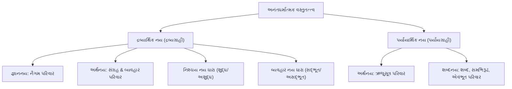

# પરિશિષ્ટ ૩: સપ્તનય અને ૨૦૩ નયોનું પારિભાષિક વર્ગીકરણ (પારિવારિક માળખું)
### (Taxonomical Classification Matrix & Family Tree of 203 Jain Nayas)

---

## 🧬 જૈન નય-વિજ્ઞાનનું સ્થાપત્ય (Taxonomy Architecture)

જૈન દર્શનમાં ૨૦૩ નયોનું વર્ગીકરણ કોઈ કાલ્પનિક વિભાજન નથી, પરંતુ જ્ઞાનમીમાંસા (Epistemology) અને તત્ત્વમીમાંસા (Ontology)ના અત્યંત વૈજ્ઞાનિક માળખા પર રચાયેલું છે. વસ્તુતત્ત્વ અનંત ગુણો અને અનંત પર્યાયો ધરાવે છે; આથી તેને જાણવાના નયો પણ અનેક સ્તરે વર્ગીકૃત થાય છે:

---

## 📊 વર્ગીકરણના ૫ મુખ્ય આધારસ્તંભો (5 Foundational Dimensions)

### ૧. દ્રવ્યાર્થિક વિરુદ્ધ પર્યાયાર્થિક (Substance vs Mode)
- **દ્રવ્યાર્થિક નય**: જે પર્યાયોના ઉદય-વ્યયને ગૌણ કરીને અખંડ દ્રવ્ય, ગુણ, સામાન્ય સત્તા અને સાતત્યને મુખ્ય કરે છે. (ખંડ ૧ થી ૩, કુલ ૧૫૩ અધ્યાય).
- **પર્યાયાર્થિક નય**: જે અખંડ દ્રવ્યને ગૌણ કરીને ક્ષણિક અવસ્થા, નવીન ઉત્પત્તિ, ભેદ અને વિશિષ્ટ ક્રિયાને મુખ્ય કરે છે. (ખંડ ૪ થી ૭, કુલ ૭૨ અધ્યાય).

### ૨. જ્ઞાનનય, અર્થનય અને શબ્દનય ત્રિપુટી
- **જ્ઞાનનય (Epistemic Standpoint)**: જે જ્ઞાતાના જ્ઞાનગત સંકલ્પ, સ્મૃતિ અને અપેક્ષાને લક્ષ્ય બનાવે છે (નૈગમ નય).
- **અર્થનય (Ontic/Object Standpoint)**: જે બાહ્ય પદાર્થના વાસ્તવિક અસ્તિત્વ અને ભેદ-સામાન્યને ગ્રહણ કરે છે (સંગ્રહ, વ્યવહાર, ઋજુસૂત્ર).
- **શબ્દનય (Linguistic Standpoint)**: જે ભાષા, વ્યાકરણ, શબ્દાર્થ અને વ્યુત્પત્તિગત ભેદને વિષય બનાવે છે (શબ્દ, સમભિરૂઢ, એવંભૂત).

### ૩. નિશ્ચય અને વ્યવહાર વર્ગીકરણ (Absolute vs Relative)
- **શુદ્ધ નિશ્ચયનય**: વસ્તુને તેના નિજ શુદ્ધ સ્વરૂપે, કર્મોપાધિ-રહિત ગ્રહણ કરે છે (દા.ત., પરમશુદ્ધ દ્રવ્યાર્થિક).
- **અશુદ્ધ નિશ્ચયનય**: કર્મબંધ સહિતની વર્તમાન પરિણતિને આત્માની જ માને છે (દા.ત., અશુદ્ધ દ્રવ્યાર્થિક).
- **અનુપચરિત સદ્ભૂત વ્યવહાર**: આત્માના જ ગુણોમાં ભેદ પાડે છે (દા.ત., જ્ઞાન-દર્શન-ચારિત્ર ભેદ).
- **ઉપચરિત અસદ્ભૂત વ્યવહાર**: પર પદાર્થ કે શરીર સાથેના સંબંધને પોતાનો કહે છે (દા.ત., 'મારું શરીર', 'મારું ઘર').

### ૪. કાળ-સાપેક્ષ વર્ગીકરણ (Temporal Dimensions)
- **ત્રિકાળગ્રાહી**: નિત્ય, ધ્રુવ, શાશ્વત સ્વભાવને ગ્રહણ કરનારા નય.
- **અતીતગ્રાહી**: વીતી ગયેલા પર્યાયને સ્મૃતિમાં જીવંત કરનારા નય (ભૂતનૈગમ).
- **અનાગતગ્રાહી**: ભવિષ્યની સંભાવના અને લક્ષ્યને વર્તમાનમાં જોનારા નય (ભાવિનૈગમ).
- **વર્તમાનગ્રાહી**: માત્ર અત્યારની સાચી ક્ષણને પકડનારા નય (ઋજુસૂત્ર, વર્તમાનનૈગમ).

### ૫. કારણ-કાર્ય અને નિમિત્ત-ઉપાદાન દૃષ્ટિ
- **ઉપાદાનલક્ષી નય**: વસ્તુની પોતાની ભીતરી યોગ્યતા અને પરિણામી શક્તિને મુખ્ય કરે છે.
- **નિમિત્તલક્ષી નય**: બાહ્ય સહાયક કારણો, સંજોગો અને પરિસ્થિતિઓને પ્રરૂપિત કરે છે.

---

## 🏛️ ખંડવાર નય-સંખ્યા અને પરિવાર વિતરણ સારાંશ

| ખંડ ક્રમ | ખંડનું નામ | મૂળ નય | શ્રેણી | સ્વરૂપ | અધ્યાય સંખ્યા | નય ક્રમાંક વિસ્તાર |
|---|---|---|---|---|---|---|
| ૧ | પ્રથમ ખંડ | **નૈગમ નય** | દ્રવ્યાર્થિક | જ્ઞાનનય | ૬ | ૧ થી ૩ (અને વ્યવહાર ભેદો ૬૨-૬૪) |
| ૨ | દ્વિતીય ખંડ | **સંગ્રહ નય** | દ્રવ્યાર્થિક | અર્થનય | ૧૪ | ૪ થી ૮ (અને વ્યવહાર ભેદો ૬૫-૬૮) |
| ૩ | તૃતીય ખંડ | **વ્યવહાર નય** | દ્રવ્યાર્થિક | અર્થનય | ૧૩૩ | ૯ થી ૩૦, ૪૪ થી ૧૫૨, ૧૬૯-૧૭૦ |
| ૪ | ચતુર્થ ખંડ | **ઋજુસૂત્ર નય** | પર્યાયાર્થિક | અર્થનય | ૧૮ | ૩૧ થી ૪૦, ૫૫ થી ૬૧, ૧૫૩ |
| ૫ | પંચમ ખંડ | **શબ્દ નય** | પર્યાયાર્થિક | શબ્દનય | ૮ | ૪૧, ૧૫૪ થી ૧૫૯ |
| ૬ | ષષ્ઠ ખંડ | **સમભિરૂઢ નય** | પર્યાયાર્થિક | શબ્દનય | ૧૧ | ૪૨, ૧૬૦ થી ૧૬૮ |
| ૭ | સપ્તમ ખંડ | **એવંભૂત નય** | પર્યાયાર્થિક | શબ્દનય | ૩૫ | ૪૩, ૧૦૨, ૧૭૧ થી ૨૦૩ |
| **કુલ** | **સપ્ત ખંડ** | **૨૦૩ મૂળ નય** | **દ્રવ્યાર્થિક & પર્યાયાર્થિક** | **જ્ઞાન-અર્થ-શબ્દ** | **૨૨૫** | **સંપૂર્ણ મહાગ્રંથ પરિવાર** |

---

## 🌳 સપ્તનય પરિવારની શાખાઓ અને કુળ-વૃક્ષ (Branch Structure of Naya Family Tree)

### ૧. નૈગમ પરિવાર (૬ નય)
- **મૂળ શાખા**: ભૂતનૈગમ, ભાવિનૈગમ, વર્તમાનનૈગમ.
- **વ્યવહાર શાખા**: ભૂતનૈગમ પ્રતિપાદક વ્યવહાર, ભાવિનૈગમ પ્રતિપાદક વ્યવહાર, વર્તમાનનૈગમ પ્રતિપાદક વ્યવહાર.
- **લક્ષણ**: કાળના ત્રણેય આયામોમાં સંકલ્પ અને વ્યવહારનું સંકલન કરવું.

### ૨. સંગ્રહ પરિવાર (૧૪ નય)
- **મૂળ શાખા**: પરસંગ્રહ દ્રવ્યાર્થિક, અપરસંગ્રહ દ્રવ્યાર્થિક (પરમશુદ્ધ, શુદ્ધ, અશુદ્ધ).
- **પ્રતિપાદક વ્યવહાર શાખા**: પરસંગ્રહ પ્રતિપાદક વ્યવહાર, અપરસંગ્રહ પ્રતિપાદક વ્યવહાર (પરમશુદ્ધ, શુદ્ધ, અશુદ્ધ વ્યવહાર ભેદો).
- **ભેદક વ્યવહાર શાખા**: અપરસંગ્રહભેદક વ્યવહાર, અંતિમ અપરસંગ્રહભેદક, અંતિમ અખંડ વ્યવહાર.

### ૩. વ્યવહાર પરિવાર (૧૩૩ નય — સૌથી વિશાળ કુળ)
- **ભેદક વ્યવહાર શાખા**: ષડ્દ્રવ્યભેદક, જીવાજીવભેદક, મુક્તસંસારીભેદક, ત્રસસ્થાવરભેદક (અધ્યાય ૯ થી ૧૪).
- **અંતિમ વ્યવહાર શાખા**: અભેદવિષયી અને ભેદવિષયી (પરમશુદ્ધ, શુદ્ધ, વ્યક્ત-અવ્યક્ત અશુદ્ધ - અધ્યાય ૧૫ થી ૨૦).
- **દ્રવ્યાર્થિક શુદ્ધ-અશુદ્ધ શાખા**: ઉપાધિનિરપેક્ષ, ઉત્પાદવ્યયગૌણ, ભેદકલ્પનાનિરપેક્ષ, અન્વય, સ્વદ્રવ્ય-પરદ્રવ્ય ગ્રાહક (અધ્યાય ૨૧ થી ૩૦).
- **નિશ્ચય નય શાખા**: અખંડ પરમશુદ્ધ નિશ્ચય, સાક્ષાત્ પરમશુદ્ધ, એકદેશ શુદ્ધ, અશુદ્ધ નિશ્ચય (અધ્યાય ૪૪ થી ૪૭).
- **સદ્ભૂત વ્યવહાર શાખા (ઉપચાર)**: અખંડ, શુદ્ધ, અશુદ્ધ, અનુપચરિત અને ઉપચરિત સદ્ભૂત વ્યવહાર (અધ્યાય ૬૯ થી ૧૦૫).
- **અસદ્ભૂત વ્યવહાર શાખા (ઉપચાર)**: સંશ્લિષ્ટ અને અસંશ્લિષ્ટ, સ્વજાતિ-વિજાતિ ઉપચરિત અસદ્ભૂત વ્યવહાર (અધ્યાય ૧૦૬ થી ૧૨૯).
- **પ્રમાણ-પરિમાણ-આધાર-કાળ વ્યવહાર શાખા**: અધ્યાય ૧૩૦ થી ૧૫૨ તથા ૧૬૯-૧૭૦.

### ૪. ઋજુસૂત્ર પરિવાર (૧૮ નય)
- **સ્થૂળ અને સૂક્ષ્મ શાખા**: શુદ્ધ સ્થૂળ/સૂક્ષ્મ ઋજુસૂત્ર, અશુદ્ધ સ્થૂળ/સૂક્ષ્મ ઋજુસૂત્ર.
- **કાળ-પર્યાય શાખા**: અનાદિનિત્ય પર્યાયાર્થિક, સાદિનિત્ય પર્યાયાર્થિક, અનિત્ય પર્યાયાર્થિક, સત્તા-ઋજુસૂત્ર.
- **લક્ષણ**: વર્તમાન એક સમયની શુદ્ધ કે અશુદ્ધ અવસ્થાને જ સત્ય માનવું.

### ૫. શબ્દ પરિવાર (૮ નય)
- **મૂળ શબ્દનય**: લિંગ-સંખ્યા-કારક વ્યભિચાર નિવૃત્તિ.
- **સપ્તભંગી શબ્દ શાખા**: અસ્તિત્વનય, નાસ્તિત્વનય, અસ્તિત્વ-નાસ્તિત્વનય, અવક્તવ્યનય, અસ્તિત્વ-અવક્તવ્યનય, નાસ્તિત્વ-અવક્તવ્યનય.

### ૬. સમભિરૂઢ પરિવાર (૧૧ નય)
- **વ્યુત્પત્તિ શાખા**: પર્યાયવાચી નામોમાં અર્થભેદ (શક્ર, ઇન્દ્ર, પુરૂહૂત).
- **વિકલ્પ-અવિકલ્પ શાખા**: વિકલ્પનય, અવિકલ્પનય, અસ્તિત્વ-નાસ્તિત્વ-અવક્તવ્ય સમભિરૂઢ.

### ૭. એવંભૂત પરિવાર (૩૫ નય)
- **મૂળ એવંભૂત**: ચેષ્ટાપન્ન ક્રિયાન્વિત નય (પૂજા સમયે જ પૂજારી).
- **આધ્યાત્મિક ૪૭ નય શાખા**: સ્વભાવનય, નિયતિનય, પુરુષકારનય, કાળનય, સાક્ષીનય, અકર્તૃનય, અભોક્તાનય, અગુણિનય, અશૂન્યનય, અસર્વગતનય, ચિન્માત્રનય, વૈલક્ષણ્યનય વગેરે (અધ્યાય ૧૭૧ થી ૨૦૩).
- **પરમ ફળ**: ક્રિયાકાળની પરાકાષ્ઠાએથી જીવને નિર્વિકલ્પ આત્મસ્વરૂપમાં સ્થિર કરવો.