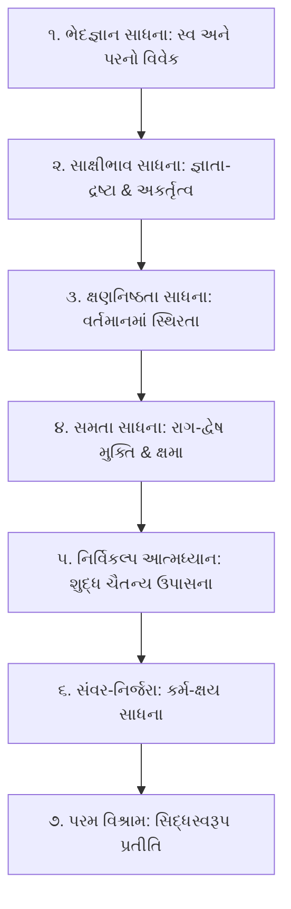

# પરિશિષ્ટ ૫: સાધનાધારા અને આધ્યાત્મિક સ્વાનુભૂતિ નિર્દેશિકા
### (Spiritual Sadhana & Experiential Meditation Directory)

---

## 🧘 જ્ઞાનથી ધ્યાન તરફ: નય-ચક્ષુથી આત્મ-દર્શન

જૈન આગમોમાં સ્પષ્ટ નિર્દેશ છે કે નયોનું અધ્યયન માત્ર શાસ્ત્રાર્થ કે બૌદ્ધિક ચર્ચા માટે નથી, પરંતુ **સ્વાનુભૂતિ (Self-Realization)** માટે છે. જ્યાં સુધી નય વિકલ્પરૂપ છે ત્યાં સુધી તે સાધન છે; જ્યારે નયોનો વિવેક સાધકને નિર્વિકલ્પ આત્મસમાધિમાં સ્થિર કરે છે ત્યારે તે પરમ ફળ બની જાય છે.

'નયચક્ષુ' ગ્રંથના તમામ પ્રકરણોમાં પ્રત્યેક નય સાથે એક વિશિષ્ટ **'સાધનાધારા'** આપવામાં આવી છે. આ પરિશિષ્ટ સાધકને મનની ચંચળતામાંથી મુક્ત કરી અંતરાત્માના પરમ વિશ્રામમાં સ્થિર કરવા માટે ૭ સોપાનોની ધ્યાન-વિધિ અને ચિંતન-સૂત્રો પૂરા પાડે છે.

---

## 🪜 ૭ ક્રમિક સાધના-સોપાનો (The 7 Experiential Stages of Sadhana)

### ૧. ભેદજ્ઞાન સાધના (Discrimination between Self and Non-Self)
- **કેન્દ્રીય સૂત્ર**: શરીર, મન, ઇન્દ્રિયો અને કર્મો પરભાવ છે; હું માત્ર શુદ્ધ જ્ઞાનસ્વરૂપ ચૈતન્ય છું.
- **ઉપયોગી નય**: *ભેદકનય, અશુદ્ધ દ્રવ્યાર્થિક નય, પરમશુદ્ધ દ્રવ્યાર્થિક નય*.
- **ધ્યાન-પ્રયોગ**: શ્વાસ અને દેહની પ્રવૃત્તિઓને દૂરથી જોવી અને પ્રત્યેક ક્ષણે અનુભવવું: 'આ શરીર હું નથી, આ વિચારો હું નથી, હું માત્ર આ બધાને જાણનારો જ્યોતિર્મય આત્મા છું.'

### ૨. સાક્ષીભાવ અને અકર્તાભાવ સાધના (Witness Consciousness & Non-Doership)
- **કેન્દ્રીય સૂત્ર**: પરિણામો કર્મવશ ઘટે છે, હું કોઈ ઘટનાનો કર્તા નથી; માત્ર સાક્ષી છું.
- **ઉપયોગી નય**: *અકર્તૃનય, અભોક્તાનય, અગુણિનય, સ્વભાવનય*.
- **ધ્યાન-પ્રયોગ**: જીવનમાં બનતી અનુકૂળ-પ્રતિકૂળ ઘટનાઓ વખતે ભીતરથી કર્તૃત્વનો ભાર છોડી દેવો: 'બધું કુદરતના નિયમ મુજબ વહી રહ્યું છે, મારે માત્ર જાગૃત દ્રષ્ટા રહેવું છે.'

### ૩. વર્તમાન ક્ષણનિષ્ઠતા સાધના (Present Moment Mindfulness)
- **કેન્દ્રીય સૂત્ર**: અતીત મૃત છે અને અનાગત અજન્મા છે; જીવન માત્ર વર્તમાન શ્વાસમાં છે.
- **ઉપયોગી નય**: *ઋજુસૂત્ર નય, ભાવનય, વર્તમાનનૈગમ નય*.
- **ધ્યાન-પ્રયોગ**: ભૂતકાળના વસવસા અને ભવિષ્યની યોજનાઓને બાજુ પર મૂકી, વર્તમાન ક્ષણની અખંડ પૂર્ણતામાં એકાગ્ર થવું.

### ૪. સમતાભાવ અને ક્ષમા સાધના (Equanimity & Forgiveness)
- **કેન્દ્રીય સૂત્ર**: પ્રત્યેક જીવ પોતાના કર્માનુસાર વર્તે છે; દોષ કોઈ વ્યક્તિનો નથી, કર્મોદયનો છે.
- **ઉપયોગી નય**: *અનેકાંત દર્શન, સામાન્યનય, સંગ્રહ નય*.
- **ધ્યાન-પ્રયોગ**: જગતના સર્વ જીવો પ્રત્યે મૈત્રીભાવ કેળવવો: 'ખામિદ્દ સવ્વ જીવે, સવ્વે જીવા ખમંતુ મે'—સર્વ જીવો પ્રત્યે ક્ષમા અને સમતા.

### ૫. નિર્વિકલ્પ શુદ્ધ આત્મધ્યાન (Absorption in Pure Consciousness)
- **કેન્દ્રીય સૂત્ર**: વિકલ્પોનો વિરામ એ જ સમાધિ છે; શુદ્ધ જ્ઞાયકભાવ એ જ મારો સ્વભાવ છે.
- **ઉપયોગી નય**: *અવિકલ્પનય, પરમશુદ્ધ અપર સંગ્રહ નય, શુદ્ધનય*.
- **ધ્યાન-પ્રયોગ**: તમામ વિચારતરંગો ઓગળી જતાં ભીતર જે નીરવ, નિર્મળ, પ્રકાશવાન શાંતિ રહે છે તેમાં લીન થવું.

### ૬. સંવર-નિર્જરા સાધના (Karmic Inflow Stoppage & Shedding)
- **કેન્દ્રીય સૂત્ર**: સ્વરૂપમાં સ્થિરતા થતાં નવા કર્મો અટકે છે (સંવર) અને પૂર્વ કર્મો ખરી પડે છે (નિર્જરા).
- **ઉપયોગી નય**: *ઉપાધ્યભાવાપેક્ષ શુદ્ધનય, ક્રિયાનય, પુરુષકારનય*.
- **ધ્યાન-પ્રયોગ**: તપશ્ચર્યા અને ઇન્દ્રિયજય દ્વારા ચિત્તને અંદર વાળવું; કર્મસ્પર્શથી અલિપ્ત રહી આત્મ-તેજમાં તપવું.

### ૭. પરમ વિશ્રામ અને સિદ્ધસ્વરૂપ પ્રતીતિ (Abidance in Pure Divinity)
- **કેન્દ્રીય સૂત્ર**: જેવું સિદ્ધ ભગવાનનું સ્વરૂપ છે, તેવું જ મારું નિજ શાશ્વત સ્વરૂપ છે.
- **ઉપયોગી નય**: *પરમભાવગ્રાહક નય, શુદ્ધપારિણામિક નય, એવંભૂત આધ્યાત્મિક નય*.
- **ધ્યાન-પ્રયોગ**: 'હું અનંતજ્ઞાન, અનંતદર્શન, અનંતસુખ અને અનંતવીર્યનો ધણી છું'—એવી અચળ શ્રદ્ધા સાથે પરમ શાંતિમાં વિરમવું.

---

## 🌅 દૈનિક ધ્યાન-સાધના વિધિ (Daily 15-Minute Contemplation Protocol)

મુમુક્ષુ સાધક માટે નય-ચક્ષુ દ્વારા રોજિંદા ધ્યાનનો ૧૫ મિનિટનો સુગમ ક્રમ:

1. **પ્રથમ ૫ મિનિટ (શરીર-વિવેક & ભેદજ્ઞાન)**: સ્થિર આસને બેસી શ્વાસને જોવો. 'હું શરીર નથી, જ્ઞાતા છું' (અશુદ્ધ સદ્ભૂત વ્યવહારથી નિશ્ચય તરફ ગતિ).
2. **વચ્ચેની ૫ મિનિટ (સાક્ષીભાવ & ક્ષણનિષ્ઠતા)**: મનમાં આવતા વિચારોને રોક્યા વિના માત્ર વહેતા જોવા (ઋજુસૂત્ર અને અકર્તૃનય).
3. **અંતિમ ૫ મિનિટ (નિર્વિકલ્પ વિશ્રામ)**: જ્ઞેયો ઓગળી જતાં કેવળ જ્ઞાન-પ્રકાશમાં મૌન થઈ જવું (પરમશુદ્ધ દ્રવ્યાર્થિક અને અવિકલ્પનય).